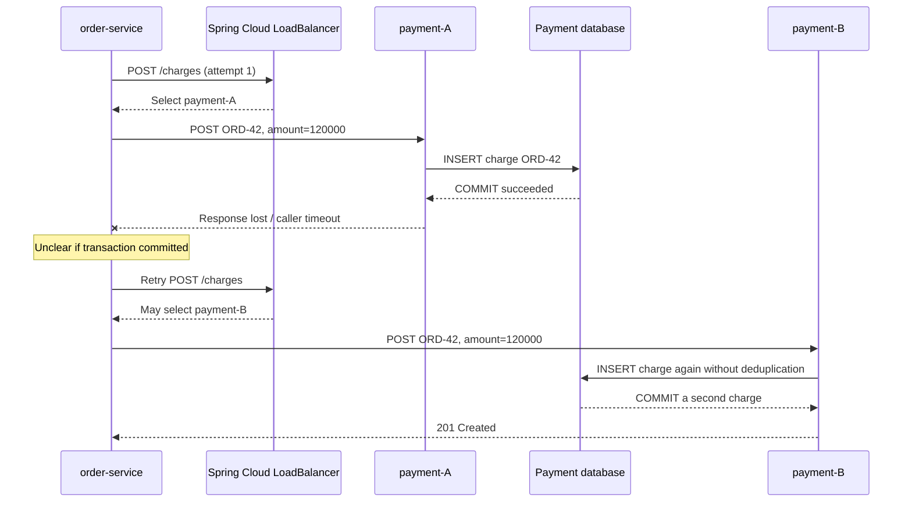
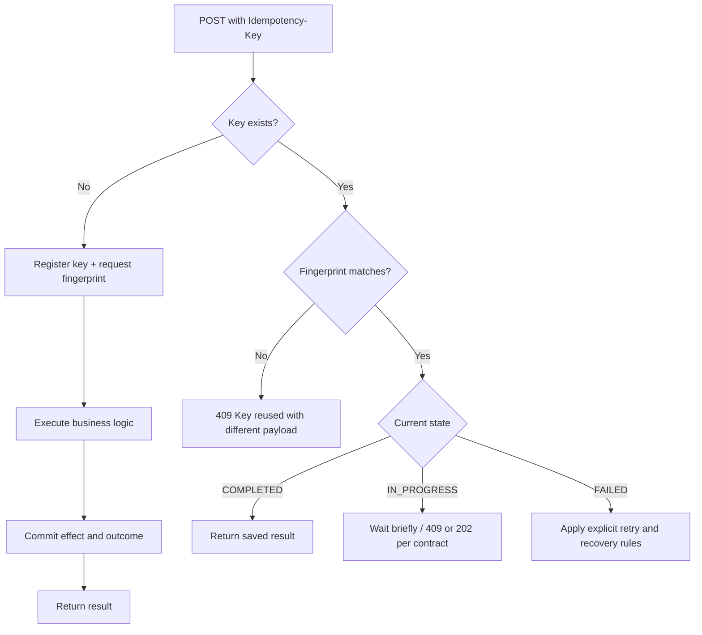

# Retryable HTTP Methods and Risks with Write Operations

In microservice systems, a call through `RestClient`, `RestTemplate`, `WebClient`, or OpenFeign can fail due to a timeout, dropped connection, HTTP `503`, or a `ServiceInstance` going down. Spring Cloud LoadBalancer can help replay the request on the same or another instance depending on the HTTP client, retry library, and configuration in use. However, **retrying an HTTP request** is not always equivalent to **safely repeating a business operation**.

This risk is especially severe for write operations: creating orders, deducting inventory, recording transactions, processing payments, or sending notifications. The first request may have **already persisted the data**, yet the response was lost. If the client retries without the server recognizing it as the same logical operation, the system can create two orders or charge a customer twice.

This lesson distinguishes HTTP **safe/idempotent** semantics from **Spring Cloud LoadBalancer's actual retry policy**, explains why defaults are typically conservative for non-GET methods, shows how to design `Idempotency-Key` and processing states to prevent duplicate writes, and provides configuration, Java examples, test scenarios, and operational metrics.

## 1. Why can retries cause duplicate writes?

Suppose `order-service` calls `payment-service` by service ID:

```http
POST /api/v1/charges HTTP/1.1
Host: payment-service
Content-Type: application/json

{"orderId":"ORD-42","amountMinor":120000}
```

Spring Cloud LoadBalancer picks `payment-A`. The server processes the request and commits the transaction successfully, but before the response reaches `order-service`, the connection drops. The client only observes a `SocketException` or timeout. **It cannot deduce whether the request committed** simply from not receiving a response.



The result can be **two transaction records for one logical payment request**. Switching instances on retry does not create business safety; on the contrary, if deduplication lives only in `payment-A`'s memory, `payment-B` will not even know the request was already processed.

### Four failure points to distinguish

| Failure point | Did the server see the request? | Could a write have occurred? | Safe action |
|---|---|---|---|
| No instance selected | Not sent to provider | No, for this attempt | Check discovery; retry conditionally within deadline |
| TCP connect failed before sending payload | Usually no | Usually no, though must rely on transport evidence | Can retry if eligible and within budget |
| Request sent, server processing | Possibly | **Unknown** | Requires idempotency or status lookup |
| Server committed, response lost | Yes | **Already happened** | Retry is safe only if server deduplicates the same operation |

For timeouts or connection resets after sending a request, what the caller observes is usually an **ambiguous outcome**, not "not executed."

## 2. Safe, idempotent, and retryable are three distinct properties

Under HTTP semantics, a method is **safe** if the requested effect is essentially read-only, without requesting state mutation. A method is **idempotent** if multiple identical requests have an *intended server effect* equivalent to a single request. This is a property of **operation semantics**, not a guarantee that two calls return the same HTTP status, body, or logs.

| HTTP method | Safe per HTTP? | Idempotent per HTTP? | Retry notes |
|---|---|---|---|
| `GET` | Yes | Yes | Usually suitable, **if the endpoint is genuinely read-only** |
| `HEAD` | Yes | Yes | Semantically safe, though not automatically retried by LoadBalancer for that reason alone |
| `OPTIONS` | Yes | Yes | Usually queries capabilities; must not create business side effects |
| `TRACE` | Yes per spec | Yes | Commonly disabled in real systems for security reasons |
| `PUT` | No | Yes | Repeating the same representation must reach the same target state; still check conflict/versioning |
| `DELETE` | No | Yes | Deleting the same resource twice may return 204 then 404, yet the final effect remains deleted |
| `POST` | No | **Not by default** | Creating resources/payments easily triggers multiple side effects |
| `PATCH` | No | **Not guaranteed** | Depends on patch semantics, e.g., "increment by 1" vs. "set to 10" |

A request may generate multiple access logs or metrics even when safe/idempotent; the spec governs **the client-requested effect**, not forbidding system logging. Conversely, a poorly designed endpoint like `GET /withdraw?amount=100` that deducts balance is **not safe merely because it uses GET**.

Example contrast:

```http
PUT /api/v1/products/42
Content-Type: application/json

{"name":"Book","price":50000}
```

Sending the same payload twice typically produces the **same final state**, so PUT is idempotent in HTTP terms. However:

```http
POST /api/v1/orders
Content-Type: application/json

{"productId":"42","quantity":1}
```

If each POST creates a new order, two sends create two orders. To retry POST safely, design the business operation to be **idempotent by logical request**, rather than relying on the HTTP method alone.

### Safe ≠ idempotent ≠ retryable in every case

- **Safe** describes the requested effect of the method.
- **Idempotent** describes whether repeating the same request alters the final effect.
- **Retryable** is an **operational decision** that also depends on where the error occurred, endpoint correctness, body replayability, tokens, deadlines, idempotency keys, and active retry policies.

Thus, `PUT` or `DELETE` may be idempotent per spec yet **not retried by default by Spring Cloud LoadBalancer**; conversely, `POST` can be retried in a controlled way if the server enforces solid deduplication.

## 3. Which methods does Spring Cloud LoadBalancer retry?

Distinguish **HTTP semantics** from **an implementation's default rules**. In Spring Cloud Commons, the property:

```properties
spring.cloud.loadbalancer.retry.retry-on-all-operations=false
```

has the official description: retries are allowed for **`HttpMethod.GET`** operations; setting `true` opens retries to other methods. **That does not mean GET is guaranteed to retry**: you still need the right HTTP client integration, retry infrastructure, qualifying error types, available instances, and remaining attempts.

| Method | When `retry-on-all-operations=false` | When `retry-on-all-operations=true` |
|---|---|---|
| GET | Eligible for retry if other conditions hold | Eligible for retry |
| HEAD, OPTIONS | Not enabled merely because they are safe | Eligible if other policy checks pass |
| PUT, DELETE | Not enabled merely because they are idempotent | Eligible; **must verify API semantics** |
| POST, PATCH | Not enabled under default policy | Eligible; **high risk without duplicate protection** |

This is an **HTTP-method filter for Spring Cloud LoadBalancer retries**, not a guarantee for Feign Retryer, Reactor `retryWhen`, API gateways, service meshes, or HTTP transports. If another layer retries POST on its own, this property **does not guard that layer's calls**.

### Example lab configuration limiting retries

```yaml
spring:
  cloud:
    loadbalancer:
      retry:
        enabled: true
        retry-on-all-operations: false
        max-retries-on-same-service-instance: 0
        max-retries-on-next-service-instance: 1
        retryable-status-codes:
          - 502
          - 503
          - 504
        retry-on-all-exceptions: false
        avoid-previous-instance: true
```

Intent of this configuration:

1. Keep LoadBalancer retries **GET-only**.
2. Cap retries on the current and new instances instead of retrying indefinitely.
3. Treat `502`/`503`/`504` as retryable responses under this policy.
4. When retrying on another instance, prefer avoiding the previously chosen instance if eligible candidates remain.

**Point to verify:** setting `retry.enabled` in YAML **does not prove** every client has retries active. Blocking `RestTemplate` requires Spring Retry and matching integration; reactive `WebClient` requires reactive integration. Defaults and activation conditions vary across release trains, so inspect versions, dependencies, logs, and **actual HTTP attempts**.

`RetryAwareServiceInstanceListSupplier` can help avoid the previous instance in certain integrations; `avoid-previous-instance=true` **does not guarantee** the next attempt always hits a different instance, especially when only one instance exists or suppliers filter down to one candidate.

**Do not** flip `retry-on-all-operations` to `true` system-wide just to "fix 503 errors on POST." If specific write operations protected by idempotency need retries, define policies per operation and owning layer; enabling it globally can expose unrelated POST/PATCH endpoints to unintended retries.

## 4. Which errors should retry and which should stop?

Retry is a response to a **potentially recoverable failure mode**, not a blanket reaction to every exception.

| Signal | Typical meaning | Could retry make sense? |
|---|---|---|
| HTTP `400`, `401`, `403` | Bad request, unauthenticated, or unauthorized | Do not resend identically |
| HTTP `404` | Missing resource or wrong route | Usually no, absent an explicit eventual-consistency policy |
| HTTP `409`, `412` | Conflict or version precondition unmet | Re-read/resync data; do not blindly resend unchanged |
| HTTP `429` | Rate limit | Only if policy allows, honoring `Retry-After` and budget |
| HTTP `502`, `503`, `504` | Gateway/backend unavailable or timeout | Possibly, **if the operation is safe** and deadline remains |
| Connect timeout before sending request | Could not establish connection | Often safer for idempotent operations |
| Read timeout after sending request | Response did not arrive in time | Outcome may have committed; requires deduplication for writes |
| Connection reset after server received request | Processing state unknown | Requires verification or idempotency |
| JSON decode error | Response violates contract | Rarely solved by retrying |
| No ServiceInstance available | Empty discovery/supplier | Check whether recovery is plausible; retries cannot conjure instances |

For a `503` response, verify whether it came from the provider, a gateway, or the LoadBalancer integration when the instance list was empty. Some failures **do not originate at the provider**, so logging `503` alone is insufficient for diagnosis.

### No response does not mean no side effect

Especially for POST, PATCH, and other write commands, network errors or timeouts after sending can happen **after the transaction already committed**. That is why retry decisions cannot rely solely on `IOException` or `TimeoutException`: you must combine them with **operation idempotency**.

## 5. Why picking another ServiceInstance does not prevent duplicates

Suppose LoadBalancer fails over from instance A to B on retry. The same payment command may be sent again through B and create a duplicate write if servers lack coordination:

```text
request #1, key=none -> payment-A -> INSERT charge #1001 -> response lost
request #2, key=none -> payment-B -> INSERT charge #1002 -> 201
```

If A and B maintain separate in-memory maps of "processed requests," they still fail to share deduplication state. Even with a shared database, simply running `INSERT` per request without a **unique constraint** on the logical operation ID cannot prevent duplicate records.

Key takeaway: **Load balancing decides where to send a request; idempotency decides whether repeating a request creates additional business effects.** Both responsibilities must be designed in separate layers.

## 6. Idempotency-Key: identifying one logical operation across attempts

A practical way to make write retries safe is for the client to generate a unique **idempotency key** per business operation, then send the **exact same key and payload** on every HTTP attempt for that operation:

```http
POST /api/v1/charges HTTP/1.1
Host: payment-service
Content-Type: application/json
Idempotency-Key: charge-ord-42-attempt-group-1

{"orderId":"ORD-42","amountMinor":120000}
```

If the first attempt finishes but the response is lost, the retry carries the **same `Idempotency-Key`**. The server looks up the key and returns the stored outcome **without creating a second charge**.

Principles:

1. **Generate the key once per logical business operation**, never a fresh UUID on every HTTP attempt.
2. **Keep the payload identical**. If the same key arrives with a different amount or order, treat it as a conflict rather than silently returning the old result or executing a new request.
3. **Scope keys by principal and operation** (e.g., `tenantId + operation + idempotencyKey`), avoiding a single global unscoped key table.
4. **Persist the outcome and business effect atomically** where possible, instead of marking "processed" before executing business logic and risking a failed transaction.
5. **Use a shared state store** across all instances; a per-replica `ConcurrentHashMap` is insufficient for production.
6. **Define TTL and expiration rules**: retain keys at least as long as valid retries may arrive; purging too early still risks duplicate writes on late retries.
7. **Protect keys and data**: keys should be hard to guess and access-controlled; never trust an unauthenticated user-supplied key as proof of payment.

Here `Idempotency-Key` is an HTTP contract the system chooses to support. Spring Cloud LoadBalancer **does not generate keys, store outcomes, or guarantee exactly-once** delivery.

### Idempotency processing states



States `IN_PROGRESS`, `COMPLETED`, `FAILED`, and replay responses must be **defined in the API contract**. For example, while a request is still in flight, the server can return HTTP 409 or 202 with a status lookup URL; never let a second worker execute the same business logic just because the final result has not been saved yet.

## 7. Lab: POST endpoint with and without idempotency

To observe the risk clearly, you can run a local Spring Boot Web provider. The following code includes an **executed charge counter** and a map storing responses by key. Complete example inside **a single JVM**:

```java
import java.util.UUID;
import java.util.concurrent.ConcurrentHashMap;
import java.util.concurrent.ConcurrentMap;
import java.util.concurrent.atomic.AtomicInteger;

import org.springframework.http.HttpStatus;
import org.springframework.http.ResponseEntity;
import org.springframework.web.bind.annotation.PostMapping;
import org.springframework.web.bind.annotation.RequestBody;
import org.springframework.web.bind.annotation.RequestHeader;
import org.springframework.web.bind.annotation.RestController;

record ChargeRequest(String orderId, long amountMinor) {
}

record ChargeResult(String chargeId, int totalExecutedCharges) {
}

record SavedCharge(String fingerprint, ChargeResult result) {
}

@RestController
class ChargeDemoController {

    private final AtomicInteger executedCharges = new AtomicInteger();
    private final ConcurrentMap<String, SavedCharge> saved =
            new ConcurrentHashMap<>();

    @PostMapping("/api/v1/charges")
    ResponseEntity<ChargeResult> charge(
            @RequestHeader(
                    name = "Idempotency-Key",
                    required = false) String key,
            @RequestBody ChargeRequest request) {

        if (request.orderId() == null
                || request.orderId().isBlank()
                || request.amountMinor() <= 0) {
            return ResponseEntity.badRequest().build();
        }

        // No key: each HTTP POST creates a new charge.
        if (key == null || key.isBlank()) {
            return ResponseEntity.status(HttpStatus.CREATED)
                    .body(newCharge());
        }

        // Simple fingerprint suitable for lab exercises only.
        String fingerprint =
                request.orderId() + "|" + request.amountMinor();

        // compute ensures that within one JVM only one result
        // is initialized per key, even under concurrent threads.
        SavedCharge record = saved.compute(key,
                (ignoredKey, previous) -> previous != null
                        ? previous
                        : new SavedCharge(fingerprint, newCharge()));

        if (!record.fingerprint().equals(fingerprint)) {
            return ResponseEntity.status(HttpStatus.CONFLICT).build();
        }

        return ResponseEntity.status(HttpStatus.CREATED)
                .body(record.result());
    }

    private ChargeResult newCharge() {
        return new ChargeResult(
                UUID.randomUUID().toString(),
                executedCharges.incrementAndGet());
    }
}
```

Things to observe:

- **Without header:** two identical POSTs execute `newCharge()` twice.
- **With same key and payload:** the second request reuses the first request's `ChargeResult` without incrementing the counter again.
- **Same key with different payload:** returns `409 Conflict` without creating a new charge.
- `ConcurrentHashMap.compute` protects response creation for **one key inside one process**—it does not turn this demo into a reliable payment system.

**Crucial limitation:** this is a **single-JVM demo** with no database, no durable storage, no state survival across restarts, and **no synchronization across replicas**. If A and B run the same code with separate maps, a retry switching from A to B can still create two charges. Never use an in-memory map like this to prevent duplicate writes for money, inventory, or production data.

### 7.1. Testing two POSTs without an idempotency key

Run the provider on `localhost:8091`, then call:

```bash
curl -i -X POST http://localhost:8091/api/v1/charges \
  -H 'Content-Type: application/json' \
  -d '{"orderId":"ORD-42","amountMinor":120000}'

curl -i -X POST http://localhost:8091/api/v1/charges \
  -H 'Content-Type: application/json' \
  -d '{"orderId":"ORD-42","amountMinor":120000}'
```

Expectation: the two responses return two distinct `chargeId` values, and `totalExecutedCharges` increments on each request. You don't even need a network fault to see the consequence: two HTTP attempts of the same action suffice to produce two side effects.

### 7.2. Retrying with the same key

```bash
curl -i -X POST http://localhost:8091/api/v1/charges \
  -H 'Content-Type: application/json' \
  -H 'Idempotency-Key: demo-order-43-charge' \
  -d '{"orderId":"ORD-43","amountMinor":120000}'

curl -i -X POST http://localhost:8091/api/v1/charges \
  -H 'Content-Type: application/json' \
  -H 'Idempotency-Key: demo-order-43-charge' \
  -d '{"orderId":"ORD-43","amountMinor":120000}'
```

Both responses carrying the same key must return the **same `chargeId`** and **same `totalExecutedCharges`** in the demo code. The total count may not start at 1 depending on prior calls; compare **the delta between the two calls** rather than hardcoding absolute numbers.

To see key reuse with a mismatched payload rejected:

```bash
curl -i -X POST http://localhost:8091/api/v1/charges \
  -H 'Content-Type: application/json' \
  -H 'Idempotency-Key: demo-order-43-charge' \
  -d '{"orderId":"ORD-43","amountMinor":200000}'
```

Expect `409 Conflict`. In production systems, compute fingerprints from a canonicalized payload per contract, store them with tenant/operation scope, and validate safely rather than concatenating a couple of strings as a security identifier.

## 8. Designing durable idempotency across multiple ServiceInstances

When `payment-service` runs multiple replicas behind LoadBalancer, **every replica must observe the same processing outcome** for a key. A common pattern uses a database table with a unique constraint on the **idempotency scope** alongside the business write.

Illustrative PostgreSQL table model:

```sql
CREATE TABLE idempotency_operations (
    tenant_id        VARCHAR(80) NOT NULL,
    operation_name   VARCHAR(80) NOT NULL,
    idempotency_key  VARCHAR(200) NOT NULL,
    request_hash     CHAR(64) NOT NULL,
    state            VARCHAR(20) NOT NULL,
    response_status  INTEGER,
    response_body    JSONB,
    created_at       TIMESTAMPTZ NOT NULL DEFAULT now(),
    PRIMARY KEY (tenant_id, operation_name, idempotency_key)
);
```

Notes:

- The **primary key** prevents two independent transactions from inserting the same key within a scope.
- `request_hash` detects reusing a key with a different payload, rather than relying only on the HTTP method.
- `state` can represent `IN_PROGRESS`, `COMPLETED`, `FAILED` per contract; clearly define how stalled records recover.
- `response_status` and `response_body` let you return a **compatible outcome** for duplicate requests without triggering extra side effects.
- `tenant_id` and `operation_name` prevent accidental key collisions across customers and endpoints.

### 8.1. Transaction boundaries matter more than header names

For a write operation **touching only the same database**, you can design the transaction flow as:

1. Attempt to insert the key and request hash under the unique constraint.
2. If the key already exists, check the hash and state; return the stored result or indicate in-progress.
3. If the key is new, execute the business operation **within an appropriately coordinated transaction scope**.
4. Record the status/response of the logical request.
5. Commit business data and idempotency result so you never end up with "business data committed, idempotency record missing."

If you insert `IN_PROGRESS` in a separate transaction **before** writing business data with no recovery path, crashes leave orphaned records. If you execute the business write first **and then** record the key, two parallel requests can both perform the side effect before duplicate detection catches them. Both are classic design bugs.

For operations calling an **external payment provider** or publishing messages, a local database transaction cannot roll back side effects in an external system. Combine idempotency keys at **the service actually creating the side effect**, outbox/inbox patterns, state machines, or reconciliation. Never claim "exactly-once delivery" merely because you saved an idempotency row.

### 8.2. Handling concurrent requests with the same key

Two requests with the same key can reach A and B **simultaneously**, especially when a client retries before the first attempt finishes. Define what happens while one request is still executing:

| Key state | New request with same fingerprint | New request with different fingerprint |
|---|---|---|
| Not present | One request wins processing rights via lock/unique constraint | One request wins processing rights |
| `IN_PROGRESS` | Wait briefly, return 202/409, or status lookup link per contract | 409 Conflict |
| `COMPLETED` | Return stored result | 409 Conflict |
| `FAILED` | Follow defined recovery/retry policy; do not blindly rewrite | 409 Conflict |

Never equate `FAILED` with "guaranteed no side effect occurred": a failure can happen **after commit**. When state is ambiguous, query business outcome by logical operation ID or reconcile before allowing a retry.

### 8.3. PUT, DELETE, PATCH still require write-logic review

- **PUT:** although idempotent per HTTP, emitting a `ProductUpdated` event or recording a secondary payment on every PUT can still create unwanted side effects. Secondary events/logic must match idempotent semantics.
- **DELETE:** two identical requests may return `204` then `404`; the caller must understand the final state is still a deleted resource. If DELETE triggers order cancellation and refunds, it must never issue multiple refunds.
- **PATCH:** `{"op":"increment","value":1}` can increment balances or stock multiple times. A PATCH setting an absolute value with a version precondition can be designed idempotently, but **never assume** all PATCH endpoints are idempotent.
- **POST:** can become retry-safe with an idempotency key, business key/unique constraint, and valid outcome replay, provided downstream dependencies also avoid repeating side effects.

For concurrent updates, use `ETag`/`If-Match`, optimistic locking, or version fields to catch lost updates. **Version checks and idempotency keys solve two different problems**: one guards concurrent mutations, while the other identifies multiple attempts of the same logical operation.

## 9. Sending the same Idempotency-Key from RestClient

Example `order-service` calling `payment-service` through Spring Cloud LoadBalancer using `RestClient` via a builder bean:

```java
import org.springframework.cloud.client.loadbalancer.LoadBalanced;
import org.springframework.context.annotation.Bean;
import org.springframework.context.annotation.Configuration;
import org.springframework.web.client.RestClient;

@Configuration
class HttpClientConfiguration {

    @Bean
    @LoadBalanced
    RestClient.Builder loadBalancedRestClientBuilder() {
        return RestClient.builder();
    }
}
```

Gateway:

```java
import org.springframework.beans.factory.annotation.Qualifier;
import org.springframework.stereotype.Service;
import org.springframework.web.client.RestClient;

record ChargeCommand(String orderId, long amountMinor) {
}

record ChargeReceipt(String chargeId, int totalExecutedCharges) {
}

@Service
class PaymentGateway {
    private final RestClient client;

    PaymentGateway(
            @Qualifier("loadBalancedRestClientBuilder")
            RestClient.Builder builder) {
        this.client = builder
                .baseUrl("http://payment-service")
                .build();
    }

    ChargeReceipt createCharge(
            ChargeCommand command, String stableOperationKey) {
        return client.post()
                .uri("/api/v1/charges")
                .header("Idempotency-Key", stableOperationKey)
                .body(command)
                .retrieve()
                .body(ChargeReceipt.class);
    }
}
```

This is **a client sending the header**; it neither enables retries nor enforces server-side idempotency. The caller must generate `stableOperationKey` **once per logical business operation** (for instance when creating the charge command) and store/reuse it across all attempts, even if another worker picks up the job after a restart.

When calling through LoadBalancer, discovery configuration might look like:

```yaml
spring:
  cloud:
    discovery:
      client:
        simple:
          instances:
            payment-service:
              - uri: http://localhost:8091
              - uri: http://localhost:8092
```

If you reuse the `ChargeDemoController` from section 7, keep in mind its in-memory map is **not shared across two providers**, so **testing against two replicas of this demo does not prove safe POST retries**. To test across two instances, use a shared idempotency store or unique-constraint table as in section 8.

### 9.1. Why shouldn't you generate the key inside the retry function?

Wrong example:

```java
// WRONG: each attempt gets a new key, so the server cannot detect duplicates.
ChargeReceipt retryAttempt(ChargeCommand command) {
    return paymentGateway.createCharge(
            command, java.util.UUID.randomUUID().toString());
}
```

If the caller retries by invoking `retryAttempt(command)` multiple times, each attempt carries a fresh key and a compliant server treats them as separate operations. Even when attaching the key ahead of a `retryWhen`, remember that an externally **re-submitted business request** must still reuse the same logical operation key.

**Correct approach:** generate the operation ID at the orchestration/command layer, persist it with the business command, and pass it down to the gateway. If the process restarts and re-reads work from a queue, the key survives. An idempotency key must not live solely on the stack frame of one HTTP attempt.

## 10. Retries in WebClient or Feign can differ from LoadBalancer policy

In practice, **multiple retry layers** can appear:

| Layer | Example | Risk |
|---|---|---|
| Spring Cloud LoadBalancer retry | `max-retries-on-next-service-instance` | May re-invoke the same or another instance |
| Reactor retry | `Mono.retryWhen(...)` in `WebClient` | Does not automatically distinguish GET vs. POST |
| OpenFeign Retryer | `Retryer` when configured | May retry write requests on exceptions |
| Resilience4j/Spring Retry | `@Retry` / `RetryTemplate` | May wrap an **entire** side-effecting business method |
| API gateway, service mesh, proxy | Upstream HTTP request retries | Application caller may not see actual attempt counts |
| Queue/consumer | Re-delivery on unacked messages | Replaying a **message** can replay outbound HTTP requests |

Specifically, Spring Cloud OpenFeign registers `Retryer.NEVER_RETRY` by default, whereas core Feign can retry certain `IOException`/`RetryableException` failures if another `Retryer` is used. Never assume the entire stack has **no retries** just because Feign's Retryer is disabled: the gateway, LoadBalancer, or caller may still retry.

### 10.1. WebClient retrying POST after attaching a key

The example below illustrates **deliberately retrying a POST**, appropriate *only* when the server has durable, tested idempotency. `client` must be a `WebClient` built from `@LoadBalanced WebClient.Builder` with `baseUrl("http://payment-service")`:

```java
import java.time.Duration;

import org.springframework.web.reactive.function.client.WebClient;
import org.springframework.web.reactive.function.client.WebClientRequestException;
import org.springframework.web.reactive.function.client.WebClientResponseException;
import reactor.core.publisher.Mono;
import reactor.util.retry.Retry;

final class ReactivePaymentGateway {
    private final WebClient client;

    ReactivePaymentGateway(WebClient client) {
        this.client = client;
    }

    Mono<ChargeReceipt> createCharge(
            ChargeCommand command, String stableOperationKey) {
        return client.post()
                .uri("/api/v1/charges")
                .header("Idempotency-Key", stableOperationKey)
                .bodyValue(command)
                .retrieve()
                .bodyToMono(ChargeReceipt.class)
                .retryWhen(Retry.backoff(1, Duration.ofMillis(100))
                        .filter(error -> error instanceof WebClientRequestException
                                || (error instanceof WebClientResponseException http
                                        && (http.getStatusCode().value() == 502
                                        || http.getStatusCode().value() == 503
                                        || http.getStatusCode().value() == 504))))
                .timeout(Duration.ofSeconds(2));
    }
}
```

Explanation:

- `stableOperationKey` is passed **from the caller** and remains unchanged across retry re-subscriptions.
- `Retry.backoff(1, ...)` permits **at most one retry** after the initial attempt.
- `.timeout(2s)` sits **outside `retryWhen`** to cap the entire chain's wait time, including backoff.
- The filter excludes HTTP 400/404/409/429 in this example; for 429, parse `Retry-After` and apply dedicated rate-limit rules.
- **Reactor `retryWhen` does not automatically enforce Spring Cloud LoadBalancer's GET-only filter.** Thus this snippet can still retry POST even when `retry-on-all-operations=false`.
- Whether a retry selects a different `ServiceInstance` depends on filter/integration wiring and discovery snapshots; do not infer it solely from retry counts.

This example uses a **replayable request body** via `bodyValue(command)`. If the body is a single-read stream, file upload, or sourced from an input stream, retries may fail to replay it; analyze body recreation and memory overhead before enabling retries.

**Do not use this example for real charges if the server only uses a `ConcurrentHashMap` as in section 7.** With multiple replicas, you need shared, reliable deduplication as in section 8.

### 10.2. Attempt counts can multiply across layers

Suppose a gateway allows up to **2 attempts**, and LoadBalancer inside allows up to **2 attempts**:

\[
N_{\mathrm{HTTP-attempts}}\le 2\times2=4
\]

This illustrates **an upper bound under one specific nesting of retries**, not a universal formula across every integration. Adding yet another retry layer multiplies attempts rapidly. Each operation should have **one clear retry policy owner**; configure remaining layers consistently so they do not form multiplicative loops.

## 11. Retry budgets, deadlines, backoff, and system protection

Even when retries are safe for **correctness**, aggressive retries can still cause a **retry storm** and overload a struggling service further.

A time budget for a sequence of attempts:

\[
\sum_i T_{\mathrm{attempt},i}
+\sum_j T_{\mathrm{backoff},j}
+T_{\mathrm{overhead}}
\le T_{\mathrm{deadline}}
\]

Suppose a request only has 650 ms left to call `payment-service`:

| Component | Example budget |
|---|---:|
| Attempt 1 | 200 ms |
| Backoff + jitter | 80 ms |
| Attempt 2 | 200 ms |
| Tracing, result handling, and reserve | 170 ms |
| **Total** | **650 ms** |

These numbers are design estimates; **the overall deadline must be enforced at runtime**, rather than setting per-attempt timeouts and hoping the sum matches the table.

When encountering a transient failure:

1. Check the HTTP method and the operation's **actual semantics**.
2. For writes, verify an idempotency key and durable deduplication exist.
3. Check whether the error is genuinely retryable; 4xx errors generally should not be retried verbatim.
4. Compute **remaining deadline**; stop trying once useful time runs out.
5. Use exponential backoff, jitter, and attempt caps.
6. Respect rate limits, circuit breakers, and concurrency/bulkheads.
7. Track the final outcome of **one logical operation**, not confusing it with total HTTP attempts.

For `429 Too Many Requests`, `Retry-After` can be seconds or an HTTP-date. Parse it per HTTP semantics, cap maximum delay, and never retry when the wait exceeds the remaining deadline.

## 12. Test matrix: catching duplicate writes and false confidence

A test that only asserts HTTP 201 on the retry is **insufficient**. You must check **actual side effects**.

| Scenario | Input | Behavior to verify |
|---|---|---|
| GET succeeds | `GET /items/42` | Correct read result, zero business side effects |
| GET returns 503 then 200 | GET retry configuration | Count attempts and selected instances; don't assume 503 came from provider |
| POST without key sent twice | Same order and amount | Single-JVM lab creates **two charges**, illustrating the risk |
| POST with key sent twice | Same key and payload | Single-JVM lab creates **one charge** and replays response |
| POST same key, different amount | Same key, different payload | 409, no extra write |
| Two concurrent POSTs with same key | Two threads/requests | Never produces two side effects within protected scope |
| POST across two instances | Retry A → B | Deduplication **must use shared state**, not per-instance maps |
| POST committed, response lost | Post-transaction fault | Retrying with same key **does not create a second charge** |
| Key expires past TTL then retried late | Old key evicted from store | Define retention/reconciliation to prevent duplicate writes |
| Provider returns 409 | Conflict/in-progress | Do not repeatedly retry identical payload |
| POST without key when all-operations enabled | Retryable 503/timeout | Evaluate duplicate risk; never ship as default production config |
| Multiple retry layers enabled | Feign/WebClient and LoadBalancer | Total HTTP attempts do not exceed approved budget |

### 12.1. Unit/integration test for the single-JVM demo

With Spring Boot Test and MockMvc, example imports in the test class:

```java
import static org.junit.jupiter.api.Assertions.assertEquals;
import static org.springframework.test.web.servlet.request.MockMvcRequestBuilders.post;
import static org.springframework.test.web.servlet.result.MockMvcResultMatchers.status;

import java.util.UUID;
import org.junit.jupiter.api.Test;
import org.springframework.beans.factory.annotation.Autowired;
import org.springframework.boot.test.autoconfigure.web.servlet.AutoConfigureMockMvc;
import org.springframework.boot.test.context.SpringBootTest;
import org.springframework.http.MediaType;
import org.springframework.test.web.servlet.MockMvc;

@SpringBootTest
@AutoConfigureMockMvc
class ChargeIdempotencyTest {

    @Autowired
    MockMvc mvc;

    @Test
    void repeatingSameKeyDoesNotCreateSecondCharge() throws Exception {
        String key = UUID.randomUUID().toString();
        String body = "{\"orderId\":\"ORD-43\",\"amountMinor\":120000}";

        String first = mvc.perform(post("/api/v1/charges")
                        .header("Idempotency-Key", key)
                        .contentType(MediaType.APPLICATION_JSON)
                        .content(body))
                .andExpect(status().isCreated())
                .andReturn()
                .getResponse()
                .getContentAsString();

        String second = mvc.perform(post("/api/v1/charges")
                        .header("Idempotency-Key", key)
                        .contentType(MediaType.APPLICATION_JSON)
                        .content(body))
                .andExpect(status().isCreated())
                .andReturn()
                .getResponse()
                .getContentAsString();

        assertEquals(first, second);
    }
}
```

This test demonstrates **replaying the same response** using a fresh key per test run. It **does not prove** safety across two JVMs sharing database transactions; testing a production architecture requires a two-replica integration test with a shared idempotency store, concurrent execution, and verification of side-effect counts in the database.

### 12.2. Safely simulating post-commit failure in the lab

To accurately simulate "committed, yet caller lost the response," use **fault injection in a test environment**:

1. Send a POST with a stable idempotency key.
2. Let the provider commit the transaction successfully, then drop the response in a proxy/test harness.
3. The client receives a timeout/connection reset while the database already holds the side effect.
4. Retry with the **exact same key and payload**, potentially hitting another instance.
5. Verify **exactly one logical transaction** exists and the replayed result matches.

Never drop responses, close sockets, or force retries in production just to practice. Never conclude a system is safe from a two-call test checking only HTTP statuses: query the business records and call counts to downstream systems.

## 13. Observing retries and detecting duplicates in operations

Distinguish two metric tiers:

- **Logical requests:** number of unique business operations requested by users.
- **HTTP attempts:** total HTTP requests actually sent by retry layers.

For instance, 100 logical requests averaging 1.2 attempts each deliver roughly **120 HTTP attempts**, even though there are only 100 business actions. If the 20 extra attempts carry non-idempotent POSTs, duplicate risk cannot be ignored.

| Signal | Question |
|---|---|
| `serviceId`, HTTP method, endpoint template | Which service and operation type are being called? |
| `logicalOperationId` or hashed key | Which attempts belong to the same logical operation? |
| `attemptCount` | How many retries occurred, and at which layer? |
| `retryReason` | Due to timeout, connect reset, HTTP 503, or 429? |
| `selectedInstance` | Did the later attempt switch instances? |
| `idempotencyHit` / `idempotencyMiss` | Did the server replay or execute fresh? |
| `idempotencyConflict` | Was a key reused with a different payload? |
| `businessSideEffectCount` | Were duplicate charges/orders/events created? |
| `latency`, `remainingDeadlineMs` | How much time did retries consume? |
| `httpStatus` / `exceptionClass` | Did the error occur before or after an HTTP response? |

These names are **instrumentation suggestions**, not all default Spring Cloud LoadBalancer metrics. Never put high-cardinality `Idempotency-Key` or order IDs directly into metric labels; use correlation IDs or hashes in access-controlled logs/traces, and aggregate metrics by service, method, retry reason, and attempt-count buckets.

### When write counts spike unexpectedly

Follow this sequence:

1. Check whether `retry-on-all-operations` changed or retries were enabled in another layer.
2. Confirm the HTTP method and real semantics of the retried endpoint.
3. Take one logical operation ID and inspect all its attempts, responses, and chosen instances.
4. Check idempotency records and unique constraints in the **shared store**, not just single-pod logs.
5. Cross-check the business database, outbox/event bus, and external provider calls.
6. If duplicate side effects are suspected, halt unsafe retry policies and trigger business reconciliation/remediation.

## 14. Pitfalls to avoid

| Pitfall | Why it is dangerous |
|---|---|
| "POST returned 503 so it definitely didn't write" | A 503 can arrive after a side effect already occurred |
| "Timeout means the server didn't process it" | Server may have committed right before the response was lost |
| "GET is always safe even if the endpoint mutates data" | Safety comes from semantics, not just the method name |
| "PUT and DELETE are idempotent so no duplicate side effects" | Secondary events, refunds, or side logic still need protection |
| "Retrying all methods makes the system more resilient" | Can multiply writes and trigger retry storms |
| "Switching instances prevents duplicate writes" | The new instance can still execute the same command again |
| "A local map of idempotency keys is enough" | Other replicas and restarts do not share that memory |
| "Generating a new UUID on every attempt" | Turns each retry into a brand-new logical operation |
| "Having a unique key means system-wide exactly-once" | Side effects outside the DB require outbox/idempotency/reconciliation |
| "Just asserting response success is enough" | Must verify actual side-effect counts |
| "WebClient retries are blocked by LoadBalancer GET-only" | `retryWhen` is independent and can retry POST |

## 15. Retry design checklist for write endpoints

- [ ] Identify the HTTP method and the **actual operation's idempotency**, not just the method name.
- [ ] Inventory side effects: database, payment provider, messages, emails, inventory, audit logs.
- [ ] Designate a single retry owner or coordination rules across retry layers.
- [ ] Do not enable `retry-on-all-operations=true` globally without auditing all write endpoints.
- [ ] Use a **stable** idempotency key per logical operation or an equivalent business key/unique constraint.
- [ ] Server validates same key with same fingerprint; mismatched payloads return an explicit conflict.
- [ ] Store idempotency state **shared** across all replicas with transaction/concurrency control.
- [ ] Define policies for `IN_PROGRESS`, completed, failed, TTL, recovery, and response replay.
- [ ] Protect side effects crossing database boundaries with downstream keys, outbox, and reconciliation.
- [ ] Configure bounded attempts, backoff/jitter, timeouts, deadlines, and retryable statuses/exceptions.
- [ ] Never assume retries switch instances; measure actual load-balancer selections and HTTP attempts.
- [ ] Test responses lost **after commit**, concurrent retries, cross-replica retries, and misused keys.
- [ ] Provide observability separating logical operations, HTTP attempts, and duplicate suppression.

## 16. Summary

**Not all HTTP methods should be retried the same way.** GET is typically read-only/idempotent, whereas POST/PATCH and write operations require careful side-effect analysis. PUT/DELETE are defined as idempotent in HTTP yet still require ensuring secondary events, payments, and side logic are not duplicated.

Spring Cloud LoadBalancer offers a conservative default: `spring.cloud.loadbalancer.retry.retry-on-all-operations=false` excludes non-GET methods from **LoadBalancer's retry policy**. However, layers like Reactor `retryWhen`, Feign Retryer, proxies, and queues can replay requests independently. Thus **LoadBalancer's GET-only guard is not a system-wide shield**.

For write operations, the durable strategy is **a stable logical operation ID / idempotency key, deduplication where side effects happen, proper transaction/concurrency boundaries, bounded deadlines/retries, and attempt traceability**. When the first request commits yet its response is lost, the client can safely retry without creating additional business effects—which is the true goal of safe retries.

### References

- [RFC 9110 — HTTP Semantics, Safe and Idempotent Methods](https://www.rfc-editor.org/rfc/rfc9110.html#section-9.2): safe/idempotent semantics and conditions for retrying non-idempotent requests.
- [Spring Cloud Commons — Configuration Properties](https://docs.spring.io/spring-cloud-commons/reference/configprops.html): `spring.cloud.loadbalancer.retry.retry-on-all-operations` and related retry properties.
- [Spring Cloud Commons — Retrying Failed Requests](https://docs.spring.io/spring-cloud-commons/reference/spring-cloud-commons/common-abstractions.html): blocking/reactive LoadBalancer retries, `RetryAwareServiceInstanceListSupplier`, and retry policies.
- [Spring Cloud OpenFeign — Features](https://docs.spring.io/spring-cloud-openfeign/reference/spring-cloud-openfeign.html): Spring Cloud OpenFeign's default `Retryer.NEVER_RETRY` bean.
