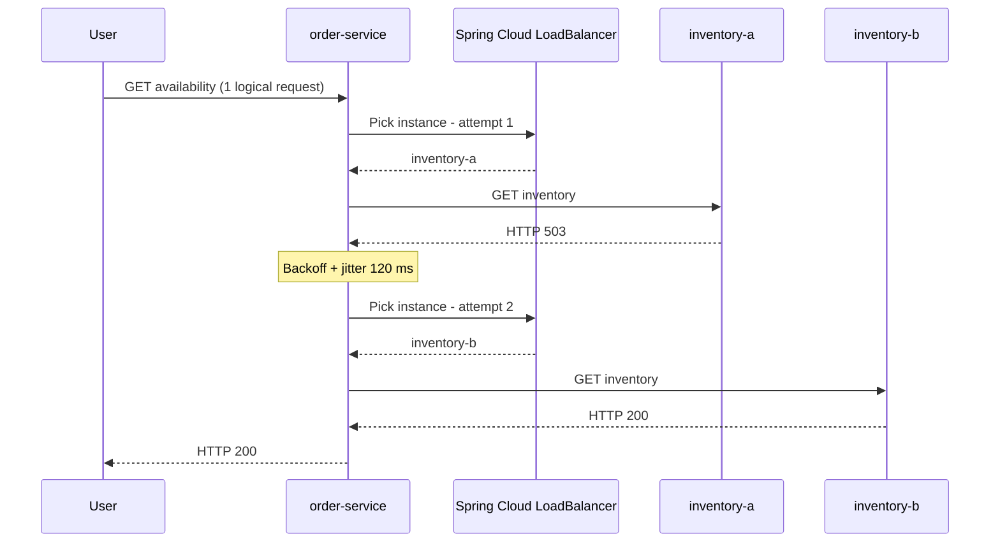

# Backoff, Jitter, and Bounding the Total Time Budget

## 1. The problem: retries can rescue requests, or trigger a load storm

In the **Retries** chapter of the `SPRING_CLOUD_SERVICE_COMMUNICATION_LOAD_BALANCING` module, `order-service` calls `inventory-service` through Spring Cloud LoadBalancer. Given a service ID, LoadBalancer obtains a list of `ServiceInstance` entries from discovery, filters by health/zone if configured, and picks an instance for `RestClient`, `WebClient`, or OpenFeign to execute the HTTP request.

Suppose `inventory-a` becomes temporarily overloaded and returns HTTP 503. The caller immediately retries, may be routed to `inventory-b`, and succeeds. However, if thousands of callers retry **immediately and at the exact same instant**, the recovering service gets slammed with massive extra traffic. A brief hiccup quickly turns into a prolonged *retry storm*; user requests can also breach the API gateway deadline even when each individual HTTP attempt has its own timeout.

To retry safely, you must answer four questions **simultaneously**:

1. **Should you retry?** Only retry errors and operations verified to be recoverable and safe to repeat.
2. **At most how many times?** Set attempt limits and distinguish same-instance tries from next-instance tries.
3. **How long to wait between tries?** Use bounded backoff and jitter to avoid synchronized caller spikes.
4. **When to stop completely?** Enforce a deadline for the **entire logical request**, covering instance selection, connection, response wait, each retry, and all backoff delays.

**Objectives:** explain exponential backoff and jitter, configure retries appropriately with Spring Cloud LoadBalancer, distinguish reactive retries from blocking/OpenFeign retries, design a total time budget, and verify using actual HTTP attempt counts and latency.

## 2. Distinguishing one logical request from multiple HTTP attempts

A user sends `GET /orders/ABC-1/availability` to `order-service`. That is **one logical request** at the external API. To fulfill it, `order-service` may execute multiple HTTP attempts against `inventory-service`.



Summary:

| Concept | Example in diagram | Unit to measure |
|---|---|---|
| Logical request | User checks inventory availability once | `logical_request_id` |
| Attempt | Each real HTTP send to an instance | `attempt_number`, `instance_id` |
| Retry | Second attempt onward, after an eligible error | `retry_count = attempts - 1` |
| Retry delay | Wait time between two attempts | Milliseconds per gap |
| Backoff policy | Rule determining the delay | Fixed/exponential/capped |
| Jitter | Delay randomization | Spread/factor |
| Deadline | Point by which the logical request must finish or stop | `started_at + budget` |

When retries are active at multiple layers, a single logical request can pass through **multiple `ServiceInstance` selections**. Do not confuse `onNext` emissions of a `Flux` with attempt counts. An attempt can also fail **before any HTTP response**, such as finding no instance or hitting a connection timeout.

### 2.1. Same-instance vs. next-instance retry

Spring Cloud LoadBalancer distinguishes:

- **Retry on same service instance:** retries the already-selected instance; useful for brief glitches unrelated to a specific replica, but risks pressuring an unhealthy instance.
- **Retry on next service instance:** requests re-selecting a `ServiceInstance`, potentially switching to a different replica.

Key properties (per Commons 4.3 metadata):

```yaml
spring:
  cloud:
    loadbalancer:
      retry:
        max-retries-on-same-service-instance: 0
        max-retries-on-next-service-instance: 1
        avoid-previous-instance: true
```

`avoid-previous-instance` helps `RetryAwareServiceInstanceListSupplier` prefer avoiding the failed instance **when other candidates exist**, depending on configuration/implementation. It does **not** guarantee every retry hits a different instance: if only one replica exists, discovery/cache is stale, or filters narrow candidates down, it may re-select the old replica or find no instances left.

Maximum attempts depend on how the implementation counts same/next retries and error conditions. Do not mechanically add the two numbers into a universal SLA across every HTTP client or Release Train; verify from attempt logs in your runtime environment.

## 3. What is backoff and why must it be bounded?

**Backoff** is a pause between attempts giving the dependency time to recover, slowing the assault on an overloaded instance, and avoiding tying up caller resources on retries almost certain to fail.

If `d_k` is the delay **before the `k`-th retry** (`k` starting at 1), with exponential backoff:

\[
d_k = \min(d_{\max}, d_0 \times 2^{k-1}).
\]

Where:

- `d_0`: base delay before the first retry.
- `2`: illustrative growth multiplier; other multipliers can also be valid.
- `d_max`: upper cap preventing unbounded waits.
- `k`: retry index, **not** counting the initial attempt as a retry.

Example with `d_0=100ms`, `d_max=800ms`:

| Retry # | Exponential delay *without jitter* | Notes |
|---:|---:|---|
| 1 | 100 ms | After initial attempt fails |
| 2 | 200 ms | Doubled |
| 3 | 400 ms | Doubled |
| 4 | 800 ms | Hit cap |
| 5 | 800 ms | Stays capped |

**Attempt limits and delay caps must be designed together.** Allowing unlimited retries lets a request drag on too long even if each delay is capped. Conversely, capping attempts while setting huge delays still breaches the API deadline.

### 3.1. Fixed delay vs. exponential delay

- **Immediate retry:** delay 0; easily creates synchronized request bursts and is rarely suitable when downstream is overloaded.
- **Fixed delay:** every retry waits 100 ms; simple, yet can produce synchronized retry waves across callers.
- **Exponential backoff:** delay grows across consecutive failures; eases pressure while the service has not recovered.
- **Capped exponential backoff:** exponential with `maxBackoff`; prevents excessively long delays.
- **Exponential + jitter:** progressively widens wait times while scattering retry timestamps across callers.

For multi-replica services, backoff does not replace health checks, discovery, or circuit breakers. If all instances are broken or the registry has no instances, retrying with longer delays won't heal the system. You may need *fail fast*, circuit breakers, or asynchronous handling depending on business needs.

## 4. How does jitter prevent the thundering herd?

**Jitter** randomizes the wait before retrying. Suppose 1,000 callers all receive HTTP 503 at 12:00:00. If everyone uses a fixed 100 ms delay, a fresh wave of retries can slam the server simultaneously at 12:00:00.100. Even with exponential backoff **without jitter**, subsequent waves can remain synchronized.

Jitter spreads retries across different timestamps:

```text
No jitter, 100ms delay:
  Caller A: |---------X
  Caller B: |---------X
  Caller C: |---------X

With jitter:
  Caller A: |-----X
  Caller B: |----------X
  Caller C: |--------X

  X = retry timestamp; diagrams are illustrative only.
```

### 4.1. Common jitter variants

| Variant | Illustrative formula given backoff `d_k` | Advantages | Notes |
|---|---|---|---|
| **No jitter** | `wait_k = d_k` | Predictable, easy to test | Many callers can synchronize |
| **Full jitter** | `wait_k ∼ Uniform(0, d_k)` | Broadly spreads retry timestamps | Can yield very short delays; consider a min delay |
| **Equal jitter** | `wait_k = d_k/2 + Uniform(0, d_k/2)` | Avoids tiny delays while still scattering | Needs a cap |
| **Decorrelated jitter** | `wait_k ∼ Uniform(d_min, 3 × wait_{k-1})` then cap | Produces less-correlated sequences | Max duration hard to predict without a cap |

These are **general design patterns**, not four named configuration options built into Spring Cloud LoadBalancer. Reactor's `RetryBackoffSpec.jitter(double)` implements its own randomization around exponential delay; **`jitter=0.5` does not mean full jitter `Uniform(0,d_k)`**. Check the Javadoc for your Reactor version to confirm the exact math.

### 4.2. Practical meaning of the jitter factor in Reactor

Per the `RetryBackoffSpec` Javadoc, `jitter(double)` accepts values from `0` to `1`; default is `0.5`, meaning randomization of up to 50% around the computed delay while still respecting `minBackoff` and `maxBackoff`.

Illustrative example for a 200 ms base delay with jitter factor 0.5: when not clamped by bounds, wait times scatter roughly within 100–300 ms. This is an **interpretation of random bounds**, not a guarantee of a single uniform distribution formula across all Reactor releases.

Never use jitter to "fix" an oversized time budget. If a retry can wait up to 300 ms, the caller must **budget for the maximum possible delay**, not just the average, when sizing deadlines.

## 5. Total time budget for a logical request

The **overall deadline** is the time limit from when the application begins handling a logical request until it obtains a result or error. It encompasses instance selection, DNS/connect/TLS, server processing, body reading, retry waits, scheduler/queue delays, and overhead.

A breakdown for `N` sequential HTTP attempts:

\[
T_{\mathrm{total}} =
\sum_{i=1}^{N} T_{\mathrm{attempt},i}
+\sum_{j=1}^{N-1} T_{\mathrm{backoff},j}
+T_{\mathrm{overhead}}.
\]

Inside `T_attempt`, components may include:

\[
T_{\mathrm{attempt}} =
T_{\mathrm{discovery/list}}+
T_{\mathrm{choose}}+
T_{\mathrm{connect}}+
T_{\mathrm{response}}.
\]

This is a **model formula for sequential stages**; callbacks, queues, connection reuse, async pipelines, and overlapping steps make real behavior more complex. Stage p95 percentiles do **not** add up to the overall p95.

### 5.1. Why can a 900ms per-attempt timeout still breach the API deadline?

Suppose `order-service` has a **2,000 ms** deadline, yet configuration allows 3 attempts; each attempt can take 900 ms and the two delays are 100 ms and 200 ms:

```text
Attempt 1         900 ms
Backoff 1         100 ms
Attempt 2         900 ms
Backoff 2         200 ms
Attempt 3         900 ms
------------------------
Total            3000 ms
```

This example omits jitter and overhead. Simply setting `responseTimeout=900ms` and `maxRetries=2` **does not** keep the request within 2,000 ms.

To meet the deadline, the caller must exit early when `remaining budget` is insufficient for another retry, or size per-attempt timeouts, attempt counts, and delays to fit inside the budget.

### 5.2. Rule for deciding whether to retry based on remaining time

Let:

- `D`: absolute deadline in the same process or duration budget from start.
- `now`: current timestamp on a monotonic clock.
- `R = D - now`: remaining time.
- `d_next`: computed backoff before the next retry.
- `t_min_attempt`: minimum time needed for a retry to be worthwhile.

Schedule a retry only when:

\[
R > d_{\mathrm{next}} + t_{\mathrm{min\ attempt}} + t_{\mathrm{safety}}.
\]

Otherwise, terminate with a clear error (or contract-approved fallback). Even when `R` is large enough to start, **cap the new attempt's timeout by the remaining budget** rather than blindly applying the full 900 ms timeout as if 900 ms remained.

For example, with 550 ms remaining, planned delay 250 ms, safety margin 50 ms, and minimum 350 ms required for an HTTP attempt:

\[
550 < 250 + 50 + 350 = 650\text{ ms}
\]

So **do not retry**, even if maximum attempt count has not been reached.

### 5.3. Placing the deadline outside the retry loop

When a WebFlux app uses Reactor retries at the publisher layer, operator order is critical:

```java
Mono<InventoryStock> readWithOverallDeadline(String sku) {
    return inventoryWebClient.get()
            .uri("/api/inventory/{sku}", sku)
            .retrieve()
            .bodyToMono(InventoryStock.class)
            .retryWhen(Retry.backoff(2, Duration.ofMillis(100))
                    .maxBackoff(Duration.ofMillis(300))
                    .jitter(0.5)
                    .filter(this::isRetryableFailure))
            .timeout(Duration.ofSeconds(2));
}
```

Here `isRetryableFailure` is an application predicate restricting retries strictly to safe errors; `InventoryStock` is an inventory DTO, and `inventoryWebClient` must be configured to call the service ID through LoadBalancer.

- `Retry.backoff(2, ...)` allows **at most two retries after the initial attempt**, meaning up to three attempts.
- `maxBackoff` caps delays at 300 ms.
- `jitter(0.5)` randomizes retry timing.
- `retryWhen(...)` is placed **before** `timeout(2s)` in the fluent chain, so the outer `timeout` spans all attempts and backoffs.
- Placing `timeout(2s)` **before** `retryWhen` resets the timeout per subscription/attempt, allowing the logical request to exceed 2 seconds.

A `Mono.timeout` terminates/cancels the publisher once the budget expires, yet **does not guarantee that any in-flight blocking I/O, server processing, or registry call stops instantaneously**. Once an HTTP request has been sent, a timeout does not prove downstream never mutated state.

## 6. Configuring backoff and jitter in Spring Cloud LoadBalancer

For the Spring Cloud Commons 4.3 line, `spring.cloud.loadbalancer.retry.backoff.*` properties apply to **reactive retries** and Reactor `RetryBackoffSpec`. Illustrative example for `inventory-service` allowing at most one next-instance retry:

```yaml
spring:
  cloud:
    loadbalancer:
      retry:
        enabled: true
        retry-on-all-operations: false
        retry-on-all-exceptions: false
        max-retries-on-same-service-instance: 0
        max-retries-on-next-service-instance: 1
        avoid-previous-instance: true
        retryable-status-codes:
          - 503
        backoff:
          enabled: true
          min-backoff: 100ms
          max-backoff: 500ms
          jitter: 0.5
```

Explanation per properties published in Commons 4.3:

| Property | Meaning |
|---|---|
| `retry.enabled` | Permits LoadBalancer retry mechanism for supported clients/stacks |
| `max-retries-on-same-service-instance` | Retry cap on the currently selected instance |
| `max-retries-on-next-service-instance` | Retry cap involving selecting a subsequent instance |
| `retryable-status-codes` | HTTP status set treated as retry candidates, here 503 |
| `retry-on-all-operations` | Default `false`, avoids automatically retrying all HTTP methods |
| `retry-on-all-exceptions` | Default `false`, avoids retrying arbitrary exceptions |
| `avoid-previous-instance` | Attempts to avoid the previously selected replica if available |
| `backoff.enabled` | **Enables** Reactor backoff policy (defaults to `false`) |
| `backoff.min-backoff` | Minimum delay for the Reactor retry policy |
| `backoff.max-backoff` | Maximum delay cap |
| `backoff.jitter` | Randomization factor from `0` to `1` |

**Documentation note:** one prose sentence on the Commons 4.3 *Common Abstractions* page mistakenly wrote that enabling reactive backoff requires `backoff.enabled=false`. However, the 4.3 *Configuration Properties* table states `false` is the **default, meaning backoff is not applied**. To enable it, set `enabled: true` and verify via logs/timing in your actual version. Never copy contradictory prose without checking metadata.

Defaults in Commons 4.3 *Configuration Properties* include `backoff.enabled=false`, `min-backoff=5ms`, `max-backoff=Long.MAX ms`, `jitter=0.5`, `max-retries-on-same-service-instance=0`, and `max-retries-on-next-service-instance=1`. These are **not recommendations to leave as production defaults**; set tight caps and SLO-aligned deadlines.

### 6.1. Per-service-ID configuration

An application calling both `inventory-service` and `payment-service` should not apply the same retry policy to every operation. On versions supporting per-client overrides, use the `spring.cloud.loadbalancer.clients.<clientId>.*` prefix where `clientId` is the service ID.

Example:

```yaml
spring:
  cloud:
    loadbalancer:
      retry:
        enabled: true
        backoff:
          enabled: false
      clients:
        inventory-service:
          retry:
            max-retries-on-same-service-instance: 0
            max-retries-on-next-service-instance: 1
            retryable-status-codes:
              - 503
            backoff:
              enabled: true
              min-backoff: 100ms
              max-backoff: 500ms
              jitter: 0.5
        payment-service:
          retry:
            max-retries-on-same-service-instance: 0
            max-retries-on-next-service-instance: 0
```

This illustrates differing policies between read and payment calls. If `payment-service` handles business POSTs, **never** rely solely on retry counts to guarantee once-only execution; also design idempotency and audit other layers. Verify which properties are global versus per-client overridable in your pinned Release Train.

### 6.2. Do not apply reactive backoff properties to every HTTP client

| Layer/Client | How to configure | Notes |
|---|---|---|
| `WebClient` via **reactive LoadBalancer retry** | `retry.backoff.enabled` + `min/max/jitter` | Backoff uses Reactor Retry; verify the retry filter is attached and no outer Reactor `retryWhen` is stacked |
| `RestTemplate` via **Spring Retry** | `LoadBalancedRetryFactory.createBackOffPolicy` | Spring Retry policy; does not read the same Reactor `backoff.*` properties by default |
| Blocking `RestClient` | Depends on LoadBalancer/HTTP transport integration and Release Train | Check which blocking retry mechanism is registered; do not assume "adding starter equals automatic backoff" |
| OpenFeign | `Retryer`/`ErrorDecoder`/client transport or integrated mechanism | Spring Cloud OpenFeign creates `Retryer.NEVER_RETRY` by default; do not confuse with plain Feign defaults |
| Gateway/Circuit Breaker | Gateway/resilience library policy | If retrying here, count toward the **same total attempt budget** |

If an application calling via `WebClient` adds its own `retryWhen` at the service layer, **disable Spring Cloud LoadBalancer retries** in that setup to avoid multiplying attempts. Conversely, when testing `spring.cloud.loadbalancer.retry.backoff.*`, remove the outer `retryWhen` so only one owner handles retries.

## 7. Custom backoff for blocking RestTemplate with Spring Retry

Spring Cloud Commons documents configuring backoff on the **blocking RestTemplate + Spring Retry** path using a `LoadBalancedRetryFactory` bean implementing `createBackOffPolicy(String service)`.

Illustrative example:

```java
@Configuration(proxyBeanMethods = false)
class BlockingRetryConfig {

    @Bean
    LoadBalancedRetryFactory retryFactory() {
        return new LoadBalancedRetryFactory() {
            @Override
            public BackOffPolicy createBackOffPolicy(String service) {
                ExponentialRandomBackOffPolicy policy =
                        new ExponentialRandomBackOffPolicy();
                policy.setInitialInterval(100L);  // milliseconds
                policy.setMultiplier(2.0);
                policy.setMaxInterval(500L);
                return policy;
            }
        };
    }
}
```

Types belong to Spring Cloud LoadBalancer and Spring Retry—such as `LoadBalancedRetryFactory`, `BackOffPolicy`, and `ExponentialRandomBackOffPolicy`; add version-appropriate imports and dependencies. `ExponentialRandomBackOffPolicy` randomizes backoff using **Spring Retry's** algorithm, not Reactor's jitter factor formula.

In real environments, you can inspect the `service` parameter to return different policies per service ID rather than forcing one setting across services with different needs. When upgrading major versions, check the `LoadBalancedRetryFactory` signature and how `RestTemplate` builds its retry interceptor. This snippet is not a total-deadline solution; the backoff policy still needs attempt limits and a caller-level overall request budget.

### 7.1. RestClient is not automatically identical to RestTemplate

`RestClient` is Spring Framework's fluent blocking client. Although it integrates with Spring Cloud LoadBalancer via `@LoadBalanced RestClient.Builder`, exact retry wiring can differ by auto-configuration path and version. Do not assume the `LoadBalancedRetryFactory` bean above automatically applies to every `RestClient` or OpenFeign setup; inspect registered beans/interceptors and actual HTTP attempts before drawing conclusions.

To place retries at the right layer, configure explicit `RestClient` connect/read timeouts, write connection/503 tests, and pick **one** retry owner for idempotent endpoints. If the app uses Resilience4j Retry or Spring Retry at the service layer, those policies also need caps, backoff/jitter, and inclusion in the shared deadline.

## 8. OpenFeign: distinguishing Retryer and LoadBalancer

Spring Cloud OpenFeign registers `Retryer.NEVER_RETRY` by default, unlike plain Feign which can retry `IOException` under its own policy. Therefore, merely declaring `@FeignClient(name="inventory-service")` does not mean Feign applies exponential backoff automatically.

Conceptual stack:

```text
order-service
  -> OpenFeign proxy
     -> Retryer / ErrorDecoder (if configured)
     -> Feign LoadBalancer client (if dependency present)
     -> ServiceInstance selection
     -> HTTP transport: connect/read timeout
```

You can configure a `Retryer` for a **specific Feign client** via `@FeignClient` configuration, though each retry may re-run one or more steps depending on adapter and retry wiring. Only one retry layer should own attempts to avoid multiplication.

Example bean in Feign client configuration (illustrating Feign's API only):

```java
class InventoryFeignRetryConfig {

    @Bean
    Retryer inventoryRetryer() {
        // period, maxPeriod: milliseconds; maxAttempts includes the initial call.
        return new Retryer.Default(100L, 500L, 2);
    }
}
```

When attaching this via `@FeignClient(name="inventory-service", configuration=InventoryFeignRetryConfig.class)`, verify how Feign `Retryer.Default` handles HTTP response exceptions—for example, status 503 **does not automatically become `RetryableException` without a matching `ErrorDecoder`**. `Retryer.Default` increases wait intervals, though do not assume it provides Reactor-style jitter. For controlled jitter, implement a policy suited to your Feign version or centralize retries in one library; deadlines and attempt caps remain paramount.

**Never enable Feign retries, LoadBalancer retries, gateway retries, and service-layer retries simultaneously without counting real attempts.** With two layers each permitting three attempts, a failure scenario can produce up to roughly 3 × 3 = 9 downstream requests depending on pipeline order and retry predicates.

## 9. Which errors to retry, and when to stop?

Not every exception means "trying again might succeed." Evaluate **whether the failure is transient**, **safety of repeating the operation**, and **remaining deadline**.

| Error/scenario | Retryable? | Rationale/policy |
|---|---|---|
| Connection reset before receiving response | Possibly, for GET/idempotent calls | Check whether the request may have already reached the server |
| Connect timeout when calling selected instance | Possibly, if budget remains and another instance exists | Prioritize protecting downstream from load storms |
| HTTP 502/503/504 | Often conditional candidates | Bound attempts, add backoff+jitter; may switch instances |
| HTTP 429 | Per contract and `Retry-After` | Honor server-requested wait; never spam retries |
| HTTP 408 | Possibly per contract | Do not assume server didn't process the request |
| HTTP 400/401/403/404/422 | Usually **no** | Bad request, auth/permissions, or data error; identical retries rarely help |
| HTTP 500 | Endpoint-dependent | May be a persistent code bug; do not retry by default |
| No instances for service ID | Usually fail fast | Immediate retries won't create registry entries; retry only with explicit wait/discovery policy |
| Persistent DNS/configuration errors | No | Fix configuration instead of increasing attempts |
| JSON decode/schema mismatch | No | Retries do not fix data contracts |
| Deadline expired | **No** | Must return error or cancel per policy |
| Order/payment creation POST | **Not by default** | Retry only with idempotency key, deduplication, and explicit semantics |

### 9.1. Idempotent operations and ambiguous outcomes

GET is generally semantically safe to retry, yet check for unusual server-side side effects. PUT/DELETE are idempotent per HTTP semantics, though never infer from the method alone that every implementation is safe to repeat in practice. POST commands creating orders, charges, or reservations need caller-generated idempotency keys; the server must store outcomes by key, replay stored results for duplicates, and guard against race conditions/transactions.

**Timeouts do not prove the server failed to commit.** If the response is lost after a DB commit, retrying without idempotency creates duplicate orders or charges. Retry is a network recovery technique, not an "exactly-once" guarantee.

### 9.2. Retry-After and deadlines

If downstream returns HTTP 429 or 503 with `Retry-After`, inspect the header (seconds or HTTP-date per HTTP semantics). Given a known policy and deadline, the caller can wait at least as long as requested, but **if the wait exceeds the remaining budget, stop** rather than holding requests open indefinitely.

Do not assume every `retryWhen` or Spring Cloud LoadBalancer retry **automatically reads `Retry-After`**; that is dedicated logic you must build or verify per library.

## 10. Retry storms: per-caller budgets are not enough system-wide

Suppose you have 100 logical requests/second. If every logical request fails and is allowed two extra retries, downstream can receive up to 300 attempts/second—**triple** the baseline load during sustained faults, before counting gateways, health probes, and other retry tiers.

An approximate model:

\[
\text{attempt RPS} \approx
\text{logical RPS}\times E[\text{attempts per logical request}].
\]

Systems also suffer *retry amplification* when `order-service` → `inventory-service` → `pricing-service` each define their own retries. Three layers each multiplying by three attempts can drive multiplicative pressure into deep services depending on call paths.

### 10.1. Protective brakes

1. **Small max attempts:** start with 0–1 retry for suitable GETs and measure; never default to 5–10 retries.
2. **Capped exponential backoff with jitter:** spread traffic while services are overloaded.
3. **Whole-logical-request deadline:** terminate once insufficient time remains.
4. **Traffic-level retry budget:** cap additional retries per time window or as a ratio of normal traffic.
5. **Circuit breakers and bulkheads:** cut attempts when dependencies stay broken and protect thread/connection pools.
6. **Rate limiting and load shedding:** shield surviving healthy instances from absorbing the full retry storm.
7. **Sensible health/discovery:** evict failing instances and pick alternatives only from trustworthy lists.
8. **Idempotency and deduplication:** enable safe write recovery when explicitly designed.

Backoff and jitter **only shift and scatter** attempts in time; they do not reduce maximum total attempts. If every request retries three times, the system still faces heavy work; you also need retry budgets and circuit-breaking stops.

## 11. Setting up a reproducible lab

### 11.1. Topology

Use `order-service` on port 8080 calling `inventory-service` with two instances:

| Instance | URI from caller | Simulated behavior |
|---|---|---|
| `inventory-a` | `http://localhost:8081` | Can return HTTP 503 or slow responses |
| `inventory-b` | `http://localhost:8082` | Returns HTTP 200 in failover scenarios |
| `order-service` | `http://localhost:8080` | `@LoadBalanced WebClient.Builder` or another HTTP client |

Static discovery configuration on the caller:

```yaml
spring:
  application:
    name: order-service
  cloud:
    discovery:
      client:
        simple:
          instances:
            inventory-service:
              - uri: http://localhost:8081
                instance-id: inventory-a
              - uri: http://localhost:8082
                instance-id: inventory-b
    loadbalancer:
      retry:
        enabled: false
      cache:
        enabled: false
server:
  port: 8080
```

At baseline, **disable LoadBalancer retries** so attempts are controlled by Reactor `retryWhen` code. When switching to measure Spring Cloud LoadBalancer's retry properties, remove `retryWhen` from code and enable the properties from section 6. Never mix both policies in the same experiment run.

`localhost` works only when all three processes share the same machine or network namespace; in Docker/Kubernetes, use addresses reachable by the caller.

### 11.2. Controlled fault-injection endpoint

Example in `inventory-service` using Spring MVC, with a test endpoint returning 503 when failure mode is enabled:

```java
@RestController
@RequestMapping("/api/inventory")
class InventoryTestController {

    private final String instanceId;
    private final AtomicBoolean failMode = new AtomicBoolean();

    InventoryTestController(Environment env) {
        this.instanceId = env.getRequiredProperty("app.instance-id");
    }

    @GetMapping("/{sku}")
    ResponseEntity<Map<String, Object>> read(
            @PathVariable String sku) {
        if (failMode.get()) {
            return ResponseEntity.status(503)
                    .body(Map.of(
                            "instanceId", instanceId,
                            "error", "LAB_UNAVAILABLE"));
        }
        return ResponseEntity.ok(Map.of(
                "sku", sku,
                "available", 12,
                "instanceId", instanceId));
    }

    // Add a toggle endpoint for failMode only in test environments;
    // never expose fault-injection toggles in production.
}
```

When running instance A, turn on `failMode` via the test harness while keeping B healthy. With `retryable-status-codes=[503]`, let an initial request hit A, then retry and observe which instance is chosen. If a request starts on B and succeeds immediately, it triggers no retry; use attempt logs across multiple runs instead of inspecting a single response and concluding the policy failed to work.

### 11.3. WebClient caller example (single retry owner)

```java
@Configuration(proxyBeanMethods = false)
class InventoryClientConfig {
    @Bean
    @LoadBalanced
    WebClient.Builder loadBalancedWebClientBuilder() {
        return WebClient.builder();
    }
}

@Service
class InventoryQuery {
    private final WebClient client;

    InventoryQuery(@LoadBalanced WebClient.Builder builder) {
        this.client = builder.clone()
                .baseUrl("http://inventory-service")
                .build();
    }

    Mono<InventoryStock> get(String sku) {
        return client.get()
                .uri("/api/inventory/{sku}", sku)
                .retrieve()
                .bodyToMono(InventoryStock.class)
                .retryWhen(Retry.backoff(2, Duration.ofMillis(100))
                        .maxBackoff(Duration.ofMillis(500))
                        .jitter(0.5)
                        .filter(error ->
                                error instanceof WebClientRequestException
                                || error instanceof
                                    WebClientResponseException.ServiceUnavailable))
                .timeout(Duration.ofSeconds(2));
    }
}

record InventoryStock(String sku, int available, String instanceId) {}
```

This snippet has **one** retry owner: Reactor inside `InventoryQuery`. Even with Spring Cloud LoadBalancer retries disabled, Reactor re-subscriptions still issue fresh HTTP requests through LoadBalancer; each attempt may select a different instance without strictly guaranteeing it. If no instances remain, reactive `WebClient` can synthesize a 503; filtering on 503 may still retry it—which is why production setups should separate **no-instance** from **server 503** via LoadBalancer/trace data rather than unconditionally retrying every 503.

### 11.4. Measuring gaps between attempts

On the caller, attach a stable correlation ID per **logical request** and a separate attempt number/trace span per HTTP attempt. Log the timestamp when sending actually begins and the selected instance; on the server, log the same correlation ID and HTTP status.

To collect clean measurements:

1. Keep only one retry layer across the lab; disable hidden gateway/HTTP-client retries if present.
2. Send enough requests to capture both first-try successes and retries; never generalize from one run.
3. Record all attempt timestamps sharing the same logical request.
4. Compute `observed_gap` between **end of prior attempt** and **start of next attempt**, not confusing it with gaps between separate requests.
5. Record retry reason, HTTP status/exception, attempt count, instance ID, per-attempt duration, and total duration.
6. Compare `jitter=0` vs. `jitter=0.5` across many logical requests to see dispersion; do not expect exact `100ms` gaps due to schedulers, networking, and load.

### 11.5. Experiment matrix

| Run | Configuration | Outcome to observe |
|---|---|---|
| A | Retry off, A 503/B 200 | One HTTP attempt per logical request |
| B | Retry on, fixed 100ms delay | If first fails, retries after ~100ms (plus scheduler overhead) |
| C | Backoff 100/200ms, jitter 0 | First/second retry delays track exponential levels |
| D | Backoff 100/200ms, jitter 0.5 | Delays scatter across logical requests |
| E | Deadline 200ms, first attempt takes 300ms | Times out before retrying; does not force all attempts |
| F | Deadline 2s, A failing/B healthy | Can succeed via another selection within budget |
| G | Both A/B returning 503 continuously | Stops at max attempts; no infinite retry |
| H | Two retry layers active | Observe attempt amplification, then remove one layer |
| I | Order-creation POST without idempotency | Retries disabled; verify policy blocks it |

Timing numbers here are configuration targets, not measured benchmark results. When testing deadlines and cancellation, check whether the server finishes processing already-received requests; caller cancellation does not always abort blocking server work.

## 12. Measurement and reporting results

To evaluate whether retries truly improve success or merely add downstream pressure, track:

| Metric / log | Interpretation |
|---|---|
| `logical_requests_total` | Business requests arriving at caller |
| `http_attempts_total` | Total HTTP exchanges/attempts sent downstream |
| `retries_total` | Attempts beyond the first, broken down by service and reason |
| `retry_delay_ms` (histogram) | Measured backoff distribution |
| `retry_exhausted_total` | Requests that ran out of attempts |
| `retry_deadline_exceeded_total` | Requests cut short by budget expiration |
| `retry_success_after_retry_total` | Logical requests rescued by a retry |
| `instance_id` in traces/logs | Instance chosen per attempt |
| `http_5xx_rate`, `timeout_rate` | Downstream health before and after retries |
| `end_to_end_latency` p50/p95/p99 | End-client experience including backoffs and attempts |
| `inflight_requests`, CPU/queues | Are retries overloading surviving healthy instances? |

These names are **custom metric design suggestions**, not a claim that Spring Cloud exports those exact names out of the box. With Actuator/Micrometer, check built-in LoadBalancer metrics for your version and add retry/attempt metrics as needed. Never place request IDs, SKUs, user IDs, or raw URLs with tokens into high-cardinality metric tags; store fine details in access-controlled traces/logs.

### 12.1. Hypothetical report

This table is solely for **interpretation practice**, not a real benchmark:

| Policy | Avg attempts / logical request | Logical success | p95 (ms) | Retry delay p95 (ms) |
|---|---:|---:|---:|---:|
| No retry | 1.00 | 90% | 150 | — |
| Immediate retry, 2x | 1.28 | 97% | 270 | 0 |
| Capped backoff + jitter, 2x | 1.25 | 97% | 340 | 220 |
| Backoff + jitter + 250ms deadline | 1.10 | 95% | 248 | 140 |

In this hypothetical example, retries raise success rates yet push p95 up. The 250 ms deadline policy fails earlier when insufficient time remains to retry, cutting attempt volume and slightly lowering success rate. You cannot declare one policy "best" without knowing latency SLOs, downstream cost, real failure rates, and business requirements.

**Note:** retry delay p95 cannot simply be added to HTTP duration p95 to derive end-to-end p95. Measure total duration for the same logical request directly.

## 13. Common implementation traps

| Mistake | Why it is wrong | Fix |
|---|---|---|
| "Allowing two retries means two attempts" | Initial call is attempt 1; retries are extra attempts | Track initial + retries separately in metrics |
| Enabling backoff without a cap | Delays can grow absurdly across retries | Set `maxBackoff` and total attempts |
| Giving every caller the same fixed delay | Triggers a thundering herd on recovery | Add jitter |
| Treating jitter 0.5 as full jitter | Reactor's jitter factor is not `Uniform(0,d)` | Read Javadoc for your version |
| Setting `backoff.enabled=false` thinking it enables backoff | Configprops table states `false` disables it | Set `true` and verify empirically |
| Applying reactive properties to blocking RestTemplate | Uses Spring Retry's separate mechanism | Configure `LoadBalancedRetryFactory`/`BackOffPolicy` |
| Assuming OpenFeign retries automatically via `@FeignClient` | Spring Cloud OpenFeign defaults to `Retryer.NEVER_RETRY` | Check Feign Retryer config and other layers |
| Enabling retries on LB + Reactor + gateway | Attempts can multiply | Designate one retry owner / count total attempts |
| Assuming timeout retry means server didn't process | Response may be lost after commit | Implement idempotency and deduplication |
| Retrying HTTP 400/404 like 503 | Non-transient errors | Retry only recoverable failures |
| Retrying continuously with no instances | No valid HTTP target exists | Fail fast and fix discovery/health |
| Putting `timeout` before `retryWhen` | Can reset timeout per attempt | Place overall deadline outside the retry loop |
| Measuring only per-attempt latency | Ignores backoff and prior attempts | Measure logical end-to-end duration |
| Ignoring `Retry-After` | Resends while server asks callers to wait | Parse header and check remaining budget |
| Looking only at post-retry success rate | Can hide underlying faults and load amplification | Track retry rate, attempts, p95/p99, and CPU |
| Treating `avoid-previous-instance=true` as always switching nodes | Filtering/health may leave only one node | Observe instance ID on every attempt |

## 14. Practice exercises

### Exercise 1 — Computing time limits

Given 3 attempts, 600 ms timeout per attempt, base delays 100 ms and 200 ms, jitter factor 0.5, and a 2,000 ms API deadline: compute the worst case if delays reach 150 ms and 300 ms: `3×600+150+300=2,250ms`, before overhead. Explain why you must lower timeouts/attempts or place an outer deadline outside the retry loop rather than assuming 2,000 ms holds automatically.

### Exercise 2 — Observing jitter

Run 100 concurrent logical requests against a transiently failing endpoint. Test fixed delay, exponential without jitter, and exponential with 0.5 jitter under the same max attempts. Plot a histogram of inter-attempt gaps and compare clustering; rely on measured data rather than assuming ideal spread.

### Exercise 3 — Same instance or another instance?

With two instances, set `max-retries-on-same-service-instance=0`, `max-retries-on-next-service-instance=1`, and `avoid-previous-instance=true`. Make A return 503 and B return 200, recording actual selections per attempt. Then deregister B to see what happens when only A remains. Explain why switching instances can never be unconditionally guaranteed.

### Exercise 4 — Two-layer retries

Enable one retry in Spring Cloud LoadBalancer and one retry in Reactor on the same `WebClient`, having both instances fail. Count total HTTP attempts and compare with a single-layer run. Then reconfigure to a single retry owner. Practice strictly in a lab to avoid generating load against production.

### Exercise 5 — Idempotency for write operations

Design a `POST /reservations` endpoint accepting `Idempotency-Key`. Persist the key alongside the outcome transactionally; when a caller retries after a timeout, return the stored outcome instead of creating a second reservation. Write a concurrent-requests test sharing the same key and verify no duplicate rows are created.

### Exercise 6 — Tracking remaining budget

Simulate a request with 450 ms left before deadline, next jittered delay chosen as 200 ms, and minimum time needed for a new attempt of 300 ms. Prediction: do not schedule the retry because 200 + 300 > 450. Add a 50 ms safety margin and test both sufficient-budget and insufficient-budget cases.

## 15. Production readiness checklist for retries

- [ ] Distinguish logical request, attempt, retry, and selected instance.
- [ ] Retry only transient errors and semantically safe operations; never retry arbitrary exceptions/statuses.
- [ ] Verify Spring Boot/Spring Cloud Release Train and actual client retry behavior.
- [ ] Enforce attempt limits; never allow unbounded retries.
- [ ] Configure exponential/capped backoff and jitter where appropriate.
- [ ] Distinguish Reactor `RetryBackoffSpec.jitter` from other jitter algorithms.
- [ ] Remember `spring.cloud.loadbalancer.retry.backoff.enabled` must be `true` to enable reactive backoff.
- [ ] Use a single retry owner or accurately sum total attempts across all layers.
- [ ] Enforce an end-to-end deadline covering attempts, backoff, discovery, and transport.
- [ ] Never equate timeout/HTTP cancellation with a guarantee that the server did not commit.
- [ ] Require idempotency keys and server-side deduplication before retrying POST/writes.
- [ ] Honor `Retry-After` where required by endpoints/implementations.
- [ ] Track delay histograms, retry counts, deadline exceeded, logical success, and p95/p99.
- [ ] Test single-instance failure, all-unhealthy, no-instance, HTTP 503, and 429 scenarios.
- [ ] Pair with retry budgets, rate limits, and circuit breakers for downstream overload.

## Official references

- [Spring Cloud Commons 4.3 — Configuration Properties](https://docs.spring.io/spring-cloud-commons/reference/4.3/configprops.html): retry enablement, `backoff.enabled`, `min-backoff`, `max-backoff`, `jitter`, and retry limits.
- [Spring Cloud Commons 4.3 — Common Abstractions, Retrying Failed Requests](https://docs.spring.io/spring-cloud-commons/reference/4.3/spring-cloud-commons/common-abstractions.html): reactive retry, blocking `LoadBalancedRetryFactory`, `RetryAwareServiceInstanceListSupplier`, and per-client overrides.
- [Project Reactor — RetryBackoffSpec](https://projectreactor.io/docs/core/release/api/reactor/util/retry/RetryBackoffSpec.html): exponential backoff, `jitter(double)`, `maxBackoff`, `filter`, and retry-exhausted handling.
- [Spring Cloud OpenFeign — Features](https://docs.spring.io/spring-cloud-openfeign/reference/spring-cloud-openfeign.html): default `Retryer.NEVER_RETRY` and Feign client retry configuration.
- [Spring Framework — WebClient retrieve](https://docs.spring.io/spring-framework/reference/web/webflux-webclient/client-retrieve.html): HTTP status and exception handling in the reactive client.
- [Spring Cloud — Release Train](https://spring.io/projects/spring-cloud/): cross-checking Spring Cloud and Spring Boot versions.

**Conclusion:** backoff slows retry cadence, jitter spreads retry timestamps, and max attempts cap resend counts; **the overall logical-request deadline** decides when to stop. Spring Cloud LoadBalancer selects a `ServiceInstance` per attempt according to policy, yet it does not automatically provide idempotency, halt downstream work, or bound total time across all layers. A sound retry setup recovers from transient glitches while protecting SLOs and avoiding incident amplification.
