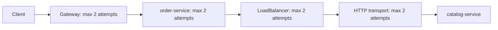

# Avoiding Retry Multiplication Across Layers

In a microservice system, resending a request after a transient error (*retry*) can help an application survive brief network glitches or a replica that just stopped serving. However, a single request may traverse an **API Gateway, business service code, Spring Cloud LoadBalancer, and an HTTP client**, each with its own retry policy. If layers resend independently without awareness of one another, actual calls reaching downstream can grow exponentially. Right when a service is already overloaded, uncontrolled retries pile on pressure and prolong recovery.

This lesson belongs to the **Retries** section of the `SPRING_CLOUD_SERVICE_COMMUNICATION_LOAD_BALANCING` module. Its goal is to explain why retries multiply, establish **a single retry policy owner** per call path, distinguish same-`ServiceInstance` retries from next-instance retries, and coordinate timeouts, deadlines, backoff, idempotency, and error observability across `RestClient`, `WebClient`, OpenFeign, and Spring Cloud LoadBalancer.

## 1. A retry is an extra request, not a free operation

Suppose `order-service` sends a GET to `catalog-service` using a logical URL:

```http
GET /api/products/P42 HTTP/1.1
Host: catalog-service
```

Spring Cloud LoadBalancer chooses a `ServiceInstance`, say `catalog-b`. If the connection fails, a retry policy may re-select `catalog-a` and send another request. When the second attempt succeeds, the caller sees a single successful business call, yet the downstream and network had to handle **two HTTP attempts**.

Distinguish:

- **Logical request:** one business action from the caller's perspective, such as "fetch product P42."
- **Attempt:** one actual effort to execute an HTTP request or connection. One logical request can have multiple attempts.
- **Retry:** an attempt **after the initial attempt**. A "max 2 retries" policy typically permits up to **3 attempts**, though property names and counting rules must be checked against the library in use.
- **Retry owner:** the layer responsible for deciding which errors are retried, how many times, whether to switch instances, and when to stop.

Not every attempt reaches the server. An attempt can fail at DNS, instance selection, connection pool acquisition, or connection setup. Conversely, an attempt may have **already been processed by the server** while the response was lost, creating duplicate side-effect risks on retry.

## 2. Retry amplification: multiple layers multiplying call volume

Suppose a request crosses four layers, each configured with up to **2 attempts** (1 initial attempt + 1 retry):



In the worst case where every layer retries everything underneath it, HTTP attempts at the final layer can reach:

\[
A_{max} = 2 \times 2 \times 2 \times 2 = 16
\]

One logical request at the system edge can generate up to **16 attempts** internally, even though each team thought they only "retried once." This is a **theoretical upper bound for nested structures**, not a claim that every request sends exactly 16 times: where an error occurs, retry predicates, stop conditions, and fan-out branches all affect actual counts.

| Independent layers, each max 2 attempts | Max attempts at final layer |
|---:|---:|
| 1 | 2 |
| 2 | 4 |
| 3 | 8 |
| 4 | 16 |

If each layer permits **3 attempts** across three nested layers, the theoretical cap becomes `3 × 3 × 3 = 27` attempts. If a request also *fans out* in parallel to multiple services, total system traffic climbs across branches—keep **retry multiplication** separate from **fan-out multiplication** so you don't misdiagnose incidents.

### A timeline of nested retries

```text
Gateway: attempt 1
  order-service: attempt 1
    LoadBalancer: attempt 1 → catalog-a fails
    LoadBalancer: attempt 2 → catalog-b fails
  order-service: attempt 2
    LoadBalancer: attempt 1 → catalog-a fails
    LoadBalancer: attempt 2 → catalog-b fails
Gateway: attempt 2
  order-service: attempt 1
    LoadBalancer: attempt 1 → catalog-a fails
    LoadBalancer: attempt 2 → catalog-b fails
  order-service: attempt 2
    LoadBalancer: attempt 1 → catalog-a fails
    LoadBalancer: attempt 2 → catalog-b fails
```

In this example, 8 attempts already reach LoadBalancer even with only Gateway, `order-service`, and LoadBalancer retrying. If the HTTP transport also retries inside each attempt, outbound requests climb further. This pattern is especially dangerous when the root cause is **downstream overload** rather than a fleeting network blip.

## 3. Layers that may be retrying without you noticing

In practice, map out every place that could replay a request:

| Layer | Mechanism examples | What to inspect |
|---|---|---|
| Browser, mobile app, or upstream consumer | HTTP SDKs, interceptors, manual retry loops | Does it retry on `429`, `503`, timeouts, or dropped connections? |
| API Gateway / ingress | Retry filters, route policies, upstream retries | Does it retry before forwarding to the service? |
| Business service | `@Retryable`, Spring Retry, Resilience4j, custom loops | Is an entire workflow or only one HTTP call being re-run? |
| Spring Cloud LoadBalancer | Same-`ServiceInstance` or next-instance retries | Are retries enabled, and how does the blocking/reactive stack support them? |
| `WebClient`/Reactor | `retry()` or `retryWhen(Retry...)` | How many times is the publisher re-subscribed? |
| OpenFeign | `Retryer`, custom Feign config | Is a custom retryer or Spring Cloud/HTTP-client policy active? |
| HTTP transport | Apache HttpClient, OkHttp, middleware/proxies | Does it auto-retry on I/O errors, redirects, or idempotent requests? |
| Target service / internal jobs | DB, RPC, message-processing retries | Does it multiply operations underneath the HTTP request? |

**Never assume library defaults are identical.** For example, Spring Cloud OpenFeign typically configures `Retryer.NEVER_RETRY` by default, unlike some core Feign defaults. Even so, that **does not prove** the request won't be retried at the Gateway, LoadBalancer, custom retryer, or transport. Check dependencies, active Spring Cloud version, effective configuration, and real logs/metrics.

A single service might use `RestClient` for one call, `WebClient` for another, and OpenFeign for a third—each branch potentially retrying at a different layer. Define policies per **specific call path**, rather than broadly declaring "retries are off system-wide."

## 4. Core principle: pick one retry owner

Instead of letting every layer decide to resend independently, designate one explicit **retry owner** per call path. That layer is responsible for:

1. Classifying retryable errors vs. errors to fail immediately.
2. Capping total attempts, not just local retry counts.
3. Deciding between same-instance retry and switching to another instance.
4. Configuring backoff, jitter, and honoring `Retry-After` when applicable.
5. Checking deadlines / remaining budget before every attempt.
6. Ensuring retries are business-safe, especially for side-effecting requests.
7. Recording actual attempt counts and stop reasons.

For example, in `Gateway → order-service → catalog-service`: if `order-service` needs to reason about the idempotency of `GET /api/products/{id}`, it can own retries for calls to `catalog-service`, while Gateway **does not retry the full request to `order-service`** and HTTP transport/LoadBalancer do not add extra retries. Conversely, a gateway forwarding to stateless replicas can be a sensible retry owner if the whole request is retry-safe and application layers turn off overlapping retries.

There is no universal rule like "always retry at the Gateway" or "always retry at LoadBalancer." Pick **the layer with enough context to decide safely**, visibility into deadlines, and observability over attempts. Multiple layers may still have distinct recovery mechanics, provided boundaries prevent nested retry loops—for instance, transport handles connection reuse while LoadBalancer handles instance selection, yet **only one layer** issues additional HTTP attempts under a unified policy.

## 5. Same instance vs. another instance: two distinct choices

Spring Cloud LoadBalancer distinguishes retrying on the **same `ServiceInstance`** vs. retrying on a **different `ServiceInstance`**. They address different failure modes.

```text
Logical GET http://catalog-service/api/products/P42
  → Discovery: catalog-a, catalog-b, catalog-c
  → Attempt 1: pick catalog-a → connection error
  → Same-instance retry: keeps hitting catalog-a, likely still fails
  → Next-instance retry: picks catalog-b → may succeed
```

| Choice | Helpful when | Risk |
|---|---|---|
| Retry same instance | Fleeting glitch, stale connection, instance still healthy | Keeps hammering an overloaded or dead replica |
| Retry another instance | Single replica failed, other replicas are healthy | Shifts extra load onto surviving replicas; writes may duplicate |
| Do not retry | Unsafe failure, budget exhausted, no candidates left | Caller gets an error, yet system avoids load amplification |

Ability to **pick another instance** also depends on discovery lists, `ServiceInstanceListSupplier`, health filtering, replica availability, and Spring Cloud version configuration. When only one valid instance exists, a "next-instance retry" policy will not conjure a new target; retries cannot replace service discovery or health checks.

Good designs distinguish "no instances available" from "instance selected but connection failed" and "server returned `503`." The first two typically call for discovery/network diagnosis; `503` can signal downstream overload requiring traffic **reduction** rather than higher request frequency.

## 6. Example Spring Cloud LoadBalancer retry configuration

Spring Cloud LoadBalancer versions supporting retry properties look like:

```yaml
spring:
  cloud:
    loadbalancer:
      retry:
        enabled: true
        max-retries-on-same-service-instance: 0
        max-retries-on-next-service-instance: 1
        retry-on-all-operations: false
        retryable-status-codes:
          - 502
          - 503
          - 504
```

**This is an example for a LoadBalancer-managed GET call path, not a blanket recommendation to enable these settings in every app.** Check your release train docs, blocking/reactive HTTP client type, and required dependencies, as not every client passes through the same retry interceptor/filter. In particular, declaring properties in YAML does not prove actual HTTP attempts are retried as intended.

Key meanings:

- `enabled`: controls enabling/disabling LoadBalancer's retry integration where that mechanism applies.
- `max-retries-on-same-service-instance`: limits retries on the previous instance.
- `max-retries-on-next-service-instance`: limits retries involving a subsequent instance selection.
- `retry-on-all-operations: false`: avoids broadly opening retries to all HTTP methods; inspect actual policies when using side-effecting methods.
- `retryable-status-codes`: list of statuses eligible for retry per config and integration. Do not assume every `502/503/504` is always safe to retry in all cases.

Assuming LoadBalancer is the sole retry owner, this example permits at most one next-instance retry beyond the initial attempt on supported paths. However, if the Gateway or Feign also retries, the total cap is **no longer just two attempts**. Therefore, after enabling these properties, audit and disable overlapping retries at other layers—or do the reverse: disable LoadBalancer retries so an upper layer governs attempt counts.

### When you want retries at the application layer instead of LoadBalancer

If the application service owns retries, you can disable LoadBalancer automatic retries:

```yaml
spring:
  cloud:
    loadbalancer:
      retry:
        enabled: false
```

This property does not automatically disable `WebClient.retryWhen`, Feign's `Retryer`, Apache HttpClient automatic retries, or Gateway retries. Audit **every layer on the same call path** before concluding total attempts are under control.

## 7. OpenFeign: separating `Retryer` from LoadBalancer retries

OpenFeign turns Java interface calls into HTTP requests via a Feign proxy. Retries can come from Feign's `Retryer`, LoadBalancer integration, or the HTTP transport Feign uses.

Example explicitly setting **no retries at the Feign layer** for one client while another layer owns the retry policy:

```java
package com.example.feignconfig;

import feign.Retryer;
import org.springframework.context.annotation.Bean;

public class CatalogFeignNoRetryConfiguration {

    @Bean
    Retryer catalogRetryer() {
        return Retryer.NEVER_RETRY;
    }
}
```

```java
package com.example.orders.client;

import com.example.feignconfig.CatalogFeignNoRetryConfiguration;
import org.springframework.cloud.openfeign.FeignClient;
import org.springframework.web.bind.annotation.GetMapping;
import org.springframework.web.bind.annotation.PathVariable;

@FeignClient(
        name = "catalog-service",
        configuration = CatalogFeignNoRetryConfiguration.class)
public interface CatalogFeignClient {

    @GetMapping("/api/products/{id}")
    ProductDto getProduct(@PathVariable("id") String id);
}
```

`ProductDto` is application-defined. Keep `CatalogFeignNoRetryConfiguration` outside the main application's component-scan scope when it is meant **for a single Feign client**; if a `Retryer` bean lands in the parent context, it can unintentionally apply to all Feign clients.

Note: in many Spring Cloud OpenFeign versions, `Retryer.NEVER_RETRY` is already the auto-configured default. Declaring it explicitly here clarifies **retry ownership**, rather than being mandatory in every project. If LoadBalancer still retries underneath, `Retryer.NEVER_RETRY` does not eliminate extra attempts. Measure the full stack's behavior.

For write methods such as `createOrder`, `chargePayment`, or `reserveInventory`, never casually swap `NEVER_RETRY` for a high-count `Retryer` just because an endpoint occasionally times out. When write operations must retry, enforce an idempotency contract and server-side deduplication.

## 8. WebClient and Reactor: confining retries to one pipeline

If the reactive application layer is chosen as the retry owner, you can use Reactor's `retryWhen`. The example below allows **at most one extra retry** for a GET request and bounds the entire pipeline's duration:

```java
package com.example.orders.client;

import java.time.Duration;
import org.springframework.cloud.client.loadbalancer.LoadBalanced;
import org.springframework.stereotype.Component;
import org.springframework.web.reactive.function.client.WebClient;
import org.springframework.web.reactive.function.client.WebClientResponseException;
import reactor.core.publisher.Mono;
import reactor.util.retry.Retry;

@Component
public class CatalogReadClient {

    private final WebClient webClient;

    public CatalogReadClient(@LoadBalanced WebClient.Builder builder) {
        this.webClient = builder.clone()
                .baseUrl("http://catalog-service")
                .build();
    }

    public Mono<ProductDto> findProduct(String id) {
        return webClient.get()
                .uri("/api/products/{id}", id)
                .retrieve()
                .bodyToMono(ProductDto.class)
                .retryWhen(Retry.backoff(1, Duration.ofMillis(100))
                        .maxBackoff(Duration.ofMillis(300))
                        .jitter(0.5)
                        .filter(this::canRetry))
                .timeout(Duration.ofMillis(900));
    }

    private boolean canRetry(Throwable error) {
        if (error instanceof WebClientResponseException response) {
            int status = response.getStatusCode().value();
            return status == 502 || status == 503 || status == 504;
        }
        return false;
    }
}
```

`ProductDto` is an application DTO. The example deliberately **does not** retry arbitrary connection failures where server state is uncertain, filtering only a few HTTP statuses typically linked to transient issues. In production systems, `429 Too Many Requests` may be retried after `Retry-After` if policy permits; honor server limits and overall deadlines.

`Retry.backoff(1, ...)` allows at most one **resend** after the first attempt, not one total attempt. `jitter(0.5)` varies wait intervals across clients, reducing synchronized retries. `.timeout(900 ms)` **outside** `retryWhen` bounds the whole reactive sequence including retries/backoff within the publisher; placing a timeout per attempt without an outer deadline can still blow past SLOs.

**Important precondition:** before using this example, configure Spring Cloud LoadBalancer, Gateway, and transport retries so they do not independently retry the same request. `retryWhen` re-subscribes the publisher; each subscription re-runs the WebClient pipeline and may invoke instance selection under active policy. It does not guarantee the next try hits a different instance. If avoiding the failed instance is mandatory, verify LoadBalancer integration and instance-selection suppliers rather than merely adding `retryWhen`.

## 9. HTTP transports can also retry automatically

Underneath `RestClient`, `RestTemplate`, or Feign, an HTTP transport such as Apache HttpClient may have built-in I/O recovery/retry logic. This policy is independent of business retries and is easily missed if teams audit only Java annotations.

Example creating Apache HttpClient 5 with automatic retries disabled:

```java
import org.apache.hc.client5.http.impl.classic.CloseableHttpClient;
import org.apache.hc.client5.http.impl.classic.HttpClients;

CloseableHttpClient httpClient = HttpClients.custom()
        .disableAutomaticRetries()
        .build();
```

This illustrates **one design choice**; wire this exact HTTP client into the target request factory or Feign client and manage resource closing properly. Calling `disableAutomaticRetries()` on a bean the client doesn't actually use changes nothing. With other transports like OkHttp or JDK HttpClient, inspect their specific mechanisms, APIs, and defaults.

Distinguish **HTTP redirects** from **error retries**: following redirects sends extra HTTP requests with different semantics, yet still counts toward observability and time budgets if it affects actual traffic. Likewise, HTTP/2 multiplexing and connection pooling do not eliminate duplicated request sends.

## 10. Retry only recoverable errors

Not every failure is suitable for retrying. Build policy tables by **root cause**, not broad exception types:

| Failure or signal | Retry? | Notes |
|---|---|---|
| Brief connection drop before request reaches server | Possibly | Must know whether the server genuinely did not process the request |
| Timeout waiting for response | Business-dependent | Server may have finished processing and only the response was lost |
| `502 Bad Gateway` | Possibly | If proxy/upstream fault is transient and budget remains |
| `503 Service Unavailable` | Conditionally | Retries can worsen overload; pair with backoff/circuit breaker |
| `504 Gateway Timeout` | Conditionally | Cannot guarantee upstream did not execute the work |
| `429 Too Many Requests` | Per `Retry-After` and budget | Honor throttling; never blast immediate retries |
| `400 Bad Request` | Usually no | Bad payload/validation cannot be fixed by retrying |
| `401/403` | Usually no | Auth/permission errors require different handling |
| `404 Not Found` | Usually no | Resource may not exist; retry only with explicit eventual-consistency contracts |
| `409 Conflict` | Per contract | Read conflict semantics and business state |
| `500 Internal Server Error` | Not automatically | May have already caused side effects; never default-retry all 500s |
| No instances in discovery | Usually fail fast or severely bounded retry | Retries cannot create instances; inspect registry/health |

**HTTP method retryability is not an absolute guarantee.** `GET` is defined as safe per HTTP semantics, yet a poorly built endpoint can still mutate state. `PUT`/`DELETE` are semantically idempotent only if the server implements the contract properly, while `POST` is typically not idempotent by default. Rely on the **API contract and server implementation**, not method names alone.

## 11. Idempotency keys and duplicate prevention for writes

Suppose `order-service` sends:

```http
POST /payments HTTP/1.1
Host: payment-service
Idempotency-Key: pay-order-9824
Content-Type: application/json

{"orderId":"9824","amount":120000}
```

The server records the payment, then the response is lost. If the client retries with a new key, it risks recording **two payments**. A safe design requires:

1. The caller attaches the **same idempotency key** across all attempts of one logical business action.
2. The server persists key state and outcome scoped appropriately by user/order, with suitable TTL and synchronization.
3. Upon receiving the same key and payload, the server returns the stored outcome or an in-progress status without re-executing side effects.
4. If the key is reused with a different payload, the server rejects it per API contract.
5. Side-effecting operations need proper unique constraints/transactions; relying on single-replica in-memory caches fails when retries switch replicas.

Idempotency keys are not built into Spring Cloud LoadBalancer or OpenFeign; they are a **business contract** implemented by caller and downstream. When retrying onto another instance, duplicate prevention must work **across all replicas**, usually via a shared database or state store with the right guarantees.

In financial or inventory systems, even after an HTTP caller times out, you cannot assume the prior request failed. You must be able to **look up outcomes by business ID/idempotency key** before deciding to retry or compensate.

## 12. Retries must fit inside the overall deadline

A retry policy capping only attempt counts can still breach SLOs if each attempt has a long read timeout plus backoff. Budget time for the **entire logical request**, rather than granting the full timeout anew at every layer:

```text
Remaining deadline when starting call to catalog-service: 900 ms
  - Instance selection/discovery: 40 ms
  - Attempt 1 response wait: 260 ms
  - Jittered backoff: 130 ms
  - Remaining before attempt 2: ~470 ms
  - Reserve 100 ms for caller result handling
  → Attempt 2 should be granted at most ~370 ms
```

If too little time remains for the next attempt to have a realistic chance of succeeding, **stop retrying** and return an appropriate error or fallback. Issuing another attempt merely to use up configured retry counts ties up connections, threads, and CPU without delivering a timely response.

In multi-hop architectures, an absolute deadline can be propagated via an internal header set by a trusted gateway. Each service recomputes its remaining budget so transport timeouts, backoffs, and retries never silently extend the deadline. Headers like `X-Request-Deadline-Epoch-Millis` are application-defined conventions; Spring Cloud LoadBalancer **does not automatically generate or interpret** them.

With `WebClient`, a `timeout(...)` operator placed **outside** `retryWhen(...)` bounds the publisher lifecycle. With blocking `RestClient`/OpenFeign, coordinate connect/read timeouts, pool waits, available cancellation/interruption hooks, and deadline orchestration; never assume a future timeout always aborts ongoing server I/O.

## 13. Backoff, jitter, and retry budgets protect downstream

When many clients hit errors and retry immediately, they can unleash a synchronized wave of new requests (*thundering herd*). **Exponential backoff** lengthens waits across consecutive failures; **jitter** adds randomness to scatter retry waves.

Illustrative example with a 100 ms base interval:

```text
Attempt 1: send immediately
  → error
Planned backoff ~100 ms (with jitter)
Attempt 2
  → error
Planned backoff ~200 ms (with jitter)
Attempt 3
  → stop if attempt limit or deadline is exceeded
```

Backoff alone is insufficient when caller volume is huge. Systems can enforce a **retry budget** capping total retry traffic over a sliding window or as a percentage of baseline traffic. Once traffic hits that empirically tuned budget, new requests do not get retries even if their individual attempt caps aren't exhausted. This is a service-wide safeguard, distinct from per-logical-request `maxAttempts`.

Complementary mechanisms:

- **Circuit breaker:** on systemic failures, temporarily stop sending attempts to an unresponsive downstream.
- **Concurrency limit / bulkhead:** prevent slow attempts from monopolizing all caller threads or connections.
- **Rate limits and load shedding:** reject excess load cleanly when resources are scarce; never let retries defeat load shedding.
- **Server `Retry-After`:** use downstream backpressure hints when present, without exceeding deadlines or allowed retry caps.

These mechanisms do not replace idempotency or designating a retry owner. They simply contain damage during prolonged outages or traffic spikes.

## 14. Retries can skew LoadBalancer traffic distribution

Spring Cloud LoadBalancer selects instances from the list supplied by discovery and `ServiceInstanceListSupplier`. When a request fails, retries may pick another replica if policy permits. If `catalog-b` slows down, retries shifting onto `catalog-a` and `catalog-c` can **pile load** onto healthy replicas, slowing them down too.

Health checks reduce picking unhealthy replicas, yet probes run periodically and cannot guarantee an instance won't become overloaded right after passing a check. Similarly, zone preferences and sticky sessions can concentrate traffic on specific replicas; retries must respect those constraints without funneling every attempt into a single bottleneck.

If policy runs `same instance` first and then `next instance`, measure results separately for the two phases. Retrying three times on one instance is not equivalent to three attempts across three instances. When only one valid replica remains, raising `max-retries-on-next-service-instance` yields no failover benefit and only extends failure duration.

For writes, switching instances never eliminates duplicate risk. That is why idempotency must be a **service-wide** guarantee, never tied to one instance's RAM.

## 15. Observability must separate logical requests from HTTP attempts

A dashboard showing 100 req/s at the Gateway can hide 800 HTTP attempts/s hitting downstream if retries multiply. To detect amplification, instrument both **logical requests** and **attempts**, linked via tracing.

| Observability field | Purpose |
|---|---|
| `logical_request_id` or `traceId` | Correlates multiple attempts belonging to one request |
| `attempt_number` and `retry_owner` | Identifies which layer initiated the extra send |
| `service_id` and selected `instance_id` | Distinguishes same-instance vs. next-instance retries |
| `retry_reason` | Connect timeout, read timeout, HTTP `503`, exception... |
| `total_attempts` per logical request | Verifies configured attempt ceilings hold |
| `retry_rate` / attempts per logical request | Spots amplification during incidents |
| `backoff_duration` | Measures time spent waiting to retry |
| `remaining_deadline` | Reveals whether retries ran with too little budget left |
| Safe identifier form of `idempotency_key` | Investigates duplicate writes without logging secret payloads |
| `final_outcome` | First-try success, success after retry, error, timeout, fallback |

Useful ratio metric:

\[
\text{Attempt amplification ratio}
=\frac{\text{Total actual HTTP attempts}}{\text{Total logical requests}}
\]

This ratio equals 1 when each logical request produces one attempt at the measured boundary. A sharp rise alongside spiking `503`s warns that retries are **amplifying** the incident. Measure at the exact same call boundary to avoid confusing retries with legitimate fan-out: an order view calling two distinct downstreams already issues two HTTP requests even with zero retries.

When logging, never record tokens, full cookies, credentials, or sensitive request/response bodies. Trace ID, service ID, instance, attempt number, status, and duration normally suffice to explain retry behavior.

## 16. Lab exercise: observing retry multiplication

**Goal:** prove actual attempt counts, eliminate nested retries, and enforce real deadlines and idempotency.

### Setup

Create a simple `catalog-service` exposing `GET /api/products/P42`. Have the server increment a request counter and return an `X-Instance-Id` header or instance name in the body. Run two replicas `catalog-a` and `catalog-b` on ports `8081` and `8082`, configured via `SimpleDiscoveryClient` in `order-service`:

```yaml
spring:
  cloud:
    discovery:
      client:
        simple:
          instances:
            catalog-service:
              - uri: http://localhost:8081
              - uri: http://localhost:8082
```

In this lab, both consumer and the two instances must share a network context where `localhost` resolves properly. When running in Docker, use addresses reachable from the consumer container.

Configure the server to **intentionally return `503` for selected requests** or simulate connection errors. Instrument request counts received at each replica and attempts observed at the client. Never run amplification experiments against production or real side-effecting endpoints.

### Four test cases

| Case | Configuration | Outcome to observe |
|---|---|---|
| A — No retries | Disable retries across all layers in the call path | One logical GET produces at most one attempt from caller to downstream |
| B — Single retry owner | Only application layer or LoadBalancer permits one extra retry | Logical GET produces at most two attempts at that boundary |
| C — Two retry owners | Both application layer and LoadBalancer each permit one retry | Can reach up to four attempts at the lower layer if every attempt qualifies |
| D — Tight deadline | Single owner configured, yet deadline is nearly exhausted | Retries stop early without forcing full attempt limit |

For cases B and C, use a safely repeatable `GET`. Record each attempt, chosen instance, and timestamp of `503` responses. Never look only at a final "success" outcome to declare a policy good: succeeding after excessive attempts still wastes resources and harms concurrency under load.

### Adding a write operation with idempotency

Create a **simulated** `POST /reservations` endpoint storing one record keyed by `Idempotency-Key` with a unique constraint. Simulate the server finishing the write while losing the first response. Resend with the same key and verify **only one reservation exists**. Then resend with the same key and a different payload; the server must reject/reconcile per contract rather than silently overwriting.

This experiment separates two questions: "was the request retried?" and "was retrying the request safe?" Spring Cloud LoadBalancer answers only **instance selection**, not duplicate-write protection.

### Suggested result log table

| Logical ID | Retry owner | Instances per attempt | Actual attempts | Remaining deadline | Outcome |
|---|---|---|---:|---|---|
| `req-1` | None | `catalog-a` | 1 | Plenty | `503` |
| `req-2` | LoadBalancer | `catalog-a → catalog-b` | 2 | Sufficient | `200` |
| `req-3` | App + LoadBalancer | `a → b → a → b` | 4 | Sufficient | `503` |
| `req-4` | App | `catalog-a` | 1 | Almost out | Timeout/fail fast |

Rows show **illustrative outcomes** defining what to measure, not guaranteed outputs for every version or selection algorithm. Actual call counts also depend on HTTP status policies, discovery sources, and retry wiring.

## 17. Anti-patterns to avoid

| Anti-pattern | Consequence | Alternative |
|---|---|---|
| Enabling retries at Gateway, service, LoadBalancer, and transport without inventory | Attempts multiply and amplify outages | Designate one retry owner per call path |
| Confusing `2 retries` with `2 attempts` | Limits end up higher or lower than intended | Explicitly translate `max retries + 1 = max attempts` where applicable |
| Retrying all exceptions/statuses | Retries validation, auth, and permanent errors | Classify errors with a conditional allowlist |
| Retrying immediately without backoff/jitter | Thundering herd while downstream is overloaded | Exponential backoff with jitter and budget |
| Retrying the same persistently failing instance | Prolongs failure and hammers unhealthy replica | Consider next-instance, health filtering, or fail fast |
| Retrying every POST after timeout | Side effects can execute multiple times | Idempotency keys, deduplication, transaction state checks |
| Granting the full timeout again to every attempt | Breaches SLOs and wastes resources | Shared overall deadline across attempts/backoff |
| Seeing Feign `NEVER_RETRY` and assuming zero retries exist | Upper/lower layers still retry | Measure actual attempts and audit the whole stack |
| Logging only logical requests | Misses amplification | Log/emit metrics for attempts and retry owner |
| Increasing retries to fix "no instance" errors | Fails to fix empty discovery | Diagnose registry, suppliers, health, and networking |

## 18. Production checklist

1. Have you mapped the full call path from client/gateway to services, HTTP adapters, and transports?
2. Have you inventoried every place capable of issuing **extra attempts**, including hidden HTTP transport retries?
3. Does each call path have a single retry owner responsible for total attempts and stop conditions?
4. Is counting of **retries** vs. **attempts** aligned across Gateway, LoadBalancer, Reactor, and Feign?
5. Are attempt limits small, with a retry budget for peak load and widespread incidents?
6. Are retryable errors classified by status, root cause, idempotency, and recoverability?
7. Are backoff, jitter, and `Retry-After` respected within the remaining deadline?
8. Have you verified same-instance vs. next-instance retry behavior works as intended?
9. For POST/PATCH or mutating operations, are idempotency keys and cross-replica deduplication in place?
10. Do transport timeouts, cancellation, circuit breakers, and load shedding shed load when downstream fails?
11. Do metrics separate logical requests from attempts and include service ID, instance ID, retry owner, and retry reason?
12. Have you run fault injection for `503`, timeouts, dropped connections, empty discovery, tight deadlines, and writes with lost responses?

**Conclusion:** Retries help only when **bounded, scoped to recoverable failures, and prevented from multiplying load**. With Spring Cloud LoadBalancer, re-selecting a `ServiceInstance` is one capability of retrying—not permission for every layer to resend at once. Designate one retry owner per call path, disable or coordinate other retries, bound total attempts and time under a shared deadline, apply backoff/jitter, and protect writes with idempotency. Only when you measure *logical request → actual attempts → selected instances and outcomes* can the system recover from transient glitches without turning retries into an outage amplifier.
