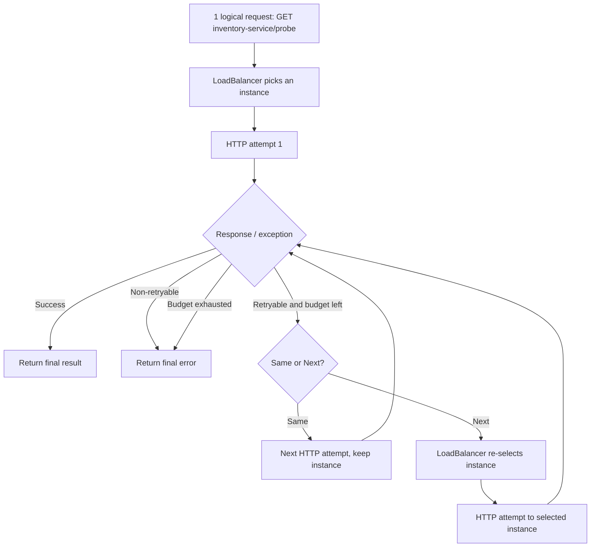

# Verifying Instance Order, Attempt Counts, and Final Outcomes

In Spring Cloud LoadBalancer, a request eventually receiving `200 OK` **is insufficient proof** that the retry mechanism worked properly. The request might have succeeded on the very first try, been sent twice to the **exact same `ServiceInstance`**, or failed on replica A and succeeded after switching to replica B. To evaluate behavior accurately, you must observe **the order of each HTTP attempt**, **the instance that actually received the request**, **attempt counts**, and **the final outcome of one business call**.

This lesson belongs to the **Retries** chapter in the `SPRING_CLOUD_SERVICE_COMMUNICATION_LOAD_BALANCING` module. Its goal is to build a verifiable test scenario applicable to clients integrating Spring Cloud LoadBalancer with discovery, health checks, and routing policies. The main lab uses `@LoadBalanced RestTemplate` with Spring Retry and two local HTTP servers; afterward, it explains how to interpret results when switching to `RestClient`, `WebClient`, or OpenFeign with their own retry and timeout behaviors.

The expected output is not a pre-measured benchmark number. You will gain a **set of assertion rules** to conclude whether retries fired the right number of times, in the right order, and stopped under the right conditions.

## 1. Four quantities that must be separated

A call from `order-service` to `inventory-service` can traverse these steps:



Four quantities:

| Quantity | Definition | Example |
|---|---|---|
| **Logical request** | One business request to call a dependency | `order-service` calls `getStock("SKU-001")` once |
| **Instance selection** | One decision choosing a `ServiceInstance` from candidates | Picks A initially; may pick B on next-instance retry |
| **HTTP attempt** | One client effort to send a request over transport | A receives GET #1; B receives GET #2 |
| **Final outcome** | Value or error received by the caller **after** retries stop | `200`, final `503` error, timeout, or no-instance |

Never assume these quantities are equal. With same-instance retries, a client may send two HTTP attempts **after one initial target selection**. With next-instance retries, an extra selection may occur. If target selection fails, **zero HTTP attempts reach any server**, even though the client attempted a logical request.

Distinguish further:

- **Client attempt:** a transport try to send, even when DNS/TCP fails before the server receives anything.
- **Server-observed attempt:** an HTTP request **actually received** by the server stub; this is the primary signal measured in the lab.
- **Final HTTP response:** status/headers/body of the final attempt if a response arrived.
- **Final exception:** when the client receives no valid response or `retrieve()`/an error handler converts an HTTP status into an exception.

**A timed-out request with zero server logs** does not prove the client never tried sending: the connection may have failed before reaching the application. Thus server-stub tests prove attempts **that reached the server**, whereas pre-connection errors require client-side instrumentation.

## 2. Inputs and experimental assumptions

Suppose discovery provides two replicas sharing one service ID:

| Field | Instance A | Instance B |
|---|---|---|
| Service ID | `inventory-service` | `inventory-service` |
| Displayed Instance ID | `inventory-a` | `inventory-b` |
| Host | `127.0.0.1` | `127.0.0.1` |
| Port | Dynamic port A | Dynamic port B |
| HTTP endpoint | `GET /probe` | `GET /probe` |

The client always calls the logical URI:

```text
http://inventory-service/probe
```

The test relies on key conditions:

1. Both HTTP servers run for real on loopback; do not rely solely on mocked responses.
2. Both servers emit distinct response markers identifying **which instance actually received the request**.
3. Use `SimpleDiscoveryClient` supplying both URIs under the same service ID.
4. Tests send requests **sequentially**, each logical request carrying a unique `X-Correlation-ID`.
5. Disable LoadBalancer caching during tests to reduce noise—not because caching always breaks retries.
6. Do not enable extra retries in gateways, Resilience4j, custom `RetryTemplate`, or underlying HTTP transports.
7. Use `GET` only to avoid duplicate-write side effects while studying retry mechanics.
8. Use compatible Spring Boot and Spring Cloud BOMs with `spring-cloud-starter-loadbalancer` and `spring-retry` for the blocking `RestTemplate` path.
9. Verify `RetryAwareServiceInstanceListSupplier` is active when aiming to **assert next-instance retries hit a different instance**.

Calling `/probe` on two servers **has no external registry state**, making attempts easy to verify. Moving to Eureka/Consul and real business servers introduces health, caching, and discovery propagation effects.

## 3. Recording every attempt under one correlation ID

To prove a business request was retried, every HTTP attempt of that request must be linked by the **same ID**.

Example client request:

```http
GET /probe HTTP/1.1
Host: inventory-service
X-Correlation-ID: case-001
```

The server stubs log an event for every received request:

```text
correlationId=case-001 ordinal=1 instance=inventory-a status=503
correlationId=case-001 ordinal=2 instance=inventory-b status=200
```

In this test, `ordinal` is a **shared sequence counter across both A and B** scoped per correlation ID, rather than a per-server counter. That lets us reconstruct the A → B order without relying on thread ordering or timestamps that could collide.

A minimal event contains:

| Field | Meaning |
|---|---|
| `correlationId` | Key identifying the logical request |
| `ordinal` | Arrival sequence across the server stubs |
| `instanceId` | Replica that actually received the request |
| `httpStatus` | HTTP code returned by the server on that attempt |
| `receivedAt` | Receipt timestamp (if measuring latency) |
| `responseBody` | Payload/marker returned to client (test-dependent) |

Cross-check **server logs** against **the response or exception observed by the client** to verify the final outcome. Client logs alone are insufficient to prove the real server received the request.

## 4. Verification matrix: order, counts, and final outcomes

Before running tests, define scenarios and expected outcomes. Labels A/B below are illustrative only; **no contract requires round-robin to always start with A**.

| Scenario | Policy | Observed server sequence (example) | Attempts reaching servers | Final outcome |
|---|---|---|---|---|
| No error | Any | A:200 | 1 | HTTP 200 |
| Same-instance retry | `same=1, next=0` | A:503 → A:200 | 2 | HTTP 200 |
| Next-instance retry | `same=0, next=1` | A:503 → B:200 | 2 | HTTP 200 |
| Same budget exhausted | `same=1, next=0` | A:503 → A:503 | 2 | Final error/status 503 |
| Next budget exhausted | `same=0, next=1` | A:503 → B:503 | 2 | Final error/status 503 |
| Non-retryable error | `retryable=[503]` | A:400 | 1 | Error/status 400 |
| No instances | Source returns empty | Zero server events | 0 | Target selection error, often surfaced as 503 |
| Only one eligible instance | `same=0, next=1` | A:503 → A:200 *possible* | 2 | Possibly 200 |
| Retries disabled | `enabled=false` | A:503 | 1 | Error/status 503 |

These are **expected patterns under simulated conditions**, not measured benchmark numbers. For next-instance retries, asserting A → B requires at least two eligible candidates and active previous-instance avoidance. With only one candidate or restrictive filters, **next** does not guarantee changing instance IDs.

### 4.1. Assertions stronger than `status == 200`

For post-retry success scenarios, assert **all of the following together**:

- Server event count for the correlation ID equals `2`.
- First event status is `503` and second event status is `200`.
- For `same`: `instanceId[0] == instanceId[1]`.
- For `next`: `instanceId[0] != instanceId[1]` when two instances are eligible and retry-aware filtering is active.
- Caller receives a 200 response whose body matches the instance from the **final event**.
- No third attempt occurs after the request succeeds.

To measure "re-selection" rather than merely "reached B," instrument `ReactorServiceInstanceLoadBalancer` or `LoadBalancerLifecycle`. Servers only see **network arrivals**, not the supplier's candidate-filtering steps.

## 5. Spring Cloud LoadBalancer retry configuration semantics

Core properties:

```yaml
spring:
  cloud:
    loadbalancer:
      retry:
        enabled: true
        max-retries-on-same-service-instance: 1
        max-retries-on-next-service-instance: 0
        retryable-status-codes:
          - 503
        retry-on-all-operations: false
        avoid-previous-instance: true
```

Meaning:

| Property | Role |
|---|---|
| `retry.enabled` | Enables retry mechanics when a matching HTTP client/integration is present |
| `max-retries-on-same-service-instance` | Extra tries on the current instance |
| `max-retries-on-next-service-instance` | Extra tries following a new instance selection |
| `retryable-status-codes` | Status codes eligible to trigger retries per implementation |
| `retry-on-all-operations` | Permits retrying HTTP methods beyond GET when enabled |
| `avoid-previous-instance` | Attempts to avoid the prior instance during next-instance selection when alternatives exist |

Per current Spring Cloud Commons documentation, common defaults include `same=0`, `next=1`, and `avoid-previous-instance=true`. Those defaults **do not confirm requests will automatically retry** if the client lacks the right retry integration/dependency. Always verify on your project's Spring Boot/Spring Cloud BOM.

### 5.1. Maximum count does not mean every attempt always runs

With `same=1` and `next=2`, the budget model is typically explained as:

```text
Select A: initial try + up to 1 retry on A
Select new: initial try + up to 1 retry on new instance
Select new: initial try + up to 1 retry on new instance

Model upper bound: (1 + same) × (1 + next)
                 = 2 × 3
                 = 6 HTTP attempts
```

This is an **illustrative upper bound**, not a guarantee that every implementation sends six requests. Actual behavior depends on retryable errors, retry ordering, deadlines, instance counts, connection failures, and other retry layers. As soon as an attempt succeeds or hits a non-retryable error, retrying stops.

### 5.2. Re-selecting does not always pick a different instance

During next-instance retries, `RetryAwareServiceInstanceListSupplier` can avoid the just-failed instance **if another replica remains**. It does not deregister instances, repair discovery, or place any instance on a "permanent ban list."

If health checks leave only A, re-selection can still pick A. If a gateway restricts traffic to zone A or tenant A, never drop hard constraints just to force a request onto B. Tests should document the candidate list conditions clearly.

## 6. Repeatable test suite architecture

The lab consists of four files under `src/test/java` (these are **examples for learners to copy into a test project**, not instructions to create extra files inside the documentation module):

```text
src/test/java/com/example/lb/retry/
├── RetryTestApplication.java     # @LoadBalanced RestTemplate
├── RetryProbeCluster.java        # Two HttpServers and event log
├── RetrySameInstanceTest.java    # same=1, next=0
└── RetryNextInstanceTest.java    # same=0, next=1
```

`RestTemplate` is used because Spring Cloud Commons explicitly documents **blocking** retry support when Spring Retry is on the classpath. When verifying `RestClient` or `WebClient` on a specific release train, keep the same event recording and attempt counting while swapping the client adapter and client-side assertions.

Illustrative Maven dependencies (assuming a compatible Spring Cloud BOM is configured):

```xml
<dependencies>
    <dependency>
        <groupId>org.springframework.boot</groupId>
        <artifactId>spring-boot-starter-web</artifactId>
    </dependency>
    <dependency>
        <groupId>org.springframework.cloud</groupId>
        <artifactId>spring-cloud-starter-loadbalancer</artifactId>
    </dependency>
    <dependency>
        <groupId>org.springframework.retry</groupId>
        <artifactId>spring-retry</artifactId>
    </dependency>
    <dependency>
        <groupId>org.springframework.boot</groupId>
        <artifactId>spring-boot-starter-test</artifactId>
        <scope>test</scope>
    </dependency>
</dependencies>
```

In a real build, use a Java version supporting `record` and the JDK `jdk.httpserver` module (such as Java 17+); if using Java modules, ensure `com.sun.net.httpserver` is accessible. No Eureka/Consul is needed since `SimpleDiscoveryClient` supplies the static instance list.

## 7. File 1: creating a LoadBalancer-backed RestTemplate

```java
package com.example.lb.retry;

import org.springframework.boot.SpringBootConfiguration;
import org.springframework.boot.autoconfigure.EnableAutoConfiguration;
import org.springframework.cloud.client.loadbalancer.LoadBalanced;
import org.springframework.context.annotation.Bean;
import org.springframework.web.client.RestTemplate;

@SpringBootConfiguration
@EnableAutoConfiguration
class RetryTestApplication {

    @Bean("loadBalancedRestTemplate")
    @LoadBalanced
    RestTemplate loadBalancedRestTemplate() {
        return new RestTemplate();
    }
}
```

Key points to remember:

- `@LoadBalanced` allows Spring Cloud LoadBalancer to attach the appropriate interceptor and retry mechanism to `RestTemplate`.
- The URI `http://inventory-service/probe` uses the **service ID**, not instance A's or B's port.
- Omitting `spring-cloud-starter-loadbalancer` or accidentally injecting a plain `new RestTemplate()` bypasses Spring Cloud instance selection.
- Even with Spring Retry on the classpath and `retry.enabled` on, verify auto-configuration actually wires the retry interceptor for your release train.

## 8. File 2: two server stubs sharing one attempt counter

To avoid assuming the first request always hits A, design the servers to return `503` on the **first attempt of any correlation ID**, whether it hits A or B; the second attempt returns `200`. Because the counter is shared across both servers, you can verify **same instance** vs. **next instance** simply by comparing the instance IDs of the two events.

For correlation IDs prefixed with `always503-`, every attempt returns `503` to test **budget exhaustion**. With prefix `bad400-`, the server returns `400` to verify **non-retryable errors are not retried**.

```java
package com.example.lb.retry;

import java.io.IOException;
import java.io.OutputStream;
import java.io.UncheckedIOException;
import java.net.InetSocketAddress;
import java.nio.charset.StandardCharsets;
import java.util.Comparator;
import java.util.List;
import java.util.concurrent.ConcurrentHashMap;
import java.util.concurrent.CopyOnWriteArrayList;
import java.util.concurrent.atomic.AtomicInteger;

import com.sun.net.httpserver.HttpServer;

final class RetryProbeCluster implements AutoCloseable {

    record Attempt(
            String correlationId,
            String instanceId,
            int ordinal,
            int status) {
    }

    private final ConcurrentHashMap<String, AtomicInteger> counters =
            new ConcurrentHashMap<>();
    private final List<Attempt> events =
            new CopyOnWriteArrayList<>();

    private final HttpServer a;
    private final HttpServer b;

    private RetryProbeCluster() throws IOException {
        a = createServer("inventory-a");

        try {
            b = createServer("inventory-b");
        } catch (IOException error) {
            a.stop(0);
            throw error;
        }
    }

    static RetryProbeCluster start() {
        try {
            return new RetryProbeCluster();
        } catch (IOException error) {
            throw new UncheckedIOException(error);
        }
    }

    String uriA() {
        return "http://127.0.0.1:" + a.getAddress().getPort();
    }

    String uriB() {
        return "http://127.0.0.1:" + b.getAddress().getPort();
    }

    List<Attempt> attempts(String correlationId) {
        return events.stream()
                .filter(e -> e.correlationId().equals(correlationId))
                .sorted(Comparator.comparingInt(Attempt::ordinal))
                .toList();
    }

    private HttpServer createServer(String instanceId)
            throws IOException {

        HttpServer server = HttpServer.create(
                new InetSocketAddress("127.0.0.1", 0),
                0);

        server.createContext("/probe", exchange -> {
            String id = exchange.getRequestHeaders()
                    .getFirst("X-Correlation-ID");

            if (id == null || id.isBlank()) {
                byte[] bytes = "missing correlation id"
                        .getBytes(StandardCharsets.UTF_8);

                exchange.sendResponseHeaders(400, bytes.length);

                try (OutputStream out =
                             exchange.getResponseBody()) {
                    out.write(bytes);
                }
                return;
            }

            int ordinal = counters
                    .computeIfAbsent(
                            id, unused -> new AtomicInteger())
                    .incrementAndGet();

            int status;
            if (id.startsWith("always503-")) {
                status = 503;
            } else if (id.startsWith("bad400-")) {
                status = 400;
            } else {
                status = ordinal == 1 ? 503 : 200;
            }

            events.add(new Attempt(
                    id, instanceId, ordinal, status));

            String payload = instanceId
                    + ":attempt=" + ordinal;

            byte[] bytes = payload.getBytes(
                    StandardCharsets.UTF_8);

            exchange.getResponseHeaders().set(
                    "X-Instance-Id", instanceId);
            exchange.getResponseHeaders().set(
                    "X-Attempt", Integer.toString(ordinal));
            exchange.getResponseHeaders().set(
                    "Content-Type", "text/plain; charset=UTF-8");

            exchange.sendResponseHeaders(status, bytes.length);

            try (OutputStream out =
                         exchange.getResponseBody()) {
                out.write(bytes);
            }
        });

        server.start();
        return server;
    }

    @Override
    public void close() {
        a.stop(0);
        b.stop(0);
    }
}
```

### 8.1. Why use a shared counter?

Suppose same-instance retry receives two requests on A:

```text
correlationId=same-101:
  1, inventory-a, 503
  2, inventory-a, 200
```

If next-instance retry moves to B:

```text
correlationId=next-101:
  1, inventory-a, 503
  2, inventory-b, 200
```

Both scenarios start with 503 and end with 200. **The destination of the second attempt** is what distinguishes the strategies, not the final status.

`CopyOnWriteArrayList` and `ConcurrentHashMap` are used because the two `HttpServer`s may handle requests on different threads from the test thread. `ordinal` establishes deterministic ordering per correlation ID without relying on timestamps. In production systems, requests may execute in parallel; there, design a trace/event store robust enough to order and group attempts.

### 8.2. Stub limitations

The stub is intentionally minimal:

- Does not simulate a real service registry.
- Does not support streaming, HTTP/2, or custom connection pools.
- Does not prove the transport called the server when TCP/TLS fails prior to HTTP.
- Does not replace production distributed tracing.
- Does not simulate database writes or idempotency.

It fits the lesson's goal: **verifying replica ordering, attempt counts, and final responses** in a controlled environment.

## 9. File 3: testing same-instance retries

Create a dedicated test class for `same=1, next=0`. This tests a blocking client with Spring Retry using `@SpringBootTest` so Spring Cloud auto-configuration wires the real integration.

```java
package com.example.lb.retry;

import java.net.URI;
import java.util.List;
import java.util.UUID;

import org.junit.jupiter.api.AfterAll;
import org.junit.jupiter.api.Test;
import org.springframework.beans.factory.annotation.Autowired;
import org.springframework.beans.factory.annotation.Qualifier;
import org.springframework.boot.test.context.SpringBootTest;
import org.springframework.http.HttpEntity;
import org.springframework.http.HttpHeaders;
import org.springframework.http.HttpMethod;
import org.springframework.http.ResponseEntity;
import org.springframework.test.context.DynamicPropertyRegistry;
import org.springframework.test.context.DynamicPropertySource;
import org.springframework.web.client.HttpClientErrorException;
import org.springframework.web.client.HttpServerErrorException;
import org.springframework.web.client.RestTemplate;

import static org.junit.jupiter.api.Assertions.*;

@SpringBootTest(
        classes = RetryTestApplication.class,
        webEnvironment = SpringBootTest.WebEnvironment.NONE,
        properties = {
                "spring.cloud.loadbalancer.cache.enabled=false",
                "spring.cloud.loadbalancer.retry.enabled=true",
                "spring.cloud.loadbalancer.retry.max-retries-on-same-service-instance=1",
                "spring.cloud.loadbalancer.retry.max-retries-on-next-service-instance=0",
                "spring.cloud.loadbalancer.retry.retryable-status-codes=503"
        }
)
class RetrySameInstanceTest {

    private static final RetryProbeCluster PROBES =
            RetryProbeCluster.start();

    @DynamicPropertySource
    static void registerInstances(DynamicPropertyRegistry registry) {
        registry.add(
                "spring.cloud.discovery.client.simple.instances."
                        + "inventory-service[0].uri",
                PROBES::uriA);

        registry.add(
                "spring.cloud.discovery.client.simple.instances."
                        + "inventory-service[1].uri",
                PROBES::uriB);
    }

    @Autowired
    @Qualifier("loadBalancedRestTemplate")
    RestTemplate restTemplate;

    @Test
    void twoAttemptsReachTheSameInstance() {
        String id = "same-" + UUID.randomUUID();

        ResponseEntity<String> result = call(id);

        assertEquals(200, result.getStatusCode().value());

        List<RetryProbeCluster.Attempt> attempts =
                PROBES.attempts(id);

        assertEquals(2, attempts.size());
        assertEquals(503, attempts.get(0).status());
        assertEquals(200, attempts.get(1).status());

        assertEquals(
                attempts.get(0).instanceId(),
                attempts.get(1).instanceId());

        assertEquals(
                attempts.get(1).instanceId(),
                result.getHeaders().getFirst("X-Instance-Id"));

        assertTrue(result.getBody().contains(
                attempts.get(1).instanceId()));
    }

    @Test
    void exhaustedBudgetReturnsTheLast503() {
        String id = "always503-" + UUID.randomUUID();

        HttpServerErrorException failure = assertThrows(
                HttpServerErrorException.class,
                () -> call(id));

        assertEquals(503, failure.getStatusCode().value());

        List<RetryProbeCluster.Attempt> attempts =
                PROBES.attempts(id);

        assertEquals(2, attempts.size());
        assertEquals(
                attempts.get(0).instanceId(),
                attempts.get(1).instanceId());
        assertTrue(attempts.stream()
                .allMatch(a -> a.status() == 503));
    }

    @Test
    void badRequestIsNotRetried() {
        String id = "bad400-" + UUID.randomUUID();

        HttpClientErrorException failure = assertThrows(
                HttpClientErrorException.class,
                () -> call(id));

        assertEquals(400, failure.getStatusCode().value());
        assertEquals(1, PROBES.attempts(id).size());
    }

    private ResponseEntity<String> call(String id) {
        HttpHeaders headers = new HttpHeaders();
        headers.set("X-Correlation-ID", id);

        return restTemplate.exchange(
                URI.create("http://inventory-service/probe"),
                HttpMethod.GET,
                new HttpEntity<Void>(null, headers),
                String.class);
    }

    @AfterAll
    static void stopServers() {
        PROBES.close();
    }
}
```

### 9.1. Three crucial assertions

In `twoAttemptsReachTheSameInstance`:

- `attempts.size() == 2` proves the server received two HTTP requests for one logical request.
- `503, 200` proves the client retried **because** the first response failed, then stopped upon receiving a success response.
- `instanceId[0] == instanceId[1]` proves both attempts hit **the exact same server**, not merely the same service ID.

You do not need to know whether round-robin picked A or B initially. Both stubs enforce the same "503 first, 200 second" rule keyed by the shared correlation ID.

### 9.2. Final error when attempts are exhausted

With `always503-*`, every HTTP attempt logged by the servers returns 503. After two attempts (initial + one same-instance retry), `RestTemplate` with its default error handler throws `HttpServerErrorException`. Assertions check both the **final exception status** and the **sequence of server events**, rather than equating "an exception was thrown" with "retries ran properly."

### 9.3. Error 400 is not retried

`bad400-*` returns HTTP 400. The example declares only 503 as retryable and leaves retry-on-all-exceptions disabled. Thus the test expects exactly one attempt. If a test observes 2 attempts, check whether another retry layer or custom policy is enabled.

## 10. File 4: testing switching to another instance

Configure a **separate test context**:

- `max-retries-on-same-service-instance=0`.
- `max-retries-on-next-service-instance=1`.
- `avoid-previous-instance=true`.
- Both instances published by discovery and not filtered out.
- HTTP status 503 is retryable.

```java
package com.example.lb.retry;

import java.net.URI;
import java.util.List;
import java.util.UUID;

import org.junit.jupiter.api.AfterAll;
import org.junit.jupiter.api.Test;
import org.springframework.beans.factory.annotation.Autowired;
import org.springframework.beans.factory.annotation.Qualifier;
import org.springframework.boot.test.context.SpringBootTest;
import org.springframework.http.HttpEntity;
import org.springframework.http.HttpHeaders;
import org.springframework.http.HttpMethod;
import org.springframework.http.ResponseEntity;
import org.springframework.test.context.DynamicPropertyRegistry;
import org.springframework.test.context.DynamicPropertySource;
import org.springframework.web.client.HttpServerErrorException;
import org.springframework.web.client.RestTemplate;

import static org.junit.jupiter.api.Assertions.*;

@SpringBootTest(
        classes = RetryTestApplication.class,
        webEnvironment = SpringBootTest.WebEnvironment.NONE,
        properties = {
                "spring.cloud.loadbalancer.cache.enabled=false",
                "spring.cloud.loadbalancer.retry.enabled=true",
                "spring.cloud.loadbalancer.retry.max-retries-on-same-service-instance=0",
                "spring.cloud.loadbalancer.retry.max-retries-on-next-service-instance=1",
                "spring.cloud.loadbalancer.retry.avoid-previous-instance=true",
                "spring.cloud.loadbalancer.retry.retryable-status-codes=503"
        }
)
class RetryNextInstanceTest {

    private static final RetryProbeCluster PROBES =
            RetryProbeCluster.start();

    @DynamicPropertySource
    static void registerInstances(DynamicPropertyRegistry registry) {
        registry.add(
                "spring.cloud.discovery.client.simple.instances."
                        + "inventory-service[0].uri",
                PROBES::uriA);

        registry.add(
                "spring.cloud.discovery.client.simple.instances."
                        + "inventory-service[1].uri",
                PROBES::uriB);
    }

    @Autowired
    @Qualifier("loadBalancedRestTemplate")
    RestTemplate restTemplate;

    @Test
    void twoAttemptsReachDifferentInstances() {
        String id = "next-" + UUID.randomUUID();

        ResponseEntity<String> result = call(id);

        assertEquals(200, result.getStatusCode().value());

        List<RetryProbeCluster.Attempt> attempts =
                PROBES.attempts(id);

        assertEquals(2, attempts.size());
        assertEquals(503, attempts.get(0).status());
        assertEquals(200, attempts.get(1).status());

        assertNotEquals(
                attempts.get(0).instanceId(),
                attempts.get(1).instanceId());

        assertEquals(
                attempts.get(1).instanceId(),
                result.getHeaders().getFirst("X-Instance-Id"));
    }

    @Test
    void exhaustedBudgetDoesNotProduceAThirdAttempt() {
        String id = "always503-" + UUID.randomUUID();

        HttpServerErrorException failure = assertThrows(
                HttpServerErrorException.class,
                () -> call(id));

        assertEquals(503, failure.getStatusCode().value());

        List<RetryProbeCluster.Attempt> attempts =
                PROBES.attempts(id);

        assertEquals(2, attempts.size());
        assertNotEquals(
                attempts.get(0).instanceId(),
                attempts.get(1).instanceId());
        assertEquals(503, attempts.get(0).status());
        assertEquals(503, attempts.get(1).status());
    }

    private ResponseEntity<String> call(String id) {
        HttpHeaders headers = new HttpHeaders();
        headers.set("X-Correlation-ID", id);

        return restTemplate.exchange(
                URI.create("http://inventory-service/probe"),
                HttpMethod.GET,
                new HttpEntity<Void>(null, headers),
                String.class);
    }

    @AfterAll
    static void stopServers() {
        PROBES.close();
    }
}
```

### 10.1. Conditions for a next-instance test to be valid

The `assertNotEquals(instanceId[0], instanceId[1])` assertion makes sense only when:

1. The supplier provides **at least two eligible instances** for `inventory-service`.
2. Re-selection genuinely receives the prior request's context.
3. `RetryAwareServiceInstanceListSupplier` is applied and `avoid-previous-instance` is active.
4. No hard filter removes one of the two replicas.
5. Both servers receive requests (no pre-HTTP network failure).
6. Retries qualify on status 503 and are not cut short by a deadline.

If the test fails because both attempts hit A, **do not relax the assertion to accept any alternating sequence**. Inspect the supplier chain and retry-aware wrapper first—finding that misconfiguration is the whole point of the verification test.

### 10.2. Why use two separate contexts?

Retry-count properties and supplier wrappers are typically read at bean creation / context startup. Do not mutate `same=1, next=0` to `same=0, next=1` in the environment after the context has booted and assume the client dynamically reconfigures itself. Two test classes with separate properties create two isolated, reproducible configurations.

## 11. When there is no final HTTP response

Not every failure produces a 400/503 status from a server. For example:

| Scenario | Server events | Signal the caller may receive |
|---|---:|---|
| No `ServiceInstance` | 0 | Target-selection failure; depending on integration, an internal HTTP 503 or exception |
| TCP connect fails to A | 0 on A | I/O exception or timeout; may retry to B |
| A receives request, fails to return body in time | Event logged on A | Read timeout; may retry per policy |
| A returns HTTP 503 and retries exhaust | 503 events logged | Status 503 or corresponding exception |
| B returns 200 after failure on A | Events on A/B | 200 with response body from B |
| Client canceled / deadline expired | 0 or more | Final cancellation/timeout, not necessarily an HTTP status |

Do not blindly write `assertEquals(503, exception.getStatusCode())` for all no-instance cases, because clients can represent server-less selection failures differently.

**Final outcomes must be classified** into:

- `SUCCESS`: caller received valid data.
- `HTTP_ERROR`: final HTTP response had an error status.
- `TRANSPORT_ERROR`: DNS/TCP/TLS/timeout/connection reset.
- `NO_INSTANCE`: no candidate could be selected.
- `CANCELLED/DEADLINE_EXCEEDED`: caller stopped waiting.

A good measurement records both the **final outcome** and server-observed attempts, while acknowledging missing server events whenever errors happened prior to HTTP.

## 12. Testing single-instance and empty-list scenarios

### 12.1. Only one replica A exists

If discovery returns only A:

```text
candidateList = [inventory-a]
same=0, next=1, avoidPrevious=true
```

A "next" retry can still pick A because no eligible B exists. Actual results may look like:

```text
attempt 1: A -> 503
attempt 2: A -> 200
final: 200
```

This case **does not prove** "same-instance retry" is active. It can be a **re-selection** whose only remaining outcome is A. To tell them apart, instrument LoadBalancer selection events in addition to server logs.

When writing a single-instance test, assert:

- No instance outside the list appears.
- Attempt count stays within budget.
- Final outcome matches the attempts' statuses/errors.
- Do not assert `nextInstanceId != previousInstanceId`.

### 12.2. Empty discovery list

If `ServiceInstanceListSupplier` returns an empty list on the very first call, LoadBalancer has no target to send to. Outcome:

```text
logicalRequests = 1
serverObservedAttempts = 0
loadBalancerSelections = possibly one empty selection
finalOutcome = NO_INSTANCE
```

Never let a retry policy guess a hardcoded IP or bypass zone/tenant/version constraints. To simulate this, call a service ID undeclared in `SimpleDiscoveryClient` and verify **zero HTTP stubs receive a request**; verify the exact caller exception/status against your client and release train.

## 13. Verifying via LoadBalancer lifecycle and metrics

In the two-server test, stub event logs prove **which targets actually received requests**. To learn **how many times LoadBalancer ran selection**, add client-side observation points.

Observation options:

- Use `LoadBalancerLifecycle` (when supported by your integration and version) to receive callbacks around selection and completion.
- Log inside `ServiceInstanceListSupplier` to inspect candidate lists before/after health/zone/filter steps.
- Instrument `ReactorServiceInstanceLoadBalancer.choose(...)` in standalone algorithm tests.
- Enable Spring Cloud LoadBalancer Micrometer metrics where appropriate and cross-check with traces.
- Track client HTTP attempt counts at the transport/interceptor layer rather than relying solely on business method calls.

Comparison table:

| Observation source | What it reveals | What it cannot prove with certainty |
|---|---|---|
| Stub A/B logs | Which servers received HTTP requests and in what order | Whether a prior selection failed before HTTP |
| `choose(...)` logs | Selections made and instances returned | Whether the server actually received the request |
| Supplier logs | Candidate pool and filtering | Which final response the caller received |
| HTTP client tracing | Logical requests, HTTP attempts, connection errors | Full registry state without extra instrumentation |
| Final HTTP response | What the caller received | How individual attempts played out |
| Retry metrics | Retry rates and final errors | Specific per-attempt instance sequence without traces |

### 13.1. Distinguishing selection count from server arrival count

In an ideal model:

```text
same-instance:
  1 logical request
  1 instance selection (model)
  2 HTTP attempts to A
  final 200

next-instance:
  1 logical request
  2 instance selections (model)
  2 HTTP attempts to A and B
  final 200
```

However, a client integration may invoke suppliers or lifecycle hooks multiple times across retry/filter stages; the numbers above are a **conceptual model**, not a universal metric contract across all Spring Cloud versions. Confirm only with real instrumentation.

## 14. Testing with WebClient and RestClient

Sections 9–10 used `RestTemplate` for a clear baseline of blocking retries with Spring Retry. The same logging approach applies to other clients, with key distinctions:

### 14.1. RestClient

`RestClient` is a newer synchronous HTTP client than `RestTemplate`. To test instance selection, use a `@LoadBalanced` `RestClient.Builder` bean in Spring Cloud:

```java
@Bean
@LoadBalanced
RestClient.Builder loadBalancedRestClientBuilder() {
    return RestClient.builder();
}
```

When testing retries, **do not assume** identical behavior to `RestTemplate` across every release train simply because both are blocking. Confirm your Spring Cloud version provides the retry interceptor/integration for `RestClient` and that `spring.cloud.loadbalancer.retry.*` properties govern that client. Then reuse `RetryProbeCluster` to assert instance ordering and attempt counts.

### 14.2. WebClient

The reactive HTTP client should be built from `@LoadBalanced WebClient.Builder`:

```java
@Bean
@LoadBalanced
WebClient.Builder loadBalancedWebClientBuilder() {
    return WebClient.builder();
}
```

Spring Cloud LoadBalancer reactive retries can be configured via `spring.cloud.loadbalancer.retry.enabled` and `max-retries-on-...` in supporting release trains.

When testing, remember publishers are **lazy**: without subscribing (or using `StepVerifier`), no request is sent. Example:

```java
Mono<String> result = loadBalancedWebClientBuilder
        .baseUrl("http://inventory-service")
        .build()
        .get()
        .uri("/probe")
        .header("X-Correlation-ID", "next-001")
        .retrieve()
        .bodyToMono(String.class);

StepVerifier.create(result)
        .expectNextMatches(body ->
                body.contains("inventory-"))
        .verifyComplete();
```

Never unconditionally attach `retryWhen(Retry.max(3))` **outside** a pipeline that already has LoadBalancer retries. Stacked retry layers multiply attempts and break "exactly two tries" assertions. Control reactive timeouts so tests never hang.

### 14.3. OpenFeign

OpenFeign uses `Retryer` and integrates LoadBalancer when `@FeignClient(name="inventory-service")` has no fixed URL. With `@FeignClient(url=...)` or a URL property, the client calls directly **without re-selecting a `ServiceInstance` via Spring Cloud LoadBalancer** for that target.

Spring Cloud OpenFeign typically configures `Retryer.NEVER_RETRY` by default. When adding a custom `Retryer`, compute total budgets across all retry layers, and never assume `max-retries-on-next-service-instance=1` automatically forces every Feign client to retry onto B.

## 15. Inspecting common final outcomes

### 15.1. Success after one retry

```text
correlationId=next-701
attempt 1: inventory-a -> HTTP 503
attempt 2: inventory-b -> HTTP 200
finalStatus=200
finalBody=inventory-b:attempt=2
attemptCount=2
```

Conclusion: at least one retry occurred, server B was the final target, and the caller succeeded. With two instances in the supplier and active retry-aware selection, this is evidence of **next-instance retry**.

### 15.2. Budget exhausted and still failing

```text
correlationId=always503-702
attempt 1: inventory-a -> 503
attempt 2: inventory-b -> 503
finalStatus=503 (or exception containing status 503)
attemptCount=2
```

Conclusion: the configured budget ran out and **did not succeed**. Never turn a final 503 into a fake `200` just to make a test "green." At an API gateway, map it cleanly to `503 Service Unavailable` with an explicit internal error code.

### 15.3. Non-retryable error

```text
correlationId=bad400-703
attempt 1: inventory-a -> 400
finalStatus=400
attemptCount=1
```

Conclusion: the system did not replay invalid input, avoiding wasted load. If `attemptCount` exceeds 1, inspect status/exception retry policies and other retry layers.

### 15.4. Timeout or no-instance error

```text
logicalRequestId=case-704
serverEvents=[]
finalOutcome=NO_INSTANCE or TRANSPORT_ERROR
```

Classify at both the caller and the selection point. Never infer `NO_INSTANCE` from `serverEvents=[]` alone: connection refused, DNS failures, or TLS errors also leave empty server logs.

## 16. Why avoid asserting A → B rigidly?

Round-robin cycles across valid instances, yet its starting index is not fixed. Health checks, caching, zones, and hints can also alter candidate ordering.

An assertion such as:

```java
assertEquals("inventory-a", attempts.get(0).instanceId());
assertEquals("inventory-b", attempts.get(1).instanceId());
```

can fail needlessly even when next-instance policy works properly, if the first attempt happened to pick B and the second picked A.

Better approach:

```java
assertEquals(2, attempts.size());
assertNotEquals(
        attempts.get(0).instanceId(),
        attempts.get(1).instanceId());
```

When testing **same-instance**, use `assertEquals` between the two IDs. To verify **`RoundRobinLoadBalancer`'s algorithm** independently, write a dedicated unit test with a fixed supplier and controlled state instead of relying on ordering inside a multi-bean integration test.

With random policies, there is no guarantee every instance appears within a small request batch. Assert that each selection belongs to the valid set, or use seeded/deterministic test doubles if supported.

## 17. Timeouts, backoff, and deadlines can alter attempt counts

Configured retry counts are **maximums**, not targets that must be hit at all costs. With a 1-second overall deadline and a 700 ms per-attempt read timeout, the second attempt may never start or may fail to finish in time.

Example:

```text
t=0ms     pick A, send HTTP
t=700ms   A times out
t=800ms   100ms backoff finishes
t=800ms   pick B and send HTTP
t=1000ms  overall deadline -> cancel
```

Possible consequences:

- A logged an attempt.
- B may or may not receive the request before cancellation.
- Caller observes a final timeout, with no HTTP 200.
- Server-observed attempts may be only 1 even though the retry budget allowed 2.

For reactive retries, `spring.cloud.loadbalancer.retry.backoff.*` affects waits between attempts; for blocking retries via Spring Retry, configure `BackOffPolicy` accordingly. Never confuse backoff with timeout; they are distinct quantities.

When testing **exact attempt counts**, use servers responding immediately, generous timeouts, and no deadline cutting the test short. Write **separate tests** for timeouts and cancellation, accounting for transport-layer uncertainty.

## 18. Business safety: POST may be processed multiple times

For `GET /probe`, replaying requests to observe behavior is safe. For `POST /reservations`, seeing `attemptCount=2` alone never proves correctness.

Example:

```text
POST to inventory-a -> DB commit succeeds
Response from A lost -> client times out
Retry to inventory-b -> processes POST again
```

Without server-side deduplication/idempotency, one logical operation can create two reservations.

When testing retries on write operations:

1. Generate a unique `Idempotency-Key` per logical operation.
2. Keep the exact same key across **all attempts** of that operation.
3. Have the server persist/check keys in data shared across instances.
4. Handle concurrency so two instances cannot both commit duplicates.
5. Assert **exactly one final business side effect**, not just the final HTTP response.
6. Never enable `retry-on-all-operations=true` for all POSTs simply because GET tests passed.

A proper write-operation test measures both **HTTP attempt count** and **actual business records created**.

## 19. Observing and reporting test results

A thorough test report captures:

| Field | Illustrative value |
|---|---|
| `testCase` | `NEXT_RETRY_SUCCESS` |
| `serviceId` | `inventory-service` |
| `clientType` | `RestTemplate + Spring Retry` |
| `sameRetries` | 0 |
| `nextRetries` | 1 |
| `retryableStatusCodes` | `[503]` |
| `avoidPreviousInstance` | true |
| `candidateInstances` | A, B |
| `logicalRequestCount` | 1 |
| `httpAttemptsObserved` | 2 |
| `instanceSequence` | A → B |
| `statusSequence` | 503 → 200 |
| `finalOutcome` | SUCCESS |
| `finalStatus` | 200 |
| `elapsedMillis` | Measure actually; never fabricate |

Example custom structured test log:

```text
testCase=NEXT_RETRY_SUCCESS
correlationId=next-701
serviceId=inventory-service
attempt=1
instanceId=inventory-a
status=503

testCase=NEXT_RETRY_SUCCESS
correlationId=next-701
serviceId=inventory-service
attempt=2
instanceId=inventory-b
status=200

testCase=NEXT_RETRY_SUCCESS
correlationId=next-701
logicalOutcome=SUCCESS
finalStatus=200
serverObservedAttempts=2
```

These fields are a **custom test/observability convention**, not mandatory default Spring Cloud metrics. Avoid putting correlation IDs, dynamic URIs, sensitive raw headers, or high-volume instance IDs into Micrometer tags to prevent high cardinality. Sampled, access-controlled traces and logs are better suited for inspecting **per-attempt sequences**.

### 19.1. Defining explicit PASS/FAIL criteria

| Verification | PASS criteria |
|---|---|
| Success without errors | 1 HTTP attempt, final 200 |
| Same retry | 2 HTTP attempts, same instance, `503→200`, final 200 |
| Next retry | 2 HTTP attempts, different instances when >=2 eligible candidates and retry-aware active, `503→200`, final 200 |
| Budget exhausted | No attempts past limit, final 503/matching exception |
| Non-retryable error | 1 HTTP attempt, final 400/matching exception |
| No instances | Zero servers receive requests; caller never receives fake success |
| Timeout | Final outcome is timeout/cancellation; actual attempts measured without assuming full budget ran |
| Idempotent write | Multiple HTTP attempts possible, yet exactly one business side effect |

## 20. When results do not match predictions

| Symptom | Likely causes | What to check |
|---|---|---|
| `same=1` yet only one attempt | Spring Retry missing, retries off, status 503 not marked retryable | Dependencies, auto-configuration, effective properties |
| `same=1` yet two different IDs | Another retry layer or unexpected supplier/transport re-selection | Client interceptor chain, correlation tracing |
| `next=1` yet two identical IDs | Single candidate, filter removed B, missing retry-aware supplier | Candidate count, `avoid-previous-instance`, client context |
| Three or four attempts despite max two | Overlapping retries in Feign, gateway, Reactor, or circuit breaker | Count attempts per layer; disable outside retries in tests |
| Tests fail when run order changes | Shared state/non-unique correlation IDs, reused cache or context | Use UUIDs, separate test contexts, clean server state |
| Final 200 with zero stub events | Request mocked or routed to another URL/proxy | Check `@LoadBalanced`, URI, and test wiring |
| Final 503 yet first event was 200 | Mixed correlation IDs across logical requests or unsorted logs | Check header propagation and sort by `ordinal` |
| One server picked overwhelmingly | Random/sticky/weighted policy or RoundRobin state | Verify algorithm and final candidate list |
| `503` doesn't retry while `IOException` does | Status retry policy differs from exception policy | Inspect status handler and `retryable-status-codes` |
| Zero events yet caller timed out | Pre-HTTP TCP/TLS/DNS failure or client cancellation | Client-side traces and network instrumentation |
| Stopped B yet retries still pick B | Stale discovery/cache or slow health detection | Source/caching/health and time-to-converge |
| Duplicate data after POST | Missing server-side idempotency | Check idempotency key/deduplication shared DB |
| Flaky pass/timeout runs | CI overload, unclosed servers, overly tight timeouts | Dynamic ports, reasonable deadlines, cleanup |

Never "fix" a test by cranking up retry counts until you see HTTP 200. Retry failures usually point to **error classification**, **client routing**, **candidate sets**, or **test setup**—not simply needing more tries.

## 21. Handoff and re-verification checklist

- [ ] Distinguished logical request, instance selection, client attempt, and server-observed attempt.
- [ ] Both servers A and B genuinely listen on separate ports.
- [ ] `SimpleDiscoveryClient` holds the exact `inventory-service` ID and both URIs.
- [ ] Client is genuinely built from a `@LoadBalanced` bean without hardcoded physical URLs.
- [ ] Spring Retry is on the classpath for blocking experiments and retries are configured properly.
- [ ] Verified effective properties: `same/next/avoid-previous/retryable-status-codes`.
- [ ] Every logical request carries a unique correlation ID preserved across all attempts.
- [ ] Each server logs instance ID, ordinal, and status per arrival.
- [ ] Same-instance test asserts matching IDs, two attempts, `503→200`.
- [ ] Next-instance test asserts distinct IDs when two eligible candidates exist.
- [ ] Exhaustion test asserts budget compliance and final 503.
- [ ] Non-retryable test asserts exactly one attempt.
- [ ] Know how to handle no-instance and pre-HTTP transport failures with zero server events.
- [ ] Test does not hardcode that A must be selected first.
- [ ] Multiple retry layers are not enabled without summing total attempts.
- [ ] Timeouts/deadlines and `HttpServer` cleanup are configured in tests.
- [ ] For write operations, server-side idempotency and business-effect assertions are present.
- [ ] Report separates `statusSequence`, `instanceSequence`, `attemptCount`, and `finalOutcome`.

## 22. Conclusion

To **verify instance ordering, attempt counts, and final outcomes**, looking solely at a final HTTP status or a "retrying 1 time" log line is never enough. Identify each logical request with a correlation ID, record every HTTP attempt at the servers, and cross-check against the final client outcome after retries stop.

With `same-instance retry`, two attempts can appear as `A:503 → A:200`. With `next-instance retry`, when the supplier offers multiple candidates and retry-aware selection is active, the trace can appear as `A:503 → B:200`. However, without an eligible B, **re-selection** can still pick A; when no instances exist or pre-HTTP connections fail, servers record zero attempts even though the caller initiated a call.

A solid test suite proves **the right target-selection strategy**, **adherence to attempt budgets**, **proper stopping on success or failure**, and **no unsafe replay of write operations**. Combining server event logs, LoadBalancer instrumentation, and final outcomes uncovers configuration mistakes, stacked retries, stale instances, and reliability gaps across `RestClient`, `RestTemplate`, `WebClient`, and OpenFeign.

### References

- [Spring Cloud Commons — Retrying Failed Requests](https://docs.spring.io/spring-cloud-commons/reference/spring-cloud-commons/common-abstractions.html) — blocking/reactive retry configuration, same/next retries, and `RetryAwareServiceInstanceListSupplier`.
- [Spring Cloud Commons — Configuration Properties](https://docs.spring.io/spring-cloud-commons/reference/configprops.html) — semantics and defaults of `spring.cloud.loadbalancer.retry.*`.
- [Spring Cloud Commons — Spring Cloud LoadBalancer](https://docs.spring.io/spring-cloud-commons/reference/spring-cloud-commons/loadbalancer.html) — supplier chain, health/caching, and instance selection.
- [Spring Framework — REST Clients](https://docs.spring.io/spring-framework/reference/integration/rest-clients.html) — `RestTemplate`/`RestClient`/`WebClient` behavior and HTTP status handling.
