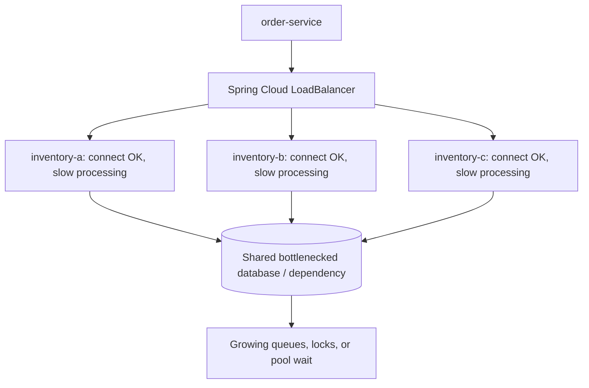
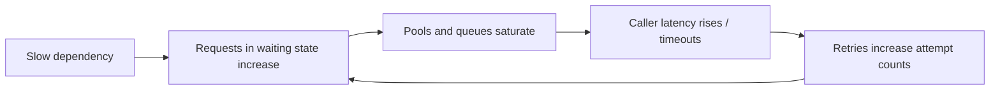
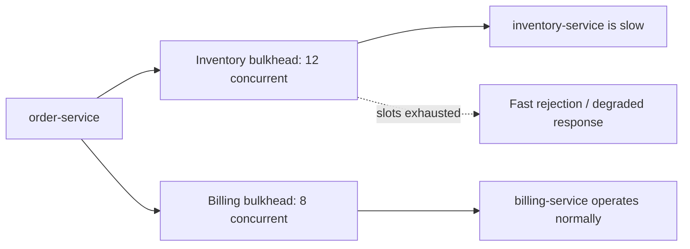
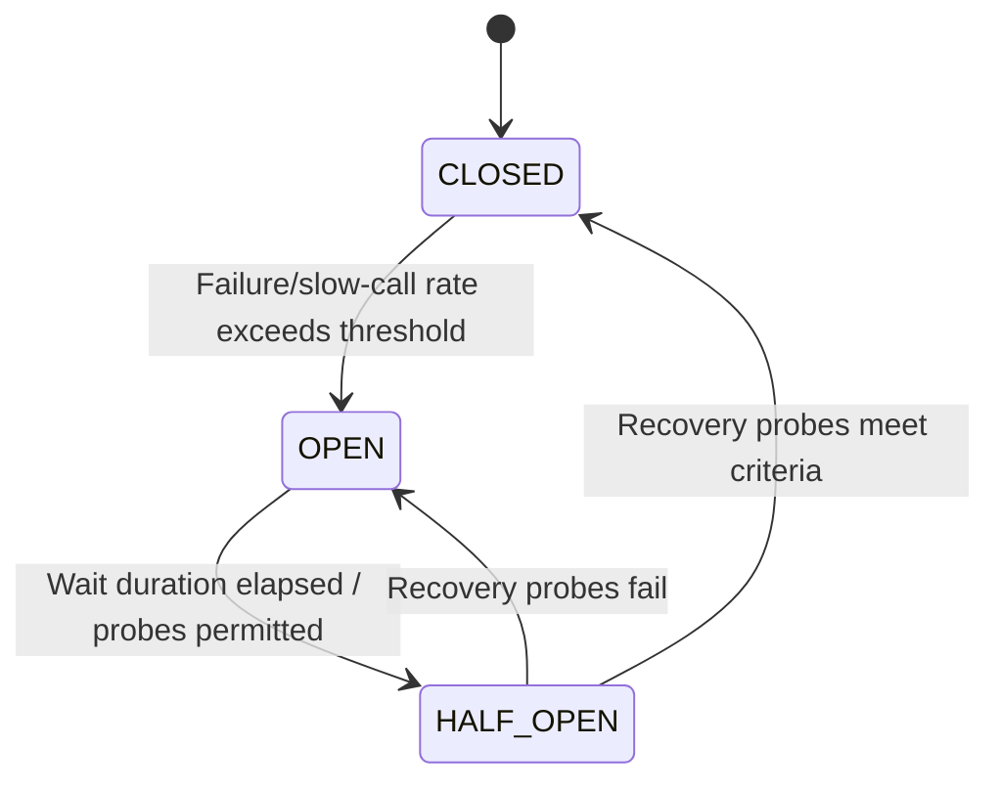
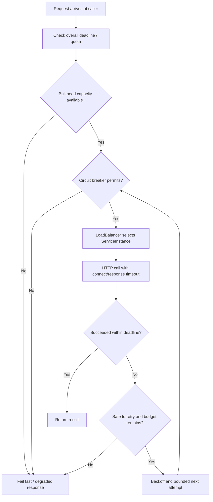

# When Every Instance Is Slow Despite Still Being Reachable

In a microservices system, failures do not always manifest as `Connection refused`, HTTP `503`, or an instance disappearing from service discovery. A harder situation to diagnose is when **all instances can still open TCP connections, health checks return success, yet every request responds very slowly**. `RoundRobinLoadBalancer` keeps rotating across instances and `RandomLoadBalancer` keeps picking randomly, yet users are still left waiting. This is often a symptom of **partial degradation (brownout)**, resource saturation, or a shared dependency becoming a bottleneck.

This lesson in the **Isolation and Recovery** chapter of the **Spring Cloud Service Communication Load Balancing** module analyzes the causes and remedies when *every instance is slow despite still being reachable*. The focus is distinguishing the role of Spring Cloud LoadBalancer from timeouts, circuit breakers, bulkheads, load shedding, retries, health checks, and recovery strategies for `RestClient`, `WebClient`, and OpenFeign. The goal is not to find a "smart" routing algorithm at all costs, but to **prevent a slow downstream from bringing down the caller and unrelated services**.

## 1. Scenario: Three Instances Look Healthy on Paper but Are Slow in Practice

Suppose `order-service` calls `inventory-service`, which is registered with three instances:

| Instance | TCP connect | `/actuator/health` | p99 of `/api/reservations` | Notes |
|---|---:|---|---:|---|
| `inventory-a` | 8 ms | `200 OK` | 3.8 s | Still reachable, business endpoint slow |
| `inventory-b` | 10 ms | `200 OK` | 4.1 s | Still reachable, business endpoint slow |
| `inventory-c` | 9 ms | `200 OK` | 3.6 s | Still reachable, business endpoint slow |

These numbers are illustrative. In this example, switching from round-robin to random is unlikely to improve p99: **there is no noticeably healthier instance to switch to**. If the root cause is an exhausted shared database connection pool, every replica can be waiting on the same dependency even while each instance's CPU remains low.



Key takeaway: **a reachable address does not equal capacity to complete work within the SLO deadline**. Nor should a `200 OK` from a lightweight health endpoint be equated with readiness for every business request.

## 2. LoadBalancer Solves Target Selection, Not Capacity Creation

The HTTP call flow by service ID typically consists of:

1. `ServiceInstanceListSupplier` retrieves the list via discovery, caching, health filters, or metadata policies.
2. Spring Cloud LoadBalancer selects a `ServiceInstance` using round-robin, random, or another algorithm.
3. The HTTP client opens/reuses a connection and sends the request to the selected host/port.
4. The server receives the request, queues it, executes business logic, and returns a response.

When every instance spends too long in step 4, changing the algorithm in step 2 **does not make the database faster**. Health checks also have limits: `HealthCheckServiceInstanceListSupplier` primarily determines whether a probe succeeded; Spring Cloud documentation also notes that default behavior can **fall back to returning the entire source list if no instance passes the check**. Therefore, do not expect that merely configuring health checks will automatically stop calling all saturated backends.

| Measure | When is it useful? | What can it not solve if all replicas are slow? |
|---|---|---|
| Round-robin / random | Multiple roughly uniform instances with spare capacity | Does not fix a shared bottlenecked dependency |
| Health-check supplier | An instance stops responding to probes or is not ready | Lightweight probe succeeds even when business APIs are slow |
| Retry to another instance | Transient error, healthy instances exist, and request is safe to retry | Can amplify load when every instance is overloaded |
| Timeout | Bounds how long the caller waits | Does not make the backend recover; the server may still keep processing |
| Circuit breaker | Detects failure/slow-call rates and fails fast | Does not increase system capacity |
| Bulkhead / concurrency limit | Isolates one downstream, prevents exhausting caller resources | Does not remove the root bottleneck |
| Load shedding | Rejects excess load before too many requests queue up | Requires deciding which requests to reject |
| Cache/degraded mode | Reduces operations hitting the slow backend | May serve stale data; not suitable for all business flows |

**Order of priority:** protect the caller and enforce time bounds first, investigate the root cause, and only then consider refining target-selection algorithms. Adaptive routing is only helpful when **real differences** exist between instances and telemetry is sufficiently reliable.

## 3. Why Are TCP and Health Still OK While Requests Are Slow?

A request passes through several distinct phases. A latency decomposition model:

\[
T_{end-to-end} \approx T_{queue,caller} + T_{select} + T_{pool-wait}
 + T_{connect/TLS} + T_{network} + T_{queue,server}
 + T_{business} + T_{response}
\]

This is a conceptual model, not a breakdown that Spring automatically exports in full. A TCP connection succeeding in 10 ms only rules out **certain** failures in the connection phase; it says nothing about whether `T_queue,server` or `T_business` has climbed to several seconds.

### 3.1. Saturation on the Backend Side

- **CPU or GC:** compute-heavy requests, stop-the-world pauses, excessive allocation.
- **Thread pool / event-loop:** blocking operations in WebFlux, exhausted Servlet workers, growing executor queues.
- **Database connection pool:** every request waits to acquire a connection, even though `/actuator/health` may still respond quickly if it does not exercise that business path.
- **Lock contention:** transactions holding locks for a long time, requests waiting on each other.
- **Queue / message broker:** read/write operations awaiting asynchronous processing, growing lag.
- **Shared dependency:** three separate instances all calling the same slow database, search cluster, or payment provider.

### 3.2. Saturation on the Caller Side

- The HTTP connection pool of `RestClient`, OpenFeign, or Reactor Netty has too few connections or too many pending acquisitions.
- Bulkheads/thread pools queue up because the caller sends too many concurrent requests.
- A `WebClient` `ExchangeFilterFunction` invokes a synchronous SDK/JDBC call and blocks the event-loop.
- Multi-layer retries cause outbound attempts to grow faster than business requests.
- Rising GC or CPU in `order-service` causes local wait time to be misattributed to downstream.

### 3.3. The "All Instances Are Slow" Signal Can Be an Observation Bias

If latency is measured at a coarse layer—for instance, from calling `RestClient` until receiving the response—the added delay may occur **before the client selects an instance** or while waiting for the connection pool. To conclude that all replicas are slow, measure on **each server instance** and separate transport latency from server processing. Tracing and per-instance metrics are far more informative than a single aggregate latency chart for the service ID.

## 4. Using Little's Law to Understand Growing Queues

With a steady arrival rate `λ` (requests/second) and average time a request spends in the system `W` (seconds), the average number of requests present is:

\[
L = \lambda \times W
\]

Suppose `order-service` receives 300 requests/second and each request waits on `inventory-service` for an average of 100 ms; the approximate concurrency is:

\[
L = 300 \times 0.1 = 30
\]

If a database bottleneck increases that wait time to 2 seconds, concurrency rises to roughly **600**, assuming the arrival rate stays constant. When thread pools/connection pools can hold only a fraction of that, the rest queue up; longer waits further raise concurrency. This is the mechanism that commonly leads to **cascading failure**.

Little's Law applies to a relatively stable system over an observation window; when queues grow unboundedly or workloads fluctuate sharply, the numbers above illustrate the trend rather than acting as a second-by-second exact forecast.



**Operational conclusion:** simply adding replicas or threads can sometimes push even more requests into a bottlenecked database, making things worse. What must be controlled is **the number of concurrent calls hitting a capacity-constrained dependency**.

## 5. Identifying Brownouts with Layer-Appropriate Data

Measure three locations simultaneously: **caller**, **LoadBalancer/HTTP client**, and **server/dependency**.

| Layer | Metrics to inspect | Diagnostic question |
|---|---|---|
| Caller | p50/p95/p99, inflight requests, queues, thread dumps | Where is the caller waiting? Is it blocked before HTTP? |
| LB/discovery | Service ID, candidate count before/after filtering, chosen instance | Is any instance actually faster to switch to? |
| HTTP client | Connect timeout, connection acquisition, pool pending, response timeout | Is slowness from connection/pool or backend? |
| Backend per instance | Server processing time, active requests, queue, CPU, GC | Are all replicas truly slow or only a subset? |
| Shared dependency | DB pool wait, query latency, locks, queue lag | Are replicas all waiting on the same bottleneck? |
| Resilience layer | Circuit breaker state, slow-call rate, bulkhead rejected | Is the isolation policy protecting or over-blocking? |
| Retry | Logical requests vs. outbound attempts | Is retry amplifying load? |

### 5.1. Read Percentiles Instead of Only Looking at Averages

An average latency of 150 ms can hide a p99 above 5 seconds. Break down p50/p95/p99 by instance and endpoint; do not lump lightweight and heavyweight APIs together. An instance that is very fast on `/actuator/health` yet slow on `/api/reservations` is a sign that the health probe does not sufficiently represent the business path.

### 5.2. Separate Connection Success Rate from SLO-Compliant Service Rate

Consider two distinct SLIs:

\[
ConnectSuccessRate = \frac{\text{successful connections}}
{\text{connection attempts}}
\]

\[
OnTimeSuccessRate = \frac{\text{requests succeeding within deadline}}
{\text{valid logical requests}}
\]

ConnectSuccessRate can stay near 100% while OnTimeSuccessRate drops severely. Use **business deadlines** and **slow-call rates** alongside error rates, rather than treating only HTTP 5xx or connection refused as incident triggers.

## 6. Immediate Response Procedure When All Instances Are Slow

A safe response sequence that does not require changing the LoadBalancer algorithm:

1. **Measure and classify:** confirm which endpoints are slow, across all instances or only a subset; separate server processing, DB pool wait, and caller connection acquisition.
2. **Curb retries:** temporarily disable non-essential retries or cut attempts, especially `POST` and `503` overload states; prevent retry storms.
3. **Enforce realistic deadlines and timeouts:** do not let requests wait indefinitely; budget connect, response, and total logical request times.
4. **Limit concurrency / queues:** give each downstream its own bulkhead, failing fast when slots are exhausted rather than queuing unboundedly.
5. **Apply a circuit breaker if appropriate:** detect slow-call/failure thresholds exceeded, reject during the protection window, and probe recovery in a controlled manner.
6. **Shed business load:** serve bounded-TTL cached data if the contract allows, temporarily drop non-essential enrichments, and apply rate limits/load shedding.
7. **Fix the root bottleneck:** reduce expensive queries, resolve lock contention, scale database capacity carefully, or shed traffic; do not merely add replicas.
8. **Recover gradually:** ramp concurrency back up in stages, watch p99/errors/rejections, and roll back if symptoms reappear.

**Do not** disable all health checks or force routing into a forbidden zone merely to chase availability targets. Constraints on tenant isolation, data residency, permissions, and API versions remain **hard constraints**, even during system degradation.

## 7. Bulkhead: Isolating Resources per Downstream

A **Bulkhead** caps the number of concurrent calls permitted into a downstream service. When `inventory-service` slows down, requests calling `billing-service` should not have to compete for all of `order-service`'s threads/connections with requests hanging on inventory.



### 7.1. Two Bulkhead Types and Crucial Differences

| Mechanism | How does it limit? | Suitable for | Caveat |
|---|---|---|---|
| `SemaphoreBulkhead` | Limits concurrent tasks via permits | Bounded blocking callers, reactive pipelines | Does not create new threads; for blocking calls, caller still waits on HTTP while holding the permit |
| `FixedThreadPoolBulkhead` | Dedicated thread pool and bounded queue | Blocking work requiring executor isolation | Adds queue/scheduling overhead; timeout/cancel does not guarantee stopping active I/O |

In Spring Cloud CircuitBreaker's Resilience4j integration, documentation describes both types above; in current configurations, **blocking CircuitBreaker Resilience4j may default to `FixedThreadPoolBulkhead`**, whereas **reactive bulkhead integration uses `SemaphoreBulkhead`**. Do not assume simply adding the Resilience4j dependency automatically wraps every WebClient/Feign request at the exact layer you expect; check the version, starter, and actual wiring.

### 7.2. How to Choose Concurrency Limits?

An example limit might be 12 concurrent calls to `inventory-service` per **caller instance**, with `maxWaitDuration=0`: reject immediately when permits are exhausted. This is **not** a cluster-wide limit. With 30 caller replicas, potential total load can still reach 360 concurrent calls; account for downstream capacity and caller replica count.

Too low a limit increases rejections even when the backend has headroom. Too high a limit exhausts caller pools and queues up the backend. Start by measuring `inflight`, p99, max connections, rejection rate, and actual capacity, then test under gradually increasing load.

**Prefer fail-fast over unbounded queuing.** If a request is already near its deadline, waiting several seconds for a permit before sending HTTP adds little value. If a queue is mandatory, bound both queue length and wait duration.

## 8. Circuit Breaker: Detecting Failures as Well as Excessively Slow Calls

A circuit breaker tracks outcomes of protected calls. When a failure or slow-call threshold is exceeded after reaching the minimum sample count, it can transition from **CLOSED** to **OPEN** to reject new requests quickly. After a wait period, it moves to **HALF_OPEN**, permitting a limited number of probes to verify recovery, then returns to CLOSED or OPEN based on the results.



**Why a slow-call threshold is needed:** When every instance still returns `200 OK` yet takes 3 seconds, a circuit breaker that only tracks exception rates may **stay closed**, unless transport/client timeouts turn those calls into errors. With Resilience4j, you can configure `slowCallDurationThreshold` and `slowCallRateThreshold` to detect latency degradation even when requests ultimately succeed.

| Resilience4j property | Meaning | Example in lesson |
|---|---|---|
| `slidingWindowSize` | Number of calls or time window for sampling | `50` calls |
| `minimumNumberOfCalls` | Minimum samples before deciding to open | `20` calls |
| `failureRateThreshold` | Failure rate threshold to open the circuit | `50%` |
| `slowCallDurationThreshold` | Calls longer than this count as slow | `800ms` |
| `slowCallRateThreshold` | Slow-call rate threshold to open the circuit | `60%` |
| `waitDurationInOpenState` | Wait duration before probing HALF_OPEN | `10s` |
| `permittedNumberOfCallsInHalfOpenState` | Limited probe count in HALF_OPEN | `3` |

These numbers are **experimental values**, not optimal universal defaults. Every API has different SLOs; for an endpoint that normally takes 2 seconds, an 800 ms slow threshold will trigger false positives.

### 8.1. Circuit Breaker Does Not Replace Health Checks and LoadBalancer

- **Health** evaluates instances (typically via readiness/probes).
- **LoadBalancer** decides which instance receives a request from the source list.
- **Circuit breaker** protects the caller from failed/slow outcomes of a downstream operation.

When **all** instances are slow, a breaker scoped to `inventory-read`/service ID can be more useful than per-instance breakers: it reflects the shared dependency risk. Still, if one service exposes two APIs with different SLAs (`/inventory/lookup` and `/inventory/reserve`), you may need **two separate per-operation circuit breakers** so an inherently slower API does not trip the circuit for the other.

Do not treat a service-ID-level breaker as a mechanism to eject individual instances from the registry. `CallNotPermittedException` from an OPEN circuit is a **local rejection**; no attempt is sent downstream in that case.

### 8.2. Avoiding Unstable OPEN/HALF_OPEN Oscillation

If all traffic rushes back at once right after HALF_OPEN transitions to CLOSED, the backend can saturate again immediately. Combine the breaker with **bulkheads, rate limits, and recovery ramp-up**. Do not allow unbounded concurrent probes before the system shows solid recovery signals.

## 9. Blocking Example: RestClient + LoadBalancer + Bulkhead + Circuit Breaker

This example uses `RestClient` by service ID to read inventory status. Protect **the entire downstream operation** with Resilience4j `SemaphoreBulkhead` and `CircuitBreaker`, instead of trying to tweak instance selection when all three replicas are slow.

### 9.1. Creating Bounded Resilience4j Policies

```java
import java.time.Duration;

import io.github.resilience4j.bulkhead.Bulkhead;
import io.github.resilience4j.bulkhead.BulkheadConfig;
import io.github.resilience4j.circuitbreaker.CircuitBreaker;
import io.github.resilience4j.circuitbreaker.CircuitBreakerConfig;
import org.springframework.context.annotation.Bean;
import org.springframework.context.annotation.Configuration;

@Configuration(proxyBeanMethods = false)
class InventoryProtectionConfiguration {

    @Bean("inventoryReadBulkhead")
    Bulkhead inventoryReadBulkhead() {
        return Bulkhead.of("inventory-read", BulkheadConfig.custom()
                .maxConcurrentCalls(12)
                .maxWaitDuration(Duration.ZERO)
                .build());
    }

    @Bean("inventoryReadCircuitBreaker")
    CircuitBreaker inventoryReadCircuitBreaker() {
        CircuitBreakerConfig config = CircuitBreakerConfig.custom()
                .slidingWindowSize(50)
                .minimumNumberOfCalls(20)
                .failureRateThreshold(50.0f)
                .slowCallDurationThreshold(Duration.ofMillis(800))
                .slowCallRateThreshold(60.0f)
                .waitDurationInOpenState(Duration.ofSeconds(10))
                .permittedNumberOfCallsInHalfOpenState(3)
                .build();
        return CircuitBreaker.of("inventory-read", config);
    }
}
```

The imports above demonstrate the Resilience4j API; compatible dependencies such as `resilience4j-bulkhead`, `resilience4j-circuitbreaker`, or the corresponding Spring Boot Resilience4j starter are required. When using the Spring Cloud CircuitBreaker abstraction, policies can be configured via factory/properties instead of manual beans; **do not declare duplicate policies in multiple places without understanding precedence**.

### 9.2. Creating a RestClient with LoadBalancer and Real Timeouts

```java
@Configuration(proxyBeanMethods = false)
class InventoryRestClientConfiguration {

    @Bean
    @LoadBalanced
    RestClient.Builder inventoryLoadBalancedBuilder() {
        SimpleClientHttpRequestFactory factory =
                new SimpleClientHttpRequestFactory();
        factory.setConnectTimeout(300); // ms, illustrative.
        factory.setReadTimeout(1500);   // ms, illustrative.

        return RestClient.builder().requestFactory(factory);
    }
}
```

In this example, `@LoadBalanced` is applied to the builder, so `RestClient` resolves service ID `inventory-service`. The specific request factory can be replaced with JDK/Apache HttpComponents in production if dedicated connection pooling/TLS is needed. When swapping factories, configure **connect/read timeouts directly on the actual transport**, not just relying on the circuit breaker. When creating a builder manually, consider Spring Boot's `RestClientBuilderConfigurer` to preserve required customizers and observability.

### 9.3. Wrapping a Single Call with Both Policies

```java
import java.util.function.Supplier;

@Service
class InventoryReadGateway {

    private final RestClient client;
    private final Bulkhead bulkhead;
    private final CircuitBreaker breaker;

    InventoryReadGateway(
            @LoadBalanced RestClient.Builder builder,
            @Qualifier("inventoryReadBulkhead") Bulkhead bulkhead,
            @Qualifier("inventoryReadCircuitBreaker") CircuitBreaker breaker) {

        this.client = builder.baseUrl("http://inventory-service").build();
        this.bulkhead = bulkhead;
        this.breaker = breaker;
    }

    StockReply read(long itemId) {
        Supplier<StockReply> remote = () -> client.get()
                .uri("/api/items/{id}", itemId)
                .retrieve()
                .body(StockReply.class);

        Supplier<StockReply> withBreaker =
                CircuitBreaker.decorateSupplier(breaker, remote);
        Supplier<StockReply> protectedCall =
                Bulkhead.decorateSupplier(bulkhead, withBreaker);

        return protectedCall.get();
    }
}
```

`StockReply` is an assumed DTO. The decorator order here places **bulkhead outside breaker**: when slots are full, the bulkhead rejects before the call enters the breaker and HTTP client, so `BulkheadFullException` is not counted as a backend-returned outcome in this breaker. When the breaker is OPEN while bulkhead permits remain, `CallNotPermittedException` is thrown without sending an HTTP request. Map exceptions to appropriate responses at the API boundary rather than exposing stack traces to users.

Note: this is sample code for learning where to place protection boundaries, not the only configuration. An example `1.5s` timeout can cause a slow call >800 ms to also terminate with a timeout error; depending on configuration, the breaker records the duration and appropriate failure type. If you need to cap **total** time including queuing/retry/fallback, also enforce a deadline at the caller/gateway layer. `@LoadBalanced` does not replace connection pooling, HTTP timeouts, or retry policies.

### 9.4. When to Use ThreadPoolBulkhead?

If you need to isolate an unruly blocking library from the request-handling executor, `FixedThreadPoolBulkhead` with a bounded pool and queue can help. However, it adds context-switching and queuing overhead; completing a `Future` on timeout does not necessarily halt an in-flight socket/JDBC call. On a Servlet stack that already has a thread pool, **semaphore bulkhead + transport timeouts** are sometimes simpler. Choose via measurement rather than treating one bulkhead type as the default for every dependency.

## 10. Reactive Example: WebClient with SemaphoreBulkhead and CircuitBreaker

With `WebClient`, the goal is not blocking the event-loop while still capping **active concurrent calls** to `inventory-service`. When using Resilience4j Reactor integration (e.g., dependency `resilience4j-reactor`), operators can be applied to the publisher:

```java
import java.time.Duration;
import reactor.core.publisher.Mono;
import io.github.resilience4j.reactor.bulkhead.operator.BulkheadOperator;
import io.github.resilience4j.reactor.circuitbreaker.operator.CircuitBreakerOperator;

@Service
class ReactiveInventoryReadGateway {

    private final WebClient client;
    private final Bulkhead bulkhead;
    private final CircuitBreaker breaker;

    ReactiveInventoryReadGateway(
            @LoadBalanced WebClient.Builder builder,
            @Qualifier("inventoryReadBulkhead") Bulkhead bulkhead,
            @Qualifier("inventoryReadCircuitBreaker") CircuitBreaker breaker) {
        this.client = builder.baseUrl("http://inventory-service").build();
        this.bulkhead = bulkhead;
        this.breaker = breaker;
    }

    Mono<StockReply> read(long itemId) {
        return Mono.defer(() -> client.get()
                    .uri("/api/items/{id}", itemId)
                    .retrieve()
                    .bodyToMono(StockReply.class))
                .timeout(Duration.ofMillis(1500))
                .transformDeferred(CircuitBreakerOperator.of(breaker))
                .transformDeferred(BulkheadOperator.of(bulkhead));
    }
}
```

This is the corresponding **reactive option**, not a requirement to install both gateways simultaneously when a project uses only one HTTP client. `Mono.defer(...)` keeps the request as a lazy publisher; `BulkheadOperator` bounds concurrent subscriptions, and `CircuitBreakerOperator` tracks errors/slow calls by signal. Placing `.timeout(...)` **inside** the breaker operator ensures timeout errors appear in the pipeline observed by the breaker; placing timeout outside can change how the breaker records outcomes, so test operator ordering.

**Important:** Reactor `.timeout()` only limits how long to wait for signals; the HTTP connector still needs connect/response timeouts and pool limits. If an `ExchangeFilterFunction` or `ServiceInstanceListSupplier` itself invokes blocking JDBC/SDK calls, the pipeline can still block the event-loop despite having a bulkhead and breaker. When a blocking API is unavoidable, offload it explicitly in a controlled manner; never call `.block()` on a reactive path.

### 10.1. Spring Cloud CircuitBreaker and Reactive Bulkhead Choice

If using Spring Cloud CircuitBreaker's `ReactiveCircuitBreakerFactory` instead of Resilience4j operators directly, you can obtain a breaker by an ID like `inventoryRead` and wrap the publisher via `run(...)`. With Resilience4j reactive integration, Spring Cloud uses `SemaphoreBulkhead`, whereas blocking integration may default to a thread-pool bulkhead, so **offloading and backpressure characteristics differ**. Properties/factories change across release trains; verify the exact documentation before applying an example configuration to another version.

## 11. Configuration via YAML: An Alternative to Manual Beans

When using compatible Resilience4j/Spring Cloud CircuitBreaker auto-configuration, policies can be managed by ID in `application.yml`:

```yaml
resilience4j:
  circuitbreaker:
    instances:
      inventoryRead:
        slidingWindowType: COUNT_BASED
        slidingWindowSize: 50
        minimumNumberOfCalls: 20
        failureRateThreshold: 50
        slowCallRateThreshold: 60
        slowCallDurationThreshold: 800ms
        waitDurationInOpenState: 10s
        permittedNumberOfCallsInHalfOpenState: 3
  bulkhead:
    instances:
      inventoryRead:
        maxConcurrentCalls: 12
        maxWaitDuration: 0ms
```

**Do not assume this YAML automatically wraps every `RestClient`/`WebClient` call.** An integration path that actually looks up breaker/bulkhead ID `inventoryRead` is required: Spring Cloud CircuitBreaker factory, supported annotations/AOP, or decorators/operators wired into your gateway. The two manual beans in section 9 do not automatically read this YAML merely because their names look similar. **Pick one place to manage policies** to avoid setting one value in Java, another in YAML, and losing track of which is active.

According to Spring Cloud CircuitBreaker Resilience4j documentation, when using the Spring Cloud integration, **property configuration generally takes precedence over Java `Customizer`**. Do not extrapolate this precedence rule to every direct Resilience4j initialization style; verify your project's wiring.

### 11.1. Choosing an Appropriate Slow-Call Threshold

If an API normally responds in 50–100 ms, an 800 ms threshold may be reasonable for testing. However, for a batch API whose contract allows 5 seconds, 800 ms produces false positives. Base thresholds on **operation SLOs**, minimum sample counts, and actual latency distributions. A shared per-service-ID circuit breaker should only be used when operations share similar profiles; vastly different APIs should be protected separately.

## 12. How Do Timeout, Retry, Bulkhead, and Circuit Breaker Combine?

Each mechanism has a different scope. Do not simply turn everything on and hope they behave consistently:



This diagram shows **decision logic**, not a mandatory decorator wrapping order. If retry sits outside bulkhead, each attempt may acquire its own permit; if retry sits inside bulkhead, a single logical request may hold a permit across backoff delays as well. That alters occupied resources and breaker metrics. Choose deliberately, document it in runbooks, and verify with tests.

### 12.1. Total Duration of a Call with Retries

Suppose at most two attempts are allowed, each with a connect+response budget of around 1.5 seconds and 200 ms backoff. Worst-case total duration can approach **3.2 seconds**, excluding queuing and overhead. If the caller-side endpoint has a 2-second deadline, shorten attempt budgets or skip the second try.

\[
T_{logical} \approx \sum_{i=1}^{N}(T_{attempt,i})
 + \sum_{i=1}^{N-1}(T_{backoff,i}) + T_{queue} + T_{other}
\]

`T_attempt` spans multiple phases and may terminate early if the server returns an error immediately. This is a **budget estimate**, not a guarantee that the framework enforces the total deadline automatically. For `POST` order creation/reservation, a response timeout does not prove the backend failed to commit, so require an idempotency key or forbid unsafe retries.

### 12.2. Why Is Retry Usually the First Thing to Cut?

When one of three instances is broken and two are healthy, retrying once on another instance can improve availability. But when **all three are slow**, a retry sends extra work to the very pool of backends already overloaded. If the gateway retries twice and the HTTP client retries twice, a single request can generate far more attempts than intended. Track `logical_requests`, `outbound_attempts`, and `backend_received_requests` separately to prevent retry amplification.

### 12.3. Circuit Breaker and Retry Can Mislead Metrics

When the breaker is open, `CallNotPermittedException` is a **local rejection**. If the retry layer treats every exception as retryable, it may keep hammering an OPEN breaker, wasting CPU/queues without sending any network request. Never retry `CallNotPermittedException` or `BulkheadFullException` indefinitely. Maintain separate policies for congestion errors versus transient transport errors.

## 13. Load Shedding and Degraded Mode When No Fast Target Remains

When downstream capacity is insufficient for all requests, the system must prioritize **preserving stability** over forcing every request to wait until timeout. Options include:

| Approach | Usable when | Risk to accept/control |
|---|---|---|
| Fast rejection `503`/`429` by API policy | Bulkhead slots full, quota exceeded, backend overloaded | Clients need to know they can retry later; avoid retry storms |
| TTL-bounded read cache | Read state tolerates delayed updates | Stale data; do not use for strictly consistent stock checks unless designed for it |
| Drop non-critical enrichments | Page can omit supplemental details | Reduced response quality while remaining contract-valid |
| Bounded async queue | Business flow can process later | Requires idempotency, queue admission, tracking state, and DLQ |
| Circuit breaker fail fast | Consecutive errors/slow calls | Prevents exhausting caller, needs half-open for recovery |
| Per-service/tenant concurrency caps | One noisy group impacts others | Must balance fairness and utilization |

**Never fabricate data as a success.** For example, do not return `stockAvailable=true` just because the inventory service is slow when that could cause overselling. If serving stale cache, agree on acceptable staleness bounds and represent uncertainty explicitly.

### 13.1. 503 and 429 Are Not Arbitrary Status Codes

`503 Service Unavailable` typically expresses that the service is temporarily unable to handle requests; `429 Too Many Requests` typically expresses caller rate/quota limits. Choose the code based on cause and API contract. If emitting `Retry-After`, set a sensible duration and ensure clients honor it; do not instruct clients to retry immediately while the system is still overloaded.

## 14. Health, Readiness, and Scale-Out When Replicas Are Bottlenecked

### 14.1. Liveness Differs from Readiness

If a process is alive yet cannot safely accept additional requests, **readiness** may transition to unready per infrastructure policy; liveness does not necessarily need to fail. Misconfigured liveness can cause Kubernetes to mass-restart slow pods, shrinking capacity further and triggering a **restart storm**.

Conversely, if all replicas mark themselves unready due to a shared slow dependency, the service can lose all endpoints completely. Define readiness criteria carefully while also using load shedding/circuit breakers where appropriate. Do not treat readiness as a switch replacing all load-protection policies.

### 14.2. When Does Scale-Out Help?

Adding `inventory-service` replicas can help if the bottleneck is per-instance CPU/threads/memory and the database still has spare capacity. However, if every instance is waiting on the same database pool or lock, scaling out can **pour even more queries into the bottleneck**. Identify the limiting component before automatically increasing replicas.

| Observation | Decision to consider |
|---|---|
| Instance CPU rising, dependency has spare capacity | Scale-out may help |
| DB wait/locks/connection pool saturated | Reduce workload, fix queries/locks, increase capacity carefully |
| Each instance slow due to blocked event-loop | Fix blocking code, do not just add replicas |
| Many identical requests hitting backend repeatedly | Valid coalescing/caching, stop retry storms |
| System slow right after a new rollout | Roll back or reduce canary, check for regressions |

## 15. Hands-On Lab: All Instances Still Reachable but Responding Slowly

Prepare `order-service` calling `inventory-service` with a load-balanced `RestClient` or `WebClient`. Run two or three `inventory-service` stubs with fast `/actuator/health` responses and a configurable business API delay. In tests, use `SimpleDiscoveryClient`:

```yaml
spring:
  cloud:
    discovery:
      client:
        simple:
          instances:
            inventory-service:
              - uri: http://127.0.0.1:18081
              - uri: http://127.0.0.1:18082
              - uri: http://127.0.0.1:18083
```

If the caller runs in a different container, replace `127.0.0.1` with an address reachable from the caller container. Do not treat example addresses as production network proof.

### 15.1. Stub API with Adjustable Latency

A simple Spring MVC controller for a **test environment**:

```java
@RestController
class SlowInventoryStubController {

    @Value("${stub.name}")
    private String name;

    @Value("${stub.delay-ms:0}")
    private long delayMs;

    @GetMapping("/api/items/{id}")
    Map<String, Object> item(@PathVariable long id)
            throws InterruptedException {

        Thread.sleep(delayMs); // Only simulates a slow MVC backend in tests!
        return Map.of("id", id, "instance", name, "delayMs", delayMs);
    }
}
```

`Thread.sleep` in an MVC controller simulates waiting on a Servlet worker; **do not copy this into a WebFlux event-loop**. In production, remove sleeps and resolve the real bottleneck. Give each stub its own `stub.name` and `server.port`; you can set `delay-ms=3000` on all three instances while their health endpoints still return OK.

### 15.2. Test Phases

1. **Baseline:** three stubs respond in ~50 ms. Send GETs at a fixed RPS and collect p50/p95/p99, error rate, active requests, and per-instance responses.
2. **Brownout:** raise business endpoint latency across all three instances to 3 seconds while keeping TCP connect and health OK. Observe that round-robin does not improve p99.
3. **Cut retries:** temporarily disable retries (`spring.cloud.loadbalancer.retry.enabled=false` if LB manages retries), and compare outbound attempts/logical requests.
4. **Timeouts:** set connect timeout 300 ms, response/read timeout 1500 ms, and a matching overall deadline; observe requests failing earlier instead of holding the caller for 3 seconds. Confirm the backend may still be processing after caller timeout.
5. **Bulkhead:** cap at 12 concurrent calls per caller; raise concurrency and verify excess requests reject fast without unbounded queuing.
6. **Circuit breaker:** configure a suitable slow-call threshold, verify minimum samples, CLOSED → OPEN → HALF_OPEN transitions, and count `CallNotPermittedException` separately from backend HTTP errors.
7. **Recovery:** lower stub delay back to 50 ms; observe the breaker permitting limited HALF_OPEN probes, controlled traffic resumption, and p99 recovery.
8. **Side-effect check:** test a `POST` endpoint with a dedicated idempotency key; ensure the test does not create duplicate records when the caller times out and resends.

### 15.3. Pass Criteria

| Test | Expected result |
|---|---|
| All stubs slow | Evidence in server-side latency, not just caller measurements |
| TCP/health still OK | Confirms this is not a wrong-service-ID resolution error |
| Retry disabled or small budget | Outbound attempts do not multiply uncontrollably |
| Bulkhead full | Fails fast; actual concurrency never exceeds per-caller limit |
| Circuit breaker OPEN | No requests sent to backend for locally rejected calls |
| HALF_OPEN | Allows only bounded probes, does not reopen full traffic immediately |
| Backend recovers | p95/p99 drops and rejections return to baseline after ramp-up |
| No valid target | Returns proper error, does not route to forbidden tenant/region |

**Observe separately:** `logical_requests`, `attempted_outbound_requests`, `backend_received_requests`, `bulkhead_rejected`, `circuit_breaker_not_permitted`, `http_timeout`, `backend_slow_calls`. Looking only at total 5xx makes it hard to tell how many requests failed on the caller before ever touching the backend.

## 16. Common Design Mistakes

| Mistake | Consequence | Fix |
|---|---|---|
| Simply adding replicas when all are slow | Pushes more queries into the shared dependency | Identify the bottleneck before scaling out |
| Treating `/actuator/health=200` as proof of healthy service | Business APIs still time out | Measure real endpoints, readiness, and slow-call rates |
| Retrying every `503` indefinitely | Retry storm and cascading failure | Small retry budget, jitter, bulkhead, deadline cap |
| Enabling breaker only on error rate | Slow 200 responses never trip the circuit | Track an appropriate `slowCallRateThreshold` |
| Scoping circuit breaker only per instance | All replicas slow due to shared dependency; retries spin in circles | Protect at service/operation level as well |
| One shared system-wide bulkhead | One slow downstream consumes slots for other services | Separate bulkheads per dependency/operation |
| Unbounded bulkhead queue | Latency breaches SLO even without backend errors | Bounded queue or fail fast |
| Wrapping a blocking SDK with only `Mono.timeout` | Cancellation may not abort active blocking socket/tasks | Configure transport timeouts, offload, monitor active tasks |
| Calling `.block()` in WebFlux to check health/routes | Blocks event-loop and slows all requests | Keep pipeline non-blocking; suppliers read fast snapshots |
| Fallback returning `stockAvailable=true` when unknown | Business bug, risk of overselling | Honest fallback, represent unknown/stale if permitted |
| Returning 503/429 without client conventions | Clients retry too fast, worsening load | Clear contract, `Retry-After`, backoff, and rate limits |
| Reopening 100% traffic right after HALF_OPEN | Backend immediately saturates and slows again | Ramp-up, bulkhead, and stability monitoring |

## 17. Operational Checklist When All Instances Are Slow

- [ ] Have metrics proving all replicas **are slow on the business API**, not just caller-side total duration.
- [ ] Separated connect/DNS/TLS, pool wait, server queue, and dependency latency.
- [ ] Know whether the bottleneck is per-instance or a shared dependency; do not auto-scale blindly.
- [ ] Inventoried retry layers across gateway, LB, HTTP client, Feign, WebClient, and service mesh.
- [ ] Aligned connect/response timeouts and overall deadlines to SLOs so threads/connections never wait indefinitely.
- [ ] Configured a **dedicated** bulkhead/concurrency limit for the slow dependency with a bounded queue or fail-fast.
- [ ] Configured the circuit breaker to track both failure rate **and slow-call rate**, with minimum calls and bounded HALF_OPEN probes.
- [ ] Never turn `CallNotPermittedException` or `BulkheadFullException` into an infinite retry loop.
- [ ] Verified WebClient filters and suppliers never block the event-loop; sized and bounded blocking client thread/connection pools.
- [ ] Ensured fallback/load-shedding behavior stays honest to business rules and never bypasses data or authorization constraints.
- [ ] Separated metrics/logs for logical requests, outbound attempts, backend received, and local rejections.
- [ ] Defined a staged recovery procedure monitoring p99 with rollback triggers if the backend saturates again.

**Conclusion:** when every instance is still reachable yet slow, the primary problem is **processing capacity and resource protection**, not failing to locate a `ServiceInstance`. Spring Cloud LoadBalancer only picks an endpoint from the candidate set; it cannot speed up backends. The reliable solution is **measure the right bottleneck → bound concurrency and deadlines → curb retry storms → use slow-call/failure circuit breakers → recover in a controlled manner**, while fixing the underlying root cause. Across `RestClient`, `WebClient`, and OpenFeign, integration details differ, yet the principles of isolation and recovery stay the same: **never let one slow downstream drag down the rest of the system**.

## References

- [Spring Cloud Commons — Spring Cloud LoadBalancer](https://docs.spring.io/spring-cloud-commons/reference/spring-cloud-commons/loadbalancer.html): service instances, suppliers, health checks, and target-selection scope limits.
- [Spring Cloud CircuitBreaker — Resilience4j Bulkhead support](https://docs.spring.io/spring-cloud-circuitbreaker/reference/spring-cloud-circuitbreaker-resilience4j/bulkhead-pattern-supporting.html): semaphore/thread-pool bulkheads and reactive integration.
- [Spring Cloud CircuitBreaker — Resilience4j configuration](https://docs.spring.io/spring-cloud-circuitbreaker/reference/spring-cloud-circuitbreaker-resilience4j/circuit-breaker-properties-configuration.html): circuit breaker, TimeLimiter, property precedence.
- [Resilience4j — Bulkhead](https://resilience4j.readme.io/docs/bulkhead): `maxConcurrentCalls`, `maxWaitDuration`, and semaphore bulkhead semantics.
- [Spring Boot Actuator — Kubernetes Probes](https://docs.spring.io/spring-boot/reference/actuator/endpoints.html#actuator.endpoints.kubernetes-probes): distinguishing readiness from liveness and avoiding health configs that trigger restart storms.
