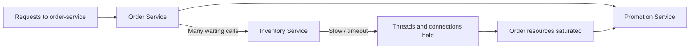
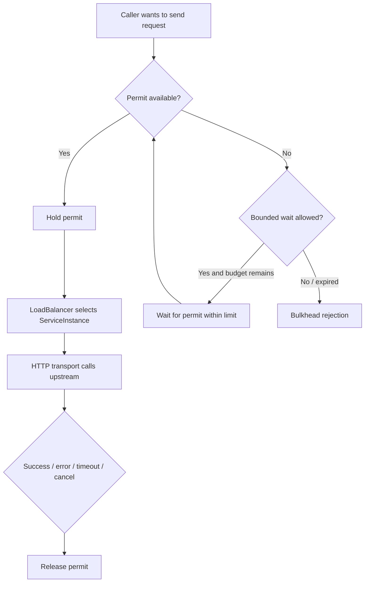
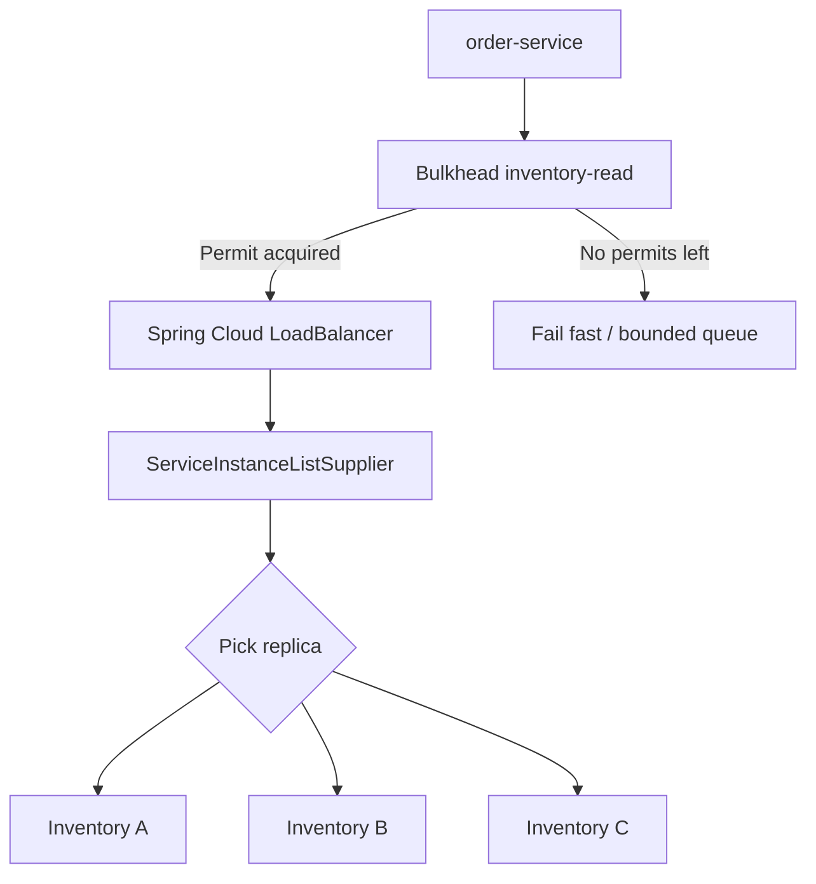

# Bulkheads and Limiting Concurrent Calls

In a microservices architecture, a service may still have plenty of CPU to handle incoming requests, yet its processing threads and connections are held hostage because a downstream responds too slowly. For example, `order-service` calls both `inventory-service` to check stock and `promotion-service` to calculate discounts. If every inventory call waits tens of seconds, those calls can consume all of order's threads, connections, or memory; at that point, both promotion operations and unrelated endpoints suffer.

A **Bulkhead** is a **resource-isolation** design pattern inspired by watertight compartments on a ship: a breach in one compartment must not sink the entire vessel. In inter-service communication, a bulkhead caps how many tasks may concurrently use a resource or call a dependency. Once capacity is full, the system **fails fast** or places work in a **clearly bounded queue**, instead of letting requests accumulate unboundedly.

This lesson belongs to the **Isolation and Recovery** chapter of the `SPRING_CLOUD_SERVICE_COMMUNICATION_LOAD_BALANCING` module. The focus is understanding bulkheads and **concurrent call limits** in the context of Spring Cloud LoadBalancer selecting a `ServiceInstance` by service ID based on discovery, health checks, and routing policies. The lesson also demonstrates coordinating bulkheads with `RestClient`, `WebClient`, OpenFeign, timeouts, retries, and observability.

## 1. Why Is Load Balancing Not Enough to Prevent Cascading Overload?

Suppose `order-service` calls `inventory-service` using the logical URI `http://inventory-service`. Spring Cloud LoadBalancer selects replica A, B, or C. This distributes target choices, **without automatically capping the total number of waiting inventory calls** inside order.



Consider a quantitative example:

- `order-service` receives a steady 150 requests/second; each request makes one inventory call.
- Normally, the average inventory wait time is 80 ms.
- During a downstream incident, the average wait time rises to 800 ms.

By Little's Law, under steady request arrival:

```text
Average in-flight calls ≈ arrival rate × processing duration

Normal: 150 calls/s × 0.080 s ≈ 12 in-flight calls
Slow:   150 calls/s × 0.800 s ≈ 120 in-flight calls
```

Without any increase in incoming traffic, concurrency jumps **10x**. If the thread pool or connection pool limit is below that, the caller bottlenecks. Round robin can still split requests across three replicas, yet it cannot fix the fact that **the caller is accepting work faster than it can finish it**.

A bulkhead capping, say, **24 concurrent inventory calls per order instance** can shield the caller from letting inventory monopolize all resources. However, when downstream slows down, a limit of 24 does not conjure extra capacity: with an average permit hold time of 0.8 seconds, the ideal completion throughput of that group is at most around `24 / 0.8 = 30 calls/second`. Traffic exceeding that capacity must wait within tight bounds, be rejected, or be shed by policy. **A bulkhead prioritizes isolation and keeping the system recoverable, not guaranteeing every request succeeds.**

## 2. "Concurrent Calls" Differs from RPS, Timeout, and Replica Count

| Term | Question it answers | Example |
|---|---|---|
| **Concurrency / in-flight** | How many tasks are currently executing or holding resources? | At most 24 inventory calls at the same time. |
| **Throughput / RPS** | How many requests start or finish per second? | 150 requests/second arriving at order. |
| **Queue length** | How many tasks are waiting for an execution slot? | At most 10 tasks allowed to wait. |
| **Timeout / deadline** | How long may an attempt or logical request wait? | 800 ms total budget for a lookup. |
| **Replica count** | How many instances of the target service are deployed? | Three inventory replicas. |
| **Bulkhead permit** | How many calls are allowed into the protected region? | 24 permits shared within one caller. |

**A concurrency limit is not a rate limit.** With 24 permits and requests finishing in 20 ms, the system can process many calls per second. With the same 24 permits but each request taking 2 seconds, throughput drops sharply. A **rate limiter** controls how many calls start in a time window; a **bulkhead** controls how many coexist at any instant.

Similarly, **timeouts do not replace bulkheads**. With a 10-second timeout and thousands of requests arriving within 1 second, the caller can still exhaust resources before timeouts ever trigger. Bulkheads provide upfront **admission control**, while timeouts stop work from holding resources too long once admitted.

## 3. How a Bulkhead Works: Acquire, Hold, and Release Permits

For a semaphore-style bulkhead, state can be described with a counter:

```text
maxConcurrentCalls = 3

Request A  -> acquire permit #1 -> call upstream -> release permit
Request B  -> acquire permit #2 -> call upstream -> release permit
Request C  -> acquire permit #3 -> call upstream -> release permit
Request D  -> no permits left   -> reject immediately or wait within limit
```



A permit must be released when work ends, including on error and cancellation. In synchronous code using `Semaphore` directly, that typically requires a `finally` block; in a reactive pipeline, the permit must be bound to the **subscription** lifecycle, not released right after constructing the `Mono`. Bulkhead libraries provide Reactor-compatible operators to manage this, though cancellation and timeout behavior should still be tested specifically.

When no permits remain, a bulkhead can:

1. **Fail fast:** reject immediately without tying up another waiting thread.
2. **Wait bounded:** wait at most a short duration or enqueue into a bounded-capacity queue.
3. **Avoid unbounded waits:** large queues may hide errors temporarily, yet inflate latency, memory usage, and cascading overload.

Do not assume every "rejected" request is an upstream failure. It may be a **caller-side resource-protection decision** occurring even before instance selection.

## 4. Two Common Bulkhead Types

| Property | Semaphore bulkhead | Thread-pool bulkhead |
|---|---|---|
| Limited resource | Number of calls currently holding a permit. | Number of tasks running in the executor and its queue. |
| Dedicated threads? | No; work runs on the existing thread/scheduler. | Yes, a dedicated thread pool for submitted tasks. |
| Suitable for | Synchronous calls already on dedicated threads; reactive pipelines with non-blocking operators. | Isolating blocking work onto a separate pool and bounding its queue. |
| When full | Can reject or wait for a permit as configured. | Rejects when both pool and queue are full. |
| Main risk | Waiting too long for a permit stalls caller threads; forgetting to release permits. | Long queues, thread overhead, hard-to-manage cancellation of blocking I/O. |
| Replaces timeouts? | No. | No. |

### Semaphore: Limits Call Count, Does Not Switch Threads Automatically

A semaphore bulkhead with `maxConcurrentCalls = 16` caps concurrent calls at 16 **within that bulkhead instance's scope**. If RestClient is blocking on a servlet thread, the bulkhead does not make the call non-blocking. Setting `maxWaitDuration = 0` allows the 17th request to fail fast instead of tying up a thread waiting.

### Thread Pool: Isolates Blocking Resources

A thread-pool bulkhead typically has its own worker threads and queue capacity. It is useful for separating a slow upstream from threads handling other work, provided you define queue-full behavior, bound total wait time, and handle cancellation and resource cleanup. Creating a massive thread pool or an unbounded queue **is not an effective bulkhead**.

With WebClient running in true non-blocking reactive mode, do not automatically offload every HTTP call onto a thread-pool bulkhead just because "reactive needs bulkheads too": bounding **in-flight subscriptions** via semaphore/operators or pipeline concurrency limits is usually a better fit. If an adapter calls a blocking library, choosing the right scheduler/pool is a separate concern to handle explicitly.

## 5. Choosing Isolation Scope: Per Downstream, Endpoint, or Business Flow?

Limits should protect actual contended resources, not just produce a number on a dashboard.

| Bulkhead scope | When useful | Caution |
|---|---|---|
| One bulkhead for all of `inventory-service` | Protects order from aggregate inventory traffic. | Short read APIs and long batch APIs may compete for the same permits. |
| One bulkhead for `inventory-read`, one for `inventory-batch` | Prevents batch jobs from starving user-facing slots. | Sum of both limits must still fit shared resources. |
| Per-tenant/cohort bulkhead | Prevents one heavy tenant from crowding out others. | Large tenant counts increase objects, metrics, and complexity. |
| Per-target-instance bulkhead | Dedicated cap for one slow replica. | Hard to keep in sync with discovery and replica churn; distinguish from service-ID limits. |
| Bulkhead for high-risk downstreams | Avoids exhausting pools serving other dependencies. | Also bound incoming requests and caller shared resources. |

If `order-service` calls two services concurrently, you can configure **two independent bulkheads**:

```text
order-service
  ├── inventory-read bulkhead: 16 concurrent calls
  │       └── inventory-service (A / B / C)
  └── promotion bulkhead:     8 concurrent calls
          └── promotion-service (X / Y)
```

When inventory slows down, inventory permits fill up while flows using promotion **do not run out of inventory permits**. Still, if both share the same servlet thread pool or an unbounded connection pool, separate bulkheads address only one contention point rather than isolating every resource type.

### Bulkheads Usually Have Local Scope

A singleton `Bulkhead` bean inside one `order-service` instance normally enforces its limit **only within that JVM/instance**. Running four order replicas with 16 permits each means the replicas together can drive roughly **64 in-flight inventory calls** before even counting retries or other callers.

Therefore, never mistake a local bulkhead for a **cluster-wide distributed quota**. If the downstream has a global budget, coordinate replica counts, downstream admission control, distributed rate limits, or other policies. Scaling out callers can raise downstream load even while each caller respects its local cap.

## 6. Designing with Spring Cloud LoadBalancer

Spring Cloud LoadBalancer typically executes the chain:

```text
RestClient / WebClient / OpenFeign
      -> logical service ID
      -> ServiceInstanceListSupplier (discovery, health, zone/hint...)
      -> ServiceInstance selection algorithm
      -> HTTP transport
```

**A bulkhead is not a load-balancing algorithm.** It guards the count of in-flight calls; LoadBalancer selects a target from candidates. Depending on architecture, the bulkhead can wrap the entire caller invocation or sit near the HTTP attempt step. What matters is defining **the exact unit a permit protects**.

Suppose inventory calls use a service-ID-level bulkhead:



A call rejected because the bulkhead is full may **never have had LoadBalancer pick an instance**. Conversely, if the bulkhead sits after target selection, some requests may run selection logic without being sent. When collecting telemetry, distinguish **logical requests**, **bulkhead admissions/rejections**, **LoadBalancer selections**, and **HTTP attempts**.

Zone preference and health checks reduce picking bad targets, yet they do not control concurrency. In particular, a hard constraint such as "this tenant may only be processed in the EU region" must still hold when permits are scarce or during retries: a full bulkhead is **never** a reason to fall back to an instance violating data policy.

## 7. RestClient Example: Shared Semaphore Bulkhead

One implementation option is Resilience4j Bulkhead. This example assumes the project has Spring Framework supporting `RestClient`, Spring Cloud LoadBalancer, and a compatible `resilience4j-bulkhead` dependency. Resilience4j is an additional library—**it is not automatically enabled just by adding `spring-cloud-starter-loadbalancer`**.

Create a RestClient builder integrated with LoadBalancer:

```java
import org.springframework.cloud.client.loadbalancer.LoadBalanced;
import org.springframework.context.annotation.Bean;
import org.springframework.context.annotation.Configuration;
import org.springframework.web.client.RestClient;

@Configuration
class HttpClientsConfig {

    @Bean
    @LoadBalanced
    RestClient.Builder loadBalancedRestClientBuilder() {
        return RestClient.builder();
    }

    @Bean("inventoryRestClient")
    RestClient inventoryRestClient(
            @LoadBalanced RestClient.Builder builder) {
        return builder.clone()
            .baseUrl("http://inventory-service")
            .build();
    }
}
```

Create **one shared bulkhead bean**, rather than creating a new one per call:

```java
import io.github.resilience4j.bulkhead.Bulkhead;
import io.github.resilience4j.bulkhead.BulkheadConfig;
import org.springframework.context.annotation.Bean;
import org.springframework.context.annotation.Configuration;
import java.time.Duration;

@Configuration
class InventoryBulkheadConfig {

    @Bean("inventoryReadBulkhead")
    Bulkhead inventoryReadBulkhead() {
        BulkheadConfig config = BulkheadConfig.custom()
            .maxConcurrentCalls(16)
            .maxWaitDuration(Duration.ZERO)
            .build();

        return Bulkhead.of("inventory-read", config);
    }
}
```

Wrap the code that **actually sends the HTTP call**:

```java
import io.github.resilience4j.bulkhead.Bulkhead;
import org.springframework.beans.factory.annotation.Qualifier;
import org.springframework.stereotype.Service;
import org.springframework.web.client.RestClient;
import java.util.function.Supplier;

@Service
class InventoryGateway {

    private final RestClient client;
    private final Bulkhead bulkhead;

    InventoryGateway(
            @Qualifier("inventoryRestClient") RestClient client,
            @Qualifier("inventoryReadBulkhead") Bulkhead bulkhead) {
        this.client = client;
        this.bulkhead = bulkhead;
    }

    ItemDto getItem(String itemId) {
        Supplier<ItemDto> guarded =
            Bulkhead.decorateSupplier(bulkhead, () ->
                client.get()
                    .uri("/api/items/{id}", itemId)
                    .retrieve()
                    .body(ItemDto.class));

        return guarded.get();
    }
}
```

`ItemDto` is an application-defined DTO. This example illustrates structure only and omits timeout configuration, empty response handling, and business errors. The logical flow is: acquire permit → call RestClient by service ID → LoadBalancer selects instance → HTTP transport awaits response → release permit on completion/error.

With `maxWaitDuration(Duration.ZERO)`, once 16 calls hold permits, the 17th call can immediately throw `BulkheadFullException` on the caller. Do not catch that exception and **still call inventory through a side path**, as doing so defeats the bulkhead's purpose.

### What to Avoid in Synchronous Code

The snippet below **does not actually enforce a limit** because a fresh bulkhead is created on every request:

```java
// WRONG: each call gets its own separate permit counter.
ItemDto getItemWrong(String id) {
    Bulkhead temporary = Bulkhead.ofDefaults("inventory-read");
    return Bulkhead.decorateSupplier(temporary,
        () -> client.get()
            .uri("/api/items/{id}", id)
            .retrieve()
            .body(ItemDto.class)).get();
}
```

A bulkhead must be **shared across all requests competing for the same budget**—for example, a singleton bean per dependency/operation. Do not substitute a `synchronized` lock around the entire HTTP call: that serializes all calls, fails to express a concurrency cap clearly, and creates unnecessary contention.

## 8. WebClient: Bounding In-Flight Calls Without Blocking the Event Loop

WebClient uses Reactor and can perform non-blocking I/O. When you write:

```java
Mono<ItemDto> response = inventoryWebClient.get()
    .uri("/api/items/{id}", itemId)
    .retrieve()
    .bodyToMono(ItemDto.class);
```

`response` only describes the pipeline; the HTTP call normally starts upon subscription. Consequently, "acquire permit before creating the `Mono`, release in `finally` after returning" **is wrong for the lifecycle**:

```java
// WRONG: finally runs right after Mono creation, before awaiting HTTP response.
Mono<ItemDto> getItemWrong(String id) {
    semaphore.acquireUninterruptibly();
    try {
        return inventoryWebClient.get()
            .uri("/api/items/{id}", id)
            .retrieve()
            .bodyToMono(ItemDto.class);
    } finally {
        semaphore.release(); // Released too early.
    }
}
```

One solution is using `BulkheadOperator` from a `resilience4j-reactor` version compatible with your runtime:

```java
import io.github.resilience4j.bulkhead.Bulkhead;
import io.github.resilience4j.reactor.bulkhead.operator.BulkheadOperator;
import reactor.core.publisher.Mono;

class ReactiveInventoryGateway {

    private final WebClient client;
    private final Bulkhead bulkhead;

    ReactiveInventoryGateway(
            WebClient inventoryWebClient,
            Bulkhead inventoryReadBulkhead) {
        this.client = inventoryWebClient;
        this.bulkhead = inventoryReadBulkhead;
    }

    Mono<ItemDto> findItem(String id) {
        return Mono.defer(() ->
                client.get()
                    .uri("/api/items/{id}", id)
                    .retrieve()
                    .bodyToMono(ItemDto.class))
            .transformDeferred(BulkheadOperator.of(bulkhead));
    }
}
```

Here `inventoryWebClient` must be built from `@LoadBalanced WebClient.Builder` if resolving `http://inventory-service` via Spring Cloud LoadBalancer. `inventoryReadBulkhead` must be a shared instance, injected by qualifier when multiple bulkheads exist. Non-essential `WebClient` imports and annotations are omitted.

With the reactive operator, permits are managed per **subscription** and released upon completion/error/cancellation per the implementation's semantics. Configure **non-blocking permit waiting**, such as `maxWaitDuration = Duration.ZERO`, and test permit release on timeout/cancellation; never block the Reactor Netty event loop waiting for a slot.

### Bounding Concurrency with flatMap

If you only need to cap concurrent requests **within a single batch flow**, Reactor provides:

```java
Flux.fromIterable(itemIds)
    .flatMap(id -> inventoryWebClient.get()
        .uri("/api/items/{id}", id)
        .retrieve()
        .bodyToMono(ItemDto.class), 8)
    .collectList();
```

The parameter `8` limits concurrent inner publisher subscriptions **within one subscription of this pipeline**. It is not a service-wide bulkhead: if 100 user requests run that pipeline simultaneously, total inventory calls can far exceed 8. To protect **all inventory traffic from an order instance**, you need a bulkhead shared across requests or equivalent admission control.

## 9. OpenFeign: Isolating Synchronous Calls per Client

OpenFeign is commonly used synchronously:

```java
@FeignClient(
    name = "inventory-service",
    contextId = "inventoryRead"
)
interface InventoryReadClient {

    @GetMapping("/api/items/{id}")
    ItemDto findItem(@PathVariable("id") String id);
}
```

You can wrap Feign calls with a bulkhead at the service layer:

```java
class InventoryFacade {

    private final InventoryReadClient feign;
    private final Bulkhead inventoryReadBulkhead;

    InventoryFacade(InventoryReadClient feign,
                    Bulkhead inventoryReadBulkhead) {
        this.feign = feign;
        this.inventoryReadBulkhead = inventoryReadBulkhead;
    }

    ItemDto findItem(String id) {
        return Bulkhead.decorateSupplier(inventoryReadBulkhead,
            () -> feign.findItem(id)).get();
    }
}
```

This snippet assumes the singleton bulkhead is properly injected and omits annotations/imports. `@FeignClient` with `name = "inventory-service"` can route through Spring Cloud LoadBalancer when no fixed `url` is set and integration is present. The bulkhead in the facade **does not create new replicas**, alter discovery, or silently turn Feign asynchronous.

If each Feign client needs its own bulkhead policy, manage beans by name/context and avoid letting a `@Configuration` containing client-specific interceptors/retryers be component-scanned as unintended global config. A dedicated bulkhead for `inventoryRead` should not share permits with `inventoryBatch` if the goal is isolating batch jobs from user requests.

## 10. Combining Bulkheads with Timeouts, Retries, and Circuit Breakers

Bulkheads primarily guard **in-flight call counts**, so they must work alongside other mechanisms:

| Mechanism | What does it protect? | What it does not do for a bulkhead |
|---|---|---|
| **Timeout/deadline** | Prevents one call from occupying time indefinitely. | Thousands of concurrent requests can still exhaust resources before timeouts fire. |
| **Bounded retry** | Retries transient errors per policy. | Retries can increase concurrent in-flight calls. |
| **Circuit breaker** | Stops sending requests when downstream errors breach thresholds. | While closed, too many calls can still pile up simultaneously. |
| **Rate limiter** | Throttles request start rate over a time interval. | One slow request can hold resources for a long time even at low RPS. |
| **LoadBalancer** | Selects a `ServiceInstance` from valid candidates. | Does not enforce a permit budget across business calls. |
| **Health check** | Excludes/prioritizes instances by health signals. | An `UP` health endpoint does not guarantee fast upstream processing. |

### Bulkhead Position Relative to Retry Determines Permit Hold Time

Suppose a logical request allows up to three HTTP attempts. There are two different ways to compose them:

**Bulkhead wrapping the entire logical request:**

```text
Bulkhead(
    Retry(
        call inventory
    )
)
```

A permit can be held **throughout the retry process, including backoff**. This bounds the number of logical requests contending for the dependency, though it may hold a permit when no HTTP attempt is actively running.

**Bulkhead inside retry, wrapping each attempt:**

```text
Retry(
    Bulkhead(
        single inventory attempt
    )
)
```

The permit can be released between attempts, protecting the number of **actively running HTTP attempts**. However, if the retry policy immediately retries on "bulkhead full," it can create a rapid rejection loop or add load at the worst moment.

The right order depends on your objective: bounding **logical requests** or bounding **transport attempts**. Large systems may need both budgets, while avoiding overlapping layers with unclear ownership. In Reactor, the relative placement of `retryWhen(...)` and `transformDeferred(BulkheadOperator.of(...))` in the pipeline defines what unit a permit wraps. Test retries, errors, cancellation, and deadlines directly instead of guessing from code order.

### Do Not Blindly Retry BulkheadFullException

`BulkheadFullException` signals that the caller has run out of capacity allocated for the dependency. It **does not necessarily** mean a replica has died. Retrying immediately without backoff or budget can turn one rejected request into dozens of permit-acquisition attempts—the exact **retry storm** to avoid.

If business requirements permit retrying after a full bulkhead, require bounded wait policies, jitter, deadlines, and alternative capacity ensuring extra attempts do no harm. In many low-latency APIs, **failing fast** is better than waiting for a permit with no guarantee when one will free up.

### Circuit Breaker and Bulkhead Are Two Different Signals

If upstream keeps returning `500`, the circuit breaker can open to cut outbound requests. If upstream keeps returning `200` yet each call takes many seconds, the bulkhead can fill up even while the circuit breaker stays closed. Conversely, an open circuit can reject requests before the bulkhead acquires a permit, depending on wrapping order. Distinguish **circuit-open rejections** from **bulkhead-full rejections** in metrics/logs and response policies.

## 11. Sizing: What Should maxConcurrentCalls Be?

There is no single right number for every service. Start by measuring upstream latency, throughput, CPU, connection pools, and tail latency. One initial estimation approach:

```text
normal concurrency needed ≈ target throughput × average latency
```

For example, an inventory endpoint called 80 times/second with a normal 120 ms latency:

```text
80 calls/s × 0.12 s ≈ 9.6 in-flight calls
```

If load tests show upstream remains stable up to 20 concurrent calls from one order instance, you can **experiment** with setting the bulkhead around 16–20 permits, then measure saturation, rejection rate, and p95/p99. This number is only meaningful alongside order replica count, other callers, and inventory's actual resources.

If inventory slows down to 1.2 seconds latency:

```text
80 calls/s × 1.2 s ≈ 96 in-flight calls if admission is uncapped
With 20 permits: ideal completion throughput ≈ 20 / 1.2 ≈ 16.7 calls/s
```

When the caller still receives 80 requests/second, the bulkhead must **reject or shed** work exceeding the budget; no configuration trick can manufacture capacity to finish all 80 calls/second with 20 permits when each call holds a permit for 1.2 seconds.

### Factors to Consider When Tuning

1. **Percentile latency:** do not look only at averages. A few very slow requests can hold permits long enough to spike rejections.
2. **Caller replica count:** each instance has its own bulkhead; scaling out callers increases cluster-wide in-flight calls.
3. **Maximum upstream concurrency:** target instance CPU, connection pools, database pools, and threads/schedulers.
4. **Business criticality:** payment APIs, product reads, and batch exports do not share the same deadlines or fault tolerance.
5. **Queue wait time:** large queues can wreck p99 even when rejection rates look small.
6. **Retry amplification:** extra attempts raise actual load beyond logical RPS.
7. **Shared bottlenecks:** two seemingly independent services sharing a DB or HTTP connection pool can still affect each other.

Do not "cure" high rejections by immediately raising `maxConcurrentCalls`. If downstream is genuinely saturated, adding permits only shifts the jam from caller to upstream and can prolong an outage.

## 12. How Should You Respond When the Bulkhead Is Full?

`BulkheadFullException` is an admission-control signal. Decide what to return based on the API contract rather than turning it into a fake business success:

| Operation type | Potentially appropriate response |
|---|---|
| Non-critical read allowing stale data | Return cached data marked with freshness metadata per contract. |
| Inventory check requiring fresh data | Return a clear temporary error; do not infer "out of stock." |
| Order creation, payment, or writes | Never report "success" when unexecuted; preserve idempotency and consistent state. |
| Non-urgent batch work | Defer job via a separately bounded queue or controlled schedule. |
| Request near its deadline | Reject early instead of queuing work that cannot finish in time. |

In HTTP APIs, insufficient upstream capacity may map to **`503 Service Unavailable`**; **`429 Too Many Requests`** fits certain rate/client quota policies better. Pick status codes per contract rather than mechanically using `429` for every internal error. Only emit `Retry-After` when backed by a reasonable prediction/rate-limit strategy rather than promising an unfounded recovery window.

When falling back to cache or degraded results, clearly indicate values may be stale and confirm the data contract allows it. Bulkheads do not replace access control; if multiple tenants share a dependency, keep downstream authorization enforced and protect sensitive data in logs.

## 13. Observability: Knowing Whether the Bulkhead Is Protecting or Over-Blocking

Operational signals must be viewed together:

| Metric / event | Purpose |
|---|---|
| **Available permits / active calls** | How close to full is the bulkhead, or how much headroom remains? |
| **Rejected calls** | How many requests were turned away for lack of capacity? |
| **Wait duration / queue depth** (if queued) | Are queues building up and inflating latency? |
| **Logical requests, HTTP attempts** | Is retry amplifying load? |
| **Downstream p50/p95/p99 latency** | Are slow calls holding permits too long? |
| **Timeouts and cancellations** | Are permits released promptly when requests finish/cancel? |
| **LoadBalancer chosen instance** | Is one replica concentrating errors or receiving disproportionate load? |
| **Connection pool / servlet threads** | Are other resources still bottlenecked even with a bulkhead enabled? |
| **Circuit breaker open, rate-limit rejection** | Distinguish rejection sources across resilience layers. |

Resilience4j provides bulkhead metrics/events and Micrometer integration with suitable dependencies/configuration. Exact metric names and Actuator exposure depend on your runtime version; do not assume an illustrative metric name exists automatically.

Do not use `requestId` or rapidly changing instance hostnames as high-cardinality metric tags; keep a bounded tag set such as client/dependency, outcome, and error class. Traces/logs can correlate logical requests, `ServiceInstance` selections, and HTTP attempts, but never put access tokens, cookies, or sensitive data into logs.

### A Rising Rejection Rate Is Not Always Bad

During a downstream outage, rejections may climb while latencies on other APIs **drop compared to having no bulkhead**. That can be evidence the bulkhead is isolating failures effectively. The goal is preserving overall system quality with transparent rejection policies, not forcing rejections to zero under all conditions.

If rejections stay high even while upstream is healthy, check for overly tight limits, mismatched queues, permits held too long, permit-release bugs, or wrapping the bulkhead at the wrong lifecycle point.

## 14. Hands-On Lab: Verifying Isolation When One Downstream Slows Down

Set up an `order-service` calling `inventory-service` and `promotion-service`, with at least one test stub/instance per downstream. You can use `RestClient` or `WebClient` integrated with Spring Cloud LoadBalancer by service ID, and enable bulkhead metrics. Restrict traffic to a test environment; never run destructive load against shared systems.

| Test case | How to simulate | What to prove |
|---|---|---|
| **No bulkhead** | Make inventory respond with a 2-second delay under bounded concurrent load. | In-flight threads/connections climb; other endpoints may slow down. |
| **Semaphore with 8 permits** | Wrap inventory with fail-fast when permits run out. | No more than 8 in-flight inventory calls **in one order instance**. |
| **Two separate bulkheads** | Inventory is slow while promotion stays normal. | Exhausted inventory permits do not drain promotion permits. |
| **Wrong Mono wrapping** | Acquire permit before returning `Mono`, release immediately in `finally`. | Counter does not reflect active subscriptions; reproduce and identify the bug. |
| **flatMap concurrency = 4** | Run a multi-item batch pipeline. | Each batch subscription runs at most 4 inner calls, yet parallel batches can exceed 4 total. |
| **Retry on rejection** | Enable immediate retry on `BulkheadFullException`. | Rejections/attempts surge even without upstream recovery; add proper filters and budget. |
| **Timeout/cancel** | Let requests breach deadline and cancel subscriptions. | Permits are released; zero stuck active calls remain afterward. |
| **Scale caller** | Run 2 order instances, 8 permits each. | Total inventory calls can reach ~16; do not confuse local quota with cluster quota. |
| **Replica swap via LB** | Remove one inventory replica from discovery. | Bulkhead limits in-flight calls but does not replace discovery/health; errors stay separated by layer. |
| **Hard zone restriction** | Leave only instances in a forbidden zone. | No policy-violating fallback occurs even if bulkhead has permits or retry is enabled. |

### How to Measure Results

Record for each run: service ID, logical request ID, bulkhead name, active/max permits, rejection count, HTTP attempts, target instance, response time, and final outcome. Compare **p95/p99 of the inventory API** against **p95/p99 of an inventory-independent endpoint** at the same load level.

Ask: when inventory degrades, does the system retain enough resources to keep serving promotion and independent endpoints? If yes, the bulkhead is achieving isolation, even when some inventory calls must fail fast.

## 15. Common Mistakes

| Mistake | Consequence | Fix |
|---|---|---|
| Creating a new `Bulkhead.of(...)` per request | Every request gets its own permit, never bounding total concurrency. | Create a shared bean per dependency/operation. |
| Acquiring/releasing semaphore just while building `Mono` | Permit is released before HTTP finishes. | Use an operator tied to subscription lifecycle. |
| One bulkhead for all downstreams | Slow inventory causes promotion to reject from the same counter. | Split bulkheads by failure boundary and isolated resource. |
| Setting `maxWaitDuration` too long with RestClient/OpenFeign | Threads wait for permits, inflating latency. | Prefer fail-fast or short waits with deadlines. |
| Oversized thread-pool queue | Tasks pile up, consuming memory and inflating tail latency. | Bound pool/queue sizes and define rejection policies. |
| Immediate retry on bulkhead full | Retry storm, surging attempts/rejections. | Do not retry by default; apply budget, backoff, and deadline if truly needed. |
| Raising `maxConcurrentCalls` to silence rejections | Overloads downstream further, worsening cascading failures. | Measure capacity, enforce admission control, optimize upstream. |
| Confusing local limit with cluster-wide quota | Scaling callers drives total load above expectations. | Budget across caller replica counts and all traffic sources. |
| Assuming LoadBalancer provides a bulkhead | Waiting calls remain uncapped. | Configure bulkhead/resilience policies explicitly. |
| Looking only at successful request counts | Blind to whether bulkhead protects other APIs or is undersized. | Track in-flight, rejections, tail latency, and HTTP attempts. |

## 16. Production Rollout Checklist

- Clearly identify **the resources and failure domains** to isolate: a downstream, an operation, or a tenant tier.
- Choose semaphore bulkhead or thread-pool bulkhead according to blocking/reactive model and real resource topology.
- Ensure bulkheads are **shared instances**, never recreated per call.
- With reactive WebClient, bind permit hold duration to the full subscription lifecycle, including complete/error/cancel.
- Size limits from throughput, latency, and caller replica counts; avoid mistaking local quotas for distributed caps.
- Set explicit queue/`maxWaitDuration` bounds and deadlines; never wait indefinitely once saturated.
- Never blindly retry `BulkheadFullException`; coordinate backoff, jitter, retry budgets, and idempotency.
- Distinguish bulkhead rejections, circuit-open rejections, LoadBalancer no-instance errors, and upstream HTTP errors.
- Preserve zone/region/tenant constraints and authorization during retry/failover; never use a full bulkhead as an excuse to bypass policy.
- Test interactions with connect/read timeouts, connection pools, thread pools, circuit breakers, and rate limiters.
- Monitor available permits, active calls, rejections, p95/p99, HTTP attempts, and unrelated API health.
- Test graceful shutdown, cancellation, timeouts, discovery instance loss, and caller scaling.

**Key takeaway:** **Spring Cloud LoadBalancer decides which instance to call, whereas a bulkhead decides whether another concurrent call may proceed**. Concurrency limiting is a mechanism for *protecting* resources and isolating faults, not a way to raise downstream throughput. For stable recovery, combine properly scoped bulkheads with timeouts/deadlines, controlled retries, circuit breakers, sound HTTP transport settings, and observability covering both rejected calls and healthy unaffected APIs.
