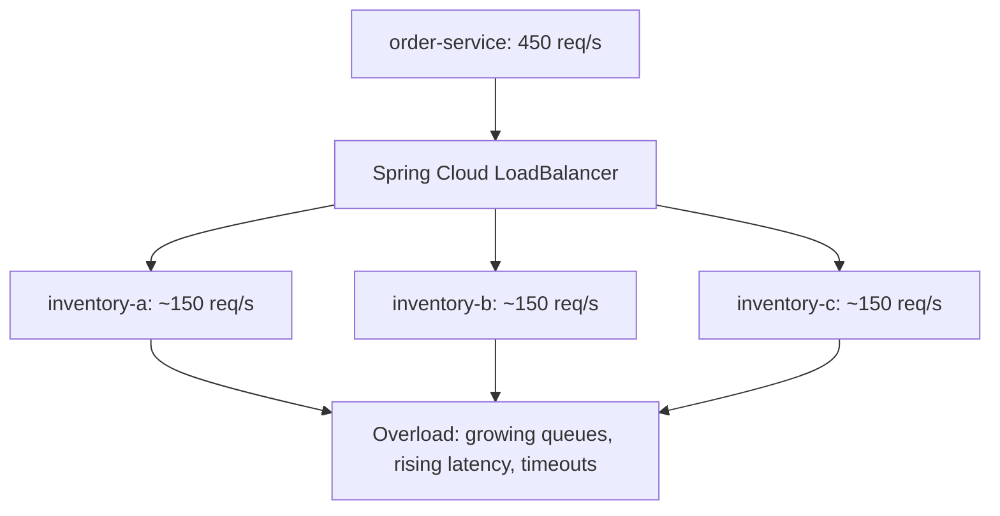
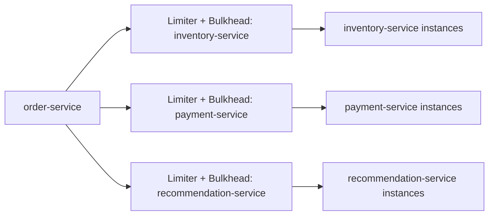

# Rate Limits, Queues, and Backpressure Control on Target Services

## Objectives

Spring Cloud LoadBalancer helps an application select a `ServiceInstance` when calling another service by service ID. However, **choosing the right instance does not mean the backend has enough resources to accept more requests**. If `order-service` sends thousands of concurrent requests to `inventory-service`, LoadBalancer can still distribute them across overloaded replicas. The result is typically rising latency, exhausted connection pools, HTTP 429/503 responses, timeouts, and retry storms.

To prevent cascading failures, systems need **isolation and pressure-control** mechanisms:

- **Rate limiting**: controls how many requests are permitted through per unit of time.
- **Bulkhead / concurrency limit**: caps how many operations execute concurrently.
- **Bounded queue**: allows only a finite amount of work to wait for processing.
- **Backpressure, load shedding, and deadlines**: signal overload to callers and reject early instead of accumulating work unboundedly.
- **Timeouts, retries, and circuit breakers**: coordinate controlled recovery without amplifying pressure.

This lesson belongs to the **Isolation and Recovery** chapter of the Spring Cloud Service Communication Load Balancing module: the focus is protecting **target services** when callers use `RestClient`, `RestTemplate`, `WebClient`, or OpenFeign, while clarifying boundaries with Spring Cloud Gateway and resilience libraries.

After this lesson, you will be able to distinguish the mechanisms above, design a sensible load budget, implement rate limiters and bulkheads on callers, configure bounded queues, test behavior under concurrent load, and decide when to reject instead of waiting or retrying.

## 1. Why Does LoadBalancer Not Prevent Overload Automatically?

Suppose `inventory-service` has three instances:

| ServiceInstance | Normal processing capacity (assumed) | Status |
|---|---:|---|
| `inventory-a` | 50 requests/second | Ready |
| `inventory-b` | 50 requests/second | Ready |
| `inventory-c` | 50 requests/second | Ready |

When `order-service` surges from 60 to 450 requests/second, round robin can still distribute requests fairly evenly. Yet total illustrative capacity is only about 150 requests/second, so **every instance still receives more load than it can handle**.



This example assumes three instances of similar configuration and capacity; actual request counts also depend on algorithms, hints, zones, caching, retries, and traffic from other callers. **Ready** or passing health checks only reflects configured readiness criteria; it does not mean an instance has enough spare capacity for every incoming request.

Spring Cloud LoadBalancer solves **endpoint selection**. It does not enforce aggregate limits such as "only let `inventory-service` process 100 requests/second" or "only 20 in-flight requests." Those limits must be implemented at the appropriate layer.

## 2. Distinguishing Six Mechanisms

| Mechanism | Question answered | Unit | When limit is exceeded |
|---|---|---|---|
| **Load balancing** | Which instance will the request call? | `ServiceInstance` list | May pick another instance, does not cap load itself |
| **Rate limiting** | May another request start in this interval? | Requests/sec or tokens/period | Reject, wait for permission, or return 429 per policy |
| **Concurrency limit / bulkhead** | How many calls are running simultaneously? | In-flight operations | Reject or wait briefly for a slot |
| **Bounded queue** | How many requests may wait? | Item count and wait duration | Fail fast when full/expired |
| **Connection pool** | How many connections can be leased to a route? | Connections and pending acquires | Wait for connection, hit acquire timeout, or reject |
| **Circuit breaker** | Is downstream failing severely enough to pause attempts? | Failure/slow-call rate, breaker state | Fail fast when OPEN, allow controlled probes in HALF_OPEN |

Three limit types usually work together:

1. **Rate** prevents a caller from firing too many operations in a time interval.
2. **Concurrency** prevents a caller from holding too many unfinished HTTP operations.
3. **Queue** bounds waiting work, avoiding unbounded memory and latency growth.

For example, a rate limit of 40 requests/second **does not guarantee** low concurrency: if each request takes 3 seconds, many requests can remain in-flight. Conversely, a concurrency limit of 10 **does not necessarily** cap requests/second: if each request takes only 10 ms, 10 slots can serve a high request rate per second.

## 3. Rate Limit: Controlling Request Transmission Rate

Two common algorithms are:

- **Token bucket**: tokens replenish at a configured rate; each request consumes one or more tokens; allows bursts up to bucket capacity.
- **Fixed/cyclic permissions**: each period grants a fixed number of permissions; requests without permission either wait for the next period or are rejected.

Example of a limiter for `inventory-service` permitting on average 20 new executions per second, without waiting when permissions run out:

```text
limitForPeriod = 20
limitRefreshPeriod = 1 second
timeoutDuration = 0 ms

In the current period:
  first 20 requests -> receive permission
  next request      -> RequestNotPermitted
```

This illustrates a limiter running **inside one JVM**. Do not equate it with a cluster-wide exact limit or a gateway token-bucket contract. Different implementations handle cycle boundaries, bursts, and permission allocation differently.

### 3.1. Implementing with Resilience4j RateLimiter

Resilience4j provides a `RateLimiter` independent of HTTP clients. To use the Java API configuration approach, add `resilience4j-ratelimiter` at a project-managed compatible version:

```xml
<dependency>
    <groupId>io.github.resilience4j</groupId>
    <artifactId>resilience4j-ratelimiter</artifactId>
</dependency>
```

Example bean in `order-service`:

```java
import java.time.Duration;
import io.github.resilience4j.ratelimiter.RateLimiter;
import io.github.resilience4j.ratelimiter.RateLimiterConfig;
import org.springframework.context.annotation.Bean;
import org.springframework.context.annotation.Configuration;

@Configuration(proxyBeanMethods = false)
class InventoryAdmissionConfiguration {

    @Bean("inventoryOutboundRateLimiter")
    RateLimiter inventoryOutboundRateLimiter() {
        RateLimiterConfig config = RateLimiterConfig.custom()
                .limitForPeriod(20)
                .limitRefreshPeriod(Duration.ofSeconds(1))
                .timeoutDuration(Duration.ZERO)
                .build();

        return RateLimiter.of("inventory-outbound", config);
    }
}
```

Explanation:

- `limitForPeriod(20)`: number of permissions granted per period.
- `limitRefreshPeriod(1s)`: duration of each refresh period.
- `timeoutDuration(Duration.ZERO)`: **fail fast** when no permission is available, instead of letting requests stall inside the caller.

Resilience4j waits for permission up to `timeoutDuration` when set above zero; that bounds **waiting for a rate permission**, not TCP connection or backend response timeouts.

### 3.2. Applying to RestClient Calls

Assume a `@LoadBalanced RestClient.Builder` bean exists:

```java
import org.springframework.cloud.client.loadbalancer.LoadBalanced;
import org.springframework.context.annotation.Bean;
import org.springframework.context.annotation.Configuration;
import org.springframework.web.client.RestClient;

@Configuration(proxyBeanMethods = false)
class HttpClientConfiguration {

    @Bean
    @LoadBalanced
    RestClient.Builder loadBalancedRestClientBuilder() {
        return RestClient.builder();
    }
}
```

In the service gateway:

```java
import java.util.function.Supplier;
import io.github.resilience4j.ratelimiter.RateLimiter;
import org.springframework.beans.factory.annotation.Qualifier;
import org.springframework.cloud.client.loadbalancer.LoadBalanced;
import org.springframework.stereotype.Component;
import org.springframework.web.client.RestClient;

@Component
class InventoryGateway {

    private final RestClient client;
    private final RateLimiter rateLimiter;

    InventoryGateway(
            @LoadBalanced RestClient.Builder builder,
            @Qualifier("inventoryOutboundRateLimiter")
            RateLimiter rateLimiter) {
        this.client = builder.baseUrl("http://inventory-service").build();
        this.rateLimiter = rateLimiter;
    }

    String getItem(String sku) {
        Supplier<String> remoteCall = () -> client.get()
                .uri("/api/items/{sku}", sku)
                .retrieve()
                .body(String.class);

        return RateLimiter
                .decorateSupplier(rateLimiter, remoteCall)
                .get();
    }
}
```

When the limiter grants permission, the request proceeds through Spring Cloud LoadBalancer to pick a `ServiceInstance`. When rejected, Resilience4j can throw `RequestNotPermitted` **before any HTTP request reaches `inventory-service`**.

**Note:** the rate limiter wrapping `remoteCall` in this example counts **each logical gateway call**. If LoadBalancer or the underlying HTTP client retries internally and sends multiple HTTP attempts, each attempt **does not necessarily consume an additional permission**. To enforce a hard cap on physical HTTP attempts reaching the backend, place the control at the per-attempt execution layer, an intermediate gateway, or the backend itself.

### 3.3. Should Rate Limiting Sit at Ingress or Outbound?

| Location | Objective | Key consideration |
|---|---|---|
| API Gateway (ingress) | Limit user/tenant/API-key requests | Can use distributed limiters; returns HTTP 429 per contract |
| Inside `order-service` before outbound calls | Keep caller from sending too many calls to `inventory-service` | Local per-process limit if using an in-memory limiter |
| Sidecar/service mesh/proxy | Cap load per route/backend | Verify all flows actually traverse the proxy |
| `inventory-service` itself | Protect actual serving capacity | Backends should self-protect even when callers are misconfigured |

Never treat a local rate limiter as a cluster-wide limit. With **5 `order-service` replicas, each capped at 20 requests/second**, theoretical total traffic can reach 100 requests/second. For a shared quota, use shared state or centralized enforcement.

## 4. Limiting Concurrency with a Bulkhead

Rate limits guard **rate**, not fully the count of operations waiting on a backend. When downstream slows down, concurrency rises even while new requests per second stay flat.

Using Little's Law in a roughly steady state:

```text
Average in-flight requests ≈ throughput (req/s)
                             × operation hold duration (s)

Example:
  40 req/s × 0.25 s = ~10 concurrent requests
  40 req/s × 2.00 s = ~80 concurrent requests
```

Thus **an 8x slower backend can drive in-flight requests up sharply** without a single extra request/second arriving. Without bounds, the caller can run out of threads, connections, heap, or scheduler slots.

### 4.1. Resilience4j SemaphoreBulkhead

Resilience4j `Bulkhead` bounds concurrent operations via a semaphore. Add the version-managed `resilience4j-bulkhead` module:

```xml
<dependency>
    <groupId>io.github.resilience4j</groupId>
    <artifactId>resilience4j-bulkhead</artifactId>
</dependency>
```

Configure a bulkhead permitting only 8 simultaneous calls:

```java
import java.time.Duration;
import io.github.resilience4j.bulkhead.Bulkhead;
import io.github.resilience4j.bulkhead.BulkheadConfig;
import org.springframework.context.annotation.Bean;

@Bean("inventoryOutboundBulkhead")
Bulkhead inventoryOutboundBulkhead() {
    BulkheadConfig config = BulkheadConfig.custom()
            .maxConcurrentCalls(8)
            .maxWaitDuration(Duration.ZERO)
            .build();
    return Bulkhead.of("inventory-outbound", config);
}
```

`maxWaitDuration(Duration.ZERO)` means when slots are full, **do not block threads waiting**, and fail fast with `BulkheadFullException`. This works well for HTTP APIs with tight deadlines that must avoid queuing pending requests.

This bean can be added to `InventoryAdmissionConfiguration` from section 3. Do not leave it outside a Spring-managed configuration class if you expect Spring to register it as a bean.

### 4.2. Composing Rate Limiter and Bulkhead for One Call

In `InventoryGateway`, alongside `RateLimiter`, inject `Bulkhead` qualified as `inventoryOutboundBulkhead`. The execution method can look like:

```java
import java.util.function.Supplier;
import io.github.resilience4j.bulkhead.Bulkhead;
import io.github.resilience4j.ratelimiter.RateLimiter;

String getItemProtected(String sku) {
    Supplier<String> remoteCall = () -> client.get()
            .uri("/api/items/{sku}", sku)
            .retrieve()
            .body(String.class);

    Supplier<String> concurrencyGuard =
            Bulkhead.decorateSupplier(bulkhead, remoteCall);
    Supplier<String> rateAndConcurrencyGuard =
            RateLimiter.decorateSupplier(rateLimiter, concurrencyGuard);

    return rateAndConcurrencyGuard.get();
}
```

In this snippet, `bulkhead` is the newly injected `Bulkhead` field; `client` and `rateLimiter` are the existing fields from earlier. This is a **method snippet**, not a standalone complete Java class to copy verbatim.

Decorator order is meaningful:

1. Rate limiter checks permission first.
2. If permitted, bulkhead checks concurrent slots.
3. If a slot is available, `RestClient` sends HTTP via LoadBalancer.
4. Whether remoteCall returns a result or throws an exception, the decorator releases the bulkhead slot when the operation ends.

Because both `timeoutDuration` and `maxWaitDuration` are `ZERO`, neither layer introduces long waits. A rate permission may already be consumed before the bulkhead rejects; that trade-off is acceptable for many fail-fast systems. If you reverse the order and allow long rate-limiter waits, a call could hold a bulkhead slot before sending any request—decide based on your system's admission-control design.

### 4.3. Which Error to Return on Rejection?

In business code, catch `RequestNotPermitted` and `BulkheadFullException` to apply an explicit policy:

- **HTTP 429 Too Many Requests**: suitable when the caller itself is enforcing user/tenant quotas.
- **HTTP 503 Service Unavailable**: typically suitable when internal/downstream resources are temporarily overloaded and the caller cannot serve.
- **Fallback with verified cached data**: suitable for read endpoints that do not require strict real-time freshness.
- **Defer to async processing**: only when business rules allow accepting and processing later.

Do not mechanically map every bulkhead rejection to 429. 429 communicates a rate/quota limit, whereas exhausting concurrent slots for a dependency often maps better to 503. Standardize the response contract and emit `Retry-After` when grounded in a real backoff policy; never invent an exact recovery delay when recovery time is unknown.

## 5. Queues: Only Wait with Explicit Bounds

Queues absorb **short** bursts, yet never create real processing capacity. If arrival rate stays above processing rate, the queue grows until full or resources run out.

Suppose a worker group handles 20 requests/second while incoming traffic is 60 requests/second. Backlog grows at roughly **40 requests/second**. A 40-slot queue fills in about one second in this simple model; raising the queue to 400 will not solve sustained overload.

| Queue policy | Advantage | Risk |
|---|---|---|
| No queue, fail fast | Predictable latency; frees resources early | Rejects requests immediately when slots fill |
| Small queue with deadline | Absorbs brief bursts | Must measure queue wait and drop expired requests |
| Large or unbounded queue | Fewer early rejections | High latency, heap growth, cascading timeouts, prolonged overload |
| Durable queue for async work | Suits deferrable tasks | Requires acks, retries, idempotency, DLQ, and status tracking |

### 5.1. ThreadPoolBulkhead with Bounded Queue

Resilience4j provides `ThreadPoolBulkhead` with a dedicated thread pool and bounded queue:

```java
import io.github.resilience4j.bulkhead.ThreadPoolBulkhead;
import io.github.resilience4j.bulkhead.ThreadPoolBulkheadConfig;
import java.util.concurrent.CompletionStage;

ThreadPoolBulkheadConfig config = ThreadPoolBulkheadConfig.custom()
        .coreThreadPoolSize(4)
        .maxThreadPoolSize(4)
        .queueCapacity(16)
        .build();

ThreadPoolBulkhead asyncInventory =
        ThreadPoolBulkhead.of("inventory-async", config);

CompletionStage<String> result = asyncInventory.executeSupplier(
        () -> blockingInventoryClient.getItem("SKU-42"));
```

Here `blockingInventoryClient` is an application-provided blocking gateway. The snippet illustrates API usage without registering it as a Spring bean; in real usage, manage lifecycle and close the bulkhead thread pool on shutdown.

In this configuration:

- At most 4 bulkhead workers run operations concurrently.
- At most 16 tasks wait in the queue.
- When both workers and queue are full, new operations are rejected by the bulkhead.

**Note:** the queue only holds pending tasks, not 16 open downstream connections. Do not enqueue oversized payloads or heavy object graphs without memory sizing. Queue wait time must stay within the operation's deadline; once a request has expired, do not execute it just to "drain the queue."

### 5.2. ThreadPoolBulkhead Is Not for Blocking Reactive Event Loops

With `WebClient`, keep the pipeline non-blocking and use reactive-compatible admission control. Do not call `block()` or run blocking tasks directly on the Netty event loop just to use a thread pool. If the application must run genuine blocking I/O, offload it onto a bounded scheduler/worker pool and monitor its queue.

An example of bounding concurrency **within a single Flux stream**:

```java
import reactor.core.publisher.Flux;
import reactor.core.publisher.Mono;

Flux<String> fetchBatch(Flux<String> skus) {
    return skus.flatMap(
            sku -> webClient.get()
                    .uri("http://inventory-service/api/items/{sku}", sku)
                    .retrieve()
                    .bodyToMono(String.class),
            8 // At most 8 inner publishers subscribed concurrently in this Flux.
    );
}
```

This is a **per-pipeline-subscription limit**, not a JVM-wide global bulkhead across all requests, and certainly not a distributed rate limit. To protect all outbound traffic across multiple endpoints/reactive pipelines, use a shared limiter or bulkhead in the right scope.

### 5.3. Connection Pool Queues Must Also Be Bounded

Reactor Netty `ConnectionProvider` lets you cap pending connection acquisitions:

```java
import java.time.Duration;
import reactor.netty.resources.ConnectionProvider;

ConnectionProvider provider =
        ConnectionProvider.builder("inventory-http-pool")
                .maxConnections(8)
                .pendingAcquireMaxCount(16)
                .pendingAcquireTimeout(Duration.ofMillis(200))
                .metrics(true)
                .build();
```

`maxConnections` caps pool/route connections, `pendingAcquireMaxCount` caps the connection-acquisition queue, and `pendingAcquireTimeout` limits how long an acquire may wait. When the queue fills, new requests fail immediately; if waiting exceeds 200 ms, requests time out even when the backend is healthy.

This limit **does not replace rate limiters or concurrency bulkheads**: the pool manages HTTP connections (and behaves differently with HTTP/2 multiplexing). Nor is it a **LoadBalancer cache**. When integrating with `WebClient`, build an `HttpClient` from the provider, pass it via `ReactorClientHttpConnector`, and use `@LoadBalanced WebClient.Builder`.

Never set `pendingAcquireMaxCount(-1)` for an unbounded queue unless tightly controlled: long queues make latency and memory unpredictable.

## 6. Rate Limiting at Spring Cloud Gateway

Beyond outbound limits inside each caller, the system can enforce limits right at the **API Gateway**. With **Spring Cloud Gateway Server WebFlux**, the `RequestRateLimiter` filter can use a Redis-backed token bucket keyed by request attributes.

Reference configuration following the Gateway 5.x WebFlux namespace:

```yaml
spring:
  cloud:
    gateway:
      server:
        webflux:
          routes:
            - id: inventory-route
              uri: lb://inventory-service
              predicates:
                - Path=/inventory/**
              filters:
                - name: RequestRateLimiter
                  args:
                    key-resolver: "#{@authenticatedPrincipalKey}"
                    redis-rate-limiter.replenishRate: 20
                    redis-rate-limiter.burstCapacity: 40
                    redis-rate-limiter.requestedTokens: 1
```

`replenishRate: 20` refills roughly 20 tokens/second, `burstCapacity: 40` allows bursts up to remaining bucket tokens, and `requestedTokens: 1` consumes one token per request. When quota is exceeded, Gateway typically returns **HTTP 429** without forwarding the request downstream.

Example `KeyResolver` using the authenticated principal:

```java
import java.security.Principal;
import org.springframework.cloud.gateway.filter.ratelimit.KeyResolver;
import org.springframework.context.annotation.Bean;
import reactor.core.publisher.Mono;

@Bean("authenticatedPrincipalKey")
KeyResolver authenticatedPrincipalKey() {
    return exchange -> exchange.getPrincipal()
            .map(Principal::getName);
}
```

Declare this bean inside a Spring-managed configuration class. When `KeyResolver` returns no key (for instance, unauthenticated requests), Gateway applies a default deny policy; verify exact behavior for your version and configuration. Never trust an arbitrary client-supplied user ID header as an authenticated identity.

**Important condition:** the configuration above applies to **Spring Cloud Gateway WebFlux** with Redis rate limiter and compatible reactive Redis dependencies; Gateway Server MVC has different rate-limit filters/configuration styles. `uri: lb://inventory-service` is Gateway's own LoadBalancer usage; Spring Cloud LoadBalancer inside `order-service` does not enable this Redis limiter automatically.

This route preserves `/inventory/**`; the backend must expose matching endpoints or Gateway needs appropriate path rewrite configuration. Do not infer from a Gateway rate-limit YAML snippet that all internal service calls pass through the API Gateway—many microservices call each other directly by service ID.

### 6.1. Rate Limit by Caller or by Downstream?

- **By user/tenant/API key**: useful for enforcing fair quotas at ingress.
- **By target service**: useful for shielding `inventory-service` from combined load across `order-service`, `catalog-service`, and other callers.
- **By route/operation**: stock GETs may permit higher rates than reservation POSTs.
- **By priority tier**: critical requests can have dedicated quotas so low-priority traffic cannot exhaust shared slots.

If the goal is capping total requests hitting a backend across multiple caller JVMs, per-JVM in-memory limiters are **insufficient**. Use a shared gateway/proxy, a distributed limiter, or protection directly on the backend. When not every flow passes through the same choke point, coordinate quotas according to the real architecture.

## 7. Protecting Each Service ID: Never Let One Downstream Bring Down the Caller

A caller may talk concurrently to `inventory-service`, `payment-service`, and `recommendation-service`. If they share **one unprotected pool or queue**, one slow service can monopolize resources and cause calls to the others to fail as well.



Sound isolation practices:

1. Create **limiters/bulkheads per dependency or operation class**, such as `inventory-read` and `payment-write`.
2. Prevent a slow client from consuming all threads/connections/schedulers needed by other services.
3. Set timeouts and deadlines tailored to each dependency's requirements.
4. Configure `ServiceInstanceListSupplier`/LoadBalancer policies per service ID when needed; do not confuse them with Resilience4j context names.
5. Track separate metrics for permitted calls, rejected calls, in-flight count, and wait duration.

**Not every Resilience4j instance name is a service ID.** `RateLimiter.of("inventory-outbound", ...)` and `Bulkhead.of("inventory-outbound", ...)` are resilience component names; LoadBalancer still resolves service ID `inventory-service` from the URL. Keep the mapping explicit in code/config.

## 8. Coordinating Retries, Timeouts, Breakers, and Overload Policies

A solid design accounts for the entire path:

```text
Request from caller
  -> check quota / priority
  -> bound concurrency
  -> very short queue (if needed)
  -> Spring Cloud LoadBalancer selects ServiceInstance
  -> HTTP client borrows connection from pool
  -> backend processes
  -> result / timeout / exception
```

### 8.1. Retry Storms

Suppose a backend can only serve 100 requests/second yet receives 200 requests/second. If every 503 is immediately retried twice, effective traffic **can surge even higher** at the exact moment downstream is weakest.

Principles:

- Retry only transient statuses/exceptions and idempotent operations.
- Cap total attempts **across the entire operation**, rather than letting Feign, LoadBalancer, and Gateway multiply retries.
- Use backoff and jitter; respect `Retry-After` where supported.
- Every retry consumes connections, threads, and backend capacity.
- If the goal is limiting **physical HTTP attempts**, rate limiting must count each attempt; a limiter wrapping a method with inner retries only counts logical calls.
- Once saturated, **load shedding** is usually better than adding retries.

### 8.2. Timeouts and Budgets

| Phase | Example budget (illustrative only) |
|---|---:|
| Wait for rate permission | 0 ms: fail fast |
| Wait for bulkhead slot | 0 ms: fail fast |
| Wait for connection pool | 100 ms |
| Connect and read response | 500 ms |
| Margin / response processing | 100 ms |

These illustrative numbers do not guarantee a 700 ms total: client libraries start timers at different phases, and serialization, TLS, or retries add overhead. When SLAs mandate total duration, enforce an **overall deadline** and ensure all work respects it.

Overly long queues cause "timeouts on already-worthless requests": by the time a queued task runs, the user has left or upstream has canceled. Prefer tiny queues, bounded waits, and cancellation propagation whenever possible.

### 8.3. Circuit Breaker Does Not Replace Rate Limiter

A circuit breaker detects error or slow-call rates exceeding thresholds to temporarily block subsequent calls. However, a backend just entering overload may not yet have enough error samples to open the breaker. Rate limiters and bulkheads **bound pressure from the start**, while breakers **cut traffic once failure signals emerge**.

Spring Cloud CircuitBreaker's Resilience4j integration supports bulkheads based on `SemaphoreBulkhead` or `FixedThreadPoolBulkhead`. When the Resilience4j bulkhead module is on the classpath, compatible integration versions may automatically wrap circuit-breaker calls with a bulkhead. Per documentation, the default type in that integration is thread-pool bulkhead, with a property to switch to semaphore bulkhead. **Do not stack extra redundant bulkhead layers** without inspecting auto-configuration and actual thread/queue counts.

## 9. Sizing Capacity with Real Numbers

A rough back-of-the-envelope calculation:

```text
average concurrency ≈ throughput × latency

40 req/s × 0.25 s = ~10 concurrent operations
40 req/s × 1.50 s = ~60 concurrent operations
```

These are averages under relatively steady state, not complete capacity planning. Use p95/p99 latency, peak traffic, per-instance throughput, CPU, memory, connection pools, error rates, and queue lengths to tune real limiters/bulkheads.

Suppose `inventory-service` has three instances, each sustaining 30 requests/second at target latency. Illustrative capacity is 90 requests/second, **yet you must subtract headroom** for internal traffic, retries, rolling deployments, and losing one replica. If you expect to keep serving during a single-instance outage, never allocate the full 90 requests/second as the caller's hard quota.

### 9.1. Signals Worth Collecting

| Metric group | Question to answer |
|---|---|
| Request rate by service ID / endpoint | How many logical calls and real attempts is downstream receiving? |
| Limiter permitted / rejected | How many requests were allowed versus rate-limited? |
| Bulkhead available permits / rejected | Is in-flight concurrency hitting the ceiling? |
| Queue depth / queue wait p95/p99 | Is work backing up or waiting too long? |
| HTTP pool active / idle / pending | Are connections exhausted or only permissions? |
| 429, 503, connection timeouts | Did errors come from quotas, fail-fast, or backend? |
| Retry count / amplification | How many physical attempts does one logical call generate? |
| Backend latency / CPU / saturation | Is the limiter actually protecting instance capacity? |
| Per-instance skew | Is LoadBalancer sending disproportionate traffic to one backend? |

Avoid high-cardinality labels like request IDs, tokens, paths with UUIDs, or raw dynamic addresses. Tag metrics cleanly by service ID, operation class, limiter type, and standardized rejection reason.

## 10. Hands-On Lab: Protecting inventory-service Against Bursts

Goal: prove that the same `@LoadBalanced RestClient` resolves instances normally, while limiters/bulkheads **reject before sending outbound HTTP** once requests exceed budget.

### Step 1. Prepare Demo Backends

Create two `inventory-service` instances both exposing:

```java
import java.util.Map;
import java.util.concurrent.atomic.AtomicInteger;
import org.springframework.beans.factory.annotation.Value;
import org.springframework.web.bind.annotation.GetMapping;
import org.springframework.web.bind.annotation.RestController;

@RestController
class InventoryDemoController {

    private final AtomicInteger hits = new AtomicInteger();
    private final String instanceId;

    InventoryDemoController(
            @Value("${demo.instance-id:unknown}") String instanceId) {
        this.instanceId = instanceId;
    }

    @GetMapping("/demo/inventory")
    Map<String, Object> inventory() throws InterruptedException {
        int hit = hits.incrementAndGet();
        Thread.sleep(250); // For Spring MVC demo only, never use on an event loop.
        return Map.of("instanceId", instanceId, "hit", hit);
    }
}
```

Run:

```text
Backend A: --server.port=8081 --demo.instance-id=inventory-a
Backend B: --server.port=8082 --demo.instance-id=inventory-b
```

These backends intentionally sleep 250 ms so in-flight operations accumulate visibly.

### Step 2. Declare the Instance List in the Caller

`order-service` `application.yml`:

```yaml
server:
  port: 8080

spring:
  application:
    name: order-service
  cloud:
    discovery:
      client:
        simple:
          instances:
            inventory-service:
              - uri: http://localhost:8081
              - uri: http://localhost:8082
```

Add `spring-cloud-starter-loadbalancer` and the HTTP/MVC starter matching your Spring Boot version. Configure `@LoadBalanced RestClient.Builder` as in section 3.

### Step 3. Set Small Thresholds for Easy Testing

In `InventoryAdmissionConfiguration`, use:

```java
// Tuned specifically for this lab:
RateLimiterConfig rateConfig = RateLimiterConfig.custom()
        .limitForPeriod(5)
        .limitRefreshPeriod(Duration.ofSeconds(1))
        .timeoutDuration(Duration.ZERO)
        .build();

BulkheadConfig bulkheadConfig = BulkheadConfig.custom()
        .maxConcurrentCalls(2)
        .maxWaitDuration(Duration.ZERO)
        .build();
```

Remember to create `RateLimiter` and `Bulkhead` beans from these configs, inject them into the gateway, and invoke the combined decorator method from section 4. Do not merely instantiate two config objects and expect the HTTP client to pick them up automatically.

### Step 4. Create a Test Endpoint on the Caller

```java
import io.github.resilience4j.bulkhead.BulkheadFullException;
import io.github.resilience4j.ratelimiter.RequestNotPermitted;
import org.springframework.http.HttpStatus;
import org.springframework.http.ResponseEntity;
import org.springframework.web.bind.annotation.GetMapping;
import org.springframework.web.bind.annotation.RestController;

@RestController
class DemoController {

    private final InventoryGateway gateway;

    DemoController(InventoryGateway gateway) {
        this.gateway = gateway;
    }

    @GetMapping("/demo/protected")
    ResponseEntity<String> call() {
        try {
            return ResponseEntity.ok(
                    gateway.getItemProtected("SKU-42"));
        } catch (RequestNotPermitted rejected) {
            return ResponseEntity.status(HttpStatus.TOO_MANY_REQUESTS)
                    .body("caller rate limit reached");
        } catch (BulkheadFullException rejected) {
            return ResponseEntity.status(HttpStatus.SERVICE_UNAVAILABLE)
                    .body("inventory dependency is busy");
        }
    }
}
```

The 429/503 mapping here is a **demo** contract. In real systems, centralize error mapping and avoid leaking internal infrastructure details. HTTP/connection exceptions are left uncaught in this example so they flow through standard application error handling.

### Step 5. Generate a Short Burst

From a load-testing tool or multiple terminals, send 20–30 nearly simultaneous requests to:

```bash
curl -i "http://localhost:8080/demo/protected"
```

The command above sends **one request**; to generate a real burst, use a bounded concurrent load generator locally/in test, such as JMeter, k6, or a project HTTP load tester. Never run this stress test against production.

Verify:

- Some requests return 200 from `inventory-a` or `inventory-b`.
- Requests exceeding 5 permissions/second can receive 429.
- Requests that got permission yet exceed 2 concurrent operations can receive 503 from the bulkhead.
- Total backend hit count **is less than** total requests sent to the caller, because excess requests were rejected before reaching the backend.
- Latency of rejected requests should be much lower than queuing everything in a long queue.

The exact ratio of 429 vs. 503 depends on request arrival timing and decorator order; do not assert that every 30-request burst produces fixed counts.

### Step 6. Vary Each Limit

| Experiment | Expectation to verify |
|---|---|
| Raise `limitForPeriod` from 5 to 20 | Fewer rate rejections per period, while concurrency can still saturate |
| Raise `maxConcurrentCalls` from 2 to 8 | More concurrent requests allowed through to backends |
| Increase RateLimiter `timeoutDuration` | Some requests wait for permission instead of failing fast; latency rises |
| Increase Bulkhead `maxWaitDuration` | Requests may wait for slots; measure tail latency and thread blocking |
| Replace queue 16 with an unbounded queue | Backlog and latency risks rise; not recommended |
| Stop one backend while keeping static discovery | Stopped instance continues getting picked; rate limiters do not fix discovery |
| Enable 503 retry at another layer | Physical attempts may increase; count them at the backend |
| Scale caller replicas from 1 to 3 | Aggregate local rate can roughly triple |

After experimenting, set limits based on measured system metrics rather than leaving 5 requests/second or 2 slots as a default "best practice."

## 11. Diagnostic Workflow When the Target Service Overloads

When `inventory-service` slows down or errors out, check in order:

1. **Actual load:** what is the incoming caller RPS and physical attempt rate hitting the backend?
2. **Instance selection:** does LoadBalancer have healthy instances; are caches/discovery stale?
3. **Rate limiter:** is it scoped to the right service/operation; is quota local or cluster-wide?
4. **Bulkhead:** active/free slot counts; are rejections from slots or rate quotas?
5. **Queues:** queue depth, wait times, expired requests; are any queues unbounded?
6. **Connection pool:** active/idle/pending counts, per-route caps, and acquisition timeouts.
7. **Timeouts/retries:** retry layers, attempts, and backoff; is retry amplifying load?
8. **Backend:** CPU, database pool, thread pool, GC, latency, and 429/503 responses.
9. **Recovery:** shed load, remove truly unhealthy instances from candidates, or scale appropriately.
10. **Verify:** check p95/p99 latency, error rates, and completion of critical requests after changes.

### 11.1. Common Troubleshooting Table

| Symptom | Likely cause | Remediation |
|---|---|---|
| LoadBalancer picks instances fine, backend still returns 503 | Total load exceeds capacity | Add admission control, optimize backend, or scale with headroom |
| RateLimiter enabled, yet cluster traffic still exceeds quota | Each caller JVM has its own limiter | Use distributed quota or centralized limiting |
| Latency rises even with few rejections | Queues too long or long waits for permits/slots | Cut queue waits, enforce deadlines, fail fast |
| `RequestNotPermitted` | Rate permissions exhausted | Review limits, key/quota, and call frequency |
| `BulkheadFullException` | Concurrent slots exhausted | Check in-flight latency, raise capacity carefully, or shed load |
| High HTTP pool pending count | Pool out of connections / slow downstream | Check per-route pool limits, timeouts, and connection release |
| Traffic spikes when errors begin | Multi-layer retry storm | Cut attempts, add backoff/jitter, shed on overload |
| RateLimiter does not cap physical retries | Limiter wraps a client that retries internally | Enforce per-attempt limits at the proper layer |
| HTTP 429 retried immediately | Ignoring rate-limit/backoff headers | Honor `Retry-After` and adjust retry policy |
| One slow downstream slows all clients | Shared executor/queue exhausted | Separate bulkheads per dependency |
| Gateway limiter misses internal Feign calls | Microservices call each other directly, bypassing Gateway | Enforce outbound limits at caller or backend |
| Scaled out, yet new backends receive no traffic | Stale discovery/cache or filter excludes them | Inspect `ServiceInstanceListSupplier` and TTLs |

## 12. Production Rollout Checklist

- [ ] Measured backend capacity and throughput/latency targets under realistic load.
- [ ] Do not confuse LoadBalancer with RateLimiter, Bulkhead, or connection pools.
- [ ] Configured rate limits **per dependency/operation** with explicit burst policy.
- [ ] Know whether limiters are per-JVM local or cluster-wide shared quotas.
- [ ] Configured concurrency limits to protect callers when downstream slows down.
- [ ] Kept queues bounded with deadlines and full-queue rejection policies.
- [ ] Never block reactive event loops with semaphore waits or blocking HTTP calls.
- [ ] Bounded HTTP pools for max connections, pending acquires, and timeouts.
- [ ] Bounded retries across all layers, counting physical attempts where hard caps matter.
- [ ] Enforced idempotency when retrying POSTs or side-effecting operations.
- [ ] Built safe fallbacks for tolerably stale reads; never fake payment/write success.
- [ ] Avoid arbitrary 429/503 usage; follow response contracts and emit `Retry-After` when justified.
- [ ] Eliminated overlapping, hard-to-observe queues/retries across Gateway, service mesh, and callers.
- [ ] Monitored rate allowed/rejected, bulkhead active/rejected, queue depth/wait, pool pending, and backend p95/p99.
- [ ] Load-tested bursts, sustained overload, single-backend loss, rollbacks, and caller scaling.
- [ ] Verified Resilience4j/Gateway config and dependencies against the exact Spring Boot/Cloud Release Train in use.

## Conclusion

**Rate limits, bulkheads, and bounded queues are tools for protecting downstream capacity, not replacements for Spring Cloud LoadBalancer.** LoadBalancer decides which `ServiceInstance` to target; rate limits control new operations over time, bulkheads cap concurrent operations, and queues hold only a finite backlog within bounded wait times.

A stable system caps pressure at **the right places**: ingress for user quotas, outbound for dependency protection, HTTP pools for connection resources, and backends for real serving capacity. Combining fail-fast, deadlines, budgeted retries, circuit breakers, metrics, and realistic load tests is far more effective than blindly growing queues, extending timeouts, or adding replicas without understanding the bottleneck.

## References

- [Resilience4j — RateLimiter, permissions, and timeoutDuration](https://resilience4j.readme.io/docs/ratelimiter)
- [Resilience4j — Bulkhead and ThreadPoolBulkhead](https://resilience4j.readme.io/docs/bulkhead)
- [Spring Cloud CircuitBreaker — Bulkhead Pattern Supporting](https://docs.spring.io/spring-cloud-circuitbreaker/reference/spring-cloud-circuitbreaker-resilience4j/bulkhead-pattern-supporting.html)
- [Spring Cloud CircuitBreaker — Bulkhead Properties Configuration](https://docs.spring.io/spring-cloud-circuitbreaker/reference/spring-cloud-circuitbreaker-resilience4j/bulkhead-properties-configuration.html)
- [Spring Cloud Gateway Server WebFlux — RequestRateLimiter Filter](https://docs.spring.io/spring-cloud-gateway/reference/spring-cloud-gateway-server-webflux/gatewayfilter-factories/requestratelimiter-factory.html)
- [Reactor Netty — Connection Pool, pendingAcquireTimeout, and pendingAcquireMaxCount](https://projectreactor.io/docs/netty/release/reference/http-client.html)
- [Spring Cloud Commons — LoadBalancer and ServiceInstanceListSupplier](https://docs.spring.io/spring-cloud-commons/reference/spring-cloud-commons/loadbalancer.html)
- [Spring Cloud OpenFeign — Client Configuration](https://docs.spring.io/spring-cloud-openfeign/reference/spring-cloud-openfeign.html)
