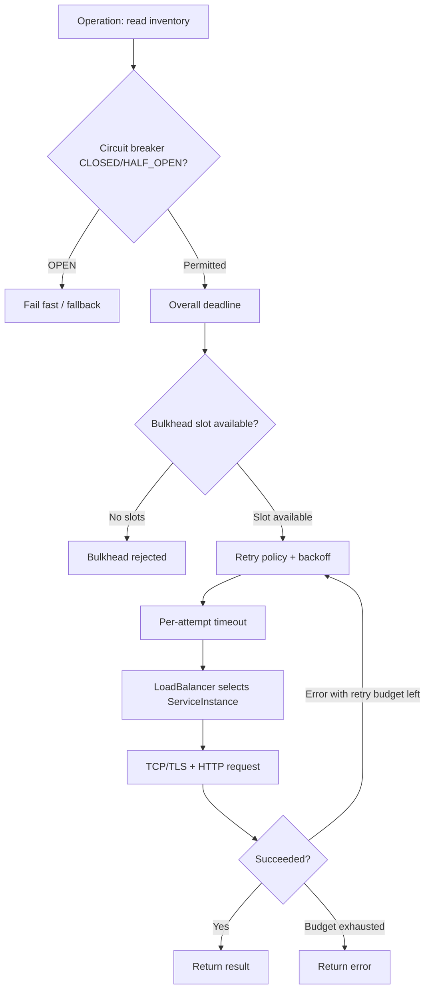
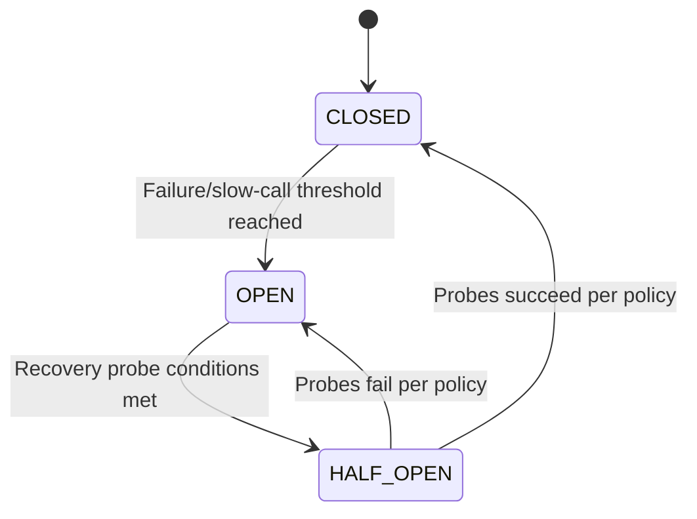
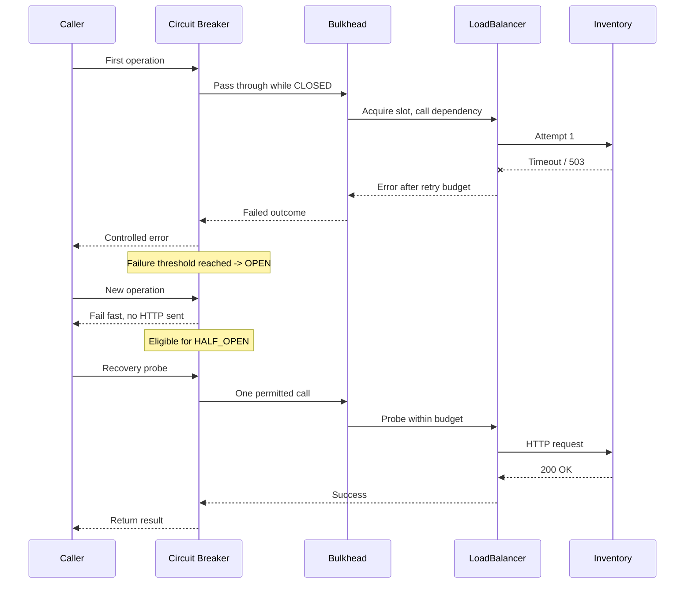

# Ordering Retry, Timeout, Circuit Breaker, and Bulkhead

A microservices system does not become resilient merely by turning on all four mechanisms—**retry**, **timeout**, **circuit breaker**, and **bulkhead**. **Their wrapping order and scope of application** determine how many requests actually reach downstream, how long an operation holds resources, how many failures the circuit breaker records, and how well the system recovers after an incident.

For example, `order-service` calls `http://inventory-service/api/products/P-1001` via a `@LoadBalanced WebClient.Builder`. Spring Cloud LoadBalancer selects a `ServiceInstance` by service ID; then the HTTP connector opens or borrows a connection from its pool. If `inventory-service` responds slowly, policies may trigger retries, hit deadlines, reject at the bulkhead, or trip the circuit breaker. **The very same initial failure can produce completely different outcomes under different mechanism orderings.**

This lesson belongs to the **Isolation and Recovery** chapter of the Spring Cloud LoadBalancer module. Learners will understand how to design resilience ordering when using `RestClient`, `WebClient`, or `OpenFeign`; distinguish retries across HTTP transport, LoadBalancer, and business layers; choose meaningful failure counters; protect connection pools; and verify behavior via logs, metrics, and fault injection.

## 1. The Four Mechanisms Serve Different Purposes

| Mechanism | Question to solve | What does it **not** replace? |
|---|---|---|
| **Timeout / deadline** | How long may an attempt or entire operation wait? | Does not decide which errors are safe to retry; does not isolate concurrency on its own. |
| **Retry** | On a transient failure, should we try again, after how long, and at most how many times? | Cannot fix config/TLS errors, prolonged dependency outages, or non-idempotent writes. |
| **Circuit breaker** | When a dependency repeatedly fails/slows down, should we stop sending new requests to prevent cascading failure? | Not a concurrent-request limiter; does not roll back committed transactions. |
| **Bulkhead** | How many resources/slots may one downstream consume at most without bringing down the caller? | Does not fix response timeouts; does not decide which instance is healthy. |

They work alongside Spring Cloud LoadBalancer, yet are not the same thing:

- **LoadBalancer:** discovers `ServiceInstance` candidates and picks an address using discovery/health/caching/routing policies.
- **HTTP transport:** handles TCP/TLS/HTTP, connection pools, and connect/read/response timeouts.
- **Resilience layer:** can wrap logical calls with bulkheads, circuit breakers, retries, and deadlines.

Separating these three responsibilities prevents flawed assumptions such as "once the circuit breaker opens, LoadBalancer automatically removes the instance from the registry" or "growing the pool will make timeouts disappear."

## 2. Understanding Outer-to-Inner Order

The notation `A(B(call))` means **A wraps B**, and B wraps the HTTP operation. When a request executes, A checks first; when a result or error returns, B completes first and passes the outcome back to A.

Example:

```text
CircuitBreaker(
    OverallTimeout(
        Bulkhead(
            Retry(
                PerAttemptTimeout(
                    LoadBalancedHttpCall
                )
            )
        )
    )
)
```

Reading from outside to inside:

1. Circuit breaker checks whether the **logical operation** is permitted to proceed.
2. Overall timeout sets the time budget for the entire operation, including waiting on the bulkhead if applicable.
3. Bulkhead checks whether a slot remains for this dependency.
4. Retry decides whether to try again based on error type, count, and backoff.
5. Per-attempt timeout protects each individual call.
6. Spring Cloud LoadBalancer selects an instance and the HTTP client sends the request.



**This is an architectural choice with trade-offs, not a mandatory ordering.** The example above holds a bulkhead slot across retries and backoff. Overall timeout sits **outside the bulkhead** so it can bound permit-wait time too; if placed inside, queuing for a permit may fall outside the timeout. When slots must be released between retries, place the bulkhead **inside** retry and accept the different load-measurement semantics. Those differences are the core focus of this lesson.

## 3. Before Choosing an Order: Define Logical Operation and Attempt

Suppose the caller handles a user request `GET /orders/42/availability`. It calls inventory:

```text
Logical operation: check inventory for order 42
    ├─ HTTP attempt 1 -> inventory-1 -> timeout
    ├─ backoff 100 ms
    └─ HTTP attempt 2 -> inventory-2 -> 200 OK
```

- **Logical operation:** one execution of the caller's business goal.
- **HTTP attempt:** one effort to send a request to a real endpoint. Some retries may fail before a request even hits a server, such as a pool acquisition timeout.
- **Per-attempt timeout:** dedicated time limit for each try.
- **Overall deadline:** time limit for the entire logical operation, **including retries and backoff**.
- **Concurrency slot:** permission to use a bounded resource. Depending on bulkhead placement, a slot may be held for the entire operation or a single attempt.

Note that one logical operation may cross multiple service IDs and gateways. Retrying an entire workflow is completely different from retrying a single HTTP call: if earlier steps already wrote data, restarting from the top risks duplicate side effects.

## 4. Timeout and Retry Order Determines Total Duration

Two common expressions:

```text
// A: deadline covers all attempts + backoff
OverallTimeout(
    Retry(PerAttemptTimeout(HTTP))
)

// B: retry sits outside a timed call
Retry(
    Timeout(HTTP)
)
```

| Order | What does the timeout apply to? | Practical consequence |
|---|---|---|
| **`Timeout(Retry(call))`** | The entire retry pipeline. | Can cut short an in-flight attempt when the overall deadline expires; fits a shared SLA budget. |
| **`Retry(Timeout(call))`** | Each subscription/attempt gets its own timeout. | Total operation time can far exceed one attempt's timeout due to retries and backoff. |
| **`Timeout(Retry(Timeout(call)))`** | Both per-attempt timeouts and an overall deadline. | Allows retrying transient errors without exceeding the shared budget; usually easier to control. |

Example: each attempt may wait 500 ms, with at most two retries and backoff of 100 ms then 200 ms.

```text
Attempt 1: 500 ms -> timeout
Backoff 1: 100 ms
Attempt 2: 500 ms -> timeout
Backoff 2: 200 ms
Attempt 3: 500 ms -> timeout
--------------------------------
Theoretical total nearly 1,800 ms, before counting other overhead
```

If the caller only has 1,000 ms left before its deadline, letting all three attempts run to completion is pointless. With an **overall deadline of 1,000 ms**, the pipeline must stop once the budget runs out even if retry counts remain. Canceling the wait on the client **does not guarantee** backend work has stopped or rolled back.

### Which Timeouts Should Be Set per Attempt?

An HTTP attempt can pass through distinct phases:

| Phase | Limiting mechanism |
|---|---|
| Fetching instances from discovery | Provider, supplier, or orchestration deadline/timeout. |
| Waiting for HTTP connection pool | Pending acquire / connection request timeout. |
| Opening TCP socket | Connect timeout. |
| TLS handshake | TLS/SSL handshake timeout or transport deadline. |
| Waiting for response, reading body | HTTP engine read timeout or response timeout. |

**Connect timeout is not an overall deadline.** Nor should Reactor Netty's `responseTimeout` or Feign's `readTimeout` be assumed to strictly cap an entire body transfer. A response stream emitting chunks steadily can stay open longer than an inactivity timeout.

## 5. Circuit Breaker Outside or Inside Retry?

A circuit breaker such as Resilience4j's tracks **CLOSED → OPEN → HALF_OPEN** states based on call counts, failure/slow-call rates in a sliding window, and breaker configuration. Yet **where does "one call" sit?**

### Option A: Circuit Breaker Outside Retry

```text
CircuitBreaker(
    Retry(HTTP)
)
```

The circuit breaker typically receives **one outcome per logical call** it wraps. For example, if the first attempt returns `503` and the second returns `200`, when retry succeeds and returns only the final result, the breaker can record **one success**. It does not necessarily know the first attempt failed unless separate retry instrumentation exists.

Advantage: the breaker reflects the probability that **the overall operation succeeds for the caller**, making dependency-boundary fail-fast straightforward. Limitation: initial attempt errors and actual backend traffic can stay hidden if you only watch breaker metrics.

### Option B: Retry Outside Circuit Breaker

```text
Retry(
    CircuitBreaker(HTTP)
)
```

Every attempt passing through the circuit breaker can be counted individually. In the same `503 → 200` example, the breaker can record **one failure and one success**. If the dependency is failing heavily, the breaker can open mid-retry. An overly broad retry can also keep retrying `CallNotPermittedException` when the breaker is OPEN, creating a pointless loop.

Advantage: the breaker tracks per-attempt quality more closely. Limitation: the breaker can react sharply to retry spikes, and metric readers must distinguish attempt-level failures from operation-level failures.

| Measurement and control goal | Usually clearer ordering |
|---|---|
| Breaker reflects the **final outcome** of calling the dependency | `CircuitBreaker(Retry(call))` |
| Breaker reflects **each attempt** and trips fast as attempts fail | `Retry(CircuitBreaker(call))`, with a tight classifier and explicit handling for `CallNotPermittedException` |
| Both measure operation-level and observe attempt failures | Appropriate breaker **plus** dedicated retry/transport metrics; never rely solely on the breaker |

**There is no one-way rule for all systems.** When the circuit breaker wraps retry, closely monitor real attempt counts and total latency: a logical operation that eventually succeeds can still double downstream load. When the breaker sits inside retry, exclude fail-fast exceptions from the retry classifier.

### Classifying Outcomes for the Breaker

Never default to treating every exception as "downstream is broken":

- `503`, timeouts, or network errors to an instance are failures the breaker can record.
- `400` caused by invalid caller payloads usually says nothing about downstream health.
- `401`/`403` from a bad token may be auth/config errors; retrying the same request does not help.
- `BulkheadFullException` reflects the caller exhausting its own allocated capacity; if the breaker wraps the bulkhead, usually consider **ignoring** it so local saturation is not misread as downstream outage.
- `CallNotPermittedException` is the result of an already-OPEN breaker; never retry it with a "retry all exceptions" policy.

Each combination must explicitly configure `recordException`, `ignoreException`, or matching predicates per your Resilience4j API.

## 6. Bulkhead Outside or Inside Retry?

Bulkheads cap dedicated resource consumption for a downstream/work group. Two common models exist:

- **Semaphore bulkhead:** limits concurrent calls permitted inside, without moving execution to another thread pool.
- **Thread-pool bulkhead:** isolates via a dedicated executor/queue where appropriate; carries different overhead and timeout/cancellation semantics.

**A bulkhead is not an HTTP connection pool.** A semaphore permit bounds operations/attempts wherever wrapped; HTTP connections can be reused, and HTTP/2 multiplexes multiple streams over one socket.

### Option A: Bulkhead Outside Retry

```text
Bulkhead(
    Retry(HTTP)
)
```

The caller holds one slot across **the entire sequence of attempts and backoff**. For instance, with a max-20 bulkhead and an operation sleeping 500 ms in backoff, the slot can remain occupied during the wait even with no active TCP connection.

Advantage: caps **concurrent logical operations** using the dependency, preventing a retrying operation from bursting past quota. Limitation: holding permits during backoff lowers throughput and increases rejections under heavy load.

### Option B: Retry Outside Bulkhead

```text
Retry(
    Bulkhead(HTTP)
)
```

Each attempt acquires a slot before calling and releases it afterward. **During backoff no slot is held**, giving other operations a chance to proceed. However, each logical operation can re-enter multiple times, forcing the backend to handle extra attempts during peak load windows.

If the bulkhead rejects an attempt, decide whether to retry `BulkheadFullException`. **By default, do not retry immediately** since it signals local saturation; if an upper layer adds queuing/backoff, keep it bounded and within the deadline.

| Bulkhead position | Limited resource | Main risk |
|---|---|---|
| `Bulkhead(Retry(call))` | In-flight logical operations, including backoff duration | Holds slots idle while sleeping between attempts. |
| `Retry(Bulkhead(call))` | Currently executing concurrent attempts | Operations can repeatedly re-enter retries, raising total load. |

A system can use **two distinct caps**: an outer bulkhead bounding in-flight operations and a concurrency limit at the HTTP/transport layer protecting physical attempts. Quantify both clearly rather than layering unobservable semaphores.

## 7. An Intentional Starting Order

For a relatively short read request, an easy-to-explain design is:

```text
CircuitBreaker(
    OverallTimeout(
        Bulkhead(
            Retry(
                PerAttemptTimeout(
                    @LoadBalanced HTTP client
                )
            )
        )
    )
)
```

Goals of this ordering:

1. **Breaker on the outside**: fail fast before holding a bulkhead slot; record final operation outcomes.
2. **Overall timeout outside bulkhead and retry**: includes permit wait time, attempts, and backoff when the deadline hits.
3. **Bulkhead outside retry**: bounds in-flight operations; *in exchange*, slots stay held during backoff.
4. **Per-attempt timeout inside retry**: keeps a single try from consuming the entire reasonable budget.
5. **Load-balanced HTTP client inside the protected boundary**: each attempt can pick an instance per the configured retry policy.

Do not apply blindly in production. When backends require releasing slots between backoffs, consider `CircuitBreaker(OverallTimeout(Retry(Bulkhead(PerAttemptTimeout(call)))))` and measure total operations/attempts. Long-lived streaming requires its own model for concurrency, timeouts, and breaker outcomes.

### Where Should Fallback Sit?

Fallback is **a policy for returning an alternative result**, such as acceptable stale cache or a "stock temporarily unknown" reply. If fallback sits **inside the breaker** and turns every error into success, the breaker may see only successes and never open when the backend genuinely fails.

An observable choice is:

```text
Fallback(
    CircuitBreaker(
        OverallTimeout(
            Bulkhead(
                Retry(HTTP)
            )
        )
    )
)
```

Here the breaker records real failures before the fallback converts them to an alternative response, while the caller still receives a controlled reply. Fallbacks must **preserve business semantics**: returning uncertain stock counts as if they were exact stock can be worse than returning an error.

## 8. Where Do Spring Cloud LoadBalancer and Retry Sit?

Spring Cloud LoadBalancer selects instances using the `service ID`, discovery, and `ServiceInstanceListSupplier` chain. When a caller uses `@LoadBalanced RestClient.Builder` or `@LoadBalanced WebClient.Builder`, instance selection happens in the HTTP client's interceptor/filter. With `OpenFeign`, a wrapper such as `FeignBlockingLoadBalancerClient` plays the corresponding role.

**Enabling LoadBalancer does not mean every request gets retries.** Retry behavior depends on dependencies, auto-configuration, the specific HTTP client, the release train, and configured policies. When retry-aware LoadBalancer is enabled, it can retry on the same or next instance:

```yaml
spring:
  cloud:
    loadbalancer:
      retry:
        enabled: true
        max-retries-on-same-service-instance: 0
        max-retries-on-next-service-instance: 1
```

This is a **conditional directional example**: check documentation and configuration metadata for your exact Spring Cloud version. These properties do not replace Spring Retry/Reactor configs, nor guarantee every client passes through the same mechanism. Some blocking integrations require Spring Retry on the classpath, and reactive paths differ from blocking paths.

### With LoadBalancer Retry Enabled, What Happens If the Gateway Also Retries?

Suppose LoadBalancer retry allows up to two attempts, and the WebClient/Feign gateway layer retries the entire call once. Under permissive conditions, **two gateway tries × two LoadBalancer attempts = up to four low-level attempts**, before even counting hidden transport retries. If failures occur before sending HTTP, actual backend HTTP requests may be lower.

Adding a circuit breaker and bulkhead wraps **whichever layer** you attach them to:

- Attaching the breaker to the business method outside the gateway: usually observes outcomes **after** LoadBalancer retries finish.
- Attaching the breaker to each HTTP attempt: can record failures that upper-layer retries recovered from.
- Attaching the bulkhead around the gateway method: holds slots for the full logical call, potentially including retries, backoff, and pool waits.
- Attaching the bulkhead lower around each attempt: releases slots between attempts, though one logical operation can enter the bulkhead multiple times.

**Never assume** `@Retry`, `@CircuitBreaker`, `@Bulkhead`, and `@TimeLimiter` execute in the order annotations are written in source code. With Resilience4j Spring aspects, ordering depends on AOP mechanics, aspect order, and version configuration; self-invocation or bypassing the Spring proxy can even skip advice altogether. When learning and requiring strict control over order, use explicit programmatic composition or Reactor operators and test it.

### Service ID, Instance, and Breaker Scope

A breaker attached to `inventory-service` treats all instances as one logical dependency. If only one instance fails, a service-ID-level breaker can open and block healthy instances too. Conversely, a breaker per **instance ID** offers fine granularity yet must handle instance autoscaling, churn, and large metric-label cardinality.

A common balance is:

- Service-level breakers to protect callers from a broadly failing **dependency**.
- Health checks/discovery and LoadBalancer retry to route around locally broken instances.
- Fine-grained policies per operation or endpoint group when workloads/risks differ.

The exact scope must fit your architecture; there is no rule saying "every instance always gets its own breaker."

## 9. WebClient Example: Expressing Order via Reactor Operators

The following example builds an intentional policy for a **data-reading GET**. Assume the application has Spring WebFlux, Spring Cloud LoadBalancer, Resilience4j core, and a compatible `resilience4j-reactor` module. The two breaker/bulkhead beans below are illustrative, not a universal production threshold set:

```java
import java.time.Duration;
import io.github.resilience4j.bulkhead.Bulkhead;
import io.github.resilience4j.bulkhead.BulkheadConfig;
import io.github.resilience4j.bulkhead.BulkheadFullException;
import io.github.resilience4j.circuitbreaker.CircuitBreaker;
import io.github.resilience4j.circuitbreaker.CircuitBreakerConfig;
import org.springframework.context.annotation.Bean;
import org.springframework.context.annotation.Configuration;

@Configuration(proxyBeanMethods = false)
class InventoryResilienceConfiguration {

    @Bean
    Bulkhead inventoryBulkhead() {
        return Bulkhead.of("inventory-read",
                BulkheadConfig.custom()
                        .maxConcurrentCalls(20)
                        .maxWaitDuration(Duration.ZERO)
                        .build());
    }

    @Bean
    CircuitBreaker inventoryCircuitBreaker() {
        CircuitBreakerConfig config = CircuitBreakerConfig.custom()
                .slidingWindowSize(20)
                .minimumNumberOfCalls(10)
                .failureRateThreshold(50.0f)
                .waitDurationInOpenState(Duration.ofSeconds(10))
                .ignoreExceptions(BulkheadFullException.class)
                .build();

        return CircuitBreaker.of("inventory-read", config);
    }
}
```

Depending on version/configuration, OPEN-to-HALF_OPEN behavior also involves automatic transitions, permitted HALF_OPEN calls, and event handling. Do not treat the snippet above as a complete setup for every circuit breaker recovery detail.

An illustrative gateway:

```java
import java.time.Duration;
import java.util.concurrent.TimeoutException;
import io.github.resilience4j.bulkhead.Bulkhead;
import io.github.resilience4j.circuitbreaker.CircuitBreaker;
import io.github.resilience4j.reactor.bulkhead.operator.BulkheadOperator;
import io.github.resilience4j.reactor.circuitbreaker.operator.CircuitBreakerOperator;
import org.springframework.cloud.client.loadbalancer.LoadBalanced;
import org.springframework.stereotype.Service;
import org.springframework.web.reactive.function.client.WebClient;
import org.springframework.web.reactive.function.client.WebClientRequestException;
import org.springframework.web.reactive.function.client.WebClientResponseException;
import reactor.core.publisher.Mono;
import reactor.util.retry.Retry;

@Service
class InventoryReactiveGateway {

    private final WebClient client;
    private final Bulkhead bulkhead;
    private final CircuitBreaker breaker;

    InventoryReactiveGateway(
            @LoadBalanced WebClient.Builder builder,
            Bulkhead inventoryBulkhead,
            CircuitBreaker inventoryCircuitBreaker) {
        this.client = builder.baseUrl("http://inventory-service").build();
        this.bulkhead = inventoryBulkhead;
        this.breaker = inventoryCircuitBreaker;
    }

    Mono<ProductView> findProduct(String id) {
        return Mono.defer(() -> client.get()
                        .uri("/api/products/{id}", id)
                        .retrieve()
                        .bodyToMono(ProductView.class))
                .timeout(Duration.ofMillis(500)) // per attempt
                .retryWhen(Retry.backoff(1, Duration.ofMillis(100))
                        .jitter(0.4)
                        .filter(this::retryableReadError))
                .transformDeferred(BulkheadOperator.of(bulkhead))
                .timeout(Duration.ofMillis(1100)) // whole operation, including permit wait
                .transformDeferred(CircuitBreakerOperator.of(breaker));
    }

    private boolean retryableReadError(Throwable error) {
        if (error instanceof TimeoutException) {
            return true;
        }
        if (error instanceof WebClientResponseException response) {
            return response.getStatusCode().value() == 503;
        }
        return error instanceof WebClientRequestException;
    }
}
```

`ProductView` is an example DTO. You must register a `@LoadBalanced WebClient.Builder` and an appropriate `ServiceInstance` source; this code does not create a registry automatically. `Retry.backoff(1, ...)` allows **at most one retry** in the Reactor pipeline (two subscriptions at this level), not one total retry across every layer.

### Why Is the Operator Order Written Like That?

Because operators chain sequentially and `transformDeferred` wraps the upstream publisher before it, execution is observed in this order:

```text
CircuitBreakerOperator(
    OverallTimeout(
        BulkheadOperator(
            RetryWhen(
                PerAttemptTimeout(
                    HTTP request
                )
            )
        )
    )
)
```

The breaker sees only the final outcome of the publisher including retries and overall timeout; the bulkhead holds its slot across retries/backoff. Because overall timeout wraps the bulkhead, it also bounds permit wait time if the bulkhead permits waiting. `BulkheadFullException` is ignored on the breaker so local saturation is not counted as a backend outage by default. If permits must be released between attempts, move `BulkheadOperator` **before** `retryWhen` and re-measure behavior.

**Limitations of the example:** the `WebClientRequestException` classifier is still quite broad and can include unrecoverable DNS/TLS errors if configuration does not change. In production, unwrap the root cause and filter by failure cause; honor `Retry-After` on `429`/`503` where supported; never pointlessly retry GETs when certificates are invalid. Reactor timeouts only bound their respective subscriptions; cancellation does not guarantee halting work already accepted by the backend.

### Do Not Confuse HTTP Connector Response Timeout with Overall Deadline

When using Reactor Netty, you can configure `CONNECT_TIMEOUT_MILLIS`, `responseTimeout(...)`, and `pendingAcquireTimeout(...)` separately. The example above uses Reactor `timeout` to illustrate **nested timeout placement**, not as a replacement for socket/TLS/connection-pool tuning on the connector.

## 10. Blocking Example with RestClient/Feign: Explicit Composition

For synchronous `RestClient` or `OpenFeign`, you can use Resilience4j's programmatic API to specify exact wrappers without relying on AOP annotation order. Example:

```java
import java.time.Duration;
import java.util.function.Supplier;
import io.github.resilience4j.bulkhead.Bulkhead;
import io.github.resilience4j.circuitbreaker.CircuitBreaker;
import io.github.resilience4j.retry.Retry;
import io.github.resilience4j.retry.RetryConfig;
import org.springframework.web.client.ResourceAccessException;

// Assume client is a @LoadBalanced RestClient
// or a Feign proxy calling inventory-service via LoadBalancer.
Supplier<ProductView> httpAttempt = () ->
        inventoryGateway.getProduct("P-1001");

RetryConfig retryConfig = RetryConfig.custom()
        .maxAttempts(2) // two total attempts, not two retries
        .waitDuration(Duration.ofMillis(100))
        .retryExceptions(ResourceAccessException.class)
        .build();

Retry retryPolicy = Retry.of("inventory-read", retryConfig);

Supplier<ProductView> retried =
        Retry.decorateSupplier(retryPolicy, httpAttempt);

Supplier<ProductView> isolated =
        Bulkhead.decorateSupplier(inventoryBulkhead, retried);

Supplier<ProductView> guarded =
        CircuitBreaker.decorateSupplier(inventoryCircuitBreaker, isolated);

ProductView result = guarded.get();
```

`inventoryGateway`, `inventoryBulkhead`, and `inventoryCircuitBreaker` are objects **already supplied by application configuration**, not variables magically created by the framework just because this snippet appears. With OpenFeign, Feign exception types are usually not `ResourceAccessException`; configure the classifier for your actual transport/Feign exceptions. This example illustrates **`CircuitBreaker(Bulkhead(Retry(call)))` ordering**, without an overall deadline yet.

### Challenges with Timeouts on Blocking Clients

You cannot automatically enforce a **hard deadline** on a blocking call merely by wrapping `Supplier.get()` with a logical clock. You need proper HTTP transport timeouts and, if using async mechanisms such as Resilience4j TimeLimiter/`CompletionStage`, understand that timing out/canceling/interrupting **does not guarantee terminating active blocking I/O**.

When running many blocking HTTP calls on an executor, a thread-pool bulkhead can bound threads/queues. Yet when a timeout ends only the caller's wait while the worker thread keeps running, resources can stay occupied. Measure active threads, queues, cancellation behavior, and transport socket closing.

### Spring Boot and OpenFeign Configuration Is Only One Layer

A `@FeignClient(name = "inventory-service")` without a fixed URL can be wrapped by LoadBalancer. When wanting circuit breakers via Spring Cloud OpenFeign, some release trains provide integration through Spring Cloud CircuitBreaker and corresponding properties, requiring compatible starters and versions. Never assume writing `@FeignClient` enables Resilience4j or `Retry → CircuitBreaker → Bulkhead` ordering as desired.

With RestClient, `@LoadBalanced RestClient.Builder` does not create breakers/bulkheads automatically; it only enables service-ID resolution when relevant auto-configurations are active. Keep resilience responsibilities at one clear layer rather than configuring retries simultaneously across Feign, LoadBalancer, HTTP transport, and Resilience4j without controlling total attempts.

## 11. When Breaker Transitions OPEN, HALF_OPEN, and Recovers

A typical circuit breaker has three states:

| State | Behavior | What to observe |
|---|---|---|
| **CLOSED** | Lets requests pass and records outcomes to compute failure/slow rates. | Recorded calls, failure/slow-call rates, latency. |
| **OPEN** | Rejects new requests fast, usually throwing `CallNotPermittedException` or equivalent signal. | Rejected/not-permitted count; is downstream load actually dropping? |
| **HALF_OPEN** | Allows a limited number of probe calls, then decides to close or reopen. | Permitted probes, actual success/failure, transition timing. |



**Do not equate circuit breaker recovery with discovery recovery.** Closing the breaker does not refresh the instance list; the service ID's cached list may still be stale. Conversely, once the registry replaces a dead instance with a healthy one, an OPEN breaker may keep rejecting requests until policy permits HALF_OPEN.

### Risk of HALF_OPEN + Retry

If one HALF_OPEN call passes through a breaker sitting outside retry, yet inner retry performs multiple HTTP attempts, "one probe" from the breaker can trigger several real requests. If the breaker sits inside retry, each attempt may consume a HALF_OPEN permit and get rejected once permits run out.

Consequently, HALF_OPEN should usually have **a very tight retry budget or disable retries** for probes, especially when a dependency has just recovered and faces cold starts, connection warm-up, or database recovery. Evaluate recovery time using metrics, not merely seeing the CLOSED state.

## 12. Do Not Lump Every Error into One Mechanism

An error-classification matrix helps design resilience ordering:

| Signal | Retry? | Circuit breaker? | What do bulkhead/timeout handle? |
|---|---|---|---|
| `ConnectException`/connect timeout from one instance | May retry GET with limits, consider another target. | Can record as dependency failure if policy fits. | Short per-attempt deadline; avoid holding slots long. |
| Read timeout after backend received request | Caution: write requests may have committed. | Can count as timeout/slow call. | Overall deadline prevents attempts from dragging on. |
| Transient HTTP `503` or `502` | May retry with backoff/budget; check status origin. | Can count as failure. | Limit concurrency to avoid piling on load. |
| HTTP `429` | Retry only when respecting rate limits/`Retry-After` and deadlines. | Do not treat as server failure by default; contract-dependent. | Bulkheads/rate limiters prevent extra pressure. |
| HTTP `400`/`401`/`403` | Usually do not retry the same request. | Usually should not count as downstream availability failure. | Timeouts and pools cannot fix payload/auth bugs. |
| TLS hostname/certificate error | Do not retry if config is unchanged. | Can treat as config error; avoid useless connections. | Fail fast; fix trust/SAN/service metadata. |
| No `ServiceInstance` available | Usually do not retry immediately; inspect discovery/health. | Prolonged occurrences may trip breaker per policy. | No socket exists for bulkheads/transport to "fix." |
| `BulkheadFullException` | Avoid immediate retry; caller already exceeded quota. | Consider ignoring rather than counting as remote failure. | Reduce concurrency/queues or shed load. |
| `CallNotPermittedException` | Never retry immediately against the same OPEN breaker. | It is the active fail-fast signal, not a failed HTTP attempt. | Return controlled fallback/error. |

Policies must rely on **endpoint semantics**, not solely HTTP methods. `GET` is safe/idempotent under HTTP semantics, yet a poorly designed GET endpoint with side effects can still misbehave on retry. For `POST`/`PATCH`, require idempotency keys/operation IDs and atomic server-side deduplication before allowing replay after uncertain timeouts.

## 13. If All Retry Layers Are Enabled, How High Can Actual Attempts Climb?

Suppose a logical call has:

- Business/Resilience4j retry: max **2 attempts**.
- LoadBalancer retry: max **2 attempts** per logical HTTP call.
- HTTP transport: up to **2 attempts** where permitted.

If loops truly nest, one operation has a **theoretical upper bound**:

```text
2 × 2 × 2 = 8 low-level attempts
```

At 100 operations/second, if all hit the theoretical bound and reach the backend, a single caller could generate roughly 800 HTTP attempts/second. Actual numbers may be lower because some errors fail before sending HTTP, classifiers reject retries, deadlines cut short, or layers do not nest literally as assumed.

**Retry budgets must count final attempts received by downstream**, not just one `maxAttempts` property at the business layer. Against an already saturated service, seven extra attempts can worsen the outage instead of boosting success rates.

### Preventing Retry Storms

When many callers time out together, immediate retries synchronize into a fresh load wave:

```text
Downstream slows down
     ↓
Read timeouts climb
     ↓
Many callers retry simultaneously
     ↓
Pool pending and backend concurrency surge
     ↓
p99 latency climbs further, causing more timeouts
```

Combine mechanisms: small attempt counts, exponential backoff with jitter, overall deadlines, concurrency limits/bulkheads, rate limiting, and circuit breakers. When the server sends `Retry-After` on `429` or `503`, decide whether waiting fits inside the remaining deadline or if failing immediately is better.

## 14. The Right Recovery Model: Fail Fast, Shed Load, Then Probe

When an instance or dependency suffers prolonged errors, the four mechanisms coordinate along a decision chain rather than "retrying endlessly until errors vanish."

### Phase 1 — Brief, Recoverable Errors

Per-attempt timeouts prevent infinite waits; bounded retries can recover a transient connect error or `503` on an idempotent GET. LoadBalancer can pick another instance if retry-aware suppliers/policies permit.

### Phase 2 — Load Rises and Pools Begin Saturating

Bulkhead rejects excess new operations to protect the caller; too many queued or retrying requests inflate tail latency. Retry classifiers should not turn `BulkheadFullException` into immediate new HTTP requests.

### Phase 3 — Dependency Fails Continuously

Circuit breaker collects enough failure/slow-call samples in its sliding window, transitions OPEN, and fails fast instead of sending further traffic. It **does not fix service discovery**, kill backends, or immediately release every idle HTTP socket.

### Phase 4 — Probing Recovery

After the configured wait duration, the breaker allows HALF_OPEN probes. These calls need low concurrency and tight/no retries to assess recovery without triggering a load spike. If probes succeed per policy, the breaker transitions CLOSED; otherwise, back to OPEN.



This diagram illustrates a single breaker's progression. Actual state transitions depend on minimum calls, sliding windows, failure/slow rates, HALF_OPEN permits, and other thresholds. Never conclude a single `200` response always suffices to close a breaker.

## 15. Hands-On Lab: Changing Order to Observe Consequences

Prepare `order-service` with `@LoadBalanced WebClient.Builder` and two `inventory-service` instances at `localhost:8081` and `localhost:8082`. Without a dynamic registry, use `SimpleDiscoveryClient`:

```yaml
spring:
  cloud:
    discovery:
      client:
        simple:
          instances:
            inventory-service:
              - uri: http://localhost:8081
              - uri: http://localhost:8082
```

On the test backend, create two endpoints:

```java
import java.time.Duration;
import java.util.concurrent.atomic.AtomicInteger;
import org.springframework.http.ResponseEntity;
import org.springframework.web.bind.annotation.GetMapping;
import org.springframework.web.bind.annotation.RestController;
import reactor.core.publisher.Mono;

@RestController
class InventoryLabController {

    private final AtomicInteger counter = new AtomicInteger();

    @GetMapping("/lab/flaky")
    Mono<ResponseEntity<String>> flaky() {
        int current = counter.incrementAndGet();
        if (current % 3 != 0) {
            return Mono.just(ResponseEntity.status(503).body("temporary"));
        }
        return Mono.just(ResponseEntity.ok("recovered"));
    }

    @GetMapping("/lab/slow")
    Mono<String> slow() {
        return Mono.just("slow")
                .delayElement(Duration.ofSeconds(2));
    }
}
```

This is a minimal simulated backend, **not a production service**. Counters run independently on each replica, and load balancing between two instances can make the `503/200` sequence differ from predictions. When verifying exact attempt sequences, pin one instance first, then enable two instances to observe target switching.

### Scenario A — Baseline with Plain HTTP Calls

1. Disable extra retries/circuit breakers/bulkheads for the baseline or set non-interfering thresholds.
2. Call `/lab/flaky` and record response statuses and actual backend request counts.
3. Call `/lab/slow` and measure latency of a successful request.
4. Verify calls route via the right service ID and LoadBalancer picks real instances.

The goal is collecting baseline metrics to compare as each mechanism is added, rather than turning all four on at once.

### Scenario B — Swapping Timeout and Retry Order

Against the slow endpoint, test:

```text
Order 1: Timeout( Retry( PerAttemptTimeout(HTTP) ) )
Order 2: Retry( Timeout(HTTP) )
```

Pick a per-attempt timeout shorter than real response time and a fixed retry count. Observe total latency, actual backend requests, and final error. `Order 2` can exceed a single timeout because it repeats after each attempt; `Order 1` cuts off sooner when the overall budget expires. Keep an overall test-run timeout too so test pipelines never hang.

### Scenario C — Circuit Breaker Outside vs. Inside Retry

1. Intentionally produce a failure sequence followed by success at the HTTP attempt level.
2. Test `CircuitBreaker(Retry(call))` and `Retry(CircuitBreaker(call))` with matching thresholds/attempt counts.
3. Track breaker `calls recorded` and failure rate **alongside** actual HTTP attempt counts.
4. Observe once the breaker opens whether the next retry triggers `CallNotPermittedException` and whether the classifier stops retrying.

Reset breaker state between runs or use fresh breaker instances; otherwise accumulated counts make runs incomparable.

### Scenario D — Bulkhead Holding Slots During Backoff

Keep caller concurrency above the lab's max permits, e.g., 50 logical operations and a bulkhead capped at 5 concurrent calls. Compare:

```text
Bulkhead(Retry(call))    // holds slot across backoff
Retry(Bulkhead(call))    // releases slot between attempts
```

Measure available permits, rejected calls, wait times, attempts, and total successes. Never conclude one design is "faster" from a single run: higher throughput may trade off against higher backend load or poorer fairness.

### Scenario E — Overall Deadline Including Permit Wait Time

Suppose the bulkhead permits waiting up to 300 ms. Compare:

```text
Bulkhead(Timeout(Retry(call)))
Timeout(Bulkhead(Retry(call)))
```

In the first expression, the inner deadline **may only start after acquiring a permit**. In the second, the outer deadline can bound permit queue time as well; depending on implementation, verify cancellation frees slots/queues properly.

### Scenario F — Breaker OPEN and Recovery

Generate enough errors to trip the breaker OPEN, keep calling, and verify the backend **receives zero additional requests** from rejected calls. After the wait duration and HALF_OPEN, restore the backend and measure probe success rate and time to return CLOSED. Do not use a test observing only `CallNotPermittedException` to conclude discovery or pools are broken.

### Scenario G — Retry on Side-Effecting POST

Use only a simulated backend capable of storing operation IDs/idempotency keys and deduplicating. Simulate a backend commit whose response to the caller is lost; then retry with the same operation ID and prove the backend does not create a second side effect. **Never run this fault test on real data or production payment systems.**

### Experimental Results Table

| Experiment | Wrapper order | Logical operations | Actual HTTP attempts | Breaker recorded failures | Bulkhead rejected | p95 logical latency |
|---|---|---|---|---|---|---|
| Baseline | No extra wrappers | Measure | Measure | Measure | Measure | Measure |
| Overall deadline | `CB(Timeout(BH(Retry(HTTP))))` | Measure | Measure | Measure | Measure | Measure |
| Breaker inside retry | `Retry(CB(Timeout(HTTP)))` | Measure | Measure | Measure | Measure | Measure |
| Bulkhead inside retry | `CB(Timeout(Retry(BH(HTTP))))` | Measure | Measure | Measure | Measure | Measure |

Never fill in unmeasured numbers. Record Spring Boot, Spring Cloud, Resilience4j, HTTP transport versions, instance count, retry count, and concurrency so results remain comparable.

## 16. Observing at the Right Layers to Avoid Masking Failures

Monitor these metrics **simultaneously**, instead of looking only at final responses:

| Metric / event | Question it helps answer |
|---|---|
| `serviceId`, `instanceId`, route, and attempt | Which target did LoadBalancer pick? Did retry switch instances? |
| Logical call success/failure | What outcome did the caller actually receive? |
| Actual HTTP attempts per operation | How many requests hit the backend? Are attempts multiplying? |
| Retry attempts, delay, and exhausted count | Is retry recovering transient errors or fanning a storm? |
| Circuit breaker state, recorded calls, failures/slow calls | Is the breaker evaluating attempts or operations? |
| Circuit breaker not-permitted calls | Is it genuinely failing fast when OPEN? |
| Bulkhead available/max permits, concurrent calls, rejected count | Is the caller isolated when a downstream slows down? |
| HTTP pool active/idle/pending acquisitions | Are sockets bottlenecking as retries rise? |
| Connect/read/response timeouts and total deadline exceeded | At which layer is time expiring? |
| Backend p95/p99, CPU/threads, readiness | Is the dependency overloaded or not ready? |

Resilience4j, Spring Boot Actuator, Micrometer, Reactor Netty, or Feign Micrometer can provide metrics/events per component when integrated and enabled. **Do not assume** every metric above is always present or named identically across versions; verify actual meters and instrumentation granularity.

Example structured diagnostic log:

```text
traceId=ab71
operation=inventory-read
serviceId=inventory-service
instanceId=inventory-2
layer=loadbalancer-attempt
attempt=2
failure=READ_TIMEOUT
retryable=true
remainingDeadlineMs=420
breakerState=CLOSED
bulkheadInFlight=9
```

This is an **illustrative format**: logs do not appear automatically just by enabling LoadBalancer. Across multiple attempts, attach a correlation/operation ID to distinguish one business operation from its child HTTP calls. Never write Bearer tokens, cookies, private keys, user PII, or full request bodies into logs/metrics.

A helpful dashboard places **first-attempt success rate**, **success-after-retry**, **retry-exhausted**, **breaker OPEN/not-permitted**, **bulkhead rejection**, **pool pending**, and **logical p99 latency** side by side. If retry rate rises while success-after-retry drops, the breaker keeps opening, and backend CPU climbs, your policy may be adding pressure rather than helping recovery.

## 17. Diagnostic Table for Ordering Configuration Bugs

| Symptom | Possible cause | How to check / fix |
|---|---|---|
| 500 ms timeout yet requests take several seconds | `Retry(Timeout(call))` gives each attempt a fresh timeout, or multiple retry layers exist. | Place an overall deadline outside the whole retry pipeline and count attempts. |
| Circuit breaker never opens despite many HTTP retry failures | Breaker sits outside retry and sees only the final successful outcome; or sample minimum not met. | Measure attempt metrics separately; inspect breaker config and statistical goal. |
| Breaker opens too fast when retry is enabled | Breaker may be counting each attempt because it sits inside retry. | Compare breaker call count vs. HTTP attempts; consider swapping positions. |
| Retry keeps calling while breaker is OPEN | Classifier retries `CallNotPermittedException` or outer retry lacks a stop rule. | Exclude not-permitted exceptions and enforce overall deadline. |
| Backend healthy yet circuit breaker reports constant errors | `BulkheadFullException` is counted as a remote failure. | Check bulkhead rejections; configure breaker to ignore local saturation per policy. |
| Bulkhead rejects heavily even with idle CPU/backend | Slots held across backoff or blocking threads, or concurrency cap is too low. | Inspect `Bulkhead(Retry(...))` and permit hold times; adjust order carefully. |
| Bulkhead limits exceeded more than expected during retry spikes | Bulkhead wraps each attempt while many logical operations retry in turns. | Measure attempt counts, per-operation quotas, and per-dependency budgets. |
| Overall timeout excludes bulkhead wait time | `Timeout` sits inside a bulkhead that permits waiting for permits. | Move deadline outside bulkhead or cut queue/`maxWaitDuration`. |
| Timeout returns error yet backend still creates order | Client cancellation does not roll back server transactions. | Use idempotency keys/operation states; never blindly retry writes. |
| Breaker returned CLOSED yet requests still fail | Stale discovery cache, failing health endpoint, unrecovered certificates/transport. | Audit instance list, TLS, pools, and readiness independently. |
| LoadBalancer retry switches instances and returns inconsistent data | Session affinity, sharding, or eventual consistency violated. | Retry only across compatible instances; design shared state/consistency. |
| Added annotations yet execution order did not change | AOP aspect order differs from expectations, or self-invocation bypasses proxy. | Verify effective aspects, beans/proxies, and test actual attempts. |
| Bulkhead blocks requests for unrelated services | Shared bulkhead across unrelated dependencies. | Separate caps by service ID/workload; track available permits separately. |
| OPEN CB makes fallback look like it always "succeeds" | Fallback turns errors into successes **before** the breaker records outcomes. | Move fallback outside the breaker or configure observation intentionally. |

## 18. Pre-Production Rollout Checklist

- [ ] Define each **logical operation** and where each physical HTTP attempt originates.
- [ ] Inventory retries across transport, Spring Cloud LoadBalancer, Reactor/Feign/Spring Retry, Resilience4j, and proxies/gateways.
- [ ] Explicitly verify **outer-to-inner order** instead of inferring from annotation order on methods.
- [ ] Configure real HTTP transport connect/read/response timeouts with sensible per-attempt limits.
- [ ] Set an overall deadline covering retries/backoff; consider placing it **outside bulkheads** to bound permit waits too.
- [ ] Distinguish per-logical-operation vs. per-attempt bulkheads; measure permit holds during backoff.
- [ ] Align breaker placement with operation-level vs. attempt-level measurement and record the right failures.
- [ ] Exclude local rejections or caller errors from failure classification when they do not indicate downstream failure.
- [ ] Never retry `CallNotPermittedException` or `BulkheadFullException` immediately.
- [ ] Classify `429`, `503`, timeouts, TLS, and no-instance errors according to explicit policies.
- [ ] Keep attempt budgets small, apply backoff with jitter, and honor `Retry-After` where appropriate.
- [ ] Use idempotency/operation IDs for side-effecting requests; understand client cancellation does not equal server rollback.
- [ ] Deliberately tune circuit breaker CLOSED/OPEN/HALF_OPEN, minimum calls, windows, and recovery probes.
- [ ] Never assume HALF_OPEN probes may retry multiple times; bound load when a dependency just recovered.
- [ ] Isolate bulkheads per downstream/critical work group; avoid a single app-wide quota.
- [ ] Verify ServiceInstance discovery, health filtering, caching, and instance metadata under autoscaling.
- [ ] Observe retry attempts, breaker states, bulkhead rejections, pool pending, and p95/p99 latency in lab tests.
- [ ] Test single-instance failure, full-dependency outage, pre/post-commit timeouts, and recovery.
- [ ] Ensure fallbacks honor business contracts without hiding remote failures or returning inaccurate data.
- [ ] Never enable debug logs carrying sensitive tokens/bodies; keep metric cardinality and tracing bounded.

**Conclusion:** **There is no single retry–timeout–circuit breaker–bulkhead ordering right for every request type.** An easily explainable starting point for short HTTP GETs is `CircuitBreaker(OverallTimeout(Bulkhead(Retry(PerAttemptTimeout(@LoadBalanced HTTP call)))))`: the breaker tracks final outcomes, the deadline caps the whole operation (including bulkhead waits), the bulkhead isolates concurrent operations, and retry recovers transient errors within budget. When workloads or measurement goals differ, adjust positions deliberately—especially **whether the breaker counts attempts or operations** and **whether the bulkhead holds slots during backoff**—and prove behavior with actual HTTP attempt counts and failure-load metrics.
