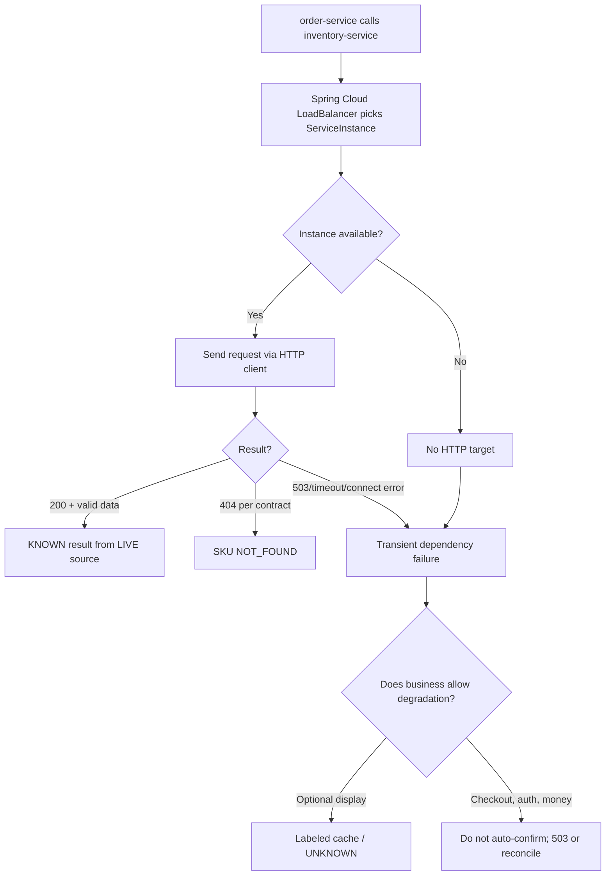
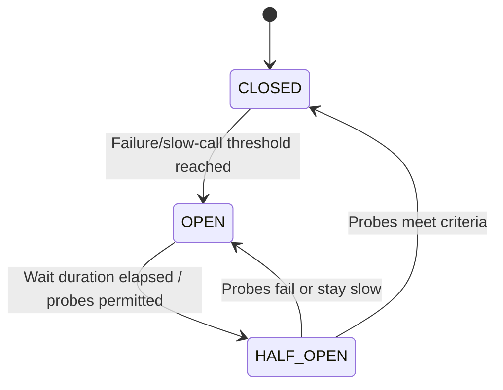

# Business-Appropriate Fallbacks and Avoiding Misleading Data

## 1. Scenario: "Out of Stock" Is Not "Unable to Check Stock"

In the **Isolation and Recovery** chapter of the `SPRING_CLOUD_SERVICE_COMMUNICATION_LOAD_BALANCING` module, `order-service` calls `inventory-service` via Spring Cloud LoadBalancer. The caller uses service ID `inventory-service`; LoadBalancer retrieves the `ServiceInstance` list from discovery, optionally filters by health/zone, and picks an instance for `RestClient`, `WebClient`, or OpenFeign to send the HTTP request.

One day, `inventory-service` returns HTTP 503 or no eligible instance remains. The development team writes a fallback:

```java
// DO NOT USE: inability to reach inventory does not mean stock is 0.
return inventoryClient.getAvailability(sku)
        .onErrorReturn(new InventorySnapshot(sku, 0));
```

The application stops reporting errors, yet users see **"out of stock"** even though 200 items may actually be on hand. Replacing `0` with `999` could let the app oversell. Both are **fabricated business data**, causing worse consequences than returning a transparent error.

A **Fallback** is intentional behavior when the primary call path fails—such as returning an "unknown" status, reading a cache explicitly marked stale, hiding a non-essential UI block, or blocking an operation that requires verification. Fallback is **not** a mechanism for "catching every exception and returning 200."

After this lesson, you will:

1. Distinguish business outcomes `AVAILABLE` / `OUT_OF_STOCK` / `NOT_FOUND` from `UNKNOWN` caused by an unavailable dependency.
2. Choose **fail-open** or **fail-closed** based on business consequences, not on a desire to make dashboard error rates look lower.
3. Design a fallback contract for cached data: source, observation timestamp, TTL, confidence, and usage limits.
4. Combine Spring Cloud LoadBalancer with timeouts, bounded retries, circuit breakers, and bulkheads **without confusing each layer's responsibility**.
5. Write illustrative APIs for a lookup screen **permitted to degrade** and a checkout step **that must verify fresh data**.
6. Measure fallback usage, stale data, masked errors, and recovery time via controlled experiments.

## 2. Distinguish Three Questions Before Designing a Fallback



Three questions must be answered **independently**:

| Question | Example | Responsibility |
|---|---|---|
| Do we already know the business outcome? | SKU genuinely out of stock, SKU does not exist | `inventory-service` and HTTP contract |
| Could an instance be reached? | No `ServiceInstance`, instance connection error, HTTP 503 | Discovery, LoadBalancer, and HTTP client |
| If the outcome is unknown, what may we do? | Show "unable to verify," block checkout, use old snapshot with warning | **Caller's business rules** |

Spring Cloud LoadBalancer **does not** generate domain fallback values. It only picks targets and coordinates with discovery/health/retries. The circuit breaker likewise only decides whether to permit a call and records failures; **what to return on error must be designed by the application**.

### 2.1. Matrix of Commonly Conflated States

| Event | What do we actually know? | What must not be claimed |
|---|---|---|
| HTTP 200, `available=0`, valid schema | Stock was 0 when the server replied | "Dependency failure" |
| HTTP 200, `available=20` | Observed stock is 20; still needs a consistency contract before reserving/checking out | "Guaranteed 20 remain until payment completes" |
| HTTP 404 for SKU, per contract | SKU does not exist in that API context | "Service does not exist" |
| HTTP 503 from inventory | Server reports unavailable | "Out of stock" |
| No instance selected | Caller had no eligible target to send HTTP to | "SKU does not exist" |
| Connect/read timeout | Caller did not receive a result in time | "Server definitely did not execute the operation" |
| Circuit breaker OPEN | Caller proactively skipped sending requests per protection policy | "Stock equals 0" |
| Cache returns a value from 20 seconds ago | A **historical snapshot** exists | "This is current live stock" |
| HTTP 200 with unexpectedly empty body | Contract may have been violated | "Auto-fill a default value" |

When JSON decoding fails, negative quantities arrive, the response SKU mismatches the requested SKU, or authentication/authorization fails, do not automatically apply the same fallback as HTTP 503. Classify and handle those according to their own contracts.

## 3. Fail-Open and Fail-Closed Are Business Policies

**Fail-open** in this context means letting **a portion of functionality** continue under strict conditions when a dependency is down. **Fail-closed** means halting or rejecting functionality that requires proof from the dependency before proceeding. Never swap these concepts carelessly between security domains and display UX.

| Business flow | Failing dependency | Common safe option | Why |
|---|---|---|---|
| Product recommendation block (non-critical) | Recommendation service unresponsive | Hide block, or show "Recommendations temporarily unavailable" | Does not corrupt order data |
| Product listing for browsing | Inventory unresponsive | Show old snapshot with `asOf`/`stale=true` or `UNKNOWN` | Users can still browse without mistaking it for live stock |
| Stock verification before checkout | Inventory unresponsive | **Do not approve reservation** until verified; return 503 or enter stateful workflow | Prevents committing unverified inventory |
| Payment | Payment provider timeout | **Pending verification/reconciliation** state; do not mark `PAID` or `FAILED` | Payment may have succeeded while the response was lost |
| Access authorization | Authorization service error | Never grant access unverified; may return 503 instead of 403 | Prevents unauthorized access; 403 can misrepresent an outage as denial |
| Exchange rate/price for checkout | Pricing service error | Block transaction or apply an explicitly approved pricing policy | Stale prices can cause financial loss |
| Non-critical analytics/telemetry | Analytics sink error | Degrade/buffer events within bounds without blocking core flow | Requires buffer caps, security, and acceptable loss tolerance |
| Feature flag for sensitive features | Flag service error | Use a predefined **safe default** per flag | "Default everything on" can violate policy |

**Principle:** only fail-open on behavior approved by product/security/operations. Just because an endpoint is a GET does not mean arbitrary fallback data is harmless.

### 3.1. "Unknown" Must Be a First-Class State

A flawed model:

```json
{
  "sku": "ABC-1",
  "available": 0
}
```

Clients cannot distinguish a genuine `0` from a `0` assigned after a timeout. A better model for **browsing screens**:

```json
{
  "sku": "ABC-1",
  "status": "UNKNOWN",
  "available": null,
  "source": "NONE",
  "observedAt": null,
  "stale": false,
  "noticeCode": "INVENTORY_UNAVAILABLE"
}
```

Here `available=null` means **no verified value exists**, not out of stock. Define UI rules: display "Unable to verify inventory," disable the purchase button if the flow requires verification, and never turn `UNKNOWN` into `OUT_OF_STOCK`.

Depending on the system, you can use a discriminated result type like `Known(value)` / `Unknown(reason)` / `Stale(value, observedAt)` instead of multiple nullable fields. What matters is that **the schema forces clients to recognize data quality state**.

## 4. Cache Fallback: When Is Stale Data Permissible?

A cache can let users view reference information while a dependency is down. Yet a cache never makes old data true right now.

A cache policy must answer:

1. **What data may be cached?** For instance, product descriptions are usually far stabler than inventory counts; login sessions or checkout prices carry different risks.
2. **Who writes snapshots?** Only store valid, successful responses from a trusted source; never cache fallback values or 503 errors as real data.
3. **What may it be used for?** Reference display may be fine; never auto-grant permissions, reserve stock, or charge money unless policy allows.
4. **How old is acceptable?** Define business-driven TTLs—say, 30 seconds for a demo—without treating that demo TTL as a production default.
5. **What source and timestamp?** Return `source=CACHE`, `stale=true`, `observedAt`, and, where relevant, data version/region.
6. **Can tenants/users/zones get mixed up?** Partition cache keys properly by tenant, location, access rights, and schema version.
7. **What if the cache also fails?** Return `UNKNOWN` or a transparent error; never invent fake values as a "fallback for the fallback."

### 4.1. Three Data Tiers for the UI

| Type | Response example | What users should see | Allowed for checkout? |
|---|---|---|---|
| `LIVE` | `available=12`, `status=AVAILABLE` | "In stock" per freshly checked data | Still requires reservation/transaction consistency |
| `CACHE` | `available=12`, `status=STALE_ADVISORY`, `observedAt=...` | "Info from 15 seconds ago; recheck required" | **No**, absent an explicit freshness guarantee |
| `NONE` | `available=null`, `status=UNKNOWN` | "Unable to check inventory" | **No** |

`STALE_ADVISORY` is a **display state**, not equivalent to in-stock. Keep it distinct from `AVAILABLE` so clients cannot accidentally approve checkout from cached data.

### 4.2. TTL and Cache Durability

TTL is the upper bound for using a stale snapshot; for example, `maxAge=30s` means considering only snapshots **no older than 30 seconds** at read time. Once data exceeds that bound, the fallback returns `UNKNOWN` rather than quietly extending accepted age.

Per-replica in-memory RAM caches in `order-service` suit demos, yet are unsynchronized across replicas and lost on restarts. Production may require a shared cache, real TTLs, invalidation, stampede protection, tenant partitioning, and age observability. Never treat a shared cache as the transactional source of truth.

## 5. Distinguishing LoadBalancer, Circuit Breaker, Bulkhead, and Fallback

| Mechanism | Primary responsibility | What it does **not** do |
|---|---|---|
| `ServiceInstanceListSupplier` / discovery | Provides the known instance set | Does not understand "out of stock" rules |
| `RoundRobinLoadBalancer` or other algorithm | Picks a `ServiceInstance` | Does not turn errors into domain data |
| Health check | Probes status of known instances | Does not guarantee every request avoids dead instances; depends on refresh timing |
| Retry | Repeats attempts under chosen conditions | Does not guarantee exactly-once or always picking a healthy instance |
| Timeout/deadline | Caps wait duration | Does not prove downstream never processed the request |
| Circuit breaker | Permits/blocks calls from error/slow-call stats | Does not infer business results on its own |
| Bulkhead | Caps contention/resources per dependency | Does not choose business-appropriate fallbacks |
| **Application fallback** | Decides valid data/action when primary path fails | Does not restore lost live data or replace transactions |

### 5.1. Circuit Breaker State Machine



In Resilience4j, the normal states are `CLOSED`, `OPEN`, and `HALF_OPEN`. When OPEN, matching calls can be rejected with `CallNotPermittedException` **before sending HTTP**. Permitted fallbacks can then run without calling `inventory-service`, shedding load during an outage.

Circuit breakers trip based on failure or slow-call thresholds. They are **not** concurrent-request caps: to isolate pools/threads/connections, use bulkheads and concurrency limits separately. Classify errors carefully: a 404 for a non-existent SKU is usually a **business outcome** and should not inflate circuit breaker failure rates.

### 5.2. LoadBalancer and Circuit Breaker Have Different Scopes

`inventory-service` has two replicas, yet a circuit breaker named `inventory-read` on the caller typically tracks the **operation/service dependency**, not one independent breaker per `ServiceInstance`. If one replica fails heavily, the breaker can open for the whole operation even while the other replica is healthy. Per-replica policies require custom design, instance-ID tracking, and managing cardinality/state overhead.

Conversely, discovery/health filtering can exclude a single dead instance from candidates; it **cannot** replace a breaker when the entire dependency is overloaded or every request is slow.

Notably, Spring Cloud Commons provides `HealthCheckServiceInstanceListSupplier`; per documentation, when **zero healthy instances pass**, the default implementation may fall back to returning **all queried instances** rather than an empty list. Health checks therefore do not guarantee strict fail-closed behavior; callers still need timeouts and error handling.

## 6. Building a Response Contract That Does Not Mislead Users

The lab uses two distinct endpoints:

- `GET /demo/products/{sku}/availability`: **display information**, permitting explicit degradation via `STALE_ADVISORY` or `UNKNOWN`.
- `POST /demo/checkout/verify/{sku}`: **fresh inventory verification step**, forbidden from using snapshot fallbacks to approve checkout; returns 503 or a separately guaranteed workflow state on dependency failure.

Example Java records/enums:

```java
enum InventoryStatus {
    AVAILABLE,
    OUT_OF_STOCK,
    STALE_ADVISORY,
    UNKNOWN
}

enum DataSource {
    LIVE, CACHE, NONE
}

record InventorySnapshot(
        String sku, Integer available, String instanceId) {}

record CachedInventory(
        InventorySnapshot snapshot, Instant observedAt) {}

record InventoryView(
        String sku,
        InventoryStatus status,
        Integer available,
        DataSource source,
        Instant observedAt,
        boolean stale,
        String noticeCode) {

    static InventoryView live(InventorySnapshot value, Instant time) {
        InventoryStatus status = value.available() > 0
                ? InventoryStatus.AVAILABLE
                : InventoryStatus.OUT_OF_STOCK;
        return new InventoryView(
                value.sku(), status, value.available(),
                DataSource.LIVE, time, false, null);
    }

    static InventoryView cached(CachedInventory cached) {
        InventorySnapshot value = cached.snapshot();
        return new InventoryView(
                value.sku(), InventoryStatus.STALE_ADVISORY,
                value.available(), DataSource.CACHE,
                cached.observedAt(), true, "RECHECK_BEFORE_PURCHASE");
    }

    static InventoryView unknown(String sku) {
        return new InventoryView(
                sku, InventoryStatus.UNKNOWN, null, DataSource.NONE,
                null, false, "INVENTORY_UNAVAILABLE");
    }
}
```

**Important detail:** the DTO uses `Integer` rather than `int` to detect missing `available` values. Using primitive `int` lets a deserializer default missing JSON fields to `0`, blurring the line between "missing data" and "out of stock." Even after decoding, validate against negative values, mismatched SKUs, and upstream schema violations.

These enums/codes are educational examples, not properties or types built into Spring Cloud. In real deployments, version your API contracts and verify web/mobile clients handle every state without ignoring `stale`/`noticeCode`.

## 7. Creating a WebClient Calling inventory-service by Service ID

To demonstrate handling asynchronous failures, use `@LoadBalanced WebClient.Builder`. The same principles apply to `RestClient` or OpenFeign, though exception/return types and fallback APIs differ.

```java
@Configuration(proxyBeanMethods = false)
class InventoryClientConfiguration {

    @Bean
    @LoadBalanced
    WebClient.Builder loadBalancedWebClientBuilder() {
        return WebClient.builder();
    }

    @Bean
    WebClient inventoryWebClient(
            @LoadBalanced WebClient.Builder builder) {
        return builder.clone()
                .baseUrl("http://inventory-service")
                .build();
    }
}
```

The app requires Spring WebFlux, Spring Cloud LoadBalancer, a suitable discovery adapter, and a Spring Cloud BOM compatible with Spring Boot. Host `inventory-service` is a **service ID**; creating `WebClient.create("http://inventory-service")` without the LoadBalancer filter causes DNS failures due to missing integration.

Adapter for inventory:

```java
@Service
class InventoryGateway {
    private final WebClient client;

    InventoryGateway(WebClient inventoryWebClient) {
        this.client = inventoryWebClient;
    }

    Mono<InventorySnapshot> fetchLive(String sku) {
        return client.get()
                .uri("/api/inventory/{sku}", sku)
                .retrieve()
                .bodyToMono(InventorySnapshot.class)
                .switchIfEmpty(Mono.error(
                        new InvalidInventoryResponse("Empty body")))
                .map(snapshot -> validate(snapshot, sku));
    }

    private InventorySnapshot validate(
            InventorySnapshot snapshot, String requestedSku) {

        if (!requestedSku.equals(snapshot.sku())
                || snapshot.available() == null
                || snapshot.available() < 0) {
            throw new InvalidInventoryResponse(
                    "Inventory response violated contract");
        }
        return snapshot;
    }
}

final class InvalidInventoryResponse extends RuntimeException {
    InvalidInventoryResponse(String message) {
        super(message);
    }
}
```

Why **not** put `onErrorReturn(available=0)` in the adapter?

- The adapter must distinguish HTTP 404/503, timeouts, decoding errors, and contract errors.
- Checkout flows may use the same adapter yet are **forbidden from falling back**.
- Only by letting errors surface to the application service layer can the caller decide which flows may degrade and which must fail closed.

In `retrieve()`, HTTP 4xx/5xx responses default to `WebClientResponseException` or a subclass. In some reactive LoadBalancer versions, **no instance found** can synthesize a 503 response; that status alone does not prove any request reached inventory. Check selection events and server logs to tell them apart.

## 8. Implementing an Age-Bounded Demo Cache

To keep the lab concise, we use a synchronous cache interface; production can replace it with Redis/Reactive Redis and adapt calls to stay non-blocking.

```java
interface InventorySnapshotCache {

    void save(InventorySnapshot snapshot, Instant observedAt);

    Optional<CachedInventory> findRecent(
            String sku, Duration maxAge);
}
```

An in-memory demo implementation:

```java
@Component
class InMemoryInventorySnapshotCache
        implements InventorySnapshotCache {

    private final Map<String, CachedInventory> snapshots =
            new ConcurrentHashMap<>();

    private final Clock clock;

    InMemoryInventorySnapshotCache() {
        this.clock = Clock.systemUTC();
    }

    @Override
    public void save(InventorySnapshot value, Instant observedAt) {
        snapshots.put(value.sku(),
                new CachedInventory(value, observedAt));
    }

    @Override
    public Optional<CachedInventory> findRecent(
            String sku, Duration maxAge) {

        CachedInventory entry = snapshots.get(sku);
        if (entry == null) {
            return Optional.empty();
        }
        Duration age = Duration.between(
                entry.observedAt(), clock.instant());

        if (age.isNegative() || age.compareTo(maxAge) > 0) {
            return Optional.empty();
        }
        return Optional.of(entry);
    }
}
```

This cache is **only suitable for a single-tenant, single-process lab**. It lacks active TTL eviction, sharing across caller replicas, cache-stampede protection, and tenant/warehouse partitioning. For production, choose cache keys, storage, encryption, invalidation, retention, and access controls based on your business domain.

**Note:** data is saved when **a valid successful response arrives**, not when the request started. Cache misses or expired snapshots always yield `UNKNOWN`; never "refresh the age" of an entry just because it was read during a fallback.

## 9. Conditional Fallback on the Display Read Path

Spring Cloud CircuitBreaker exposes `ReactiveCircuitBreakerFactory`. With Resilience4j, reactive apps typically add `spring-cloud-starter-circuitbreaker-reactor-resilience4j` matching their Spring Cloud Release Train. Do not confuse the CircuitBreaker dependency with `spring-cloud-starter-loadbalancer`: they are separate components.

In the service below:

- Only **valid responses from live inventory** are cached.
- Cache ≤30 seconds is used solely to display **`STALE_ADVISORY`**.
- Without valid cache, return **`UNKNOWN`** and `available=null`.
- Fall back only on transient dependency errors or OPEN breaker.
- HTTP 404, JSON/contract errors, and programming exceptions are **never** masked as fallback data.

```java
@Service
class InventoryDisplayService {

    private final InventoryGateway gateway;
    private final InventorySnapshotCache cache;
    private final ReactiveCircuitBreakerFactory<?, ?> breakers;
    private final Clock clock = Clock.systemUTC();

    InventoryDisplayService(
            InventoryGateway gateway,
            InventorySnapshotCache cache,
            ReactiveCircuitBreakerFactory<?, ?> breakers) {
        this.gateway = gateway;
        this.cache = cache;
        this.breakers = breakers;
    }

    Mono<InventoryView> readForDisplay(String sku) {

        Mono<InventoryView> live = gateway.fetchLive(sku)
                .map(snapshot -> {
                    Instant now = clock.instant();
                    cache.save(snapshot, now);
                    return InventoryView.live(snapshot, now);
                })
                .timeout(Duration.ofMillis(800));

        return breakers.create("inventory-read")
                .run(live)
                .onErrorResume(this::eligibleForFallback, error ->
                        Mono.fromSupplier(() ->
                                cache.findRecent(
                                        sku, Duration.ofSeconds(30))
                                .map(InventoryView::cached)
                                .orElseGet(() ->
                                        InventoryView.unknown(sku))));
    }

    private boolean eligibleForFallback(Throwable error) {
        if (error instanceof CallNotPermittedException
                || error instanceof WebClientRequestException
                || error instanceof TimeoutException) {
            return true;
        }

        if (error instanceof WebClientResponseException httpError) {
            int status = httpError.getStatusCode().value();
            return status == 502 || status == 503 || status == 504;
        }
        return false;
    }
}
```

Imports come from Spring Cloud CircuitBreaker, Reactor, Spring WebClient, Resilience4j, and `java.time`/`java.util.concurrent`. `TimeoutException` here is `java.util.concurrent.TimeoutException` emitted by Reactor timeout. The example assumes a Spring Boot/Spring Cloud Release Train with matching APIs; verify your BOM and actual packages.

### 9.1. Why Not Use a Fallback Accepting Every Throwable?

An unsafe example:

```java
// WRONG: hides HTTP 404, contract bugs, code bugs, and auth errors alike.
.onErrorResume(error -> Mono.just(InventoryView.unknown(sku)))
```

If `inventory-service` returns HTTP 404 for a non-existent SKU, turning it into `UNKNOWN` misleads clients. If the server returns JSON missing `available` or with a mismatched SKU, that is a data bug that must surface rather than silently disappearing from monitoring.

**Narrow error filters as much as possible.** `eligibleForFallback` here is only a baseline; refine error classification for your exact LoadBalancer, connector, circuit breaker, and system versions. Never assume `WebClientResponseException.ServiceUnavailable` alone proves whether 503 came from the inventory server or LoadBalancer.

### 9.2. Why Must You Pay Attention to Circuit Breaker Classification?

`ReactiveCircuitBreakerFactory#create("inventory-read").run(live)` wraps the primary path. The circuit breaker **records publisher outcomes** per configured rules; without classification, 404s or contract errors can count as dependency failures and trip the breaker erroneously.

Resilience4j configuration must specify which exceptions are recorded, ignored, or treated as valid outcomes—**not** merely checked in `onErrorResume` after the breaker. On the read path, a 404 meaning "SKU does not exist" per contract should translate to an appropriate domain outcome or be ignored by the breaker, rather than inflating technical failure rates.

### 9.3. Why Must Stale Cache Still Be Labeled Stale?

A cached entry reflects past timestamp `observedAt`. When serving it during a live outage, never rewrite `observedAt` to the current time or change `source` to `LIVE`. That metadata is the only evidence telling the UI and telemetry that data is degraded.

Example JSON when the service fails while cache is still within threshold:

```json
{
  "sku": "ABC-1",
  "status": "STALE_ADVISORY",
  "available": 12,
  "source": "CACHE",
  "observedAt": "2026-11-17T10:00:00Z",
  "stale": true,
  "noticeCode": "RECHECK_BEFORE_PURCHASE"
}
```

Timestamps are illustrative. The degraded state must be visibly surfaced in the UI, not buried inside JSON where users cannot see it.

## 10. Checkout Path Must Fail-Closed When Unverified

Using the same `InventoryGateway`, the endpoint deciding whether to reserve/checkout must require a **valid live result**. Neither `STALE_ADVISORY` cache nor `UNKNOWN` may become an "in stock" approval.

```java
final class DownstreamUnavailableException extends RuntimeException {
    DownstreamUnavailableException(Throwable cause) {
        super("Inventory verification is unavailable", cause);
    }
}

@Service
class CheckoutInventoryVerifier {

    private final InventoryGateway gateway;
    private final ReactiveCircuitBreakerFactory<?, ?> breakers;

    CheckoutInventoryVerifier(
            InventoryGateway gateway,
            ReactiveCircuitBreakerFactory<?, ?> breakers) {
        this.gateway = gateway;
        this.breakers = breakers;
    }

    Mono<InventorySnapshot> verifyFresh(String sku) {
        Mono<InventorySnapshot> upstream = gateway.fetchLive(sku)
                .timeout(Duration.ofMillis(800));

        return breakers.create("inventory-checkout")
                .run(upstream)
                .onErrorMap(this::temporaryUnavailable,
                        error -> new DownstreamUnavailableException(error));
    }

    private boolean temporaryUnavailable(Throwable error) {
        if (error instanceof CallNotPermittedException
                || error instanceof WebClientRequestException
                || error instanceof TimeoutException) {
            return true;
        }
        if (error instanceof WebClientResponseException http) {
            int code = http.getStatusCode().value();
            return code == 502 || code == 503 || code == 504;
        }
        return false;
    }
}
```

There is no `onErrorReturn`: failed calls remain errors. `inventory-checkout` is a separate breaker from the display operation so they need not share latency/failure thresholds. Note that separating **policies** does not mean this checker creates an atomic stock-reservation transaction.

During real order placement, reading inventory and then creating an order introduces a race condition: stock can change between the two steps. You need a concurrency-controlled reservation endpoint or appropriate transaction. **Fallbacks cannot replace reservation/consistency mechanisms.**

### 10.1. Representing HTTP Errors with ProblemDetail

At the Spring WebFlux or Spring MVC API boundary, you can map the domain exception to HTTP 503 with `ProblemDetail`:

```java
@RestControllerAdvice
class DependencyProblemAdvice {

    @ExceptionHandler(DownstreamUnavailableException.class)
    ResponseEntity<ProblemDetail> unavailable(
            DownstreamUnavailableException error) {

        ProblemDetail detail = ProblemDetail.forStatusAndDetail(
                HttpStatus.SERVICE_UNAVAILABLE,
                "Unable to verify inventory at this time. Please try again later.");
        detail.setTitle("Inventory verification service temporarily unavailable");
        detail.setProperty("code", "INVENTORY_VERIFICATION_UNAVAILABLE");

        return ResponseEntity.status(HttpStatus.SERVICE_UNAVAILABLE)
                .body(detail);
    }
}
```

An HTTP 503 returned **by `order-service`** does not prove downstream `inventory-service` returned 503: when the circuit breaker is OPEN or LoadBalancer finds no instance, no request was ever sent. Log/metric the exact failure stage to investigate properly.

**Avoid mis-mapping 404 to 503:** if `inventory-service` confirms a SKU does not exist with 404, return API 404 or the matching domain result per contract. Never convert 404 into "dependency unavailable" just to standardize on one status code.

### 10.2. Avoid "Fake Success" HTTP 200s

An **optional display endpoint** may return HTTP 200 with body `status=UNKNOWN` if the contract clearly states this is **lookup status**, not stock confirmation. Never return HTTP 200 + `available=0` on a checkout endpoint to mask an outage.

Nor should you use HTTP 206 Partial Content to mean "API returned incomplete data because upstream failed" unless implementing HTTP range semantics; `206` is for byte/unit range responses. For aggregated data, define explicit per-part status fields in your response schema, or return 503 if a mandatory component is missing.

## 11. Fallbacks in Other Sensitive Domains

### 11.1. Payment: A Timeout Does Not Prove Transaction Failure

When `payment-service` times out on a charge request, both possibilities exist: the server never processed it, or the server committed successfully and the response was lost.

Never do this:

```java
// DANGEROUS: no payment response != payment failed.
return PaymentStatus.FAILED;

// EVEN MORE DANGEROUS: no payment response != payment succeeded.
return PaymentStatus.PAID;
```

Instead, use a reconcilable state such as `PENDING_VERIFICATION`/`UNKNOWN_OUTCOME` and route the transaction into verification via idempotency keys, payment-provider status queries, or reliable webhooks. Only return HTTP 202 Accepted if the system **has genuinely accepted and durably persisted the async request**; never use 202 to mask random failures lacking a managed job.

If retrying charges, require idempotency contracts and server/provider-side deduplication. Keep retry budgets bounded; never retry infinitely and never declare payment successful without verification.

### 11.2. Authorization: Fail-Closed While Returning Honest Errors

If the authorization service fails to respond, never grant access by default. However, `403 Forbidden` means the server understood the request and denied permission; when **unable to verify permissions**, depending on contract you may return `503` to distinguish infrastructure outage from a user lacking rights. Regardless of status code, sensitive actions **must never execute** without a valid authorization decision.

Never keep serving expired permission caches if policy requires immediate revocation. Define dedicated TTLs, revoke events, scopes, tenants, and invalidation strategies.

### 11.3. Pricing: "Last Known Price" Is Not Automatically "Sellable Price"

You may display a stale price clearly labeled on a browsing page if business permits. Checkout, however, requires a price confirmed by the pricing system or an explicitly approved, documented policy. Never default discounts to 0 or reuse stale exchange rates without risk bounds.

### 11.4. Recommendations: Lower-Risk Degradation

If `recommendation-service` fails, you can omit the recommendation block, show a notice, or serve a labeled popular-items fallback. Do not claim "no matching products" when the recommendation engine simply failed to run. For personalized data, prevent cross-user or cross-tenant cache leaks.

## 12. Retries, Fallbacks, and Deadlines Must Coordinate in Order

For a read-only GET:

```text
Logical request
  -> concurrency protection (bulkhead if present)
  -> overall logical request timeout/deadline
  -> circuit breaker / call admission policy
  -> at most a few retries with backoff+jitter (if safe)
  -> Spring Cloud LoadBalancer selects instance per attempt
  -> WebClient/RestClient/OpenFeign sends HTTP
  -> success: validate, update cache
  -> final failure: conditional fallback or 503 error
```

This is a logical flow, **not a mandatory ordering of all operators or filters in every version**. Execution order depends on publisher/interceptor wrapping: placing `timeout` inside a retry resets the timer per attempt; placing a deadline outside retry caps the total. Whether the circuit breaker counts one logical call or each attempt also depends on whether it wraps retry.

### 12.1. Total Budget

Suppose the caller budgets 1,200 ms for an inventory read. One 600 ms attempt, 150 ms backoff, and a second 600 ms attempt takes at least 1,350 ms before discovery and overhead. Decide **not to retry** when remaining time is insufficient.

\[
T_{\mathrm{logical}} =
\sum T_{\mathrm{attempt}}
+\sum T_{\mathrm{backoff}}
+T_{\mathrm{overhead}}.
\]

HTTP connector timeouts govern connection/response phases and do not automatically cover discovery, queuing, and retries. With reactive publishers, placing `timeout(Duration)` outside retries caps the entire pipeline, alongside proper transport timeouts and cancellation.

### 12.2. Preventing Retry Storms and Fallback Storms

When a circuit breaker opens, thousands of requests can pivot simultaneously to cache or fallback paths. If the fallback calls another dependency without limits, the outage merely **shifts load** onto the backup service.

- Cap fallback concurrency and Redis/cache call rates.
- Avoid making fallbacks depend on the same failing service ID.
- Use cached snapshots populated while healthy rather than triggering a cache-miss storm of unbounded live retries.
- Give fallback dependencies their own circuit breakers/rate limits if needed.
- Never chain `fallback A → fallback B → fallback C` endlessly.
- Set a deadline on fallbacks too; if time runs out, return `UNKNOWN` or a clean error.

**Circuit breaker differs from bulkhead:** a breaker restricts calls when error/slow statistics breach thresholds, whereas a bulkhead caps concurrent calls/resource contention. They complement rather than replace each other.

## 13. Experiment Matrix with Two Instances

### 13.1. Lab Configuration

Run `order-service` on `8080`; two `inventory-service` instances on `8081` and `8082`. Caller uses `SimpleDiscoveryClient`:

```yaml
spring:
  application:
    name: order-service
  cloud:
    discovery:
      client:
        simple:
          instances:
            inventory-service:
              - uri: http://localhost:8081
                instance-id: inventory-a
              - uri: http://localhost:8082
                instance-id: inventory-b
    loadbalancer:
      retry:
        enabled: false
      cache:
        enabled: false

server:
  port: 8080
```

`localhost` ports apply only when the caller and both instances share the same host/network namespace. In Docker/Kubernetes, use caller-reachable addresses. Disable retries in the baseline so one logical read maps cleanly to one attempt.

When using Spring Cloud CircuitBreaker + Resilience4j reactive, add the version-appropriate dependency:

```xml
<dependency>
    <groupId>org.springframework.cloud</groupId>
    <artifactId>spring-cloud-starter-circuitbreaker-reactor-resilience4j</artifactId>
</dependency>
```

Illustrative purpose-specific breaker configs for the lab only:

```yaml
resilience4j:
  circuitbreaker:
    instances:
      inventory-read:
        slidingWindowSize: 20
        minimumNumberOfCalls: 10
        failureRateThreshold: 50
        waitDurationInOpenState: 10s
        permittedNumberOfCallsInHalfOpenState: 3
      inventory-checkout:
        slidingWindowSize: 20
        minimumNumberOfCalls: 10
        failureRateThreshold: 50
        waitDurationInOpenState: 10s
        permittedNumberOfCallsInHalfOpenState: 3
```

The two YAML snippets **are configuration fragments to merge into one file**—do not duplicate top-level `spring:` keys if your project already defines them. Align Resilience4j settings with your Starter/BOM and actual Spring Cloud CircuitBreaker version behavior. In production, tune thresholds, minimum calls, and exception recording from measured data rather than copying lab numbers as defaults.

### 13.2. Demo Server for Fault Injection

Example controller in `inventory-service` (Spring MVC):

```java
@RestController
class InventoryController {
    private final String instanceId;

    InventoryController(Environment env) {
        this.instanceId = env.getRequiredProperty("app.instance-id");
    }

    @GetMapping("/api/inventory/{sku}")
    InventorySnapshot get(@PathVariable String sku) {
        return new InventorySnapshot(sku, 12, instanceId);
    }
}
```

To simulate failures in a test environment, add a mode returning HTTP 503 or delayed responses; **never** expose public fault-toggle endpoints in production. Set distinct `app.instance-id` values for A/B. When testing no-instance, remove both URIs from discovery config and restart the caller, or use a dynamic registry and wait for list updates.

### 13.3. Test Cases to Run

| Case | Dependency/cache state | Display endpoint | Checkout endpoint |
|---|---|---|---|
| A. Live healthy, `available=12` | Cache initially empty | `AVAILABLE`, `source=LIVE`, count 12 | Verified live, no cache used |
| B. Live healthy, `available=0` | Cache may hold different old value | `OUT_OF_STOCK`, count 0 from live | Verifies 0 is genuine outcome |
| C. Live 503, 10s-old cache | Valid snapshot | `STALE_ADVISORY`, `source=CACHE`, old `observedAt` | HTTP 503; cache never used to approve |
| D. Live 503, 40s-old cache | Exceeded 30s TTL | `UNKNOWN`, `available=null` | HTTP 503 |
| E. No-instance, empty cache | Unable to send HTTP | `UNKNOWN` if classified transient | HTTP 503 |
| F. Dead instance, healthy replica | Discovery still lists dead address | Follows attempt/error/circuit; any fallback must be labeled | Succeeds only on valid live response |
| G. HTTP 404 SKU not found | Not a transient availability failure | Per contract: preserve 404/NOT_FOUND | Preserve 404/NOT_FOUND |
| H. JSON missing `available` | Contract violation | Contract error; do not return fake cache | Contract error; never allow checkout |
| I. Breaker OPEN | Request blocked before HTTP | `STALE_ADVISORY` or `UNKNOWN` per cache | HTTP 503, no stock confirmed |
| J. Cache also unreadable | No trustworthy snapshot left | `UNKNOWN` or clear error, separate metric | HTTP 503 |
| K. Auth/permission 401 or 403 | Missing rights or auth error | **Never** fall back to someone else's data | Never grant access |

These are **expected outcomes per the example contract**, not benchmark measurements. If a request in Case C gets routed by LoadBalancer to a healthy replica and returns 200, that is a live success rather than a fallback; log instance/attempt before interpreting results.

### 13.4. Triggering and Inspecting State from the Caller

Sample controller:

```java
@RestController
@RequestMapping("/demo")
class InventoryDemoController {

    private final InventoryDisplayService displayService;
    private final CheckoutInventoryVerifier checkoutVerifier;

    InventoryDemoController(
            InventoryDisplayService displayService,
            CheckoutInventoryVerifier checkoutVerifier) {
        this.displayService = displayService;
        this.checkoutVerifier = checkoutVerifier;
    }

    @GetMapping("/products/{sku}/availability")
    Mono<InventoryView> display(@PathVariable String sku) {
        return displayService.readForDisplay(sku);
    }

    @PostMapping("/checkout/verify/{sku}")
    Mono<InventorySnapshot> verify(@PathVariable String sku) {
        return checkoutVerifier.verifyFresh(sku);
    }
}
```

Lab test commands:

```bash
curl -i http://localhost:8080/demo/products/ABC-1/availability
curl -i -X POST http://localhost:8080/demo/checkout/verify/ABC-1
```

This POST endpoint only **illustrates a mandatory verification step**—it does not place an order or replace safe reservation logic; real apps need proper authorization, CSRF/CORS policies, and transactional consistency. After warming cache from a live 200, make inventory fail and compare the bodies of both endpoints.

## 14. Measure Properly: A Low Fallback Rate Is Not Automatically Safe

An operational dashboard should separate:

| Metric or log | Purpose | What to avoid |
|---|---|---|
| `primary_calls_total` | How many logical calls attempted the dependency | Do not count retries as logical requests |
| `primary_failures_total` by cause | Which failures led to degradation | Do not lump 404 together with timeout/503 |
| `no_instance_total` | LoadBalancer found no target | Do not confuse with server 503 |
| `circuit_breaker_state` and `not_permitted_total` | Breaker OPEN/HALF_OPEN and blocked calls | Do not interpret OPEN breaker as out of stock |
| `fallback_used_total` by mode | How often CACHE/UNKNOWN was returned | Do not count only HTTP 200 |
| `fallback_cache_age_seconds` | Age of data served by fallbacks | Do not let averages hide expired snapshots |
| `fallback_errors_total` | Fallback/cache also failed | Do not let fallbacks silently mask further failures |
| `checkout_blocked_total` | Checkouts blocked because verification failed | Do not lump with genuine out-of-stock |
| `http_client_duration` p50/p95/p99 | End-to-end caller and downstream latency | Do not exclude timed-out requests from error rates |
| `retry_attempts_total` | Actual load sent to instances | Do not confuse with logical requests |
| `stale_response_ratio` | Share of CACHE-sourced responses | Do not report as live success |

These names are **custom instrumentation suggestions**, not default Spring Cloud metrics. Micrometer/Actuator, tracing, and `LoadBalancerLifecycle` provide signals to correlate requests, instances, and fallbacks. Check what your Release Train supplies out of the box versus what you must instrument yourself.

**Never treat HTTP 200 rate as the sole metric.** If before an outage an API returned 503 on 10% of requests, and after adding a fallback it returns 200 for all with a fake `available=0`, the dashboard looks greener while business decision quality has degraded. Measure **verified-live**, **stale-advisory**, **unknown**, and **critical-operation-blocked** rates separately.

### 14.1. Auditing Correctness and Data Security

On every fallback, record `traceId`, service ID, operation, fallback mode, cache age bucket, error category, start/end timestamps, and outcome. Never put raw session tokens, payment details, account numbers, or PII into metric labels. For per-tenant/user caches, strictly verify key isolation; falling back to another tenant's data is far worse than an HTTP 503.

## 15. Post-Incident Recovery Plan

A good fallback is only a **temporary degradation mode**, never a permanent operating state.

1. **Incident detection:** log causes of no-instance/503/timeouts; inspect registry, cache, health checks, zone filters, and HTTP connector; track breaker OPEN events.
2. **Isolation:** cap retries/connection pools to avoid flooding healthy instances; allow approved degraded UX while blocking critical operations lacking proof.
3. **Dependency recovery:** confirm the registry sees instances, readiness is green, connections/responses succeed, and source data remains accurate.
4. **Breaker HALF_OPEN transition:** allow only policy-defined probe requests before closing if criteria pass; never force-close a breaker just from seeing one HTTP 200.
5. **Exiting fallback:** watch `source=LIVE` rise and `UNKNOWN`/`STALE_ADVISORY` drop; never falsify `observedAt` on old snapshots.
6. **Reconcile in-flight work:** for payments/orders/reservations, verify true state via idempotency keys and source-of-truth records; never assume prior requests succeeded just because the dependency recovered.
7. **Postmortem:** review SLOs, cache age, false-success rates, retry amplification, extra load on fallback dependencies, and user experience.

To stop stale cache from lingering harmfully, consider invalidation policies on inventory/price updates or tenant/region changes. Whenever a sensitive workflow requires strict freshness, **forbid cache fallbacks** at the decision step.

## 16. Mistakes to Avoid

| Mistake | Consequence | Fix |
|---|---|---|
| Using `onErrorReturn(available=0)` | Unknown gets interpreted as out of stock | Return `UNKNOWN`/null or 503 error |
| Returning a huge number to "let orders through" | Overselling inventory | Block checkout without live data |
| Treating HTTP 404 as a timeout | Non-existent SKUs get masked | Follow API contract; do not fall back indiscriminately |
| Returning `200 OK` on checkout when verification fails | Creates "fake successful" transactions | `503 ProblemDetail` or stateful workflow |
| Treating ≤30s cache as live stock | Users misled about freshness | `STALE_ADVISORY`, `source=CACHE`, `observedAt` |
| Caching error responses or fallback values | Fallback grows increasingly polluted | Cache only validated live responses |
| Unbounded cache age | Very stale data treated as current | Business-defined TTL and explicit expiry |
| Mixing tenants or warehouses in cache | Data leak / wrong decisions | Complete cache keys and access checks |
| Returning 0 when circuit breaker is OPEN | Sends no request yet fabricates data | `UNKNOWN` state or error |
| Treating breaker as a bulkhead | Too many concurrent calls still slip through | Separate concurrency/pool limits |
| Enabling retry + fallback at every layer | Retry storms, hard to debug | Single retry owner and overall deadline |
| Fallback calling the same broken dependency | Infinite failure loop | No circular dependencies; cap depth/time |
| Marking payment `FAILED` on timeout | May have charged customer yet claim failure | Reconcile via idempotency/status API |
| Marking payment `PAID` on timeout | May ship goods without collecting payment | Update only after verification |
| Passing through when authorization fails to respond | Data exposure or privilege escalation | Fail-closed |
| Using HTTP 206 for JSON missing fields | Violates HTTP range semantics | Partial-status schema or 503 |
| Counting HTTP 200 as "success rate" | Masks degraded/unknown rate | Track semantic success metrics separately |
| Opening breaker on every HTTP 404 | Falsely trips against a healthy dependency | Configure record/ignore exception classifiers |

## 17. Practice Exercises and Checklist

### Exercise 1 — Turn a Bad Fallback into a Proper Contract

Starting from `onErrorReturn(new InventorySnapshot(sku, 0))`, rewrite `InventoryView` with `AVAILABLE`, `OUT_OF_STOCK`, `STALE_ADVISORY`, and `UNKNOWN` states. On HTTP 503 with no cache, `available` must be `null`; explain why the UI must not display "out of stock."

### Exercise 2 — Bounded Stale Data

Save a live snapshot at `T0`, then simulate outages at `T0+10s` and `T0+40s` with a 30s TTL. Verify the first returns `STALE_ADVISORY` with `observedAt=T0` and the second returns `UNKNOWN`. Never extend `observedAt` when cache is served.

### Exercise 3 — Display Path Differs from Checkout Path

With the same failing `inventory-service` and fresh cache, call both endpoints from section 13.4. Expect the display endpoint to return labeled cache data while checkout returns 503. Explain why these results are **not** contradictory.

### Exercise 4 — Circuit Breaker OPEN and HALF_OPEN

Trigger enough timeouts to trip the breaker. Observe how many requests actually hit the server while OPEN, fallback responses, then HALF_OPEN and CLOSED once the server recovers. Separate "caller returned fallback data" from "downstream was called" metrics.

### Exercise 5 — 404 and Contract Failures

Make inventory return 404 for a missing SKU, then return JSON missing `available`. Verify neither converts to `STALE_ADVISORY`/`UNKNOWN` under your fallback predicate; define proper error reporting.

### Exercise 6 — Payment Outcome Unknown

Simulate a payment provider receiving POST and then timing out. Design a state machine with `PENDING_VERIFICATION` and reconciliation using an idempotency key. Write a test replaying the same key after timeout and verify no duplicate charge is created.

### Exercise 7 — Protecting the Fallback Dependency

Simulate a slow or unreachable cache store while inventory is also failing. Propose timeouts, bulkheads, and a circuit breaker for the cache plus cache-miss behavior. Prove the fallback never hangs requests indefinitely or fabricates fake data.

### End-of-Lesson Checklist

- [ ] Separate **known business outcomes** from **lack of evidence**.
- [ ] Give every endpoint a risk-approved fail-open/fail-closed policy.
- [ ] Never use `0`, `false`, empty lists, or `200 OK` to mask a critical dependency failure.
- [ ] Include `source`, `observedAt`, `stale`, TTL, tenant key, and usage limits in fallback caches.
- [ ] Never use stale inventory to auto-approve checkout; never use stale auth to grant access.
- [ ] Fall back only on classified transient errors; handle 404/contract/authorization separately.
- [ ] Configure circuit breakers to record the right exceptions rather than tripping on normal domain errors.
- [ ] Give retries and timeouts an overall budget, avoiding attempt multiplication across layers.
- [ ] Track degraded/unknown/stale metrics, cache age, breaker state, and fallback errors.
- [ ] Test no-instance, 503, timeouts, cache miss/expiry, invalid contracts, and recovery.
- [ ] Implement reconciliation workflows for stateful operations when downstream times out.
- [ ] Clearly display degraded state to API consumers/UI; never silently equate `UNKNOWN` with `OUT_OF_STOCK`.

## References

- [Spring Cloud Commons — Spring Cloud LoadBalancer](https://docs.spring.io/spring-cloud-commons/reference/spring-cloud-commons/loadbalancer.html): service IDs, `ServiceInstanceListSupplier`, health checks, retries, lifecycle, and instance selection.
- [Spring Cloud Commons — Spring Cloud Circuit Breaker](https://docs.spring.io/spring-cloud-commons/reference/spring-cloud-circuitbreaker.html): `CircuitBreakerFactory`, `ReactiveCircuitBreakerFactory`, and `run(..., fallback)` APIs.
- [Spring Cloud CircuitBreaker — Resilience4j](https://docs.spring.io/spring-cloud-circuitbreaker/docs/current/reference/html/spring-cloud-circuitbreaker-resilience4j.html): blocking/reactive starters, per-breaker config, and time limiters.
- [Resilience4j — CircuitBreaker](https://resilience4j.readme.io/docs/circuitbreaker): `CLOSED`/`OPEN`/`HALF_OPEN`, sliding windows, failure/slow-call stats, and breaker scope vs. bulkheads.
- [Spring Framework — Error Responses](https://docs.spring.io/spring-framework/reference/web/webflux/ann-rest-exceptions.html): `ProblemDetail` and HTTP error bodies.
- [Spring Framework — WebClient retrieve](https://docs.spring.io/spring-framework/reference/web/webflux-webclient/client-retrieve.html): response statuses, `bodyToMono`, and 4xx/5xx handling.
- [Spring Cloud project — Release Train](https://spring.io/projects/spring-cloud/): cross-check Spring Cloud, Spring Boot, and API versions before applying sample code.

**Conclusion:** LoadBalancer picks **where** to send requests; timeouts, retries, circuit breakers, and bulkheads protect **how** calls execute; fallback decides **data semantics and business actions**. When inventory, payment, or authorization cannot be verified, the right choice is usually **unknown/unable to process**, not a "successful" value invented by the application. Responsible degradation preserves the truth about data source, freshness, and certainty.
