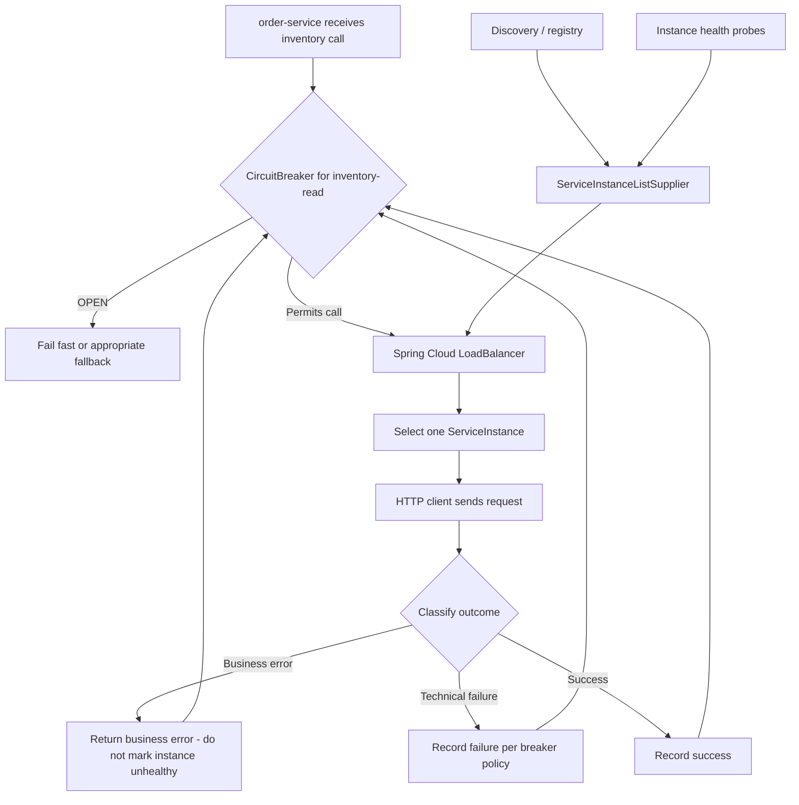
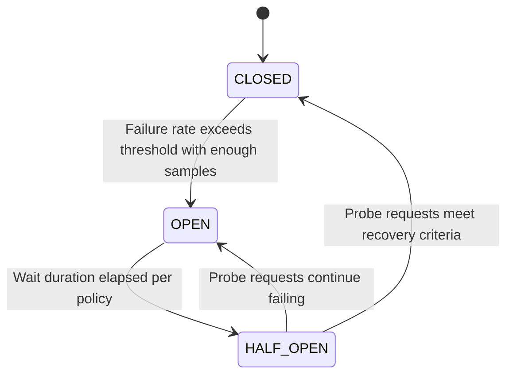

# Distinguishing Business Errors from Errors Used to Evaluate Health

In a microservices system, a call to `inventory-service` through Spring Cloud LoadBalancer can return HTTP `404`, `409`, `429`, or `503`, or fail because of a timeout, connection refusal, or having no available `ServiceInstance`. Yet **not every error means the target instance is unhealthy**.

For example, a lookup for a non-existent item returning `404 Not Found` is a **valid business outcome** if the API is designed that way. Treating 404 as an infrastructure failure can trip the circuit breaker after a burst of users querying invalid item codes, even while every instance is healthy. Conversely, ignoring every HTTP 5xx on the grounds that "it's still a response" can keep routing traffic to a continuously failing service.

The goal of this lesson in the **Isolation and Recovery** chapter is to build a **signal-classification policy**: which errors return straight to the caller, which count toward the circuit breaker, which permit retries, when health checks must drop an instance from the list, and which cases need closer observation before drawing conclusions.

## 1. Three Distinct Questions When a Call Fails

Suppose `order-service` calls:

```http
GET /api/v1/items/missing HTTP/1.1
Host: inventory-service
```

To evaluate properly, do not lump all failures into one `healthy=false` flag. Separate at least three questions:

1. **Is the business outcome valid?** Missing items, locked orders, insufficient stock, or unauthorized users are outcomes an API can explicitly express.
2. **Is the instance ready to accept traffic?** Health/readiness probes tell whether an instance currently meets general serving criteria.
3. **Are calls from this client failing continuously?** Circuit breakers and timeout/error statistics per `service ID` or operation assess the success probability of a call group over time.

| Example | Business outcome | Instance readiness | Should record as availability failure? |
|---|---|---|---|
| GET non-existent item → 404 | Valid if per contract | Likely still UP | Usually no |
| Order negative quantity → 400 | Invalid input | Likely still UP | No |
| Order out-of-stock item → 409 | Business conflict | Likely still UP | No |
| Overloaded provider → 429 | Capacity-limiting signal | Likely still UP | Per dedicated policy; do not auto-equate with dead instance |
| TCP connect timeout | No HTTP response | Unknown | Usually yes, once error origin is confirmed |
| Provider repeatedly returns 503 | Cannot serve current request | May be degraded | Usually yes |
| Discovery finds no instances | No target selectable | No probe for a selected instance | Service/discovery-level availability failure; do not blame one instance |

A **business failure** does not mean the user got a happy result; it means the system made an **expected business decision**. An **availability failure** indicates an inability to serve per the technical contract, not merely any non-2xx HTTP status.

## 2. Classifying HTTP Status Codes by API Context

A status table provides guidance, yet **each endpoint's contract defines its real semantics**:

| Status / group | Common semantics | Guidance for health / circuit breaker |
|---|---|---|
| `200/201/204` | Processed successfully | Do not record availability failure |
| `400/422` | Invalid input or data-rule violation | Usually exclude from circuit breaker failure stats |
| `401/403` | Missing authentication/authorization | Usually do not mark instance broken; if spiking after deploy, investigate auth/config |
| `404` | Resource not found; occasionally wrong route/API version | Contract-valid 404: do not record infra failure; misrouted 404 needs investigation |
| `409/412` | Conflict or unmet update precondition | Usually business/concurrency error, not availability |
| `408` | Request Timeout from an HTTP hop | Investigate which layer generated it; may be a timeout incident |
| `429` | Rate limit / overload / per-caller throttling | Capacity signal; track separately, do not automatically conclude "instance is dead" |
| `500` | Unexpected server error | Usually counted as technical/circuit-breaker failure |
| `502/503/504` | Gateway/backend unavailable or upstream timeout | Usually availability failure, though origin must be identified |

### Why Not Count Every 4xx as an Infrastructure Error?

A customer queries 100 non-existent SKUs; the provider processes them correctly and returns 100 `404` responses. If the breaker counts those 100 responses as failures, it can open and block requests for **real** SKUs too. That is a self-inflicted outage caused by choosing the wrong signal.

Similarly, `409 Conflict` on an inventory update API using optimistic locking typically reflects a **legitimate concurrent update conflict**; raising timeouts or dropping instances from the pool will not resolve conflicts.

### Why Not Exclude Every 4xx from Observability Either?

A sudden spike in HTTP `404` after deploying a new API version can indicate a **wrong route, changed path, or version mismatch**. Mass HTTP `401/403` can indicate broken tokens, clock skew, or bad config. They are usually **not signals of a dead instance to eject from the pool**, yet still require alerts broken down by rate, operation, and version.

HTTP `429` in particular must be separated from "bad input": the provider may be alive yet overloaded, or rate limiting a specific tenant. Depending on the system, use dedicated metrics, back off honoring `Retry-After`, or record 429 in a **capacity-focused** circuit breaker policy. Never apply one global 429 rule across every service.

## 3. Health Checks, LoadBalancer, and Circuit Breakers Are Distinct Layers

In Spring Cloud, three layers hold related yet distinct responsibilities:

**Discovery / LoadBalancer:** `DiscoveryClient` and the `ServiceInstanceListSupplier` chain supply the instance list for a `service ID`. `RoundRobinLoadBalancer`, `RandomLoadBalancer`, or another strategy picks a `ServiceInstance` from the list visible to the client.

**Health check:** `HealthCheckServiceInstanceListSupplier` is an optional instance-list source that periodically probes a health endpoint and prioritizes instances considered healthy. Instance counts can differ across discovery, cache, and health results.

**Circuit breaker:** a component like Resilience4j tracks call outcomes within a **configured scope**, such as all `inventory-read` calls. When failure probability exceeds threshold, the breaker can open to **reject new calls** for a period, then allow limited recovery probes. It does not inherently mark individual instances like `inventory-A` or `inventory-B` separately.



This diagram illustrates responsibility relationships. A call may traverse layers in a different order depending on `RestClient`, `WebClient`, OpenFeign integration, and where resilience wrappers are placed. Do not infer exact execution order of every decorator from this diagram alone.

### Instance Health Is Not Identical to Operation Health

Suppose `inventory-A` serves `GET /items` fine while `POST /reservations` fails due to a write dependency. Overall health may still be UP while the `reserve-stock` circuit breaker sees high failures and opens. Conversely, the `inventory-read` breaker need not open when writes fail.

If a breaker is scoped per `service ID`, it normally observes **all instances aggregated together**. One broken instance A among A/B/C can trip the breaker for **the entire service** if the error rate breaches threshold. Measure per instance to spot localized failures and consider health/discovery filtering; never assume a service-ID-scoped breaker isolates a single bad replica precisely.

### When All Instances Are Marked Unhealthy

With the common `HealthCheckServiceInstanceListSupplier`, when **zero healthy instances remain** while the source list is non-empty, the supplier **falls back to returning the delegate's instance list** instead of always returning empty. This favors availability when probes might yield false negatives.

Consequently, "health check is enabled" **does not guarantee** LoadBalancer will never pick an instance that failed probes. If strict fail-closed behavior is required, design a dedicated policy; do not confuse this fallback with a circuit breaker feature. If the source list itself is empty, there are no instances to fall back to.

## 4. Choosing the Right Health Endpoint for the Job

**Liveness** typically signals whether a process is alive or needs restarting. **Readiness** answers whether the instance is ready to accept traffic. For target selection, readiness fits far better than treating individual 404/409 business responses as health probes.

Example on a Spring Boot Actuator provider:

```yaml
management:
  endpoint:
    health:
      probes:
        enabled: true
```

When Spring Boot exposes the readiness probe, you can check:

```bash
curl -i http://localhost:8091/actuator/health/readiness
```

An unready provider typically responds according to health indicator status mappings, such as `503`; when ready, it typically returns 2xx. Actual paths and access controls must match deployment security. Never expose internal diagnostics or credentials publicly just so health checkers can call them.

Principles for readiness endpoints:

1. Check only dependencies **genuinely required** for the instance to serve the traffic class readiness protects.
2. Keep probes lightweight enough that many clients/LoadBalancers do not add noticeable load.
3. Define clear failure-detection and recovery windows; one stray timeout need not eject an instance immediately.
4. During shutdown, transition readiness to stop receiving traffic **before** the process halts; pair with graceful shutdown.
5. Never let 404/409 business responses cause `/actuator/health/readiness` to report DOWN.

**Be careful when coupling dependencies:** if readiness checks a shared service, when that service blips, every instance may mark itself DOWN simultaneously. Sometimes that is right; other times it triggers a cascading outage—decide based on serving viability and acceptable system degradation.

## 5. Error Classification Rules Belong Near the API Contract

For a client calling `inventory-service`, outcomes can be grouped by intent:

| Group | Handling purpose | Examples |
|---|---|---|
| **BUSINESS** | Return business error/answer without opening circuit breaker | `ITEM_NOT_FOUND`, `STOCK_CONFLICT`, validation |
| **CAPACITY** | Backoff, rate limiting, capacity-limit tracking | HTTP 429, `Retry-After` |
| **AVAILABILITY** | Circuit breaker evaluation, timeouts, conditional retries | Connect failure, HTTP 502/503/504, certain 500s |
| **UNKNOWN** | Preserve error details and investigate; avoid fake successes | Decode errors, unexpected exceptions, unclear provenance |

`UNKNOWN` does not mean "ignore." Depending on the contract, an undecodable 200 response still renders the call **unusable** and may belong in the operation's circuit breaker. Still, do not equate it with *instance not listening on TCP* or report DOWN in readiness.

### Example: Mapping Error Codes to Business Exceptions

With Spring Cloud OpenFeign, an `ErrorDecoder` can turn 404/409 into **dedicated** domain exceptions while keeping 5xx as infrastructure exceptions:

```java
import feign.Response;
import feign.codec.ErrorDecoder;

final class ItemNotFoundException extends RuntimeException {
    ItemNotFoundException() {
        super("Item does not exist");
    }
}

final class StockConflictException extends RuntimeException {
    StockConflictException() {
        super("Inventory conflict");
    }
}

final class InventoryErrorDecoder implements ErrorDecoder {
    private final ErrorDecoder fallback = new ErrorDecoder.Default();

    @Override
    public Exception decode(String methodKey, Response response) {
        return switch (response.status()) {
            case 404 -> new ItemNotFoundException();
            case 409 -> new StockConflictException();
            default -> fallback.decode(methodKey, response);
        };
    }
}
```

This snippet assumes **the API specifies 404 as item not found and 409 as stock conflict** for this Feign client. A client with multiple endpoints should inspect `methodKey` and/or error codes in the body to avoid mis-mapping; 404 can also stem from a bad route or API version. Likewise, enabling `dismiss404` passes 404 through normal decoding rather than ErrorDecoder.

The benefit of dedicated domain exceptions is that the circuit breaker can **ignore** them while still letting the service layer handle them. There is no need to mark the provider unhealthy just because the server rejected an invalid business operation.

## 6. Configuring the Circuit Breaker Not to Treat Business Errors as Instance Failures

With Resilience4j, `CircuitBreakerConfig` lets you specify which exceptions **are recorded as failures** and which **are ignored from breaker statistics**. This is crucial when an endpoint legitimately returns 404/409 frequently.

Suppose an app uses Spring Cloud OpenFeign with Resilience4j CircuitBreaker; you can write a shared error classifier for the `inventory-read` policy:

```java
import feign.FeignException;

final class InventoryFailurePolicy {

    private InventoryFailurePolicy() {
    }

    static boolean shouldIgnoreForCircuitBreaker(Throwable error) {
        if (error instanceof ItemNotFoundException
                || error instanceof StockConflictException) {
            return true;
        }

        if (error instanceof FeignException feignError) {
            int status = feignError.status();
            return status == 400
                    || status == 401
                    || status == 403
                    || status == 404
                    || status == 409
                    || status == 412
                    || status == 422
                    || status == 429;
        }

        return false;
    }
}
```

This is an **illustrative policy for the inventory-read operation**:

- Contract-valid 404/409 errors are excluded from the breaker's **statistical samples**, not counted as successful calls either.
- 429 is separated for rate-limit/capacity handling, though another system might record 429 in a dedicated breaker when overload thresholds apply. Base that decision on metrics and API behavior.
- 401/403/400/422 usually reflect caller or contract issues, yet still require independent metrics/alerts if they spike unexpectedly after deployment.
- Exceptions outside the ignored group (HTTP 5xx, transport errors, timeouts, unexpected decode errors...) count as failures in the config below. This is a **conservative choice for an operation breaker**, not a claim that all of them mean a specific instance died.

### 6.1. Creating an Operation-Scoped Breaker

Example using `resilience4j-circuitbreaker` compatible with your project's Spring Boot/Spring Cloud stack:

```java
import io.github.resilience4j.circuitbreaker.CircuitBreaker;
import io.github.resilience4j.circuitbreaker.CircuitBreakerConfig;

import java.time.Duration;
import org.springframework.context.annotation.Bean;
import org.springframework.context.annotation.Configuration;

@Configuration
class InventoryResilienceConfiguration {

    @Bean
    CircuitBreaker inventoryReadCircuitBreaker() {
        CircuitBreakerConfig config = CircuitBreakerConfig.custom()
                .slidingWindowSize(20)
                .minimumNumberOfCalls(10)
                .failureRateThreshold(50.0f)
                .waitDurationInOpenState(Duration.ofSeconds(15))
                .ignoreException(
                        InventoryFailurePolicy::shouldIgnoreForCircuitBreaker)
                .build();

        return CircuitBreaker.of("inventory-read", config);
    }
}
```

`slidingWindowSize(20)` uses Resilience4j's default count-based window size, `minimumNumberOfCalls(10)` requires enough samples before evaluating thresholds, and `failureRateThreshold(50%)` defines an illustrative cutoff. These numbers are **for learning only**, not production recommendations.

In this policy, `ignoreException` keeps a business exception from incrementing the breaker's success or failure sample counts, **while the exception still propagates to the caller**. It does not convert a 404 response into 200, nor handle business logic on the app's behalf.

Caution: when specifying `recordException` with a custom predicate, exceptions **not matching** it may be counted as successes in breaker statistics unless also excluded via `ignoreException`. Design both **record** and **ignore** rules explicitly; never accidentally count 404/409 as successes and report 100% service availability.

### 6.2. Wrapping the Call Properly with Circuit Breaker

Example gateway using an injected Feign client protected by a dedicated breaker:

```java
import io.github.resilience4j.circuitbreaker.CircuitBreaker;
import org.springframework.beans.factory.annotation.Qualifier;
import org.springframework.stereotype.Service;

import java.util.function.Supplier;

@Service
class InventoryGateway {

    private final InventoryClient client;
    private final CircuitBreaker breaker;

    InventoryGateway(
            InventoryClient client,
            @Qualifier("inventoryReadCircuitBreaker") CircuitBreaker breaker) {
        this.client = client;
        this.breaker = breaker;
    }

    ItemDto getItem(String itemId) {
        Supplier<ItemDto> protectedCall =
                CircuitBreaker.decorateSupplier(
                        breaker, () -> client.findById(itemId));
        return protectedCall.get();
    }
}
```

Here, the breaker named `inventory-read` protects the **read operation**. When both `inventory-A` and `inventory-B` sit under this service ID, the breaker does not remember which instance was picked per call: its failure rate reflects **calls observed by the breaker**, not A's or B's individual failure rate.

When the breaker is `OPEN`, Resilience4j can throw `CallNotPermittedException` to reject new calls. This is a **client-side isolation decision**, not an HTTP 503 actually returned by the provider. If the retry layer immediately retries `CallNotPermittedException`, the system creates a pointless loop; distinguish it from transient HTTP errors.

### 6.3. Open, Half-Open, and Closed: A Separate Lifecycle



This is the simplified common three-state model; Resilience4j also supports special administrative states like disabled/forced-open. A circuit breaker **is not an active health probe**: if no probe requests arrive during `HALF_OPEN`, it will not prove recovery on its own.

When multiple distinct operations exist, consider scoping breakers by **downstream + operation** or SLO-uniform operation groups. One monolithic breaker for every GET/POST on a service ID risks letting business 404s or one endpoint's errors affect unrelated endpoints.

## 7. Limitations of ErrorDecoder and Classification Across HTTP Clients

OpenFeign's `ErrorDecoder` handles **HTTP error responses that reached Feign**. It is not the only place errors arise:

- TCP connect refused, DNS/TLS errors, and read timeouts can throw transport exceptions **before ErrorDecoder is ever invoked**.
- HTTP 200 with malformed JSON usually triggers **data decoder** exceptions rather than `ErrorDecoder`.
- Some LoadBalancer integrations synthesize an **HTTP 503** when no instance is found; a custom `ErrorDecoder` may see 503 with zero actual provider requests.
- Feign can wrap transport errors in `RetryableException`, yet **actual retrying** depends on the configured `Retryer`; Spring Cloud OpenFeign defaults to `Retryer.NEVER_RETRY`.

With Spring WebFlux `WebClient`, `retrieve().onStatus(...)` or `exchangeToMono(...)` handlers can map HTTP responses to business errors. Example converting 404 to a dedicated exception while keeping 5xx default handling:

```java
import org.springframework.web.reactive.function.client.WebClient;
import reactor.core.publisher.Mono;

Mono<ItemDto> getItem(WebClient client, String id) {
    return client.get()
            .uri("/api/v1/items/{id}", id)
            .retrieve()
            .onStatus(status -> status.value() == 404,
                    response -> response.releaseBody()
                            .thenReturn(new ItemNotFoundException()))
            .bodyToMono(ItemDto.class);
}
```

With `@LoadBalanced WebClient.Builder`, the client can use `baseUrl("http://inventory-service")` and pick instances via LoadBalancer. `onStatus` applies only to **HTTP responses**; it does not intercept connect or decode failures. When wrapping reactive pipelines with resilience operators, classify both transport exceptions and mapped domain exceptions.

With `RestClient`/`RestTemplate`, similarly configure an error handler/`onStatus` or catch `RestClientResponseException` to inspect status codes and avoid conflating business errors with network errors. If the application catches every exception and turns it into `InventoryUnavailableException`, the circuit breaker loses the original signal and may count 404s as availability failures.

### Do Not Hide Infrastructure Failures as Business Outcomes

A dangerous example:

```java
// WRONG: network drops or HTTP 503 also get treated as "item missing."
try {
    return client.findById(id);
} catch (RuntimeException ignored) {
    throw new ItemNotFoundException();
}
```

The right approach is mapping only `404` or verified error codes to `ItemNotFoundException`. Preserve status/cause on all remaining errors so circuit breakers, retry policies, and observability systems can react properly.

## 8. Retries, Fallbacks, and Health Checks Must Not Trigger Chain Reactions

A sound policy decides not only "which errors raise failure rates," but also the next action:

| Error type | Retry | Fallback | Circuit breaker | Health |
|---|---|---|---|---|
| Contract-valid `404` | Do not retry verbatim | Return clear not-found | Ignore/exclude | Do not drop instance |
| `409` stock conflict | Wait for business state resolution | Return conflict | Ignore/exclude | Do not drop instance |
| `429` rate limit | May back off per `Retry-After`, bounded | Degrade per policy | May use separate breaker/capacity metric | Do not assume instance is dead |
| Provider HTTP `503` | May retry idempotent calls within deadline | Valid cached read data if contract permits | Usually record failure | Readiness may report DOWN, needs independent probe |
| Connect timeout/refused | Consider retrying on another instance | Degraded response or fail fast | Usually record failure | Check probes and discovery |
| Open breaker | Never loop retries immediately | Fail fast or fallback | Actively isolating | Does not auto-drop instance from discovery |
| No instances remaining | No target available at that moment | Controlled failure | Service-level availability outage | Inspect registry/supplier |

**Never retry a business error like 404/409 just because the status is non-2xx.** Doing so wastes budget, adds load, and may hop instances even when every replica handles the valid request identically.

**Never fall back by fabricating successful data** when a write fails. For read APIs, cached responses with appropriate TTL and confidence metadata are sometimes acceptable; for payments/reservations, fake success misleads callers into thinking transactions committed without confirmation.

### Timeouts and Retry Budgets

If a caller has an 800 ms total deadline, each retry must use **remaining budget** rather than granting a fresh 800 ms. A setup with two 500 ms attempts plus 100 ms backoff easily blows the deadline.

A conservative rule:

\[
\sum_i T_{\text{attempt},i}
 +\sum_j T_{\text{backoff},j}
 +T_{\text{overhead}}
\le T_{\text{deadline}}
\]

For truly idempotent HTTP GETs, bounded retries on a subset of transient failures can help. For POST/PATCH or side-effecting PUT/DELETE operations, require idempotency keys and duplicate-write prevention before retrying. A client timeout **never proves** the provider failed to commit.

Circuit breakers, retries, and timeouts need an **intentional wrapping order**: if retry sits inside the breaker, the breaker sees the final chain outcome; if the breaker sits inside retry, each attempt can be counted separately. You cannot deduce exact order from annotations without checking decorator/aspect ordering and library versions.

## 9. Hands-On Lab: Producing Business Responses and Technical Error Responses

This lab uses `order-service` (client) calling two `inventory-service` replicas on ports `8091` and `8092`. The provider exposes a business test endpoint and **a separate readiness endpoint**. When testing 404/409 statuses, readiness stays healthy; when intentionally flipping readiness to DOWN, we observe supplier and LoadBalancer behavior without fabricating 404s.

### 9.1. Spring Boot Provider

In `inventory-service` using `spring-boot-starter-web`, the lab controller:

```java
import java.util.Map;
import java.util.concurrent.atomic.AtomicBoolean;

import org.springframework.beans.factory.annotation.Value;
import org.springframework.http.HttpStatus;
import org.springframework.http.ResponseEntity;
import org.springframework.web.bind.annotation.GetMapping;
import org.springframework.web.bind.annotation.PathVariable;
import org.springframework.web.bind.annotation.PostMapping;
import org.springframework.web.bind.annotation.RestController;

record ItemDto(String id, String name, String servedBy) {
}

@RestController
class InventoryDemoController {

    private final AtomicBoolean ready = new AtomicBoolean(true);
    private final int port;

    InventoryDemoController(@Value("${server.port}") int port) {
        this.port = port;
    }

    @GetMapping("/api/v1/items/{id}")
    ResponseEntity<?> find(@PathVariable String id) {
        return switch (id) {
            case "missing" -> ResponseEntity.status(404)
                    .body(Map.of("code", "ITEM_NOT_FOUND"));
            case "conflict" -> ResponseEntity.status(409)
                    .body(Map.of("code", "STOCK_CONFLICT"));
            case "limited" -> ResponseEntity.status(429)
                    .header("Retry-After", "2")
                    .body(Map.of("code", "RATE_LIMITED"));
            case "fault" -> ResponseEntity.status(500)
                    .body(Map.of("code", "INTERNAL_FAILURE"));
            case "down" -> ResponseEntity.status(503)
                    .body(Map.of("code", "TEMPORARILY_UNAVAILABLE"));
            default -> ResponseEntity.ok(
                    new ItemDto(id, "Item " + id, "inventory-" + port));
        };
    }

    @GetMapping("/internal/ready")
    ResponseEntity<Map<String, String>> readiness() {
        if (ready.get()) {
            return ResponseEntity.ok(Map.of("status", "UP"));
        }
        return ResponseEntity.status(HttpStatus.SERVICE_UNAVAILABLE)
                .body(Map.of("status", "DOWN"));
    }

    @PostMapping("/internal/lab/ready/{value}")
    ResponseEntity<Void> changeReadiness(@PathVariable boolean value) {
        ready.set(value);
        return ResponseEntity.noContent().build();
    }
}
```

**Use this controller only in a lab environment.** `POST /internal/lab/ready/{value}` has no authentication and lets callers flip simulated readiness; never deploy this prototype to production. Real health relies on Actuator readiness and trustworthy application signals, not an unauthenticated toggle on the network.

Run two processes:

```bash
# Terminal A
java -jar inventory-service.jar --server.port=8091

# Terminal B
java -jar inventory-service.jar --server.port=8092
```

Verify **directly against the providers**:

```bash
curl -i http://localhost:8091/internal/ready
curl -i http://localhost:8091/api/v1/items/missing
curl -i http://localhost:8091/api/v1/items/conflict
curl -i http://localhost:8092/api/v1/items/limited
curl -i http://localhost:8092/api/v1/items/fault
curl -i http://localhost:8092/api/v1/items/down
```

Expect readiness to return 200 even as business endpoints intentionally return 404/409/429/500/503. This shows that **an HTTP error response from a business endpoint is not automatically a health probe failure**.

### 9.2. Client Instance Source and Health Probe

In `order-service` `application-lab.yml`:

```yaml
spring:
  application:
    name: order-service
  cloud:
    discovery:
      client:
        simple:
          instances:
            inventory-service:
              - uri: http://localhost:8091
              - uri: http://localhost:8092
    loadbalancer:
      health-check:
        path:
          inventory-service: /internal/ready
        initial-delay: 2s
        interval: 10s
```

`localhost` works on the same host; in Docker/Kubernetes, the client's `localhost` is not the provider's hostname. The 2s/10s values are just for quick lab observation. Depending on release train, verify exact properties and lifecycle of `HealthCheckServiceInstanceListSupplier`.

**Declaring properties alone may not guarantee the health supplier is active.** In a Spring Cloud version supporting the builder API, you can register a dedicated supplier for `inventory-service`:

```java
import org.springframework.cloud.loadbalancer.core.ServiceInstanceListSupplier;
import org.springframework.context.ConfigurableApplicationContext;
import org.springframework.context.annotation.Bean;
import org.springframework.context.annotation.Configuration;

@Configuration(proxyBeanMethods = false)
public class InventoryLoadBalancerConfiguration {

    @Bean
    ServiceInstanceListSupplier instanceSupplier(
            ConfigurableApplicationContext context) {
        return ServiceInstanceListSupplier.builder()
                .withDiscoveryClient()
                .withBlockingHealthChecks()
                .build(context);
    }
}
```

And bind it to the client context by service ID:

```java
import org.springframework.boot.autoconfigure.SpringBootApplication;
import org.springframework.cloud.loadbalancer.annotation.LoadBalancerClient;
import org.springframework.cloud.openfeign.EnableFeignClients;

@SpringBootApplication
@EnableFeignClients
@LoadBalancerClient(
        name = "inventory-service",
        configuration = InventoryLoadBalancerConfiguration.class)
public class OrderApplication {
}
```

Place `InventoryLoadBalancerConfiguration` **outside the main application's normal component scan** so custom settings do not accidentally apply to other service IDs. This illustrates a **blocking health check** for Feign/RestTemplate apps; reactive WebClient apps use the matching reactive supplier/extension points for their Spring Cloud version.

To run the Feign client, include `spring-cloud-starter-openfeign`, `spring-cloud-starter-loadbalancer`, `spring-boot-starter-web`, and a Spring Cloud BOM compatible with Spring Boot. Enable `@EnableFeignClients` on the application and place `InventoryClient` and `InventoryErrorDecoder` in the proper Feign client configuration.

### 9.3. Wiring the Feign Client with Policy and Breaker

In `order-service`, reuse the domain exceptions and `InventoryErrorDecoder` from section 5. Place the interface and configuration in their respective Java files:

```java
import org.springframework.cloud.openfeign.FeignClient;
import org.springframework.web.bind.annotation.GetMapping;
import org.springframework.web.bind.annotation.PathVariable;

@FeignClient(
        name = "inventory-service",
        configuration = InventoryFeignConfiguration.class)
public interface InventoryClient {

    @GetMapping("/api/v1/items/{id}")
    ItemDto findById(@PathVariable("id") String id);
}
```

```java
import feign.codec.ErrorDecoder;
import org.springframework.context.annotation.Bean;
import org.springframework.context.annotation.Configuration;

@Configuration(proxyBeanMethods = false)
public class InventoryFeignConfiguration {

    @Bean
    ErrorDecoder errorDecoder() {
        return new InventoryErrorDecoder();
    }
}
```

Client-side `ItemDto` must match the provider's response structure, e.g., `record ItemDto(String id, String name, String servedBy) {}`. Keep `InventoryFeignConfiguration` outside normal component scanning so `inventory-service`-specific policies do not leak to other Feign clients. `InventoryGateway` from section 6 calls `InventoryClient` wrapped with the `inventory-read` breaker.

To invoke via an HTTP endpoint on the client, add a controller:

```java
import org.springframework.web.bind.annotation.GetMapping;
import org.springframework.web.bind.annotation.PathVariable;
import org.springframework.web.bind.annotation.RestController;

@RestController
class InventoryProxyController {

    private final InventoryGateway gateway;

    InventoryProxyController(InventoryGateway gateway) {
        this.gateway = gateway;
    }

    @GetMapping("/test/items/{id}")
    ItemDto getItem(@PathVariable String id) {
        return gateway.getItem(id);
    }
}
```

For the proxy HTTP responses to reflect business errors accurately, add a `@RestControllerAdvice` mapping `ItemNotFoundException` to 404 and `StockConflictException` to 409. Without a handler, custom exceptions may surface as default HTTP 500 on `order-service` even though Feign classified them correctly. **Never** map transport/503 errors to 404 just to tidy up caller responses.

### 9.4. Never Let Business Errors Drive Readiness

Try these steps:

1. With A/B ready, call `GET /api/v1/items/missing` and `GET /api/v1/items/conflict` through Feign on `order-service`; verify domain exceptions are thrown while `/internal/ready` on A/B stays 200.
2. Call `GET /api/v1/items/fault` repeatedly; verify `inventory-read` circuit breaker records failures and opens once minimum calls/threshold are met.
3. On provider A, call `POST /internal/lab/ready/false` to simulate unready. Wait one health interval and observe A excluded from the health-filtered list while B remains healthy.
4. Flip B to unready too. With a health-check supplier that defaults to falling back when **no healthy instance remains**, the source list A/B may be used again; this **does not prove** either instance recovered.
5. Restore both with `POST /internal/lab/ready/true`, and observe after the health interval and breaker state transitions per recovery policy.

Perform readiness toggles only in a **controlled lab**, never on live services. To verify the exact list entering LoadBalancer, instrument `ServiceInstanceListSupplier` or record chosen-instance metrics; HTTP responses alone are sometimes insufficient.

## 10. Testing That the Circuit Breaker Does Not Open on Business Errors

At the unit-test level, you can verify **classification logic** directly without running a registry or provider. Example using JUnit Jupiter and Resilience4j:

```java
import static org.junit.jupiter.api.Assertions.assertEquals;
import static org.junit.jupiter.api.Assertions.assertThrows;

import io.github.resilience4j.circuitbreaker.CircuitBreaker;
import io.github.resilience4j.circuitbreaker.CircuitBreakerConfig;
import org.junit.jupiter.api.Test;

import java.util.function.Supplier;

class InventoryCircuitBreakerTest {

    private CircuitBreaker newBreaker() {
        CircuitBreakerConfig config = CircuitBreakerConfig.custom()
                .slidingWindowSize(4)
                .minimumNumberOfCalls(2)
                .failureRateThreshold(50.0f)
                .ignoreException(
                        InventoryFailurePolicy::shouldIgnoreForCircuitBreaker)
                .build();
        return CircuitBreaker.of("inventory-test", config);
    }

    @Test
    void notFoundDoesNotTripCircuitBreaker() {
        CircuitBreaker breaker = newBreaker();

        Supplier<ItemDto> call = CircuitBreaker.decorateSupplier(
                breaker, () -> {
                    throw new ItemNotFoundException();
                });

        for (int i = 0; i < 10; i++) {
            assertThrows(ItemNotFoundException.class, call::get);
        }

        assertEquals(CircuitBreaker.State.CLOSED, breaker.getState());
        assertEquals(0, breaker.getMetrics().getNumberOfBufferedCalls());
    }

    @Test
    void unexpectedFailuresCanOpenCircuitBreaker() {
        CircuitBreaker breaker = newBreaker();

        Supplier<ItemDto> call = CircuitBreaker.decorateSupplier(
                breaker, () -> {
                    throw new IllegalStateException("Unexpected provider failure");
                });

        assertThrows(IllegalStateException.class, call::get);
        assertThrows(IllegalStateException.class, call::get);

        assertEquals(CircuitBreaker.State.OPEN, breaker.getState());
    }
}
```

This test verifies:

- Ten `ItemNotFoundException` occurrences still propagate to the caller, yet are **excluded from statistics** so the breaker stays closed.
- Two non-ignored failures reach `minimumNumberOfCalls(2)` and exceed the 50% threshold in the test fixture, opening the breaker.

This is solely a **Resilience4j policy unit test**. It does not prove Feign's ErrorDecoder is wired properly or that LoadBalancer alternates between two instances. Add integration tests using real HTTP/stubs and check traces to verify end-to-end behavior.

### Recommended Integration Test Matrix

| Scenario | HTTP/transport result | Readiness | Expected breaker outcome |
|---|---|---|---|
| Missing item | 404 → `ItemNotFoundException` | UP | Ignored; breaker does not open on 404s alone |
| Stock conflict | 409 → `StockConflictException` | UP | Ignored |
| Rate limited | 429 | UP (policy-dependent) | Classify under capacity; do not retry immediately in a loop |
| Provider returns 500 repeatedly | 500 | Possibly UP | Record failure; breaker may OPEN |
| Provider returns 503 | 503 | Possibly DOWN or UP | Record availability failure; identify origin |
| Connect refused | No HTTP response | Possibly stale UP | Record failure/timeout; diagnose network |
| Readiness A DOWN, B UP | A probe 503 | A DOWN, B UP | Health filter prefers B; does not open service-wide breaker |
| Both A/B DOWN | Both probes fail | DOWN | Verify health supplier default fallback behavior |
| No instances | LoadBalancer finds no target | No target | Discovery/service-level error; do not blame A/B |
| Breaker OPEN | Provider not called | Do not infer readiness | Fail fast; track `CallNotPermittedException` separately |

For breaker tests, never use "an HTTP 404 appeared" as a failure criterion. Measure **classified exceptions**, recorded sample counts, and breaker state; for health suppliers, inspect post-probe instance lists **independently** of business request results.

## 11. Observing Failure Rates and Recovery Properly

Separate at least four metric groups:

1. **Business outcomes:** `not_found`, `validation_failed`, `stock_conflict`, `unauthorized`; these explain API behavior without necessarily indicating infrastructure failures.
2. **Client-call availability:** successful calls, 5xx errors, transport/timeout errors, retries, and whether an instance was selected.
3. **Instance health:** total discovered instances, probe-passing instances, readiness outcomes, and DOWN-to-UP transition times.
4. **Circuit-breaker state:** `CLOSED/OPEN/HALF_OPEN`, recorded failures, ignored exceptions, slow calls, `CallNotPermittedException`, and recovery duration.

| Signal to record | Question it answers |
|---|---|
| `serviceId`, `operation` | Which service and operation type is being called? |
| `selectedInstance`, `zone` | Are errors concentrated on one replica/zone or the whole service? |
| `httpStatus` and `domainErrorCode` | Is this a business outcome or a technical failure? |
| `errorOrigin` | Provider, gateway, LoadBalancer, transport, or local circuit breaker? |
| `timeoutPhase` | Did timeout occur at connect, pool acquire, response, or overall deadline? |
| `breakerName` and `breakerState` | Which operation is currently isolated? |
| `recordedFailureCount` and `ignoredOutcomeCount` | Are errors being classified accurately? |
| `discoveredInstanceCount` and `healthyInstanceCount` | Which candidates did the health supplier retain? |
| `retryCount`, `attemptCount` | How many attempts did each logical request generate? |
| `traceId` / `correlationId` | Can we trace A → B → C and correlate logs? |

Metric/field names in the table are **instrumentation suggestions**; not all are emitted automatically with these exact names by Spring Cloud LoadBalancer or Resilience4j. With Micrometer/Observation or OpenTelemetry, choose bounded labels and instrument where full context is available.

Specifically, **never use user IDs, order IDs, full parameterized URIs, or traceId as unbounded-cardinality metric labels**. Keep those in controlled traces/logs; metrics only need bounded labels such as service ID, operation template, error class, and evaluated instance/zone.

### Signs of a Misconfigured Policy

| Symptom | Primary diagnosis |
|---|---|
| Breaker opens after a wave of missing-item lookups | 404 is being recorded as failure or domain exception was wrapped |
| Readiness flips DOWN whenever 409 occurs | Health endpoint executes business logic or overly broad dependency checks |
| Business error rate drops while rejected requests rise | Breaker may have OPENed, stopping calls to provider |
| Many 429s while breaker remains CLOSED | Likely intentional if capacity is separated; add rate-limit metrics/alerts |
| 503 rises while health stays UP | Backend failing a specific operation below readiness threshold, or proxy 503 |
| Both A/B unhealthy yet requests still hit them | Health-check supplier fell back to source list, or discovery/cache is stale |
| Breaker opens for both A and B when only A fails | Breaker is scoped to aggregated service/operation, not per-instance |
| Feign errors missing from ErrorDecoder | Failure occurred at network/discovery before an HTTP response existed to decode |

### Monitor Recovery Rather Than Only Errors

Verify recovery on **both sides**:

- **Provider:** readiness returns UP, 5xx drops, dependencies work, instances serve real requests.
- **Client:** instance lists refresh, breaker moves OPEN → HALF_OPEN → CLOSED as probes succeed per policy, and backlogs/retries return to baseline.

A healthy provider does not instantly close the client's breaker; the breaker has its own lifecycle. Conversely, a CLOSED breaker does not prove all instances are healthy, since the client may have probed only a subset. Verify each mechanism separately.

## 12. Common Design Mistakes

| Mistake | Consequence | Fix |
|---|---|---|
| Counting every HTTP 4xx as instance failure | 404/409 opens breaker falsely | Classify per contract; ignore domain exceptions |
| Treating 404 as always a business outcome | Masks wrong URLs/gateways or version mismatches | Inspect endpoint, method, error code, and traces |
| Treating every 503 as unhealthy backend | Could be a LoadBalancer or gateway-synthesized 503 | Verify whether requests reached the provider and chosen instance |
| Treating 429 like lost connectivity | Continuous retries worsen overload | Separate capacity policy; honor `Retry-After` |
| One service-wide breaker for all operations | One broken endpoint drags down healthy endpoints | Group operations and scope breakers carefully |
| Using health readiness instead of handling 404/409 | Fails to solve business semantics | Return proper domain errors; keep health independent |
| Catching every RuntimeException and mapping to NotFound | Masks timeouts/503s and skews metrics | Map only explicit domain errors |
| Catching every RuntimeException and mapping to Unavailable | Business errors recorded as infra failures | Preserve business exceptions and root causes |
| Retrying `CallNotPermittedException` too | Bypasses breaker's isolation intent | Fail fast or safe fallback; wait per policy |
| Enabling health-check config without registering supplier | No actual health filtering happens | Verify bean and service-specific configuration |
| Assuming all unhealthy ⇒ zero targets | May fall back to source list | Test actual behavior; build explicit fail-closed logic if mandatory |
| Fallback turning errors into "success" | Caller thinks order/payment committed | Never fake success for unverified side effects |
| Judging instance health solely by successful request counts | Misses retried failures and breaker-rejected calls | Track attempts, failure origin, and outcomes separately |

## 13. Checklist and Summary

- [ ] Documented clear definitions of **business errors**, **capacity signals**, and **availability failures** per endpoint.
- [ ] Mapped 404/409/4xx per API contract rather than mechanically by status code alone.
- [ ] Kept health/readiness probes measuring serving viability, unaffected by users submitting invalid data.
- [ ] Verified which `ServiceInstanceListSupplier` chain and health filter supply candidates to LoadBalancer.
- [ ] Understood `HealthCheckServiceInstanceListSupplier`'s fallback behavior when all instances fail health checks.
- [ ] Scoped circuit breakers cleanly by operation and **ignored** expected business errors.
- [ ] Preserved unclassified transport/5xx errors without disguising them as "not found" or fake "success."
- [ ] Restricted retries to recoverable errors and safe operations with bounded deadlines/budgets.
- [ ] Avoided blind retries on conflicts/rate limits; enforced idempotency on writes.
- [ ] Added tests proving **404/409 do not open the breaker** while sustained technical failures can.
- [ ] Added tests separating **instance health** from **breaker state** and pinpointing real 503 origins.
- [ ] Instrumented observations by service ID, operation, instance, exception, status, attempt count, and breaker state.
- [ ] Verified recovery on both provider and client instead of watching a single UP/CLOSED signal.

**Conclusion:** Isolation and recovery only work when you choose the right failure signals. HTTP `404` for a missing item and `409` for a conflict can be completely valid business outcomes; they should neither trip a circuit breaker nor eject an instance from the pool merely for being non-2xx. Conversely, transport errors, timeouts, and repeated 5xx responses must be observed and governed by resilience policies. By separating **API contract semantics**, **instance readiness**, **call success probability**, and **circuit breaker lifecycle**, Spring Cloud LoadBalancer can route reliably without cascading outages caused by misclassified errors.

### References

- [Spring Cloud Commons — Spring Cloud LoadBalancer](https://docs.spring.io/spring-cloud-commons/reference/spring-cloud-commons/loadbalancer.html): suppliers, health checks, and `ServiceInstance` selection.
- [Resilience4j — CircuitBreaker](https://resilience4j.readme.io/docs/circuitbreaker): sliding windows, recording/ignoring exceptions, and breaker states.
- [Spring Cloud OpenFeign](https://docs.spring.io/spring-cloud-openfeign/reference/spring-cloud-openfeign.html): Feign client config, ErrorDecoder, and retries.
- [Spring Boot Actuator — Health Indicators](https://docs.spring.io/spring-boot/reference/actuator/endpoints.html#actuator.endpoints.health): health endpoints and availability.
