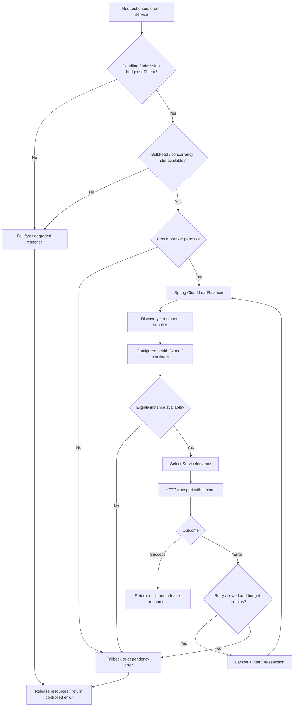
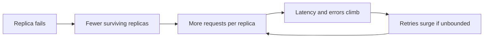

# Partial Recovery and Avoiding Load Concentration on Surviving Instances

When a few replicas of `inventory-service` fail, a common reflex is "drop the broken instances and let Spring Cloud LoadBalancer shift requests to the surviving instances." That can keep some requests succeeding, yet **it does not guarantee the system still has enough capacity for the original total traffic**. If every request—including retries—piles onto fewer replicas, healthy replicas can overload and fail one after another.

For stable recovery, combine **selecting the right instances**, **bounding incoming load**, **isolating resources**, **gracefully degrading when necessary**, and **ramping newly recovered replicas back into traffic safely**. That is the essence of *partial recovery* in inter-service communication: preserving useful capacity without turning a localized fault into a cascading outage.

This lesson belongs to the **Isolation and Recovery** chapter of the `SPRING_CLOUD_SERVICE_COMMUNICATION_LOAD_BALANCING` module. Examples use `order-service` calling `inventory-service` through Spring Cloud LoadBalancer, combining concepts from discovery, `ServiceInstanceListSupplier`, health checks, timeouts, retries, RestClient, WebClient, and OpenFeign. Remember: **LoadBalancer only assists with replica selection; concurrency limits, rate limiting, circuit breakers, and graceful degradation are complementary policies**, not features that appear automatically from adding a LoadBalancer dependency.

## 1. A Replica Outage Changes the Capacity Equation

Suppose `inventory-service` has four identical replicas, each serving roughly **300 requests/second (RPS)** under load testing. To preserve headroom for spikes and tail latency, operations targets at most **80% of measured capacity**, or 240 RPS per replica.

Before the incident, `order-service` generates roughly **800 RPS**.

| State | Available replicas | Target capacity at 240 RPS/replica | 800 RPS per replica if split evenly |
| --- | ---: | ---: | ---: |
| Normal | 4 | 960 RPS | 200 RPS |
| One replica down | 3 | 720 RPS | ~267 RPS |
| Two replicas down | 2 | 480 RPS | 400 RPS |
| Three replicas down | 1 | 240 RPS | 800 RPS |

As soon as only two replicas remain, total target capacity is **480 RPS** while demand stays at 800 RPS. That is a shortfall of roughly **320 RPS**, or **40%** of initial demand. Continuing to accept and forward all requests pushes both healthy replicas outside their safe operating zone.

These figures are only an **illustrative capacity model**: real RPS depends on request complexity, cache hits, databases, connection pools, CPU, memory, and downstream dependency load. Being "alive" according to a health check does not prove a replica has 240 RPS of spare headroom.

**Key takeaway:** *picking the right instance* and *protecting surviving instances* are two distinct problems. Spring Cloud LoadBalancer helps with the first; the second requires explicit load-control policies.

## 2. Two Goals of Partial Recovery

Partial recovery operates on two levels:

1. **Partial topology recovery:** only a subset of `ServiceInstance` replicas are alive or recently restarted. The system must keep using the healthy subset without waiting for every replica to return.
2. **Partial functional continuity:** during a capacity shortfall, the system prioritizes core flows and rejects, defers, or returns degraded results for lower-priority features.

E-commerce example:

| Business capability | Priority | Degradation option to consider |
| --- | --- | --- |
| Verify stock quantity before order placement | High, requires accurate data | Bound concurrency; return a retryable error if unverifiable |
| Browse popular catalog | Medium | Can serve age-bounded cache if business accepts staleness |
| Real-time dashboard analytics | Lower | Serve delayed data or pause updates |
| Large report exports | Lower | Enqueue into an async bounded queue |

**Never use an "in stock" fallback when inventory could not be verified** merely to prop up HTTP 200 rates. Fallbacks must preserve business correctness and openly disclose delayed or unknown data.

## 3. Protection Layers Along the Call Path



This diagram is a **design model**, not a default interceptor chain automatically created by Spring Cloud. In real code, the placement of bulkheads, rate limiters, circuit breakers, retries, and timeouts can vary; that ordering governs attempt counts, wait durations, and error-measurement scope.

Specifically, if retry sits **outside** the bulkhead, each attempt may need its own slot. If retry sits **inside** the bulkhead, one request may hold a slot across backoff delays too. Choose and test the desired behavior intentionally; no single ordering fits every system.

## 4. Step One: Select Only Instances Capable of Serving

On the caller side, instance lists come from discovery or an equivalent supplier. Filtering layers for health, zone, or hints can run before an algorithm like `RoundRobinLoadBalancer` picks a replica.

```text
Discovery sees:         [A, B, C, D]
Health/filter permits:  [B, C]
LoadBalancer receives:  [B, C]
LoadBalancer selects:   B
HTTP client sends to:   B's host:port
```

The objective is **not actively sending traffic to replicas known to be unavailable**. Distinguish these concepts:

- **Deregistration:** the replica was removed from the service registry when shutting down or expiring.
- **Discovery/cache refresh:** the caller may retain a stale list briefly.
- **Health-check supplier:** when configured, can probe and filter out replicas failing health checks.
- **Server readiness:** new instances should only advertise readiness after completing required startup initialization.
- **Actual request outcomes:** a passing health probe does not prove every API and dependency on that replica is healthy.

Spring Cloud LoadBalancer provides `HealthCheckServiceInstanceListSupplier` and other `ServiceInstanceListSupplier` implementations to supply candidates, yet these require **proper configuration and trustworthy health signals**. Never assume adding Spring Cloud LoadBalancer automatically runs health checks for every replica.

## 5. Why Dropping Failed Instances Can Still Cause Cascading Failures

Suppose four instances A, B, C, and D share traffic evenly. A and B both go down, leaving only C and D. Three negative feedback loops can emerge:

1. **Smaller candidate pool:** the same 800 RPS now splits across two replicas—roughly 400 RPS each instead of 200.
2. **Rising latency:** CPU/connection pools/databases on C and D saturate, making requests wait longer.
3. **Growing retries:** timed-out requests resend to C or D, piling even more load onto the surviving instances.



If **20% of the initial 800 requests/second retry exactly once**, outbound attempts can climb to roughly:

```text
800 requests/s × (1 + 0.20) = 960 attempts/s
960 attempts/s ÷ 2 replicas = 480 attempts/s/replica
```

That far exceeds the 240 RPS/replica target. If retries fail again and repeat multiple times—or if a gateway retries too—load climbs even higher.

**Retry does not create capacity.** It only raises success odds when failures are transient and capable capacity exists elsewhere. When the root cause is a system-wide capacity deficit, heavy retries can actually lower overall success rates.

## 6. Admission Control and Load Shedding: Knowing When to Reject

**Admission control** decides whether an incoming request may consume downstream resources. **Load shedding** rejects or defers part of the workload when serving capacity is insufficient, keeping the remainder stable.

For example, when two surviving replicas have a target capacity of 480 RPS against 800 RPS of demand:

- Do not assume the system must push all 800 RPS through.
- Prioritize up to 480 RPS of critical requests within policy.
- Shed excess work early, place deferrable work in a bounded queue, or serve valid fallbacks.
- Return clear responses so upstreams avoid immediately retrying identically.

Rate limiting can live at the gateway, right before the HTTP client, or on each downstream instance. However, **a per-caller-process limit is not a cluster-wide limit**. With 10 `order-service` replicas each allowing 100 RPS, combined traffic can reach 1,000 RPS; aggregate or coordinate quotas centrally when protecting a shared downstream.

### 6.1. Choosing Responses When Shedding Load

Depending on the API contract, gateways or servers may return HTTP `429 Too Many Requests` or `503 Service Unavailable`, with `Retry-After` if appropriate. Internally, however, a caller bulkhead may first throw an **internal exception**; the API layer must explicitly map exceptions to HTTP statuses and messages.

Never use `404` to report "insufficient capacity." Never fabricate successful business data when the business outcome is genuinely unknown.

## 7. Bulkheads: Isolating Concurrent Requests Waiting on Downstream

A **Bulkhead** limits resources a dependency may consume. With synchronous HTTP clients, capping concurrent calls to `inventory-service` prevents slow requests from exhausting `order-service` threads and connections.

A useful estimate from Little's Law in steady state:

```text
Average concurrent requests ≈ throughput (requests/s) × latency (seconds)
```

At 240 RPS with 200 ms average latency:

```text
240 × 0.2 = ~48 concurrent requests
```

If downstream overloads and average latency rises to 1 second while still admitting 240 RPS:

```text
240 × 1.0 = ~240 concurrent requests
```

Concurrency demand jumps fivefold without any rise in RPS. That is why a system showing "flat incoming traffic" can still exhaust threads, sockets, pools, or memory once a downstream slows down.

This is an average-based estimate, **not** a replacement for p95/p99 analysis, request-size distributions, or connection-pool sizing. Measure under realistic load.

### 7.1. Simple Bulkhead Example for Synchronous RestClient

Example using a `Semaphore` to cap concurrent calls to `inventory-service` at 32 **within one `order-service` process**:

```java
import java.util.concurrent.Semaphore;

import org.springframework.cloud.client.loadbalancer.LoadBalanced;
import org.springframework.stereotype.Component;
import org.springframework.web.client.RestClient;

@Component
class InventoryGateway {

    private final RestClient client;
    private final Semaphore inFlight = new Semaphore(32);

    InventoryGateway(@LoadBalanced RestClient.Builder builder) {
        this.client = builder
                .baseUrl("http://inventory-service")
                .build();
    }

    StockResponse getStock(String sku) {
        if (!inFlight.tryAcquire()) {
            throw new InventoryCapacityExceededException(
                    "Inventory client concurrency budget exhausted");
        }

        try {
            return client.get()
                    .uri("/api/stocks/{sku}", sku)
                    .retrieve()
                    .body(StockResponse.class);
        } finally {
            inFlight.release();
        }
    }
}
```

In this code:

- `StockResponse` is an application DTO and `InventoryCapacityExceededException` is an application-defined exception.
- `tryAcquire()` does not wait; when slots run out, the caller **fails fast** instead of piling up waiting requests.
- `finally` guarantees releasing the slot even when the HTTP client throws.
- The limit of 32 is **an example** to tune against latency, traffic, pools, and caller process count.
- This semaphore limits **by service ID inside one caller**, not per replica C/D and not cluster-wide.
- HTTP transport still needs connect/read timeouts; a bulkhead alone does not terminate an indefinitely hanging request.

With reactive WebClient, never use a synchronous semaphore in a way that blocks the event loop or releases the permit before the publisher finishes. Use a reactive-lifecycle bulkhead/limiter whose acquire/release binds to subscription, completion, error, and cancellation.

### 7.2. Queue or Reject Immediately?

A small queue can absorb brief bursts, yet queues create no extra capacity. When queues grow long, requests **expire past their deadline before ever being sent**; retrying or waiting further only wastes resources.

Define explicitly:

1. Maximum in-flight requests.
2. Maximum queue size, if any.
3. Maximum wait time to acquire a slot.
4. Handling policy when full.
5. Metrics tracking queue depth, rejected requests, and wait durations.

## 8. How Does a Rate Limiter Differ from a Bulkhead and Circuit Breaker?

All three can reject requests, yet they evaluate different signals:

| Mechanism | What does it guard against? | Example |
| --- | --- | --- |
| **Rate limiter** | Request count per unit of time | Max 400 RPS to inventory |
| **Bulkhead** | Concurrent requests or held resources | Max 32 active calls waiting on inventory |
| **Circuit breaker** | Recent dependency error/slow-call patterns | Trips open when error rate exceeds policy threshold |
| **LoadBalancer health filtering** | Whether candidate instances pass health criteria | Drops A and B from the list when unhealthy |
| **Retry-aware supplier** | Avoiding the instance picked on the prior attempt if alternatives exist | After A fails, prefers picking B or C |

A rate limiter does not tell whether a server is healthy. A circuit breaker does not enforce exact RPS caps. A bulkhead does not detect dead instances. These components must cooperate rather than substitute for each other.

When using a resilience library like Resilience4j, watch configuration scope: a circuit breaker/bulkhead named after **a dependency** guards all calls to `inventory-service`, without automatically creating separate breakers per `ServiceInstance`. Distinguishing replicas requires explicit keys and lifecycle cleanup so state does not grow unboundedly as topology changes.

## 9. Phased Partial Recovery: Never Dump Full Traffic Immediately

A freshly restarted instance may pass readiness yet still need time to warm up JIT compilation, connection pools, caches, thread pools, or local data. Receiving a full equal share of traffic right away can overload it and knock it right back down.

Recovery can be staged into phases:

| Phase | State | Illustrative policy |
| --- | --- | --- |
| 0 – Protect | A/B down, C/D alive | Cut retries, bound in-flight calls, shed load exceeding capacity |
| 1 – Verify | A restarts | Readiness and probes along critical dependency paths must pass |
| 2 – Warm-up | A is ready yet cold | Shift a small, controlled fraction of traffic |
| 3 – Ramp-up | A stays stable over an observation window | Gradually increase traffic to A; watch latency and error rates |
| 4 – Stabilize | A/C/D serve steadily | Adjust admission limits; assess restoring fuller load |
| 5 – Full recovery | B also returns eligible | Restore target load-balancing policy and lift degradations safely |

Never treat an instance flipping to `UP` in the registry as sufficient reason to open 100% traffic immediately.

### 9.1. Traffic Distribution During Warm-Up

Example ramp-up schedule for newly recovered instance A:

```text
Step 1: grant ~5% of eligible traffic
Step 2: grant ~15% if errors/latency remain within bounds
Step 3: grant ~30% if stability holds
Step 4: step up to target operating share
```

These percentages are an **operational scenario**, not a Spring Cloud LoadBalancer default. Implement them via weight-aware routing, upstream config, canary mechanisms, or a custom supplier/selection strategy tailored to your system.

Using plain `RoundRobinLoadBalancer` over `[A, C, D]` with equal-weight instances distributes selections roughly evenly; **it does not limit A to 5%**. Weighted routing can be used where supported and properly configured, verifying implementation behavior and interactions with caching/zones/health.

## 10. Criteria for Increasing Load vs. Rolling Back

A ramp-up must be driven by **metrics**, not merely elapsed clock time.

Signals to measure:

- HTTP error rate, timeout rate, and connection errors on the recovering instance.
- p95/p99 latency, active request count, queue depth, and connection-pool saturation.
- CPU, memory, garbage collection, thread pools, database pools, and shared dependencies.
- Requests rejected by bulkheads/rate limiters.
- Retry rate and average attempts per business request.
- Business success rate, not just HTTP 200.

An operational rule might state: increase traffic only when error rates stay low and p95 latency stays within target across a sufficiently long observation window. If signals deteriorate, **hold or cut traffic share** and investigate the root cause.

Avoid ramping too quickly on tiny sample sizes: a handful of successful requests does not prove an instance can carry target load. For an instance that repeatedly recovers and fails (*flapping*), enforce stability windows, hysteresis, or cooldown periods before re-admitting it.

## 11. Recovery Does Not Mean the Circuit Breaker Closes Immediately

A service-ID-level circuit breaker moves conceptually through **CLOSED**, **OPEN**, and **HALF_OPEN**:

- **CLOSED:** calls pass through and outcomes are recorded per policy.
- **OPEN:** most calls fail fast locally to relieve pressure on the dependency.
- **HALF_OPEN:** permits a bounded set of probe requests; if criteria are met, the circuit closes.

When a few replicas recover, never let thousands of callers probe simultaneously. Probes and transitions must be tuned carefully to avoid a *recovery stampede*.

**Limitation to remember:** a circuit breaker wrapping all of `inventory-service` can open from failing instances even while one healthy instance remains. Conversely, per-replica circuit breakers must track identity and clean up state when instances disappear. Never assume any breaker type automatically understands Spring Cloud LoadBalancer topology.

## 12. Zone Preference and Cross-Zone Failover

Suppose the caller runs in `zone-a` with these instances:

| Instance | Zone | Status |
| --- | --- | --- |
| A | zone-a | Failing |
| B | zone-a | Failing |
| C | zone-b | Healthy |
| D | zone-b | Healthy |

When zero same-zone replicas remain, a `ZonePreferenceServiceInstanceListSupplier`-style supplier typically falls back to cross-zone candidates. That prevents a total outage while simultaneously **shifting zone-a's traffic onto zone-b**.

If many callers in zone-a fail over together, zone-b must carry both its native load and zone-a's load. Account for **cross-zone capacity**, network cost, added latency, data residency rules, and consistency.

Where data must strictly stay inside a zone/region, a soft preference with fallback is insufficient to enforce compliance. Implement hard isolation at routing/authorization layers and accept rejecting or degrading features when the required zone is unavailable.

## 13. Retries During Capacity Shortfalls: Less Is Better

When two surviving replicas are already near capacity, unrestrained retries usually make things worse. Distinguish cases:

| Situation | Guidance |
| --- | --- |
| Connection refused from broken replica A while B/C have headroom | May retry very sparingly onto another instance |
| C/D return `503` due to overload | Back off, honor overload signals, consider skipping retries to avoid adding load |
| Downstream returns `429` with `Retry-After` | Respect quotas and deadlines; do not "hop instances to dodge rate limits" |
| `404` because resource does not exist | Do not retry merely to pick another instance |
| `POST` hits read timeout | Do not retry blindly; require idempotency and account for server commit uncertainty |

`RetryAwareServiceInstanceListSupplier` can avoid re-picking the just-failed replica **when alternatives exist**, yet it cannot verify whether another replica has spare capacity. If only overloaded C and D remain, "avoiding A" creates zero new serving capacity.

Retry designs need attempt caps, overall deadlines, backoff with jitter, and optionally a system-wide **retry budget**. During degraded operation, **cut or disable retries** on low-priority requests to preserve capacity for critical calls.

## 14. Timeouts and Deadlines Trim Pointless Queues

A request spends time across distinct stages:

```text
Admission / waiting for slot
    -> fetch instances from supplier
    -> select ServiceInstance
    -> acquire connection from pool
    -> connect/TLS
    -> send request / await response
    -> retry + backoff if needed
```

Setting only connect/read timeouts without an **end-to-end deadline** lets requests spend excessive time in queues, discovery, retries, or backoff. Conversely, an overly tight deadline triggers premature timeouts that fuel retries if policies are unaligned.

A sound policy defines:

1. Total business request time budget.
2. Maximum wait for admission/bulkhead slots.
3. Per-HTTP-attempt timeout.
4. Maximum retries and inter-attempt delay.
5. Time margin for the caller to process the response.

Once the deadline expires, **do not fire another request to a surviving replica** merely to finish configured retry counts. For side-effecting operations, client cancellation does not guarantee the server stops processing immediately.

## 15. Fallbacks and Graceful Degradation Must Be Honest About Data

When inventory lacks capacity, fallbacks can suit display-only information yet prove dangerous for high-accuracy business decisions.

| Feature | Acceptable fallback? | Condition |
| --- | --- | --- |
| Display "popular products" | Possibly | TTL cache with notice that data may be delayed |
| Similar product recommendations | Possibly | Return shorter or empty list per contract |
| View reference stock count | Only if API permits | Mark data unverified/stale |
| Confirm order placement | Never fake "success" | If stock cannot be verified, return unconfirmed/pending status |
| Payment or stock deduction | Never skip mandatory checks | Require transactions/idempotency and clear errors |

**A degraded response is not silent success.** API contracts should distinguish complete live results, provisional results, cached data, and unexecutable states. For asynchronous workflows, work can move into a durable queue returning "accepted, processing," provided the architecture genuinely guarantees processing and tracking.

## 16. Round Robin Alone Does Not Provide Load-Aware Routing

Default `RoundRobinLoadBalancer` distributes **selections** across candidates; it does not automatically inspect CPU, latency, or in-flight counts to judge spare capacity.

For instance, C sits at 95% CPU and D at 35% CPU, yet both remain in `[C, D]`. Round Robin keeps alternating between them, keeping C overloaded.

Routing by actual capacity requires additional policies:

- Weighted routing driven by trustworthy weights.
- Health/readiness sources accurately reflecting ability to accept traffic.
- Per-replica concurrency limits or proxy-tier caps.
- Load-aware/adaptive balancing if reliable telemetry signals are available.
- Autoscaling paired with warm-up controls.

Spring Cloud LoadBalancer offers extension points to customize suppliers and selection strategies. Still, **never assume least-connections, adaptive concurrency, or warm-up weighting exists out of the box** without configuring or implementing them.

## 17. Adding Capacity: Launching Replicas Is Not Instant Relief

When an autoscaler launches new replica E, a new process appears without instant usable capacity. E may still need to:

- Load classes, warm up JIT, and open database connections.
- Initialize connection pools, caches, and security state.
- Pass readiness and register with discovery.
- Propagate to callers via cache/registry refreshes.
- Enter candidate lists after zone/health filtering.
- Ramp load gradually to steady-state operating levels.

Significant lag can separate these milestones. If LoadBalancer caches hold stale topology, E is ready yet unselected. If readiness flips green too early, E gets flooded before connections or data are ready.

### 17.1. Avoid "Seeing a New Replica and Raising Retries"

Autoscaling takes time and can oscillate. While waiting for a new replica, keep admission limits, backoff, and graceful degradation active to shield C and D. Only ramp load after E passes readiness and warm-up; **never raise retries before observing real aggregate capacity growth**.

## 18. Observability Must Reflect Real Degradation

Looking solely at successful requests on surviving instances can mislead dashboards: success rates look high while **caller rejections or generated retry attempts** have spiked.

Correlate metric groups by service ID and timestamp:

| Group | Metrics to measure |
| --- | --- |
| Topology | Discovered instances, health-filtered instances, selected instance |
| Traffic | Incoming RPS, attempted outbound RPS, retries/request |
| Isolation | In-flight calls, bulkhead saturation, queue depth, rejected requests |
| Downstream | p50/p95/p99 latency, error rate, 429/503, CPU, pool saturation |
| Recovery | Ready replicas, new replica traffic share, ramp-up time, flapping |
| Business | Order completion rate, unverifiable-stock rate, fallback count |
| Timing | Deadline exceeded, connect/read timeouts, backoff delay, total duration |

Illustrative log format:

```text
traceId=bf91... serviceId=inventory-service eligible=[C,D]
selectedInstance=C attempt=1 durationMs=520 httpStatus=503
traceId=bf91... retryAllowed=false reason=overload
traceId=bf91... outcome=DEPENDENCY_UNAVAILABLE
bulkheadInFlight=32 bulkheadCapacity=32
```

This is a **suggested format**, not default Spring Cloud logging. Never log tokens, full bodies, or sensitive IDs; avoid high-cardinality metric labels like SKUs, user IDs, dynamic URIs, or arbitrary instance strings.

With Micrometer/Observability and `LoadBalancerLifecycle`, you can connect pre-selection, selection, and post-call events. Keep caller metrics and server metrics clear on **business requests** versus **HTTP attempts**; never merge them without explicit definitions.

## 19. End-to-End Partial Recovery Walkthrough

Suppose A/B/C/D initially serve 800 RPS. An outage knocks out A/B while C/D keep running near their safe ceiling.

**At failure onset:**

1. Discovery and health filters gradually drop A/B from candidates.
2. Callers observe shrinking instance counts and rising error rates.
3. Admission policies throttle outbound inventory traffic to what C/D can sustain.
4. Low-priority requests shed or degrade cleanly; retries are tightly capped.
5. Operators verify C/D stabilize rather than forcing all requests through.

**When A recovers:**

6. A passes readiness and registers in discovery.
7. Suppliers see A once caches/registries refresh.
8. Send a tiny warm-up fraction to A while watching errors, latency, and saturation.
9. If stable, step up traffic share and adjust admission budgets accordingly.
10. If A flaps, cut traffic or drop it from candidates with a cooldown.

**When B recovers and capacity suffices:**

11. Reintroduce B through the same warm-up workflow.
12. Lift degradations only after total capacity, latency, and error rates stabilize across a defined observation window.
13. Conduct a post-incident review: discovery convergence time, retry amplification, shed requests, and readiness accuracy.

Success is not "every request retried until it passed," but **serving the maximum valid workload within available capacity and returning cleanly to steady state**.

## 20. Testing Before Incidents Strike

A chaos/load test suite can start with four mock instances or a fully instrumented staging environment:

| Scenario | What to verify |
| --- | --- |
| Stop A, keep B/C/D | A drops out of candidates per policy; error rates tracked |
| Stop A and B, sustain 800 RPS demand | C/D do not cascade; admission/shedding engages |
| One replica slows down instead of dying | Latency spike contained by bulkhead/timeout; caller does not stall |
| Retries with few instances left | No storm; attempt caps and deadlines hold |
| Only one instance left | Retry-aware supplier does not invent capacity; fail-fast works cleanly |
| Bring A back | Readiness, discovery refresh, and warm-up ramp traffic gradually |
| A flaps up/down repeatedly | Cooldown/hysteresis prevents flapping and re-selection storms |
| Callers across multiple zones | Cross-zone failover does not overwhelm target zone capacity |
| Read API using cache fallback | Stale data labeled accurately; never fakes live confirmation |
| Write API hitting read timeout | Idempotency prevents duplicates and outcomes reconcile cleanly |

For load tests, define **input rate, capacity, and rejection thresholds** beforehand instead of expecting 100% HTTP 200s when half the fleet is intentionally down. Better pass criteria are bounded tail latency, protected core flows, and controlled rejection responses.

## 21. Investigation Runbook When Healthy Replicas Overload

Suppose dashboards show only C and D active, rising CPU on both, high p99 latency, and frequent HTTP 503s. Check in order:

1. **Actual topology:** were A/B removed from discovery and suppliers? Are C/D really the two eligible instances?
2. **Incoming traffic:** is inbound RPS steady, or is there a burst/new traffic source?
3. **Amplification:** how many HTTP attempts does each business request generate; are retries stacked across gateway, app, and client?
4. **Admission:** do callers/gateways enforce rate limits and bulkheads; are limits still tuned for 2 replicas?
5. **Concurrency:** have in-flight counts and queues on C/D hit ceilings; are connection-pool acquire waits climbing?
6. **Timeouts:** are overall deadlines enforced, or do expired requests linger in queues?
7. **LoadBalancer:** is Round Robin picking from the right list yet unaware C is more saturated than D?
8. **Zone:** is cross-zone failover traffic piling onto C/D?
9. **Shared dependency capacity:** is a database/cache behind C/D the real bottleneck so extra replicas will not help?
10. **Recovery:** have new replicas passed readiness, discovery refresh, and proper warm-up?

When C and D overload, the fix usually combines **reducing incoming load** and **restoring/adding capacity**, rather than raising retries or shrinking cache TTLs.

## 22. Design Mistakes to Avoid

1. **Enabling health checks alone and calling it done:** two healthy replicas still may lack capacity for full baseline demand.
2. **Treating Round Robin as adaptive load control:** it has no default awareness of CPU, in-flight count, or latency.
3. **Keeping high retry counts during downstream overload:** switching instances creates zero new capacity.
4. **Returning "success" fallbacks for accuracy-critical operations:** fabricates wrong outcomes and masks outages.
5. **Configuring unbounded queues:** converts overload into latency, memory pressure, and cascading timeouts.
6. **Treating a single-caller concurrency limit as a cluster quota:** multiple callers add up.
7. **Putting up a service-wide circuit breaker and assuming it picks healthy replicas:** breakers and LoadBalancer operate at different scopes.
8. **Giving a newly UP replica full Round Robin share immediately:** it may still be cold.
9. **Ramping up without rollback triggers:** flapping instances cycle endlessly through fail–recover–fail.
10. **Not measuring shed requests:** reporting success rate only on admitted requests creates an illusion of health.
11. **Ignoring shared bottlenecks:** four replicas sharing an exhausted database are not fixed by adding a fifth replica.
12. **Lumping all requests together:** instance selections, HTTP attempts, and business requests must be counted distinctly.
13. **Retrying POSTs after read timeouts without idempotency:** risks duplicate writes even when routed to another replica.

## 23. Self-Check Questions

1. Why can dropping from four replicas to two cause overload even when LoadBalancer picks only healthy instances?
2. With 800 RPS incoming and two replicas targeting 240 RPS each, how much demand exceeds target capacity?
3. How do bulkheads, rate limiters, circuit breakers, and health-check suppliers differ in responsibility?
4. Why does picking a different replica on retry not mean capacity has been restored?
5. With reactive WebClient, why should you avoid acquiring a synchronous semaphore and releasing the permit before the publisher completes?
6. Once a new replica passes readiness, why should you still warm it up and ramp traffic gradually?
7. How can zone-preference fallback concentrate load onto another zone?
8. Why should you never return cached "in stock" data in place of a mandatory live inventory check?
9. When p99 rises while incoming RPS stays flat, how can concurrency change?
10. Which metrics help detect retry storms and distinguish business requests from HTTP attempts?
11. What can cause a service-wide circuit breaker to OPEN while one healthy instance still exists?
12. Why should rollback/hysteresis criteria be part of replica recovery?

**Conclusion:** partial recovery means more than filtering faulty replicas out of the `ServiceInstance` list. When effective capacity drops, systems must govern **admitted request rate**, **concurrent in-flight calls**, **retries and deadlines**, and **safe business degradation**. As replicas recover, verify readiness, discovery freshness, and serving capacity before **ramping traffic in stages**. Spring Cloud LoadBalancer helps pick suitable targets; resilience against cascading failure comes from pairing load balancing with backpressure, bulkheads, load shedding, observability, and controlled recovery plans.
