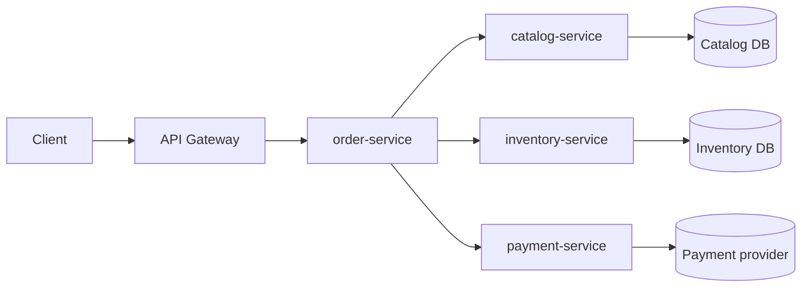
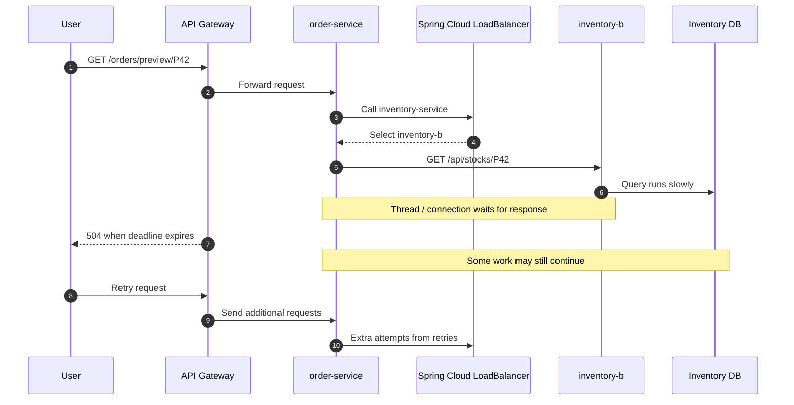
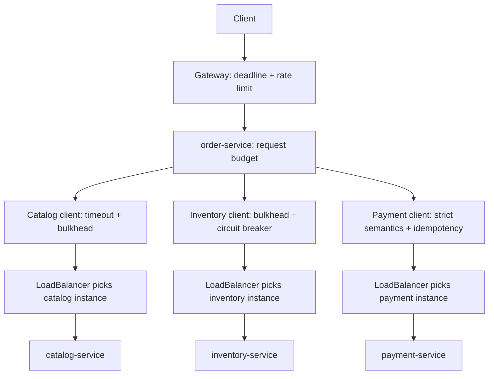
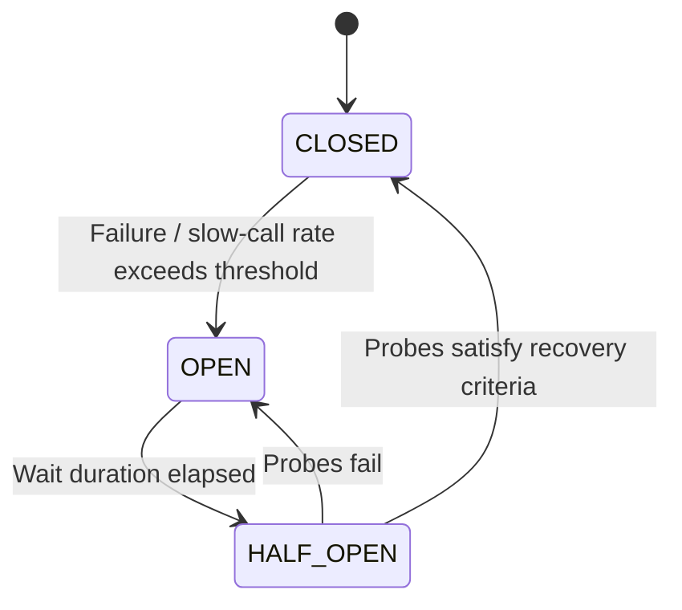

# Cascading Failure Scenarios in a Service Communication Chain

One slow replica of `inventory-service` can exhaust threads in `order-service`, make the API Gateway return `504`, spike retry traffic into `catalog-service`, and eventually leave the entire system unable to serve requests that never even needed inventory data. This is a **cascading failure**: a localized fault spills beyond the broken component because dependent services keep waiting, resending, or tying up shared resources.

In the `SPRING_CLOUD_SERVICE_COMMUNICATION_LOAD_BALANCING` module, Spring Cloud LoadBalancer selects a `ServiceInstance` by service ID and coordinates with discovery, health checks, zones, or routing policies. Yet **picking an instance does not guarantee the call will succeed**, and LoadBalancer does not enforce concurrency caps, end-to-end request deadlines, circuit breakers, or business fallback rules on its own. This lesson follows a realistic scenario from early symptoms to system-wide failure, then designs **fault isolation and controlled recovery** using `RestClient`, `WebClient`, OpenFeign, and complementary resilience mechanisms.

## 1. Modeling a Call Chain Prone to Cascading Failure

Suppose an ordering system consists of:

- **API Gateway:** entry point receiving HTTP requests from client applications.
- **`order-service`:** orchestrates product details, inventory, and payment.
- **`catalog-service`:** looks up product details across multiple `ServiceInstance` replicas.
- **`inventory-service`:** checks stock, reserves items, and talks to its database.
- **`payment-service`:** processes payments and must prevent duplicate charges.



On an **order preview** page, `order-service` may call `catalog-service` and `inventory-service` to show product names, prices, and available stock. During **order confirmation**, the system also reserves stock, creates the order, and may charge payment. The two business flows carry different criticality: the preview page can sometimes tolerate temporarily unknown stock, whereas order confirmation **must never assume items are in stock** when `inventory-service` fails to reply.

When the system is healthy:

| Step | Call | Illustrative duration | Outcome |
|---|---|---:|---|
| 1 | Gateway → `order-service` | 15 ms | Request accepted |
| 2 | `order-service` → `catalog-service` | 50 ms | Product details received |
| 3 | `order-service` → `inventory-service` | 80 ms | Stock received |
| 4 | Aggregate and return response | 25 ms | User sees data |

These numbers are **hypothetical lesson data**, not Spring Cloud defaults. When independent calls execute in parallel, total duration tracks roughly the slowest branch plus overhead rather than the sum of every step.

## 2. Incident Scenario: One Inventory Replica Responds Slowly

`inventory-service` has two replicas:

```text
inventory-service
  ├─ inventory-a = 10.20.1.21:8080  (healthy)
  └─ inventory-b = 10.20.1.22:8080  (slow DB queries)
```

Due to a database connection-pool issue, `inventory-b` begins taking 4 seconds on `/api/stocks/{sku}` instead of ~80 ms. Discovery still sees this replica because the process is alive and remains registered under service ID `inventory-service`.

A chain reaction can unfold:

1. `RoundRobinLoadBalancer` keeps picking `inventory-b` for a share of requests because the instance remains in the candidate list.
2. `order-service` uses a blocking HTTP client with a large `readTimeout`; every request routed to B holds a thread while waiting.
3. Incoming requests pile onto the same route; the connection pool for `inventory-service` hits its limit. Subsequent requests must **wait to acquire a connection from the pool**.
4. The Gateway times out and returns `504`, yet some calls inside `order-service` are still waiting, or tasks inside `inventory-b` keep running.
5. Both Gateway and `order-service` have retries enabled, multiplying HTTP attempts sent to inventory.
6. Shared threads and connections inside `order-service` stay tied up; even read-only calls hitting only `catalog-service` begin queuing or failing.
7. Users manually refresh/retry, adding further load. One replica's slowdown becomes a Gateway outage affecting unrelated endpoints.



**Note:** a gateway timeout does not automatically stop downstream work, and health checks do not automatically catch every slowdown if the health endpoint keeps returning success. Instrument each layer to see where requests actually stall.

## 3. Why Can a Local Fault Exhaust Shared Resources?

When a downstream slows down, how long each request holds resources rises. A steady-state concurrency estimate is:

\[
\text{In-flight requests} \approx
\text{Arrival rate} \times \text{Average processing duration}
\]

Suppose `order-service` receives 200 requests/second. When an inventory call averages 100 ms, concurrent requests waiting on it sit around `200 × 0.1 = 20`. When latency jumps to 3 seconds, concurrency can climb to `200 × 3 = 600`, **if arrival rate and wait duration remain at those levels**.

This is an illustrative estimate based on the throughput–latency relationship, not an exact prediction for every queue or thread pool. Still, it exposes the core hazard: at constant traffic, multiplying wait duration multiplies unfinished in-flight work.

| Resource | How it is affected | Cascading consequence |
|---|---|---|
| Blocking HTTP worker threads | Waiting on `inventory-service` responses | Unrelated endpoints also run out of threads |
| HTTP connection pool | Connections to inventory held long | New requests wait for slots or time out |
| Queues/executors | Tasks waiting for threads or connections | Latency climbs past deadlines |
| Memory | Accumulated request contexts, buffers, pending state | GC spikes, risk of OOM |
| Inventory database pool | Slow queries hold connections | Healthy replicas suffer too if sharing the DB |
| Gateway connections | Waiting on responses from order | Gateway feels pressure despite healthy networking |

A foundational principle of **isolation** is never letting one slow dependency consume resources needed by other dependencies. That requires caps **per dependency/business group**, not just one giant global pool for the whole application.

## 4. Multiplying Retries Make Outages Worse

Suppose Gateway, `order-service`, and Spring Cloud LoadBalancer each allow up to **2 attempts** (initial attempt + 1 retry). If retries nest and each try fails a retryable condition, one logical request can generate up to:

\[
2 \times 2 \times 2 = 8 \text{ attempts}
\]

At 200 logical requests/second, the theoretical worst-case load at the bottom layer hits **1,600 attempts/second**, before counting manual user retries. Actual counts depend on retry predicates, where errors occur, instance counts, deadlines, and layer composition; not every request produces all eight attempts.

```text
Gateway: attempt 1
  order-service: attempt 1
    LoadBalancer: attempt 1 → inventory-b timeout
    LoadBalancer: attempt 2 → inventory-a overload error
  order-service: attempt 2
    LoadBalancer: attempt 1 → inventory-b timeout
    LoadBalancer: attempt 2 → inventory-a overload error
Gateway: attempt 2
  ... repeats attempts across both lower layers ...
```

**Retry is a load multiplier**, not a harmless error-fixing switch. When downstream is overloaded, extra attempts make database pools even harder to recover. Designate a clear **retry owner** along the call path, cap attempts, apply backoff/jitter, respect deadlines, and retry only recoverable errors.

For write operations like `POST /orders`, `reserveInventory`, or `chargePayment`, retrying after a read timeout also risks **duplicate execution**: the server may have committed while the response was lost. Require idempotency keys, unique constraints, and reconciliation; switching replicas does not automatically make writes safe.

## 5. The Real Role of Spring Cloud LoadBalancer

Spring Cloud LoadBalancer solves **instance selection**. When `order-service` calls `http://inventory-service/api/stocks/P42`, the LoadBalancer-integrated client:

1. Identifies the service ID as `inventory-service`.
2. Retrieves the `ServiceInstance` list from discovery via `ServiceInstanceListSupplier`.
3. Optionally filters/prioritizes by health check, zone, metadata, sticky sessions, or custom policies.
4. Selects an instance using an algorithm such as round robin or random.
5. Sends the request to the chosen host/port over HTTP transport.

LoadBalancer **does not automatically**:

- Measure database query latency on the target replica.
- Immediately drop an instance with a slow business endpoint if its health endpoint still returns `200`.
- Cap total concurrency or connections across the application.
- Enforce an end-to-end deadline across Gateway → order → inventory.
- Open a circuit breaker or supply a caller fallback on repeated errors.
- Undo business side effects that already occurred downstream.

`HealthCheckServiceInstanceListSupplier` can improve candidate lists when an instance fails health probes. Still, health checks run periodically with inherent lag, and health endpoints rarely reflect latency across every business API. Moreover, per the supplier's documented behavior, when zero instances pass health checks, it may **fall back to returning the entire delegate list** rather than an empty list. Never treat health filtering as a guarantee against picking faulty replicas.

To avoid bad instances over time, combine realistic discovery/readiness, timeouts, bounded retries, circuit breakers, and connection management. Do not merely swap round robin for random hoping to cure a bottlenecked DB or connection pool.

## 6. Where in the Architecture Should We Cut Propagation?

A controlled design places safeguards at multiple **responsibility boundaries**:



| Boundary | Safeguard | Objective |
|---|---|---|
| Ingress/Gateway | Deadlines, rate limits, load shedding | Stop admitting more work than capacity allows |
| Each downstream dependency | Dedicated timeouts and pools / per-route caps | One slow service cannot monopolize resources for all services |
| Before HTTP call | Bulkhead/concurrency limit | Cap concurrent calls into a failing dependency |
| After failure streak | Circuit breaker | Stop sending futile new calls temporarily |
| On transient error | Single retry owner, bounded attempts, jitter | Retry only when recovery is plausible and deadline remains |
| Business layer | Intentional fallback | Keep permitted degradable features running |
| Target replica | Readiness, query timeouts, backpressure | Stop accepting or shed work when under-provisioned |

Each component solves a distinct problem. **Bulkheads limit simultaneous work; circuit breakers decide whether to call; timeouts cap waiting; retries issue bounded extra attempts; fallbacks decide alternative outcomes.** No single component stops every cascading failure alone.

## 7. Using Timeouts and Deadlines to Stop Waiting on Time

In an overall request with a 1,200 ms SLO, `order-service` must not give `inventory-service` a 5-second read timeout expecting the Gateway to sort everything out. The total deadline must encompass discovery, instance selection, pool waiting, connecting, responding, backoff/retries, and response assembly.

Budget example:

| Phase | Illustrative max budget |
|---|---:|
| Gateway auth and routing | 100 ms |
| `order-service` data prep | 100 ms |
| Inventory and catalog calls | 750 ms |
| Merge data, write response | 150 ms |
| Network variance margin | 100 ms |
| **Total** | **1,200 ms** |

These numbers illustrate budget allocation only. When catalog and inventory calls run in parallel, do not sum both branches as if sequential; budget for the slowest branch plus overhead. Before each outbound call, compute **remaining deadline** rather than granting a fresh full timeout at every hop.

```text
Deadline = wall-clock instant by which request must finish
Remaining = deadline - now

If remaining <= reserved margin:
    do not start new downstream call
Else:
    bound HTTP call by min(remaining - margin, per-call cap)
```

Passing deadlines between services via headers can follow an internal convention such as `X-Request-Deadline-Epoch-Millis`, though this is **not** a header automatically emitted or enforced by Spring Cloud LoadBalancer. Gateways must sanitize untrusted incoming headers; each service must clamp received deadlines under local policy rather than trusting arbitrarily huge external values.

With WebClient, `Mono.timeout(...)` sends cancellation to upstream subscriptions on expiry. That stops client-side waiting yet **does not guarantee** server tasks or database queries abort. With blocking `RestClient` and OpenFeign, transport timeouts bound connect/response waits; timing out a `Future` does not automatically stop underlying blocking I/O. Servers should check deadlines before expensive steps and enforce query timeouts and idempotency.

## 8. Bulkheads: Keeping Inventory from Exhausting Concurrency

**Bulkheads** borrow from watertight ship compartments: flooding one compartment must not sink the ship. In applications, a bulkhead caps concurrent calls or threads/connections that **a single dependency** may use.

Example:

- Allow at most **20** concurrent inventory calls inside `order-service`.
- Once 20 are active, additional calls fail fast or wait in a **bounded queue**.
- Resources allocated to `catalog-service` and inventory-independent endpoints stay available.

| Bulkhead type | How it works | What to watch |
|---|---|---|
| Semaphore/concurrency bulkhead | Caps simultaneous active calls | Suits fast-fail blocking without spinning extra threads |
| Thread-pool bulkhead | Dedicated executor and queue per work group | Explicitly bounds threads and queue; adds scheduling overhead |
| Connection-pool partitioning | Separate pools or per-route limits | Prevents one destination from starving connections |

Conceptual configuration with Resilience4j Bulkhead:

```yaml
resilience4j:
  bulkhead:
    instances:
      inventoryRead:
        maxConcurrentCalls: 20
        maxWaitDuration: 0ms
```

**Note:** these properties take effect only when the app actually routes `inventoryRead` calls through a matching Resilience4j Bulkhead (via properly configured annotations/aspects, operators, or decorators). Declaring YAML **does not automatically wrap all** `RestClient`, `WebClient`, or OpenFeign calls. Property names and auto-configuration support must also match your Resilience4j dependency/version.

When using a thread-pool bulkhead, size **queue capacity** too. An unbounded queue merely moves the bottleneck from threads to memory and stretches latency past deadlines. Once a bulkhead is full, controlled rejection or an appropriate fallback beats piling up hundreds of waiting requests.

## 9. Circuit Breakers: Stopping Calls on Repeated Failures

A **Circuit breaker** monitors call outcomes and transitions state to curb new traffic to a failing dependency:

- **CLOSED:** permits calls and collects outcome statistics.
- **OPEN:** fails new calls fast for a configured duration.
- **HALF_OPEN:** permits a limited number of probe calls; closes if healthy, reopens otherwise.



A circuit breaker prevents `order-service` from repeatedly opening connections to `inventory-service` while unstable. Yet breaker state reflects **calls it observes**, not individual `ServiceInstance` states in discovery. A service-ID-scoped breaker can open even if only one replica is broken, provided enough traffic hits it; pick scope and thresholds intentionally.

Illustrative Resilience4j config:

```yaml
resilience4j:
  circuitbreaker:
    instances:
      inventoryRead:
        slidingWindowType: COUNT_BASED
        slidingWindowSize: 20
        minimumNumberOfCalls: 10
        failureRateThreshold: 50
        waitDurationInOpenState: 10s
        permittedNumberOfCallsInHalfOpenState: 3
```

When using Spring Cloud CircuitBreaker with Resilience4j, breaker names created in code and config keys must align for your integration version; the illustrative thresholds above **are not production defaults**. Beyond error rate, configure slow-call thresholds/rates to catch dependencies that hang while still returning `200`. Verify slow calls are recorded and timeouts terminate calls so the breaker observes outcomes.

When OPEN, calls fail immediately **without sending any HTTP request** downstream. That is intentional proactive protection—distinct from empty discovery or TCP connect errors. In observability, separate `short-circuited` from `attempt failed`.

## 10. Example Integrating RestClient, LoadBalancer, and CircuitBreaker

Example Spring Boot 3.2+/Spring Framework 6.1+ app using `RestClient`. The client calls `inventory-service` by service ID, while the circuit breaker provides a fallback **solely for display-only stock reads**.

Core Maven dependencies may include:

```xml
<dependencies>
    <dependency>
        <groupId>org.springframework.boot</groupId>
        <artifactId>spring-boot-starter-web</artifactId>
    </dependency>
    <dependency>
        <groupId>org.springframework.cloud</groupId>
        <artifactId>spring-cloud-starter-loadbalancer</artifactId>
    </dependency>
    <dependency>
        <groupId>org.springframework.cloud</groupId>
        <artifactId>spring-cloud-starter-circuitbreaker-resilience4j</artifactId>
    </dependency>
</dependencies>
```

Select a Spring Cloud BOM compatible with your Spring Boot version. For other releases or reactive apps, use matching starters/APIs rather than assuming identical configs run unchanged across framework generations.

Configure `@LoadBalanced` `RestClient.Builder` with an illustrative-timeout request factory:

```java
package com.example.orders.config;

import org.springframework.cloud.client.loadbalancer.LoadBalanced;
import org.springframework.context.annotation.Bean;
import org.springframework.context.annotation.Configuration;
import org.springframework.http.client.SimpleClientHttpRequestFactory;
import org.springframework.web.client.RestClient;

@Configuration(proxyBeanMethods = false)
public class InventoryHttpConfiguration {

    @Bean
    @LoadBalanced
    RestClient.Builder loadBalancedRestClientBuilder() {
        SimpleClientHttpRequestFactory requestFactory =
                new SimpleClientHttpRequestFactory();
        requestFactory.setConnectTimeout(300);
        requestFactory.setReadTimeout(700);

        return RestClient.builder()
                .requestFactory(requestFactory);
    }
}
```

`SimpleClientHttpRequestFactory` here illustrates timeouts; **it does not provide an Apache HttpClient connection pool**. For production load, you can use `HttpComponentsClientHttpRequestFactory` with Apache HttpClient 5 and per-route/total pool limits, while still managing pool-acquire timeouts and HTTP client lifecycles.

Build the inventory read client with a fallback clearly expressing **unknown state**:

```java
package com.example.orders.inventory;

import org.springframework.cloud.client.circuitbreaker.CircuitBreaker;
import org.springframework.cloud.client.circuitbreaker.CircuitBreakerFactory;
import org.springframework.cloud.client.loadbalancer.LoadBalanced;
import org.springframework.stereotype.Component;
import org.springframework.web.client.RestClient;

@Component
public class InventoryReadClient {

    private final RestClient restClient;
    private final CircuitBreaker circuitBreaker;

    public InventoryReadClient(
            @LoadBalanced RestClient.Builder builder,
            CircuitBreakerFactory<?, ?> circuitBreakerFactory) {
        this.restClient = builder.clone()
                .baseUrl("http://inventory-service")
                .build();
        this.circuitBreaker = circuitBreakerFactory.create("inventoryRead");
    }

    public StockView getStockForPreview(String sku) {
        return circuitBreaker.run(
                () -> restClient.get()
                        .uri("/api/stocks/{sku}", sku)
                        .retrieve()
                        .body(StockView.class),
                failure -> new StockView(sku, null, true));
    }
}
```

```java
package com.example.orders.inventory;

public record StockView(
        String sku,
        Integer available,
        boolean unknown) {
}
```

In `StockView`, `unknown=true` means **stock could not be confirmed**, not `available=0` and certainly not sufficient stock. `CircuitBreakerFactory` needs a Spring Cloud CircuitBreaker starter implementation. Real circuit-breaker/bulkhead configs must be wired properly to calls; the Java snippet above **only demonstrates circuit breaker wrapping**, without automatically enabling bulkheads or end-to-end deadlines.

Furthermore, fallbacks must never swallow every exception blindly. In production, separate degradable infrastructure errors from business errors, auth/authz errors, and data-parse errors. If an error means an invalid request or unauthorized user, propagate that error instead of turning it into `unknown`.

### Never Use Read Fallbacks to Confirm Orders

A side-effecting `reserveInventory` operation must **fail cleanly or await explicit reconciliation** when availability cannot be confirmed. Never reuse an `unknown=true` fallback and interpret it as `available > 0`.

When retrying reservations or payments, send a consistent idempotency key across all attempts and deduplicate on the server. Client timeouts do not prove prior attempts never ran. Nor do circuit breakers roll back transactions or undo committed side effects.

## 11. Reactive WebClient: Cancellation, Concurrency, and Cascading Failures

If `order-service` uses WebFlux, `WebClient` does not block a dedicated thread for the entire HTTP wait. That **reduces thread-exhaustion risk from waiting I/O**, yet does not eliminate finite resources such as connection pools, pending acquire queues, memory, or downstream capacity.

A pipeline can enforce deadlines and controlled concurrency:

```java
Mono<StockView> getStockForPreview(
        String sku,
        Duration remaining) {

    if (remaining.isZero() || remaining.isNegative()) {
        return Mono.just(new StockView(sku, null, true));
    }

    return inventoryWebClient.get()
            .uri("http://inventory-service/api/stocks/{sku}", sku)
            .retrieve()
            .bodyToMono(StockView.class)
            .timeout(remaining)
            .onErrorResume(error -> {
                if (isTransientInfrastructureFailure(error)) {
                    return Mono.just(new StockView(sku, null, true));
                }
                return Mono.error(error);
            });
}
```

`inventoryWebClient` must come from `@LoadBalanced WebClient.Builder` or equivalent config; `isTransientInfrastructureFailure` is an application error classifier, not a built-in API. This shows how to **fall back solely on permitted infrastructure errors**. Compute `remaining` on subscription or before each attempt using `Mono.defer` so stale budgets are not reused if a publisher sits idle in a pipeline.

`timeout(...)` sends cancellation upstream on expiry, though a server already handling the request may keep querying its database. When joining multiple `Mono`s with `zip`, failure in one branch can cancel siblings; accept partial results only when the business contract permits.

With Reactor `retryWhen`, remember each resubscription can trigger a new HTTP attempt; if Spring Cloud LoadBalancer and Gateway also retry, total attempts grow exponentially. Enforce an overall deadline and retry cap across the whole pipeline rather than resetting clocks on every retry.

## 12. Fallbacks and Graceful Degradation: Which Capabilities Should Survive?

Fallback must not mean "return default data on any error and call it a day." Classify by **business correctness** and **data freshness**:

| Capability | Potentially appropriate fallback | Dangerous fallback |
|---|---|---|
| Product detail page | Show catalog details with `stockStatus=UNKNOWN` | Claiming definitely in stock without checking |
| Product recommendation list | Skip recommendations or serve labeled cached list | Treating cached data as live guaranteed price/stock |
| Order preview | Show preview lacking stock, disable confirmation | Marking order ready for payment |
| Stock reservation | Return unconfirmed state, require retry/reconciliation | Recording stock as reserved |
| Payment | Return `PENDING/UNKNOWN`, look up via idempotency key | Assuming payment failed or charging again |

Define clearly in API responses what is **confirmed**, **unknown**, or **potentially stale**. Never return HTTP `200 OK` with fake data disguised as confirmed truth if users will act on it for critical steps.

A fallback must never trigger an even longer, more fragile call chain than the primary path. If a fallback calls a third service for substitute data, give it its own deadline, bulkhead, and isolation policy; otherwise, the fallback becomes a **new cascading failure path**.

## 13. Recovery: From OPEN Back to Stable

Suppose operations fixes the slow query or database pool on `inventory-b`. The system may not recover instantaneously if layers are already backed up:

1. The database may be healthy while old queued requests linger.
2. Callers keep retrying, spiking incoming load before the service can absorb it.
3. Circuit breakers remain OPEN until their wait duration elapses.
4. During HALF_OPEN, only limited probes may run; if hordes of callers reopen simultaneously, errors easily return.
5. Caches, discovery, or health-check suppliers may need a refresh cycle to restore healthy instance lists.

A controlled recovery workflow:

- **Fix root cause:** resolve failing dependencies, queries, pools, or routes, and verify each replica's readiness.
- **Drain backlog:** let expired requests drop; avoid retaining unbounded incident queues.
- **Probe gradually:** HALF_OPEN allows small test probes; never restore 100% load instantaneously.
- **Restore discovery/health:** confirm healthy replicas return to candidate lists and business endpoints respond properly.
- **Hold retry budgets:** do not loosen attempt caps just because one replica recovered.
- **Watch p95/p99 latency, error rates, and pool saturation:** declare recovery only after metrics stabilize, not from one successful request.

Recovering too fast triggers **oscillation** (*flapping*): breaker closes → load floods service → errors spike → breaker reopens. Wait durations, HALF_OPEN probes, autoscaling, concurrency caps, and load shedding must all be tuned together.

## 14. Observing Cascading Failures with Tracing and Metrics

A dashboard showing only Gateway `5xx` rates rarely reveals where trouble began. Correlate **logical requests**, individual HTTP attempts, and chosen instances via traces/spans:

```text
trace=abc123  GET /orders/preview/P42  Gateway        504  1200ms
  span=1       order-service             deadline exceeded
    span=2     catalog-service           catalog-a 200 65ms
    span=3     inventory-service         inventory-b timeout 700ms
    span=4     inventory-service retry   inventory-a 503 300ms
```

These lines are illustrative examples, not default Spring log formats. Fields to monitor:

| Metric / attribute | Question to answer |
|---|---|
| `serviceId`, `instanceId`, zone | Which replica/zone concentrates errors? |
| Error rate by dependency | Did errors start at inventory or elsewhere? |
| p50/p95/p99 latency | Did the service slow down before failing, or crash abruptly? |
| In-flight calls / bulkhead rejections | Are concurrency caps isolating faults? |
| HTTP pool `leased`, `available`, `pending` | Are connection slots exhausted or held? |
| Circuit breaker state/transitions | Which condition tripped OPEN/HALF_OPEN? |
| Logical requests vs. attempts | Are retries multiplying load? |
| Remaining deadline | Are callers retrying with nearly zero budget left? |
| Fallback count/quality | How many requests served degraded responses? |
| Cancellation outcome | Did downstream keep working after the client gave up? |

Do not abuse `instanceId`, trace IDs, or user-parameterized URLs as high-cardinality metric labels that can overload monitoring systems. Use traces/logs for per-request investigation and bounded-label metrics for aggregation. Never log tokens, cookies, payment payloads, or secrets during incident diagnostics.

Spring Boot Actuator/Micrometer can expose HTTP client/server observability; additional LoadBalancer, circuit-breaker, and bulkhead metrics depend on dependencies and instrumentation setup. Verify **actual requests received** on target servers rather than only counting API calls at the orchestrator.

## 15. Fault-Injection Lab: Triggering and Stopping Cascading Failures

**Objective:** prove that one slow replica can exhaust resources, and verify each isolation measure measurably shields unrelated endpoints. Run only in a load-bounded test environment—never inject faults into production.

### Step 1 — Create Two Replicas and Static Discovery

Run `inventory-service` on ports 8081 and 8082, each exposing `/api/stocks/{sku}` for stock data plus `/whoami` returning port/instance ID. Declare the list in `order-service`:

```yaml
spring:
  cloud:
    discovery:
      client:
        simple:
          instances:
            inventory-service:
              - uri: http://localhost:8081
              - uri: http://localhost:8082
```

`localhost` addresses apply only when consumer and replicas share the same host network. When the consumer runs in Docker/Kubernetes, use addresses actually reachable from the consumer; raising timeouts never fixes DNS or container port issues.

### Step 2 — Measure Healthy Baseline

Have both replicas respond in 50–100 ms. Send controlled low load to `/orders/preview/{sku}` and record p95 latency, selected instances, in-flight calls, thread/connection pools, and retries. Also call an inventory-independent `/orders/ping` endpoint to measure cross-endpoint impact during failure.

### Step 3 — Inject Latency into One Replica

Add a 3–4 second delay or controlled `503` rate to `inventory-b`. Initially leave client timeouts fairly long with no dedicated bulkhead; observe:

- How slow are requests routed to `inventory-b`?
- Do new requests queue on the connection pool or threads?
- Does the Gateway return timeouts while downstream keeps running?
- Does `/orders/ping` slow down despite never calling inventory?

Avoid blasting huge load right away or letting tests leak infinite connections; start with low concurrency and keep a clean way to restore the replica.

### Step 4 — Enable Protection Mechanisms One by One

| Experiment | Single change to evaluate | Expected signal |
|---|---|---|
| A — Timeouts | Reasonable connect/read/pool-wait caps | Thread/connection hold duration drops |
| B — Bulkhead | Cap e.g. 20 concurrent calls to inventory | `/orders/ping` stays largely unaffected by slow inventory |
| C — Circuit breaker | Open breaker when error/slow rate breaches threshold | New calls fail fast when breaker is OPEN |
| D — Read fallback | Return `stockStatus=UNKNOWN` on infra errors | Preview stays honest without auto-confirming stock |
| E — Retry owner | Single retry layer with small attempt count | Server sees attempts stay within configured cap |
| F — Shared deadline | Propagate budget per hop and stop early | Stacked retries cannot stretch requests past SLO |
| G — Recovery | Restore B; watch HALF_OPEN and discovery | Traffic returns in a controlled manner without flapping |

Change only one setting or intentional group per run so you know which mechanism produced the improvement. Turning everything on together makes it hard to prove which layer stopped cascading failure.

### Step 5 — Verify Retry Multiplication

Configure both Gateway and `order-service` to retry once on simulated errors while measuring actual requests arriving at inventory. Once amplification appears, revert to **one retry owner**, enable backoff/jitter, and enforce deadlines. Verify actual attempt counts drop while transient-error recovery stays acceptable.

### Step 6 — Test Non-Fallback Operations

Build a simulated `POST /reservations` with an `Idempotency-Key`. Have the server finish processing and then drop the response to simulate an uncertain timeout. Verify the system **never creates a second reservation**, never treats unknown stock as in stock, and supports key-based status lookup/reconciliation.

## 16. Interpreting Test Results

| Observed signal | Accurate interpretation | Next action |
|---|---|---|
| Gateway returns `504`, inventory still querying | Gateway deadline did not abort server work | Propagate deadlines, query timeouts, cooperative cancellation |
| One replica slow, another healthy | Discovery/LB may still pick both | Tune readiness, health policies, or isolate faulty replica |
| Inventory pool exhausted, catalog endpoint slows too | Caller resources are shared | Separate caps/bulkheads; inspect thread pools |
| Breaker OPEN with zero requests reaching inventory | Intentional fail-fast | Monitor fallbacks, HALF_OPEN, and recovery |
| Many requests succeed only after 4–8 attempts | Retries consuming heavy resources | Pick one retry owner, cut attempts, measure amplification |
| Preview returns `UNKNOWN`, checkout rejects | Business-appropriate graceful degradation | Confirm API contract and UX |
| B recovers yet latency spikes immediately | Over-eager recovery; backlog/retry surge | Half-open probes, concurrency caps, load shedding |

A passing test suite does not require **zero HTTP errors**. When a dependency genuinely cannot serve, returning `503` or the proper business error is right. Isolation succeeds when **failures stay contained, resource usage stays bounded, errors are explicit, and unrelated capabilities keep serving**.

## 17. Anti-Patterns That Keep Failures Cascading

| Mistake | Why it is dangerous | Better alternative |
|---|---|---|
| Simply raising read timeouts when downstream slows | Threads and connections stay tied up longer | Overall deadlines, per-phase timeouts, root-cause diagnostics |
| Enabling retries at every layer | Attempts multiply right during an outage | One retry owner, small attempt count, backoff/jitter |
| Assuming LoadBalancer alone provides fault tolerance | LB only picks instances; does not isolate resources | Bulkheads, breakers, health checks, timeouts, fallbacks |
| One uncapped shared pool/thread group for all downstreams | One bad dependency starves everything | Per-route/dependency caps or separate pools |
| Assuming UP health endpoint means all business flows are healthy | Specific APIs/DBs can still crawl | Readiness aligned to serving viability plus latency monitoring |
| Raising retries when breaker is OPEN | Hammers a dependency actively being shielded | Fail fast, hold budgets, await controlled recovery |
| Falling back to empty/default data on every error | Masks bugs and drives wrong business decisions | Classify critical vs. degradable flows; mark UNKNOWN |
| Assuming client timeout means server never wrote data | Server may have committed while response dropped | Idempotency keys, transactions/reconciliation |
| Unbounded queues to avoid rejecting requests | High latency, memory exhaustion, deadline misses | Small queues, load shedding, backpressure |
| Restoring 100% load after one passing probe | Traffic surge, breaker flapping | Bounded HALF_OPEN, canarying, p95/p99 tracking |

## 18. Pre-Production Rollout Checklist

1. Mapped the dependency chain and classified each endpoint as **critical** or **degradable**?
2. Know exact service IDs, `ServiceInstance` lists, and which replica failed in practice?
3. Bounded connect/read/pool-acquire waits and overall deadlines rather than one arbitrary timeout?
4. Configured **per-dependency** bulkheads or concurrency caps so failing inventory cannot starve catalog resources?
5. Defined clear circuit breaker names/scopes, thresholds, HALF_OPEN probes, and configuration mappings?
6. Designated one retry owner, capped attempts, added backoff/jitter, and verified cross-instance retries?
7. Aligned health checks/readiness with real serving capability and accounted for refresh lag and fallback behavior?
8. Verified fallbacks return honest states rather than turning `UNKNOWN` into "in stock" or "paid"?
9. Enforced idempotency keys, unique constraints, and lost-response reconciliation on writes?
10. Ensured callers and downstreams halt unnecessary work on deadline expiry, including DB queries and background jobs?
11. Separated metrics/tracing across logical requests, HTTP attempts, breaker OPEN, bulkhead rejections, chosen instances, and resource saturation?
12. Tested single-replica failures, full-service outages, pool exhaustion, timeouts, retry amplification, recovery, and rollout incidents?

**Conclusion:** Cascading failures happen when **an unhealthy dependency is allowed to hold excessive resources or trigger extra work across dependent layers**. Spring Cloud LoadBalancer routes to `ServiceInstance` targets, yet represents only one piece of fault tolerance. True isolation requires timeouts/deadlines, concurrency caps, circuit breakers, owned retries, health filtering, and business-honest fallbacks. Sustainable recovery further demands layer-by-layer observability and ramping traffic back gradually rather than flooding a newly recovered service all at once.
