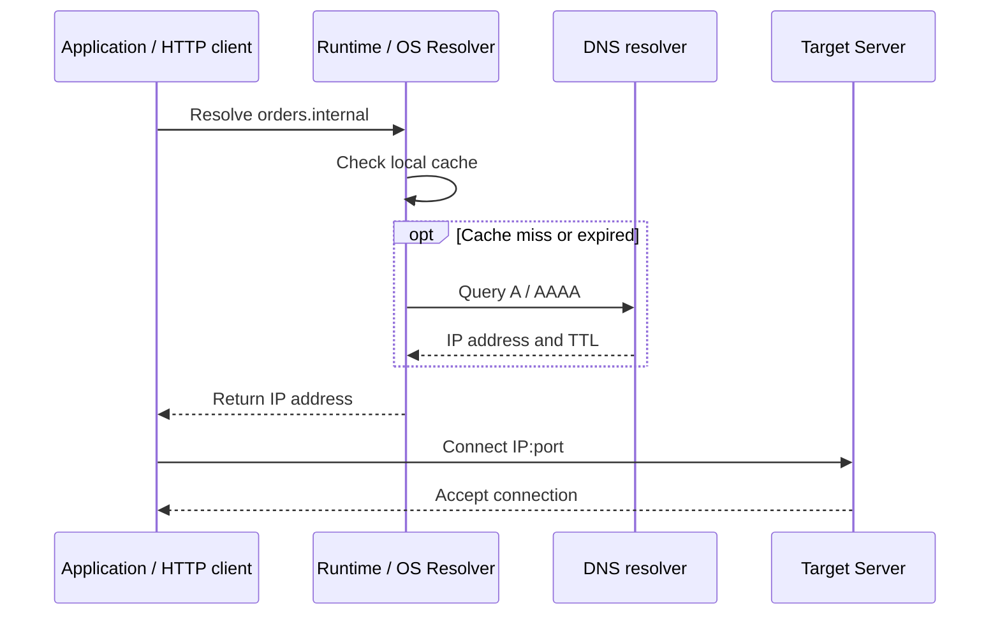
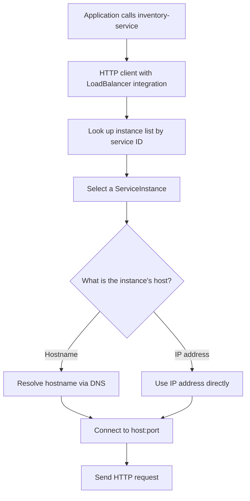

# URL, URI, Hostnames, and DNS Resolution in Service Calls

When a service calls another service over HTTP, the application needs to identify the target resource, find the server's network address, and connect to the right port. These tasks are related but belong to different conceptual layers: a URI describes the resource identifier, a hostname is the server name inside the URI, DNS maps that name to an IP address, and discovery and load balancing mechanisms can select a specific instance among multiple running instances.

In Spring Cloud LoadBalancer, applications typically call a service by a **service ID** such as `inventory-service`. A service ID is a logical name used to look up instances in the discovery system. It is only resolved via DNS when the component handling the call actually uses that name as a hostname; with load balancing integration, Spring Cloud can look up the service ID, select a `ServiceInstance`, and then send the request to the host and port of the chosen instance.

## 1. URI and URL Describe the Request Target

A **URI (Uniform Resource Identifier)** is a string that identifies a resource. A URI may specify how and where to access the resource, or simply provide an identifier within a namespace. A **URL (Uniform Resource Locator)** is a type of URI that indicates the location and means of accessing a resource. In everyday HTTP development, these two terms are sometimes used interchangeably; when reading documentation or APIs, rely on the specific context.

Example of an HTTP URL:

```text
https://orders.internal:8443/api/v1/orders?status=PAID#summary
```

The general structure of a URI is commonly represented as follows:

```text
scheme:[//authority]path[?query][#fragment]
```

| Component | Example | Meaning |
|---|---|---|
| `scheme` | `https` | Protocol or how the URI is interpreted; for HTTP calls, typically `http` or `https`. |
| `authority` | `orders.internal:8443` | Part identifying the server, optionally including user information and port. |
| `host` | `orders.internal` | Hostname or IP address within the authority. |
| `port` | `8443` | Target port. If omitted, the client uses the default port for the scheme, typically 80 for HTTP and 443 for HTTPS. |
| `path` | `/api/v1/orders` | Resource path on the server. |
| `query` | `status=PAID` | Query parameters, commonly used for filtering or controlling how the resource is processed. |
| `fragment` | `summary` | Internal reference within the resource, typically handled on the client side. |

The authority can take the form `userinfo@host:port`; the user information part is rarely used in modern application URLs, and passwords should not be embedded in URLs. The host can be a domain name, an IPv4 address, or an IPv6 address. When writing an IPv6 address in the authority, enclose the address in square brackets, for example `http://[2001:db8::10]:8080/health`.

### Path, query, and fragment have different roles

- **Path** identifies the resource path or endpoint, for example `/api/v1/orders/42`.
- **Query** passes parameters such as `?page=2&size=20`. When constructing URLs with an HTTP library, use the URI builder API and encode parameter values properly instead of arbitrary string concatenation.
- **Fragment** starts with `#`, for example `#summary`. Fragments are usually meaningful only to the client; browsers and HTTP clients do not send the fragment part in HTTP requests to the server. Therefore, the server cannot rely on the fragment for endpoint routing.

An absolute URI has a scheme and usually an authority, whereas a relative URI reference can simply be `/api/v1/orders` or `../health`. The client resolves the relative reference against a base URI to form the full target. This commonly appears when configuring `baseUrl` for `RestClient` or `WebClient`.

```java
URI baseUri = URI.create("https://orders.internal:8443");
URI requestUri = baseUri.resolve("/api/v1/orders?status=PAID");

System.out.println(requestUri);
// https://orders.internal:8443/api/v1/orders?status=PAID
```

In an application, distinguish URI construction or parsing errors from connection errors. A syntactically invalid URI may be rejected before the client performs a DNS lookup or opens a network connection.

## 2. Hostname, IP Address, and Port

A **hostname** is the server name that a client uses to specify a network target, such as `orders.internal` or `inventory-service`. An **IP address** is the address used by the network stack to route packets, such as `10.20.4.15` or `2001:db8::15`. A **port** identifies the service or process accepting connections on that server.

A network endpoint is typically identified by the triplet:

```text
scheme + host + port
https  + orders.internal + 8443
```

Hostname and IP address are not the same concept. A hostname is an easy-to-manage name that can map to one or more IP addresses. An IP address is the result needed to establish a network connection. One hostname can point to multiple IPs; conversely, multiple hostnames can also point to the same IP.

With HTTP/1.1, clients typically send the hostname in the `Host` header, for example:

```http
GET /api/v1/orders HTTP/1.1
Host: orders.internal:8443
Accept: application/json
```

HTTP/2 and HTTP/3 use the `:authority` pseudo-header to represent the request's authority. This header tells the server which host the request targets, but it does not perform a DNS lookup itself. DNS lookup is the name resolution step before the client connects; authority information is transmitted in the HTTP protocol after the connection has been established.

With HTTPS, the hostname also participates in the TLS process. The client typically sends the hostname via the SNI (Server Name Indication) extension in the TLS ClientHello so the server or proxy can select the appropriate certificate. The client also verifies whether the hostname in the URL matches a name in the certificate, usually in the Subject Alternative Name (SAN). Therefore, replacing a hostname with an IP can cause certificate verification to fail even if that IP is reachable.

Do not use `localhost` to call a service in another container or on another machine. `localhost` always refers to the network environment of the process making the call. Inside a container, `localhost` is usually the current container, not a neighboring container or the host machine.

## 3. DNS Resolves Hostnames to IP Addresses

**DNS (Domain Name System)** is a distributed system used to look up domain name information. In service calls, the most common task is finding address records for a hostname so the client knows which IP to connect to.

Common record types:

| Record type | Purpose |
|---|---|
| `A` | Maps a hostname to an IPv4 address. |
| `AAAA` | Maps a hostname to an IPv6 address. |
| `CNAME` | Creates an alias pointing to another hostname; the resolver continues looking up the target name. |
| `SRV` | Publishes the hostname and port of a service following the DNS SRV convention; the application must support this lookup type to use it. |

### How does a DNS resolution take place?

When an application needs to connect to `orders.internal`, the general flow is typically as follows:

1. The HTTP client extracts the hostname from the URI.
2. The network library calls the OS or runtime resolver to resolve the hostname. Caches in the application, runtime, OS, or DNS resolver may reply immediately if valid data is still cached.
3. If no result is in the cache, the stub resolver sends a query to the DNS resolver configured for the machine or container.
4. The DNS resolver may use its own cache or query the necessary DNS servers further, then return the appropriate record.
5. The client receives one or more IP addresses and attempts to establish a connection to the selected address and port.

Simplified diagram:



This is a general model. Some environments have a DNS proxy, service mesh, custom cache, or internal resolution mechanism, so the actual steps may differ. Not every HTTP request triggers a new DNS query: DNS caching and connection pools can allow reusing resolution results or open connections.

### TTL and DNS caching

DNS records typically have a **TTL (Time To Live)**, indicating how long a resolver may cache the answer. When a service's IP address changes, a resolver may still return the old address while the data remains cached. In addition to the record's TTL, runtimes like the JVM and operating systems have their own caching policies; therefore, do not assume every process will see DNS changes immediately.

In a multi-instance system, a single hostname can return multiple IP addresses. The resolver or client may select addresses according to its own ordering and policies. Having DNS return multiple IPs does not mean the application already has per-request load balancing: caching, address ordering, connection pooling, and network infrastructure all affect the actual outcome.

### Internal DNS in deployment environments

In enterprise environments, internal hostnames typically resolve only from the corporate network, VPN, or deployment cluster. A hostname that works on a development machine may not work inside a container, pod, or production server. Each environment may use different resolvers, search domains, and DNS zones.

In Kubernetes, a Service name like `inventory.default.svc.cluster.local` is typically resolved by cluster DNS to the Service's ClusterIP. The Kubernetes data plane then forwards the connection to an eligible Pod. For a headless Service, DNS can return the Pod addresses. Therefore, it is necessary to identify whether a hostname points to a ClusterIP, a Pod IP, or another endpoint before concluding which component is performing load balancing.

## 4. Distinguishing DNS Hostnames from Service IDs

In a microservices architecture, a service typically has multiple instances running on different machines or containers. Calling a specific IP directly couples the client to deployment addresses. Instead, the application can call the service using a stable **service ID**, for example `inventory-service`.

A service ID is a logical name used to look up instances in service discovery. It may look like a hostname, but the two concepts are not inherently identical:

| Concept | Question answered | Example |
|---|---|---|
| Service ID | Which logical service does the application want to call? | `inventory-service` |
| Service instance | Which specific instance is ready to accept requests? | Instance with host `10.20.1.12`, port `8080` |
| Instance hostname | By what server name is the instance described? | `inventory-2.internal` |
| IP address | Which network address does the client need to connect to? | `10.20.1.12` |
| Port | On which port is the service listening? | `8080` |

Spring Cloud LoadBalancer provides a mechanism to select a `ServiceInstance` from the list of instances for a service ID. This list typically comes from an implementation of Spring Cloud `DiscoveryClient` or `ServiceInstanceListSupplier`. Depending on the discovery system, an instance's host field may be a hostname or an IP.

High-level service call flow:



DNS and service discovery solve two different questions:

- Service discovery finds the instances belonging to a logical service, typically along with host, port, and metadata.
- DNS resolves a hostname to a network address. DNS may come into play after the discovery step if the instance is returned as a hostname, or from the very beginning if the application calls a regular DNS hostname.

If discovery returns an IP, the client can connect directly without looking up a hostname for that instance. If discovery returns a hostname, the client needs to resolve that hostname. Some systems also use DNS as the service discovery mechanism; in that case, the application and infrastructure must agree on the DNS conventions used.

## 5. Example of Calling a Service with Spring Cloud LoadBalancer

Suppose `inventory-service` has multiple instances. The application calls the item lookup API using the service ID instead of hardcoding a single instance's host.

With `RestClient`, you can register a builder annotated with `@LoadBalanced`:

```java
import org.springframework.cloud.client.loadbalancer.LoadBalanced;
import org.springframework.context.annotation.Bean;
import org.springframework.context.annotation.Configuration;
import org.springframework.web.client.RestClient;

@Configuration
class HttpClientConfiguration {

    @Bean
    @LoadBalanced
    RestClient.Builder loadBalancedRestClientBuilder() {
        return RestClient.builder();
    }
}
```

Then use the service ID as the host in the URL:

```java
import org.springframework.stereotype.Service;
import org.springframework.web.client.RestClient;

@Service
class InventoryGateway {
    private final RestClient restClient;

    InventoryGateway(RestClient.Builder loadBalancedRestClientBuilder) {
        this.restClient = loadBalancedRestClientBuilder
                .baseUrl("http://inventory-service")
                .build();
    }

    String getItem(String itemId) {
        return restClient.get()
                .uri("/api/v1/items/{id}", itemId)
                .retrieve()
                .body(String.class);
    }
}
```

In this configuration, `inventory-service` is the service ID that the load balancing mechanism uses to find instances. When a request goes through a builder marked with `@LoadBalanced`, Spring Cloud LoadBalancer integration can select an instance and route the request to that instance's actual host and port. For lookup to work, the application needs the appropriate discovery dependency and configuration for the deployment environment.

If a regular `RestClient` without load balancing integration is used, the string `http://inventory-service` is interpreted as a URL with the hostname `inventory-service`. The HTTP client will then ask the resolver to resolve this hostname via DNS. If DNS has no matching record, the call may fail with a name resolution error. Simply putting a service ID into a URL does not automatically activate Spring Cloud LoadBalancer.

This also explains why it is important to distinguish two cases:

1. **Calling a DNS hostname:** the resolver finds the IP for the hostname, then the client connects to the IP and port.
2. **Calling a service ID via LoadBalancer:** LoadBalancer finds the list of instances, selects one instance, and the client connects to the instance's host and port. DNS is only needed if the instance's host is a hostname or if the discovery mechanism is designed around DNS.

## 6. Interpreting Errors by Stage of the Call

A request goes through multiple stages: constructing the URI, finding an instance (if load balancing is used), resolving the hostname (if needed), opening a TCP connection, TLS handshake (if using HTTPS), and then exchanging HTTP messages. Identifying which stage the request stops at helps narrow down errors faster.

| Symptom | Likely failing stage | What to check |
|---|---|---|
| Malformed URI or missing scheme | URL/URI parsing | Check scheme, authority, delimiters, encoding, and how the base URL and path are combined. |
| `UnknownHostException` or equivalent error | Hostname resolution | Check hostname, DNS resolver, search domain, and resolution capability from the exact container or pod running the application. |
| No instances found for service ID | Service discovery / LoadBalancer | Check service ID, instance registration, instance status, and discovery configuration. |
| `Connection refused` | TCP connection setup | The IP may have been determined, but the port is not accepting connections; check port, listening process, and network policies. |
| Connect timeout | TCP connection setup | Check routes, firewalls, network policies, target address, and server status. |
| TLS handshake error or hostname mismatch with certificate | TLS | Check `https` scheme, SNI, truststore, and certificate SAN against the hostname being called. |
| HTTP `404` | HTTP request handling | The connection reached an HTTP server; check path, method, context path, and routing. |
| HTTP `503` | Request handling or gateway | Check instance availability, gateway, health status, and retry policy. |

An HTTP status indicates that an HTTP component answered the request, though not necessarily the target application: a proxy or gateway can also generate a response. Conversely, a DNS error occurs before the client can send an HTTP request to the target server.

### Basic diagnostic commands

Run commands from the exact machine, container, or pod where the application makes the call. Results from a laptop do not prove that the production runtime has the same DNS configuration or network routes.

```bash
# Look up a hostname; available tools depend on the image/container.
nslookup inventory-2.internal

# On Linux, view the addresses resolved by the system.
getent hosts inventory-2.internal

# Observe the HTTP connection process and TLS details.
curl -v https://inventory-2.internal:8443/actuator/health
```

If you need to test a specific IP while keeping the hostname for HTTP Host and TLS SNI, `curl --resolve` can force a hostname mapping for that single run:

```bash
curl -v --resolve inventory-2.internal:8443:10.20.1.12 \
  https://inventory-2.internal:8443/actuator/health
```

This command is useful for isolating DNS issues from connectivity or TLS issues. It does not modify system DNS and is not a long-term configuration approach for service discovery.

## 7. Principles to Keep When Designing Service Calls

1. **Use clear, structured URIs.** Separate scheme, host, port, path, and query; use URI builder APIs to encode parameters properly.
2. **Use stable service IDs at the application layer.** Let discovery and LoadBalancer find instances instead of hardcoding the IP of a running machine.
3. **Know where hostnames are resolved.** Test from the right runtime; DNS on a development machine can differ from DNS in a container or cluster.
4. **Do not treat DNS as per-request load balancing.** DNS has caching and TTL; connection pools may continue using existing connections. Understand the discovery and LoadBalancer policies in use.
5. **Keep hostnames consistent with TLS.** The hostname in the URL needs to match SNI and the names in the certificate; avoid switching to an IP if the certificate does not cover that IP.
6. **Configure timeouts and observe each stage.** Track discovery, DNS, connect, TLS, and HTTP errors separately to know whether a request failed before or after reaching the server.

Once you understand the relationship between URIs, hostnames, DNS, and service IDs, you can accurately read a call's URL, understand how the target address is determined, and identify where Spring Cloud LoadBalancer participates. This forms the foundation for intentionally configuring discovery, instance selection, retries, and timeouts in a multi-service system.
