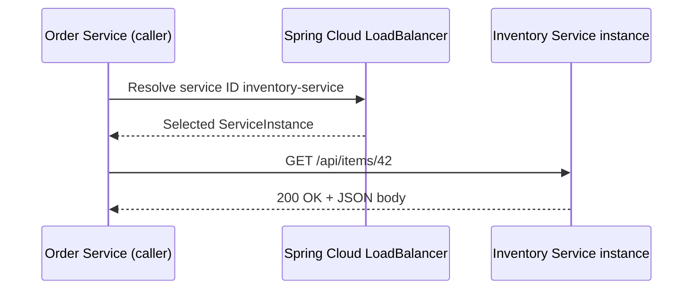

# HTTP Methods, Status Codes, and Meaning for Callers

When one service calls another over HTTP, the caller needs to understand two parts of the contract: the **HTTP method** indicates what operation it is requesting, and the **status code** indicates how far the server processed the request. Understanding both parts helps the application interpret results, return appropriate errors, and decide whether to retry.

In a Spring Cloud architecture, Spring Cloud LoadBalancer can select a `ServiceInstance` for a call to a service ID. Selecting an instance does not change the semantics of the HTTP method or status code. The target service, gateway, or proxy produces the response; the caller must still handle the response according to the HTTP contract and the API contract.

## 1. Method and Status Code Are Two Distinct Parts of a Contract

An HTTP request typically has a method, URI, headers, and optionally a body. An HTTP response has a status code, headers, and optionally a body.

For example, the caller sends:

```http
GET /api/products/42 HTTP/1.1
Host: catalog-service
Accept: application/json
```

The server may return:

```http
HTTP/1.1 200 OK
Content-Type: application/json

{
  "id": 42,
  "name": "Mechanical Keyboard"
}
```

`GET` expresses the intent to read a resource. `200 OK` indicates that the request was processed successfully and the response body contains the resource representation. The same method can receive many different statuses: `200` if the product is found, `404` if no matching product exists, or `503` if the service is temporarily unavailable.

Therefore, the caller should not infer the outcome solely from the method or merely from the fact that an HTTP connection was established. It needs to inspect the status code, relevant headers, and body according to the API contract.

## 2. Commonly Used HTTP Methods

The method describes the semantics of the operation. Two important properties when designing inter-service calls are **safe** and **idempotent**:

- *Safe*: the operation is defined as read-only and does not request the server to alter resource state.
- *Idempotent*: executing the same request once or multiple times has the same intended effect on server state.

Idempotent does not mean every call must return the same status code or the same response body. For example, the first `DELETE` might return `204` and a subsequent one might return `404`, yet the resource remains in the deleted state.

| Method | Purpose | Safe | Idempotent | Notes for callers |
|---|---|---:|---:|---|
| `GET` | Read a resource representation | Yes | Yes | Do not use for operations that alter state. |
| `HEAD` | Retrieve metadata like `GET`, without receiving a response body | Yes | Yes | Useful when only checking resource existence or headers. |
| `POST` | Submit data for the server to process, typically creating a resource or triggering business logic | No | Not by default | Resending may create a duplicate record or execute the operation a second time. |
| `PUT` | Create or replace a representation at the target URI per the API contract | No | Yes | Resending the same payload to the same URI should have the same intended effect. |
| `PATCH` | Partially update a resource | No | Not guaranteed | Idempotency depends on how the update operation is defined. |
| `DELETE` | Request deletion of the resource at the target URI | No | Yes | Resending should not cause additional deletion effects beyond the intended outcome. |
| `OPTIONS` | Query the server about communication options or capabilities | Yes | Yes | Can be used to discover supported methods; commonly appears in CORS preflight. |

A few examples help clarify the differences:

```http
GET /api/orders/1001
```

Reads order `1001`. The caller can retry the request on transient failures without creating a new order.

```http
POST /api/orders
Content-Type: application/json

{
  "customerId": 27,
  "productId": 42,
  "quantity": 1
}
```

Creates an order. If the server created the order but the response was lost in transit, the caller cannot be certain whether the operation completed. Resending the request might create a second order.

```http
PUT /api/customers/27/preferences
Content-Type: application/json

{
  "language": "en",
  "currency": "USD"
}
```

Replaces the preferences at the specified URI. Resending the same request still brings the resource to the same desired state.

```http
PATCH /api/accounts/27
Content-Type: application/merge-patch+json

{
  "displayName": "An Nguyen"
}
```

Partially updates an account. Setting `displayName` to a specific value can generally be repeated safely under the API contract. Conversely, an operation like "increment balance by 100" is not idempotent if resent.

With `POST` or `PATCH`, an API may provide a deduplication mechanism such as an `Idempotency-Key` header. Callers should only rely on this mechanism when the target API explicitly documents and implements the key's behavior.

## 3. HTTP Status Code Categories

A status code is a three-digit number. The first digit indicates the category of the outcome:

| Category | Meaning | Initial caller interpretation |
|---|---|---|
| `1xx` | Informational | The server is exchanging further protocol information; typically handled by the HTTP client at the protocol layer. |
| `2xx` | Success | The request was successfully processed or accepted according to the semantics of the specific status. |
| `3xx` | Redirection | Needs to reference another location or reuse cached data as instructed. |
| `4xx` | Client Error | There is an issue with the request, missing permissions, resource not found, or rate limiting; inspect each code before deciding to retry. |
| `5xx` | Server Error | The server or an intermediary component could not complete the request; some cases may be transient. |

### 3.1. Common Success Codes

| Code | Meaning | What the caller should do |
|---|---|---|
| `200 OK` | The request succeeded. | Read the body if the API specifies returned data. |
| `201 Created` | One or more resources were created. | Read the body and the `Location` header if the API provides the URI of the new resource. |
| `202 Accepted` | The server accepted the request for processing, though the work may not be complete yet. | Track task status via the URI or callback mechanism specified by the API. Do not treat this as the final business outcome. |
| `204 No Content` | The request succeeded and there is no response body. | Do not attempt to parse the body as JSON. |

For example, an order creation API may return `201 Created` along with `Location: /api/orders/1002`. If the API only accepts the request for asynchronous processing, `202 Accepted` is more appropriate; the caller needs to continue tracking the task rather than assuming the order is already complete.

### 3.2. Redirection

Codes such as `301`, `302`, `303`, `307`, and `308` direct the client to another URI. Some HTTP clients follow redirects automatically; this behavior can affect the method and body. `307` and `308` require preserving the method when redirecting, whereas `303` directs the client to issue a `GET` for the target resource. `304 Not Modified` also belongs to `3xx`, but is used for conditional requests: the client can reuse its cached representation because the resource has not changed. When calling internal APIs, an unexpected redirect is often a sign to check the base URL, gateway configuration, or API path.

### 3.3. Request or Business Logic Errors

| Code | Common meaning | How the caller should handle |
|---|---|---|
| `400 Bad Request` | The request is malformed or invalid according to API rules. | Check payload data, query parameters, headers, and body format. |
| `401 Unauthorized` | Missing or invalid authentication credentials. | Check token/credentials; only refresh credentials according to the designed mechanism. |
| `403 Forbidden` | The server understood the request but denies permission to execute it. | Check permissions or access scopes; re-authenticating usually does not resolve an authorization error. |
| `404 Not Found` | The requested resource or endpoint was not found. | Check the ID, URI, service route, and whether the resource exists. |
| `405 Method Not Allowed` | The resource does not support the sent method. | Check the method; the `Allow` header may indicate supported methods. |
| `406 Not Acceptable` | The server cannot produce a representation matching the `Accept` header. | Adjust the formats the client accepts. |
| `408 Request Timeout` | The server did not receive the complete request within the allowed time. | May retry if the request can be safely resent and time budget remains. |
| `409 Conflict` | The request conflicts with the current state of the resource. | Inspect error details, refresh state, or handle the business conflict. |
| `412 Precondition Failed` | Conditions in headers such as `If-Match` were not met. | Re-read the resource version and construct a new request with the appropriate condition. |
| `415 Unsupported Media Type` | The server does not support the format of the sent body. | Check `Content-Type` and payload format. |
| `422 Unprocessable Content` | The content is syntactically valid but violates API validation/processing rules. | Display or map field-level data validation errors. |
| `429 Too Many Requests` | The client sent too many requests in a given time window. | Slow down request rate and respect `Retry-After` if present. |

Not all `4xx` codes are handled the same way. `400`, `401`, `403`, and `404` usually require fixing the request or access permissions. `408` and `429` may allow conditional retries. `409` and `412` typically require reading the latest state and creating a new request rather than resending the exact old request.

### 3.4. Server or Intermediary Errors

| Code | Common meaning | How the caller should handle |
|---|---|---|
| `500 Internal Server Error` | The server encountered an unexpected error while processing the request. | Log the error and correlation/trace ID; only retry when policy determines it is appropriate. |
| `501 Not Implemented` | The server does not support the requested functionality or method. | Check API compatibility; retrying usually does not help. |
| `502 Bad Gateway` | A gateway or proxy received an invalid response from upstream. | Check upstream service; bounded retries may be used if the operation is safe. |
| `503 Service Unavailable` | The service is temporarily unavailable or overloaded. | Respect `Retry-After` if present and apply backoff. |
| `504 Gateway Timeout` | A gateway or proxy did not receive a timely response from upstream. | Review timeouts, upstream health, and whether the request may have already been processed before retrying. |

`5xx` does not mean every request should be resent. For instance, `501` is usually a configuration or compatibility issue. `500` may stem from bad input data or a deterministic bug. `503` is likely a transient condition, though retry attempts still need to be bounded.

## 4. Reading Response Body and Headers Alongside Status Code

The status code indicates the outcome category; headers and body provide the details for the caller to handle it properly. Several headers commonly carry direct meaning:

- `Content-Type`: format of the response body, for example `application/json`.
- `Location`: URI of the created resource or redirection target.
- `Retry-After`: timestamp or duration the client should wait before retrying.
- `WWW-Authenticate`: details about the required authentication scheme.
- `Allow`: methods supported by the resource, often accompanying `405`.
- `ETag` and `Last-Modified`: support caching and resource version checks.

For JSON APIs, errors should have a stable structure so clients can map them to domain errors. Example using the Problem Details format:

```http
HTTP/1.1 409 Conflict
Content-Type: application/problem+json

{
  "type": "https://api.example.com/problems/insufficient-stock",
  "title": "Insufficient stock",
  "status": 409,
  "detail": "The requested quantity is not available.",
  "instance": "/api/orders",
  "code": "INSUFFICIENT_STOCK"
}
```

The caller can use status `409` to classify the conflict and the `code` field to choose specific handling. Do not rely on matching `detail` verbatim, because this text may change or be localized. If the API returns an empty or malformed body, the client must still handle the status code and retain basic error information.

## 5. Deciding Whether to Retry a Request

Retries help overcome certain transient errors, but they can also duplicate operations or overload the system. The caller should decide based on three factors: the error type, method semantics, and the likelihood that the previous request was already processed.

A practical workflow:

1. If `2xx` is received, process the result according to the specific status. For `202`, continue tracking the task; for `204`, do not expect a body.
2. If `3xx` is received, follow the client's redirect policy and check the target URI when a redirect is unexpected.
3. If `4xx` is received, read the status and error body to fix the request, authentication, authorization, or business state. Only retry cases covered by an explicit policy, such as `408` or `429`.
4. If `5xx` is received, determine whether the error is likely transient. `502`, `503`, and `504` may suit bounded retries; `500` needs evaluation based on cause and API contract.
5. If no HTTP response is received due to DNS, connection errors, or timeouts, there is no status code to classify. With a timeout, the server may have already performed the operation while the response failed to reach the caller.

Before retrying, check idempotency. `GET`, `HEAD`, `PUT`, and `DELETE` have idempotent semantics under HTTP. For `POST` or `PATCH`, only retry automatically when the API guarantees deduplication or the business logic has a suitable reconciliation mechanism. An `Idempotency-Key` is only effective when the server persists and enforces the key according to the contract.

A retry policy should define maximum attempts, maximum total duration, exponential backoff, and jitter. When a response includes `Retry-After`, the client should honor that value within the call's deadline. Avoid stacking retries across multiple layers without calculating total attempts: retries in the HTTP client, Spring Cloud LoadBalancer, and the business layer can multiply request counts several times over.

In particular, a timeout does not prove that the operation failed. If the caller sends `POST /api/orders`, the server creates the order successfully, and the response is lost, blind retries can create a second order. This is why idempotency and handling of indeterminate outcomes must be designed into the API contract from the start.

## 6. Meaning in Calls Through Spring Cloud LoadBalancer

With client-side load balancing, the caller typically uses a service ID in the URI, such as `http://inventory-service`. Spring Cloud LoadBalancer picks an eligible instance of that service; the HTTP client sends the request to the chosen instance. The method, headers, body, and status code still follow HTTP rules:



LoadBalancer handles selecting an instance based on the service ID and application configuration. It does not turn a `POST` into a `PUT`, does not interpret `409` as success, and cannot determine that a timed-out request was definitely not processed. Retries or status handling must be designed in the HTTP client, resilience layer, or business logic.

Example using `WebClient` configured with `@LoadBalanced`:

```java
@Configuration
class HttpClientConfiguration {
    @Bean
    @LoadBalanced
    WebClient.Builder loadBalancedWebClientBuilder() {
        return WebClient.builder();
    }
}

@Service
class InventoryClient {
    private final WebClient webClient;

    InventoryClient(@LoadBalanced WebClient.Builder builder) {
        this.webClient = builder.build();
    }

    Mono<Item> findItem(String itemId) {
        return webClient.get()
            .uri("http://inventory-service/api/items/{id}", itemId)
            .retrieve()
            .onStatus(
                status -> status.value() == 404,
                response -> response.createException()
                    .map(ItemNotFoundException::new)
            )
            .onStatus(
                HttpStatusCode::is5xxServerError,
                ClientResponse::createException
            )
            .bodyToMono(Item.class);
    }
}
```

In this example, `WebClient.Builder` is injected into the client and already carries the `@LoadBalanced` configuration. `404` is mapped to the domain error `ItemNotFoundException`; the `5xx` group is converted into an HTTP exception so the upstream calling layer can decide how to log, retry, or propagate the error to the next caller. `ItemNotFoundException` is an application-defined exception that can take `WebClientResponseException` as its cause. When using `retrieve()`, unhandled `4xx` and `5xx` responses also become `WebClientResponseException` by default.

If no suitable instance is available, an error may occur before any HTTP response is received or may be represented by a component in the system as a status such as `503`, depending on configuration and integration version. Therefore, distinguish connection/LoadBalancer exceptions from an actual HTTP response from the target service.

## 7. Checklist When Designing APIs and Writing Callers

- Choose the method matching intent: read with `GET`, create or trigger business actions with `POST`, replace with `PUT`, partially update with `PATCH`, delete with `DELETE`.
- Return statuses that clearly reflect outcomes: `201` when creating resources, `202` when accepting asynchronous work, `204` when succeeding without a body.
- Use `4xx` for request/permission/business state issues and `5xx` for server or intermediary errors; provide an error body with a stable structure.
- Read `Retry-After`, `Location`, `Allow`, and related headers when the API uses them.
- Only retry when the error is likely transient, the request can be safely resent, and time remains within the deadline.
- Protect non-idempotent operations with an idempotency key or equivalent business mechanism before enabling automatic retries.
- Log status, service ID, URI, response latency, and trace/correlation ID; avoid logging tokens or sensitive data in headers/bodies.

When methods and status codes are properly understood, callers can distinguish request errors, business errors, transient errors, and connection errors. This forms the foundation for configuring retries, timeouts, and observability for inter-service communication in a controlled manner within systems using Spring Cloud LoadBalancer.
