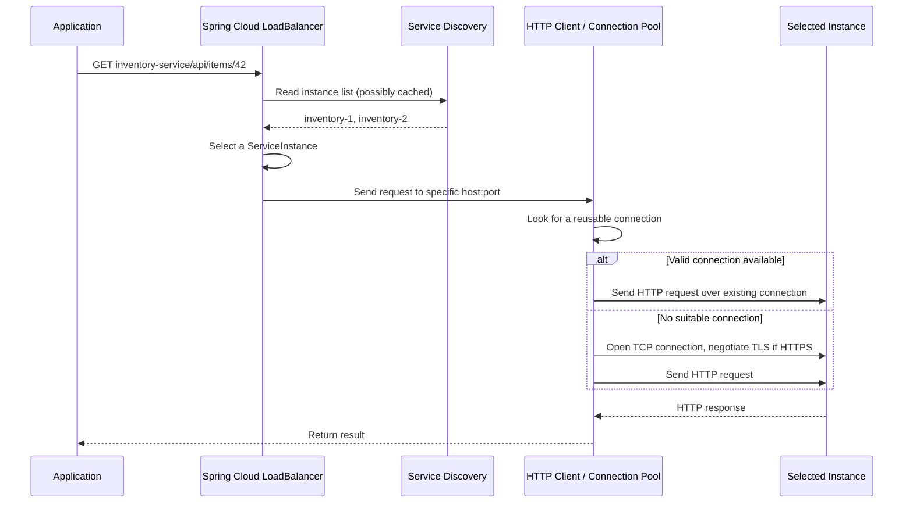
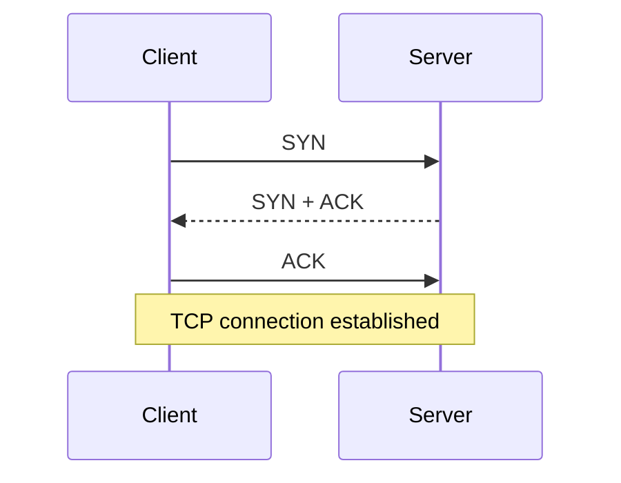
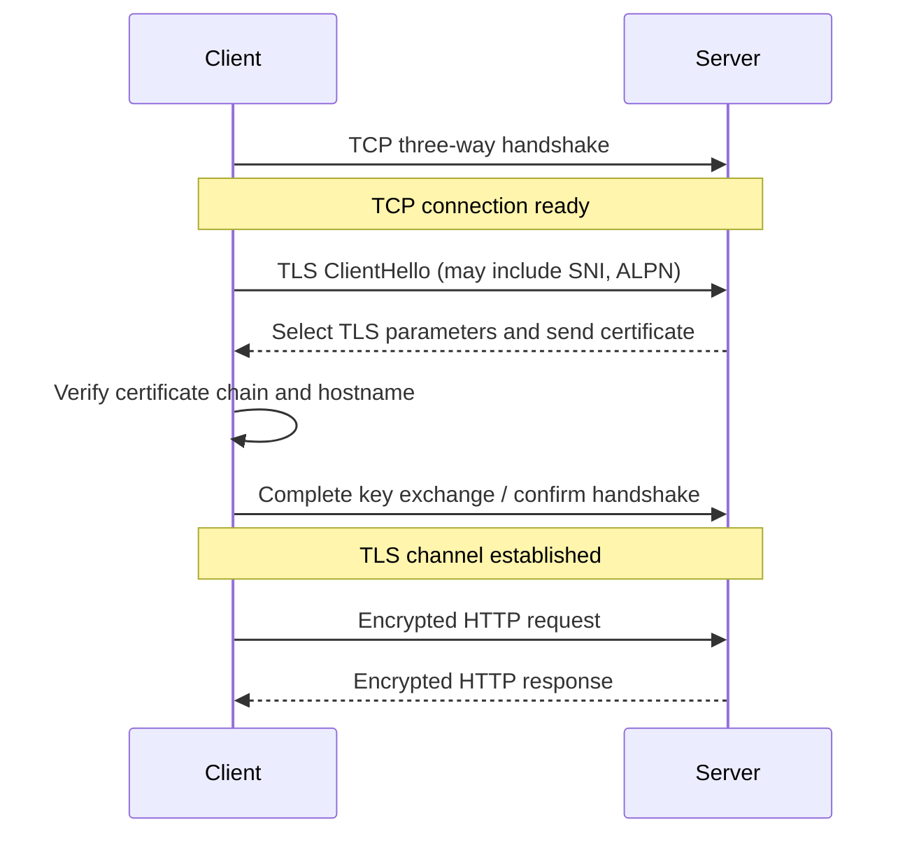
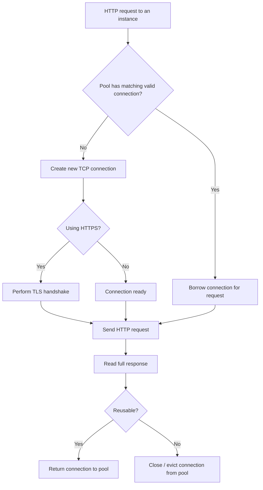

# TCP Connections, TLS, Keep-Alive, and Connection Reuse

When one service calls another over HTTP, the application usually only sees a call such as `GET http://inventory-service/api/items/42`. Beneath that call lie several steps: Spring Cloud LoadBalancer selects an instance, the HTTP client finds or creates a network connection, TCP establishes a byte transport stream, TLS protects the stream, and HTTP exchanges requests and responses.

Understanding the connection lifecycle helps explain why the first request is often slower, why an instance can still receive traffic after being removed from the discovery list, why a timeout acquiring a connection differs from a timeout waiting for a response, and why connection pool configuration affects load distribution.

## 1. Where Do Connections Fit in a Service-to-Service Call?

In Spring Cloud LoadBalancer, applications typically call a service using a **service ID** instead of hardcoding a single instance's address. For example:

```java
String item = restClient.get()
        .uri("http://inventory-service/api/items/{id}", 42)
        .retrieve()
        .body(String.class);
```

`inventory-service` is a logical name. The discovery client provides the list of registered instances, such as:

| Service ID | Instance | Address |
|---|---|---|
| `inventory-service` | `inventory-1` | `10.0.1.10:8080` |
| `inventory-service` | `inventory-2` | `10.0.1.11:8080` |

High-level processing flow:

1. The application sends a request to a URL containing the service ID.
2. Spring Cloud LoadBalancer selects a `ServiceInstance` from the discovery list according to the configured policy.
3. The logical URL is resolved to the concrete address of the chosen instance.
4. The HTTP client looks for a suitable connection in its connection pool. If no usable connection is available, the client opens a new connection.
5. The connection is used to send the request and receive the response. If the protocol and connection state permit, the client retains the connection for subsequent requests.



Each component solves a different problem:

| Component | Responsibility |
|---|---|
| Service discovery | Finds registered instances for a service ID |
| Spring Cloud LoadBalancer | Selects an instance for the request |
| DNS | Resolves hostnames to IP addresses when needed |
| TCP | Creates a reliable byte stream between two endpoints |
| TLS | Authenticates the remote peer and encrypts data sent over the connection |
| HTTP client and connection pool | Sends HTTP requests, manages and reuses connections |

LoadBalancer decides **which instance the request targets**. TCP/TLS and the connection pool decide **how the connection to that instance is established and used**.

## 2. How Does TCP Establish a Connection?

TCP is a connection-oriented transport protocol. It provides an ordered byte stream, detects packet loss, and retransmits data when needed. TCP has no awareness of HTTP requests, service IDs, or microservice names; it operates solely between two network endpoints.

A TCP connection is identified by the endpoint pair, typically described as a four-tuple:

- Source IP and source port.
- Destination IP and destination port.

In the example above, a connection may run from `10.0.2.20:53124` to `10.0.1.10:8080`. If LoadBalancer selects the second instance, the client needs a connection to `10.0.1.11:8080` or an existing pooled connection to that endpoint.

### 2.1. TCP three-way handshake

Before exchanging application data, the two peers establish a connection using a three-way handshake:



- **SYN:** the client requests to open a connection and sends initialization parameters.
- **SYN-ACK:** the server accepts the request and responds.
- **ACK:** the client acknowledges; both sides can now transmit data.

The handshake requires network round-trip time. If a client had to open a new TCP connection for every request, setup overhead would repeat and increase latency. Connection reuse lets multiple requests share an already-established connection.

TCP is a byte stream and does not preserve message boundaries. The HTTP client and server must parse HTTP framing themselves to know which bytes belong to which request or response.

### 2.2. Closing a TCP connection

When one side closes a connection gracefully, TCP typically uses FIN and ACK packets so both transmission directions terminate independently. Therefore, closing is often described as a four-way handshake. A connection can also be terminated abruptly with RST, for example when one endpoint is no longer accepting connections.

Operational consequences to remember:

- A new connection may fail with `connection refused` if no process is listening at the endpoint or the network rejects the connection.
- An active connection may be reset when the server, proxy, or network closes it unexpectedly.
- A client creating too many short-lived connections can increase load on both sides and build up sockets in closing states such as `TIME_WAIT`.
- TCP preserves byte ordering within a connection; it does not guarantee that the request will succeed at the application layer.

### 2.3. TCP keepalive vs. HTTP keep-alive

Two concepts share similar names but serve different purposes:

| Mechanism | How it works | Purpose |
|---|---|---|
| HTTP persistent connection (often called HTTP keep-alive) | Keeps the connection open to send additional HTTP requests after the prior response finishes | Reuses connections, reducing TCP/TLS setup count |
| TCP keepalive probe | The OS sends probes on an idle TCP connection at configured intervals | Detects peers or network paths that may have disappeared without closing properly |

TCP keepalive probes do not generate extra HTTP requests, do not replace a connection pool, and do not guarantee immediate failure detection. Probe intervals and retry counts depend on OS/socket settings. When designing application timeouts, you still need HTTP client-level timeouts and idle connection eviction policies.

## 3. TLS Protects HTTPS Connections

With HTTPS, HTTP is transported inside TLS, and TLS typically runs over TCP for HTTP/1.1 and HTTP/2. After TCP connects successfully, the client and server perform a TLS handshake before exchanging encrypted HTTP requests.

TLS provides three primary capabilities:

1. **Encryption:** observers on the network path cannot read HTTP contents.
2. **Integrity:** data tampered with in transit is detected.
3. **Authentication:** the client verifies the server's certificate to confirm it is connecting to the expected identity. Depending on configuration, TLS can also authenticate the client with a certificate.

During the handshake, both sides agree on protocol version and cipher suite, exchange key material, and verify certificates. With HTTPS to a hostname, the client typically sends SNI so the server knows which host name is requested; the client also checks whether the hostname matches the certificate. ALPN can be used to negotiate the application protocol such as HTTP/1.1 or HTTP/2.



The TLS handshake adds overhead to a new connection. Reusing an active TLS connection usually avoids repeating the full handshake on every request. TLS session resumption can also lower cost when opening new connections, but that is a mechanism for resuming a TLS session; it is **not the same** as reusing the existing TCP connection itself.

Do not disable certificate or hostname verification to work around TLS errors. When encountering verification failures, inspect the trust store, certificate chain, certificate expiration, hostname/SNI, and TLS configuration between client and server.

## 4. HTTP Keep-Alive and Persistent Connections

Once TCP and TLS are ready, the HTTP client can send requests. With HTTP/1.1, persistent connections are the default behavior: after a response finishes, both sides can continue using the same connection for the next request provided there is no close directive and message framing allows determining where the message ends.

For example, a client can send two sequential requests over the same connection:

```text
TCP connection #1
  ├── HTTP request: GET /api/items/1
  ├── HTTP response: 200 OK
  ├── HTTP request: GET /api/items/2
  └── HTTP response: 200 OK
```

In HTTP/1.1:

- Connections are kept open by default after request/response completion.
- `Connection: close` requests closing the connection after the current message.
- `Connection: keep-alive` is commonly seen in older systems or HTTP/1.0; do not rely on this header as the sole switch for managing connection pools in HTTP/1.1.
- Messages must have clear framing, such as `Content-Length` or appropriate chunked transfer encoding, so the receiver knows when a response has ended.

Keep-alive does not mean a connection lasts forever. Servers, reverse proxies, network load balancers, or clients can close a connection after an idle period, after a maximum lifetime, or when freeing resources. Clients must tolerate the possibility that a pooled connection was closed by the remote peer.

### 4.1. HTTP/2 and HTTP/3

HTTP/2 still typically runs over a single TCP/TLS connection but supports multiplexing: multiple HTTP streams can operate concurrently on the same connection. This reduces the need to open many connections just to run concurrent requests. However, TCP packet loss can stall data delivery across streams sharing the connection.

HTTP/3 runs HTTP over QUIC, using UDP as its transport foundation and integrating TLS 1.3 into QUIC. Consequently, HTTP/3's handshake and connection management model differs from traditional TCP/TLS. Long-lived connections and reuse remain important, though exact configuration details depend on the protocol and HTTP client.

## 5. Connection Pools and Connection Reuse

A connection pool is where an HTTP client manages open connections for reuse. Rather than performing a TCP handshake and TLS handshake on every request, the client borrows an idle connection, sends the request, reads the response, and returns the connection to the pool.



A pool typically manages the following limits and durations:

| Property | Meaning | When misconfigured |
|---|---|---|
| Maximum connections | Maximum concurrent connections, pool-wide or per route | Too low causes waiting to acquire a connection; too high increases sockets, memory, and server load |
| Pending acquire timeout | How long a request may wait to obtain a connection from the pool | Requests can time out before even starting to send HTTP |
| Max idle time | Maximum time a connection may sit idle in the pool | Too long can retain connections already closed by server/proxy |
| Max life time | Maximum lifetime of a connection | Too long can keep connections open to decommissioned instances longer than expected |
| Idle eviction | Background sweep that removes expired idle connections | Lack of eviction can leave stale connections in the pool for too long |

Pools typically segregate connections by route or origin, such as scheme, host, and port. Thus, a connection to `10.0.1.10:8080` cannot be used as a connection to `10.0.1.11:8080`. Exact segregation details depend on the HTTP client and proxy configuration.

### 5.1. Connection reuse coordinated with LoadBalancer

Suppose LoadBalancer picks `inventory-1` for the first request. The HTTP client may open a connection to `10.0.1.10:8080` and keep it in the pool. On the next request, LoadBalancer still performs instance selection through its integration; if it picks `inventory-1` again, the HTTP client can reuse the existing connection. If it picks `inventory-2`, the client needs a connection matching the second instance's endpoint.

This leads to three important points:

1. **Keep-alive does not select instances.** Instance selection is the responsibility of Spring Cloud LoadBalancer or the corresponding routing component.
2. **An open connection is bound to a specific endpoint.** Requests running over that connection continue going to the same endpoint unless another proxy or routing layer sits in between.
3. **Discovery changes do not automatically close old connections.** When an instance is removed from the discovery list, LoadBalancer can stop selecting it for new requests; existing open connections to that instance may remain in the pool until closed, expired, or errored.

Therefore, connection lifetimes must be coordinated with instance lifecycles and network infrastructure. For instance, during a new deployment, the system can stop assigning new requests to an old instance, wait for in-flight requests to finish, and close connections after a drain period. Clients should also set sensible idle timeouts and max lifetimes so connections do not outlive operational policies.

### 5.2. Choosing timeouts by stage

A call may wait at several different stages. Do not lump every situation under a single "connection timeout" concept.

| Timeout | Stage bounded | Example error or symptom |
|---|---|---|
| Connection timeout | Establishing a new TCP connection | Cannot connect to host/port within the limit |
| TLS handshake timeout | Negotiating TLS after TCP connects | Certificate, handshake, or peer responds too slowly |
| Pool acquire timeout | Waiting to borrow a connection from the pool | Pool runs out of available connections and requests queue up |
| Response/read timeout | Waiting for response data after sending the request | Server processes slowly or network path stops responding |
| Overall/call timeout | Total time for the entire call | Total elapsed time exceeds the business budget |

HTTP clients differ in naming and timeout scopes. When configuring them, identify clearly which timeout governs which stage and check whether the overall timeout encompasses pool wait, TCP, TLS, and response times.

## 6. Integrating with HTTP Clients in Spring

Spring Cloud LoadBalancer provides integrations for several HTTP clients. The examples below show how to declare URLs by service ID; configuring the underlying connection pool and timeouts remains the responsibility of the HTTP client in use.

### 6.1. RestClient

With `RestClient`, you can provide a builder marked with `@LoadBalanced`:

```java
@Configuration
class HttpClientConfiguration {

    @Bean
    @LoadBalanced
    RestClient.Builder loadBalancedRestClientBuilder() {
        return RestClient.builder();
    }
}
```

Then inject the builder to create the client and call by service ID:

```java
@Service
class InventoryGateway {
    private final RestClient restClient;

    InventoryGateway(@LoadBalanced RestClient.Builder builder) {
        this.restClient = builder.build();
    }

    Item findById(long id) {
        return restClient.get()
                .uri("http://inventory-service/api/items/{id}", id)
                .retrieve()
                .body(Item.class);
    }
}
```

The `@LoadBalanced` builder enables LoadBalancer integration to resolve service IDs. Connection pooling, TLS, and timeouts depend on the request factory or HTTP client that `RestClient` uses; verify the application's actual configuration instead of assuming every builder uses the same pool.

### 6.2. WebClient

With `WebClient`, the builder can also be marked with `@LoadBalanced`:

```java
@Configuration
class WebClientConfiguration {

    @Bean
    @LoadBalanced
    WebClient.Builder loadBalancedWebClientBuilder() {
        return WebClient.builder();
    }
}
```

Using the client:

```java
@Service
class InventoryWebClient {
    private final WebClient webClient;

    InventoryWebClient(@LoadBalanced WebClient.Builder builder) {
        this.webClient = builder.build();
    }

    Mono<Item> findById(long id) {
        return webClient.get()
                .uri("http://inventory-service/api/items/{id}", id)
                .retrieve()
                .bodyToMono(Item.class);
    }
}
```

If the application uses Reactor Netty, you can configure a `ConnectionProvider` to manage the pool. When customizing the pool, use the configuration bean below instead of the basic builder bean above. The example illustrates common limits; actual values must be chosen based on traffic, server capacity, and proxy timeouts:

```java
@Configuration
class LoadBalancedWebClientConfiguration {

    @Bean
    @LoadBalanced
    WebClient.Builder loadBalancedWebClientBuilder() {
        ConnectionProvider provider = ConnectionProvider.builder("inventory-pool")
                .maxConnections(100)
                .pendingAcquireTimeout(Duration.ofSeconds(2))
                .maxIdleTime(Duration.ofSeconds(30))
                .maxLifeTime(Duration.ofMinutes(5))
                .evictInBackground(Duration.ofSeconds(30))
                .build();

        HttpClient httpClient = HttpClient.create(provider)
                .option(ChannelOption.CONNECT_TIMEOUT_MILLIS, 2_000)
                .responseTimeout(Duration.ofSeconds(3));

        return WebClient.builder()
                .clientConnector(new ReactorClientHttpConnector(httpClient));
    }
}
```

The builder is both marked `@LoadBalanced` and backed by a Reactor Netty connector with custom pool and timeout settings. Values in the example are illustrative; choose them according to traffic, server capacity, and proxy timeouts. Check your Spring Boot/Reactor Netty version to ensure API and configuration compatibility.

### 6.3. OpenFeign

With OpenFeign, the name in `@FeignClient` is typically the service ID:

```java
@FeignClient(name = "inventory-service")
interface InventoryClient {
    @GetMapping("/api/items/{id}")
    Item findById(@PathVariable long id);
}
```

Spring Cloud OpenFeign can integrate with Spring Cloud LoadBalancer to select instances. Actual connection pooling and timeouts depend on the HTTP client Feign uses, such as the default client or Apache HttpClient/OkHttp if configured by the application. Identify which client is active before tuning pool settings.

## 7. Common Failure Scenarios

| Symptom | Possible cause | What to check |
|---|---|---|
| First request is slow, subsequent requests are faster | First call creates TCP/TLS connection; subsequent calls reuse the pool | Compare connect time, TLS handshake time, and server processing time |
| `Connection refused` | No listening process, wrong port, or endpoint is no longer active | Check selected instance address, port, and service status |
| `Connection reset` on reuse | Server, proxy, or network closed an idle connection still held in the pool | Compare idle timeouts; check eviction, max idle time, and logs on both sides |
| Pool acquire timeout | Max connections too low, high concurrency, or responses holding connections too long | Monitor active/idle/pending connections and how long response bodies are held open |
| TLS handshake failure | Untrusted certificate, hostname mismatch, expired cert, or incompatible TLS config | Check trust store, certificate chain, SNI, hostname, and TLS version |
| Instance removed from discovery still receives requests | Old connections remain active, proxy has separate routing, or request was dispatched before discovery update | Check instance selection timestamps, remote address, pool state, and drain procedure |
| Uneven load distribution | Selection policy, request rate, pool behavior, proxy, or uneven traffic | Log the selected instance per request and compare against actual received counts |

When retrying a request after a connection error or timeout, determine whether the request may have reached the server. A client-side timeout does not prove the server did not execute the business operation. Automatic retries are safer for idempotent operations; for creation or payment operations, design idempotency keys or duplicate-execution safeguards.

## 8. Observing and Verifying at Runtime

To verify that connections are reused properly, observe both the LoadBalancer layer and the HTTP client layer:

- **Selected instance:** log service ID, host, port, or instance ID per request at an appropriate log level.
- **Pool:** track active, idle, pending, and total connections, acquire wait time, and connection creation/close counts.
- **TCP:** inspect remote addresses, socket counts, reset connections, and closing states when deep investigation is needed.
- **TLS:** monitor handshake errors, certificate validation, and secure connection setup time.
- **HTTP:** measure response wait time, response size, and failed request counts per instance.

A hands-on exercise can deploy two `inventory-service` instances on two different ports, then send a steady stream of requests via `RestClient` or `WebClient`:

1. Record the selected instance and the number of TCP connections created.
2. Send multiple sequential requests to observe connection reuse.
3. Increase concurrency to observe pool limits and acquire wait times.
4. Stop one instance or remove it from discovery, then observe new requests and already-open connections.
5. Adjust idle timeout/max lifetime and compare new connection counts, stale connection errors, and latency.

When interpreting results, separate request count from connection count. A single HTTP/1.1 persistent connection can serve many sequential requests; a single HTTP/2 connection can serve many concurrent streams. Thus, the TCP connection count does not necessarily equal the request count or business thread count.

## 9. Practical Configuration Principles

- Use service IDs with clients integrated with Spring Cloud LoadBalancer so instance selection occurs through the intended mechanism.
- Enable and use connection pooling appropriate to the HTTP client; avoid creating a new client or pool per request.
- Set connection limits based on concurrency and per-instance capacity. Monitor pool wait queues to catch pool saturation.
- Set max idle time safely below the server/proxy idle timeout if infrastructure may proactively close idle connections.
- Set a finite max lifetime when instances may be replaced or drained during deployments.
- Distinguish connect timeout, TLS handshake timeout, pool acquire timeout, response timeout, and overall timeout.
- Keep TLS certificate and hostname verification enabled; fix the root configuration cause when handshakes fail.
- Design retries around operation idempotency and execution state.
- Observe the selected instance alongside pool metrics to accurately explain load distribution behavior.

Once you understand the TCP/TLS lifecycle and how HTTP clients reuse connections, you can accurately interpret request latency, configure sensible timeouts, and coordinate connection pools with Spring Cloud LoadBalancer for more reliable inter-service communication.
