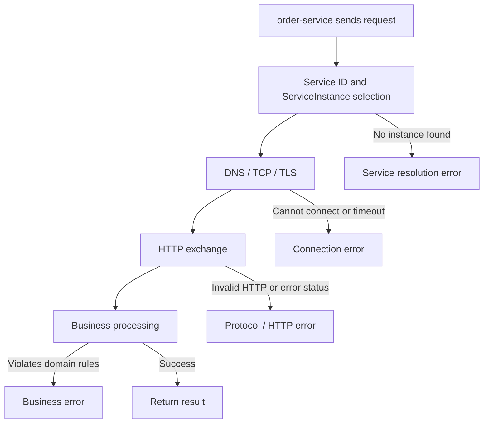

# Distinguishing Connection Errors, Protocol Errors, and Business Errors

When one service calls another service's API, a request can fail at several layers. Sometimes the client cannot connect to an instance; sometimes both sides connect but the HTTP exchange encounters an error; and sometimes the request is sent and processed successfully at the technical level, yet rejected by business logic—such as insufficient product inventory.

Properly distinguishing these three error categories helps select the right response. Connection errors typically require checking the network, discovery, and instance health. Protocol errors require checking the HTTP request, response, and how the client interprets them. Business errors must be handled according to domain rules. Lumping everything into a single generic failure causes misplaced retries, obscures root causes, and creates duplicate side effects.

## 1. Viewing Errors by Processing Layer

A request from `order-service` to `inventory-service` typically passes through the following layers:

1. **Service and address resolution:** the client looks up the service ID, fetches the instance list, and selects an instance.
2. **Network connection and security:** the client resolves the host, opens a TCP connection, and optionally performs a TLS handshake.
3. **HTTP exchange:** the client sends method, path, headers, and body; the server returns status, headers, and body.
4. **Business processing:** the target service evaluates domain rules and determines the business outcome.



The diagram shows that errors can occur before the request ever reaches business code. Therefore, first determine whether the client received a valid HTTP response. If there is no response, investigate service discovery, connectivity, or protocol exchange. If there is a response, read the status and payload per the API contract to determine whether it is an application-layer HTTP error or a rejected business outcome.

## 2. Connection Errors: Failing to Establish or Maintain Transport

Connection errors occur when the client cannot create or maintain a transport connection to the selected instance. Normally, the client does not receive a valid HTTP response from the target service.

Common scenarios:

| Symptom | Possible causes | Where to check |
| --- | --- | --- |
| Unknown host or name resolution failure | Wrong DNS, nonexistent hostname, network config, or discovery returning an invalid address | DNS, discovery configuration, service ID, and instance address |
| Connection refused | Host is reachable, but no process is listening on that port, or a firewall actively rejects | Replica status, port, binding, and firewall |
| Connect timeout | Could not complete the connection within the configured deadline | Network route, firewall, system load, and connect timeout |
| Read/response timeout | Connection opened, but client did not receive a timely response | Server processing time, downstream dependencies, queues, and response timeout |
| Connection reset or broken pipe | Connection closed abruptly during exchange | Server restart, proxy, network, idle connections, and connection limits |
| TLS handshake failure | Unable to agree on version/cipher or invalid certificate | Truststore, certificate, hostname verification, and TLS configuration |

TLS errors occur before a complete HTTP exchange takes place. Operationally, track them as secure connection setup errors and log the specific TLS cause rather than treating them as HTTP status errors.

### 2.1. Relation to Spring Cloud LoadBalancer

When communicating via service ID, some issues can occur even before the client opens a connection:

- Discovery returns no instances for the service ID.
- The instance list is stale and still includes a recently stopped replica.
- The selected instance has an incorrect host or port.
- A replica remains registered in the registry, but the process is no longer listening.

LoadBalancer picks an instance from the list returned by the instance supplier. Selecting a `ServiceInstance` does not guarantee that a TCP connection to that instance will succeed. Discovery, caching, health checks, networking, and process state all influence the final result.

### 2.2. Timeouts do not tell you for sure what the server did

A connect timeout generally indicates the client did not establish a connection. A read timeout is trickier: the client may have sent the entire request, and the server may have executed the business logic, while the response failed to return in time.

For example, `order-service` sends an order creation request. `inventory-service` records the operation, but the response is lost in transit. The client sees a timeout and cannot be sure whether the operation completed. Resending the request blindly can create two orders or deduct stock twice.

For write operations, design an idempotency key or an operation status lookup mechanism before retrying. A timeout indicates uncertainty about the outcome, not proof that the server did not process the request.

## 3. Protocol Errors and HTTP Errors

Protocol errors occur when the two sides fail to exchange or interpret data according to the agreed protocol. For HTTP, distinguish two cases.

**Violations of HTTP format or rules:** the response may be unreadable or invalid, such as a malformed status line, invalid headers, invalid message framing, malformed chunked body, or a mid-stream connection close leaving an incomplete response. The client may report a parse error or protocol exception and fail to produce a complete HTTP response.

**HTTP response with a status indicating the request did not succeed:** the server or proxy returned a valid HTTP response with a status such as `400`, `404`, `429`, `500`, or `503`. This is a readable response; the client needs to interpret the status, headers, and body per the API contract. Many libraries call this an HTTP error or response error.

Common statuses:

| Status | General meaning | Example in service communication |
| --- | --- | --- |
| `400 Bad Request` | Request is invalid per API requirements | Missing required parameter or invalid data format |
| `401 Unauthorized` | Unauthenticated or invalid authentication credentials | Expired token or missing credentials |
| `403 Forbidden` | Caller identified but not permitted to perform action | Service account lacks resource access permission |
| `404 Not Found` | Resource or endpoint not found | Wrong API path or nonexistent product code |
| `405 Method Not Allowed` | Endpoint does not support the sent HTTP method | Calling `POST` on an endpoint allowing only `GET` |
| `406 Not Acceptable` | No representation matches the `Accept` header | Client requests a format the server does not support |
| `415 Unsupported Media Type` | Server does not support the request body format | Sending JSON with missing or wrong `Content-Type` |
| `409 Conflict` | Request conflicts with current state | Order already confirmed or data version changed |
| `422 Unprocessable Content` | Content is understood but cannot be processed under business rules | Syntactically valid data failing business constraints |
| `429 Too Many Requests` | Caller sent too many requests within a time window | Rate limit at the API or gateway |
| `500 Internal Server Error` | Server encountered an unhandled error | Unhandled exception in target service |
| `502 Bad Gateway` | Gateway/proxy received an invalid response from upstream | Proxy failed to communicate properly with backend replica |
| `503 Service Unavailable` | Service is temporarily unable to accept requests | No available replicas or service under maintenance |
| `504 Gateway Timeout` | Gateway did not receive a timely upstream response | Target service or a dependency took too long to process |

Do not infer the root cause from the status code alone. For example, `404` could be a programming mistake in the endpoint path, or a product that does not exist in business terms. `409` could be a business state conflict explicitly described by the API. Check the error code and API documentation to know what that status represents in the system.

## 4. Business Errors: The Request Reached Application Logic but Violated Domain Rules

A business error arises when the data and request are structurally acceptable, but the requested action is disallowed or cannot be completed under system rules.

Examples:

- Insufficient product stock to fulfill the ordered quantity.
- Insufficient account balance for payment.
- A cancelled order cannot transition to shipping status.
- A user already redeemed a discount code and cannot reuse it.
- An update request violates limit rules or current state constraints.

Business errors can be represented in several ways depending on the API contract:

**Approach 1: using an appropriate HTTP status.** The API may return `409 Conflict` when resource state conflicts or `422 Unprocessable Content` when payload content violates business conditions. The response body provides a domain error code for the caller to handle.

```http
HTTP/1.1 409 Conflict
Content-Type: application/json

{
  "code": "ORDER_ALREADY_CONFIRMED",
  "message": "The order has already been confirmed"
}
```

**Approach 2: using an HTTP success status with a business failure payload.** Some APIs always return `200 OK` for processed requests and place the business outcome in the body:

```http
HTTP/1.1 200 OK
Content-Type: application/json

{
  "success": false,
  "code": "INSUFFICIENT_STOCK",
  "message": "Insufficient stock quantity",
  "availableQuantity": 2
}
```

In the second case, `retrieve()` may treat the response as successful at the HTTP layer. The caller must still inspect `success` or `code` and translate it into the appropriate business outcome. Never assume business success just because the status is `2xx`.

A well-designed API clearly specifies status codes, error body structure, stable error codes, and how callers handle each error type. Callers should not classify business errors by comparing `message` strings, as message text can change or be localized.

## 5. Comparison Table of the Three Error Categories

| Criterion | Connection Error | Protocol / HTTP Error | Business Error |
| --- | --- | --- | --- |
| When it occurs | Before or while establishing/maintaining transport | During HTTP exchange or interpretation | After the request reaches business logic |
| Valid HTTP response present? | Usually no | Maybe not if malformed message; yes if server returns error status | Usually yes, depending on how the API represents it |
| Examples | Connection refused, DNS failure, timeout | HTTP `415`, `503`, malformed response | `INSUFFICIENT_STOCK`, `ORDER_ALREADY_CONFIRMED` |
| Where to investigate | DNS, discovery, replicas, network, TLS, timeouts | URL, method, headers, content type, status, gateway, response format | Domain rules, payload data, resource state, error code |
| Retry | Conditional, bounded, considering idempotency | Depends on status and cause; do not retry all `4xx`/`5xx` | Usually do not retry unless business conditions changed |
| Caller action | May try another instance or report dependency failure | Fix request, auth/permissions, adjust backoff, or report upstream error | Return business outcome or guide next steps |

The most important distinction: **no response** usually directs investigation toward connectivity; **having an HTTP response** means inspecting status and body; **having a domain error code** means handling it according to published business rules.

## 6. Recognizing Errors in Spring HTTP Clients

Exception names depend on the underlying HTTP client and framework version, so inspect the root exception (`cause`) rather than relying solely on the outermost class. The examples below describe common types when using Spring.

### 6.1. With RestClient

When using `retrieve()`, responses with `4xx` or `5xx` status are converted by default into subclasses of `RestClientResponseException`. I/O errors when executing the request are typically wrapped in `ResourceAccessException`.

```java
import org.springframework.web.client.ResourceAccessException;
import org.springframework.web.client.RestClient;
import org.springframework.web.client.RestClientResponseException;

class InventoryGateway {

    private final RestClient restClient;

    InventoryGateway(RestClient restClient) {
        this.restClient = restClient;
    }

    StockResponse getStock(String sku) {
        try {
            StockResponse response = restClient.get()
                    .uri("http://inventory-service/api/stocks/{sku}", sku)
                    .retrieve()
                    .body(StockResponse.class);

            if (response == null) {
                throw new IllegalStateException("Inventory API returned an empty body");
            }

            if (!response.success()) {
                throw new InventoryBusinessException(
                        response.code(), response.message());
            }

            return response;
        } catch (ResourceAccessException ex) {
            // Inspect cause: DNS, connect timeout, read timeout, reset...
            throw new InventoryConnectionException("Cannot reach inventory-service", ex);
        } catch (RestClientResponseException ex) {
            // HTTP response received: record status and error code/body per API contract.
            throw new InventoryHttpException(
                    ex.getStatusCode().value(), ex.getResponseBodyAsString(), ex);
        }
    }
}
```

`StockResponse`, `InventoryBusinessException`, `InventoryConnectionException`, and `InventoryHttpException` are illustrative application types. Define them according to your API contract and project error-handling conventions. In real code, deserialize error response bodies into structured DTOs instead of keeping only raw strings.

This handling order helps callers preserve the distinction between I/O failures and HTTP responses. Body-parsing exceptions or data-mapping errors may belong to another category; track them separately so they are not mistaken for connection errors.

### 6.2. With WebClient

With `WebClient`, connection-layer failures while executing a request typically appear as `WebClientRequestException`. When using `retrieve()`, HTTP error statuses default to `WebClientResponseException`.

```java
import org.springframework.web.reactive.function.client.WebClient;
import org.springframework.web.reactive.function.client.WebClientRequestException;
import org.springframework.web.reactive.function.client.WebClientResponseException;
import reactor.core.publisher.Mono;

Mono<StockResponse> getStock(WebClient client, String sku) {
    return client.get()
            .uri("http://inventory-service/api/stocks/{sku}", sku)
            .retrieve()
            .bodyToMono(StockResponse.class)
            .flatMap(response -> {
                if (!response.success()) {
                    return Mono.error(new InventoryBusinessException(
                            response.code(), response.message()));
                }
                return Mono.just(response);
            })
            .onErrorMap(WebClientRequestException.class,
                    ex -> new InventoryConnectionException(
                            "Cannot reach inventory-service", ex))
            .onErrorMap(WebClientResponseException.class,
                    ex -> new InventoryHttpException(
                            ex.getStatusCode().value(),
                            ex.getResponseBodyAsString(), ex));
}
```

This example illustrates classification; custom exception classes should be defined in your application. When using `onStatus(...)`, the caller can read the body and map the status to a specific error type directly during response handling.

### 6.3. With OpenFeign

When using OpenFeign, errors from receiving an HTTP response are typically represented by `FeignException`, from which the status can be read. Certain I/O errors or situations marked retryable may appear as `RetryableException`. Inspect the underlying cause and actual Feign configuration to distinguish network errors from response errors.

Do not catch every `FeignException` and retry it. For example, `400 Bad Request`, `401 Unauthorized`, or `422 Unprocessable Content` usually require fixing the request, authentication, or business handling. Retries only make sense when the cause is likely self-healing and the operation is permitted to repeat.

## 7. Deciding Retries Based on Root Cause

Retrying means resending a request after a prior attempt failed or yielded no clear result. It is a useful recovery mechanism but can amplify outages if all callers retry simultaneously or if the request has non-idempotent effects.

| Scenario group | Typically appropriate handling |
| --- | --- |
| No available instance | Check discovery and replica health; may return a temporary dependency error. Short retries help only if an instance is likely re-registering |
| Connect timeout/refused | May try another instance if healthy instances remain in the list; cap attempts and total duration |
| Read timeout after sending request | Treat outcome as uncertain; for writes, verify idempotency or state before resending |
| HTTP `400`, `401`, `403`, `404`, `405`, `415`, `422` | Generally do not retry the exact request; fix data, token, permissions, path, method, or handle business outcome |
| HTTP `409` | Read error code and resource state; retry only when business rules allow after refreshing state |
| HTTP `429` | Honor `Retry-After` if present; apply backoff and rate limiting |
| HTTP `502`, `503`, `504` | May perform bounded retries if the operation is safe and overall time budget permits |
| HTTP `500` | Investigate server error first; retry only when there is reason to expect a transient error and the request is safe |
| Business errors such as insufficient stock | Usually return business outcome to caller; retry only if business conditions change |

A retry policy must cap attempt counts, wait intervals, and total request duration. Exponential backoff with jitter reduces simultaneous retries from many callers. For write APIs, idempotency keys or deduplication mechanisms must be built on the server; client-side retries alone are insufficient for safety.

Spring Cloud LoadBalancer can work alongside client-layer retries according to the corresponding configuration. When enabling retries, clearly define which requests are retried, which exceptions/statuses trigger retries, whether another instance is tried, and the overall business deadline. Avoid multi-layer retry multiplication, such as the gateway retrying three times, the calling service retrying three times, and the underlying client also retrying three times.

## 8. Observing and Logging to Find the Right Cause

When investigating inter-service errors, logs should carry enough context to trace a request from caller to target instance. Useful fields include:

- Trace ID or correlation ID to locate the same request across services.
- Service ID and actual selected instance address.
- HTTP method, sanitized path without sensitive data, timestamp, and request duration.
- Attempt count, configured timeout, and retry timestamp.
- Exception type, root cause, and HTTP status if a response was received.
- Stable business error code if the response includes an error code.

Do not log access tokens, passwords, personal data, or full sensitive request/response bodies. If logging bodies is necessary for diagnostics, filter fields, cap sizes, and comply with system data policies.

Example of reading logs:

```text
traceId=8af2... serviceId=inventory-service instance=10.0.1.12:8080
method=GET path=/api/stocks/BOOK-001 durationMs=1200
exception=WebClientRequestException cause=ReadTimeoutException
```

This log shows the caller selected a specific instance but received no response within the wait limit. Check processing time on instance B, its dependencies, and the response timeout setting. There is no HTTP status in the log because the client never received a valid response.

Another example:

```text
traceId=9bc1... serviceId=inventory-service instance=10.0.1.13:8080
method=GET path=/api/stocks/BOOK-001 durationMs=35
httpStatus=200 businessCode=INSUFFICIENT_STOCK
```

The request completed the HTTP exchange quickly. The business outcome indicates insufficient stock; retrying immediately against another replica will not resolve this condition if replicas share a consistent data source.

## 9. Diagnostic Procedure for a Failed Request

When an inter-service call fails, follow this order:

1. **Identify service ID and instance:** did the caller obtain an instance list? Which instance was selected? Are the host/port accurate?
2. **Check connectivity:** was the host resolved, TCP connection opened, and TLS handshake completed? If it timed out, was it a connect timeout or read timeout?
3. **Look for an HTTP response:** did the client receive a valid status and headers? If not, inspect the root exception and proxy/server logs.
4. **Read status and response body:** what is the status? Does the error code belong to the API contract? Are there signs of wrong method, path, header, or content type?
5. **Check business outcome:** does a `2xx` response contain `success=false` or a domain error code? Does `409`/`422` represent a documented business condition?
6. **Choose recovery action:** fix the request, re-authenticate, pick another instance, apply backoff, return a dependency error, or return a business outcome depending on the cause.
7. **Evaluate retry safety:** might the server have already processed the request? Is the operation idempotent? Is there an idempotency key or status lookup mechanism?

## 10. Real-World Scenario: Checking Stock During Order Creation

Suppose `order-service` calls `inventory-service` to check product `BOOK-001` before confirming an order. The three failures below exhibit different symptoms:

**Scenario A — Connection refused:** LoadBalancer selects `10.0.1.12:8080`, yet the replica has stopped and the port is no longer listening. The caller receives no HTTP response. Inspect registry/health checks and replica status; trying another instance under a safe retry policy may be appropriate.

**Scenario B — HTTP 503:** The caller connects to a gateway or server and receives `503 Service Unavailable`. This is a valid HTTP response indicating temporary unavailability. Check headers such as `Retry-After` if present, inspect upstream health, and apply bounded retries if the request is safe.

**Scenario C — Insufficient stock:** The caller receives `200 OK` with `success=false` and `code=INSUFFICIENT_STOCK`, or the API uses `409`/`422` per contract. Connectivity and HTTP both worked; business logic cannot proceed with the available quantity. The caller must return the appropriate outcome to the ordering flow rather than continuously retrying other replicas.

All three scenarios can leave order creation incomplete, yet their causes and remedies differ completely. Classifying by layer prevents using retries to mask configuration mistakes or turning a clear business outcome into unnecessary load.

## 11. Self-Check Questions

1. A client encounters `Connection refused` with no HTTP status. Which components should you check first?
2. Why does `ReadTimeoutException` not prove that the target service has not executed the business operation?
3. Distinguish a `503 Service Unavailable` response from a failure to open a TCP connection.
4. An API returns `200 OK` along with `success=false` and `code=INSUFFICIENT_STOCK`. Why must the caller still treat this as a business failure?
5. Which statuses should generally not be retried verbatim before the caller fixes payload data or authentication?
6. When retrying an order creation operation, what problem does an idempotency key prevent?

Once you can pinpoint whether a request stopped at the connection, HTTP, or business layer, you can pick the right place to investigate and the right recovery strategy. This forms the basis for configuring timeouts, retries, and observability in Spring Cloud LoadBalancer in a controlled manner.
