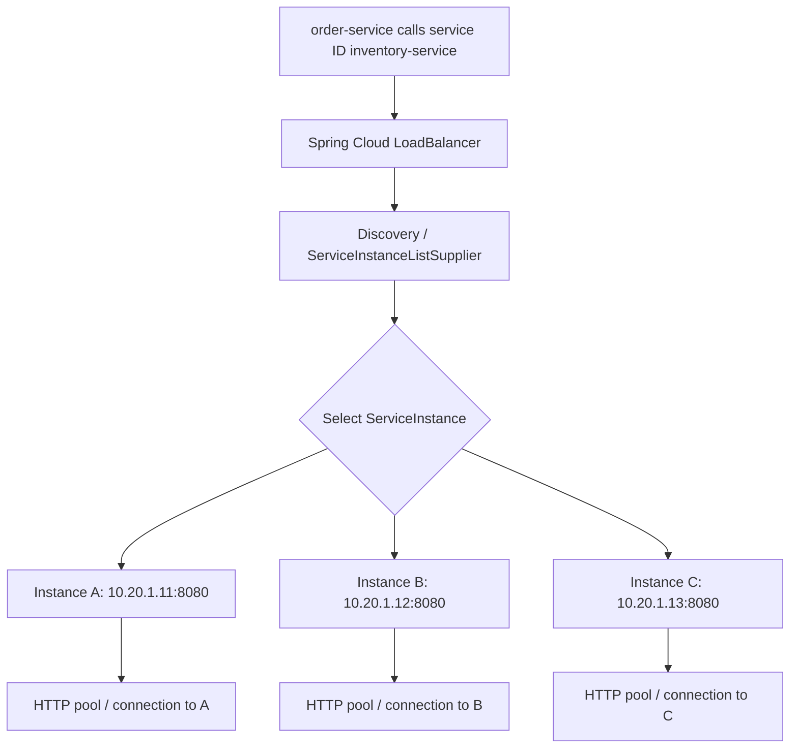
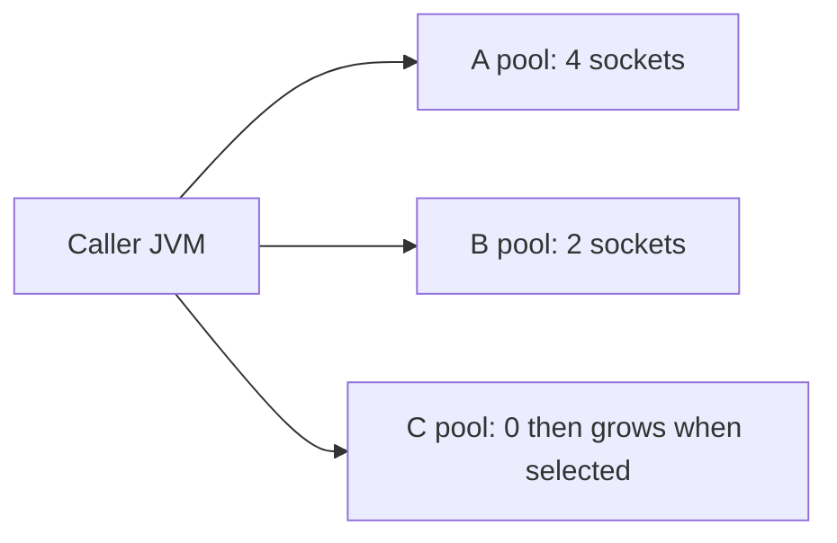
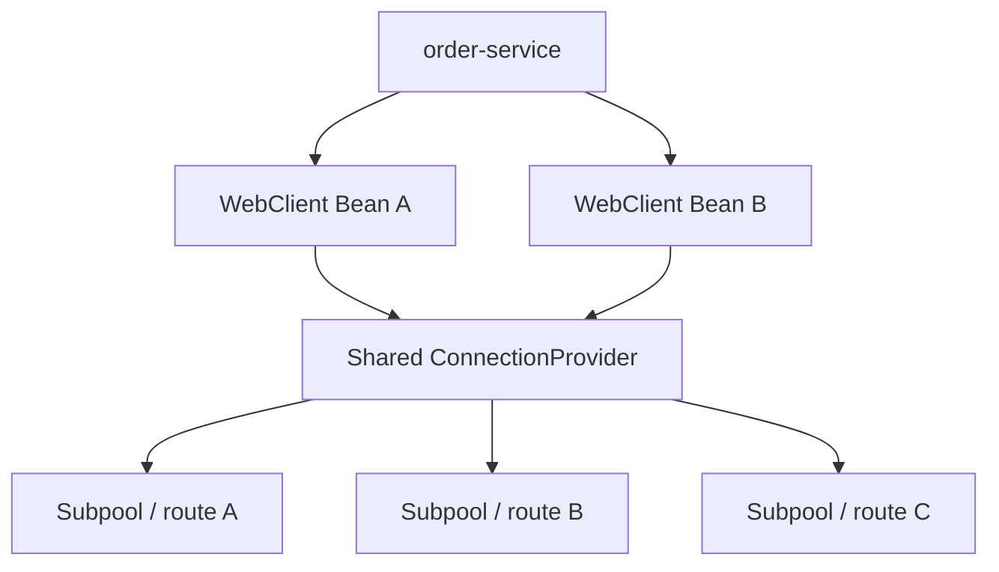
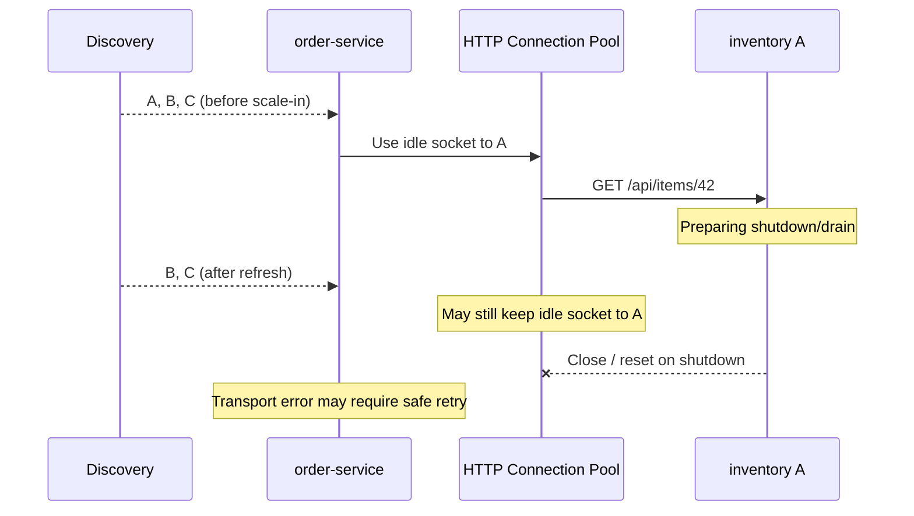
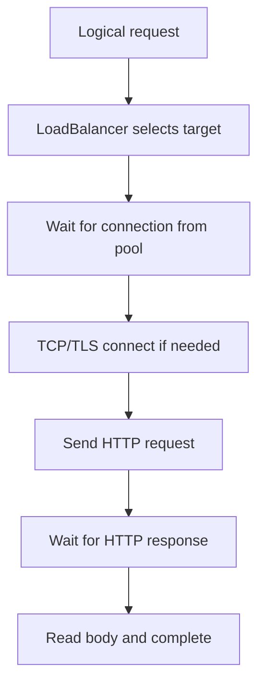

# Impact of Replica Count on Connections to Maintain

When scaling a microservice from 2 to 20 replicas, we usually expect load to be split and response times to improve. One often-overlooked consequence, however, is that **callers have more network destinations to connect to and maintain connections with**. In a system using Spring Cloud LoadBalancer, `order-service` may call `inventory-service` by service ID; LoadBalancer picks a `ServiceInstance` with a specific host/port, while the HTTP transport decides when to open, reuse, and close connections to that instance.

Increasing the replica count can **increase the number of connection groups/pools per target address**, idle sockets, TLS handshake overhead, file descriptors, and pressure on connection tracking/NAT. However, **there is no rule that "adding one replica immediately opens N new connections"**: the actual connection count depends on the number of callers, concurrent load, instance selection algorithm, HTTP/1.1 vs. HTTP/2, pooling mechanics, and how discovery refreshes.

This lesson belongs to the **Connections and Performance** chapter of the `SPRING_CLOUD_SERVICE_COMMUNICATION_LOAD_BALANCING` module. The goal is to build an accurate quantitative model for designing connection pools for `RestClient`, `WebClient`, and OpenFeign, understand the distinct role of Spring Cloud LoadBalancer, and recognize issues that arise during scaling, rollouts, or `ServiceInstance` list changes.

## 1. Distinguishing Service ID, ServiceInstance, and TCP Connections

Suppose the caller uses a logical URI:

```http
GET http://inventory-service/api/items/42
```

In a discovery environment, `inventory-service` may map to:

| Service ID | Instance | Host | Port |
|---|---|---|---:|
| `inventory-service` | A | `10.20.1.11` | 8080 |
| `inventory-service` | B | `10.20.1.12` | 8080 |
| `inventory-service` | C | `10.20.1.13` | 8080 |

Spring Cloud LoadBalancer retrieves the instance list from `ServiceInstanceListSupplier` (potentially via discovery, cache, health checks, zone/hint filters) and selects one destination for the request. The HTTP client then uses its HTTP transport to connect to the selected destination.



The diagram shows the logical flow. **The connection pool lives inside the HTTP client/transport**, not inside the `RoundRobinLoadBalancer` algorithm itself. A request routed to A can only reuse a connection compatible with destination A; you cannot normally take a TCP socket connected to A and use it to send a request directly to B.

In common HTTP engines, the pool partitions connections by some form of **target address/route** (typically involving host, port, scheme, and sometimes proxy or TLS configuration). You must verify how your specific engine defines a route. If traffic passes through a **single stable gateway/VIP/proxy**, the caller's pool may only see one intermediate address, even if many replicas sit behind it. That is a different architecture from client-side LB selecting individual hosts/ports.

### Do Not Confuse "Logical Connection" with a Socket

| Component | What is it? | Does it grow immediately when adding replicas? |
|---|---|---|
| Service ID | Logical name, e.g., `inventory-service`. | Does not need to change. |
| `ServiceInstance` | An endpoint record provided by discovery. | The list can grow. |
| HTTP route/pool key | A group of reusable connections for a matching destination. | Can grow as callers start hitting new endpoints. |
| TCP connection/socket | An actual network connection currently active or kept idle. | Depends on requests, pool limits, and idle policy. |
| HTTP/2 stream | A logical request/response multiplexed over an HTTP/2 connection. | Can grow **without** opening extra sockets at a 1:1 ratio. |

## 2. Why More Replicas Create More Connection Groups

With HTTP/1.1 keep-alive, a single socket normally handles sequential requests via reuse; to send multiple requests simultaneously to **the same host/port**, the client may need multiple sockets. Afterward, sockets may stay idle for subsequent requests.

Suppose `order-service` has a pool to A with 4 connections, while the pool to B has 2 connections. When C enters discovery, LoadBalancer may begin picking C; the first HTTP client call to C must establish a new connection (DNS if needed, TCP, TLS if HTTPS), and may then keep that socket idle for later requests.



Therefore, the larger the replica count, the larger the **number of routes that can be used**. If the client keeps idle connections per route, total idle connections can grow even when **overall system throughput does not increase**.

Factors that alter the actual numbers:

- **Load per instance:** keeping total RPS constant while adding replicas can reduce concurrent requests to each individual instance.
- **Selection algorithm:** round robin touches many routes in turn; sticky affinity or weighted/routing policies may use only a subset.
- **Connection reuse:** healthy keep-alive enables socket reuse; if the server/proxy closes early, sockets must reopen repeatedly.
- **Idle eviction:** connections to rarely selected instances may be closed after an idle period.
- **Pool bounds:** per-route and total pool limits prevent open connection counts from growing linearly without bound.
- **Protocol:** HTTP/2 multiplexing can serve many concurrent requests over fewer sockets than HTTP/1.1.
- **Topology:** direct-to-Pod differs from calling via a proxy/VIP; DNS caching and how LoadBalancer rewrites hosts also affect route identity.

**Local conclusion:** adding replicas expands the **connection destination space**, rather than directly dictating a fixed number of sockets every caller must always maintain.

## 3. Estimation Formula: Callers × Replicas × Per-Route Limit

Let:

- `C`: number of **caller** processes/instances that maintain independent HTTP pools.
- `R`: number of target instances **that each caller can actually select**.
- `P`: connection limit to **one route/destination** in a caller's pool, if the HTTP engine enforces such a limit.

When all callers can reach all replicas and there is no tighter global cap, a **theoretical upper bound** on HTTP/1.1 connections can reach:

```text
connections_upper_bound ≈ C × R × P
```

For example, with 6 `order-service` instances, 12 `inventory-service` instances, and a pool allowing up to 20 connections per route:

```text
6 callers × 12 replicas × 20 connections/route
= up to 1,440 connections under per-route limits
```

If inventory scales to 24 replicas with the same limits:

```text
6 × 24 × 20 = 2,880 connections under per-route limits
```

**1,440 and 2,880 are not predictions of how many connections will actually open!** They are simply the sum of limits if every route were driven to its maximum. The real number can be much lower because traffic spreads out, pools allocate lazily, idle connections are evicted, and engines have `maxTotalConnections` or separate global bounds. Some HTTP clients use a global pool, some use per-remote-address limits, and counting varies across versions.

### A Second Estimate: Actual In-Flight Demand

If the system handles 500 HTTP requests/second and average connection occupancy is around 100 ms:

```text
average_active_requests ≈ 500 calls/s × 0.1 s = 50
```

With non-multiplexed HTTP/1.1, average busy connections only need to serve roughly 50 requests **across all callers combined**, depending on distribution, bursts, and hold times. There is no reason each of the 24 instances must keep 20 busy sockets when total average in-flight requests are only about 50.

However, **idle sockets can still outnumber active sockets**: after LoadBalancer cycles through different replicas, clients may retain idle sockets to many destinations. Measure separately:

```text
active connections ≠ idle connections
configured max connections ≠ actual open connections
HTTP attempts ≠ TCP connections created
```

Note: Little's Law describes steady-state averages; bursts, queuing, timeouts, and retries push in-flight counts higher over short intervals.

## 4. How HTTP/1.1 and HTTP/2 Change the Model

| Factor | HTTP/1.1 keep-alive | HTTP/2 |
|---|---|---|
| Socket reuse | Yes, multiple sequential requests on one socket. | Yes, multiple streams can run concurrently on one connection. |
| Concurrent requests on one socket | Typically one request awaiting a response per socket, without relying on HTTP/1.1 pipelining. | Multiple streams, bounded by peer SETTINGS, flow control, and HTTP engine. |
| Effect of adding replicas | Can increase routes and idle sockets; high load on one route may need multiple sockets. | Can increase connections to new origins, though sockets per route are often lower with proper multiplexing. |
| Setup cost | TCP and TLS if HTTPS. | TCP/TLS, ALPN/h2 negotiation or corresponding configuration. |
| Can one socket serve all replicas? | No when replicas are separate TCP destinations. | Not by default; multiplexing does not mean one socket spans arbitrary Pods/IPs. |

HTTP/2 **does not completely eliminate pooling**. When a connection hits its stream limit, encounters a flow-control bottleneck, or needs to reconnect, the HTTP client may open extra connections depending on the implementation. Some cases allow HTTP/2 connection coalescing across eligible origins, but **never assume** this happens across different ServiceInstance IPs/ports.

Do not assume WebClient "always uses HTTP/2": the actual protocol depends on Reactor Netty, TLS/ALPN, HTTP client configuration, and the server. Likewise, `RestClient` or OpenFeign may use HTTP engines with differing HTTP/2 support. Observe the negotiated protocol in your running system.

## 5. Scaling Both Callers and Downstream Multiplies Connections in Two Dimensions

In microservices, two scaling actions often occur independently:

1. Scaling `inventory-service` from 8 to 16 replicas exposes each caller to more routes.
2. Scaling `order-service` from 4 to 12 replicas creates more **independent HTTP pools** inside the new caller processes.

If each caller keeps an average of one idle connection to each inventory replica, a simple model shows:

```text
4 callers × 8 replicas × 1 idle socket/route   ≈ 32 sockets
12 callers × 16 replicas × 1 idle socket/route ≈ 192 sockets
```

The figure of 1 idle socket/route is an **educational assumption**, not a default setting in any library. A pool may not open connections to unvisited routes, may close idle sockets after a timeout, and may reuse/group routes differently. Still, the math highlights one fact: **every independent caller process has its own FD/socket budget**, and the cluster-wide total can climb even when each instance is well tuned.

### Multiple Services Calling One Upstream

Beyond `order-service`, inventory may also be called by `cart-service`, `checkout-service`, gateways, or background jobs. Connection volume into inventory therefore does not come from just one caller group:

```text
Total connections to inventory
≈ sum of connections across all caller processes / services
+ connections from health probes, admin tools, jobs, proxies... if any
```

Each caller group has its own version, pool config, and load profile. Budget from **all sources**, not only the single microservice under active development.

## 6. Cost of Many Sockets and Many Routes

Large socket counts can create pressure in multiple places:

| Resource | Why it is impacted |
|---|---|
| **File descriptors** | Each open TCP socket consumes an FD in the caller process and usually on the server. |
| **Kernel and user-space memory** | Socket buffers, connection metadata, and HTTP/TLS engine state consume memory. |
| **TLS CPU/latency** | New connections require handshakes; keep-alive/resumption reduces but does not eliminate cost. |
| **NAT/conntrack** | Many connections through NAT or proxies create extra entries/state, potentially exhausting intermediary tables. |
| **Ephemeral ports** | Each new TCP connection requires a valid address/port tuple, especially notable behind SNAT. |
| **DNS and resolvers** | New targets or changing addresses can increase lookups/cache churn depending on transport. |
| **Server accept/load** | Replicas must handle accept, handshakes, keep-alive, and idle sockets from many callers. |
| **Pool memory/queues** | When a pool saturates, pending acquires and waiting requests can pile up. |

Not every connection causes continuous CPU load. **Idle sockets** still consume resources; **active connections** carry traffic and ongoing work. **Connections repeatedly opened and closed** cause heavy handshake overhead and `TIME_WAIT`/churn, even if concurrent open sockets at any instant are low.

In particular, when callers use HTTPS directly to replicas, pay attention to TLS certificate validation and SNI/hostname. Changing destinations via discovery must preserve security correctness: never disable certificate checks just to connect to new IPs.

## 7. Separate Pool per Origin or One Shared Pool?

The phrase "one connection pool" can be misleading:

- There can be **one pool manager object** shared across multiple `WebClient`s.
- Inside the manager, connections are still typically partitioned by **remote address/route**.
- Another HTTP client may use its own pool; two `RestClient`/Feign beans do not necessarily share a pool.
- If a new HTTP client/pool is created per request, reuse drops sharply and overhead surges.

Proper design usually means **reusing the HTTP client/connection provider** across requests that share resource requirements, rather than creating sockets or pool managers arbitrarily per call.



Sharing a pool can save resources, yet creates **quota contention** if multiple critical downstreams share one global limit. Conversely, isolating pools contains blast radius but increases sockets/FDs and operational overhead. Choose sharing boundaries based on SLAs, traffic patterns, and how the HTTP engine defines limits.

### Pools and Bulkheads Are Not the Same

A pool limit typically caps **connections/routes or total connections**. A bulkhead caps **concurrent business calls**. In HTTP/2, many requests can share one socket, so socket counts do not accurately reflect logical in-flight requests. With HTTP/1.1, waiting on the connection pool also holds requests/queues on the caller. You may therefore need all of:

- Pool limits to protect socket and connection resources.
- Bulkheads/admission control to protect total concurrent calls.
- Timeouts and bounded queues to avoid holding requests too long.

Increasing `maxConnections` is no substitute for a bulkhead when a downstream is slow, nor does it add server capacity.

## 8. WebClient with Reactor Netty: An Illustrative Pool Configuration

In a WebFlux/WebClient environment with Reactor Netty and Spring Cloud LoadBalancer, you can explicitly configure a `ConnectionProvider`. The Java example below illustrates **a reusable pool manager** capping connections per destination and requests waiting to acquire a connection.

```java
import java.time.Duration;
import io.netty.channel.ChannelOption;
import org.springframework.cloud.client.loadbalancer.LoadBalanced;
import org.springframework.context.annotation.Bean;
import org.springframework.context.annotation.Configuration;
import org.springframework.http.client.reactive.ReactorClientHttpConnector;
import org.springframework.web.reactive.function.client.WebClient;
import reactor.netty.http.client.HttpClient;
import reactor.netty.resources.ConnectionProvider;

@Configuration
class InventoryWebClientConfig {

    @Bean(destroyMethod = "dispose")
    ConnectionProvider inventoryConnectionProvider() {
        return ConnectionProvider.builder("inventory-http-pool")
            .maxConnections(32)
            .pendingAcquireMaxCount(64)
            .pendingAcquireTimeout(Duration.ofMillis(400))
            .maxIdleTime(Duration.ofSeconds(30))
            .maxLifeTime(Duration.ofMinutes(5))
            .evictInBackground(Duration.ofSeconds(60))
            .build();
    }

    @Bean
    @LoadBalanced
    WebClient.Builder loadBalancedWebClientBuilder() {
        return WebClient.builder();
    }

    @Bean
    WebClient inventoryWebClient(
            @LoadBalanced WebClient.Builder builder,
            ConnectionProvider inventoryConnectionProvider) {

        HttpClient httpClient =
            HttpClient.create(inventoryConnectionProvider)
                .option(ChannelOption.CONNECT_TIMEOUT_MILLIS, 1_000)
                .responseTimeout(Duration.ofSeconds(3));

        return builder.clone()
            .baseUrl("http://inventory-service")
            .clientConnector(
                new ReactorClientHttpConnector(httpClient))
            .build();
    }
}
```

The values `32`, `64`, 400 ms, 30 seconds, and 5 minutes are **illustrative only**, not universal recommendations. Check supported APIs and default changes for the Reactor Netty/Spring Boot version you run.

Meaning of the options:

| Option | Typical Effect |
|---|---|
| `maxConnections(32)` | Caps connections in the pool **per remote host/target address** as defined by Reactor Netty's provider; do not assume this always means max 32 across all services in the cluster. |
| `pendingAcquireMaxCount(64)` | Caps how many requests can wait for a connection when the corresponding pool is exhausted. |
| `pendingAcquireTimeout(400ms)` | Deadline to wait for an idle connection; exceeding it can fail the acquire before any HTTP request reaches the server. |
| `maxIdleTime(30s)` | Connections idle longer than this become eligible for closure. |
| `maxLifeTime(5m)` | Caps connection age to avoid outliving topology changes; takes effect when the pool checks/evicts per implementation. |
| `evictInBackground(60s)` | Periodically scans and reclaims eligible connections in the background. |
| Connect/response timeout | Caps the connect/response phases in the HTTP engine, **not the total deadline** for a logical request including retries. |

With a client-side LoadBalancer, the HTTP connector typically sees the real endpoint after `ServiceInstance` selection. If there are 20 remote addresses and every route is pushed to `maxConnections=32`, total per-route capacity could reach hundreds of sockets on **a single caller process**. Do not misread `32` as a cluster-wide budget.

### Do Not Create a New ConnectionProvider per Request

Common mistake:

```java
// DO NOT DO THIS: creating a new client/pool for every call.
Mono<ItemDto> findItemWrong(String id) {
    ConnectionProvider provider =
        ConnectionProvider.create("temporary-pool");
    HttpClient http = HttpClient.create(provider);
    WebClient client = WebClient.builder()
        .clientConnector(new ReactorClientHttpConnector(http))
        .baseUrl("http://inventory-service")
        .build();
    return client.get()
        .uri("/api/items/{id}", id)
        .retrieve()
        .bodyToMono(ItemDto.class);
}
```

The code above also **lacks `@LoadBalanced` integration** and does not manage the `ConnectionProvider` lifecycle. It illustrates the anti-pattern: repeatedly creating pools and connectors destroys reuse and can leak resources, while the service ID hostname may be sent straight to DNS instead of LoadBalancer. Use a properly configured client, reuse the bean across requests, and let Spring manage pool shutdown/disposal.

### Pending Acquire Is Not HTTP Response Timeout

When a request waits too long to obtain a connection from the pool, it can fail **before HTTP I/O even starts**. This differs from a server read/response timeout. Looking only at a `WebClientRequestException` log or generic timeout error makes it hard to tell whether the bottleneck is in:

1. Acquiring a connection from the pool.
2. DNS or TCP/TLS establishment.
3. Sending the request to the HTTP server.
4. Waiting for the upstream response.
5. Retry/backoff and total deadline.

Enable metrics and stage-level tracing at appropriate detail to tell these apart, avoiding raising `responseTimeout` by mistake when the problem sits in the acquire queue.

## 9. RestClient with Apache HttpClient: Total and Per-Route Differ

`RestClient` is a synchronous HTTP client API. It **does not dictate a single built-in connection pool**; pooling and limits depend on the underlying `ClientHttpRequestFactory` and HTTP engine.

If using Apache HttpClient 5 with matching dependencies, you can configure the pool as follows:

```java
import org.apache.hc.client5.http.impl.classic.CloseableHttpClient;
import org.apache.hc.client5.http.impl.classic.HttpClients;
import org.apache.hc.client5.http.impl.io.PoolingHttpClientConnectionManagerBuilder;
import org.springframework.cloud.client.loadbalancer.LoadBalanced;
import org.springframework.context.annotation.Bean;
import org.springframework.context.annotation.Configuration;
import org.springframework.http.client.HttpComponentsClientHttpRequestFactory;
import org.springframework.web.client.RestClient;

@Configuration
class InventoryRestClientConfig {

    @Bean(destroyMethod = "close")
    CloseableHttpClient inventoryApacheClient() {
        var manager =
            PoolingHttpClientConnectionManagerBuilder.create()
                .setMaxConnTotal(200)
                .setMaxConnPerRoute(25)
                .build();

        return HttpClients.custom()
            .setConnectionManager(manager)
            .evictExpiredConnections()
            .build();
    }

    @Bean
    @LoadBalanced
    RestClient.Builder loadBalancedRestClientBuilder() {
        return RestClient.builder();
    }

    @Bean
    RestClient inventoryRestClient(
            @LoadBalanced RestClient.Builder builder,
            CloseableHttpClient inventoryApacheClient) {

        return builder.clone()
            .baseUrl("http://inventory-service")
            .requestFactory(
                new HttpComponentsClientHttpRequestFactory(
                    inventoryApacheClient))
            .build();
    }
}
```

In this example:

- `setMaxConnTotal(200)` sets the **total limit** of connections managed by this Apache pool manager.
- `setMaxConnPerRoute(25)` sets the **per-route limit**.
- Route count can grow as `inventory-service` scales out replicas, yet total sockets for **this manager** remain capped at `200` (per the pool semantics used).
- `CloseableHttpClient` is shared and closed on Spring context shutdown; do not create a new client per HTTP request.

The example omits connect timeout, response timeout, TLS, and pool-acquire timeout; in a real application you must configure them using the Apache HttpClient/`HttpComponentsClientHttpRequestFactory` APIs for your version. Picking a large `maxConnPerRoute` with a too-low `maxConnTotal` causes routes to contend for the global cap; conversely, raising the total too high stresses FDs, TLS, and downstreams.

**Synchronous RestClient blocks a thread while waiting** under the standard call model. If many requests wait simultaneously for a connection from the pool, the servlet/caller thread pool can still saturate. Coordinate pooling with bulkheads and overall deadlines rather than raising both limits until acquire errors vanish.

## 10. OpenFeign and Other HTTP Engines

With OpenFeign:

```java
@FeignClient(name = "inventory-service", contextId = "inventoryRead")
interface InventoryReadClient {
    @GetMapping("/api/items/{id}")
    ItemDto getItem(@PathVariable("id") String id);
}
```

The Feign interface specifies the contract and service ID. Actual connection pooling depends on the integrated HTTP engine: Apache HttpClient 5, OkHttp, or whichever client the project configures. Different engines have different route pooling rules, idle eviction, max connections, and timeouts. `@FeignClient` or `contextId` **does not automatically create a socket pool per service replica**, nor does it guarantee all Feign clients share one manager.

When setting Feign client-specific configuration, verify:

- Which HTTP `Client` implementation is in use and whether it actually pools connections.
- How connections are partitioned by host/port/proxy and whether they are shared across Feign clients.
- Whether `connectTimeout` and `readTimeout` belong to the Feign request or the HTTP engine; distinguish them from pool acquisition time and total deadline.
- Whether Feign's `Retryer`, LoadBalancer retries, or gateways are creating extra attempts/sockets.
- Whether `contextId` and bean configuration leak from a parent context, unintentionally applying the same pool/timeout policy to another client.

Do not copy Reactor Netty pool properties onto OkHttp/Apache and expect the same names or semantics. Verify with HTTP-engine metrics in your actual application and Spring Cloud BOM.

## 11. Scale Out, Scale In, and Rolling Deployments

### Scale Out: New Replicas Have "Cold Connections"

When a new inventory replica D appears in discovery:

1. Callers receive the updated `ServiceInstance` list after refresh/cache expiry.
2. LoadBalancer begins selecting D according to its policy.
3. The HTTP engine may not have an idle socket to D yet, so the first request must open a new connection.
4. Over HTTPS, TCP/TLS handshakes add latency to the first request; multiple callers may open connections to D simultaneously.
5. Over time, pools keep idle sockets to D, lowering overhead for subsequent requests.

This sometimes causes **cold-start latency** and a burst of connection establishments even when RPS stays flat. During large scale-outs, monitor new connection rate, TLS handshakes, pool pending acquires, and p99 latency.

### Scale In: Instance Leaves Discovery While Old Sockets May Remain

When A is removed from the registry or becomes NotReady:

- Callers may still hold a **stale cached instance list**, so some requests keep choosing A until caches/health refresh.
- HTTP pools may still hold **idle connections to A**; A leaving discovery **does not guarantee sockets close immediately**.
- The server may close connections during shutdown/drain; clients may encounter `connection reset` or I/O errors when attempting to reuse sockets.
- Requests already sent before A stopped require graceful shutdown, readiness probes, and reasonable in-flight completion budgets.

**Discovery refresh and connection eviction are two separate mechanisms.** One manages the candidate set; the other manages sockets. Do not expect swapping `ServiceInstanceListSupplier` to immediately purge every socket to a departed instance.



### Rolling Deployments and Connection Churn

If a rollout replaces most replicas over a short period, callers may have to build many new connection pools/routes and close old ones. This is **connection churn**. Instance replacement rate, readiness/drain periods, and pool age/idle eviction must be considered together. Unlimited retries during a rollout only multiply attempts and handshakes while topology is unstable.

## 12. Role of Health Checks, Retries, and Routing Policies

Mechanisms inside Spring Cloud LoadBalancer can affect **the set of destinations called**:

| Mechanism | Impact on Connections |
|---|---|
| Discovery | Adds/removes candidate host/ports; opens up or removes selectable routes. |
| `HealthCheckServiceInstanceListSupplier` (if enabled) | Can shrink the eligible instance set; health probes may issue separate network requests and incur extra connection overhead. |
| Zone preference | Often reduces the replicas used by each caller or favors a subset; can concentrate traffic/pools within the same zone. |
| Weighted/affinity routing | Some replicas receive more requests/connections; the number of active routes may differ from total R. |
| Retry on same instance | May keep using the old route; if the connection broke, a new socket may have to open. |
| Retry on another instance | May touch another route and warm more sockets; increases total attempts. |
| Hard isolation by tenant/region | Blocks calls to disallowed instances; never breach this boundary just to reuse an existing socket. |

Caller-side health checks are not automatically equivalent to Kubernetes readiness probes. If there are `C` callers and `R` replicas, and each caller probes every replica every `T` seconds, average health requests/second under a simple **assumption** can reach:

```text
health_probes_per_second ≈ C × R / T
```

For example, 20 callers × 30 replicas / 10 seconds ≈ 60 health requests/second, before caching/dedup mechanisms and timing jitter. Health probes may use a different HTTP client or network path than business requests and **do not necessarily share the same pool**. As replica count grows, health-check overhead from many callers can rise even if business traffic stays flat.

## 13. Pool Saturation Can Be Mistaken for a Slow Upstream

When a client reports a timeout, the slowdown can stem from multiple layers:



| Phenomenon | Symptoms | How to Investigate |
|---|---|---|
| Pool hitting its cap | High pending acquires/queue, active connections near cap. | Measure per-route/total limits and acquire wait times. |
| Slow server processing | Socket is held, response time increases. | Trace upstream, CPU/DB, and endpoint p95/p99. |
| Slow new connection setup | High connect/TLS handshake time, rising connection creation rate. | Check network, TLS, DNS, cold routes, and NAT. |
| Stale connections after rollout | Reset/closed sockets spike when instances leave. | Check readiness/drain, idle/TTL eviction, and discovery cache. |
| Retry amplification | HTTP attempts outnumber logical requests. | Check retries at HTTP, LB, Feign/WebClient, and gateway layers. |
| Hot-spotted route | One instance has unusually high active/pending counts. | Check weights, affinity, zone routing, and replica health. |

Increasing `maxConnections` can reduce pool-acquire waiting **only if** the downstream genuinely has spare capacity and no other bottleneck exists. If the upstream is already overloaded, adding sockets only adds in-flight requests, increases tail latency, and risks cascading overload. Combine pool limits with bulkhead/concurrency budgets, connect/read timeouts, and retry budgets.

## 14. Observability: Measuring the Connection Lifecycle Accurately

Do not guess socket counts from replica count or RPS. In test/staging and production, monitor at a minimum:

| Metric or Signal | Meaning |
|---|---|
| **Active connections / leased** | Connections actively serving requests per the HTTP engine. |
| **Idle connections / available** | Open sockets currently not serving requests. |
| **Pending acquires** | Requests waiting to lease a connection from the pool. |
| **Connections created / closed** | Rate of socket creation and closure; detects post-rollout churn. |
| **Acquire latency / timeouts** | Delay obtaining a connection before actually sending the request. |
| **Connect and TLS handshake latency** | Cost of cold routes or secure transport setup. |
| **HTTP request latency p50/p95/p99** | Perceived latency by service/route, separated from pool waiting if possible. |
| **FD count / TCP states** | Tracks OS limits, ESTABLISHED, TIME_WAIT, CLOSE_WAIT at process/node scale. |
| **Conntrack/NAT pressure** | Exhaustion of connection tables or ephemeral ports on intermediate network paths. |
| **Instance selection distribution** | Whether target selection is balanced or skewed by affinity/zone rules. |
| **Retries and no-instance errors** | Whether retries are amplifying socket and request demand. |

Metric names depend on Reactor Netty, Apache/OkHttp, Micrometer, Spring Boot, and integration versions. For example, Reactor Netty provides connection provider metrics for active/idle/pending counts when instrumentation is enabled, though **not every metric appears by default** and label names from one release do not carry across every version. Check actual emitted metrics and the docs for your running BOM.

Tag by service ID/route template at reasonable cardinality, avoiding unbounded metric tags with IP/port combinations across thousands of ephemeral Pods. For deep diagnostics, use time-bounded logs/traces linking the chosen `ServiceInstance` and connection errors; never log credentials, cookies, query tokens, or personal data.

## 15. Lab Practice: Scaling Replicas and Observing Connections

Prepare `inventory-service` able to run 2, 4, or 8 replicas behind one service ID; `order-service` uses `@LoadBalanced WebClient.Builder` or LoadBalancer-integrated RestClient/Feign. Each replica returns its instance ID on `GET /api/items/{id}`. Run experiments only in a test environment with bounded load.

### Scenario A — Keep RPS Constant, Increase Replica Count

1. Run 2 inventory replicas and 3 order callers. Send steady load, e.g., 100 GET/s total, long enough for the pool to reuse connections.
2. Record active/idle connections, connection-created rate, pending acquires, chosen instance distribution, and p95.
3. Scale inventory to 4 and then 8 replicas while keeping **100 GET/s total** constant.
4. Compare the number of routes actually touched, idle sockets, and new connections per scale step.

**Questions:** do total active requests necessarily rise with replica count? Why can idle connections still increase? If traffic is low and idle eviction is short, might actual open sockets stay roughly flat?

### Scenario B — Scale Both Callers and Replicas

1. Keep the same per-route pool limit across all callers.
2. Scale `order-service` from 3 to 6 instances; simultaneously scale inventory from 4 to 8.
3. Compare connection counts **per caller** and **across the cluster**.
4. Verify why a pool limit of 20/route does not mean only 20 connections system-wide.

### Scenario C — Change Pool Configuration

| Experiment | Prediction to Verify |
|---|---|
| Lower max connections/route | Pending acquires may climb if concurrent load stays constant. |
| Set max idle too short | Raises create/close rate and connect/TLS overhead. |
| Set max idle very long | Retains many idle sockets, increasing FDs and topology-change impact. |
| Enable HTTP/2 (if client & server support it) | More requests may share fewer sockets, though stream/route limits still apply. |
| Create a new WebClient/pool per request | Reuse drops, connection churn rises, and resource leaks become likely. |
| Share one pool across two downstreams | May lower overhead, but test global-limit contention and failure isolation. |

### Scenario D — Rollout and Stale Connections

1. Replace half of the inventory replicas while maintaining light request traffic.
2. Observe selected `ServiceInstance`s, new connections, old sockets, resets/timeouts, and retries.
3. Enable proper readiness/drain and compare connection reset counts.
4. If using caller-side health checks, measure extra probes by caller/replica count and verify whether they share the HTTP pool.

Do not intentionally prolong outages or crank RPS to infrastructure-breaking levels; the goal is to **measure trends and causes**, not run destructive limit tests.

## 16. Checklist When Designing Connection Pools for Replica Scale

- **Identify topology:** do callers connect straight to each `ServiceInstance`, or to a single gateway/VIP/proxy?
- **Count both scaling axes:** both caller instance count and target replica count affect maintainable routes/sockets.
- **Do not confuse limits with reality:** max connections/route is a ceiling, not a count of always-open sockets.
- **Measure concurrency:** use RPS × latency to estimate in-flight load, then inspect bursts, p95/p99, and traffic skew.
- **Separate active and idle:** idle sockets can scale with routes even when active requests stay constant.
- **Understand the HTTP protocol:** HTTP/2 multiplexed streams differ from HTTP/1.1; do not assume one socket serves all replicas.
- **Manage pool lifecycle:** reuse HTTP clients/providers and dispose on shutdown; never recreate per request.
- **Configure sensibly:** per-route and total pool limits, bounded pending queues/acquire timeouts, max idle/lifetime, and eviction.
- **Stay safe on scale-in:** discovery/caches, graceful shutdown/readiness, and socket eviction all matter.
- **Prevent retry amplification:** extra HTTP attempts can saturate pools; retries need budgets/backoff/deadlines.
- **Pair with bulkheads/rate limits:** protect concurrent calls and upstream capacity rather than just raising connection counts.
- **Watch OS/network resources:** FDs, TCP states, ephemeral ports, NAT/conntrack, and TLS handshakes.
- **Preserve routing policy:** never fall back to a disallowed zone/tenant just because the pool holds an open socket to it.
- **Test with your actual versions:** Reactor Netty, Apache HttpClient, and OkHttp/Feign have different pool semantics and defaults.

**Takeaway:** scaling replicas does not automatically require a fixed number of TCP connections per replica. In client-side load balancing, more `ServiceInstance`s create more **destinations/routes that can maintain separate pools**, and more callers create more **independent pools**. Actual socket counts depend on request concurrency, connection reuse, HTTP/1.1 vs. HTTP/2, pool limits, and idle/eviction policies. **Spring Cloud LoadBalancer selects the instance; the HTTP engine maintains the connection.** To scale reliably, measure active/idle/pending states, budget total cluster-wide resources, and align pooling with timeouts, retries, bulkheads, health/discovery, and graceful shutdown.
