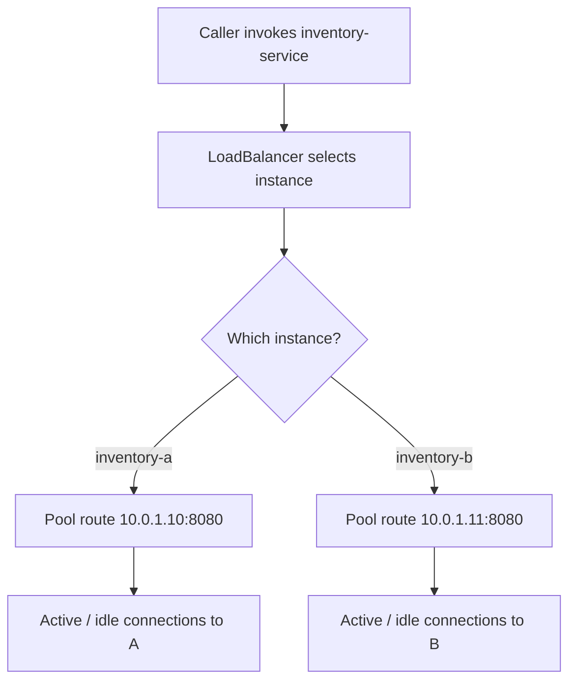

# Keep-Alive, Idle Timeouts, and Evicting Stale Connections

In Spring Cloud LoadBalancer, `order-service` can call `inventory-service` thousands of times using a logical URL such as `http://inventory-service/api/items/42`. LoadBalancer chooses a `ServiceInstance` by service ID, while the HTTP client opens or reuses a TCP/TLS connection to that instance's actual host and port. **Keeping connections alive (keep-alive)** generally reduces latency and the cost of establishing new connections; however, if a connection is no longer valid because the backend, proxy, or network equipment closed it, the next reuse attempt can fail with `Connection reset`, `PrematureCloseException`, `NoHttpResponseException`, or a timeout.

This lesson in the **Connections and Performance** chapter explains HTTP keep-alive, TCP keepalive, **idle timeouts**, connection pool lifecycles, and how to **evict idle/stale connections** in `WebClient` (Reactor Netty), `RestClient` (Apache HttpClient 5), as well as notes for OpenFeign. The hands-on section combines Spring Cloud LoadBalancer, discovery, health checks, timeouts, and error observability to build resilient inter-service communication without blindly trading away performance.

## 1. Context: Instance Is Healthy, Yet the First Request After Idle Fails

Suppose `order-service` calls `inventory-service` every few seconds. When traffic drops for 90 seconds and then resumes, the first request hits a connection error even though:

- `inventory-service` still has two instances in discovery.
- `/actuator/health/readiness` on both returns `200 OK`.
- A request sent immediately afterward succeeds.
- Logs show signs such as `Connection reset by peer` or `PrematureCloseException`.

One plausible scenario is that the client held an idle connection, while an intermediary proxy or the backend closed the connection after 30 seconds of inactivity. If the client has not detected the closure yet (or closure and reuse race with each other), the stale connection is leased to the new request and fails.

```mermaid
sequenceDiagram
    participant Caller as order-service
    participant Pool as HTTP connection pool
    participant Proxy as Ingress / proxy
    participant Backend as inventory-a
    Caller->>Pool: First GET request
    Pool->>Proxy: Create TCP/TLS connection
    Proxy->>Backend: Forward request
    Backend-->>Proxy: 200 OK
    Proxy-->>Pool: Response
    Note over Pool,Proxy: Connection returns to pool and goes idle
    Note over Proxy: Idle timeout expires; proxy closes connection
    Caller->>Pool: GET after idle period
    Pool--xProxy: Attempt to reuse stale connection (race / close unseen)
    Pool-->>Caller: Reset or premature close
    Note over Pool: Drop failed connection; next request can open a new socket
```

**The diagram depicts one possible scenario**, not that every server-side idle socket close causes an error: when FIN/RST is processed cleanly by the client, the pool normally knows the connection is closed and does not hand it out again. Reuse errors typically involve a race, silent drops by intermediary network devices, or stale state that has not been adequately checked.

## 2. Distinguishing Four Layers Often Lumped Together as "Keep-Alive"

| Mechanism | Layer | Purpose | Does it guarantee the endpoint is still healthy? |
|---|---|---|---|
| **HTTP persistent connection** (HTTP/1.1 keep-alive) | HTTP | Reuses one socket for multiple sequential HTTP requests | No |
| **HTTP/2 connection and streams** | HTTP/2 | Multiple HTTP streams can share one connection | No |
| **TCP `SO_KEEPALIVE`** | TCP/OS | Probes inactive connections according to OS configuration | Does not guarantee the app can process requests |
| **Connection pool** | HTTP client | Manages active/idle connections, leasing, and closing | Does not replace health checks/service discovery |

### 2.1. HTTP/1.1 Keep-Alive

With HTTP/1.1, persistent connections are usually the default unless the protocol or peer specifies closure, such as `Connection: close`. A client can send request A, receive the response, and reuse the TCP/TLS connection for request B to the same route. This saves TCP handshakes, TLS handshakes, and socket allocations.

```text
Without reuse:
  request A: TCP connect -> TLS handshake -> HTTP -> close
  request B: TCP connect -> TLS handshake -> HTTP -> close

With reuse:
  TCP connect -> TLS handshake -> request A -> response A
                       same connection -> request B -> response B
```

HTTP keep-alive **does not mean manually adding a `Connection: keep-alive` header to every request**. Forcing that header will not fix a broken pool, and HTTP/2 has different rules regarding connection-specific headers. To know whether requests use HTTP/1.1 or HTTP/2, check actual protocol negotiation and client/server configuration.

### 2.2. TCP SO_KEEPALIVE Is a Different Mechanism

`SO_KEEPALIVE` asks the operating system to send TCP-layer probes to verify the link after an idle interval. Default OS intervals in many environments are very long (potentially hours), so you cannot rely on it by default to detect dead sockets before a 20–60 second HTTP idle timeout. TCP keepalive parameters also vary across Linux, Windows, containers, and cloud environments.

With Reactor Netty, you can enable TCP keepalive via `ChannelOption.SO_KEEPALIVE`, but enabling this flag **does not replace `ConnectionProvider.maxIdleTime`**. TCP probes only check connectivity at the network layer; a backend can return TCP ACKs while blocked on its database and still make APIs slow.

### 2.3. HTTP/2 Does Not Use Pools Identically to HTTP/1.1

HTTP/2 can multiplex multiple concurrent streams over one TCP/TLS connection. Single-stream errors, GOAWAY frames, keepalive PINGs, and connection idle timeouts have different semantics from HTTP/1.1. A `maxConnections` setting does not directly equal a concurrent-request cap, because per-connection stream limits and proxy/server policies also apply.

When investigating performance, do not reason from a "one request leases one HTTP/1.1 connection" model to calculate connections needed for HTTP/2. With Envoy/service meshes or ingress controllers, check the protocol version at **each hop**: client → proxy may be HTTP/2, while proxy → backend remains HTTP/1.1.

## 3. Types of Connection-Related Timeouts

No single `timeout` property controls the entire path. Separate at least:

| Timeout / Limit | When does the clock start? | Effect |
|---|---|---|
| **Connect timeout** | When establishing a new TCP connection | Fails if not connected in time; excludes server processing time after sending |
| **TLS handshake timeout** | During TLS negotiation | Caps security handshake duration |
| **Pool pending-acquire timeout** | While waiting for an idle/available connection | Caps pool wait time, even before connecting to the server |
| **Response/read timeout** | Per transport semantics when waiting for a response or data | Prevents requests from hanging too long after sending |
| **Client max idle time** | From when a connection returns to the pool unused | Specifies when a long-idle connection becomes eligible to close/evict |
| **Client max lifetime / connection TTL** | From when a connection was created | Rotates old connections even under continuous traffic |
| **Server/proxy idle timeout** | During inactivity as defined by server/proxy | Server/network may close the connection even while the client keeps it in the pool |
| **Overall deadline** | From when the logical request begins | Total budget covering pool wait, connect, request, retries, and backoff |

**Common confusion:** `maxIdleTime` is not a response timeout. A request waiting for the server to return data is not automatically cancelled simply because the connection is not idle. Conversely, a connection sitting idle in the pool is not an active request, so application request timeouts do not necessarily inspect it.

## 4. Why Sockets in the Pool Become Invalid

### 4.1. Backend Proactively Closes Idle Connections

Servers routinely cap idle connections to conserve file descriptors, RAM, and resources. After an idle interval, the server may close with a TCP FIN; in some cases it sends RST. If the client receives the close event promptly, the pool drops the socket. If a race occurs between server closure and client reuse, an attempt may fail.

### 4.2. Load Balancers, Proxies, NATs, or Firewalls Drop State

A reverse proxy or NAT device may have an idle timeout **shorter** than the backend's. Some devices drop the connection state without sending a FIN to the client. When the caller reuses the connection, it may hang and then time out rather than failing immediately. You must know the real network topology, not just read `server.connection-timeout` in one Spring Boot app.

### 4.3. Rolling Deployments or Scale-In

Removing a `ServiceInstance` from the registry does not mean the HTTP client immediately closes every existing TCP connection to that host/port. Distinguish two states:

```text
ServiceInstanceListSupplier / registry:
    inventory-a was removed from the candidate list

HTTP connection pool:
    may still hold idle sockets to inventory-a
```

If LoadBalancer **no longer selects** `inventory-a`, idle connections to that endpoint will not be used for service-ID requests under the updated list, yet can still consume resources until evicted/closed. If discovery/caching **still returns** `inventory-a`, LoadBalancer can still pick it and cause connection errors. These are **two independent problems**: the `ServiceInstanceListSupplier` cache is distinct from the connection pool.

### 4.4. Half-Closed Connections and Stale Validation

A socket may once have been valid yet become unusable because the peer closed one direction or intermediary network state vanished. HTTP clients/pools can validate connection health before re-leasing, though no check guarantees the subsequent request will succeed if the peer closes right **after** validation. Configure sensible idle eviction and timeouts while accepting that a small race error rate can still occur.

## 5. Coordinating Client maxIdleTime with Server/Proxy Idle Timeouts

A practical rule of thumb is to **have the client proactively evict idle connections before the network hop with the shortest idle timeout closes them**. Example in a test environment:

| Component | Illustrative Idle Timeout |
|---|---:|
| Backend server | 45 seconds |
| Ingress/proxy | 30 seconds |
| Intermediary NAT | 60 seconds |
| HTTP client pool (`maxIdleTime`) | **20 seconds** |

Here, the shortest threshold outside the client is 30 seconds; setting the client to 20 seconds provides a safety margin. If a connection sits idle for 25 seconds, the client should evict it before reuse. **This is not an absolute guarantee**: layers can measure idle differently, schedulers have jitter, network closes can race, and HTTP/2 behaves differently.

### 5.1. Guiding Formula, Not a Default Constant

If you know the idle timeouts of the involved hops:

\[
T_{clientIdle} < \min(T_{serverIdle},\;T_{proxyIdle},\;T_{NATIdle})
\]

Leave a safety margin tailored to your environment. If intermediary network timeouts are unknown, test under monitoring in staging/production or ask your infrastructure team; never assume every proxy shares the same value.

**A shorter TTL is not always better.** If the client closes connections after 1 second while requests arrive 2 seconds apart, TCP/TLS handshakes spike, increasing CPU, latency, network traffic, and OS `TIME_WAIT` sockets. Conversely, an overly long idle time lets the pool hold invalid connections or waste file descriptors.

### 5.2. maxIdleTime vs. maxLifeTime

- **`maxIdleTime`**: when a connection sits unused long enough, it becomes eligible for eviction. A heavily used connection can live many times longer than `maxIdleTime`.
- **`maxLifeTime`**: caps total connection age since creation, rotating aging connections even under steady traffic.
- **Background eviction**: a periodic pool scan to proactively close connections eligible for eviction; it does not turn idle timeout into an active HTTP request timeout.

A newly created and continuously busy connection does not get closed just because it had 0 seconds of idle time; an old connection returning to the pool may be dropped due to max lifetime. In Reactor Netty documentation, idle/lifetime limits are typically evaluated on **acquire/release**, while `evictInBackground` adds periodic scanning. Thus, omitting background eviction does not disable `maxIdleTime`; it can still be enforced at the next lease/release.

## 6. Reactor Netty: Connection Pools and Eviction Mechanics

`WebClient` typically uses Reactor Netty in Spring WebFlux when configured accordingly. Reactor Netty's `ConnectionProvider` manages connection pools per remote endpoint (host/port and associated transport configuration). Once WebClient integrates Spring Cloud LoadBalancer, this endpoint is normally the **host/port of the selected `ServiceInstance`**, not a single pool keyed only by the logical service ID.

Key options on `ConnectionProvider.builder(...)`:

| Property | Meaning | Caveats |
|---|---|---|
| `.maxConnections(n)` | Active connection limit **per pool** | Total sockets can exceed `n` when there are multiple remote endpoints/pools |
| `.pendingAcquireMaxCount(n)` | Max requests waiting to acquire a connection | Unbounded queues can mask overload and inflate latency |
| `.pendingAcquireTimeout(duration)` | Max wait time to acquire a connection | Distinct from connect timeout and response timeout |
| `.maxIdleTime(duration)` | Connections idle too long become eligible to close | Should account for proxy/server timeouts |
| `.maxLifeTime(duration)` | Evicts connections exceeding max age when appropriate | Not an overall request timeout |
| `.evictInBackground(duration)` | Schedule for proactive background pool scanning/eviction | Disabled by default; scan interval is not the idle timeout |
| `.metrics(true)` | Exposes pool metrics via Micrometer when configured | May carry remote-address tags; watch cardinality |

### 6.1. Example: Load-Balanced WebClient with a Dedicated Pool

```java
import java.time.Duration;
import io.netty.channel.ChannelOption;
import org.springframework.cloud.client.loadbalancer.LoadBalanced;
import org.springframework.context.annotation.Bean;
import org.springframework.context.annotation.Configuration;
import org.springframework.http.client.reactive.ReactorClientHttpConnector;
import org.springframework.web.reactive.function.client.WebClient;
import reactor.netty.http.client.HttpClient;
import reactor.netty.resources.ConnectionProvider;

@Configuration(proxyBeanMethods = false)
public class InventoryWebClientConfiguration {

    @Bean(destroyMethod = "dispose")
    ConnectionProvider inventoryConnectionProvider() {
        return ConnectionProvider.builder("inventory-http-pool")
                .maxConnections(80)
                .pendingAcquireMaxCount(160)
                .pendingAcquireTimeout(Duration.ofSeconds(2))
                .maxIdleTime(Duration.ofSeconds(20))
                .maxLifeTime(Duration.ofMinutes(5))
                .evictInBackground(Duration.ofSeconds(10))
                .metrics(true)
                .build();
    }

    @Bean
    @LoadBalanced
    WebClient.Builder loadBalancedInventoryBuilder(
            ConnectionProvider inventoryConnectionProvider) {

        HttpClient httpClient = HttpClient
                .create(inventoryConnectionProvider)
                .option(ChannelOption.CONNECT_TIMEOUT_MILLIS, 1000)
                .responseTimeout(Duration.ofSeconds(3));

        return WebClient.builder()
                .clientConnector(new ReactorClientHttpConnector(httpClient));
    }

    @Bean
    WebClient inventoryWebClient(
            @LoadBalanced WebClient.Builder builder) {
        return builder.baseUrl("http://inventory-service").build();
    }
}
```

Values such as `20s` idle, `5m` lifetime, `10s` eviction, and 80 connections are **experimental only**; evaluate SLOs, server/proxy settings, instance counts, and caller counts. `@LoadBalanced` ensures the hostname `inventory-service` is resolved as a service ID. `ReactorClientHttpConnector` governs the underlying transport/pool after LoadBalancer picks an instance.

`@Bean(destroyMethod = "dispose")` ensures the dedicated pool closes when the Spring application context shuts down. If multiple `WebClient`s share **one** `ConnectionProvider`, do not dispose that pool when a single client finishes; let the shared resource owner manage its lifecycle. Calling `ConnectionProvider.dispose()` affects every client using that pool. Constructing via `WebClient.builder()` may bypass some Spring Boot auto-configuration/customizers; if your app relies on Boot's default observation/codecs/proxies, reapply the relevant customizers or start from Boot's provided builder before cloning/customizing.

### 6.2. Does `evictInBackground` Remove Every Connection at Exactly 20 Seconds?

**No.** `maxIdleTime(20s)` defines when a connection becomes eligible for eviction. `evictInBackground(10s)` schedules the pool to inspect eligible connections. A connection may be evicted on acquire/release or during a subsequent scan; there is no guarantee it vanishes at the exact 20-second millisecond. Likewise, eviction normally handles **idle** connections and is not meant to cancel active requests simply for running long.

Without background scanning, the pool can still evaluate expired idle/lifetime connections on lease/release. Background scanning helps reduce invalid idle sockets even during zero-traffic periods, at the cost of scan overhead and scheduler management.

### 6.3. LIFO, FIFO, and Trade-Offs

Reactor Netty supports `fifo()` and `lifo()` leasing strategies on the connection pool. `fifo()` prefers the longest-idle connection (least recently used), spreading usage evenly though potentially leasing connections near their idle deadline; `lifo()` prefers the most recently used connection, increasing reuse of "warm" connections while letting other connections sit idle longer. Do not choose a strategy as a **replacement** for `maxIdleTime` and stale eviction. Measure on real workloads before customizing.

### 6.4. TCP Keepalive as an Optional Complement

In the code above, to enable OS-level TCP keepalive on connections you can add:

```java
HttpClient httpClient = HttpClient.create(inventoryConnectionProvider)
        .option(ChannelOption.SO_KEEPALIVE, true)
        .option(ChannelOption.CONNECT_TIMEOUT_MILLIS, 1000)
        .responseTimeout(Duration.ofSeconds(3));
```

Enabling `SO_KEEPALIVE` alone does not control OS probe timing parameters; many systems will not probe fast enough to catch a connection cut by a proxy at 30 seconds. You still need idle eviction, HTTP-layer timeouts, and real-world verification.

## 7. RestClient + Apache HttpClient 5: Cleaning Up Idle and Stale Connections

`RestClient` is a blocking HTTP client. Spring Framework uses `ClientHttpRequestFactory` to plug in the actual transport: Apache HttpComponents, JDK HttpClient, or another implementation. Hence, **there is no single universal `RestClient.keepAlive` property** across all transports. When you want active control over pooled connections, Apache HttpClient 5 is a common choice.

### 7.1. Creating an Apache Connection Manager and Eviction

```java
import org.apache.hc.client5.http.config.ConnectionConfig;
import org.apache.hc.client5.http.impl.classic.CloseableHttpClient;
import org.apache.hc.client5.http.impl.classic.HttpClients;
import org.apache.hc.client5.http.impl.io.PoolingHttpClientConnectionManager;
import org.apache.hc.client5.http.impl.io.PoolingHttpClientConnectionManagerBuilder;
import org.apache.hc.core5.util.TimeValue;
import org.springframework.cloud.client.loadbalancer.LoadBalanced;
import org.springframework.context.annotation.Bean;
import org.springframework.context.annotation.Configuration;
import org.springframework.http.client.HttpComponentsClientHttpRequestFactory;
import org.springframework.web.client.RestClient;

@Configuration(proxyBeanMethods = false)
public class InventoryRestClientConfiguration {

    @Bean(destroyMethod = "close")
    CloseableHttpClient inventoryApacheClient() {
        ConnectionConfig connectionConfig = ConnectionConfig.custom()
                .setTimeToLive(TimeValue.ofMinutes(5))
                .setValidateAfterInactivity(TimeValue.ofSeconds(2))
                .build();

        PoolingHttpClientConnectionManager pool =
                PoolingHttpClientConnectionManagerBuilder.create()
                        .setDefaultConnectionConfig(connectionConfig)
                        .setMaxConnTotal(100)
                        .setMaxConnPerRoute(30)
                        .build();

        return HttpClients.custom()
                .setConnectionManager(pool)
                .evictExpiredConnections()
                .evictIdleConnections(TimeValue.ofSeconds(20))
                .build();
    }

    @Bean
    @LoadBalanced
    RestClient.Builder loadBalancedInventoryRestClientBuilder(
            CloseableHttpClient inventoryApacheClient) {
        return RestClient.builder().requestFactory(
                new HttpComponentsClientHttpRequestFactory(inventoryApacheClient));
    }

    @Bean
    RestClient inventoryRestClient(
            @LoadBalanced RestClient.Builder builder) {
        return builder.baseUrl("http://inventory-service").build();
    }
}
```

The snippet uses Apache HttpClient **5.x** APIs: `ConnectionConfig`, `PoolingHttpClientConnectionManagerBuilder`, `evictIdleConnections(TimeValue)`, and `HttpComponentsClientHttpRequestFactory`. Add an Apache HttpClient 5 dependency matching your project's BOM/Spring Framework version. Do not import Apache HttpClient 4.x, as its APIs and packages differ.

Meaning:

1. `setMaxConnTotal(100)` caps total connections in this Apache pool; `setMaxConnPerRoute(30)` caps per route. Multiple LoadBalancer instances on different hosts/ports create multiple routes.
2. `setTimeToLive(5m)` limits the lifetime of connections managed by the manager.
3. `setValidateAfterInactivity(2s)` configures checking connections that have been idle long enough before re-leasing them. It reduces the chance of handing out stale connections, though **it does not guarantee protection against every race or network blackhole**.
4. `.evictIdleConnections(20s)` and `.evictExpiredConnections()` clean the pool via Apache's eviction mechanism. When sharing a manager (`setConnectionManagerShared(true)`), `HttpClientBuilder`'s eviction methods may **have no effect**; delegate management/cleanup to the pool owner.
5. `CloseableHttpClient` is managed as a Spring bean and closed when the context shuts down, avoiding background eviction threads lingering after shutdown.

Per Apache documentation, eviction methods use a background thread; close `CloseableHttpClient` cleanly. If the connection manager is managed separately and shared across multiple callers, explicitly define **who owns** its lifecycle instead of closing a manager still used by other clients. You should also configure connect/socket/response timeouts on Apache HTTP client per your version; idle eviction does not replace those timeouts.

### 7.2. Is Validate-After-Inactivity Different from Idle Eviction?

Yes. `validateAfterInactivity(2s)` checks whether a connection is still valid **before re-leasing it** if it has been idle for more than 2 seconds, whereas `evictIdleConnections(20s)` proactively closes connections idle past 20 seconds via eviction. A connection idle for 5 seconds may remain in the pool and get validated before reuse; a connection idle for 25 seconds should be evicted even if no new requests arrive.

Validation does not replace timeouts and idempotency when an attempt fails mid-flight. In some environments, you may need to balance validation policies and timeouts against the cost of socket health checks; do not set thresholds ultra-low merely in pursuit of "absolute safety."

### 7.3. Keep Load-Balanced Builders Separate from Direct Builders

With `RestClient`, internal backends should use a `@LoadBalanced` builder to resolve `ServiceInstance`s. Partner APIs using real hostnames or direct URLs should use a **separate builder without `@LoadBalanced`**, preventing Spring Cloud from treating a partner hostname as a service ID. If two clients need different TLS credentials, proxies, or idle timeouts, use separate request factories/pools per policy. Be careful with mutable `RestClient.Builder` instances: configuring one client must not accidentally mutate another.

## 8. OpenFeign: Keep-Alive Depends on the Underlying HTTP Transport

`@FeignClient(name = "inventory-service")` usually runs in a blocking thread model. With Spring Cloud LoadBalancer present, a `FeignBlockingLoadBalancerClient` can select an instance and hand the request to Feign's HTTP transport. **The connection pool lives in that transport**, not inside the `@FeignClient` annotation.

Options may include Apache HttpClient 5, OkHttp, or other transports depending on dependencies and the Spring Cloud release train. Certain Spring Cloud OpenFeign configurations use Apache HttpClient 5 when appropriate; pool/keep-alive properties depend on which client is actually active. Always verify **which transport and pool Feign is actually using** before tuning timeouts.

Example Feign usage by service ID:

```java
@FeignClient(name = "inventory-service")
interface InventoryFeignClient {
    @GetMapping("/api/items/{id}")
    ItemReply getItem(@PathVariable("id") long id);
}
```

In this example `ItemReply` is a hypothetical DTO. Checklist when encountering connection resets after idle periods:

- Is Feign actually using a connection pool like Apache HttpClient 5, or another default transport?
- Does `@FeignClient` specify a hard-coded `url` causing requests to **bypass LoadBalancer**?
- Have pool idle eviction/validation and timeout settings for that transport taken effect?
- Does the server/proxy idle timeout on the Feign route differ from the `RestClient`/`WebClient` route?
- Are retries enabled at the Feign, LoadBalancer, transport, or gateway layer? Spring Cloud OpenFeign defaults to `Retryer.NEVER_RETRY` at the Feign layer, though another layer may retry.

**Do not assume:** merely adding `spring.cloud.loadbalancer.cache.ttl` fixes stale connections in Feign. That property affects the **instance list** cache, not pooled TCP sockets. To tune Feign's connection pool, configure the actual HTTP transport in use.

## 9. Per-Endpoint Pools Differ from Service-ID Caches

LoadBalancer may select an instance by service ID on every logical request, while the HTTP connection pool sees actual network addresses. For instance:



**Important during scaling:** adding instances can increase the number of routes/connection pools a client uses, even if you keep `maxConnections` **per pool** unchanged in Reactor Netty. Conversely, in the Apache classic pool example above, `setMaxConnTotal` is the manager's global limit, whereas `setMaxConnPerRoute` is the per-route limit. The two APIs name things differently, so do not compare 80 and 100 as if they shared the same scope.

| Cached/Held Data | Who manages it? | Expiry / refresh mechanism | When stale or broken |
|---|---|---|---|
| List `[inventory-a, inventory-b]` | `ServiceInstanceListSupplier` + discovery/cache | Registry refresh, LB cache TTL, health/refetch | May pick a decommissioned instance before convergence |
| Socket to `10.0.1.10:8080` | HTTP client connection pool | Idle timeout, lifetime, transport validation, server/proxy close | May hit reset or pending timeout on reuse |
| DNS entries | DNS resolver/cache | DNS TTL, resolver policy | May resolve to outdated addresses after DNS changes |
| TLS session/tickets | TLS stack | Session lifecycle/config | Affects handshake cost, does not replace service discovery |

A request can fail because of a **stale instance list** or a **stale socket**; sometimes both happen together. Separating metrics and logs by phase is how you pinpoint the true cause.

## 10. Behavior During Scale-In, Rolling Deploys, and Graceful Shutdown

To minimize errors when draining an instance, coordinate **readiness → stop routing new requests → drain active connections/requests → shut down process**.

```text
T0: inventory-a is ready, receiving traffic
T1: transition readiness to unready / deregister from discovery
T2: callers/suppliers converge, stop picking A for new requests
T3: in-flight requests get time to complete; proxy/server drains
T4: backend proactively closes idle connections and shuts down
```

Milestones can overlap depending on infrastructure; no single `terminationGracePeriodSeconds` fits every app. Consider registry/discovery lag, LB cache TTL, health check intervals, proxy idle timeouts, request deadlines, and active transaction durations.

### 10.1. Is Server-Initiated Idle Connection Closure Helpful?

Yes—if the server sends proper close signals and the client detects them, the pool will not re-lease that socket. With HTTP/1.1, a server can return `Connection: close` before closing the connection; with HTTP/2, it can send GOAWAY to stop accepting new streams per protocol. Still, races between new requests and shutdown remain possible; zero errors cannot be guaranteed by keep-alive configuration alone.

### 10.2. DNS/Service Mesh Complicates the "Final Destination" Concept

With proxies or sidecars, the socket opened by the client may connect to a local proxy, which then chooses the backend. The HTTP client's pool may be keyed to a route/address different from the application-level `ServiceInstance`. Never assume `ServiceInstance.getHost()` always matches the final socket destination in every mesh topology. When debugging, correlate client traces, proxy access logs, and server access logs.

## 11. Interplay Between Idle Cleanup, Timeouts, and Retries

Closing idle connections early lowers the probability of reusing stale sockets, but does not eliminate all failures. A connection can fail **while sending the request**, or the backend can crash after receiving it. Therefore:

1. **Connect timeout** bounds new connection attempts.
2. **Response/read timeout** bounds waiting for a response.
3. **Pool acquire timeout** bounds queuing to lease a connection.
4. **Idle eviction/validation** reduces stale idle sockets handed back out.
5. **Conditional retries** can recover transient errors if the request is safe to replay.

### 11.1. Retrying After a Reset Is Not Safe by Default

For a read-only GET within its deadline, retrying once may be reasonable. For `POST /api/payments`, however, seeing `Connection reset` **does not prove the backend did not execute the transaction**. If the response was lost after the backend committed, retrying can create duplicate transactions. Use idempotency keys and server-side deduplication, or avoid automatic retries on non-idempotent operations.

If the HTTP client or Spring Cloud LoadBalancer retries, check **actual outbound attempts**. Multi-layer retries can amplify load while a backend is restarting or under-provisioned. With next-instance retries, never bypass tenant/zone/region constraints just to find another target.

### 11.2. One Reset Connection Does Not Mean the Service Is Unhealthy

When the first request after an idle period resets and the subsequent request succeeds, that points toward inspecting connection reuse. If even requests opening fresh sockets time out and server readiness fails, the root cause may be a genuinely broken instance or unreachable network. In that case tuning `maxIdleTime` alone will not help; inspect health checks, discovery, circuit breakers, and route/network diagnostics.

## 12. Monitoring Connection Pools and Performance

In Reactor Netty, `ConnectionProvider` can expose metrics when `.metrics(true)` and Micrometer integration are enabled. Documented pool meters include:

| Metric | What to observe |
|---|---|
| `reactor.netty.connection.provider.active.connections` | Connections currently leased/in use |
| `reactor.netty.connection.provider.idle.connections` | Idle connections retained for reuse |
| `reactor.netty.connection.provider.pending.connections` | Requests waiting for the pool to grant a connection |
| `reactor.netty.connection.provider.pending.connections.time` | Time spent waiting to acquire a connection |
| `reactor.netty.connection.provider.total.connections` | Total active + idle connections |
| `reactor.netty.http.client.response.time` | HTTP response time observed by the HTTP client |

**Distinguish how metrics are enabled:** `.metrics(true)` on `ConnectionProvider` enables **pool metrics** when Micrometer is configured. `reactor.netty.http.client.response.time`, by contrast, belongs to **HTTP client metrics/observability** and requires enabling metrics on `HttpClient` or equivalent instrumentation; it does not appear automatically just from enabling pool metrics. Exact metric names/tags also depend on versions and observability systems.

With Apache HttpClient 5, you can read `PoolingHttpClientConnectionManager.getTotalStats()` and per-route stats to inspect `leased`, `available`, `pending`, and `max` when you have access to the manager. Do not assume these metrics are automatically exported as Micrometer meters in every project; if needed, add bounded-cardinality instrumentation.

### 12.1. Signals to Measure Together

- **Connection reuse / new connections ratio** and TCP/TLS handshake counts (requiring appropriate transport metrics/tracing).
- **Reset/EOF/premature close rate after idle**, grouped by recent idle duration if possible.
- **Active/idle/pending connections, pool acquire latency**, and pending-queue overflow errors.
- **p50/p95/p99 latency** and logical-request error rate, alongside retry attempt counts.
- **Actual instance/route counts**, and connection counts across rollouts/scale-ins.
- **Backend/proxy idle timeouts** and drain/shutdown events.
- **Memory/file descriptors/`TIME_WAIT` sockets**, and CPU spent on TCP/TLS handshakes.

**Never use full URIs containing user IDs or tokens as metric labels.** Tags by remote address can blow up cardinality under heavy replica churn; favor service IDs and normalized route groups, keeping detailed logs safely sampled.

### 12.2. Why Increasing maxConnections May Not Fix the Error

If `pending.connections` and pending-acquire time rise while active connections sit near max, the pool may be the bottleneck. Raising max too high, however, can flood the backend with connections, saturating CPU/memory, triggering connection storms, excessive TLS handshakes, and even `PrematureCloseException` from connect timeouts. Conversely, when active connections are low and only the first request after idle fails, increasing `maxConnections` usually does not fix stale connections.

**Distinguish per-pool limits from application-wide limits.** For example, Reactor Netty `maxConnections(80)` per pool does not mean 10 instances open only 80 sockets total. Across multiple routes, total connections can be substantially higher; account for caller replicas and actual endpoints.

## 13. Trade-Off Analysis of Connection Reuse

Suppose a client sends repeated requests to a backend. Reuse keeps TCP/TLS handshakes lower than opening a connection per request:

\[
T_{request}\ \approx\ T_{acquire}\ +\ T_{connect/TLS\;if\;new}\ +\ T_{server}\ +\ T_{transfer}
\]

For an existing connection, the `connect/TLS` term is usually tiny or zero on that request. For a new connection, you pay handshake overhead (though TLS session resumption can shave off part of it). Yet if an idle connection goes stale, errors or retries sharply inflate total latency. Thus the goal is not **keeping every connection forever**, but **reusing valid connections with an appropriately sized pool**.

| Tuning Action | Potential Benefit | Cost / Risk |
|---|---|---|
| Setting max idle too low | Fewer stale reuses | More handshakes, CPU, and `TIME_WAIT` sockets |
| Setting max idle too high | Better reuse under sparse traffic | More idle sockets, risk of proxy timeout/stale connections |
| Enabling periodic eviction | Cleans old idle sockets under low traffic | Scanning overhead, requires lifecycle management |
| Setting max lifetime | Rotates aging connections | Extra connection churn if lifetime is too short |
| Raising max connections | Reduces pending waits in genuinely saturated pools | Higher downstream load and socket resource usage |
| Adding retries on reset | Recovers transient errors for safe requests | Increases attempts, latency, and duplicate side-effect risk |

## 14. Lab Practice: Simulating Stale Connections After Idle

Suggested test setup:

```text
order-service
  -> @LoadBalanced WebClient or RestClient
  -> inventory-service (SimpleDiscoveryClient)
       -> inventory-a :18081
       -> inventory-b :18082

Between the client and backends, you can place a test reverse proxy
with a configurable idle timeout to simulate closing idle connections.
```

With `SimpleDiscoveryClient` on the caller:

```yaml
spring:
  cloud:
    discovery:
      client:
        simple:
          instances:
            inventory-service:
              - uri: http://127.0.0.1:18081
              - uri: http://127.0.0.1:18082
```

Both backends must actually be running, returning instance IDs and writing access logs. If the caller runs in another container, replace `127.0.0.1` with an address reachable between containers. When routing through a proxy, point the registered endpoints appropriately for the test topology and document the route map; do not assume every socket goes directly to a backend.

### 14.1. Round A — Establish a Keep-Alive Baseline

1. Enable HTTP/1.1 persistent connections and connection pooling as appropriate for your transport.
2. Send continuous GETs for 30 seconds; record `active`, `idle`, new connections, and p95 latency.
3. Record TCP/TLS handshake counts (if using HTTPS); confirm reuse via socket/connection IDs on the server/proxy where observable.
4. Set the proxy idle timeout to, say, 30 seconds, while keeping client `maxIdleTime` long enough not to close ahead of the proxy.

### 14.2. Round B — Let Connections Sit Idle Past the Proxy Threshold

1. Send several requests so the pool creates connections and returns them to idle.
2. Pause traffic on the route for 40 seconds (longer than the example proxy idle timeout).
3. Send GETs again and observe: does the client open a new connection, reuse an old one, or hit a reset/timeout?
4. Repeat multiple times, since races do not trigger on every run; do not force a test to expect a `Connection reset` if the proxy closes cleanly and the client detects it.
5. Correlate the proxy's socket-close timestamp, pool metrics, and server access logs.

### 14.3. Round C — Set Client Idle Shorter Than Proxy

1. Set `maxIdleTime=20s` and `evictInBackground=10s` for Reactor Netty, or `evictIdleConnections(20s)` for Apache client.
2. Repeat the 40-second pause from Round B; record evicted idle connections and failed requests when traffic resumes.
3. Measure new-connection cost, post-idle p95/p99, and total sockets. Do not claim "zero resets" from a single successful test run.
4. Try shorter and longer idle values and compare total latency, handshakes, memory, and errors.

### 14.4. Round D — Scale-In and Distinguishing Stale Instances from Stale Sockets

1. Remove `inventory-a` from readiness/discovery while keeping `inventory-b` running.
2. Observe `ServiceInstanceListSupplier`: when does A disappear from the list?
3. Observe the connection pool: how long do idle sockets to A persist after A leaves the list?
4. Send new requests: if LB no longer selects A, idle sockets to A sitting in the pool **do not prove** requests went to the wrong target; check access logs or lifecycle metrics.
5. Try increasing LB cache TTL to observe stale instance lists, then change HTTP pool idle timeouts to see these are two distinct knobs.

### 14.5. Result Table to Record

| Test Config | Client idle | Proxy idle | Errors after pause | New connection rate | p99 | Notes |
|---|---:|---:|---|---|---|---|
| A — baseline | Not tightly capped | 30s | Measure | Measure | Measure | Is reuse happening? |
| B — long idle | >30s | 30s | Measure | Measure | Measure | Any stale sockets/races? |
| C — 20s idle | 20s | 30s | Measure | Measure | Measure | Improved without excessive handshakes? |
| D — scale-in | Per test | 30s | Measure | Measure | Measure | Separate discovery vs. pool |

**Evaluate results only with real measurements.** A connection closed cleanly by a proxy may be detected by the pool without causing a reset; a different reverse proxy may simulate silent drops. Document clearly how faults were induced when comparing runs.

## 15. Quick Diagnostic Table

| Symptom | Top Hypothesis | How to Verify / Fix |
|---|---|---|
| First request after idle fails, next succeeds | Stale socket closed by server/proxy while idle | Check per-hop idle timeouts; measure and lower client maxIdle, enable appropriate eviction |
| `PrematureCloseException` under load spike | Pool/transport pressure, too many concurrent connects, or peer closing early | Inspect active/pending, connect timeout, pool caps, and server logs |
| Connections pending long while backend is fast | Insufficient pool capacity or connection leak | Inspect pending acquires, response body consumption, and per-pool `maxConnections` |
| Idle sockets closing too quickly, TLS handshakes surge | Client idle shorter than traffic interval | Raise idle thoughtfully; measure CPU/latency and intermediary network timeouts |
| Dead instance still selected after scale-in | Stale discovery/cache/health | Check `ServiceInstanceListSupplier`, registry TTL/refetch, readiness, and rollout |
| Removed instance still has idle sockets | Pool has not evicted old route yet | Enable idle/maxLife cleanup; clarify lifecycle/pool ownership |
| `UnknownHostException` before connecting | Wrong service ID, direct builder, or DNS issue | Check `@LoadBalanced` and how logical URIs are routed |
| Fast TCP connect yet very slow responses | Slow backend/DB, not idle reuse | Measure server p99, queues, DB waits; use timeouts/bulkheads/circuit breakers |
| Duplicate records created after retries | Non-idempotent request retried after response loss | Idempotency keys and server deduplication; cap retries |
| Pool metrics grow after deploying more replicas | Per-remote-route pools, more endpoints, or undisposed pools | Count remote pools/instances and verify lifecycle cleanup |
| Enabled `SO_KEEPALIVE` yet still fails at 30s idle | Default OS probes too infrequent or HTTP/proxy-layer closure | Use topology-aware maxIdle eviction/timeouts; do not rely on TCP keepalive |
| No pool metrics despite HTTP traffic | Metrics not enabled or missing compatible Micrometer/provider | Enable `.metrics(true)`/instrumentation and verify version-specific naming |

## 16. Operational Checklist

- [ ] Distinguish **HTTP keep-alive**, TCP `SO_KEEPALIVE`, HTTP/2, and pooled connections.
- [ ] Know whether the actual HTTP client is Reactor Netty, Apache HttpClient 5, JDK HttpClient, OkHttp, or another transport.
- [ ] Identify the shortest idle timeout across servers, ingress, proxies, NATs, and relevant hops.
- [ ] Set client `maxIdleTime` below the network threshold with a safety margin and measure handshake cost.
- [ ] Configure `maxLifeTime`/connection TTL where needed; understand eviction runs on acquire/release or background scan.
- [ ] Manage resource ownership of `ConnectionProvider`/`CloseableHttpClient` without leaking sockets or background threads.
- [ ] Separate the service-ID `ServiceInstance` cache from TCP pools per physical endpoint.
- [ ] During rolling deploys, coordinate readiness, discovery convergence, draining, and graceful shutdown.
- [ ] Cap `maxConnections` and pending-acquire queues according to downstream capacity rather than raising them indefinitely.
- [ ] Configure connect, TLS, pool-acquire, response timeouts, and overall deadlines appropriate to requests.
- [ ] Retry only safe or idempotent requests, cap attempts, and prevent retry storms.
- [ ] Monitor active/idle/pending counts, connection reuse, reset rates, handshakes, p95/p99, and per-instance errors.
- [ ] Test long idle gaps, proxy resets/drops, scale-in, and traffic bursts.
- [ ] Keep tokens, cookies, request IDs, and unbounded dynamic URLs out of metric labels and sensitive logs.

**Conclusion:** keep-alive helps `RestClient`, `WebClient`, and OpenFeign save TCP/TLS overhead when calling services via Spring Cloud LoadBalancer, but **invalid idle connections** can fail subsequent requests. The solution is to understand **timeout layers**, clean up stale connections using the real transport's **maxIdleTime/maxLifeTime/validation/background eviction**, coordinate timeouts with servers/proxies, and manage graceful shutdown. Most importantly, **the `ServiceInstance` list in discovery and TCP connections in the pool are two independent resources**: observe both to diagnose issues accurately and tune performance safely.

## References

- [Reactor Netty — HTTP Client Reference](https://projectreactor.io/docs/netty/release/reference/http-client.html): connection pools, `maxIdleTime`, `maxLifeTime`, `evictInBackground`, timeouts, metrics, and lifecycles.
- [Reactor Netty — ConnectionProvider API](https://projectreactor.io/docs/netty/release/api/reactor/netty/resources/ConnectionProvider.ConnectionPoolSpec.html): max connections, pending acquire, idle/lifetime, and eviction.
- [Apache HttpComponents 5 — Connection management](https://hc.apache.org/httpcomponents-client-5.6.x/connection-management.html): idle/TTL, validate-after-inactivity, stale connections, and cleanup.
- [Apache HttpClient 5 — HttpClientBuilder API](https://hc.apache.org/httpcomponents-client-5.6.x/current/httpclient5/apidocs/org/apache/hc/client5/http/impl/classic/HttpClientBuilder.html): `evictIdleConnections`, `evictExpiredConnections`, and background thread management.
- [Spring Framework — REST Clients](https://docs.spring.io/spring-framework/reference/integration/rest-clients.html): `RestClient`, request factories, and `WebClient`.
- [Spring Cloud Commons — Spring Cloud LoadBalancer](https://docs.spring.io/spring-cloud-commons/reference/spring-cloud-commons/loadbalancer.html): `ServiceInstance` selection, supplier chains, caching, health checks, and client integration.
