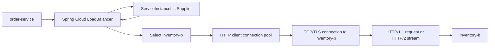
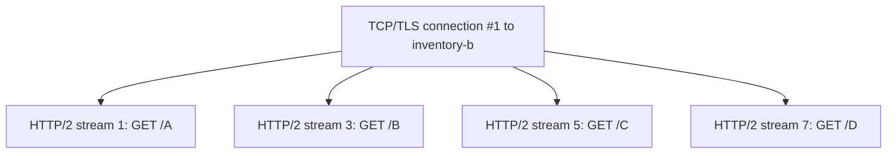
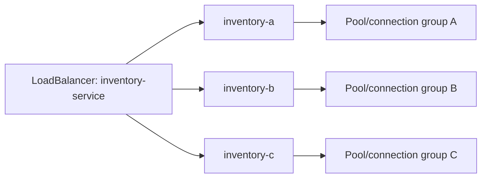

# HTTP/1.1, HTTP/2, and Their Impact on Connection Usage

## Objectives

In a microservices system, `order-service` may call `inventory-service` hundreds of times per second via `RestClient`, `WebClient`, or OpenFeign. Spring Cloud LoadBalancer helps select an `inventory-service` replica, yet **how the HTTP client actually uses TCP connections** depends on HTTP/1.1, HTTP/2, and the underlying HTTP library.

An HTTP client using HTTP/1.1 typically has to open multiple connections to handle concurrent requests to the same instance. In HTTP/2, **multiple requests/responses can run across multiple streams over the same TCP connection**, reusing resources more efficiently. This directly impacts connection pools, queued requests, TLS handshakes, latency, load limits, and how metrics are read.

After this lesson, you will be able to:

- Distinguish **connection**, **HTTP request**, **HTTP/2 stream**, **service ID**, and `ServiceInstance`.
- Explain HTTP/1.1 keep-alive and HTTP/2 multiplexing.
- Recognize HTTP/2 stream limits, flow control, TCP head-of-line blocking, and cases where HTTP/2 does not improve performance.
- Understand how protocol negotiation works over TLS/ALPN or cleartext h2c.
- Configure WebClient/Reactor Netty with HTTP/1.1, HTTP/2, and a connection provider.
- Know the HTTP/2 support constraints when using RestClient, RestTemplate, or OpenFeign: **it depends on the HTTP transport**.
- Test the actual protocol, observe connection/stream counts, and tune pools and concurrency on a solid basis.

## 1. Do Not Confuse ServiceInstance with HTTP Connection

Suppose the application calls:

```text
GET http://inventory-service/api/items/SKU-42
```

Spring Cloud LoadBalancer takes `inventory-service` as the **service ID**, retrieves instances via discovery/supplier, and selects one physical destination:

| Service ID | Instance ID | Replica URI |
|---|---|---|
| `inventory-service` | `inventory-a` | `http://10.20.1.11:8080` |
| `inventory-service` | `inventory-b` | `http://10.20.1.12:8080` |
| `inventory-service` | `inventory-c` | `http://10.20.1.13:8080` |

Once LoadBalancer picks `inventory-b`, the HTTP client must send the request to `10.20.1.12:8080`. **At this point, the transport decides whether to reuse an existing connection, open a new TCP connection, or open an HTTP/2 stream on an existing connection.**



These concepts have different scopes:

| Concept | Definition | Shared across multiple requests? |
|---|---|---|
| **Service ID** | Logical name, e.g., `inventory-service` | Yes: many requests call the same service name |
| **ServiceInstance** | A replica with its own host/port/metadata | Yes: many requests can select the same replica |
| **TCP/TLS connection** | Connection between the HTTP client and a network target/proxy | Yes: kept alive and reused |
| **HTTP/1.1 request** | One HTTP exchange over the chosen connection | The connection normally serves requests sequentially |
| **HTTP/2 stream** | An independent frame-level HTTP exchange on an HTTP/2 connection | One connection can carry many concurrent streams |
| **LoadBalancer cache** | Temporarily stored instance list from discovery | Not where TCP connections are stored |

A service ID with three instances **does not mean** the HTTP client holds exactly three TCP connections. Each instance may have many connections, none at all, or requests may go through an intermediary proxy depending on the deployment.

## 2. HTTP/1.1: Keep-Alive with Little Multiplexing

HTTP/1.1 supports **persistent connections (keep-alive)**: after a response completes, the TCP connection can be retained and used for the next request to a matching route. This avoids repeating TCP and TLS setup overhead on every request.

```text
HTTP/1.1, one connection:

TCP connection #1
  GET /items/A  --------> 200 OK
  GET /items/B  --------> 200 OK
  GET /items/C  --------> 200 OK
```

HTTP/1.1 defines request pipelining, but lacks independent frame multiplexing like HTTP/2. In most modern HTTP clients, **an HTTP/1.1 TCP connection serves one request/response at a time**, then returns to the pool for reuse. Pipelining is rarely practical for concurrent requests due to response-ordering constraints and head-of-line blocking.

### 2.1. When Many Concurrent Requests Hit the Same Instance

Suppose `inventory-b` must process four concurrent requests, each taking about 200 ms:

```text
HTTP/1.1, 4 connections (illustrative):

connection #1: GET /items/A  [0---200 ms]
connection #2: GET /items/B  [0---200 ms]
connection #3: GET /items/C  [0---200 ms]
connection #4: GET /items/D  [0---200 ms]
```

If the pool only permits one connection for this route, the remaining requests may have to wait:

```text
HTTP/1.1, maxPerRoute=1:
  connection #1: A [0-200] -> B [200-400] -> C [400-600] -> D [600-800]
  requests B/C/D: may have to wait to acquire from the pool
```

This is a simplified model, not an execution-time guarantee. Actual results depend on the HTTP client, proxy, connection reuse, TCP, server, and timeout policies.

### 2.2. Strengths and Limitations

HTTP/1.1 is broadly compatible with servers, reverse proxies, and many HTTP clients. Keep-alive drastically reduces handshakes compared to opening a fresh connection per request.

However:

- Higher request concurrency usually requires **more connections** on the same route.
- Each connection consumes sockets, memory, TLS state, and server-side resources.
- Too small a pool increases **connection acquisition** wait time.
- Too large a pool can cause connection storms, high TLS cost, and backend overload.
- A slow response holds its connection longer, forcing other requests to wait for a slot.

**Do not confuse pool connection wait time with connect timeout.** A request stuck waiting in the pool may not even have attempted a TCP connection to the backend yet.

## 3. HTTP/2: Multiple Streams on One Connection

HTTP/2 preserves HTTP semantics (methods, statuses, headers, paths), but replaces the wire representation with **binary frames**. Each request/response uses a **stream** with its own identifier; frames belonging to different streams can interleave over the same TCP connection.

```text
HTTP/2, same TCP/TLS connection:

Stream 1: HEADERS(A) ---- DATA(A) ------- END_STREAM
Stream 3: -- HEADERS(B) -- DATA(B) ------ END_STREAM
Stream 5: ---- HEADERS(C) ---- DATA(C) -- END_STREAM
Stream 7: ------ HEADERS(D) -- DATA(D) - END_STREAM
```

Streams can make progress concurrently without forcing response A to finish before B at the HTTP layer like HTTP/1.1 pipelining. HTTP/2 also uses **HPACK** to compress headers, reducing repeated data when many requests share common headers.

### 3.1. One Connection Can Carry Many Concurrent Requests

For example, if the server accepts up to 100 open HTTP/2 streams on one connection, 40 concurrent requests can in principle use 40 streams over **one TCP connection** to the same instance.



Thanks to multiplexing, an application **may need fewer TCP connections** than HTTP/1.1 when sending many concurrent small requests. Still, never conclude "HTTP/2 uses only one connection for every service":

- Each instance/network destination can have its own pool.
- Servers cap concurrent streams.
- Clients may proactively open multiple HTTP/2 connections to spread load.
- Proxies/network load balancers may split connections across hops.
- Connections can close due to idle timeouts, max lifetime, errors, or rollouts.

### 3.2. Stream Limit: SETTINGS_MAX_CONCURRENT_STREAMS

HTTP/2 defines `SETTINGS_MAX_CONCURRENT_STREAMS`, advertised by the peer. It caps **concurrently open** streams, not the total requests a connection can serve over its lifetime.

For example:

```text
Server: SETTINGS_MAX_CONCURRENT_STREAMS = 50
Caller: 120 concurrent requests to the same instance

At any moment, one HTTP/2 connection can serve at most
50 streams per the peer's limit.
Remaining requests may have to wait for a stream slot or use another
connection, depending on the connection pool and HTTP client implementation.
```

Configuring `maxConcurrentStreams(100)` on the client **does not override** the limit of 50 advertised by the server. In practice, the effective limit respects both sides.

### 3.3. Flow Control: Streams Do Not Have Unlimited Bandwidth

HTTP/2 uses **flow-control windows** per stream and per connection; the receiver grants more transmission credit via `WINDOW_UPDATE` frames. This stops a sender from overflowing the receiver's buffers, yet can slow a stream down when the receiver reads slowly or the window is too small.

If one request returns a multi-hundred-MB response while another returns a tiny JSON payload, both streams share the **same bandwidth and TCP connection**. Multiplexing does not magically increase network bandwidth or backend CPU capacity.

### 3.4. Head-of-Line Blocking Has Not Completely Vanished

HTTP/2 eliminates **HTTP-layer head-of-line blocking** seen in HTTP/1.1 pipelining because frames from different streams can interleave. However, HTTP/2 runs over **TCP**: when a TCP segment is lost, TCP must ensure in-order recovery before delivering bytes up to the HTTP layer. One connection carrying many streams can suffer across all of them during packet loss.

Therefore, never claim "HTTP/2 eliminates all head-of-line blocking." On lossy networks—especially with many streams packed onto one connection—multiplexing gains can shrink.

## 4. Direct Comparison Table: HTTP/1.1 vs. HTTP/2

| Criterion | HTTP/1.1 | HTTP/2 |
|---|---|---|
| Method/status/URL semantics | HTTP | Still HTTP |
| Wire representation | Text-based HTTP messages | Binary frames, streams |
| TCP connection reuse | Yes, via keep-alive | Yes, shared via multiplexing |
| Concurrent requests on one connection | Usually not multiplexed; pipelining is limited | Yes, across multiple streams |
| Header compression | No HPACK | Has HPACK |
| Key concurrency unit | Connections serving requests | Streams **and** connections |
| Relevant limits | Pool size, max per route, queues | Max streams/connection, connection pool, pending streams |
| Per-stream HTTP flow control | Nothing like HTTP/2's mechanism | Separate stream/connection windows |
| HOL blocking | Pipelining suffers at HTTP layer | Reduced at HTTP layer; TCP HOL remains |
| Handshake cost | Reduced via keep-alive; many connections can add cost | Can reduce connections/handshakes when multiplexing works well |
| TLS mandatory by spec? | No | HTTP/2 supports h2 over TLS **or** cleartext h2c |
| Practical support | Very broad | Depends on HTTP client, server, TLS/ALPN, and proxies |

**Both HTTP/1.1 and HTTP/2 can serve blocking or non-blocking requests**, depending on the HTTP client API. `RestClient`/`RestTemplate` are synchronous APIs and `WebClient` is a reactive API; **the HTTP version alone does not dictate the programming model**.

## 5. How HTTP/2 Connections Are Negotiated

### 5.1. h2 over TLS and ALPN

With HTTP/2 over TLS, client and server typically negotiate the protocol via **ALPN (Application-Layer Protocol Negotiation)** during the TLS handshake. A client supporting both HTTP/1.1 and HTTP/2 can advertise both; the outcome depends on what the server and HTTP client support.

```text
Client -> Server: TLS handshake; ALPN offers ["h2", "http/1.1"]
Server -> Client: ALPN selects "h2" (if supported)
Client <-> Server: HTTP/2 frames over TLS
```

If an HTTP client is configured to **accept only HTTP/2** and the server does not support it, requests may fail instead of falling back. If configured to support both HTTP/1.1 and HTTP/2, it can fall back based on negotiation.

Do not try to force HTTP/2 merely by manually adding an `Upgrade` header on `RestClient` or `FeignClient`; the HTTP transport must genuinely understand HTTP/2 framing, multiplexing, and ALPN.

### 5.2. h2c on Non-TLS Connections

HTTP/2 also defines **h2c** for cleartext connections. Depending on client/server configuration, h2c can use:

- **Prior knowledge:** the client speaks HTTP/2 right away without an HTTP/1.1 Upgrade.
- **HTTP/1.1 Upgrade:** the client starts with HTTP/1.1 and asks to upgrade to h2c if the peer accepts.

h2c is useful in local/test environments or appropriately secured internal networks. **Never treat h2c as equivalent in security to HTTPS.** Over untrusted networks, prefer HTTP/2 over TLS with proper certificate validation.

### 5.3. Enabling HTTP/2 on a Spring Boot Server

Server example with Spring Boot 4.x:

```yaml
server:
  port: 8443
  http2:
    enabled: true
  ssl:
    enabled: true
    # Configure a valid certificate/SSL bundle for your environment.
```

This YAML intentionally **omits fake keystores**: the app must be configured with real certificates (keystore or SSL bundle) to start HTTPS cleanly. In Spring Boot, `server.http2.enabled=true` enables HTTP/2 on supported embedded servers; h2 uses TLS, while without SSL it may use h2c depending on the web server and deployment path.

**Enabling HTTP/2 on the backend does not automatically make callers use HTTP/2.** The HTTP client must be configured to support the protocol and any intermediary peers must be compatible as well.

### 5.4. HTTP/2 Is a Per-Hop Characteristic

Microservice paths often pass through gateways/proxies/service meshes:

```text
order-service -- HTTP/2 --> sidecar/proxy
sidecar/proxy -- HTTP/1.1 --> inventory-service
```

Or the reverse:

```text
order-service -- HTTP/1.1 --> Gateway
Gateway -- HTTP/2 --> inventory-service
```

Conclusion: using HTTP/2 on **one hop** does not mean every downstream hop uses HTTP/2. When measuring performance, verify the protocol and connection pool **on the exact hop experiencing the issue**.

## 6. Impact of LoadBalancer on Connection Reuse

Suppose `order-service` is configured to call `http://inventory-service` and LoadBalancer uses round robin across three instances. Each request may pick a different destination:

```text
Request 1 -> inventory-a (10.20.1.11:8080)
Request 2 -> inventory-b (10.20.1.12:8080)
Request 3 -> inventory-c (10.20.1.13:8080)
Request 4 -> inventory-a (10.20.1.11:8080)
```

In many HTTP clients, connection pools are partitioned by **route/remote address** (or equivalent pool key), so a connection to `inventory-a` cannot simply substitute for a connection to `inventory-b`.



With HTTP/2, each connection group to an instance can carry **multiple concurrent streams**. Therefore:

- Backend instance count differs from TCP connection count.
- Adding replicas can increase the number of connection groups and overall keep-alive overhead.
- If requests spread too thinly across many low-traffic instances, connection reuse benefits can shrink.
- If a route sends heavy load to one instance, stream limits and pool saturation can still occur even though LoadBalancer returns an instance.
- HTTP/2 connection coalescing across multiple origins has specific requirements on TLS, addresses, certificates, and implementation; **do not rely on coalescing** as a default Spring Cloud LoadBalancer feature.

### 6.1. Do Not Confuse Weighted Routing with Stream Capacity

`WeightedServiceInstanceListSupplier` can use `weight` metadata to adjust instance selection ratios. However, weight values **do not inspect available HTTP/2 streams**, nor do they guarantee an instance is healthier.

Similarly, `ZonePreferenceServiceInstanceListSupplier` and hint suppliers filter by routing metadata, **not open stream counts**. If backends or HTTP clients need dynamic admission control, add concurrency limits, rate limits, and appropriate metrics.

### 6.2. Sticky Sessions and Connection Reuse Are Separate Concerns

HTTP/2 can reuse a connection across many requests to **one physical destination** after selection. That **does not mean** LoadBalancer guarantees user-level sticky sessions. Sticky routing requires cookies/request context or a dedicated policy; connection reuse is an HTTP transport decision.

Conversely, a sticky policy sending repeated requests to the same instance may boost connection reuse, at the risk of skewing load. Do not enable stickiness solely to "take advantage of HTTP/2."

## 7. Connection Pools and HTTP/2: Count Streams Too

With HTTP/1.1, if one instance receives 100 concurrent requests and each connection handles one request at a time, the pool may need many connections or queue acquires.

With HTTP/2, if the server allows up to 50 streams/connection, **in theory** two connections could support 100 concurrent streams. Yet that is not an automatic pool setting: clients may open more or fewer connections, and must obey flow control and remote peer settings.

| Parameter | HTTP/1.1 | HTTP/2 |
|---|---|---|
| `maxConnections` | Caps sockets/connections that can serve requests | Caps connections, though each connection holds multiple streams |
| `maxConcurrentStreams` | Not an HTTP/1.1 multiplexing concept | Caps concurrent streams per connection |
| `pendingAcquireMaxCount` | Caps requests waiting for a connection | May apply to connection acquisition; stream wait queues may also exist per provider |
| Connection idle timeout | Closes unused connections | Closes connections with no active streams/activity per policy |
| Active connections metric | Close to in-flight HTTP/1.1 requests | **Does not directly represent** HTTP/2 request count |
| Active/pending streams metrics | Not applicable | Crucial signals for understanding HTTP/2 concurrency |

### 7.1. Pay Attention to Reactor Netty's Connection Allocation Strategy

In Reactor Netty 1.3.x, HTTP/2 has a **specialized connection pool** and `Http2AllocationStrategy`. By default, the pool **may open extra connections** when multiple requests contend, even if an existing connection still has stream capacity.

To prioritize maximizing multiplexing on existing connections, you can use `strictConnectionReuse(true)`. There is a trade-off:

- **Strict reuse:** fewer connections/handshakes; many streams share the same TCP connection.
- **Opening extra connections:** can reduce contention and lessen the blast radius of TCP packet loss on one connection, at the cost of extra sockets/TLS/memory.

Strict reuse is not optimal for every configuration. Decide based on your workload and measure p95/p99 latency, bandwidth, packet loss, pending streams, and connection utilization.

## 8. WebClient + Reactor Netty: Practical HTTP/2 Configuration

Reactor Netty supports `HttpProtocol.HTTP11`, `HttpProtocol.H2` (TLS), and `HttpProtocol.H2C` (cleartext). By default Reactor Netty's HTTP client supports HTTP/1.1; using HTTP/2 requires configuring the protocol intentionally.

### 8.1. WebClient Using HTTPS and ALPN (HTTP/1.1 or HTTP/2)

Example with Reactor Netty using an HTTP/2 allocation strategy:

```java
import java.time.Duration;
import org.springframework.cloud.client.loadbalancer.LoadBalanced;
import org.springframework.context.annotation.Bean;
import org.springframework.context.annotation.Configuration;
import org.springframework.http.client.reactive.ReactorClientHttpConnector;
import org.springframework.web.reactive.function.client.WebClient;
import reactor.netty.http.HttpProtocol;
import reactor.netty.http.client.Http2AllocationStrategy;
import reactor.netty.http.client.HttpClient;
import reactor.netty.resources.ConnectionProvider;

@Configuration(proxyBeanMethods = false)
class InventoryHttp2ClientConfiguration {

    @Bean(destroyMethod = "dispose")
    ConnectionProvider inventoryHttp2Pool() {
        return ConnectionProvider.builder("inventory-h2-pool")
                .allocationStrategy(Http2AllocationStrategy.builder()
                        .maxConnections(4)
                        .maxConcurrentStreams(50)
                        .strictConnectionReuse(true)
                        .build())
                .metrics(true)
                .build();
    }

    @Bean
    @LoadBalanced
    WebClient.Builder loadBalancedWebClientBuilder(
            ConnectionProvider inventoryHttp2Pool) {
        HttpClient httpClient = HttpClient.create(inventoryHttp2Pool)
                .protocol(HttpProtocol.HTTP11, HttpProtocol.H2)
                .secure()
                .responseTimeout(Duration.ofSeconds(3));

        return WebClient.builder()
                .clientConnector(new ReactorClientHttpConnector(httpClient));
    }
}
```

Here:

1. `maxConnections(4)` sets the connection cap for the HTTP/2 pool via the allocation strategy.
2. `maxConcurrentStreams(50)` is the client-desired limit, which must still respect the server's limit.
3. `strictConnectionReuse(true)` prioritizes opening streams on existing connections before opening new connections.
4. `.protocol(HTTP11, H2).secure()` enables HTTP/2 negotiation over TLS and HTTP/1.1 fallback depending on mutual support.
5. `@LoadBalanced WebClient.Builder` lets logical URIs like `https://inventory-service` be resolved by Spring Cloud LoadBalancer to real instances.

This example is **one configuration approach**; Spring Boot also provides WebClient builder customizers/observability. When creating a builder via `WebClient.builder()`, integrate any required application customizers so you do not accidentally lose tracing or HTTP metrics.

Service-calling gateway:

```java
import org.springframework.cloud.client.loadbalancer.LoadBalanced;
import org.springframework.stereotype.Component;
import org.springframework.web.reactive.function.client.WebClient;
import reactor.core.publisher.Mono;

@Component
class InventoryReactiveGateway {

    private final WebClient inventoryClient;

    InventoryReactiveGateway(@LoadBalanced WebClient.Builder builder) {
        this.inventoryClient = builder
                .baseUrl("https://inventory-service")
                .build();
    }

    Mono<String> findItem(String sku) {
        return inventoryClient.get()
                .uri("/api/items/{sku}", sku)
                .retrieve()
                .bodyToMono(String.class);
    }
}
```

**Prerequisites:** the target instance or proxy the client connects to must support TLS/ALPN; certificates must be valid under the caller's truststore. Never disable certificate verification just to "get HTTP/2 working." If discovery reports a non-secure instance or the client hits a proxy that does not support h2, the actual protocol may differ from expectations.

### 8.2. When a Local Backend Uses h2c

In a non-TLS local/test network, transport can be configured for instance as:

```java
HttpClient localH2cClient = HttpClient.create(inventoryHttp2Pool)
        .protocol(HttpProtocol.H2C)
        .responseTimeout(Duration.ofSeconds(3));

WebClient localClient = WebClient.builder()
        .clientConnector(new ReactorClientHttpConnector(localH2cClient))
        .baseUrl("http://localhost:8081")
        .build();
```

This demonstrates **HTTP/2 cleartext prior knowledge** to a physical host. To integrate with LoadBalancer, use a `@LoadBalanced WebClient.Builder` and a service-ID base URL; ensure every target instance supports h2c. Do not combine `.secure()` with cleartext h2c.

When testing to compare against HTTP/1.1 on the same backend, change `.protocol(HttpProtocol.H2C)` to `.protocol(HttpProtocol.HTTP11)`, restart the caller, and re-measure. Do not assume changing a single YAML property automatically switches existing connections to a new protocol.

### 8.3. Things to Test in Production

- **How many connections and streams per route?** Do not look only at `maxConnections`.
- **What `SETTINGS_MAX_CONCURRENT_STREAMS` does the server advertise?** Do not exceed the peer limit.
- **Is there a proxy/service mesh?** Check client → proxy and proxy → backend protocols separately.
- **Do connections close during idle/rollouts?** Check `maxIdleTime`, `maxLifeTime`, and `GOAWAY`.
- **Do large responses affect small streams?** Measure latency and flow-control stalls.
- **Which phase do requests time out in?** Separate pending streams, pool acquire, TCP connect, TLS, and response.

## 9. RestClient, RestTemplate, and OpenFeign: Protocol Depends on HTTP Transport

**The Spring-level API does not decide the HTTP version.**

`RestClient` and `RestTemplate` are blocking HTTP APIs, yet they can use `JdkClientHttpRequestFactory`, `HttpComponentsClientHttpRequestFactory`, Jetty, or Reactor Netty HTTP clients depending on configuration/classpath. Spring Boot also auto-detects request factories, so two projects both using `RestClient` may not be using the same protocol or pool.

### 9.1. RestClient Using JDK HttpClient Preferring HTTP/2

JDK's `java.net.http.HttpClient` can be configured to **prefer HTTP/2**, falling back to HTTP/1.1 when the server or path does not support it:

```java
import java.net.http.HttpClient;
import java.time.Duration;
import org.springframework.cloud.client.loadbalancer.LoadBalanced;
import org.springframework.context.annotation.Bean;
import org.springframework.context.annotation.Configuration;
import org.springframework.http.client.JdkClientHttpRequestFactory;
import org.springframework.web.client.RestClient;

@Configuration(proxyBeanMethods = false)
class JdkRestClientConfiguration {

    @Bean
    @LoadBalanced
    RestClient.Builder loadBalancedRestClientBuilder() {
        HttpClient jdkClient = HttpClient.newBuilder()
                .version(HttpClient.Version.HTTP_2)
                .connectTimeout(Duration.ofSeconds(2))
                .build();

        return RestClient.builder()
                .requestFactory(
                        new JdkClientHttpRequestFactory(jdkClient));
    }
}
```

To call a service ID, build a `RestClient` from the builder above with base URL `https://inventory-service` and ensure valid TLS certificates. `version(HTTP_2)` is a **preference/hint to use HTTP/2** in the JDK client, not proof that every request went over h2. Observe the actual protocol at the backend or via HTTP client diagnostics.

A `RestTemplate` can also use `JdkClientHttpRequestFactory` depending on the Spring Framework/Boot version, yet its API remains blocking; h2 multiplexing is a property of the configured transport and does not turn `RestTemplate` non-blocking.

### 9.2. OpenFeign

With Spring Cloud OpenFeign, `@FeignClient(name = "inventory-service")` uses a **service ID** when no fixed URL is declared and LoadBalancer integration is active. Whether Feign speaks HTTP/1.1 or HTTP/2 depends on the **Feign Client transport**.

For example, Spring Cloud OpenFeign provides the property:

```yaml
spring:
  cloud:
    openfeign:
      http2client:
        enabled: true
```

Per current property documentation, `spring.cloud.openfeign.http2client.enabled` enables using the **Java HTTP/2 Client** for Feign. Your project must check the classpath, conflicts with other transports such as Apache HC5/OkHttp, and the **actual Feign Client bean selected**; do not inspect YAML alone and conclude every request uses h2.

Apache HC5's **classic blocking transport** is commonly used in Feign examples and relies on a connection pool with total/per-route limits. Do not infer from a dependency named "HttpClient 5" that every Feign version integrating it multiplexes HTTP/2.

**One separate note:** `@FeignClient(url = "https://inventory.example.com")` is a direct URL call that skips Spring Cloud LoadBalancer's `ServiceInstance` selection. Enabling HTTP/2 on the Feign transport does not turn a fixed URL into service discovery.

## 10. When HTTP/2 Is Not Faster Than HTTP/1.1

HTTP/2 typically helps when there are many small concurrent requests to the same target and connection/header overhead is significant. However, there is no guarantee every workload becomes faster.

| Scenario | Why HTTP/2 may not help | What to measure |
|---|---|---|
| Few sequential requests | HTTP/1.1 keep-alive already reuses connections well | Per-request latency and CPU |
| Many distinct backends, few requests each | Few concurrent streams per connection | Connection/route counts and reuse ratio |
| Very large responses | Streams share bandwidth/flow control | Throughput, flow-control stalls |
| Significant packet loss | Multiple streams suffer TCP HOL together | Retransmissions, p95/p99 latency |
| Low server stream limit | Requests wait for stream slots or open new connections | Active/pending streams |
| Proxy downgrades to HTTP/1.1 | Only one hop is HTTP/2 | Protocol per hop |
| Misconfigured TLS/ALPN or certificates | Fails to negotiate HTTP/2 | TLS handshakes, ALPN, errors |
| Backend CPU/DB already saturated | Transport tuning does not speed up backend business logic | CPU, DB pool, service time |
| Retry storm | Physical requests surge regardless of multiplexing efficiency | Retry amplification and error rate |

Additionally, cancelled HTTP/2 streams can produce `RST_STREAM`; servers gracefully draining a connection can send `GOAWAY`. Clients must handle these according to the HTTP/2 contract and safe retry policies. Do not blindly retry every POST after a stream error because the backend may already have executed side effects.

## 11. Observing Metrics and Verifying the Real Protocol

Do not compare HTTP/1.1 and HTTP/2 solely by total TCP connection count:

- HTTP/1.1 has a closer correspondence between active connections and in-flight requests.
- HTTP/2 can have **few connections yet very many active streams**.
- Fewer connections do not automatically guarantee high throughput, low latency, or a healthy backend.

With Reactor Netty and Micrometer, useful metrics include:

| Metric | Meaning |
|---|---|
| `reactor.netty.connection.provider.total.connections` | Total existing connections |
| `reactor.netty.connection.provider.active.connections` | Acquired/in-use connections |
| `reactor.netty.connection.provider.idle.connections` | Connections currently idle at measurement time |
| `reactor.netty.connection.provider.pending.connections` | Acquires waiting for a connection |
| `reactor.netty.connection.provider.pending.connections.time` | Distribution of acquire wait times |
| `reactor.netty.connection.provider.active.streams` | **Active HTTP/2 streams** |
| `reactor.netty.connection.provider.pending.streams` | **Requests waiting to open an HTTP/2 stream** |
| `reactor.netty.http.client.response.time` | Response latency from HTTP client instrumentation |

Metrics appear only when compatible transport/instrumentation is active; you need a Micrometer registry and `ConnectionProvider.metrics(true)` or equivalent configuration. Names/tags can vary across Reactor Netty versions and providers. Check actual data in Actuator/Prometheus rather than assuming every app exposes all metrics.

### 11.1. Recording the HTTP Version on the Backend

On a Spring MVC servlet server, `HttpServletRequest.getProtocol()` verifies the HTTP version the **backend actually received**:

```java
import java.util.Map;
import jakarta.servlet.http.HttpServletRequest;
import org.springframework.beans.factory.annotation.Value;
import org.springframework.web.bind.annotation.GetMapping;
import org.springframework.web.bind.annotation.RestController;

@RestController
class WhoAmIController {

    private final String instanceId;

    WhoAmIController(@Value("${demo.instance-id:unknown}")
                     String instanceId) {
        this.instanceId = instanceId;
    }

    @GetMapping("/whoami")
    Map<String, String> whoAmI(HttpServletRequest request) {
        return Map.of(
                "instanceId", instanceId,
                "httpProtocol", request.getProtocol()
        );
    }
}
```

When the server receives HTTP/2, the protocol value may appear as `HTTP/2.0` or the container's equivalent format; when receiving HTTP/1.1 it is typically `HTTP/1.1`. This measures the **hop to the backend**, and does not tell you the protocol on other upstream hops.

### 11.2. Using curl to Verify

Example when the backend has HTTPS and a trusted certificate:

```bash
curl -v --http2 --cacert ./dev-ca.pem \
  "https://localhost:8443/whoami"
```

For a test backend supporting HTTP/2 h2c:

```bash
curl -v --http2-prior-knowledge \
  "http://localhost:8081/whoami"
```

Check `curl --version` to ensure your curl build supports HTTP/2. On PowerShell, use `curl.exe` to avoid the `curl` alias. `--http2` may fall back to HTTP/1.1 depending on conditions; inspect verbose output/`httpProtocol` rather than only checking exit code 0. For self-signed HTTPS in tests, trust the CA via `--cacert` or a proper truststore; never disable TLS verification just to make a demo pass.

## 12. Hands-On: Comparing 20 Concurrent Requests Across Both Protocols

This lab uses the **same backends and same service ID**, switching the caller's HTTP transport between HTTP/1.1 and h2c to observe differing connection/stream counts. Run in local/test only, never run stress tests against production.

### Step 1. Prepare Two Spring MVC Backends

Create two `inventory-service` instances with `WhoAmIController` from section 11.1. In a non-TLS local environment, try configuring:

```yaml
spring:
  application:
    name: inventory-service

server:
  http2:
    enabled: true
```

Run two processes with distinct ports and instance IDs:

```text
Backend A: --server.port=8081 --demo.instance-id=inventory-a
Backend B: --server.port=8082 --demo.instance-id=inventory-b
```

With Spring Boot and an embedded server supporting h2c, this configuration accepts cleartext HTTP/2. Verify each backend with `curl --http2-prior-knowledge` before continuing. If your web server does not support h2c as expected, use TLS/h2 or another test server instead of assuming the protocol is active.

### Step 2. Configure Static Discovery on the Caller

`order-service` needs `spring-cloud-starter-loadbalancer` and an appropriate HTTP client (e.g., `spring-boot-starter-webflux` for WebClient), plus:

```yaml
server:
  port: 8080

spring:
  application:
    name: order-service
  cloud:
    discovery:
      client:
        simple:
          instances:
            inventory-service:
              - uri: http://localhost:8081
              - uri: http://localhost:8082
```

`SimpleDiscoveryClient` supplies two instances; LoadBalancer picks the host/port. This config **does not itself control** whether WebClient uses HTTP/1.1 or HTTP/2.

### Step 3. Create a Pooled h2c WebClient

In the caller application:

```java
import java.time.Duration;
import org.springframework.cloud.client.loadbalancer.LoadBalanced;
import org.springframework.context.annotation.Bean;
import org.springframework.context.annotation.Configuration;
import org.springframework.http.client.reactive.ReactorClientHttpConnector;
import org.springframework.web.reactive.function.client.WebClient;
import reactor.netty.http.HttpProtocol;
import reactor.netty.http.client.Http2AllocationStrategy;
import reactor.netty.http.client.HttpClient;
import reactor.netty.resources.ConnectionProvider;

@Configuration(proxyBeanMethods = false)
class LocalHttpClientConfiguration {

    @Bean(destroyMethod = "dispose")
    ConnectionProvider demoConnectionProvider() {
        return ConnectionProvider.builder("demo-h2c-pool")
                .allocationStrategy(Http2AllocationStrategy.builder()
                        .maxConnections(2)
                        .maxConcurrentStreams(20)
                        .strictConnectionReuse(true)
                        .build())
                .metrics(true)
                .build();
    }

    @Bean
    @LoadBalanced
    WebClient.Builder demoLoadBalancedWebClientBuilder(
            ConnectionProvider demoConnectionProvider) {
        HttpClient httpClient = HttpClient.create(demoConnectionProvider)
                .protocol(HttpProtocol.H2C)
                .responseTimeout(Duration.ofSeconds(5));

        return WebClient.builder()
                .clientConnector(new ReactorClientHttpConnector(httpClient));
    }
}
```

If the HTTP/2 pool strategy is not supported by the Reactor Netty version on your classpath, check your Reactor Netty release train and adjust accordingly. Do not copy Reactor Netty 1.3.x configuration onto older versions without verifying the API.

### Step 4. Create Test Endpoints on the Caller

```java
import java.util.List;
import org.springframework.cloud.client.loadbalancer.LoadBalanced;
import org.springframework.web.bind.annotation.GetMapping;
import org.springframework.web.bind.annotation.RequestParam;
import org.springframework.web.bind.annotation.RestController;
import org.springframework.web.reactive.function.client.WebClient;
import reactor.core.publisher.Flux;
import reactor.core.publisher.Mono;

@RestController
class ProtocolProbeController {

    private final WebClient inventoryClient;

    ProtocolProbeController(@LoadBalanced WebClient.Builder builder) {
        this.inventoryClient = builder
                .baseUrl("http://inventory-service")
                .build();
    }

    @GetMapping("/demo/protocol")
    Mono<String> check() {
        return inventoryClient.get()
                .uri("/whoami")
                .retrieve()
                .bodyToMono(String.class);
    }

    @GetMapping("/demo/burst")
    Mono<List<String>> burst(@RequestParam(defaultValue = "20") int count) {
        int size = Math.min(Math.max(count, 1), 50);
        return Flux.range(1, size)
                .flatMap(i -> inventoryClient.get()
                        .uri("/whoami")
                        .retrieve()
                        .bodyToMono(String.class), 20)
                .collectList();
    }
}
```

The `/demo/burst` endpoint intentionally generates many outbound HTTP requests to test concurrency; **use in local/test only**. `flatMap(..., 20)` bounds concurrent inner publisher subscriptions within one controller request, not a JVM-wide concurrency limit.

### Step 5. Send Test Requests

```bash
curl "http://localhost:8080/demo/protocol"
curl "http://localhost:8080/demo/burst?count=20"
```

The responses return both instances according to the LoadBalancer algorithm. Inspect `httpProtocol` in the backend JSON:

```json
{
  "instanceId": "inventory-a",
  "httpProtocol": "HTTP/2.0"
}
```

The value `HTTP/2.0` is just an example representation from a servlet container; verify your actual output. `curl` calling the caller's endpoint may be using HTTP/1.1 on the **client → order-service hop**, while `WebClient` speaks HTTP/2 on the **order-service → inventory-service hop**.

### Step 6. Re-Run with HTTP/1.1

Change only the line:

```java
.protocol(HttpProtocol.H2C)
```

to:

```java
.protocol(HttpProtocol.HTTP11)
```

Then restart the caller, send the same request count to the same backends, keeping other factors constant where possible.

| Metric | HTTP/1.1 | HTTP/2 h2c |
|---|---|---|
| Backend `httpProtocol` | Usually `HTTP/1.1` | Usually `HTTP/2.0` |
| Active connections at backend | May need multiple connections for high concurrency | Can use fewer connections thanks to multiple streams |
| Active HTTP/2 streams | Not applicable | Can be many times larger than connection count |
| Pending acquire / pending streams | Depends on pool, load, and limits | Depends on connection count, stream limit, and pool policy |
| p50/p95/p99 latency | Must measure | Must measure; not lower by default |

**Technical note:** `Http2AllocationStrategy` is a strategy for HTTP/2; when switching the client to HTTP/1.1, create a dedicated HTTP/1.1 `ConnectionProvider` with `maxConnections(2)` and an appropriate pending queue for a fair comparison. Not every H2 strategy attribute applies as intended to an HTTP/1.1 pool. For example:

```java
ConnectionProvider http11Provider = ConnectionProvider.builder("demo-h1-pool")
        .maxConnections(2)
        .pendingAcquireMaxCount(20)
        .pendingAcquireTimeout(Duration.ofSeconds(2))
        .metrics(true)
        .build();
```

Wire the client to `http11Provider` when running the HTTP/1.1 measurement. Ensure only one corresponding `@LoadBalanced WebClient.Builder` bean exists in each run to avoid injecting the wrong one.

### Step 7. Cross-Check with a Single Instance

Temporarily configure `SimpleDiscoveryClient` with only `inventory-a` and re-run. This isolates the effect of **multiplexing on a single route** instead of mixing it with LoadBalancer splitting requests across two instances.

Next, bring `inventory-b` back to see how total pools/connections change with **physical destination count**, not just request count. When HTTP/2 is enabled, monitor both `active.streams` and `pending.streams` to spot true saturation points.

## 13. Common Errors and How to Handle Them

| Symptom | Possible Cause | How to Check |
|---|---|---|
| Enabled `server.http2.enabled` yet caller still sends HTTP/1.1 | Client lacks h2 support, TLS/ALPN failed to negotiate, or proxy downgraded | Check client transport, ALPN, and `getProtocol()` on the backend |
| `curl --http2` still returns HTTP/1.1 response | Syntax allows fallback or server lacks support | Check verbose output, test proper h2c/TLS, verify `curl --version` |
| `protocol(H2)` fails against an HTTP backend | H2 requires TLS in Reactor Netty configuration | Use HTTPS/h2 or `H2C` for local cleartext |
| HTTP/2 uses few connections yet requests remain slow | Hit stream limit, flow control, TCP packet loss, or slow backend | Check active/pending streams, p99 latency, retransmissions |
| `maxConnections=4` yet more than 4 concurrent HTTP requests run | HTTP/2 multiplexes many streams per connection | Measure stream count as well; do not count sockets alone |
| Increasing pool size does not lower latency | Bottleneck is CPU/DB/server max streams, not pool | Measure backend service time and stream queue |
| HTTP/1.1 connection pool pending count is high | Too few connections for a hot route | Measure per-route max, response time, timeouts, and connection release |
| HTTP/2 opens more connections than expected | Pool strategy allows opening more or multiple routes exist | Check `strictConnectionReuse`, instance routing, and connection metrics |
| Errors on old connections after scale-in | Connections closing, stale discovery/cache, or in-flight requests | Check graceful shutdown, GOAWAY, target URIs, and safe retries |
| RestClient uses HTTP/1.1 despite HTTP/2 configured on server | Underlying HTTP request factory does not support/prefer h2 | Check JDK/HC5/Jetty transport and negotiated protocol |
| OpenFeign enables HTTP/2 yet h2 is not observed | Wrong Feign transport selected or different URL/proxy | Check `spring.cloud.openfeign.http2client.enabled` and Feign Client bean |
| HTTP/2 is faster locally but slower over WAN | Packet loss, RTT, congestion, TLS/proxy differences | Benchmark against real environments and workloads |

## 14. Performance Checklist

- [ ] Verified Spring Cloud LoadBalancer selects the service ID/instance, while the HTTP transport governs connections and streams.
- [ ] Not conflating HTTP request count, `ServiceInstance` count, and TCP connection count.
- [ ] Understand HTTP/1.1 keep-alive reuses connections but generally does not multiplex requests.
- [ ] Understand HTTP/2 multiplexing, `SETTINGS_MAX_CONCURRENT_STREAMS`, and flow-control windows.
- [ ] Not claiming HTTP/2 eliminates TCP head-of-line blocking.
- [ ] Know whether the path uses TLS/h2 via ALPN or cleartext h2c.
- [ ] Verified the protocol of **each hop** when a Gateway/proxy/mesh is present.
- [ ] Selected a WebClient/RestClient/Feign transport that supports HTTP/2.
- [ ] HTTP/2 pool has sensible connection and stream limits; monitoring pending streams.
- [ ] Not using HTTP/1.1 pool sizes as HTTP/2 concurrency limits.
- [ ] Verified backend readiness, discovery/caching, and draining during scaling.
- [ ] Configured connect, pending-acquire, response timeouts, and overall operation deadlines.
- [ ] Retries do not amplify load or repeat POSTs with side effects.
- [ ] Collecting connection/stream metrics, p95/p99 latency, error rate, and per-instance throughput.
- [ ] Benchmarked the same workload on HTTP/1.1 and HTTP/2, changing one variable at a time.
- [ ] Never disabling TLS verification or enabling h2c on untrusted networks solely for performance.

## Conclusion

**Both HTTP/1.1 and HTTP/2 can reuse connections, but they handle concurrent requests differently.** HTTP/1.1 typically uses multiple TCP connections to serve concurrent in-flight requests to the same route; HTTP/2 can multiplex multiple streams over one connection, cutting socket/handshake overhead and boosting efficiency on suitable workloads. In return, HTTP/2 requires monitoring **stream limits, flow control, TCP packet loss, and pool strategy**, not connection counts alone.

In Spring Cloud LoadBalancer, `ServiceInstance` selection remains decoupled from the HTTP transport. Whether using `RestClient`, `WebClient`, or OpenFeign, verify that the HTTP client genuinely supports and has negotiated HTTP/2 on the hop you are optimizing. Combining protocol testing, connection/stream metrics, timeouts, graceful shutdown, and real benchmarks will guide you to the right configuration instead of assuming HTTP/2 is always faster.

## References

- [RFC 9113 — HTTP/2: Streams, multiplexing, flow control, and concurrent stream limits](https://www.rfc-editor.org/rfc/rfc9113.html)
- [RFC 9112 — HTTP/1.1: Message syntax, connection management, and pipelining](https://www.rfc-editor.org/rfc/rfc9112.html)
- [Reactor Netty Reference — HTTP Client, HTTP/2, and Http2AllocationStrategy](https://projectreactor.io/docs/netty/release/reference/http-client.html)
- [Reactor Netty Reference — HTTP Server, H2/H2C](https://projectreactor.io/docs/netty/release/reference/http-server.html)
- [Spring Boot — Embedded Web Servers and server.http2.enabled](https://docs.spring.io/spring-boot/how-to/webserver.html)
- [Spring Boot — Calling REST Services and HTTP Client Detection](https://docs.spring.io/spring-boot/reference/io/rest-client.html)
- [Spring Framework — REST Clients and ClientHttpRequestFactory](https://docs.spring.io/spring-framework/reference/integration/rest-clients.html)
- [Spring Cloud Commons — Spring Cloud LoadBalancer](https://docs.spring.io/spring-cloud-commons/reference/spring-cloud-commons/loadbalancer.html)
- [Spring Cloud OpenFeign — Feign Clients and HTTP transport](https://docs.spring.io/spring-cloud-openfeign/reference/spring-cloud-openfeign.html)
- [Spring Cloud OpenFeign — Configuration Properties: http2client.enabled](https://docs.spring.io/spring-cloud-openfeign/reference/configprops.html)
