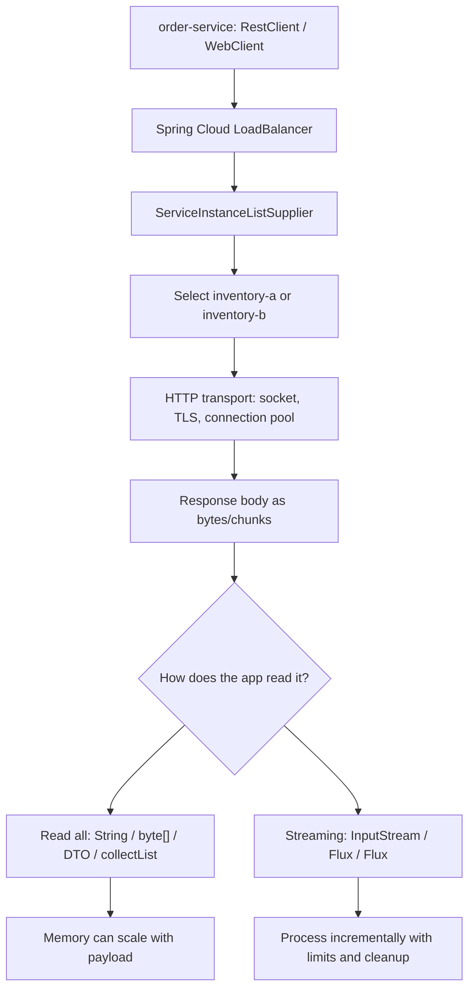

# Memory Limits When Reading Bodies, Buffering, and Streaming

In inter-microservice communication, Spring Cloud LoadBalancer helps the client select a `ServiceInstance` based on service ID, discovery, health checks, and routing policy. **Picking an instance does not guarantee reading the response safely within memory bounds.** If `inventory-service` returns an 80 MB JSON report, a 2 GB file, or a continuous event stream, how `order-service` reads the HTTP body determines whether application memory grows with payload size.

This lesson belongs to the **Connections and Performance** chapter of the `SPRING_CLOUD_SERVICE_COMMUNICATION_LOAD_BALANCING` module. The focus is distinguishing **full-body buffering** from **chunk-by-chunk reading**, understanding WebClient's `maxInMemorySize` and `DataBufferLimitException`, streaming via RestClient/WebClient, managing heap/direct memory and `DataBuffer`s, setting practical capacity limits, testing large payloads, and tying everything to connection pools, timeouts, retries, and performance observability.

> **Principle:** do not raise buffer limits endlessly to handle every large response. For small data, DTO/`String` is simple; for large files or continuous streams, use streaming, cap total bytes, control concurrency, and release resources properly.

## 1. Which Layers Does an HTTP Body Pass Through?

Suppose `order-service` calls the logical URL `http://inventory-service/api/v1/export` using a `@LoadBalanced` HTTP client:



Two responsibilities must remain separate:

- **Load balancing:** decides which instance receives the request. `spring.cloud.loadbalancer.cache.*` typically caches the **ServiceInstance list**, not HTTP response bodies.
- **HTTP body processing:** decides how responses are read, decoded, forwarded, or written. Memory limits here belong to the HTTP transport, codec/decoder, and application logic, not the round-robin algorithm.

Even if a service ID has three replicas, one download still connects to **one selected replica** for that attempt. Streaming does not mean LoadBalancer automatically stripes chunks across three different instances.

## 2. Three Data Shapes and Their Memory Demands

| Response Type | Example | Typically Suitable Reader | Primary Risk |
|---|---|---|---|
| Small JSON | `{"available":42}` | `bodyToMono(StockView.class)` or `body(StockView.class)` | DTO/codec needs memory, though bounded |
| Huge JSON array | Hundreds of thousands of records | Pagination or element-wise streaming if format/codec fits | Aggregating into a `List` inflates heap |
| Large file | ZIP, PDF export report, image/video | `InputStream` or `Flux<DataBuffer>` written to file/streaming sink | `byte[]` or `String` holds entire content |
| SSE / NDJSON | Continuous inventory change events | `Flux<ServerSentEvent<T>>`, `Flux<T>` | `collectList` never finishes or grows endlessly |
| File upload | Sending a file to another service | Streaming `Resource`/publisher with size limits | Loading the whole file into `byte[]`/memory before sending |

There is no rule saying "for large responses just use WebClient." **Synchronous RestClient can still stream via `InputStream`**; WebClient can also accidentally retain an entire body via `bodyToMono(byte[].class)` or `collectList()`.

### 2.1. Where Memory Gets Used

In an HTTP call, memory can be held in:

1. **Socket / TLS / transport buffers:** receive buffers, which may live in direct memory outside the Java heap.
2. **Decoder/codec buffers:** temporary buffers while assembling bytes to decode JSON, text, or a value.
3. **Java object graph:** DTOs, `String`, `byte[]`, and `List` objects created after decoding.
4. **Application buffers:** `ByteArrayOutputStream`, app caches, collections/reactive operators.
5. **Output queues:** data waiting to be written to disk, forwarded downstream, or returned to an HTTP caller.

Thus, a 10 MB JSON body **does not cost exactly 10 MB of heap**; there can be multiple intermediate copies, string/object overhead, or off-heap memory.

## 3. Concurrency-Based Risk Estimation Model

Suppose each request buffers a payload of average size `S`, and `C` requests are reading bodies concurrently. A minimal estimate of raw data held is:

```text
bufferedBytes ≈ concurrentResponses × bufferedBytesPerResponse
              ≈ C × S
```

Illustrative example:

```text
S = 12 MiB / response
C = 50 concurrent responses

C × S = 600 MiB raw data
```

600 MiB is a **rough raw-data approximation**, excluding the JSON object graph, connection buffers, request data, GC overhead, thread stacks, traces, and direct memory. It is not an exact formula for sizing `-Xmx`.

With retries, one logical call can go through multiple attempts. In some implementations, a failing attempt and a new attempt can briefly hold resources concurrently. Bound both in-flight requests and total deadlines, not just per-request memory.

### 3.1. What Does Streaming Change?

In a well-built streaming pipeline, retained memory depends more on **chunk size and in-flight chunks** than on total file size:

```text
streamingWorkingSet ≈ activeStreams × inFlightChunks × chunkSize
```

This is also only a mental model. Reactive operators have prefetch, network buffers, codecs, and output sinks that add queues. Streaming **does not guarantee constant memory** if an aggregating operator sits in the middle of the pipeline.

## 4. WebClient: Codec maxInMemorySize Limit

Spring Framework places a limit on how much data a codec will **buffer in memory**. Per the Spring WebClient reference documentation, codecs default to around **256 KiB**, and exceeding it can throw:

```text
org.springframework.core.io.buffer.DataBufferLimitException:
Exceeded limit on max bytes to buffer
```

This error commonly appears when:

- `bodyToMono(String.class)` has to assemble a large text body.
- `bodyToMono(byte[].class)` has to materialize an entire file as a byte array.
- One JSON value/object or one streaming element needs a decoder buffer larger than the limit.
- Reading an error body also requires buffering large content.
- A step calls `DataBufferUtils.join(...)` or a custom collector joins buffers past the configured limit.

**Crucial point:** `maxInMemorySize` is **not a total HTTP response size limit** for every API. It constrains **codec buffering while decoding a single value**. A streaming response of many small elements can exceed 256 KiB **in total** and still succeed as long as no single element/chunk forces buffering past the limit and there is no final collection.

### 4.1. Raising the Limit in a Controlled Way on WebClient.Builder

Example for an API with an accepted JSON response cap of up to 1 MiB:

```java
import org.springframework.cloud.client.loadbalancer.LoadBalanced;
import org.springframework.context.annotation.Bean;
import org.springframework.context.annotation.Configuration;
import org.springframework.web.reactive.function.client.WebClient;

@Configuration(proxyBeanMethods = false)
public class InventoryWebClientConfiguration {

    @Bean("inventoryWebClientBuilder")
    @LoadBalanced
    WebClient.Builder inventoryWebClientBuilder() {
        return WebClient.builder()
                .codecs(configurer ->
                        configurer.defaultCodecs()
                                .maxInMemorySize(1024 * 1024));
    }

    @Bean
    WebClient inventoryWebClient(
            @Qualifier("inventoryWebClientBuilder")
            WebClient.Builder builder) {

        return builder.baseUrl("http://inventory-service")
                .build();
    }
}
```

Add `import org.springframework.beans.factory.annotation.Qualifier;`. The builder is Spring-managed and annotated with `@LoadBalanced` so requests targeting `http://inventory-service` go through instance selection when Spring Cloud LoadBalancer and a compatible discovery/supplier exist.

Here `1024 * 1024` equals **1 MiB**. Never raise this to 1 GiB just to silence `DataBufferLimitException`: high concurrency will expose the JVM to heap pressure and GC pauses. If the response is a 1 GiB file, streaming is the right solution.

### 4.2. Customizing the Actual Client in Use

If your app has multiple `WebClient`s or multiple `WebClient.Builder`s, make sure the codec configuration is applied to the **builder that builds the client actually sending requests**. Modifying builder A will not affect a WebClient already built from builder B.

Spring Boot may apply customizations to builders through auto-configuration. When creating `WebClient.builder()` directly, check whether critical application customizers—such as metrics, TLS, proxies, or timeouts—are preserved. Boot properties managing codecs may vary in naming/application across versions; configuring directly via `WebClient.Builder.codecs(...)` illustrates the exact scope clearly.

## 5. Distinguishing DataBufferLimitException, OutOfMemoryError, and Timeouts

These three signals have very different causes:

| Signal | Primary Interpretation | Remediation Direction |
|---|---|---|
| `DataBufferLimitException` | Codec had to buffer a single value exceeding the configured threshold | Inspect payload/schema, paginate, stream, or raise threshold within bounds |
| `OutOfMemoryError: Java heap space` | Heap insufficient for live object graphs/buffers | Inspect heap dumps, concurrency, collectors, caches, and payload sizes |
| Direct memory pressure / Netty leak warning | Off-heap/pooled buffers held too long or not released | Check `DataBuffer` ownership, pool metrics, and cancellation |
| Response timeout | Client saw no progress/completion within deadline | Check service latency, network, response timeout, and retries |
| HTTP 413 from server/proxy | Upload request too large for receiver limits | Tune API contract/limits at the right layer, not download `maxInMemorySize` |
| HTTP 5xx | Service/proxy returned an error | Classify by status/transport; do not assume client memory exhaustion |

`DataBufferLimitException` is an intentional safeguard—**it does not mean the JVM is already out of memory**. Conversely, blindly raising `maxInMemorySize` to eliminate the exception can drive the system into OOM under large concurrent responses.

### 5.1. Things to Verify Before Raising the Limit

- The **actual** payload size, not just the `Content-Length` header.
- The body type being read: `String`, `byte[]`, JSON object, `Flux<T>`, or `Flux<DataBuffer>`.
- Whether the endpoint contract promises small JSON or actually returns large files/reports.
- Whether a single JSON/NDJSON element is abnormally long.
- Whether `collectList()`, string-joining `reduce`, `buffer()`, or `DataBufferUtils.join` runs downstream.
- How many requests and streams run concurrently.
- Whether pagination, NDJSON/SSE, or file streaming can replace buffering everything.

## 6. Reading Patterns That Cause Buffering

Several concise calls nonetheless retain large amounts of data:

```java
// Easy to read for small JSON, unsuitable for very large downloads.
Mono<byte[]> allBytes = webClient.get()
        .uri("/exports/report.bin")
        .retrieve()
        .bodyToMono(byte[].class);

// Creates a single String for the entire text body.
Mono<String> fullText = webClient.get()
        .uri("/exports/report.txt")
        .retrieve()
        .bodyToMono(String.class);

// Flux elements can stream,
// yet collectList retains the whole set on the heap.
Mono<List<EventView>> allEvents = webClient.get()
        .uri("/events")
        .retrieve()
        .bodyToFlux(EventView.class)
        .collectList();
```

`collectList()` can be fine when the element count has a small bound, yet on a long or unbounded stream it accumulates data and may never complete.

The following operations also deserve scrutiny:

| Operation | Memory Behavior to Watch |
|---|---|
| `bodyToMono(byte[].class)` | Returns the entire body as one byte array |
| `bodyToMono(String.class)` | Creates a `String` containing the entire body |
| `bodyToMono(List.class)` | Decodes and holds a large list/object graph |
| `bodyToFlux(T.class)` | Decodes incrementally, though each item still uses memory |
| `bodyToFlux(DataBuffer.class)` | Exposes raw buffers; ownership must be managed |
| `collectList()` | Collects all emitted elements |
| `buffer(1000)` | Batches 1000 elements at a time, enlarging working set |
| `cache()` on a long Flux | Retains signals/items for replay, inflating memory |
| `DataBufferUtils.join(source)` | Merges buffers into one `DataBuffer`, not streaming-to-file |
| Fire-and-forget `subscribe()` | Loses control of lifetime, errors, and cancellation |

Merely using `Flux` does not guarantee efficient streaming: a pipeline only keeps that property if processing stages and sinks **do not accumulate unbounded data**.

## 7. RestClient: Streaming Responses via InputStream in exchange

With a synchronous client, `RestClient` can process the response while the stream is still open via `exchange(...)`. This differs from `retrieve().body(byte[].class)`, where the caller asks for the entire byte array.

Example of a downloader built from a `@LoadBalanced` `RestClient.Builder`:

```java
import java.io.IOException;
import java.io.InputStream;
import java.io.OutputStream;
import java.io.UncheckedIOException;
import java.nio.file.Files;
import java.nio.file.Path;

import org.springframework.web.client.RestClient;

public final class InventoryExportDownloader {

    private static final long MAX_DOWNLOAD_BYTES =
            200L * 1024L * 1024L; // 200 MiB

    private final RestClient client;

    public InventoryExportDownloader(RestClient client) {
        this.client = client;
    }

    public long download(String exportId, Path target) {

        // target must be an application-managed temp file;
        // never pass an arbitrary user-supplied existing file path.
        try {
            return client.get()
                    .uri("http://inventory-service/api/v1/exports/{id}",
                            exportId)
                    .exchange((request, response) -> {
                        if (!response.getStatusCode()
                                .is2xxSuccessful()) {
                            throw new IllegalStateException(
                                    "Export HTTP "
                                    + response.getStatusCode());
                        }

                        try (InputStream input =
                                     response.getBody();
                             OutputStream output =
                                     Files.newOutputStream(target)) {
                            return copyBounded(
                                    input, output, MAX_DOWNLOAD_BYTES);
                        } catch (IOException error) {
                            throw new UncheckedIOException(error);
                        }
                    });
        } catch (RuntimeException failure) {
            try {
                Files.deleteIfExists(target);
            } catch (IOException cleanupFailure) {
                failure.addSuppressed(cleanupFailure);
            }
            throw failure;
        }
    }

    private static long copyBounded(
            InputStream input,
            OutputStream output,
            long limit) throws IOException {

        byte[] chunk = new byte[16 * 1024];
        long total = 0;
        int count;

        while ((count = input.read(chunk)) != -1) {
            if (count > limit - total) {
                throw new IOException(
                        "Download exceeds configured limit");
            }

            output.write(chunk, 0, count);
            total += count;
        }

        return total;
    }
}
```

Technical points:

- The response is read in **16 KiB chunks**, never allocating a `byte[]` the size of the file.
- Read/write the response **only inside the `exchange` callback**. Never leak the `InputStream` outside the callback for use after the response closes.
- `exchange` reads statuses/headers directly; **status handlers from `retrieve()` do not automatically apply** inside `exchange`. Check status codes explicitly as shown.
- `MAX_DOWNLOAD_BYTES` is an **application-enforced total size quota**, independent of WebClient's `maxInMemorySize`.
- On mid-stream failure, the snippet attempts to delete the incomplete target file. For production, write to a **temporary file**, verify checksum/size, and **atomically move** on completion.
- `target` must come from trusted code; never concatenate raw user filenames onto a system path.

**Request factory caveat:** streaming via `InputStream` does not guarantee every request factory or HTTP client version avoids transport-layer buffering. Verify the actual implementation and config, especially when using proxies, decompression, or body-logging interceptors.

### 7.1. Creating a Load-Balanced RestClient

```java
@Configuration(proxyBeanMethods = false)
class ExportClientConfiguration {

    @Bean("loadBalancedRestClientBuilder")
    @LoadBalanced
    RestClient.Builder loadBalancedRestClientBuilder() {
        return RestClient.builder();
    }

    @Bean
    InventoryExportDownloader exportDownloader(
            @Qualifier("loadBalancedRestClientBuilder")
            RestClient.Builder builder) {

        return new InventoryExportDownloader(
                builder.build());
    }
}
```

Imports belong to `org.springframework.context.annotation.*`, `org.springframework.cloud.client.loadbalancer.LoadBalanced`, and `org.springframework.beans.factory.annotation.Qualifier`. Here the URL uses the `inventory-service` hostname; Spring Cloud LoadBalancer selects an instance before the transport receives and reads the response. Creating a plain `RestClient` without the annotated builder may send the URI through regular DNS.

## 8. WebClient: Receiving Incremental DataBuffers

WebClient supports streaming bodies as `Flux<DataBuffer>`:

```java
import org.springframework.core.io.buffer.DataBuffer;
import reactor.core.publisher.Flux;

Flux<DataBuffer> chunks = webClient.get()
        .uri("http://inventory-service/api/v1/exports/report.bin")
        .retrieve()
        .bodyToFlux(DataBuffer.class);
```

Here each `DataBuffer` is a slice of data, not the entire response. Actual chunk sizes depend on the HTTP stack, TLS, network, codecs, and upstream; **never assume every chunk is always 16 KiB**.

When working at the low level with `DataBuffer`, manage **ownership**. On Reactor Netty, many buffers may be `PooledDataBuffer`s using reference counting. Failing to release after reading can leak direct/pooled memory.

### 8.1. Example: Counting Bytes Without Buffering the Body

```java
import org.springframework.core.io.buffer.DataBuffer;
import org.springframework.core.io.buffer.DataBufferUtils;
import reactor.core.publisher.Mono;

Mono<Long> bodyLength = webClient.get()
        .uri("http://inventory-service/api/v1/exports/report.bin")
        .retrieve()
        .bodyToFlux(DataBuffer.class)
        .map(buffer -> {
            try {
                return (long) buffer.readableByteCount();
            } finally {
                DataBufferUtils.release(buffer);
            }
        })
        .reduce(0L, Long::sum);
```

This pipeline only sums chunk lengths. It holds an accumulating `long` and the buffer currently being processed, **never holding the whole response in a byte array**.

However, in pipelines with `filter`, `flatMap`, `take`, or cancellation, watch for buffers **discarded before reaching `map`**. Add `doOnDiscard(DataBuffer.class, DataBufferUtils::release)` at appropriate points per the Spring Data Buffers guide to prevent leaks on discard. Never release the same buffer twice or retain it after release.

### 8.2. Do Not Use Unmanaged subscribe()

Avoid this pattern:

```java
webClient.get()
        .uri("/exports/report.bin")
        .retrieve()
        .bodyToFlux(DataBuffer.class)
        .subscribe(); // no consumption/release, no result coordination
```

This snippet has no subscriber handling buffer ownership, propagates no completion/error to the caller, and is hard to cancel on client disconnect. Instead of calling `subscribe()` ad hoc inside a service, **return the publisher** so the caller controls subscription, cancellation, and results.

## 9. Streaming Responses to Disk with DataBufferUtils.write

When the goal is saving a file, Spring provides the `DataBufferUtils.write(Publisher<DataBuffer>, Path, OpenOption...)` overload returning `Mono<Void>` to signal completion or failure.

Example:

```java
import java.nio.file.Path;
import java.nio.file.StandardOpenOption;

import org.springframework.core.io.buffer.DataBuffer;
import org.springframework.core.io.buffer.DataBufferUtils;
import org.springframework.web.reactive.function.client.WebClient;

import reactor.core.publisher.Flux;
import reactor.core.publisher.Mono;

public final class ReactiveExportDownloader {

    private final WebClient client;

    public ReactiveExportDownloader(WebClient client) {
        this.client = client;
    }

    public Mono<Void> download(String exportId, Path temporaryFile) {
        Flux<DataBuffer> source = client.get()
                .uri("http://inventory-service/api/v1/exports/{id}",
                        exportId)
                .retrieve()
                .bodyToFlux(DataBuffer.class);

        return DataBufferUtils.write(
                source,
                temporaryFile,
                StandardOpenOption.CREATE,
                StandardOpenOption.TRUNCATE_EXISTING,
                StandardOpenOption.WRITE);
    }
}
```

**Details to verify against actual APIs:**

- `temporaryFile` must be a valid, writable path; never pass raw paths from user URLs.
- When the `Mono` completes, the file can be moved from the temp path to its final destination after verifying size/checksum.
- If the stream errors, is cancelled, or exceeds size limits, **clean up the incomplete file**.
- Do not call `Files.readAllBytes(temporaryFile)` immediately afterward if the goal was to avoid buffering the whole file.
- Distinguish the `write` overload accepting `Path` from overloads accepting `OutputStream`/channels; per Javadoc, channel overloads **do not automatically release buffers or close the channel**, so callers using them must handle resources, releases, and termination explicitly.
- With low-level `DataBuffer`s, check release/cancellation rules for your Spring Framework version.

The example above illustrates streaming-to-disk **without yet enforcing a total byte quota**. In production, add download caps, disk quotas, temp file naming, checksums, and error cleanup.

### 9.1. Streaming and Error Responses

With `retrieve()`, WebClient normally turns HTTP 4xx/5xx into errors. When you need to inspect `Content-Length` before consuming the body or classify statuses in detail, use `exchangeToFlux(...)`/`exchangeToMono(...)` and decide how to consume the body inside the callback.

```java
Flux<DataBuffer> source = webClient.get()
        .uri("/exports/report.bin")
        .exchangeToFlux(response -> {
            if (!response.statusCode().is2xxSuccessful()) {
                return response.createError().flux();
            }

            return response.bodyToFlux(DataBuffer.class);
        });
```

`exchangeToFlux` handles releasing unconsumed body parts after the publisher completes per Spring's contract, yet **`DataBuffer`s actively received and retained by application code still require proper ownership handling**.

## 10. Enforcing a Total Size Limit Inside the Streaming Pipeline

Codec limits **do not replace** a download's total size quota. If an API can stream forever, the app can still fill the disk.

A straightforward approach is checking `Content-Length` to reject early when the declared header is too large, and **still counting actual received bytes** because the header may be missing, inaccurate, or chunked transfer encoding may be used.

Example wrapping the source with a byte-counting operator:

```java
import java.util.concurrent.atomic.AtomicLong;

import org.springframework.core.io.buffer.DataBuffer;
import org.springframework.core.io.buffer.DataBufferUtils;

import reactor.core.publisher.Flux;

static Flux<DataBuffer> limitBody(
        Flux<DataBuffer> source, long maxBytes) {

    AtomicLong counter = new AtomicLong();

    return source.<DataBuffer>handle((buffer, sink) -> {
        long size = buffer.readableByteCount();
        long before = counter.get();

        if (size > maxBytes - before) {
            DataBufferUtils.release(buffer);
            sink.error(new IllegalStateException(
                    "Downloaded body exceeds limit"));
            return;
        }

        counter.addAndGet(size);
        sink.next(buffer);
    }).doOnDiscard(
            DataBuffer.class,
            DataBufferUtils::release);
}
```

The **one subscriber per invocation** invariant matters: `AtomicLong` is allocated when calling `limitBody(...)`. If a `Flux` holding this counter is reused across multiple subscriptions, the counter gets shared and skews counts. In a service, construct a fresh pipeline per logical download (e.g., via `Flux.defer(...)`).

When the limit is exceeded:

1. The current buffer is already released in the error branch.
2. The publisher emits `onError`, stopping downstream writes.
3. The response is cancelled/closed per the HTTP client's contract.
4. Any partially written temporary file must be deleted.
5. Log the cause as `BODY_LIMIT_EXCEEDED`, not as a network timeout.

**Note:** hand-written `DataBuffer` pipelines require thorough testing of cancel/discard paths to avoid missing releases or double-releases. When reactive isn't required, an `InputStream` + byte counter like the RestClient example in Section 7 is easier to reason about.

## 11. Streaming JSON, NDJSON, and SSE

Streaming does not have to mean raw bytes. Spring WebClient can decode elements of a stream incrementally, provided the **server format matches**.

### 11.1. Small JSON Objects

```java
Mono<StockView> item = webClient.get()
        .uri("/items/{sku}", "SKU-001")
        .retrieve()
        .bodyToMono(StockView.class);
```

Suitable when a single object is reasonably sized. One giant JSON object can still exceed `maxInMemorySize` when the codec has to buffer data for **a single value**.

### 11.2. NDJSON: One Object per Line

Server returns `application/x-ndjson`:

```text
{"sku":"SKU-001","available":10}
{"sku":"SKU-002","available":6}
{"sku":"SKU-003","available":3}
```

Client:

```java
Flux<StockView> updates = webClient.get()
        .uri("/exports/stock.ndjson")
        .accept(MediaType.parseMediaType(
                "application/x-ndjson"))
        .retrieve()
        .bodyToFlux(StockView.class);
```

The app can process each record—for example writing to storage or updating metrics—instead of collecting everything into a `List`. Each individual record still must fit within codec and memory budgets. One abnormally long NDJSON line can still trigger `DataBufferLimitException`.

### 11.3. Server-Sent Events (SSE)

```java
import org.springframework.core.ParameterizedTypeReference;
import org.springframework.http.MediaType;
import org.springframework.http.codec.ServerSentEvent;

Flux<String> events = webClient.get()
        .uri("/events/stock")
        .accept(MediaType.TEXT_EVENT_STREAM)
        .retrieve()
        .bodyToFlux(
                new ParameterizedTypeReference<
                        ServerSentEvent<String>>() {})
        .filter(event -> event.data() != null)
        .map(ServerSentEvent::data);
```

SSE can be an infinite stream; **never call `collectList()`** without a bounding condition. Handle reconnects, heartbeats, event IDs, cancellation, and backpressure according to the API contract.

### 11.4. Large JSON Arrays and Pagination

`bodyToFlux(StockView.class)` can incrementally decode elements of a JSON array when the decoder supports streaming, though do not assume every format/codec handles every array without buffering. Moreover, a single `StockView` could still exceed the per-value limit.

For query APIs with finite data, **pagination** is usually easier to operate: cap items per page, response size, in-flight pages, and query time. Streaming fits exports/events, whereas pagination fits read/filter APIs with explicit retries and checkpoints.

## 12. Streaming Uploads: Never Load Entire Files into byte[]

For uploads, the following pattern forces the entire file onto the heap:

```java
byte[] all = Files.readAllBytes(path);

webClient.post()
        .uri("/files")
        .bodyValue(all)
        .retrieve()
        .toBodilessEntity();
```

For large files, use a resource/file publisher instead. WebClient example:

```java
import java.nio.file.Path;

import org.springframework.core.io.FileSystemResource;
import org.springframework.http.MediaType;
import org.springframework.web.reactive.function.BodyInserters;

Mono<Void> upload(Path path) {
    return webClient.post()
            .uri("http://inventory-service/api/v1/files")
            .contentType(
                    MediaType.APPLICATION_OCTET_STREAM)
            .body(BodyInserters.fromResource(
                    new FileSystemResource(path)))
            .retrieve()
            .bodyToMono(Void.class);
}
```

Exact optimization/streaming behavior depends on the transport and request body inserter; verify with your actual request factory/connector and filesystem. For multipart uploads, use multipart builders/file resources rather than constructing a single `byte[]` holding all parts.

Upload limits also live on the **receiving service, reverse proxy, and gateway**—for example multipart max file/request sizes in Servlet or WebFlux. Client-side WebClient `maxInMemorySize` **does not** replace server/multipart limits. On a WebFlux server, file parts may spool to disk past a threshold and are subject to separate disk/part quotas.

### 12.1. Upload Retries and Body Replayability

If an upload is retried after a timeout:

- The `Resource` must still be readable on the next attempt.
- A one-shot `InputStream` may already have been consumed.
- The file must still exist and remain unmodified between attempts.
- The server must know whether uploads are idempotent or resumable.
- For multi-GB files, full retries can consume massive network and disk bandwidth.

For huge uploads, design **chunked/resumable uploads** at the API layer with checksums and offsets. That is a **separate business contract**, not something LoadBalancer generates automatically.

## 13. Backpressure: Streaming Does Not Automatically Prevent Queuing

In Reactor, `Flux<DataBuffer>` normally uses demand signaling so downstream communicates its consumption pace. However, operators with prefetch/queues or bridges to blocking APIs can still inflate memory.

Things to watch out for:

- `flatMap` can process many elements concurrently and hold pending data.
- `buffer(n)` accumulates `n` items at once.
- Unbounded `onBackpressureBuffer()` can grow queues enormously.
- `publishOn(...)` maintains scheduler queues/prefetch buffers.
- `collectList()` defeats item-by-item processing.
- Slow file/DB writes can cause data to back up across multiple layers.
- Upstream clients may not support end-to-end backpressure via the same mechanism.

A safer pattern when items must be processed sequentially:

```java
Flux<StockView> source = webClient.get()
        .uri("/exports/stock.ndjson")
        .retrieve()
        .bodyToFlux(StockView.class);

Mono<Void> completed = source
        .concatMap(item -> writeOneItem(item))
        .then();
```

Here `writeOneItem` is a **custom method returning `Mono<Void>`** and must perform I/O without blocking the event loop. `concatMap` preserves ordering and avoids launching many concurrent operations like default `flatMap`, yet you must still inspect prefetch and resource bounds on the specific publisher.

If `writeOneItem` uses blocking JDBC or `Files.copy`, offload it onto `Schedulers.boundedElastic()` or use an appropriate async API; never run blocking I/O directly on the Reactor Netty event loop.

### 13.1. Cancellation Is Also a Path to Test

Clients can cancel a stream because:

- The caller disconnects.
- A deadline expires.
- `take(n)` only needs `n` elements.
- A test cancels the subscription.
- The service shuts down.

On cancellation, release unconsumed `DataBuffer`s, close files/channels, and clean up temp files. If the response was not fully consumed, the connection may need to close rather than be reused depending on the HTTP client. Never assume every cancellation leaves the connection reusable like a full body read.

## 14. Connection Pools, Timeouts, and Memory Must Be Designed Together

Spring Cloud LoadBalancer selects the instance; the HTTP transport typically manages a **connection pool** to reuse connections per real destination address, including host/port/TLS. Picking another instance may hit a different pool/connection key or open a new connection, depending on the transport.

A large stream keeps a connection busy for a long time. With hundreds of slow downloads, the problem can be **pool exhaustion** or backpressure, not just `maxInMemorySize`.

### 14.1. Independent Limits

| Limit | Controls | Does NOT Control |
|---|---|---|
| Codec `maxInMemorySize` | WebClient codec buffering for a single value | Total download bytes or concurrent stream count |
| Download size quota | Total bytes accepted by the application | Connection duration or connection count |
| Connection pool max | Concurrent connections per provider/pool | Decoder bytes currently held on the heap |
| Pending acquire timeout | Wait time to borrow a connection from the pool | Time for the server to transmit the full body |
| Connect timeout | Time to establish a connection | Total response body transfer |
| Response/read timeout | Data wait time per transport semantics | Overall deadline across all retries |
| Overall deadline | Max duration of a logical operation | Automatically choosing chunk sizes or codec buffers |
| Retry budget | Number of attempts/instance re-selections | Automatically making write operations idempotent |

When using Reactor Netty, you can configure `HttpClient` with a `ConnectionProvider` and response timeout. Illustrative configuration:

```java
import java.time.Duration;

import io.netty.channel.ChannelOption;
import reactor.netty.http.client.HttpClient;
import reactor.netty.resources.ConnectionProvider;

import org.springframework.http.client.reactive.ReactorClientHttpConnector;
import org.springframework.web.reactive.function.client.WebClient;

ConnectionProvider provider = ConnectionProvider
        .builder("inventory-requests")
        .maxConnections(80)
        .pendingAcquireTimeout(Duration.ofSeconds(2))
        .build();

HttpClient httpClient = HttpClient.create(provider)
        .option(ChannelOption.CONNECT_TIMEOUT_MILLIS, 2000)
        .responseTimeout(Duration.ofSeconds(10));

WebClient client = loadBalancedBuilder
        .clientConnector(
                new ReactorClientHttpConnector(httpClient))
        .baseUrl("http://inventory-service")
        .build();
```

Here `loadBalancedBuilder` is a Spring-managed `@LoadBalanced WebClient.Builder`. The values 80/2s/10s are **illustrative configuration only**, not fixed recommendations for every system.

Important notes:

- Manage the lifecycle of `ConnectionProvider`; avoid creating a new provider **per request**.
- Pool size must fit traffic, downstream capacity, and caller instance counts.
- Response timeout does not automatically guarantee multi-GB files finish in 10 seconds; verify exact timeout semantics for your Reactor Netty version.
- Long-running streams hold connections busy, so bound concurrent streams and disk/network throughput.
- When a retry switches to another instance, it may open a new connection; account for retry and pool budgets together.

## 15. Retries, Caching, and Health Checks During Streaming

### 15.1. Retrying a Partially Received Response

Suppose A returned 50 MiB of a file before the connection dropped. The client retries to B:

```text
attempt 1:
  inventory-a -> bytes 0..49 MiB -> connection reset

attempt 2:
  inventory-b -> ??? 
```

**Never append bytes from the second attempt onto the first attempt's file** without an explicit contract guaranteeing identical content version and byte offset.

Appropriate strategies:

- For small/medium files: delete the failed attempt's temp file and re-download **from byte 0**.
- For large files: use `Range`, `ETag`/`If-Range`, checksums, object versions, or a purpose-built resume API.
- For event streams: use event IDs/checkpoints and deduplication instead of assuming retries never drop or duplicate events.
- For POST uploads: use idempotency or an upload session/chunk protocol.

Spring Cloud LoadBalancer **does not stitch together a broken byte stream** from two instances into one valid file. Same/next-instance selection only determines the target of an attempt; response consistency must be enforced by the application.

### 15.2. LoadBalancer Cache Is Not a Body Cache

`CachingServiceInstanceListSupplier` can cache instance lists to cut discovery lookups. It does not solve large memory footprints caused by `bodyToMono(byte[].class)` or `collectList()`.

If instance B goes down while the cache holds stale data, file downloads can hit connection errors. That is a list-freshness issue, completely distinct from `DataBufferLimitException`.

### 15.3. Health Checks Cannot Rescue an In-Flight Stream

Health checks can filter instances before the next selection. They cannot seamlessly migrate an already-open stream from instance A to B if A dies mid-transfer. Application-layer retry/resume contracts are needed.

### 15.4. Hints and Zones

Zone/hint routing can cause download requests to pick different instance groups. If a file exists only locally on A, retrying to B can return 404 even though B is healthy. For large downloadable artifacts, store files in shared object storage or use a consistent distribution strategy across instances.

## 16. Test Scenario: 512 KiB Body and a 256 KiB Limit

A small experiment helps separate **buffering** from **streaming**:

1. Start a local HTTP server returning 512 KiB of `text/plain`.
2. Create a WebClient with `maxInMemorySize=256 * 1024`.
3. Read with `bodyToMono(String.class)`: expect the codec to report the buffer limit.
4. Read the same endpoint with `bodyToFlux(DataBuffer.class)`, release each buffer, and sum byte counts: expect all 512 KiB without buffering the entire body.
5. Raise the codec threshold to 1 MiB and re-read `bodyToMono(String.class)`: with this payload it should succeed.
6. Separate concurrent load and download-to-file tests from this baseline test.

JUnit example with JDK `HttpServer` and WebClient. Because this is a **codec/body** test, it hits the local URL directly; LoadBalancer integration testing via service ID is a separate step.

```java
import java.io.IOException;
import java.io.OutputStream;
import java.net.InetSocketAddress;
import java.nio.charset.StandardCharsets;

import com.sun.net.httpserver.HttpServer;
import org.junit.jupiter.api.AfterAll;
import org.junit.jupiter.api.Test;
import org.springframework.core.io.buffer.DataBufferUtils;
import org.springframework.core.io.buffer.DataBufferLimitException;
import org.springframework.web.reactive.function.client.WebClient;
import reactor.test.StepVerifier;

import static org.junit.jupiter.api.Assertions.assertEquals;

class WebClientBodyMemoryTest {

    static final byte[] PAYLOAD =
            "x".repeat(512 * 1024)
                    .getBytes(StandardCharsets.UTF_8);

    static final HttpServer SERVER = startServer();

    static String url() {
        return "http://127.0.0.1:"
                + SERVER.getAddress().getPort() + "/large";
    }

    @Test
    void aggregatingExceedsCodecLimit() {
        WebClient client = WebClient.builder()
                .codecs(c -> c.defaultCodecs()
                        .maxInMemorySize(256 * 1024))
                .build();

        StepVerifier.create(client.get()
                        .uri(url())
                        .retrieve()
                        .bodyToMono(String.class))
                .expectError(DataBufferLimitException.class)
                .verify();
    }

    @Test
    void rawStreamingCanCountAllBytes() {
        WebClient client = WebClient.builder()
                .codecs(c -> c.defaultCodecs()
                        .maxInMemorySize(256 * 1024))
                .build();

        StepVerifier.create(client.get()
                .uri(url())
                .retrieve()
                .bodyToFlux(
                        org.springframework.core.io.buffer
                                .DataBuffer.class)
                .map(buffer -> {
                    try {
                        return (long) buffer.readableByteCount();
                    } finally {
                        DataBufferUtils.release(buffer);
                    }
                })
                .reduce(0L, Long::sum))
                .expectNext((long) PAYLOAD.length)
                .verifyComplete();
    }

    @Test
    void higherBoundAllowsSmallEnoughTextBody() {
        WebClient client = WebClient.builder()
                .codecs(c -> c.defaultCodecs()
                        .maxInMemorySize(1024 * 1024))
                .build();

        StepVerifier.create(client.get()
                .uri(url())
                .retrieve()
                .bodyToMono(String.class)
                .map(String::length))
                .expectNext(PAYLOAD.length)
                .verifyComplete();
    }

    @AfterAll
    static void stop() {
        SERVER.stop(0);
    }

    private static HttpServer startServer() {
        try {
            HttpServer server = HttpServer.create(
                    new InetSocketAddress("127.0.0.1", 0),
                    0);

            server.createContext("/large", exchange -> {
                exchange.getResponseHeaders().set(
                        "Content-Type",
                        "text/plain; charset=UTF-8");

                exchange.sendResponseHeaders(
                        200, PAYLOAD.length);

                try (OutputStream out =
                             exchange.getResponseBody()) {
                    out.write(PAYLOAD);
                }
            });

            server.start();
            return server;
        } catch (IOException error) {
            throw new ExceptionInInitializerError(error);
        }
    }
}
```

### 16.1. Prerequisites to Run the Test

- Compatible `spring-webflux`/`spring-boot-starter-webflux`, Reactor Netty connector if using the default Netty HTTP client, JUnit 5, and `reactor-test`.
- The server binds to an ephemeral port; no service registry is required.
- Text payload is pure ASCII, so string length equals UTF-8 byte count in the test.
- `DataBufferLimitException` may be wrapped inside another exception in some versions/integrations; in that case unwrap the exception chain properly instead of dropping the assertion.
- When running inside a suite where tests share caches/contexts, isolate the client and server.
- Do not treat the 512 KiB test outcome as a benchmark of throughput or heap usage under real load.

### 16.2. Separate LoadBalancer Integration Check

After the codec test, configure two servers A/B under service ID `inventory-service` using `SimpleDiscoveryClient` and a `@LoadBalanced WebClient.Builder`:

```properties
spring.cloud.discovery.client.simple.instances.inventory-service[0].uri=http://localhost:18081
spring.cloud.discovery.client.simple.instances.inventory-service[1].uri=http://localhost:18082
```

Logical call:

```java
Flux<DataBuffer> data = loadBalancedWebClient.get()
        .uri("http://inventory-service/large")
        .retrieve()
        .bodyToFlux(DataBuffer.class);
```

This assumes `loadBalancedWebClient` was built from a `@LoadBalanced` builder. To verify which instance served the request, have each server return `X-Instance-Id` or log its ID. Never hardcode localhost with a direct port and conclude LoadBalancer picked the instance.

## 17. Measuring Real Performance: Do Not Watch Heap Alone

A system can show steady heap yet still crawl because pools are tied up by long-lived streams, or leak direct memory because `DataBuffer`s are never released.

| Metric Group | Data to Measure | Meaning |
|---|---|---|
| Java heap | Used heap, allocation rate, GC pauses | Are large DTOs/`byte[]`/`List`s being buffered? |
| Direct/pooled memory | Netty allocator gauges, leak warnings | Are pooled/connection buffers held too long? |
| HTTP transport | Active/idle connections, pending acquires, timeouts | Does the pool have enough capacity? |
| Streaming | Concurrent streams, bytes transferred, bytes/sec, duration | Are files/events tying up resources too long? |
| Decoder | `DataBufferLimitException` count, JSON decode failures | Are payloads breaching per-value limits? |
| Request failures | 413, 429, 5xx, resets, timeouts, cancellations | Which layer is failing? |
| LoadBalancer | Service ID, instance count, selection distribution, retries | Are failures tied to instance selection? |
| Disk | Temp file count, occupied bytes, free space, cleanup errors | Is streaming-to-file filling the disk? |
| Application | P95/P99 latency, in-flight requests, queue sizes | Is there concurrency/backpressure strain? |

Record results as a comparison table:

| Scenario | Body size | Method | Concurrency | Peak heap | Direct memory | P95 latency | Success/error |
|---|---:|---|---:|---:|---:|---:|---|
| Small JSON | 4 KiB | `bodyToMono(DTO)` | 20 | Measure | Measure | Measure | Measure |
| Large text | 8 MiB | `bodyToMono(String)` | 20 | Measure | Measure | Measure | Measure |
| Large file | 100 MiB | Streaming-to-file | 20 | Measure | Measure | Measure | Measure |
| NDJSON | 100,000 records | `bodyToFlux(DTO)` | 10 | Measure | Measure | Measure | Measure |

**Never fill in numbers before actually running the experiment.** If streaming uses less heap yet hurts P95 latency, the cause could be the file sink, disk I/O, connection pool, or backpressure—not just the codec.

### 17.1. Keep High-Cardinality Dimensions Out of Metrics

Never attach individual filenames, request IDs, full URL query strings, or instance IPs as Micrometer tags when cardinality is unbounded. Use `serviceId`, endpoint templates, outcome categories, and size buckets; keep per-request details in sampled logs/traces.

## 18. Common Issues and How to Fix Them

| Symptom | Possible Cause | How to Fix |
|---|---|---|
| `DataBufferLimitException` reading a large file | `bodyToMono(byte[].class)`/`String` or codec forced to buffer a large value | Stream the file or raise the limit within bounds |
| Raised limit yet still hits OOM | Excess concurrency, `collectList`, multiple DTO copies | Cap concurrency, paginate, stream, and profile heap |
| `bodyToFlux` still grows heap | Downstream `collectList`/`buffer`/`cache`/unbounded queue | Audit the entire pipeline and backpressure |
| Direct memory climbs steadily | `DataBuffer` retained or never released | Check ownership, `doOnDiscard`, and Netty leak detection |
| Incomplete downloaded bytes | Mid-stream cancellation, disk/network error, timeout | Temp files, checksums, atomic move, contract-backed retry/resume |
| Error response triggers `DataBufferLimitException` | Oversized error body buffered by error handler | Cap error body reading and use appropriate status handling |
| Raising pool size fails to boost throughput | Slow downstream, slow disk, or too many streams | Bound concurrent requests and analyze bottlenecks |
| Upload returns 413 despite higher client `maxInMemorySize` | Server/proxy upload cap | Tune server/proxy request limits and API contract |
| Large JSON array remains slow | Many objects retained downstream | Paginate or stream-process; avoid `collectList` |
| SSE connection never terminates | Long-lived stream by design | Heartbeats, cancellation, dedicated connection budget |
| File retry produces corrupt content | Appended attempts with different versions/offsets | Restart from byte 0 or use valid `Range`/`ETag`/resume |
| Calls go to a fixed IP without LoadBalancer | Client skips service ID or lacks `@LoadBalanced` | Check builder, URI, and supplier |
| Stream from a dying instance still fails | Health checks only govern the next selection | Handle retry/resume at the application layer |
| Transfer time rises after adding instances | New pool entries open connections/TLS, or routing changed | Measure connect time, per-target pools, and selected instances |

## 19. Safe Implementation Checklist

1. Determine whether the endpoint returns a small DTO, large JSON array, file, NDJSON, or SSE.
2. Use `bodyToMono(DTO)` or `RestClient.body(DTO.class)` for small, bounded, well-defined schemas.
3. Avoid `byte[]`/`String`/`collectList` when payloads can grow large.
4. Remember `maxInMemorySize` caps single-value codec buffering; do not confuse it with total HTTP size.
5. With WebClient raw chunks, manage `DataBuffer` ownership, release, and discard/cancel paths.
6. With RestClient, read `InputStream` inside the `exchange` callback; never use it after the response closes.
7. Stream downloads to temp files, verify checksum/size, clean up on error/cancel, and promote atomically.
8. Enforce a **total received byte limit** rather than trusting `Content-Length` alone.
9. Enforce disk quotas and concurrent stream limits.
10. Configure connection pools, pending acquires, connect/response timeouts, and overall deadlines appropriately.
11. Do not enable unconditional retries on file downloads or POSTs; define restart, `Range`/`ETag`, or idempotency rules.
12. Check whether proxies/gateways buffer bodies or impose their own size limits.
13. Use `@LoadBalanced` builders and service IDs when Spring Cloud LoadBalancer should select instances.
14. Measure heap, direct memory, pool active/pending, transferred bytes, P95/P99, and error rates.
15. Test low thresholds triggering errors, successful streaming, quota-exceeded bodies, cancellations, and server disconnects.
16. Never allow users to directly supply target file paths or internal host URLs.

## 20. Summary

**Memory limits when reading HTTP bodies** are governed by how the client decodes, buffers, and consumes data—not by Spring Cloud LoadBalancer alone. `RestClient` can stream via `InputStream` inside `exchange`; `WebClient` can process chunks via `Flux<DataBuffer>` or records via `Flux<T>`. Conversely, `bodyToMono(String.class)`, `bodyToMono(byte[].class)`, and `collectList()` can retain large amounts of data in memory.

WebClient enforces a codec `maxInMemorySize` (around **256 KiB** by default per Spring Framework docs) to prevent excessive buffering of a single value; exceeding it can throw `DataBufferLimitException`. This is **not a total download quota**. Reliable large-payload handling requires true streaming, byte-count limits, `DataBuffer` ownership, disk cleanup, connection pool tuning, concurrency caps, timeouts, and backpressure.

Within the `SPRING_CLOUD_SERVICE_COMMUNICATION_LOAD_BALANCING` module, LoadBalancer still selects a `ServiceInstance` per attempt via discovery/health/routing. When a stream breaks, LoadBalancer does not automatically stitch data from another instance; retries and resumes must follow application-level contracts. Thorough testing must verify both the service-ID routing path and body memory, byte counts, connection usage, and outcomes across load levels.

### References

- [Spring Framework — WebClient Configuration: MaxInMemorySize](https://docs.spring.io/spring-framework/reference/web/webflux-webclient/client-builder.html) — default codec threshold and configuration.
- [Spring Framework — Data Buffers and Codecs](https://docs.spring.io/spring-framework/reference/core/databuffer-codec.html) — pooled buffers, `DataBufferUtils`, releasing, and discarding.
- [Spring Framework — DataBufferUtils Javadoc](https://docs.spring.io/spring-framework/docs/current/javadoc-api/org/springframework/core/io/buffer/DataBufferUtils.html) — `write`, `read`, `join` overloads, and resource semantics.
- [Spring Framework — REST Clients](https://docs.spring.io/spring-framework/reference/integration/rest-clients.html) — RestClient `exchange` and WebClient APIs.
- [Spring Cloud Commons — Spring Cloud LoadBalancer](https://docs.spring.io/spring-cloud-commons/reference/spring-cloud-commons/loadbalancer.html) — service IDs, instance suppliers, caching, health, and instance selection.
