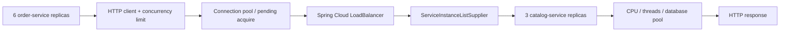
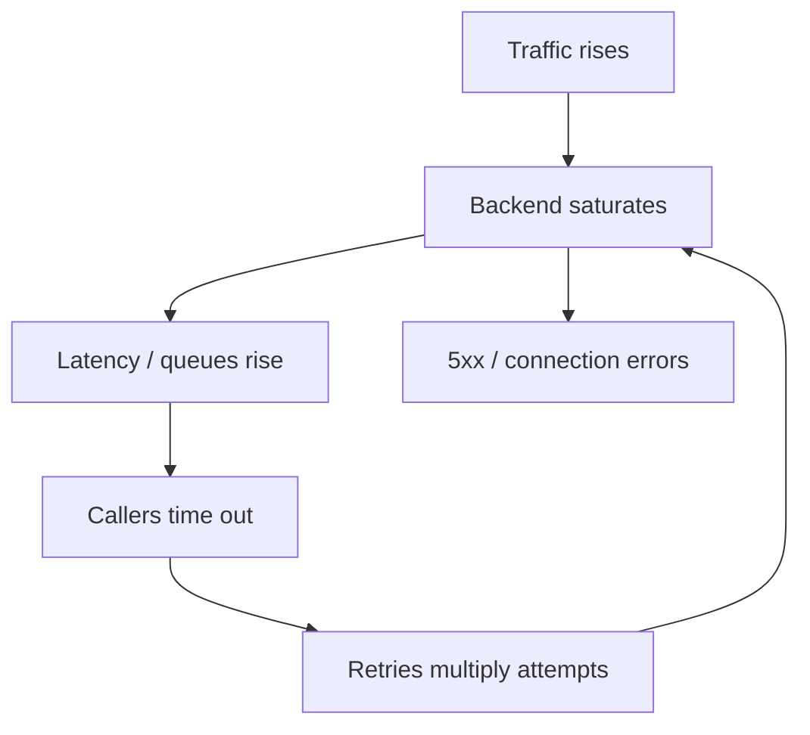

# Balancing Threads, Concurrency, and Target Capacity

In a microservices system, an HTTP client can connect successfully to every replica of a target service yet still cause **overload** if it sends too many requests simultaneously. Spring Cloud LoadBalancer helps locate and pick a `ServiceInstance` by service ID; it **does not automatically** ensure that in-flight requests match the CPU, database pool, thread pool, or limits of the downstream service.

This lesson belongs to the **Connections and Performance** section of Spring Cloud LoadBalancer. The goal is to understand the relationship between **threads**, **connections**, **concurrent in-flight requests**, **queues**, and **response times**, as well as how to coordinate `RestClient`, `RestTemplate`, `WebClient`, and OpenFeign to protect target services when there are many callers and many instances.

## 1. Distinguishing Five Frequently Confused Resource Types

| Concept | What It Measures | Role | What Cannot Be Inferred |
|---|---|---|---|
| Thread | Server or client thread count | Executes Java code; may block during synchronous I/O | 100 threads does not mean 100 connections |
| Connection | Open, active TCP/TLS connections | Reuses sockets and lowers connection setup cost | 50 connections does not necessarily mean 50 active requests |
| In-flight requests | Requests started but not yet finished | Reflects concurrency placed on the backend | Not every request is actively consuming CPU |
| Queue | Tasks waiting for a slot, connection, or thread | Absorbs short traffic spikes | A long queue does not increase actual processing capacity |
| Throughput | Requests completed per second (RPS) | Processing rate over a time interval | High throughput does not guarantee good p95/p99 |

In **blocking** communication, a typical OpenFeign or `RestTemplate` call holds a caller thread while waiting for the HTTP response. With non-blocking `WebClient`, I/O threads do not block one-thread-per-request, yet **requests still consume resources**: connections or HTTP streams, memory, backend processing slots, and downstream pipeline resources.

**HTTP/1.1** normally does not multiplex concurrent requests over one connection like **HTTP/2**. With HTTP/2, one connection can carry multiple streams, making it even more wrong to equate connection limits with request limits. Verify the HTTP version and actual connector capabilities.

## 2. Request Flow and Potential Bottlenecks

Suppose six `order-service` instances call three `catalog-service` instances:



The diagram shows a separation of **responsibilities**, not necessarily the exact internal order of every HTTP client: instance selection can happen before choosing a destination-specific connection pool. For capacity analysis, examine these limits:

1. **Caller ingress:** how many requests the `order-service` server is receiving and handling.
2. **Outbound concurrency:** how many concurrent HTTP calls `order-service` makes to `catalog-service`.
3. **HTTP connector:** allowed open connections, pending connection acquisition requests, and acquisition timeout.
4. **Discovery and LoadBalancer:** the live instance set at call time, plus round-robin/random/zone/health policies.
5. **Per-target-instance capacity:** CPU, worker threads, database connections, downstream operation latency, and memory limits.
6. **Cluster-wide resources:** multiple callers and other services may all load the target instances at once.

If `catalog-service` handles at most 40 concurrent requests **within measured SLAs**, letting each caller allow 30 concurrent requests can exceed cluster capacity even though each individual caller sees light traffic.

## 3. Relationship Between RPS, Latency, and In-Flight Requests

By **Little's Law**, in a steady-state system measured over a consistent boundary:

\[
L = \lambda \times W
\]

Where:

- `L`: average number of requests inside the system/pipeline segment under consideration;
- `\lambda`: average arrival or completion rate in requests/second at steady state;
- `W`: average time a request spends in that pipeline segment, in seconds.

**Example:** if callers steadily send 200 RPS to `catalog-service` and an HTTP request takes 150 ms on average from start to finish, average in-flight load is roughly:

```text
L = 200 requests/second × 0.150 seconds = 30 concurrent requests.
```

If latency jumps to 600 ms while arrival rate remains 200 RPS, required in-flight concurrency can climb to 120. If concurrency is capped at 40, requests must wait or be rejected; actual throughput may drop, queues grow, and steady-state assumptions break down.

This formula is **not** a rigid thread allocation formula, nor does it prove raising concurrency always boosts throughput. Near backend saturation, extra requests may only inflate wait times, timeouts, and memory consumption. Base limits on **load-test results**, especially p95/p99 latency, errors, and rejections.

### 3.1. Cluster Capacity and Multiple Caller Instances

A starting estimate under relatively even distribution:

\[
C_{\text{per-target}} \approx
\frac{N_{\text{callers}} \times C_{\text{per-caller}}}{N_{\text{targets}}}
\]

Suppose there are **6 caller replicas**, each allowing **30 concurrent requests** to `catalog-service`, and **3 catalog instances**:

```text
Total maximum from callers = 6 × 30 = 180 requests.
Concurrent load/target if evenly split = 180 / 3 = 60.
```

If each target only sustains 40 concurrent requests cleanly, 60 exceeds the measured threshold. With an experimental goal of keeping **20% headroom** below 40 requests/target, the reference budget is 32 requests/target, or 96 requests cluster-wide. Divided across six callers: **16 requests/caller**.

```text
6 callers × 16 = 96 requests cluster-wide.
96 / 3 targets = 32 requests/target (when evenly distributed).
```

The figures 40, 20%, and 16 are **illustrative data only**. Measure and tune limits under real load. Real traffic can skew due to zone preference, sticky sessions, instance weights, discovery caching, varying fast/slow requests, and traffic from **other callers**. Caller limits therefore never replace overload measurement on each target.

## 4. RestTemplate, RestClient, and OpenFeign: Avoid Multiplying Waiting Threads

Synchronous-style HTTP clients typically look like:

```java
ProductResponse product = catalogFeignClient.getProduct("42");
// The calling thread is held until the call completes or fails.
```

If a synchronous controller handles a request by calling three APIs sequentially, the thread is held across all three calls. When an upstream slows down, waiting threads pile up and shrink the caller server's capacity to accept new requests.

However, **the web server thread pool is not the HTTP client connection pool**. For example, Tomcat's max thread setting only affects one side of the system (when using Tomcat); it does not enforce an independent cap on all outbound calls to `catalog-service`.

For `RestTemplate`, connection reuse and max connections depend on the chosen `ClientHttpRequestFactory`/HTTP client. `SimpleClientHttpRequestFactory` uses basic JDK primitives and does not offer the same connection pooling APIs as Apache HttpComponents. `RestClient` likewise depends on the underlying request factory. OpenFeign can use different HTTP clients depending on dependencies and configuration; never assume every Feign client shares the same pooling style.

### 4.1. Bulkhead Limiting Concurrent Requests to a Dependency

A simple protective technique is a **bulkhead**: allow only a fixed number of concurrent in-flight requests to a dependency, failing fast when slots run out instead of letting requests queue indefinitely. Illustrative Java example for synchronous calls:

```java
import java.util.concurrent.Semaphore;

public final class CatalogGateway {
    private final CatalogFeignClient client;
    private final Semaphore slots = new Semaphore(16);

    public CatalogGateway(CatalogFeignClient client) {
        this.client = client;
    }

    public ProductResponse getProduct(String id) {
        if (!slots.tryAcquire()) {
            throw new CatalogBusyException(
                    "Catalog concurrency budget exhausted");
        }

        try {
            return client.getProduct(id);
        } finally {
            slots.release();
        }
    }

    public static class CatalogBusyException extends RuntimeException {
        public CatalogBusyException(String message) {
            super(message);
        }
    }
}
```

Here, `CatalogFeignClient` and `ProductResponse` are hypothetical business types. `Semaphore(16)` is a limit **within one gateway instance of a single caller process**, not a cluster-wide cap. In Spring, make the gateway a singleton bean; never instantiate a new gateway per request, which would give every request its own semaphore.

`tryAcquire()` does not block, so overload surfaces fast and clearly; callers can map it to an appropriate response or bounded fallback. When brief controlled waiting is desired, `tryAcquire(timeout, unit)` can be used, provided wait time counts toward the **overall deadline**. In production, dedicated bulkhead libraries add metrics, bounded queues, and centralized config; the core principle stays the same.

**Note:** this semaphore does not limit connections to other dependencies, nor does it distribute quotas fairly across caller replicas. For a true cluster-wide limit, you need coordination architecture or overload control at the target service itself.

## 5. WebClient: Non-Blocking Does Not Mean Unlimited Concurrency

`WebClient` typically uses Reactor Netty with an I/O event loop. Requests fire upon subscription; each in-flight request still holds state and HTTP resources and exerts pressure on the backend. Precisely because it does not block a thread per request, an app can launch **huge numbers** of HTTP calls rapidly if left unconstrained.

Example without explicit limits:

```java
Flux<ProductResponse> responses = Flux.fromIterable(productIds)
        .flatMap(catalogClient::getProduct);
```

`flatMap` uses Reactor's default concurrency and prefetch settings, which **should not be treated as a target service capacity policy**. Declare an explicit limit suited to the pipeline:

```java
Flux<ProductResponse> responses = Flux.fromIterable(productIds)
        .flatMap(catalogClient::getProduct, 12);
```

The `12` here caps concurrent inner publisher subscriptions **within one subscription of this pipeline**. It does not create a process-wide shared quota across all HTTP requests: if ten controller requests arrive and each triggers this pipeline, total concurrency can reach 120. Combine with a service-scoped bulkhead/global limiter when necessary.

### 5.1. Configuring the Reactor Netty Connection Pool

Example configuring a bounded connection pool on an HTTP connector wired into `@LoadBalanced WebClient.Builder`:

```java
import java.time.Duration;
import io.netty.channel.ChannelOption;
import org.springframework.cloud.client.loadbalancer.LoadBalanced;
import org.springframework.context.annotation.Bean;
import org.springframework.context.annotation.Configuration;
import org.springframework.http.client.reactive.ReactorClientHttpConnector;
import org.springframework.web.reactive.function.client.WebClient;
import reactor.netty.http.client.HttpClient;
import reactor.netty.resources.ConnectionProvider;

@Configuration(proxyBeanMethods = false)
public class CatalogWebClientConfiguration {

    @Bean
    ConnectionProvider upstreamConnectionProvider() {
        return ConnectionProvider.builder("upstream-http")
                .maxConnections(40)
                .pendingAcquireMaxCount(80)
                .pendingAcquireTimeout(Duration.ofMillis(300))
                .build();
    }

    @Bean
    @LoadBalanced
    WebClient.Builder loadBalancedWebClientBuilder(
            ConnectionProvider upstreamConnectionProvider) {

        HttpClient httpClient = HttpClient
                .create(upstreamConnectionProvider)
                .option(ChannelOption.CONNECT_TIMEOUT_MILLIS, 1_000)
                .responseTimeout(Duration.ofSeconds(2));

        return WebClient.builder()
                .clientConnector(
                        new ReactorClientHttpConnector(httpClient));
    }
}
```

Meaning of the example limits:

- `maxConnections(40)`: caps connections for **each pool corresponding to a remote address** per Reactor Netty's pool structure; it is **not** a policy allowing only 40 requests to the **entire** `catalog-service` across multiple instances/hosts.
- `pendingAcquireMaxCount(80)`: caps pending connection acquisition requests per pool; not the number of requests the backend can safely process.
- `pendingAcquireTimeout(300 ms)`: max wait time for a connection slot; not a read timeout or end-to-end deadline.
- `CONNECT_TIMEOUT_MILLIS`: TCP connection establishment timeout.
- `responseTimeout(2 s)`: response wait limit per HTTP connector semantics, not covering total time spent in queues, discovery, retries, and upstream processing by default.

This configuration is illustrative, **not a default or production copy-paste recommendation**. Validate values against your Reactor Netty version, HTTP/1.1 vs. HTTP/2, number of remote addresses, concurrency, and load-test outcomes.

The pool is shared by the builder and WebClients created from it. For explicit resource lifecycles, dispose of `ConnectionProvider`/HTTP resources cleanly on application shutdown. Connection pools alone never replace bulkheads: when multiple target instances have separate pools, total in-flight requests to one service ID can still grow large.

### 5.2. Do Not Solve Saturation by Merely Enlarging the Pool

Suppose pending acquires keep climbing; raising `maxConnections` from 40 to 200 may cut caller pool-wait time while simultaneously flooding the server and database with extra work, pushing p99 up or raising `503` rates. Verify **where the bottleneck lies**:

1. Is the caller's pool out of connections while the backend still has headroom?
2. Is the backend already saturated on CPU, threads, or database connections?
3. Are network/TLS issues slowing connection establishment?
4. Are retries multiplying requests after timeouts?
5. Is one instance taking skewed load due to zone, affinity, or missing health filters?

Increase the pool only when measurements prove the pool is an artificial bottleneck and the target service has spare capacity.

## 6. Queuing, Backpressure, and Early Load Shedding

A queue can smooth short bursts, yet creates zero extra capacity. If 300 requests/second arrive on average while the system finishes only 200 requests/second, the queue grows by roughly 100 requests/second until hitting its cap or the system changes.

Three ways to respond to excess load:

| Policy | How It Works | Pros | Risks |
|---|---|---|---|
| Bounded queue | Holds a limited number of requests waiting for slots | Absorbs brief bursts | Raises latency; queued requests can time out |
| Fail-fast / load shedding | Rejects when quota is exhausted | Protects backend and limits retry storms if callers handle properly | Requires clear responses and signaling |
| Rate limit | Caps request rate over time | Protects average throughput and tenant fairness | Does not automatically cap in-flight load if latency spikes |

**Concurrency limits** and **rate limits** differ: 100 RPS at 100 ms latency yields ~10 in-flight requests, whereas 100 RPS at 2 seconds latency yields nearly 200 in-flight requests. A system may need both.

Reactive Streams provides backpressure to coordinate consumption between Publisher and Subscriber. However, backpressure on one `Flux` does not automatically enforce a cluster-wide quota across HTTP requests fired from multiple controllers, multiple caller instances, or retry loops. Always define the exact **scope** of every limit.

## 7. Retries, Timeouts, and Amplification Under Target Overload

When a backend slows down, multiple callers timing out and retrying simultaneously can push **more** traffic onto the backend than the original business load. This is a dangerous feedback loop:



If 100 business requests/second trigger up to two retries each, **attempts** can hit 300 requests/second in the worst case. That extra surge must fit inside your capacity and concurrency budget—never treat retries as free traffic.

Principles:

- Set **connect timeout**, **response/read timeout**, **pending acquire timeout**, and **overall deadline** per layer; do not mechanically sum timeouts while ignoring queuing and retry delays.
- Bound retry counts, use sensible backoff with **jitter** so callers do not retry in lockstep, and only retry errors likely to clear over time.
- For state-mutating operations like order creation, require idempotency keys or equivalent protection before retrying because the server may have executed the request before the response was lost.
- For timeouts/`503`s, consider a **retry budget**; when all callers retry during an outage, LoadBalancer switching instances will not recover the system.
- Never assume retries automatically pick a different instance; that depends on policy, discovery state, sticky sessions, and prior-instance avoidance config.

When using `WebClient.timeout(Duration)`, pay attention to operator placement relative to `retryWhen`. Placing `timeout` **before** `retryWhen` generally applies the timeout per subscription/attempt; add an outer overall deadline when you need a strict upper bound for the whole call. For `RestClient`, `RestTemplate`, and OpenFeign, retry and timeout behavior also depends on the underlying HTTP client, Spring Cloud LoadBalancer, and retryer.

## 8. Aligning LoadBalancer with Per-Instance Capacity

Spring Cloud LoadBalancer selects instances from `ServiceInstanceListSupplier`, influenced by:

- **Discovery:** newly created or removed instances may not appear/disappear instantly due to registry lag, refreshes, or caches.
- **Health checks:** when configured, instances failing health probes can be filtered out. Being in the registry does not guarantee the business endpoint is ready.
- **Zone preference:** favors same-zone instances, which can carry heavier load than other zones.
- **Request-based sticky sessions:** preserve affinity where needed, yet can create hot spots on specific instances.
- **Selection algorithms:** round-robin or random distribute request counts per policy; they **do not guarantee equal CPU, processing time, or concurrency**.
- **Weights/metadata/custom policies:** can shift traffic according to target capability when properly implemented and measured, yet static weights never replace overload protection.

Example of three instances under the same service ID with very different capacities:

| Instance | Measured Reference Capacity | Current In-Flight | Preliminary Assessment |
|---|---:|---:|---|
| `catalog-1` | 40 | 35 | Near threshold |
| `catalog-2` | 40 | 12 | Has headroom |
| `catalog-3` | 20 | 19 | Near threshold |

Round-robin can keep sending requests evenly even though `catalog-3` slows down because it only supports 20 concurrent requests. Advanced strategies can use weights/metrics or backend overload control. Regardless of policy, **caller-side limits** and **backend overload signaling** must still work together.

Sound architecture typically includes timely readiness probes, graceful shutdown/draining, sensible timeouts, per-downstream concurrency limits, and explicit overload responses. Never tune `spring.cloud.loadbalancer` alone while ignoring connection pools and target server capacity.

## 9. Measure the Right Metrics Before Choosing Config Numbers

Performance tuning requires identifying the **bottleneck** with real metrics instead of guessing from average CPU.

| Measurement Point | Suggested Metrics | Diagnostic Question |
|---|---|---|
| Caller HTTP client | Active/idle connections, pending acquires, pool acquire latency | Waiting for a connection or already sent? |
| Caller application | Busy threads, in-flight requests, bulkhead rejections | Blocked on which thread/slot? |
| LoadBalancer | Service ID, selected instance, candidate count, empty results | Is traffic skewing onto one instance? |
| Backend | In-flight requests, queues, CPU, memory, GC, worker threads | Which resource is saturated on the backend? |
| Backend dependencies | Database pool, query latency, downstream errors | Slow because of the database or a third service? |
| HTTP outcomes | RPS, p50/p95/p99, 4xx/5xx, timeouts | At what threshold do tail latency and errors jump? |
| Retry policy | Attempts/request, retry success rate, total duration | Are retries healing or amplifying load? |

Metrics tagged with `serviceId` and error category are helpful for aggregation. Avoid using `traceId` or `instanceId` as uncontrolled high-cardinality metric labels; use sampled logs/traces for per-instance details. You still need **per-instance** visibility to catch hot spots, designed with appropriate label cardinality and storage.

### 9.1. An Easy-to-Interpret Benchmark Table

Example hypothetical load-test results when stepping concurrency from 16 to 128:

| Concurrent Requests | Throughput (RPS) | p95 Latency | Errors/Timeouts | Notes |
|---:|---:|---:|---:|---|
| 16 | 100 | 180 ms | 0% | Stable |
| 32 | 190 | 240 ms | 0% | Throughput still scaling |
| 64 | 230 | 950 ms | 2% | Approaching saturation |
| 128 | 225 | 2,400 ms | 12% | Higher concurrency yields no throughput gain |

These are **simulated figures**, not a Spring Cloud benchmark. Here, stepping from 64 to 128 concurrent requests yields zero throughput gain while p95 and timeouts surge. Your safe operating point depends on SLAs, cost, and headroom, and may sit well below peak-throughput concurrency.

## 10. Load-Testing Process and Choosing Limits

A repeatable process when integrating `RestClient`, `WebClient`, or OpenFeign with `catalog-service`:

1. **Measure single-target capacity:** test across concurrency levels; record RPS, p95/p99, CPU, database pool usage, errors, and the inflection point where latency spikes.
2. **Measure multiple instances:** run replicas with realistic config; verify LoadBalancer distributes traffic by service ID, zone, health, and affinity as expected.
3. **Scale up callers:** add `order-service` replicas. Compute peak cluster-wide concurrency when every caller hits its limit—do not inspect just one caller.
4. **Pick initial limits:** start from measured capacity, subtract reasonable headroom, and allocate quotas across callers by traffic and request class.
5. **Bound all queues:** prevent endless pool-acquisition waits or unbounded task queues. Emit rejection metrics rather than letting outer timeouts mask everything.
6. **Test slow operations:** mix fast reads with long-running calls; decide whether separate bulkheads are needed so slow calls cannot starve fast ones.
7. **Test rollouts/scale-in:** shut down one target instance. Remaining capacity drops, so a quota that was safe with three instances may overload two.
8. **Test faults and retries:** inject controlled network errors/`503`s and verify retries do not surge load past capacity.
9. **Inspect tail latency:** track p95/p99 over time and timeouts, not just averages. Compare pool wait, server wait, and business processing times.
10. **Repeat in a production-like setup:** protocol, connection reuse, TLS, HTTP connector, DB latency, and instance count all change results.

### 10.1. Scenario When One Instance Disappears

If three instances provide roughly `3 × 40 = 120` in-flight capacity, losing one drops theoretical capacity to `80` before headroom. A cluster-wide caller quota of `96` that was safe with three instances becomes an overload when only two remain.

Therefore, size quotas to survive **plausible degradation scenarios** or use overload control/adaptive concurrency with reliable signals to shed load when target capacity shifts. Never assume service discovery updates instantaneously: during the convergence window, LoadBalancer can still pick an unreachable instance.

## 11. Design Mistakes and Fixes

| Symptom | Common Mistake | Remediation |
|---|---|---|
| Enlarged connection pool yet 503s increase | Backend has no headroom | Measure backend capacity and reduce concurrency instead of just enlarging the pool |
| WebClient spikes CPU/RAM unexpectedly | Overly wide fan-out, too many concurrent subscriptions | Use `flatMap(..., concurrency)` and service-scoped limits |
| Servlet threads exhausted when downstream slows | Blocking calls with overly long timeouts | Set tight timeouts, add bulkheads, and lower concurrent calls |
| Long pool pending acquires, bad p99 | Unbounded or oversized wait queues | Bound queues, set acquire timeouts, and fail fast |
| Timeouts spike after scale-in | Quotas not sized for lost instance; stale discovery/cache | Leave headroom, use graceful draining and health checks |
| Retries multiply request volume severalfold | No retry budget, backoff, or idempotency | Cap attempts and overall deadlines; retry only eligible errors |
| One instance runs hot despite round-robin | Stickiness/zone skew, uneven capacity, or long requests | Measure per-instance traffic and active routing rules |
| Raising thread count does not increase RPS | Bottleneck sits in DB pool/CPU/backend | Fix the true bottleneck instead of raising every cap |
| Rate limit holds yet connections exhaust | Rising latency inflates in-flight count | Pair rate limits with concurrency/bulkhead limits |

## 12. Key Principles to Remember

1. **Threads, connections, and in-flight requests are three distinct quantities.** Optimizing only one does not guarantee higher system capacity.
2. **Target service capacity is the fundamental constraint.** Multiple caller replicas can combine traffic past cluster or per-instance capacity.
3. **Little's Law guides estimation:** at steady state, requests in the system approximate completion rate times residence time. Rising latency increases in-flight counts and queues unless arrival rate drops.
4. **Blocking and reactive clients need different bounding strategies.** Non-blocking avoids tying up threads on I/O, yet never permits sending unlimited requests.
5. **A connection pool is not a service-wide bulkhead.** Pools typically manage connections per remote address/route; request quotas need their own scope.
6. **Timeouts, retries, and queues must share a budget.** Retrying during overload can worsen incidents; account for idempotency and overall deadlines.
7. **LoadBalancer selects instances; it does not replace capacity management.** Discovery, health, zones, affinity, and weights shape distribution; pair them with overload control and backend monitoring.
8. **Pick configuration numbers through controlled load testing.** Track p95/p99, errors, pending acquires, in-flight load, per-instance load, and the impact of losing an instance.

When limits across callers, connection pools, LoadBalancer, and backends are designed as **one cohesive system**, inter-service communication via Spring Cloud LoadBalancer remains resilient under normal load as well as traffic spikes, timeouts, and rollouts.
