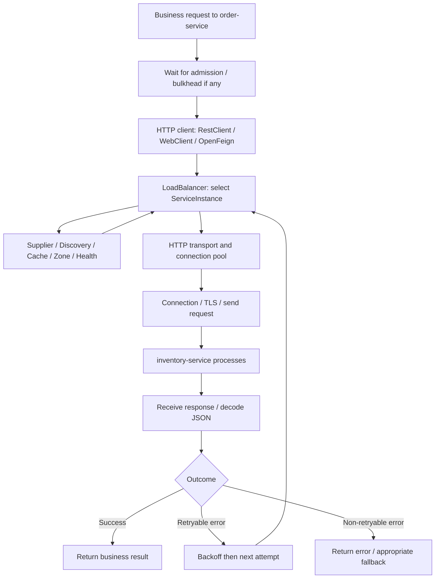

# Measuring Throughput, Percentile Latency, and Resource Utilization

When deploying Spring Cloud LoadBalancer, a crucial question is not only **which replica a request was routed to**, but also **how many requests the system processes, how long they take, and how much resource they consume**. A configuration can distribute `ServiceInstance` selections evenly yet still be slow: one replica may hit connection pool limits, one zone may have high network latency, or retries may pile load onto surviving replicas.

To evaluate performance, measure three metric groups in parallel:

1. **Throughput:** requests or HTTP attempts processed over a time window, typically in requests per second (RPS).
2. **Percentile latency:** request completion times at `p50`, `p95`, `p99`, rather than looking solely at averages.
3. **Resource utilization:** CPU, heap/GC, threads, connection pools, in-flight request counts, queues, and dependency resources.

This lesson belongs to the **Connections and Performance** chapter of the `SPRING_CLOUD_SERVICE_COMMUNICATION_LOAD_BALANCING` module. The focus is measuring along the `order-service → inventory-service` path with `RestClient`, `WebClient`, or OpenFeign, isolating the effects of discovery, `ServiceInstanceListSupplier`, health checks, zones, timeouts, and retries from actual HTTP time. Micrometer, Prometheus, and load-testing examples turn "LoadBalancer is slow" into a testable hypothesis.

> **Principle:** every metric must be interpreted with its **unit**, **measurement scope**, **time window**, **request type**, and **error rate**. Do not compare the p99 of an endpoint group with retries against another group without retries and conclude a load-balancing algorithm is good or bad.

## 1. Measurement Points Along a Call

Suppose `order-service` calls a logical URL:

```http
GET /api/stocks/BOOK-001 HTTP/1.1
Host: inventory-service
Accept: application/json
```

Spring Cloud LoadBalancer selects a `ServiceInstance` and the HTTP client sends the request to that instance's host/port.



This path spans **several distinct durations**. Measuring from the start of the business request to the final result yields *overall latency*. Measuring each attempt at the HTTP transport yields *attempt latency*. Measuring `choose(...)` observes only instance selection. All three are useful, yet **must not be used interchangeably**.

| Observation Point | Question It Answers |
| --- | --- |
| `order-service` API layer | How long must the user wait for the final outcome? |
| Adapter layer calling `inventory-service` | How long does one dependency call take, including retries if any? |
| Each HTTP attempt | How long did each network attempt to a replica take, and what was the outcome? |
| LoadBalancer/supplier | How large is the candidate list, and how long did selection take? |
| Server layer of each replica | How many requests did the server actually process, and how much CPU/DB did they cost? |

Define clearly where a `Timer` or `Observation` is placed before reading dashboards. A single stopwatch on the caller cannot split out DNS, pool, server, and network times accurately without instrumentation at those boundaries.

## 2. Throughput: Counting What, Where?

**Throughput** is typically completed work per unit time. For HTTP, dashboards often label everything RPS even when measuring different things.

| Throughput Type | How It Counts | Meaning |
| --- | --- | --- |
| Incoming RPS | Every HTTP request entering `order-service` | Demand received by the caller |
| Business completion RPS | Business operations finishing per second | Final work completion capacity |
| Outbound logical-call RPS | Times caller code initiates a dependency call | Adapter-layer calls before retries |
| Outbound attempt RPS | HTTP attempts actually dispatched | Network and downstream load, including retries |
| Successful RPS | Successful completions per second | Useful throughput |
| Error/rejected RPS | Failed or rejected requests per second | Demand not served as intended |

Suppose in one second the caller receives **800 business requests**. Of those, **80 fail on the first attempt and are retried once**. If each normal business request makes one HTTP call:

```text
Incoming business RPS:         800
First-attempt HTTP calls:      800
Retry HTTP attempts:            80
Outbound HTTP attempt RPS:     880
Amplification factor:          880 / 800 = 1.10
```

If all retries succeed, successful business throughput stays near 800 RPS. Yet `inventory-service` must handle or at least receive **880 attempts/second**, not 800. With multi-layer retries, amplification can be much higher.

**Never use LoadBalancer selection count as proof every request reached the server.** A successful selection can be followed by connection refused, timeout, or TLS failure. Conversely, an HTTP attempt reaching the server can return a business error and still count toward attempt throughput.

## 3. Window Duration and Error Rate Must Accompany Throughput

Over an observation window of length `\Delta t`:

```text
RPS = requests within scope / Δt (seconds)
errorRate = requests ending in error / total completed requests
successRate = successful requests / total completed requests
```

Example over 60 seconds:

```text
Completed business requests: 48,000
Succeeded:                   46,800
Failed:                       1,200

Completion RPS = 48,000 / 60 = 800 RPS
Success RPS    = 46,800 / 60 = 780 RPS
Error rate     =  1,200 / 48,000 = 2.5%
```

Displaying only `800 RPS` leaves unclear whether all 800 succeeded or 2.5% failed. An algorithm might raise attempt throughput via retries while leaving **useful throughput** flat and driving downstream CPU/connections up.

Watch requests still in flight at the end of the measurement window: they have not completed yet, while still consuming resources. Under rising load, comparing **started** vs. **completed** requests reveals growing queues.

## 4. Mean Latency vs. Percentile Latency

**Latency** is elapsed time between a defined start and end timestamp. It can be measured in milliseconds (ms) or seconds (s); Prometheus typically exports duration metrics in **seconds**.

Suppose 10 request durations are:

```text
20, 22, 23, 25, 27, 28, 29, 31, 35, 760 (ms)
```

Nine requests finish under 40 ms, yet one takes 760 ms. The mean is dragged up by the slowest request; conversely, at massive request volume, the mean can hide an entire tail cohort of users experiencing high latency.

Commonly tracked percentiles:

| Metric | Practical Interpretation |
| --- | --- |
| `p50` | Median: roughly 50% of observations are at or below this value |
| `p90` | Roughly 90% of observations are at or below this value |
| `p95` | Roughly 95% of observations are at or below this value |
| `p99` | Roughly 99% of observations are at or below this value |
| `max` | Slowest observation in the measurement scope |

Percentile interpolation differs across tools, histograms, and sample sets. Never treat p99 as the "slowest request": roughly 1% of observations can still be **slower than p99**, and extreme outliers can degrade UX even when p99 barely moves.

For example, 10,000 requests with `p99 ≈ 600 ms` means roughly 99% of requests fell at or below 600 ms under the estimator in use—not that all 10,000 finished under 600 ms.

## 5. Why p95 and p99 Matter Especially When Selecting Replicas

One service with two replicas:

| Instance | p50 | p95 | p99 | Analysis |
| --- | ---: | ---: | ---: | --- |
| A | 45 ms | 90 ms | 220 ms | Relatively stable |
| B | 43 ms | 410 ms | 1,500 ms | Very slow tail |

Looking only at p50, both instances look nearly identical. Yet some requests to B wait a long time, hit read timeouts, and retry to A, inflating total attempts.

Causes to investigate include:

- B is CPU-throttled or experiencing long GC pauses.
- B's database connection pool is exhausted.
- B happens to handle a more expensive subset of requests.
- B runs in a distant zone or experiences network jitter.
- Requests wait in a queue due to concurrency limits.
- Caller's HTTP client waits for a pooled connection before even sending.
- Cache misses, lock contention, or a slow downstream behind B.

**System-wide tail latency is not caused solely by the LoadBalancer algorithm.** LoadBalancer may return the exact right list while execution conditions differ per replica.

Compare p95/p99 **across the same request type, same time window, and sufficient sample size**. Splitting by instances with very few observations makes percentiles noisy and misleading.

## 6. Histograms and Percentiles: How to Aggregate Correctly

A duration histogram contains buckets counting observations less than or equal to a threshold. In Prometheus, buckets typically appear as series ending in `_bucket` with an `le` (less than or equal) label.

Simple illustrative data:

```text
Duration <= 0.05 s:   7,000 requests
Duration <= 0.10 s:   9,000 requests
Duration <= 0.25 s:   9,700 requests
Duration <= 0.50 s:   9,900 requests
Duration <= +Inf:    10,000 requests
```

With such a histogram, p95 can be estimated within the corresponding bucket. **Accuracy depends on bucket boundaries and sample count**; histograms do not retain every original exact duration.

### 6.1. Never Average Per-Instance p99s

If instance A has p99 = 200 ms and B has p99 = 800 ms, **the combined p99 is not `(200 + 800) / 2 = 500 ms`**. Percentiles are not linear quantities that can be arithmetically averaged.

To compute an aggregate p99 across replicas or processes, aggregate the **underlying distribution** or compatible histogram buckets properly weighted by observation counts. When instances receive unequal traffic, averaging p99 becomes even more wrong.

### 6.2. Do Not Collapse Into One Distribution When Comparison Is Needed

A service-wide histogram answers "how long do callers wait for `inventory-service` overall?" To spot an abnormally slow replica or zone, you need an appropriate breakdown dimension.

Never put high-cardinality fields like dynamic paths, SKUs, or request IDs **directly into metric labels**. Use method, path template, and service ID as stable labels; observe selected instances via sampled traces/logs or tightly governed label sets.

## 7. Three Latency Milestones: Client, Load Balancing, and Server

To pinpoint slowness, separate intervals:

```text
t0  Caller initiates dependency call
 |
 | T_client_before_send (admission, instance selection, pool wait...)
 |
t1  HTTP request reaches server (server observation point)
 |
 | T_server_processing (application + database + downstream)
 |
t2  Server emits response
 |
 | Network/receive/decode
 |
t3  Caller receives result / handles error
```

Conceptually:

```text
Caller-observed latency ≈ pre-send time
                        + server processing time
                        + transfer/read/decode
                        + retry/backoff if any
```

Clocks on two machines can drift; never subtract caller wall-clock timestamps from server timestamps and treat the difference as exact network latency without clock sync. Within one process, use a monotonic clock for elapsed time.

With HTTP/2, multiplexing lets multiple requests share one connection; with HTTP/1.1, connection pool caps directly constrain concurrent requests. Hence, **open sockets do not equal in-flight HTTP requests across every protocol**.

## 8. Throughput, Latency, and Concurrency: Little's Law

Under relatively steady conditions, Little's Law states:

```text
Average concurrency ≈ Throughput (requests/second) × Average latency (seconds)
```

For example, `order-service` calls `inventory-service` at 800 HTTP attempts/second with 50 ms average latency:

```text
800 × 0.05 = roughly 40 in-flight requests
```

If latency jumps to 250 ms while arrival rate remains ~800 attempts/second:

```text
800 × 0.25 = roughly 200 in-flight requests
```

If client resources only permit 64 concurrent in-flight requests, the excess must **wait in pools/queues**, get rejected, or pull achievable throughput down. Rising latency increases concurrency **before** CPU necessarily spikes, because requests sit waiting on networks or dependencies.

The formula is a steady-state average relationship. Never plug p99 into place of mean latency to claim exact concurrency, and never treat it as a capacity guarantee during bursts or unstable transients.

## 9. Connection Pools: A Bottleneck Before the Server

Spring Cloud LoadBalancer selects `ServiceInstance`, while the HTTP client handles connections. With `RestClient`, the HTTP transport may be JDK HTTP Client, Apache HttpComponents, or another implementation. `WebClient` typically uses Reactor Netty; OpenFeign can use different HTTP clients depending on config.

In a pooled client, monitor:

| Metric | Meaning | Anomaly Signal |
| --- | --- | --- |
| Active connections | Connections currently in use | Sustained near cap |
| Idle connections | Connections available for reuse | Unexpectedly high or never reused |
| Pending connections / waiters | Requests waiting to lease a connection | Climbing steadily; caller latency rises |
| Pool acquisition time | Wait time to obtain a slot/connection | p95/p99 rises while server p95 stays normal |
| Connect timeout | Failed to establish connection in time | Network, target, or connection limits |
| Pool acquisition timeout | Failed to lease a connection within budget | Pool lacks slots, leaks, or requests hold connections too long |

**Verify pool scope against your specific HTTP client.** A pool may enforce both a global cap and per-origin/route caps. When LoadBalancer picks across 10 replicas instead of 2, active origins and needed connections can rise; never assume a 200-connection pool gives each replica 200 connections.

With HTTP/2, multiple streams can multiplex over one connection, so also analyze stream/concurrent-request caps and implementation behavior. With HTTP/1.1, concurrent requests normally require multiple active connections unless otherwise handled.

**Never create a new HTTP client/pool per request.** Reuse configured HTTP clients and manage resource lifecycles to avoid TLS handshake churn, socket leaks, and lost pooling.

## 10. CPU, Heap, GC, Threads, and Shared Dependencies

A replica marked `UP` by health checks may still lack capacity for another 200 RPS. Resource measurement must trace from symptom to root cause.

| Resource Group | Metrics to Watch | Typical Impact |
| --- | --- | --- |
| CPU | CPU utilization, throttling, runnable threads | Latency and error rates climb on saturation |
| Heap / allocation | Heap used, allocation rate, GC pauses | Long GC pauses or memory pressure |
| Threads | Live threads, thread pool active/queue | Tasks queue for execution; throughput drops |
| Client-side connection pool | Active/idle/pending connections | Callers wait for slots even while targets are healthy |
| Server-side DB connection pool | Active/idle/pending, acquisition timeouts | Replicas block waiting on the database |
| Network | Byte throughput, retransmissions, handshakes | Higher latency or timeouts |
| I/O and dependencies | Disk latency, cache misses, downstream p95 | API slows down even with low CPU |

**Low CPU does not prove a healthy system.** If most requests are blocked waiting for database connections, CPU can stay low while p99 skyrockets. Conversely, high CPU might stem from JSON compression/deserialization or GC, not instance selection.

One special scenario: four `inventory-service` replicas all share one saturated database pool or DB cluster. Adding replicas increases connections and query contention **without adding throughput**. Investigate shared dependency resources, not just per-pod metrics.

## 11. How Spring Cloud LoadBalancer Affects Measurements

A selection path may chain multiple suppliers:

```text
Discovery/Registry
  -> cache if enabled
  -> health / zone / hint filters per configuration
  -> candidate list
  -> RoundRobinLoadBalancer or other algorithm
  -> selected ServiceInstance
```

Configuration changes affect metrics differently:

| Change | What to Measure Before and After |
| --- | --- |
| Enable/disable instance cache | Instance selection latency, discovery query frequency, lag seeing topology updates |
| Enable health checks | Eligible instance count, requests hitting unhealthy replicas, probe overhead |
| Enable zone preference | Same-zone selection ratio, network latency, cross-zone traffic cost |
| Change selection algorithm | Selection distribution, per-service/instance p95/p99, fairness |
| Increase replica count | Useful throughput, tail latency, per-replica CPU, and shared bottlenecks |
| Enable retries | Final success rate, attempts/business request, extra load, and deadline exceeded |

**Do not conclude LoadBalancer is faster just because p50 dropped.** Most requests may speed up while p99 worsens because one instance overloaded or retries stretched tail requests.

To measure instance-selection latency specifically, instrument the chooser or `LoadBalancerLifecycle` where supported. An outer HTTP interceptor timer covers additional steps; verify exact boundaries.

## 12. Why Request Distribution Is Not Necessarily Even

Even when `RoundRobinLoadBalancer` receives a stable `[A,B,C]` list, selections on a single LoadBalancer instance generally alternate. Yet observed HTTP requests at each server can still differ because:

- Multiple caller processes maintain independent counters.
- Discovery/health/zone filters produce different lists across callers.
- Some requests fail before reaching a server.
- Retries add attempts, potentially re-selecting or avoiding a prior instance.
- Traffic spans multiple service IDs, paths, or zones.
- Weighted routing or custom suppliers alter candidate lists.
- One instance processes slower, holding more in-flight requests at measurement time.

Example:

```text
LoadBalancer selected A: 300 times
LoadBalancer selected B: 300 times
LoadBalancer selected C: 300 times

Server A received: 290 requests (10 connection failures)
Server B received: 300 requests
Server C received: 300 requests
```

There is no contradiction: **selections do not always equal requests received by the server**. If retries from A spill onto C, server C can receive extra attempts even with unchanged business requests.

When comparing distribution, specify whether you are counting *selections*, *HTTP attempts*, or *server requests*, over the same window and caller group.

## 13. Enabling Micrometer and Metrics Endpoints in Spring Boot

A common way to instrument Spring Boot apps is via Spring Boot Actuator and Micrometer. If exporting to Prometheus, typical Maven dependencies include:

```xml
<dependency>
    <groupId>org.springframework.boot</groupId>
    <artifactId>spring-boot-starter-actuator</artifactId>
</dependency>

<dependency>
    <groupId>io.micrometer</groupId>
    <artifactId>micrometer-registry-prometheus</artifactId>
</dependency>
```

In a Spring Cloud LoadBalancer app, you still need the compatible starter and instance source; metrics dependencies **do not replace** `spring-cloud-starter-loadbalancer`.

Lab environment example:

```properties
management.endpoints.web.exposure.include=health,info,metrics,prometheus
management.endpoint.health.show-details=when_authorized
```

With matching config and registry, Prometheus can scrape `/actuator/prometheus`. However, endpoint exposure depends on security, networking, and Actuator version. **Never expose metrics endpoints publicly in production** without access controls, management port/network isolation, and proper security policies.

Micrometer/Spring Boot exposes HTTP, JVM, CPU, and other metrics per active instrumentation. **Metric names and tags are not immutable across versions**; verify the actual exported series before building production dashboards. Connection pool/LoadBalancer metrics appear only when the corresponding implementations and instrumentation are enabled.

## 14. Example: Measuring Duration and In-Flight Count for RestClient Calls

To illustrate a metric source with stable names, we add a `Timer` and `Gauge` around a synchronous dependency call.

```java
import java.util.List;
import java.util.concurrent.atomic.AtomicInteger;

import io.micrometer.core.instrument.MeterRegistry;
import io.micrometer.core.instrument.Tag;
import io.micrometer.core.instrument.Timer;
import org.springframework.cloud.client.loadbalancer.LoadBalanced;
import org.springframework.stereotype.Component;
import org.springframework.web.client.RestClient;

@Component
class InventoryGateway {

    private final RestClient client;
    private final MeterRegistry registry;
    private final AtomicInteger inFlight = new AtomicInteger();
    private final Timer successTimer;
    private final Timer errorTimer;

    InventoryGateway(
            @LoadBalanced RestClient.Builder builder,
            MeterRegistry registry) {

        this.registry = registry;
        this.client = builder
                .baseUrl("http://inventory-service")
                .build();

        registry.gauge(
                "app.downstream.inflight",
                List.of(Tag.of("target_service", "inventory-service")),
                inFlight,
                AtomicInteger::doubleValue);

        this.successTimer = Timer.builder("app.downstream.call.duration")
                .tag("target_service", "inventory-service")
                .tag("outcome", "success")
                .publishPercentileHistogram()
                .register(registry);

        this.errorTimer = Timer.builder("app.downstream.call.duration")
                .tag("target_service", "inventory-service")
                .tag("outcome", "error")
                .publishPercentileHistogram()
                .register(registry);
    }

    StockResponse getStock(String sku) {
        inFlight.incrementAndGet();
        Timer.Sample sample = Timer.start(registry);
        boolean success = false;

        try {
            StockResponse response = client.get()
                    .uri("/api/stocks/{sku}", sku)
                    .retrieve()
                    .body(StockResponse.class);

            success = true;
            return response;
        } finally {
            sample.stop(success ? successTimer : errorTimer);
            inFlight.decrementAndGet();
        }
    }
}
```

The snippet assumes `StockResponse` is an application DTO and the Spring context provides a `@LoadBalanced RestClient.Builder` bean. That builder can be declared as:

```java
@Bean
@LoadBalanced
RestClient.Builder loadBalancedRestClientBuilder() {
    return RestClient.builder();
}
```

**Meaning of the custom metrics:**

- `app.downstream.call.duration` measures **each `getStock` call at the caller's adapter**, including inner retry time if retries are configured inside the client.
- `outcome` takes only two fixed values (`success` or `error`) based on method completion. An HTTP `200` reporting insufficient stock still counts as `success` for the HTTP adapter; track business stock-check failures in a separate metric if needed.
- `app.downstream.inflight` reflects **active calls inside one caller process**, not sockets, HTTP/2 streams, or cluster-wide concurrency.
- `publishPercentileHistogram()` instructs Micrometer to emit histogram distribution buckets for backends that support percentile calculation; accuracy still depends on bucket configuration and registry settings.

**Limitation:** this snippet measures the *logical downstream call*, **not individual HTTP attempts**. If the client retries three times internally, the `Timer` records **one observation**. To measure attempt RPS, instrument the HTTP client/transport layer or retry hook using a distinct metric name to avoid mixing definitions.

When Spring Boot's built-in HTTP client observations are already active, avoid creating duplicate metrics with the same meaning without clear distinction. This custom instrumentation is useful to time the full dependency call including adapter logic.

## 15. Reading Throughput and Latency from Prometheus

Suppose Prometheus scrapes the metrics from the previous section. Under standard Prometheus naming conventions, the `app.downstream.call.duration` Timer exports series such as:

```text
app_downstream_call_duration_seconds_count
app_downstream_call_duration_seconds_sum
app_downstream_call_duration_seconds_bucket
```

**Verify exact names at the metrics endpoint**, since naming conventions and library versions can vary. If histograms are not enabled or the backend does not export buckets, `_bucket` series will not exist and `histogram_quantile` queries will return nothing.

### 15.1. Total Logical-Call Throughput by Service ID

```promql
sum(
  rate(
    app_downstream_call_duration_seconds_count{
      target_service="inventory-service"
    }[5m]
  )
)
```

Result is in **calls/second** over roughly a 5-minute window, computed from the Timer observation counter. This is the *logical-call completion rate* at the example's measurement point, not the *HTTP attempt rate*.

### 15.2. Throughput by Outcome

```promql
sum by (outcome) (
  rate(
    app_downstream_call_duration_seconds_count{
      target_service="inventory-service"
    }[5m]
  )
)
```

The `success` and `error` series distinguish successful vs. failed adapter calls. Do not call them business success/failure if business logic also inspects `availableQuantity`.

### 15.3. Mean Latency

```promql
sum(rate(app_downstream_call_duration_seconds_sum{
  target_service="inventory-service"
}[5m]))
/
sum(rate(app_downstream_call_duration_seconds_count{
  target_service="inventory-service"
}[5m]))
```

This computes **mean latency** over the window in **seconds**. When the observation count is 0, dashboards must handle division by zero or missing series.

### 15.4. p95 from Histogram

```promql
histogram_quantile(
  0.95,
  sum by (le) (
    rate(app_downstream_call_duration_seconds_bucket{
      target_service="inventory-service"
    }[5m])
  )
)
```

This aggregates histogram buckets over time to estimate overall p95. Replace `0.95` with `0.99` for p99. Never compute `avg(p99_per_instance)` and present it as service-wide p99.

### 15.5. Concurrent In-Flight Calls

```promql
sum(app_downstream_inflight{
  target_service="inventory-service"
})
```

This sums the in-flight `Gauge` across scraped caller processes. Account for scrape intervals and active instances; it is not an atomically consistent cluster-wide snapshot.

## 16. Defining Useful SLOs and Dashboards

An operational performance dashboard should answer all at once:

1. **Is enough work getting done?** Incoming RPS, completion RPS, and useful success RPS.
2. **How long do users wait?** End-to-end p50/p95/p99 latency and SLO breach rate.
3. **Are errors occurring?** Error rate, timeouts, 429/503, load shedding, and circuit-breaker rejections.
4. **Is load being amplified?** HTTP attempts per business request, retry count, and backoff.
5. **Where is the bottleneck?** CPU, heap/GC, threads, connection pool waiters, database pools, and queues.
6. **Which replicas receive traffic?** Selected instance/zone distribution, eligible instance count, and health.
7. **Is topology freshness an issue?** Discovery/cache refresh lag and calls hitting deregistered instances.

An illustrative SLO for `GET /api/stocks/{sku}`:

| Hypothetical Metric | Lab Target |
| --- | --- |
| Final success rate | ≥ 99.5% |
| p95 logical-call latency | ≤ 250 ms |
| p99 logical-call latency | ≤ 600 ms |
| Average replica CPU at target load | < 80% |
| Retry amplification | ≤ 1.05 attempts/business call |
| Rejected requests | Per admission limits and API contract |

Numbers in this table are **not universal recommendations**. SLOs must reflect UX, API class, deployment geography, system budgets, and resilience. High p99 with low error rate still requires fixing tail latency; low p99 while many requests are shed outside the measurement point does not mean the system is healthy.

## 17. Designing Reproducible Load Tests

A sound load test requires a clear **load generator**, **environment setup**, and **evaluation criteria**.

### 17.1. Preparation

- Run `inventory-service` with 4 replicas on the exact same app version.
- Configure `order-service` to call via logical URL using Spring Cloud LoadBalancer.
- Record exact settings for Round Robin, zones, health checks, cache, timeouts, and retries.
- Use stable test data; keep `GET` endpoints free of state mutations.
- Run the load generator **off the system under test** when possible; monitor the load generator's own CPU, memory, and network.
- Match realistic endpoint traffic mixes; do not hammer a single SKU if production differs.

### 17.2. Step Load Across Multiple Levels

For example, test **200, 400, 600, 800 RPS**, holding each step long enough after warm-up to observe histograms and resources. At each step record:

| Target Load | Actual Completed RPS | p95 | p99 | Error Rate | CPU & Pool Saturation |
| ---: | --- | --- | --- | --- | --- |
| 200 | Measure | Measure | Measure | Measure | Measure |
| 400 | Measure | Measure | Measure | Measure | Measure |
| 600 | Measure | Measure | Measure | Measure | Measure |
| 800 | Measure | Measure | Measure | Measure | Measure |

Do not pre-fill "expected results" like 200 completed RPS merely because the generator aimed for 200 RPS. The app may start queuing and complete less than offered load, or the generator itself may fail to keep pace.

**Control offered load by arrival rate when testing capacity at fixed RPS.** *Closed-loop* load generators that send the next request only after receiving a response slow down automatically when the server slows, masking overload. This measurement bias is widely known as *coordinated omission*. Check which load model your tool (k6, JMeter, Gatling, etc.) uses.

### 17.3. Measure Over Identical Windows

When comparing config A vs. config B:

- Use identical warm-up duration and measurement windows.
- Keep versions, topology, load, endpoint ratios, and test data identical.
- Hold dependencies and autoscaling settings steady during controlled comparisons where appropriate.
- Specify whether metrics are caller-side or server-side, successes or attempts, and whether retries are included.
- Repeat runs multiple times and report variance rather than cherry-picking the best run.

p99 measurements require enough samples per window. With only a few dozen requests, p99 virtually equals the single slowest request and swings wildly; pay attention to sample size and histogram resolution.

## 18. Analyzing Results as Load Increases

Suppose a hypothetical experiment on the same endpoints yields:

| Offered Load | Completed RPS | p50 | p95 | p99 | Error Rate |
| ---: | ---: | ---: | ---: | ---: | ---: |
| 200 RPS | 200 | 35 ms | 75 ms | 130 ms | 0.1% |
| 400 RPS | 399 | 39 ms | 95 ms | 190 ms | 0.2% |
| 600 RPS | 595 | 50 ms | 180 ms | 480 ms | 0.8% |
| 800 RPS | 670 | 110 ms | 640 ms | 1,900 ms | 7.5% |

These are **fictional figures for analysis**, not a Spring Cloud LoadBalancer benchmark.

Valid observations:

- At 800 offered RPS, completed RPS is only 670: the system cannot sustain offered throughput.
- p95 and p99 jump sharply, signaling tail latency degrading ahead of or alongside errors.
- A 7.5% error rate violates a 99.5% success SLO.
- You cannot yet blame Round Robin: check CPU, GC, DB pools, HTTP pools, retries, and per-replica request distribution.

A follow-up question: **does 670 completed RPS include both successes and failures, or successes only?** If it includes errors, useful throughput is even lower. Real measurement tables must state this definition explicitly.

## 19. Failover Testing: When Two Replicas Disappear

To verify resilience, hold offered load at a known level and shut down A and B one after another.

For instance, with four instances initially, each receives ~200 requests/second. Once only C and D remain, the same 800 RPS concentrates to ~400 RPS/replica under even distribution—before counting retries.

During this test, measure:

1. **Time-to-converge:** how long from replica shutdown until callers stop picking it?
2. **Errors during convergence:** connection errors/timeouts to the dead replicas.
3. **Attempt amplification:** do retries spike request volume to C/D?
4. **Useful throughput and p95/p99:** work still served cleanly after losing capacity.
5. **C/D CPU, pools, and queues:** are they saturating?
6. **Admission/load shedding:** does controlled rejection kick in when demand exceeds capacity?
7. **Warm-up and ramp-up:** when replicas return, does traffic ramp smoothly and p99 stabilize?

Do not enforce a pass criterion of "must still achieve 800 RPS after stopping A/B" if remaining capacity genuinely cannot support it. Far more meaningful is knowing the **new sustainable throughput ceiling**, bounded error rates, and recovery time once replicas return.

## 20. Traps That Make Metrics Misleading

| Trap | Why It Is Wrong | How to Fix |
| --- | --- | --- |
| Looking only at throughput | Many requests may be failing or retrying | Show useful success throughput alongside error rate |
| Looking only at mean latency | Hides a slow tail cohort | Track p50/p95/p99 and timeouts |
| Averaging per-instance p99 | Percentiles do not add or average linearly | Aggregate observation-weighted histogram buckets |
| Confusing requests with attempts | Retries raise attempt RPS above business RPS | Define separate metrics per layer |
| Counting selections as server requests | Network errors happen after selection | Track both selections and server receives |
| Measuring only successful requests | Ignores timeouts and slow failures | Record latency for both success and error outcomes |
| Benchmarking right after startup | JIT, caches, and pools are still cold | Separate warm-up from steady-state measurement |
| Load generator slows down with server | Offered load drops under server overload | Use an arrival-rate load model |
| Splitting metrics by SKU/user ID | Cardinality explodes | Use path templates, groupings, and sampled logs |
| Ignoring pool wait time | Blames server when caller waits for connections | Monitor pool active/pending/acquisition latency |
| Lumping all zones together | Masks cross-zone latency or failover | Break down by normalized zone when needed |
| Changing retries, pools, and chooser together | Cannot tell which change caused the effect | Isolate one change at a time and repeat measurements |
| Comparing misaligned time windows | Skewed by different traffic or incidents | Synchronize observation windows and test conditions |

These warnings apply equally when comparing `RestClient`, `WebClient`, and OpenFeign. They can differ in execution model, transport, and pooling; comparing throughput without fixing workloads and resources is insufficient to crown one client superior.

## 21. Workflow for Diagnosing a Real Performance Incident

**Scenario:** `order-service` calls `inventory-service`; incoming RPS is unchanged, yet p99 jumped from 200 ms to 1,500 ms.

Work through step by step:

1. **Confirm metric definition:** is p99 measuring the business request, logical dependency call, or HTTP attempt?
2. **Check sample size and window:** is data large enough, on the same workload and version?
3. **Compare outcomes:** did timeout/error rates rise, especially in the tail?
4. **Read attempt/business ratio:** did retry amplification climb while incoming RPS stayed flat?
5. **Check topology:** did the eligible instance count for `inventory-service` drop?
6. **Inspect selections:** did traffic skew to another zone or pile onto one instance?
7. **Inspect caller HTTP pool:** did pending queues and acquisition latency climb?
8. **Inspect server resources:** CPU, GC pauses, threads, DB connection pools, and queues.
9. **Check timeouts/backoff:** does cumulative retry time explain the p99 jump?
10. **Compare before/after changes:** did anyone alter cache TTL, zones, health, pools, retries, versions, or deployments?
11. **Verify with controlled load tests:** change one factor while holding others steady.
12. **Protect the system:** if capacity is lacking, consider admission limits, trimming retries, or graceful degradation—not blindly adding replicas.

If caller p99 is high while server p99 is low, suspect pre-server delays (pool waits, discovery, connect, DNS, retries/backoff) or mismatched measurement scopes. If both caller and server p99 are high, inspect the server and shared dependencies. If only one replica has bad p99, find the local cause and shield traffic with appropriate health/routing policies.

## 22. Operational Principles to Maintain

1. **Name and define every metric explicitly.** Separate incoming, completed, successful, and attempted RPS.
2. **Track at least p50, p95, p99, and error rate.** Averages alone are never enough.
3. **Use histograms when aggregate percentiles are needed.** Never average p99 across processes.
4. **Measure timings on both caller and server.** Gaps point to where to investigate, without automatically proving network latency.
5. **Check connection pools and queues before blaming the server.**
6. **Scope metrics sensibly.** Service ID and path template are useful; avoid dynamic IDs.
7. **Bound retries and track amplification.** Requests may eventually succeed while overloading downstreams.
8. **Account for topology when reading throughput.** Losing half of replicas under steady demand causes tail latency to surge quickly.
9. **Benchmark with warm-up and controlled offered load.** Separate transient startup from steady state.
10. **Compare configurations on identical workloads.** Same load, request mix, replica count, and error rate.
11. **Set SLOs from business experience.** Inventory read p99 differs from payment or report-export deadlines.
12. **Never use metrics as a security boundary.** Secure endpoints and scrub sensitive data from logs and labels.

## 23. Self-Check Questions

1. How do business-request throughput and HTTP-attempt throughput differ when retries occur?
2. If 800 requests/second experience a 10% single-retry rate, what is the attempt RPS?
3. Why must you not compute overall p99 by averaging each replica's p99?
4. What different kinds of problems do `p50`, `p95`, and `p99` help uncover?
5. What accuracy limits do histograms have? When does a `histogram_quantile` query return no data?
6. By Little's Law, with 800 RPS and 250 ms average latency, roughly what is the average concurrency?
7. When an HTTP client pool fills up, what can rise even while downstream CPU remains low?
8. Why does even Round Robin selection not prove servers receive equal request counts?
9. When four replicas drop to two with offered RPS unchanged, why can useful throughput fall and p99 climb?
10. How can a closed-loop load generator mask an overload incident?
11. Does placing one `Timer` around an adapter method automatically reveal HTTP retry attempt counts?
12. If caller p99 jumps while server p99 stays flat, which layers should you inspect?
13. Which metrics belong alongside p99 on a dashboard to avoid falsely concluding the system is healthy?

**Conclusion:** measuring Spring Cloud LoadBalancer performance does not stop at confirming the chooser picked `ServiceInstance`s correctly. Measure **useful throughput**, **clearly scoped percentile latency**, and **resource utilization across callers, networks, pools, replicas, and shared dependencies**. Only when metrics link business requests to HTTP attempts and selected instances can you distinguish bottlenecks from discovery, retries, connection pools, zones, downstreams, or the load-balancing policy itself—enabling verified improvements instead of guesswork tuning.
