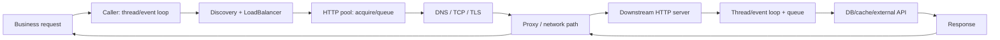
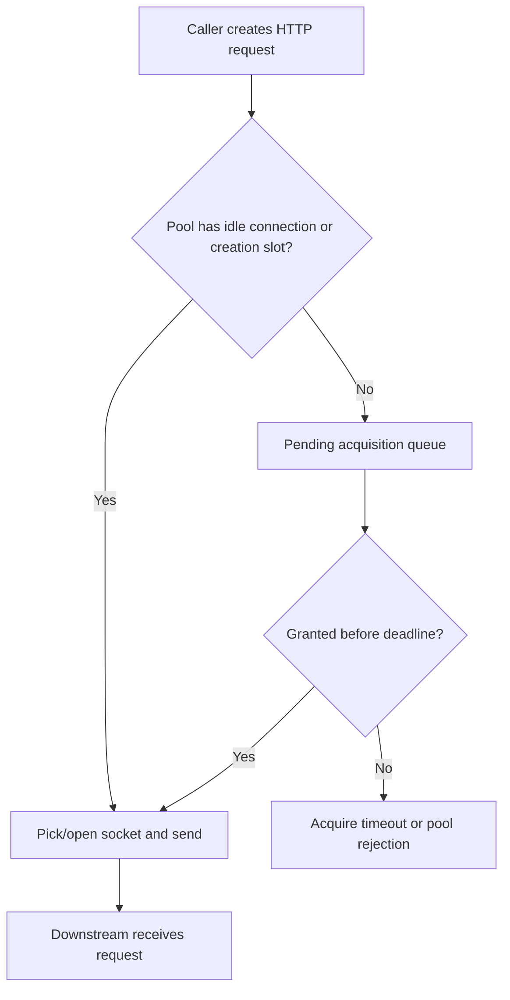
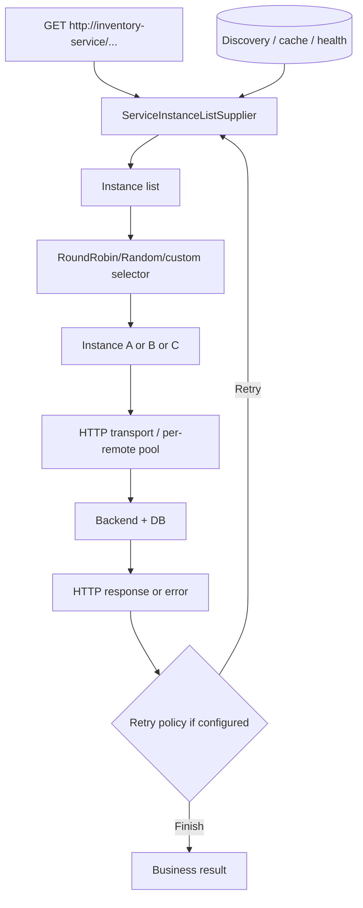
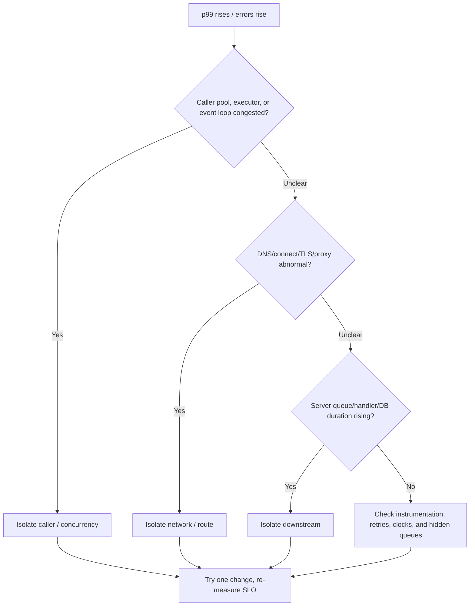

# Distinguishing Bottlenecks Across the Caller, Network, and Target Service

A request from `order-service` to `inventory-service` taking 2 seconds does not mean `inventory-service` spent 2 seconds processing it. That time could have been spent **before the request ever left the caller**, while **DNS/TCP/TLS/the network path** was active, or **after the request reached the target service**. With Spring Cloud LoadBalancer in the path, you must also account for `ServiceInstance` list retrieval, instance selection, connection pools, and retry effects.

For example, suppose `order-service` uses `@LoadBalanced WebClient.Builder` to call `http://inventory-service/api/products/P-1001`. Users see HTTP 504 after 3 seconds. One team raises `readTimeout`, another adds instances, and another enlarges the connection pool; **all three may do nothing** if the true cause is `WebClient` blocked on the event loop or a proxy dropping packets. Measure each stage accurately before deciding what to change.

This lesson belongs to the **Connections and Performance** chapter of the Spring Cloud LoadBalancer module. The focus is distinguishing three bottleneck domains—**caller**, **network**, and **downstream**—via symptoms, metrics, distributed tracing, and controlled experiments. Examples apply to `RestClient`, `WebClient`, and `OpenFeign`, tied together with discovery, `ServiceInstance` selection, timeouts, retries, caching, and health checks.

## 1. Three Bottleneck Domains and Responsibility Boundaries

| Domain | Typical Components | Resources Prone to Contention | Prominent Symptoms |
|---|---|---|---|
| **Caller** | Application threads, Reactor event loop, queues/bulkheads, HTTP connector, connection pool, LoadBalancer client context | CPU/GC, threads/queues, pool permits, pending connection acquisitions | Requests wait long **before being sent**, high pool pending counts, blocked event loop, saturation even while the backend is healthy. |
| **Network and Intermediaries** | DNS, routing, TCP, TLS, NAT, firewalls, proxies, service mesh, ingress, infrastructure load balancers | DNS resolvers, RTT, bandwidth, socket/network buffers, conntrack, proxy upstream pools | Connect/TLS latency, packet loss/retransmissions, resets, per-AZ/zone errors, proxy 502/504s. |
| **Downstream (Target Service)** | Server accept queues, HTTP workers/event loops, thread pools, database/Redis client pools, locks, external dependencies | CPU, heap/GC, executors, DB connections, disk I/O, locks, further downstreams | Server receives requests promptly yet responds late; long handler/DB spans, growing queues, high instance-specific p99. |

**Spring Cloud LoadBalancer does not control all three domains.** It picks a `ServiceInstance` from the caller's instance supplier and algorithm. If an instance is selected properly yet the backend lacks database connections, LoadBalancer cannot make the database faster. If the caller's pool runs out of connections, adding instances may or may not help depending on per-remote pooling and global caps; you must measure.



This diagram is a conceptual view: DNS may precede TCP, TLS may be reused, a proxy may terminate TLS and open another connection, and multiple phases can overlap. **Never mechanically add span durations** when spans run concurrently, nest inside each other, or use different clocks.

## 2. Breaking HTTP Call Duration Down by Phase

To diagnose, ask: "Where did time go **before** the backend started processing?" and "How long did the backend actually spend?"

```text
Caller receives request
  ├─ wait for scheduler/executor/bulkhead
  ├─ discovery/supplier + select ServiceInstance
  ├─ wait to lease connection from HTTP pool
  ├─ DNS (if needed) + TCP connect + TLS handshake (if needed)
  ├─ send request over network/proxy
  │    └─ downstream receives request
  │         ├─ wait in server queue/worker
  │         ├─ handler/business logic
  │         └─ DB/cache/another downstream
  ├─ receive response headers and body
  └─ decode, transform, return response to upstream caller
```

An **illustrative** breakdown, not real measurements from a live system:

| Observed Phase | Simulated Duration |
|---|---:|
| Waiting in caller executor and HTTP pool | 650 ms |
| DNS/TCP/TLS and proxy/network | 150 ms |
| Server queue + downstream processing | 1,050 ms |
| Returning body, decoding, and caller post-processing | 150 ms |
| **Total under non-overlapping example breakdown** | **2,000 ms** |

Looking only at `2,000 ms` from the caller tempts you to raise timeouts while missing `650 ms` spent queued locally. Yet looking only at an `800 ms` server handler time misses server queuing, proxies, and the network.

**Measurement caveat:** not every instrument automatically splits out all four buckets; an HTTP client histogram may span multiple phases, whereas a server HTTP timer usually measures after the request arrives at the server. Reliable decomposition requires knowing exact start and end boundaries of every metric and trace span.

## 3. Symptoms of a Caller-Side Bottleneck

Caller bottlenecks typically exhibit a distinct pattern: the downstream responds fast when called directly, yet requests going through the caller are slow or rejected.

### 3.1. Saturated HTTP Connection Pool

With WebClient using Reactor Netty or Feign/RestClient using Apache HttpClient, the pool can cap total connections and/or connections per remote route. When concurrent requests exceed connection capacity:

- Active/leased connections climb near their cap.
- Pending acquires or connection-request queues grow.
- Connection acquisition wait time climbs, eventually causing acquisition timeouts.
- Matching entries do not necessarily appear in **downstream access logs** because HTTP has not been sent yet.
- `connectTimeout` may never fire; the failure occurs **before** opening a new TCP socket.



**Important:** with Reactor Netty, `maxConnections` typically applies per remote-address pool, not as a single cap across all of `inventory-service` when multiple instances exist. With HC5, check both max total and max per route as well as which manager is in use. Do not infer from `activeConnections=20` that the whole application has only 20 in-flight requests.

### 3.2. Congested Thread Pool or Executor

With synchronous `RestClient` and `OpenFeign`, the calling thread waits for the HTTP response. When slow requests hold threads for a long time, the executor/servlet thread pool can fill up:

- Executor active threads hit their limit and queue sizes grow.
- Incoming requests sit queued before gateway methods are even called.
- Caller CPU may **not be high**: threads are blocked/waiting.
- Stack traces show threads waiting on socket reads, locks, semaphores, or local DB connections inside the caller itself.

Blindly adding threads can dump even more connections/requests onto an overloaded downstream. Identify **what** threads are waiting on and measure actual concurrency.

### 3.3. Blocked Reactor Event Loop

Using non-blocking `WebClient` does not make all application code non-blocking. Calling `Thread.sleep(...)`, blocking JDBC, or `Mono.block()` on an event-loop thread slows down the event loop for unrelated connections too.

Symptoms:

- Rising event-loop lag or scheduling delays.
- Latency spiking simultaneously across many outbound hosts, including healthy backends.
- Thread dumps/profilers catching blocking operations on I/O threads.
- CPU may be high from heavy work, or low because threads sit blocked on locks/I/O.

Keep reactive pipelines non-blocking on the event loop; if a blocking library is unavoidable, offload it to a concurrency-bounded scheduler, or use a blocking client in an architecture provisioned with appropriate threads/virtual threads. Never try to fix event-loop blocking merely by enlarging pool connections.

### 3.4. Caller CPU, GC, and Data Processing

Large JSON encoding/decoding, DTO mapping, compression, cryptography, DEBUG logging, overly verbose tracing, or batch processing on the caller can consume time **after the HTTP response arrives**. Symptoms:

- Fast TTFB yet slow end-to-end operations.
- High CPU, GC pauses, or elevated allocation rates.
- Large time spent in map/filter/decoder spans.
- Network and server spans do not rise proportionally.

Do not equate "HTTP response received" with "business operation finished": the caller still has to decode, validate, assemble data, and return the result upstream.

## 4. Network Bottlenecks: DNS, TCP, TLS, and Proxies

Network bottlenecks manifest differently depending on the path, host, zone, proxy, or socket reuse state:

| Phase | Symptoms | What to Check |
|---|---|---|
| **DNS lookup** | Delays before TCP connect, resolver errors, NXDOMAIN, or timeouts; possibly hostname-specific. | DNS resolver/config, cache TTL, search domains, DNS server latency; inspect instance URIs from discovery. |
| **TCP connect** | Rising socket open time; `ConnectTimeoutException` or refused/unreachable. | Routes, firewalls, listener ports, SYN retransmissions, conntrack/NAT, backend accept backlog. |
| **TLS handshake** | Fast TCP connect yet slow/failing handshake; `SSLHandshakeException`. | CA, SNI, SAN/hostname, mTLS, crypto CPU, TLS termination/proxies, session reuse. |
| **Packet loss / RTT** | TCP retransmissions, lower throughput, higher tail latency, zone/path differences. | NICs, packet drops, MTU, network latency, network policies, proxy metrics. |
| **Proxy/service mesh** | Client sees 502/503/504 or upstream timeouts; app server sees no request. | Separate downstream app vs. proxy; check access logs and upstream cluster health. |
| **Bandwidth / flow control** | Large response bodies transfer slowly, erratic receive rates. | Bytes/s, TCP windows, backpressure, socket buffers, HTTP/2 flow control. |

**Distinguish connect timeout from connection refused:** a connect timeout means the TCP handshake did not finish within the threshold; refused typically appears immediately when the target rejects the connection. Neither proves the server application received an HTTP request.

### Keep-Alive Helps—and Can Complicate Diagnostics

HTTP clients routinely reuse connections:

- When a socket already exists, **no new TCP connect runs**, so connect timeouts cannot trigger for that call.
- Proxies/servers may have closed idle connections; requests reusing those sockets can hit resets or premature closes.
- Pools for an instance recently removed from discovery may still retain idle sockets briefly.
- Scaling up introduces new remotes, making the first few requests slower due to TCP/TLS warm-up.

When comparing latencies, distinguish **cold connections** from **warm connections**. Errors appearing only after several minutes of idle time often point to keep-alive timeout mismatches across client/proxy/server, not the round-robin algorithm.

### Do Not Rush to Call a Client-Side Timeout "Slow Network"

If a client reads a response slowly, the cause could equally be the backend spending 5 seconds querying a DB, or the caller queuing inside its pool. Capture server arrival timestamps, network connection events, and backend spans together. Clean ICMP pings do not prove HTTP/TLS takes the same route/proxy, nor do they prove server handlers are fast.

## 5. Downstream Bottlenecks

Even when TCP/TLS are rock-solid, a downstream can still be slow because requests wait before executing or business logic itself is slow.

### 5.1. Server-Side Queues or Thread Pools

The server may accept the connection yet wait for a worker thread, event loop, request queue, or internal semaphore. In some stacks, pre-handler queue wait time **is excluded from controller spans**. Symptoms: high caller TTFB while measured handler duration stays small; high server executor queues or active request counts.

### 5.2. Database Pools, Locks, and Slow Queries

A Java request may wait for a database pool connection before running SQL, or block on row locks:

```text
HTTP request received
  -> wait for a DB connection from pool (700 ms)
  -> execute query/wait on lock (450 ms)
  -> map DTO and return response (40 ms)
```

Optimizing the caller's HTTP pool while the downstream DB pool is exhausted yields zero improvement. Monitor `db.pool.active`, `db.pool.pending`, query latency, slow SQL, lock waits, and concurrency on the backend.

### 5.3. CPU, GC, Disk, and Deeper Downstreams

CPU saturation, stop-the-world GC, synchronized locks, Redis/third-party API calls, or slow disk I/O all lengthen server duration. An HTTP timer on `inventory-service` measuring 1.2 seconds does not mean CPU ran for 1.2 seconds—most of it may have been waiting on `pricing-service` or the database.

Distributed traces should expose nested spans on the downstream: HTTP server → business handler → SQL/outbound HTTP client. Never rely on a single CPU chart to declare "the backend is healthy."

### 5.4. Slowness on Only Some Instances

When `inventory-1` has an exhausted DB pool while `inventory-2` is healthy:

- `serviceId=inventory-service` shows elevated p99 while the mean may still look acceptable.
- Per-`instanceId` metrics show errors/latency clustered on `inventory-1`.
- Even if round robin distributes request counts evenly, **active in-flight load** can differ dramatically because service times differ.
- `/actuator/health` may keep reporting `UP` if it does not reflect actual request-processing readiness.

This is when you compare **selected instances**, per-backend latencies, readiness, and supplier health/caching; blindly enlarging connection pools or randomly switching algorithms will not cure a localized backend bottleneck.

## 6. Using Timelines and Distributed Traces to Pinpoint Delay

A useful trace distinguishes **where the request originated**, **where it went**, **pre-HTTP wait time**, and **downstream execution time**.

Two ways to explain the exact same 2-second client span:

```text
Case A — caller is congested:
Client span:              [--------------------- 2000 ms --------------------]
  bulkhead/pool pending:  [------------ 1500 ms ------------]
  network + server:                                      [--- 400 ms ---]
  decode/other:                                                       [100]

Case B — backend is slow:
Client span:              [--------------------- 2000 ms --------------------]
  local + network:        [-- 100 ms --]
  downstream server:                  [---------------- 1800 ms ----------]
  response/decode:                                                     [100]
```

These timelines use **simulated numbers**, not real metrics or framework-computed math. Gather metrics with explicit boundaries and trace the critical path.

### Key Spans

| Span / Metric | Desired Start and End | Why It Helps |
|---|---|---|
| Business operation | Caller accepts work → business work completes. | Captures user-perceived latency including queues, retries, fallbacks, and decoding. |
| Outbound HTTP client | Client initiates logical request → body/response handled per instrumentation. | Shows HTTP-call latency, though may include or exclude pools/queues depending on SDK. |
| Connection acquisition | Start waiting on pool → connection granted or failed. | Separates caller pool saturation from TCP/network. |
| TCP connect / TLS handshake | Start establishing new socket → connection ready. | Separates network/TLS from server processing. |
| Inbound HTTP server | Server instrumentation starts processing → response completes per stack. | Compare with client latency to spot delays outside the server. |
| Backend business/DB spans | Enter handler → queries/locks/external calls → exit handler. | Pinpoints where time goes inside the target service. |

**Never subtract absolute wall-clock timestamps across two machines casually**: system clocks can drift even under NTP. Use monotonic span durations or SDK-recorded trace contexts, and verify span semantics. Nested spans overlap; two 500 ms spans running in parallel do not sum to 1,000 ms.

### Should You Track One HTTP Attempt or the Whole Logical Request?

If the caller retries three times, the client operation span may last 3 seconds while each attempt took only 300 ms and the rest went to backoff/pool waits/processing. Record separately:

- `operationId`/trace ID for the whole operation.
- `attempt` and retry layer for each try.
- `serviceId`, selected `instanceId`/remote host (with bounded cardinality).
- `outcome`, exception/status class, total latency, and per-attempt latency.

Never confuse the total duration of **three attempts** with the processing time of a single request inside `inventory-service`.

## 7. Quick Symptom-Based Triage Matrix

| Observed Symptom | Suspect Caller | Suspect Network/Proxy | Suspect Downstream |
|---|---|---|---|
| Downstream access log shows no matching request | Pool acquire or thread/bulkhead rejected before sending. | Packets/routes/proxies may block before reaching backend. | Unlikely if logs are complete; verify log completeness. |
| Pool pending/leased rises while connect time is normal | **Highly suspicious**. | Possible indirect cause if sockets stay open long. | Possible root cause if slow backend responses hold connections. |
| Reactor event-loop lag or high caller executor queue | **Highly suspicious**. | Less typical. | Could indirectly cause caller queuing. |
| High TCP SYN retransmissions / connect timeouts | Possible local socket/conntrack exhaustion. | **Highly suspicious**. | Backend accept backlog/listener can also contribute. |
| TLS handshake failures or rising handshake time | Misconfigured caller truststore. | TLS termination/proxy/network. | TLS listener/backend may be overloaded. |
| High HTTP client p99 yet short HTTP server span | Pooling/scheduling/decoding. | Network/proxy/transfer. | Pre-span server queue or missing instrumentation. |
| High backend server p99 and DB waits | Can induce backpressure on caller. | Not primary suspect. | **Highly suspicious**. |
| Slow for only one instance | Per-route pool congested. | Network path to that instance/zone. | That instance has different CPU/DB/GC/readiness. |
| All service IDs slow from the same caller | Overloaded caller or shared pool. | Shared egress/DNS/proxy. | Plausible only if multiple backends share a dependency. |
| HTTP 504 at gateway with no matching caller timeout | Caller may simply be surfacing proxy status. | **Highly suspicious** gateway upstream timeout. | Backend may be causing the proxy to time out. |

This matrix is an **investigation guide**, not rigid classification. Incidents often cascade: slow downstream → connections held long → high caller pool pending → more retries → backend slows further.

## 8. Where Does Spring Cloud LoadBalancer Affect Performance?

Spring Cloud LoadBalancer selects targets **on the client side** by service ID and instance list. It can affect latency and stability via:

1. **Discovery lookup/supplier chain:** fetching from registries, caching, health filters, zone preference, or custom suppliers.
2. **Selection algorithm:** round robin, random, or custom policies, which can skew load when request costs vary.
3. **Caching and stale data:** decommissioned instances lingering in caches, causing connect/read timeouts.
4. **Health checks/readiness:** instances removed or re-admitted; health endpoints may not catch DB pool congestion if readiness ignores it.
5. **Retry-on-next-instance:** can fail over after errors, yet also increases HTTP attempts and logical duration.



### Round Robin Does Not Automatically Balance Processing Time

Round robin tries to balance **selection counts**, not necessarily **in-flight requests**, CPU, or DB load. If `inventory-1` averages 100 ms/request and `inventory-2` takes 1 second/request, equal call counts produce vastly different active concurrency and pool pressure.

Do not switch to random just because one instance has high p99. Verify instance health, request mix, concurrency, per-route pools, locality, and routing policies first.

### Service IDs and Remote Addresses Are Not Equivalent

With a service mesh, NAT, or HTTP proxy, the client may connect to a shared proxy while LoadBalancer selects logical instances. The HTTP pool keys connections by the **remote address the transport actually sees**, which may not match each `ServiceInstance` intuitively. Correlate socket counts by service ID with your route/proxy setup.

### Missing Instances Are a Separate Error Category

When the supplier returns an empty list, callers get a no-instance error or error response depending on integration. At that moment no TCP request has gone downstream. Raising connect timeouts or enlarging connection pools will not fix discovery errors; inspect registration, readiness, health probes, service IDs, and cache state.

## 9. Timeouts and Retries Can Mask the True Root Cause

Three examples:

**Example A — Congested pool:** A request waits 800 ms for a connection and the backend replies in 100 ms. Raising `responseTimeout` from 1 to 5 seconds leaves the 900 ms latency untouched; fix pending acquires and concurrency.

**Example B — Packet loss:** TCP connect takes 1.5 seconds while the backend processes in 40 ms. Enlarging the connection pool does not stop TCP retransmissions. Inspect paths/conntrack/firewalls and connection reuse.

**Example C — Exhausted backend DB pool:** The HTTP request reaches the server immediately, yet the server waits 2 seconds for the database. Raising caller timeouts makes requests hang longer; adding retries multiplies load onto the database.

| Limit | What It Protects | What It Does Not Fully Cover |
|---|---|---|
| Pool acquire timeout | Waiting for an HTTP connection from the pool. | TCP connect, TLS, or server response. |
| Connect timeout | Establishing a new TCP connection per transport. | DNS, pool wait, or full TLS/HTTP body. |
| Read/response timeout | Waiting for data/response per HTTP engine. | Not necessarily the overall deadline. |
| Overall deadline | Entire logical operation within its wrapper. | Does not roll back side effects already committed downstream. |
| Retry limit | Retry count within one layer. | Does not cap total attempts if other layers also retry. |

### Load Amplification Across Multi-Layer Retries

If the caller retries two attempts at the business layer, LoadBalancer also tries up to two attempts, and the transport self-recovers up to two attempts where permitted, one logical operation could emit **up to eight lower-layer attempts in a hypothetical nested case**. Actual HTTP requests hitting the backend may be fewer if failures happen before sending.

When a backend is saturated, retries lacking backoff/deadlines inflate queues, pool pending counts, and p99. Never retry blindly on all `5xx`, `429`, or TLS failures. Apply exception/status classifiers, rate limits/`Retry-After`, idempotency, and time budgets.

### Distinguish HTTP Statuses from Pre-HTTP Failures

HTTP `502/503/504` responses can originate from a gateway or proxy, not from a Java HTTP client throwing a connect timeout. `Connection refused`, `UnknownHostException`, or pool acquire timeouts normally have no business HTTP response from the backend. Never label every error as "the server returned 504" if the caller only caught an exception.

## 10. Never Sum Component p95/p99s to Estimate Total p95/p99

Suppose client pool acquire p99 is 300 ms, TCP/TLS p99 is 200 ms, and backend p99 is 1,000 ms. **You cannot conclude** total p99 = 1,500 ms by adding independent percentiles: phases can hit different requests, some phases skip via keep-alive, and others overlap.

Instead, rely on:

- End-to-end latency distributions over **the same logical operation set**.
- Sample traces of tail requests and critical paths to see which phase dominates.
- Per-component histograms/counters to inspect distributions rather than treating percentiles as additive terms.
- Correlated logs by attempt, service ID, and selected instance to spot uneven load.

### Using Little's Law as a Starting Point

In relatively steady state:

```text
Average in-flight operations
  ≈ average arrival rate (operations/s)
    × average residence time in system (s)
```

For instance, `200 operations/s × 0.25 s = ~50 concurrent operations` in the measured scope. This is **average concurrency**, not optimal pool size or peak concurrency. Account for bursts, retry amplification, request cost, instance count, p95/p99, HTTP/2 multiplexing, and max concurrent calls.

When processing time climbs without arrival rate dropping, in-flight requests or queues tend to rise. Under finite resources, the system starts rejecting or timing out—classic signs of overload.

### Separate Latency from Throughput and Errors

Raising throughput alone or lowering mean latency alone is insufficient. Watch together:

- True useful throughput: **successful logical operations/s**, not just HTTP attempts/s.
- Logical-operation p50, p95, and p99 latency.
- Timeout/error/retry rates, comparing first-attempt outcomes vs. post-retry outcomes.
- Queue/pool pending counts, CPU/memory, network, and backend dependencies.

A system can show higher throughput while p99 multiplies due to excessive queuing. In that case, capping concurrency/queues carefully often outperforms raising `maxConnections`.

## 11. Measuring WebClient and Reactor Netty on the Caller

With `WebClient` using Reactor Netty, you can create a dedicated `ConnectionProvider` for a workload to expose pool-acquisition metrics and bound resources. Illustrative example on Reactor Netty versions supporting these builder APIs:

```java
import java.time.Duration;
import io.netty.channel.ChannelOption;
import org.springframework.cloud.client.loadbalancer.LoadBalanced;
import org.springframework.context.annotation.Bean;
import org.springframework.context.annotation.Configuration;
import org.springframework.http.client.reactive.ReactorClientHttpConnector;
import org.springframework.web.reactive.function.client.WebClient;
import reactor.netty.http.client.HttpClient;
import reactor.netty.resources.ConnectionProvider;

@Configuration(proxyBeanMethods = false)
class InventoryWebClientConfig {

    @Bean(destroyMethod = "dispose")
    ConnectionProvider inventoryConnectionProvider() {
        return ConnectionProvider.builder("inventory-pool")
                .maxConnections(64)
                .pendingAcquireMaxCount(128)
                .pendingAcquireTimeout(Duration.ofMillis(300))
                .maxIdleTime(Duration.ofSeconds(20))
                .metrics(true)
                .build();
    }

    @Bean
    @LoadBalanced
    WebClient.Builder inventoryLoadBalancedBuilder(
            ConnectionProvider inventoryConnectionProvider) {
        HttpClient httpClient = HttpClient.create(inventoryConnectionProvider)
                .option(ChannelOption.CONNECT_TIMEOUT_MILLIS, 1500)
                .responseTimeout(Duration.ofSeconds(3));
        return WebClient.builder()
                .clientConnector(new ReactorClientHttpConnector(httpClient));
    }
}
```

The values 64/128/300 ms/20 s/1.5 s/3 s are illustrative only, **not default production recommendations**. `Micrometer`/meter registry and matching integration are required for metrics to appear. Meter names and tags depend on Reactor Netty version, so inspect actual metadata rather than guessing names when building dashboards.

**Notes:**

- `ConnectionProvider.metrics(true)` enables pool instrumentation when supported; it does not automatically capture full business latency or selected instance.
- A pool created by this configuration can be disposed on context shutdown; never dispose of **shared** Reactor Netty resources managed by Spring Boot or other clients.
- Calling `WebClient.builder()` directly may omit Spring Boot's `WebClientCustomizer`/observation/SSL config. In real projects, wire version-appropriate customizers/configurers to keep instrumentation and client policies intact.
- Reactor Netty's `responseTimeout` is not an overall deadline across logical operations. When an overall deadline is needed, wrap the outer pipeline/orchestration outside retries.

### Bounding Concurrency at the Application Layer

Example caller fetching multiple products:

```java
Flux<ProductView> items = Flux.fromIterable(productIds)
        .flatMap(id -> inventoryWebClient.get()
                        .uri("/api/products/{id}", id)
                        .retrieve()
                        .bodyToMono(ProductView.class),
                16);
```

`16` caps concurrent inner subscriptions for this pipeline, not global system concurrency. Never unleash thousands of concurrent calls simply because `WebClient` is non-blocking; pools, networks, and backends still have finite limits.

## 12. RestClient and OpenFeign: Measuring Timeouts, Pools, and Waiting Threads

### RestClient (Blocking)

When using `@LoadBalanced RestClient.Builder`, identify the actual `ClientHttpRequestFactory`:

- JDK-based factories have their own timeout and connection reuse behavior.
- Apache HttpComponents provides a connection manager/pool with connection limits and acquire timeouts.
- Spring Boot versions may auto-select or customize the HTTP client based on classpath.

To tell caller congestion apart from a slow backend, track caller executor/servlet threads, HTTP client spans, pool leased/pending stats where available, and selected instances. **A slow response does not prove caller threads are burning CPU**: threads may simply be blocked on socket reads.

### OpenFeign

An `@FeignClient(name = "inventory-service")` without a fixed URL uses the Spring Cloud LoadBalancer wrapper to select instances. Yet pooling lives in the **underlying Feign transport**, such as Apache HttpClient 5 (`feign-hc5`) or OkHttp (`feign-okhttp`), not in a single universal property across all Feign clients.

With HC5, check **total** and **per-route** max connections, pending/leased/available connections, and acquire times. With OkHttp, monitor its connection pool/dispatcher with matching tools; do not apply HC5 per-route settings to OkHttp.

An `@FeignClient` with a static `url` can bypass discovery and hit that URL directly. In that case, comparing Feign timings against LoadBalancer algorithms makes no sense; verify actual beans, wrappers, and URL config.

### Instrumentation Matched to Each Layer

| Client | Signals to Measure on the Caller | What to Verify |
|---|---|---|
| RestClient | HTTP client observation, request factory, connect/read timeouts, executor waits, connection manager if present. | Is the builder `@LoadBalanced`, and did it receive Boot customizers? |
| WebClient | Reactor Netty active/idle/pending, response latency, event loop, Reactor scheduling, selected instance. | Is the connector really Reactor Netty vs. JDK/Jetty/Apache? |
| OpenFeign | Micrometer/Feign metrics, HTTP transport pool, Feign retries, LoadBalancer wrapper, caller threads. | Is the Feign delegate HC5/OkHttp/JDK? Is a Retryer active? |

Do not assume adding Spring Boot Actuator alone gives you pool, DNS, or selected-instance metrics; many metrics require enabling HTTP engine metrics or custom observations. Also never use raw product IDs, user IDs, or URLs with sensitive query strings as metric labels.

## 13. Investigation Workflow When an API Suddenly Slows Down

A practical workflow moves from **blast radius** to **request path**, avoiding configuration edits before forming a hypothesis.

### Step 1 — Define Symptoms and Scope

Document:

- When did slowness/errors start, how long have they lasted, and after which deploy/scaling/config change?
- Just one endpoint or all endpoints? One service ID or all downstreams?
- One caller instance/pod, one region/AZ, one backend, or everywhere?
- How did p50, p95, p99, throughput, error rate, and timeout counts shift?
- Are retries, `OPEN` circuit breakers, bulkhead rejections, or autoscaling happening concurrently?

For instance, if `order-service` calls to **every** dependency slowed down, suspect shared client executors, egress DNS/proxies, or caller CPU/GC. If only `inventory-service` slowed down and skewed toward `inventory-2`, inspect the path to that instance and that backend first.

### Step 2 — Verify the Actual Path

Check:

1. Logical URL (`http://inventory-service`) or hard-coded URL?
2. Is Spring Cloud LoadBalancer involved, and which `ServiceInstance` was picked?
3. Does the real HTTP transport traverse a proxy/service mesh?
4. Do requests pass through a gateway/ingress, and which proxy terminates TLS?
5. How many attempts does one logical operation make due to retries?

**One instance in discovery does not mean one unique TCP destination.** With sidecars/proxies, real connections may go to another address. When testing by calling a backend directly, state explicitly **which layers the test bypassed**—never cite direct-call results as proof that production proxy/network paths are healthy.

### Step 3 — Check the Caller Before Blaming the Backend

During the incident, inspect:

- Executor active/queued/rejected counts and thread dumps.
- Event-loop lag/blocking calls, CPU, and GC.
- HTTP pool active/idle/pending/acquire timeouts.
- Bulkhead queues/available permits, circuit-breaker `not-permitted` counts.
- Per-attempt timeouts, retry counts, and overall deadlines.

If caller pending counts are high while the backend sees no extra requests, focus on concurrency, pools/queues, or whatever is holding connections rather than immediately adding backend replicas.

### Step 4 — Compare Network and Downstream via Traces

Correlate by trace ID:

- When did the caller start the request? Were there pool/DNS/connect/TLS events?
- Did the proxy receive the request and forward upstream? Did the proxy or app emit the HTTP status?
- Does the backend access log contain the request ID? When did processing start and respond?
- Do handler spans wait on DB/cache/locks/external HTTP calls?

Never treat a short backend span as proof the backend is completely healthy if pre-handler queuing goes uninstrumented.

### Step 5 — Change One Variable in a Safe Environment

Run controlled experiments, such as:

- Lowering caller concurrency to see if pool pending and p99 drop.
- Pinning routing to one backend and comparing backends under identical load.
- Comparing cold vs. warm connections to separate connect/TLS from reuse.
- Injecting bounded latency/loss via a **controlled** test proxy.
- Calling a simulated slow backend endpoint and comparing handler time against client response time.

Avoid changing `maxConnections`, timeouts, retries, load-balancing algorithms, and backend replica counts simultaneously: if things improve, you will not know why.



## 14. Establishing Per-Instance and Per-Phase Baselines

Before an incident hits, establish a baseline dashboard and correlatable logs.

| Metric Group | Suggested Observations | Notes |
|---|---|---|
| Caller SLO | Successful operations/s, logical p50/p95/p99, timeouts, error ratio. | Computed over logical operations, not just HTTP attempts. |
| Client attempts | Attempt counts, status/exceptions, retry reasons, success-after-retry. | Requires correlation so retries are not counted as new users. |
| LoadBalancer | Service ID, selected instance, eligible count, no-instance errors, health/supplier events. | Avoid binding short-lived instance IDs to unbounded-cardinality metrics. |
| Caller transport | Pool leased/idle/pending, acquire time, TCP connect/TLS errors, connection churn. | Metrics differ across Reactor Netty, HC5, OkHttp/JDK. |
| Caller runtime | CPU, GC pauses, event-loop lag, worker/executor queues, thread states. | Blocking an event loop slows multiple downstreams together. |
| Network/proxy | TCP retransmits/loss, measurable RTT, proxy upstream latency, 502/503/504s, DNS latency. | Intermediaries may originate HTTP statuses. |
| Target HTTP | In-flight requests, server queues, handler duration, per-route/instance p95/p99. | Server timers may exclude pre-handler queues. |
| Target dependencies | DB pool waits, SQL latency/locks, cache latency, nested HTTP spans, disk I/O. | Finds waits inside the target request. |

Example correlated log entry:

```text
traceId=8b11
operation=read-product
serviceId=inventory-service
selectedInstance=inventory-2
attempt=1
clientPoolAcquireMs=410
connectMs=0
serverObservedMs=70
logicalDurationMs=520
outcome=SUCCESS
```

**This is a synthetic log illustrating a format**, not fields logged automatically by Spring Cloud LoadBalancer. `connectMs=0` in the example **could** mean a reused connection or an unmeasured connect phase, never automatically assume connect time is always zero; record explicit states like `reusedConnection=true` or `phaseNotObserved` if supported by your instrumentation.

### Grouping Cardinality

Prefer `serviceId`, HTTP method, route template, error class, and stable environment tags for metric labels. Fields like `productId`, full URLs with query strings, tokens, request IDs, or user IDs explode time-series counts and risk leaking data. Per-`instanceId` details help during triage, yet require weighing pod lifespan, cardinality caps, sampling, or keeping them in logs/traces instead of permanent metrics.

## 15. Lab: Three Layers Along One Call Path

The lab goal is to **prove bottleneck localization using signals**, not merely describe theory. Setup:

- Caller `order-service` using `@LoadBalanced WebClient.Builder` (or RestClient/Feign with equivalent instrumentation).
- Two backends: `inventory-1` at `localhost:8081` and `inventory-2` at `localhost:8082`.
- Both expose `GET /lab/fast` returning immediately and `GET /lab/slow` returning after a controlled delay.
- A **load-bounded** load generator recording request count, p95/p99, and failure count.
- Metrics for caller pools, server handlers, threads/event loops; if using a lab proxy, add DNS/connect/TLS/proxy metrics.

### Static Instance Registration in the Learning Environment

```yaml
spring:
  cloud:
    discovery:
      client:
        simple:
          instances:
            inventory-service:
              - uri: http://localhost:8081
              - uri: http://localhost:8082
```

`SimpleDiscoveryClient` removes registry variables, though **it does not reflect real autoscaling/health** unless the static list changes. Use test environments with synthetic data; never stress-test production.

### Simulated Slow Endpoint on a WebFlux Backend

```java
import java.time.Duration;
import org.springframework.web.bind.annotation.GetMapping;
import org.springframework.web.bind.annotation.RestController;
import reactor.core.publisher.Mono;

@RestController
class InventoryPerformanceLabController {

    @GetMapping("/lab/fast")
    Mono<String> fast() {
        return Mono.just("ok");
    }

    @GetMapping("/lab/slow")
    Mono<String> slow() {
        return Mono.just("slow-ok")
                .delayElement(Duration.ofMillis(900));
    }
}
```

`delayElement` illustrates **response wait time without blocking the event loop**; it does not simulate CPU saturation or DB pool exhaustion. To test those bottlenecks, use dedicated workloads/limiters/test proxies rather than putting `Thread.sleep()` on a WebFlux event loop and calling it database processing.

### Scenario A — Baseline with Two Healthy Instances

Call `/lab/fast` by service ID at low concurrency; record selected instances, total latency, pool reuse, and server duration. Verify the gateway picks both backends under round robin with a stable list. Separate cold first requests from warm requests before comparing.

### Scenario B — Caller Connection Pool Is the Bottleneck

Set `maxConnections(2)` and `pendingAcquireMaxCount(4)` on the caller's connection provider **in the lab only**, then send concurrent requests exceeding that capacity. Use `/lab/slow` to hold connections busy.

Expected observations **under lab conditions**: active connections hit the cap, pending acquires rise, and some requests are rejected or time out waiting on the pool. The backend still processes quickly once each request actually arrives. If these symptoms do not appear, check whether requests split across two remote pools, HTTP/2 multiplexing ran, actual concurrency was lower than planned, or a different HTTP engine was selected.

### Scenario C — Caller Event Loop / Executor Congested

Run a separate test task that keeps the executor busy or an isolated blocking test; observe scheduling delays/thread waits and p99 while calling `/lab/fast`. With WebFlux, never intentionally stall a shared event loop in a multi-user environment. The goal is observing client latency climb **while HTTP server timers stay small**, then recover once caller congestion is removed.

### Scenario D — Simulating Network Latency/Loss

If using a controlled fault-injection test proxy, inject bounded latency between caller and backend; test a tiny packet-loss rate and then restore. Observe connect/TLS/response latency, TCP retries, and proxy statuses.

Never alter production firewalls/routes or send test traffic to external IPs you do not own. Network fault tests must be immediately reversible and isolated from user data.

### Scenario E — Slow Downstream Responses

Call `/lab/slow` and compare client latency against server handler duration. With `delayElement`, server duration rises noticeably with the simulated delay; pool pending rises only when concurrency is high enough to exhaust slots. To test DB pools or locks, use a backend test instrumented specifically for SQL/DB queues instead of extrapolating from artificial delays.

### Scenario F — One Instance Slow, Other Healthy

Configure `inventory-1` to serve `/lab/fast` and `inventory-2` to serve the corresponding route with delay. Under round robin, compare request counts, p95/p99, and error rates **by selected instance**, plus per-remote pool usage. Notice logical p99 can spike even though half of all requests remain fast.

Check readiness/health checks: `/actuator/health` returning `UP` does not guarantee an instance meets latency SLAs. Avoid turning readiness into an expensive probe or coupling it to all downstreams in a way that causes false negatives or feedback loops.

### Scenario G — Retries Amplifying Failures

Configure a backend to return controlled `503`s; test a GET retry policy of at most one retry with short backoff, then compare logical RPS vs. HTTP attempts/s, pool pending, and server error rate. Stop the test when overload appears; never enable blanket retries on `POST` or non-idempotent writes.

### Result Recording Table

| Scenario | Caller pool pending | Connect/TLS latency | Server handler time | HTTP attempts / operation | Logical p99 | Post-measurement conclusion |
|---|---|---|---|---|---|---|
| Baseline | Measure | Measure | Measure | Measure | Measure | Isolate |
| Saturated pool | Measure | Measure | Measure | Measure | Measure | Isolate |
| Network latency | Measure | Measure | Measure | Measure | Measure | Isolate |
| Slow backend | Measure | Measure | Measure | Measure | Measure | Isolate |
| One slow instance | Record per instance | Record per instance | Record per instance | Measure | Measure | Isolate |
| Retries | Measure | Measure | Measure | Measure | Measure | Isolate |

Never fill in unmeasured numbers. Document Spring Boot/Cloud versions, HTTP transport, topology, caller replica count, HTTP/1.1 vs. HTTP/2, and workload description.

## 16. Choosing Remediation Based on the Proven Bottleneck

No single change fixes every scenario. Pick fixes based on collected **evidence** and re-measure SLOs afterward.

### When the Bottleneck Is on the Caller

| Confirmed Cause | Remediation | What Not to Do |
|---|---|---|
| Pool pending due to concurrency exceeding capacity | Tune per-remote/route pools, cap concurrent requests and apply backpressure; measure backend capacity too. | Raise `maxConnections` indefinitely without checking DB/server capacity. |
| High executor queue, threads waiting on I/O | Trim fan-out, set deadlines, isolate workloads, bound blocking calls and thread/virtual-thread policies. | Blindly add threads when upstream/downstream are saturated. |
| Blocked event loop | Remove blocking calls from event loops; offload to suitable schedulers/transports. | Add CPU or HTTP pool connections to mask blocking. |
| High GC and allocations decoding JSON | Shrink body sizes, stream appropriately, tune codecs/buffers per profiler. | Raise timeouts without fixing memory pressure. |
| Full bulkhead | Separate quotas per dependency/operation; size concurrency from measured load. | Immediately retry `BulkheadFullException`, adding more queue. |

### When the Bottleneck Is in the Network/Proxy

| Confirmed Cause | Remediation | What Not to Do |
|---|---|---|
| Slow/failing DNS resolution | Inspect resolvers, service names, TTL/negative caches, and DNS servers/paths. | Only raise connect timeouts or hardcode production IPs. |
| High TCP connects/retransmissions | Inspect network ACLs/routes, AZs, conntrack/NAT, SYN backlogs, and socket reuse. | Only enlarge pools while ignoring packet loss/routing. |
| Slow or failing TLS handshakes | Verify certificates, SNI/SAN, mTLS, proxy termination, and TLS session reuse. | Disable hostname verification or trust-all. |
| Proxy 502/504 | Check proxy upstream timeouts, connection pools, route/cluster health, and backend timings. | Treat every HTTP 504 as a Java caller read error. |
| Large body / HTTP/2 flow control | Inspect payload sizes, compression, chunking, backpressure, and network throughput. | Tweak round robin expecting higher bandwidth. |

### When the Bottleneck Is on the Downstream

| Confirmed Cause | Remediation | What Not to Do |
|---|---|---|
| DB pool waits or slow SQL | Optimize queries/indexes, cut lock contention, align DB pools with request concurrency. | Raise caller read timeouts so requests hang longer. |
| Saturated handler/server queue | Cap inbound concurrency, fix blocking, scale capacity with verification. | Enable retry-all, piling extra load onto an overloaded backend. |
| One slow/unready instance | Inspect that instance and readiness; scale/drain safely; fix health signals/supplier routing. | Drop every instance via overly heavy probes. |
| Deeper dependency slow | Trace nested spans, enforce per-hop deadlines/bulkheads, fix the root dependency. | Take low `inventory-service` CPU as proof the whole request is fast. |

**Iterate in small loops:** (1) capture baseline, (2) pick one hypothesis, (3) change one variable, (4) re-measure throughput/p99/errors/pools/backend, (5) keep or roll back. A change that improves p50 while worsening p99 and error rates is rarely an improvement.

## 17. Common Misconceptions That Lead to Bad Tuning

**"LoadBalancer splits requests evenly so every instance carries equal load."** False when request costs vary. Round robin balances selection turns, not CPU, request weight, DB pools, or active work.

**"Read timeout means the network is slow."** Incomplete: the server may have received the request and be waiting on a DB; a proxy may have dropped the caller; for streaming, timeouts also depend on gaps between chunks.

**"The backend handler only ran 50 ms, so the network caused the other 2 seconds."** Not necessarily: check pre-handler queues, client pool waits, retry backoffs, and post-response decoding. Confirm exact span scopes.

**"Low caller CPU means the caller isn't congested."** False when threads wait on connection pools, locks, or blocking I/O. Check thread wait states and queue metrics.

**"Enlarging the connection pool always boosts throughput."** False when backend DBs/workers are out of capacity; it may just add sockets, TLS handshakes, and timeouts.

**"TCP connect succeeded, so the network is healthy."** False: the response path can drop packets, proxies can time out, MTU or bandwidth can bottleneck, and TLS or HTTP/2 flow control can stall.

**"Calling the backend IP directly is fast, so production must be fast."** False when production uses proxies, TLS, service meshes, cross-zone hops, or routing policies. Direct tests only isolate the layers they actually traverse.

**"Retries always improve reliability."** Retrying into an overloaded backend causes amplification, pool queuing, and worse tail latency. Use classifiers, retry budgets, backoff/jitter, overall deadlines, and idempotency.

**"Health endpoint reports UP, so the instance meets SLOs."** False: simple health checks rarely measure concurrency, DB locks, or real processing time. Readiness needs accurate semantics without adding dangerous load.

**"When a request returns 504, Spring Cloud LoadBalancer originated the 504."** Not by default: responses may come from ingress/proxies/gateways or servers; client-side connect timeouts typically raise exceptions without an HTTP status.

## 18. Three-Domain Bottleneck Diagnostic Checklist

- [ ] Defined logical operations, HTTP attempts, backend requests, and timing metric scopes clearly.
- [ ] Recorded SLOs, baseline p50/p95/p99, successful operations/s, and error/timeout/retry rates.
- [ ] Verified the caller uses `@LoadBalanced` RestClient/WebClient or an OpenFeign wrapper rather than a static URL when discovery is intended.
- [ ] Confirmed which `ServiceInstance`s the service ID resolves to and whether the client selects properly.
- [ ] Measured discovery/supplier latency and checked for stale, empty, or overly filtered instance lists.
- [ ] Identified the exact HTTP connector/transport: Reactor Netty, Apache HC5, OkHttp, JDK, or other engine.
- [ ] Measured HTTP pool active/leased/idle/pending counts and acquisition timeouts per remote where available.
- [ ] Inspected executor/thread queues, blocking threads, event-loop lag, caller CPU/GC, and decoding overhead.
- [ ] Separated DNS lookup, TCP connect, TLS handshake, response read, and overall deadline.
- [ ] Checked proxies/service meshes/ingress, network retransmissions, conntrack, routes/zones, and TLS termination on network symptoms.
- [ ] Compared caller outbound spans with downstream inbound/server spans, accounting for measurement boundaries and clock skew.
- [ ] Checked downstream server queues, CPU/GC, handlers, DB connection waits, slow SQL, locks, and external dependencies.
- [ ] Analyzed latency/errors per selected instance rather than relying only on service-wide averages.
- [ ] Distinguished TTFB from full body read times, especially for streaming and large payloads.
- [ ] Avoided adding independent p99s into a fake total p99; used critical-path traces and real end-to-end distributions.
- [ ] Counted actual HTTP attempts to spot retry amplification and separated post-retry successes from first-attempt successes.
- [ ] Checked whether retry-on-next-instance, overall deadlines, backoff, and circuit breakers/bulkheads shifted load.
- [ ] Tested caller-pool/network/backend/instance-skew scenarios in a controlled lab environment.
- [ ] Changed only one parameter group at a time, re-measuring p99/errors/throughput and backend capacity.
- [ ] Never disabled TLS verification, sent real user data in tests, or stress-tested production for diagnostics.
- [ ] Logged traces with correlation IDs and controlled metric cardinality, keeping secrets and PII out.

## 19. Summary of the Decision Workflow

When a Spring Cloud LoadBalancer call slows down, follow this sequence:

```text
1. Confirm the client, service ID, and actually selected instance
2. Check HTTP attempt / retry counts and overall deadline
3. Check the caller: executor, event loop, bulkhead, HTTP pool pending
4. Check the network: DNS, TCP, TLS, proxies, retransmissions
5. Check the downstream: server queue, handler, DB, dependencies
6. Compare along the same trace ID and route, separating cold vs. warm connections
7. Apply one controlled change, re-measure SLOs, then expand
```

**Conclusion:** **caller** bottlenecks typically show up in queues, threads/event loops, bulkheads, or connection pools; **network** bottlenecks show up in DNS/TCP/TLS/proxies, packet loss, and data transfer; **downstream** bottlenecks show up in server queues, business logic, databases, and deeper dependencies. Spring Cloud LoadBalancer adds `ServiceInstance` selection, suppliers/health/caching, and retries, yet does not replace per-layer measurement. To achieve durable inter-service performance, combine **per-attempt traces + phase-accurate metrics + per-instance breakdowns** to locate the true bottleneck before tuning pools, timeouts, retries, routing, or backend capacity.
