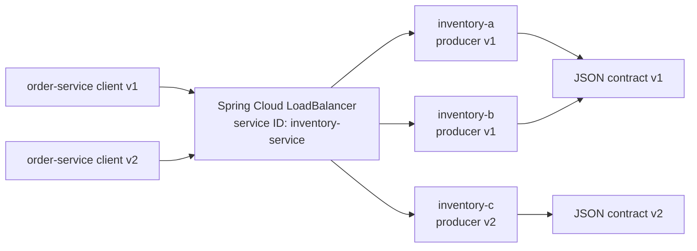

# API Contracts and Compatibility When Multiple Versions Run Together

## 1. One Service ID, Multiple Versions: The Problem Is Not the Target Selection Algorithm

In the **Contracts and Errors** chapter of the `SPRING_CLOUD_SERVICE_COMMUNICATION_LOAD_BALANCING` module, `order-service` calls `inventory-service` by service ID. Spring Cloud LoadBalancer retrieves the list of `ServiceInstance` objects via discovery, applies health check/zone/routing when configured, and then selects an instance for `RestClient`, `WebClient`, or OpenFeign. This mechanism allows multiple replicas to serve traffic together, but it also introduces a risk when **multiple API versions coexist** during a rolling deployment, canary release, or rollback.

Suppose:

- `inventory-a` and `inventory-b` are running application **v1**.
- A deployment group brings up `inventory-c` running **v2**, registered under the same name `inventory-service`.
- `order-service` still calls the URL `http://inventory-service/api/inventory/ABC-1`.

One request may hit v1 and the next request may hit v2. A retry can even route the same logical request from v1 to v2. **LoadBalancer only picks an eligible instance according to policy; it does not automatically verify whether the JSON, status codes, or field meanings of the two versions are compatible.**

Therefore, compatibility must be guaranteed at the **contract between producer and consumer**, or through a strict, tested version-selection mechanism. You cannot rely on sticky routing, caching, or Round Robin to fix a breaking API change.

### Lesson Objectives

After this lesson, you will be able to:

1. Distinguish between **deployment** version, **API** version, and **schema** version.
2. Identify backward compatibility and forward compatibility when v1 and v2 clients and servers run concurrently.
3. Classify changes as safe or contract-breaking across URLs, headers, JSON, enums, data types, HTTP status codes, and business semantics.
4. Design DTOs that handle extension fields without masking missing required fields.
5. Deploy using the **expand → migrate → contract** strategy, supporting rollback within the compatibility window.
6. Enforce version-selection boundaries using service IDs, URLs, metadata, or version-aware routing when a shared contract cannot be maintained.
7. Build an old–new client/server test matrix, contract tests, and rolling/canary tests with Spring Cloud LoadBalancer.
8. Observe 404/409/422/5xx errors, decode failures, and semantic mismatches during version transitions.

## 2. Risk Diagram During Rolling Deployment



In practice, v1 and v2 clients do not **necessarily** call an instance at the exact same time; the diagram illustrates what can happen when both generations of callers and producers register/configure the same service ID **without a version filter**.

### 2.1. Four Combinations You Must Consider

| Consumer (caller) | Producer (instance) | Why it matters |
|---|---|---|
| **Client v1 → Server v1** | Initial state | Baseline; does not prove safety during an upgrade |
| **Client v1 → Server v2** | Server is upgraded first | Does the new server still satisfy what old clients expect? |
| **Client v2 → Server v1** | Caller is upgraded first, or producer rolls back | Can the new client tolerate fields/features that do not exist yet on the old server? |
| **Client v2 → Server v2** | New state | Does the new functionality work properly once both sides are upgraded? |

If producers are deployed first, the most critical combination is **v1 client → v2 server**. However, if rollback is needed or some callers are upgraded first, **v2 client → v1 server** is also a real requirement. If a combination is not supported, you must design a **routing policy and rollout order** that prevents it from occurring, rather than skipping tests.

**Compatibility does not necessarily mean all four combinations support every new feature.** For example, a v2 client may read the v1 API while disabling the "quick reserve" button when the v1 server does not provide the required data. That is explicitly documented graceful degradation, not guessing missing values.

## 3. Scope of an API Contract

An HTTP contract is much more than a list of DTOs:

| Component | Example | Risk when changed |
|---|---|---|
| Address and HTTP method | `GET /api/inventory/{sku}` | Changing the path or changing GET to POST causes old clients to receive 404/405 |
| Path/query/header | `sku`, `warehouse`, `X-Api-Version` | Turning an optional parameter into required breaks old clients |
| Content type | `application/json`, `application/x-ndjson` | Replacing a JSON array with NDJSON can make the codec fail |
| JSON body | `sku`, `available` | Renaming, changing type, nullability, or object/list causes decode errors or corrupt data |
| Enum values | `AVAILABLE`, `OUT_OF_STOCK` | Adding an enum value can break clients using strict enum parsing |
| Status and errors | 200/404/409/429/503 + `ProblemDetail` | Changing 404 to 200 with an empty body or vice versa can break logic |
| Business semantics | `available` means "sellable quantity" | Changing it to "physical on-hand quantity" while keeping the name breaks **semantics** |
| Auth and permissions | Bearer header, scope, tenant | Changing permission requirements or accepting old tokens must be planned |
| Idempotency/retry | `Idempotency-Key`, retryable state | Changing from a safe GET to an operation with side effects causes duplicate errors |
| Pagination/ordering | `page`, `limit`, default order | Clients may miss or duplicate items when behavior changes |
| Time/unit data | UTC ISO-8601, milliseconds, currency units | Changing units without changing field names causes severe data corruption |

**Application version** (for example build `2.18.0`), **API contract version** (for example `inventory-api/v1`), and **OpenAPI document version** (`info.version` field) are three related concepts that are **not identical**. A new build may still serve API v1; one server may serve v1 and v2 concurrently; and upgrading a Spring Cloud library does not automatically change your business contract.

### 3.1. Backward Compatibility and Forward Compatibility

From the producer's perspective:

- **Backward compatible:** the **new** server continues to serve **old** consumers according to everything old clients already expect.
- **Forward compatible on the consumer side:** the **new** client can communicate with the **old** server within the agreed scope of functionality, even when the old server does not yet know about new features.

Neither property comes for free just because "both can parse JSON." You must verify **required constraints and business logic**. For instance, if v2 JSON adds `reservationEligible=true`, a v1 client that ignores this field can still read the quantity, but a v2 client calling a v1 server must treat `reservationEligible` as **unknown**, never assuming it is `true`.

## 4. v1 and v2 Example: Adding a Field in a Controlled Way

### 4.1. Producer v1

HTTP response of `GET /api/inventory/ABC-1`:

```http
HTTP/1.1 200 OK
Content-Type: application/json

{"sku":"ABC-1","available":12}
```

The v1 contract specifies that `sku` and `available` are **required**. `available` is a non-negative integer describing the sellable quantity at read time.

### 4.2. Producer v2: Expanding Without Breaking Old Content

```http
HTTP/1.1 200 OK
Content-Type: application/json

{"sku":"ABC-1","available":12,"reservationEligible":true}
```

The v2 server still returns `sku` and `available` with the same types and meaning. The `reservationEligible` field is **optional** and provides supplementary information only.

This *can* be backward compatible if old clients allow unknown fields to be ignored. If an old client enables strict JSON deserialization or validates a schema with `additionalProperties=false`, adding a field can still be breaking. Therefore, you cannot claim "adding a field is always safe" without knowing the **consumer's contract**.

### 4.3. Producer v2 Breaking the Contract

```json
{
  "productCode": "ABC-1",
  "stock": 12
}
```

Although this is valid JSON, an old client looking for `sku` and `available` will be missing data. Worse yet, with a Java DTO using primitive `int available`, a missing field can deserialize to **0**, making the system think the item is out of stock. This is a silent business bug, sometimes more severe than an exception.

**Rule:** required fields must be **validated after decoding**. Do not treat successful JSON parsing as proof that the contract was preserved.

## 5. Consumer DTO: Accept Extensions Without Masking Missing Meaning

A wire DTO flexible enough for both v1 and v2:

```java
import com.fasterxml.jackson.annotation.JsonIgnoreProperties;

@JsonIgnoreProperties(ignoreUnknown = true)
public record InventoryWire(
        String sku,
        Integer available,
        Boolean reservationEligible) {
}
```

Why choose `Integer` and `Boolean` instead of `int`/`boolean`?

- `Integer available` lets you distinguish **missing/null** from **0**. It is a required field, so it must be validated.
- `Boolean reservationEligible` is optional while v1 and v2 coexist; `null` means **no information yet**, not `false`.
- `@JsonIgnoreProperties(ignoreUnknown = true)` allows ignoring other new fields that this client does not use yet. It does **not** automatically verify required fields or preserve semantics.

Define the domain result:

```java
enum ReservationCapability {
    YES, NO, UNKNOWN
}

record InventoryView(
        String sku, int available, ReservationCapability capability) {
}
```

Wire → domain validator:

```java
final class ContractViolationException extends RuntimeException {
    ContractViolationException(String message) {
        super(message);
    }
}

final class InventoryDecoder {

    private InventoryDecoder() {
    }

    static InventoryView validate(
            InventoryWire wire, String requestedSku) {

        if (wire == null
                || wire.sku() == null
                || !requestedSku.equals(wire.sku())
                || wire.available() == null
                || wire.available() < 0) {
            throw new ContractViolationException(
                    "Invalid inventory response contract");
        }

        ReservationCapability capability =
                wire.reservationEligible() == null
                        ? ReservationCapability.UNKNOWN
                        : wire.reservationEligible()
                            ? ReservationCapability.YES
                            : ReservationCapability.NO;

        return new InventoryView(
                wire.sku(), wire.available(), capability);
    }
}
```

Results:

| Server | Returned JSON | New consumer interpretation |
|---|---|---|
| v1 | `sku` + `available` | Valid inventory value, `capability=UNKNOWN` |
| v2 | Includes `reservationEligible=true` | Valid inventory value, `capability=YES` |
| v2 | Includes `reservationEligible=false` | Valid inventory value, `capability=NO` |
| Broken contract server | Missing `available`, wrong `sku`, or negative value | Throws `ContractViolationException`, does **not** default to 0 |

If the business flow requires placing a reservation, `UNKNOWN` **must not allow automatic confirmation**. It means the old producer does not yet provide that information under the new contract. A dedicated reservation API with an atomic reservation mechanism is still needed to prevent race conditions; the display field is only an indicator.

### 5.1. Do Not Solve Everything with ignoreUnknown

- It cannot fix changing `available:12` to `available:"12"` if the contract forbids type coercion.
- It cannot fix `available` silently changing to a different unit.
- It cannot fix a producer returning an empty body with HTTP 200.
- It cannot fix a client enum parsed as a Java enum with no fallback for new values.
- It cannot make a v1 server understand a v2 request carrying a new required header/body field.

**Tolerant reader only helps when the change aligns with the contract and validation.** It is never an excuse to skip testing across client/server generations.

## 6. Change Matrix: Additive, Conditional, and Breaking

| Producer change | Risk level | Condition for compatibility |
|---|---|---|
| Add an **optional** response field | Usually additive | Old clients ignore unknown fields; existing fields keep type/meaning |
| Add an optional query parameter | Potentially additive | Old server accepts new requests without the parameter; new client has a fallback |
| Add a new endpoint | Usually additive | Does not alter old routes; auth/routing do not conflict |
| Add a new response enum value | Potentially breaking | Consumer has a safe `UNKNOWN`/default branch |
| Add a new HTTP status | Potentially breaking | Callers handle status codes by class/contract, not by comparing a single status |
| Change field from `int` to `string` | Breaking | Requires versioned transition or an agreed contract |
| Remove/rename a required field | Breaking | Old clients still depend on that field |
| Add a **required** request field | Breaking | Old clients do not send it, so the new server rejects requests |
| Remove auth header or change scope | Potentially breaking and sensitive | Requires security migration, never "fail-open" |
| Change JSON object to JSON array | Breaking | Client decoder and semantics change |
| Change 404 to 200 + empty body | Potentially breaking | Callers rely on 404 to detect "not found" |
| Change `available` from sellable to on-hand | **Semantic breaking change** | Cannot be fixed by a JSON parser alone |
| Change monetary value from cents to major currency units | **Severe breaking change** | Needs a new field/unit or explicit API version |
| Add stricter server-side validation | Potentially breaking | Previously accepted old requests now return 400/422 |
| Remove stable sorting or change pagination | Potentially breaking | Consumers may duplicate/miss items |
| Add an observability-only response header | Usually additive | Does not change required fields or existing formats |

Do not judge compatibility solely by an OpenAPI diff. Rules such as **idempotency**, data freshness, permissions, ordering, timeouts, and status semantics require integration testing and live monitoring.

### 6.1. Request Evolution Can Be More Dangerous Than Response Evolution

Having a v2 producer add an optional response field is sometimes straightforward. However, having a v2 consumer send a new request field that a v1 producer does not understand may result in it being ignored or rejected. If that field governs transaction integrity, **having the old server ignore it is even more dangerous than returning 400**.

For example, a v2 client sends `Idempotency-Key` to `POST /reservations`, but the v1 server **does not support deduplication**. Even though the HTTP request succeeds, a retry after a timeout can still create two reservations. Never use "the old server ignores the header" as proof of business compatibility.

## 7. Error Contracts and HTTP Status Codes Must Be Stable

When multiple replicas share a service ID, error categories must be distinguished:

| Situation | Origin | Example caller policy |
|---|---|---|
| `404 Not Found` from inventory because SKU does not exist | **Producer** received the request and determined the domain lacks the resource | Return 404/`SKU_NOT_FOUND` if the contract specifies so |
| `400` or `422` due to invalid request | Producer validation | Do not retry verbatim; fix request/contract |
| `409 Conflict` on reservation conflict | Producer/domain | Handle conflict per business rules; do not retry unconditionally |
| `429 Too Many Requests` | Producer/rate limit | Bound retries; respect `Retry-After` and deadlines |
| `503 Service Unavailable` from producer | Producer is unavailable | Classify as dependency error; bounded retry if safe |
| Synthetic `503` when LoadBalancer finds no instance | **Caller/LoadBalancer**, possibly before any HTTP call | Record `no-instance`; do not infer the server returned 503 |
| Connect/read timeout | HTTP/transport client after target selection | Uncertain whether the server executed the operation |
| JSON decode/validation failure | Contract mismatch | Report contract error; do not retry indefinitely |
| Circuit breaker OPEN | Caller blocked the request | Do not report "inventory server returned 503" |
| HTTP 200 with semantically wrong payload | Producer v2 changed field meaning | Especially dangerous; monitor and run domain tests |

**404 does not mean the service ID does not exist.** A `@LoadBalanced WebClient` calling an invalid service ID typically receives a synthetic 503 when no instance is found, whereas HTTP 404 usually indicates that a server received the request and the endpoint/resource does not exist (unless a gateway/fallback alters semantics). Distinguish them using traces and logs, not status codes alone.

### 7.1. Keep Machine-Readable Error Codes Stable

An API can return `ProblemDetail` per RFC 9457:

```json
{
  "type": "https://api.example.test/problems/sku-not-found",
  "title": "SKU not found",
  "status": 404,
  "detail": "SKU requested does not exist",
  "code": "SKU_NOT_FOUND",
  "traceId": "trace-123"
}
```

This is a **contract example**, not a body Spring Boot auto-generates with the `code`/`traceId` extensions. `type` is the problem documentation URI; illustrative URLs must be replaced with URIs managed by your organization. Avoid branching on the `detail` text: wording may change with localization or copywriting. Clients should rely on `status` and a stably defined `code` field.

A handler in Spring MVC:

```java
@RestControllerAdvice
class InventoryErrorAdvice {

    @ExceptionHandler(SkuNotFoundException.class)
    ResponseEntity<ProblemDetail> notFound(
            SkuNotFoundException error) {

        ProblemDetail detail = ProblemDetail.forStatusAndDetail(
                HttpStatus.NOT_FOUND, "SKU does not exist");
        detail.setTitle("SKU not found");
        detail.setProperty("code", "SKU_NOT_FOUND");

        return ResponseEntity.status(HttpStatus.NOT_FOUND)
                .body(detail);
    }
}
```

`SkuNotFoundException` is a custom domain exception, not a Spring class. Following the same pattern, `order-service` can return `503` with `code=DEPENDENCY_UNAVAILABLE` when it cannot call inventory, or `502`/a clearly classified internal error when upstream breaks the schema. **Never** pretend an SKU is out of stock or nonexistent after a timeout.

### 7.2. Error Semantics Changes Must Also Be Versioned

For example, producer v1 returns `404` for "SKU does not exist," while producer v2 returns `200 {"available":0}` for the same situation. A client may interpret that as "SKU exists but is out of stock," causing inconsistent behavior depending on which instance is hit. This is a **breaking change even when both payloads parse cleanly**. To change semantics, you need a negotiated API version or a migration phase where the producer explicitly supports both contracts.

## 8. Configuring WebClient with LoadBalancer and Validation

In `order-service`, use `@LoadBalanced WebClient.Builder` to call by service ID:

```java
@Configuration(proxyBeanMethods = false)
class InventoryWebClientConfiguration {

    @Bean
    @LoadBalanced
    WebClient.Builder loadBalancedWebClientBuilder() {
        return WebClient.builder();
    }
}
```

The gateway decodes using `InventoryWire` and then validates the contract:

```java
@Service
class InventoryGateway {

    private final WebClient client;

    InventoryGateway(@LoadBalanced WebClient.Builder builder) {
        this.client = builder.clone()
                .baseUrl("http://inventory-service")
                .build();
    }

    Mono<InventoryView> read(String sku) {
        return client.get()
                .uri("/api/inventory/{sku}", sku)
                .retrieve()
                .bodyToMono(InventoryWire.class)
                .switchIfEmpty(Mono.error(
                        new ContractViolationException("Empty JSON body")))
                .map(wire -> InventoryDecoder.validate(wire, sku));
    }
}
```

With Spring Cloud LoadBalancer, each HTTP subscription selects an instance from the replicas available in discovery/supplier. `InventoryDecoder` enforces the contract at the **HTTP adapter boundary**, ensuring domain services receive validated data. An empty `bodyToMono` is not turned into `available=0`. If the producer returns HTTP 404/503, `retrieve()` by default emits a `WebClientResponseException` for that status; those errors do **not** enter the `map` branch.

**Do not catch all errors with `onErrorReturn(InventoryView(sku,0,...))`.** Contract violations, no-instance errors, HTTP 404s, timeouts, and valid responses with zero inventory are distinct cases.

### 8.1. RestClient and OpenFeign Also Need Validation

With blocking `RestClient`:

```java
InventoryWire wire = restClient.get()
        .uri("/api/inventory/{sku}", sku)
        .retrieve()
        .body(InventoryWire.class);

InventoryView view = InventoryDecoder.validate(wire, sku);
```

In this snippet, `restClient` is a bean built from `@LoadBalanced RestClient.Builder` with `baseUrl("http://inventory-service")`. `body(...)` can return `null` on an empty body, so `validate` must handle `null` as shown above.

With OpenFeign, an illustrative client:

```java
@FeignClient(name = "inventory-service", path = "/api/inventory")
interface InventoryFeignApi {

    @GetMapping("/{sku}")
    InventoryWire read(@PathVariable("sku") String sku);
}
```

Having Spring Cloud OpenFeign and Spring Cloud LoadBalancer properly wired does not make v1/v2 APIs automatically compatible; responses from both versions still require validation. Feign's default exceptions for HTTP status/transport **differ** from `WebClientResponseException`, so introduce an adapter layer to translate them into stable domain errors. Do not use retries to "keep picking until an instance returns parseable data"—that hides contract violations and makes load unpredictable.

## 9. Versioning: When Do You Need Separate Paths?

If you keep a shared v1-compatible API throughout a rolling upgrade, sharing a single service ID is normal. When making **breaking** changes, you have these options:

| Approach | Example | Pros | Limitations |
|---|---|---|---|
| **Add optional fields, same endpoint** | `GET /api/inventory/{sku}` | Simple, rolling-friendly | Must test tolerant reader; cannot change old field meanings |
| **Path versioning** | `/api/v1/inventory/{sku}`, `/api/v2/inventory/{sku}` | Explicit contract; a single server can support both paths | Every instance LoadBalancer picks **must** support the path the client calls if sharing a service ID |
| **Header/media type versioning** | `X-Api-Version: 2` or custom media type | Keeps URIs stable | Proxies/caches/routing must propagate version; old servers may not understand it |
| **Separate service IDs** | `inventory-v1` and `inventory-v2` | Clean separation of instance pools, rollout, and rollback | Increases discovery/config/observability overhead and parallel operations |
| **Version-aware supplier** | Filter instances by version metadata | Routes by contract without splitting service IDs | Requires real support/version propagation; must not fall back to the wrong version |

### 9.1. Changing the Path Is Not Enough When Old Instances Do Not Understand the New Path

Suppose a client calls `http://inventory-service/api/v2/inventory/ABC-1`, yet LoadBalancer can still pick `inventory-a` v1, which only supports `/api/v1/...`. The v1 server will return 404. Path versioning only solves **contract identification**; you must ensure that **every selectable instance supports the requested path**, either by configuring a hard routing filter or by separating service IDs.

Similarly, adding an `X-Api-Version: 2` header does not automatically cause Round Robin to skip v1 instances. The API version in the **HTTP request** and the version metadata on the **ServiceInstance** must be connected by an actual routing mechanism.

### 9.2. Do Not Use Zone, Hint, or Sticky Preferences as a Hard Version Barrier

*Preference* policies can fall back:

- `ZonePreferenceServiceInstanceListSupplier` may return all instances when the preferred zone has no candidates.
- `HintBasedServiceInstanceListSupplier` may return all instances if no hint matches.
- `SameInstancePreferenceServiceInstanceListSupplier` only prefers a previously chosen instance; it does not bind versions per user and does not guarantee sticking after failover.

Therefore, do **not** use them as a safety guarantee for a breaking change if the implementation can fall back to an incompatible revision. For a **hard version requirement**, when no valid instance exists, it must **fail closed/no-instance** rather than routing to a different API version and hoping the request succeeds.

## 10. Spring Cloud Commons 5.0+: API Version-Based Load-Balancing

**This section applies to Spring Cloud Commons 5.0+** and must not be assumed to exist in Spring Cloud Commons 4.3 or earlier applications. The 5.0 documentation describes `BlockingApiVersionServiceInstanceListSupplier` and `ReactiveApiVersionServiceInstanceListSupplier`.

You can create the supplier via the builder (for example, for reactive `WebClient`):

```java
class InventoryVersionRoutingConfiguration {

    @Bean
    ServiceInstanceListSupplier inventorySupplier(
            ConfigurableApplicationContext context) {
        return ServiceInstanceListSupplier.builder()
                .withDiscoveryClient()
                .withCaching()
                .withReactiveApiVersioning()
                .build(context);
    }
}
```

For blocking `RestClient`, use `.withBlockingApiVersioning()` instead. Configure `@LoadBalancerClient(name="inventory-service", configuration=InventoryVersionRoutingConfiguration.class)` if you want to target a specific service ID. Do **not** accidentally component-scan this dedicated configuration class into the root context; it must be loaded inside the LoadBalancer child context of the targeted service ID.

You can select the built-in configuration:

```yaml
spring:
  cloud:
    loadbalancer:
      configurations: api-version
      api-version:
        header: X-Api-Version
        required: true
        fallback-to-available-instances: false
```

The properties in the example above are the **global form in Commons 5.0**; per-client-ID configuration has its own prefixes/binding styles depending on the version. Verify `spring.cloud.loadbalancer.api-version.*` in the *Configuration Properties* of the exact artifact you are running. This example illustrates intent, not a migration recipe applicable to Commons 4.x.

**Key control point:** the supplier matches the request's version (header/query/path/media type depending on configuration) against the `API_VERSION` metadata of each `ServiceInstance`. When no instance matches, it can default to returning an empty list; setting `fallback-to-available-instances=false` prevents misrouting to a different revision. If set to `true`, falling back to any available instance can **violate hard compatibility constraints**.

For this to work, you need:

1. The registry to provide accurate `API_VERSION` metadata for each instance.
2. Requests to pass through the right client/filter so the supplier can read the version information.
3. Each instance's version metadata to match the API it actually serves.
4. Tests for missing versions, invalid versions, non-matching versions, and stale registry/cache states.
5. No default version overriding a required version intentionally sent by a client.

Logical metadata example:

```text
inventory-a: serviceId=inventory-service, API_VERSION=1, host=:8081
inventory-b: serviceId=inventory-service, API_VERSION=1, host=:8082
inventory-c: serviceId=inventory-service, API_VERSION=2, host=:8083
```

This is **illustrative** data, not universal registration YAML for every registry. How metadata is attached in Eureka/Consul/Kubernetes varies; configure according to your actual provider and inspect `ServiceInstance.getMetadata()`.

**Scope note:** a single instance may support both v1 and v2, whereas the basic supplier's `API_VERSION` metadata represents a single version value. If you want to model "an instance supports a set of versions," consider separating service IDs, writing an appropriate custom supplier/metadata scheme, or running two endpoints with separate routing; do not assume a single key automatically encodes multiple versions.

## 11. Deployment Plan: expand → migrate → contract

Suppose the desired end state is v2 adding the `reservationEligible` field and a v2 endpoint for reservation operations. Never update all servers and clients simultaneously hoping no interleaved requests occur.

### 11.1. Phase 1 — Expand (non-breaking expansion)

- Add optional fields/new endpoints on the producer while **preserving all old fields/paths/status codes and semantics**.
- If DB schema changes are needed, add new columns/tables so both old and new code continue running; do not drop or repurpose old columns.
- Producer v2 must run alongside producer v1 without breaking v1 consumers.
- Current consumers still rely only on old fields and can ignore extended fields.
- Run contract tests covering both old and new responses.

### 11.2. Phase 2 — Migrate (gradual consumer transition)

- Upgrade consumers to v2 so they understand the new fields/endpoints, while still handling v1 producers during the rollout/rollback window if policy requires it.
- For capabilities absent in v1, yield `UNKNOWN`/hide the new action instead of guessing values.
- If API v2 must be enforced, configure hard version routing or a new service ID.
- Monitor the actual server versions received and error rates by consumer/server pair.
- Test rolling back consumers and producers independently in a test environment.

### 11.3. Phase 3 — Contract (retire the old contract)

Only remove old fields/paths/behaviors when:

1. You have confirmed **no v1 consumers remain** or separate routing is in place.
2. The support/deprecation window has been announced and has elapsed safely.
3. The system measures traffic to the old API, including slow-to-update batch jobs, cron jobs, and mobile clients.
4. A rollback plan exists that does not depend on the removed parts.
5. Contract tests and DB migration tests prove compatibility within the expected window.

If a v2 producer must read/write the DB using a new schema, rolling back the application should not require rolling back data that was updated in a compatibility-breaking way. Use expand-read-write-contract and two-phase migrations when needed, and avoid dropping columns before old code stops running.

### 11.4. Canary and Rolling Traffic

A cautious rollout:

```text
0% v2 producer  -> all v1 consumers hit v1 producers
10% v2 producer -> v1 consumers may hit v2 if sharing the service ID
50% v2 producer -> check contract errors and semantic metrics
100% v2 producer -> keep v1 contract support until the migration window ends
Consumer v2 rollout -> test v2 client against v2 producer and rollback to v1
Retire v1 contract -> only after proving no v1 consumers remain
```

Do not monitor HTTP 5xx alone: a "syntactically compatible but semantically wrong" change can produce 200 responses with wrong values. Track domain metrics such as anomalous `available=0` rates, erroneous reservations, inventory discrepancies, and spikes in `UNKNOWN` after rollout.

## 12. Retries and LoadBalancer Can Switch Between Two Versions

When the first attempt is routed to `inventory-a` v1 and times out, Spring Cloud LoadBalancer may pick `inventory-c` v2 on the next retry if both remain in the candidate pool. Therefore:

- Every instance selectable on retry must support **the same request contract**.
- Do not "retry until valid JSON" when an attempt receives a body violating the contract: that is a producer deployment bug, not a transient network error.
- If the request is a reservation POST, it must have an `Idempotency-Key`, deduplication rules, and compatible contracts on **both** v1 and v2; if v1 does not support it yet, do not send that POST to v1.
- A timeout or HTTP 503 does not guarantee the server did not execute the transaction; retrying can multiply side effects if versions behave differently.
- Sticky sessions or preferences do not guarantee a session will never switch to a different version instance after restarts or scale-in events.

A particularly dangerous example:

```text
POST /reservations, header Idempotency-Key: order-123
Attempt 1 -> v1, v1 ignores the header; server created reservation, response lost
Attempt 2 -> v2, v2 has a new idempotency store; creates reservation again
=> Two reservations even though the caller issued only one logical request.
```

**Conclusion:** "v2 client can still parse v1 responses" is a necessary condition, not a sufficient one for write operations. Compatibility must encompass **state, idempotency, transactions, and error semantics**.

## 13. Compatibility Testing: Not Just v2/v2 Unit Tests

### 13.1. Minimum Matrix

| Test case | Consumer | Producer/instance | Expected outcome |
|---|---|---|---|
| TC01 | v1 | v1 | Baseline compatibility |
| TC02 | v1 | v2 | Old response fields remain stable; no decode failure |
| TC03 | v2 | v1 | Reads old data; optional capability is `UNKNOWN` |
| TC04 | v2 | v2 | Uses new fields when present |
| TC05 | v1 | v2 invalid | Fails properly; does not silently default to `available=0` |
| TC06 | v2 | v1 returns 404 | Preserves `SKU_NOT_FOUND` semantics |
| TC07 | v1/v2 | producer returns 503 | Classifies as dependency unavailable; does not return bogus data |
| TC08 | v1/v2 | no instance | Reports no-instance error; does not confuse with `SKU_NOT_FOUND` |
| TC09 | v2 | v1 then retry to v2 | Contract holds when target switches |
| TC10 | v2 | v2 then rollback to v1 | No new feature is executed erroneously |
| TC11 | v2 | producer returns new enum | Unknown value handled safely without parse crash if contract permits |
| TC12 | v1/v2 | producer changes `available` semantics | Domain test fails even though JSON is valid |
| TC13 | v2 | v1 POST lacks idempotency support | Does not route, does not send, or fails closed |
| TC14 | v2 | only v1 instances exist when API v2 required | Does not fall back to v1 when version is hard-required |

**Do not assume every test must pass in "full feature" mode.** For example, TC03 may pass with "inventory quantity displayed, v2 reservation feature disabled." However, TC14 must verify that the request is blocked/routed with no candidates rather than leaking to v1.

### 13.2. Unit Tests for DTO and Validation

Example using Jackson/JUnit 5 with `InventoryWire` and `InventoryDecoder` from Section 5:

```java
class InventoryContractTest {

    private final ObjectMapper mapper = new ObjectMapper();

    @Test
    void acceptsV1AndV2Payloads() throws Exception {
        String v1 = "{\"sku\":\"ABC-1\",\"available\":12}";
        String v2 = "{\"sku\":\"ABC-1\",\"available\":12,"
                + "\"reservationEligible\":true,\"newField\":\"ignored\"}";

        InventoryView oldView = InventoryDecoder.validate(
                mapper.readValue(v1, InventoryWire.class), "ABC-1");
        InventoryView newView = InventoryDecoder.validate(
                mapper.readValue(v2, InventoryWire.class), "ABC-1");

        assertEquals(12, oldView.available());
        assertEquals(ReservationCapability.UNKNOWN,
                     oldView.capability());

        assertEquals(12, newView.available());
        assertEquals(ReservationCapability.YES,
                     newView.capability());
    }

    @Test
    void missingRequiredFieldFailsValidation() throws Exception {
        InventoryWire wire = mapper.readValue(
                "{\"sku\":\"ABC-1\"}", InventoryWire.class);

        assertThrows(ContractViolationException.class,
                () -> InventoryDecoder.validate(wire, "ABC-1"));
    }
}
```

JUnit imports (`@Test`, `assertEquals`, `assertThrows`) and `ObjectMapper` are omitted. The code targets Java/Spring Boot 3.x and Jackson 2.x; for Jackson 3 or a different mapper configuration, verify your dependency/BOM and active APIs. This test **does not replace** HTTP integration testing: it only proves decoding/validation logic.

### 13.3. Consumer-Driven Contract Tests

Spring Cloud Contract supports declaring contracts, generating **producer verification tests**, and publishing WireMock **stubs** so consumers can test without spinning up a full registry. You can use:

- **Producer-side verifier:** verifies `inventory-service` actually returns the committed paths/statuses/headers/schemas.
- **Stub Runner / WireMock:** `order-service` runs tests against stubs representing both v1 and v2 scenarios.
- **LoadBalancer integration test:** a mock registry or `SimpleDiscoveryClient` pointing to two mock servers, each running one contract version, verifying requests can reach both.
- **Migration test:** mixes legacy and new DTOs rather than testing only the latest client and server.

Whether Spring Cloud Contract Stub Runner can stub `DiscoveryClient` and integrate with LoadBalancer depends on the starter and version configuration. Do not assume adding a single annotation mocks discovery across the system; configure stub artifacts/groups and wiring properly for your Spring Cloud Contract version.

### 13.4. OpenAPI Aligns Contracts, Not Runtime Compatibility

Partial schema example:

```yaml
openapi: 3.0.3
info:
  title: Inventory API
  version: "1.1.0"
paths:
  /api/inventory/{sku}:
    get:
      parameters:
        - name: sku
          in: path
          required: true
          schema:
            type: string
      responses:
        "200":
          description: Inventory snapshot
          content:
            application/json:
              schema:
                $ref: "#/components/schemas/Inventory"
        "404":
          description: SKU not found
components:
  schemas:
    Inventory:
      type: object
      required: [sku, available]
      properties:
        sku:
          type: string
        available:
          type: integer
          format: int32
          minimum: 0
        reservationEligible:
          type: boolean
          description: Optional; absent when unknown or unsupported
```

The `reservationEligible` field is not listed in `required`. `info.version` is the **API specification version**; it does not automatically instruct LoadBalancer to route to an instance of a matching version. Whenever the schema changes, test readability on real consumers and also verify semantics/status codes outside the schema.

If you use an automated OpenAPI diff, do not treat a "non-breaking" report as sufficient; additionally test `404↔200`, retry/idempotency, stale data, and authorization boundaries.

## 14. Lab: Rolling Deployment of Two Versions Under One Service ID

### 14.1. Topology

| Process | Service ID | Port | Producer version |
|---|---|---:|---|
| `order-service` | `order-service` | 8080 | Consumer with `InventoryGateway` |
| `inventory-a` | `inventory-service` | 8081 | v1 |
| `inventory-b` | `inventory-service` | 8082 | v1 |
| `inventory-c` | `inventory-service` | 8083 | v2 |

`SimpleDiscoveryClient` configuration in the caller:

```yaml
spring:
  application:
    name: order-service
  cloud:
    discovery:
      client:
        simple:
          instances:
            inventory-service:
              - uri: http://localhost:8081
                instance-id: inventory-a
              - uri: http://localhost:8082
                instance-id: inventory-b
              - uri: http://localhost:8083
                instance-id: inventory-c
    loadbalancer:
      retry:
        enabled: false
      cache:
        enabled: false
server:
  port: 8080
```

This is a **static list for the lab**. In a real rollout, use a registry/rolling controller and wait for discovery, caches, and health checks to update. `localhost` only works when the caller and instances share the same network namespace; in containers, use hostnames reachable from the caller.

### 14.2. v1/v2 Servers (Separate Controllers per Process)

v1 application:

```java
@RestController
class InventoryV1Controller {

    @GetMapping("/api/inventory/{sku}")
    ResponseEntity<Map<String, Object>> get(
            @PathVariable String sku) {

        return ResponseEntity.ok()
                .header("X-Server-Revision", "v1")
                .body(Map.of(
                        "sku", sku,
                        "available", 12));
    }
}
```

v2 application (runs **in place of** the v1 controller in a separate process; do not register both for the same path):

```java
@RestController
class InventoryV2Controller {

    @GetMapping("/api/inventory/{sku}")
    ResponseEntity<Map<String, Object>> get(
            @PathVariable String sku) {

        return ResponseEntity.ok()
                .header("X-Server-Revision", "v2")
                .body(Map.of(
                        "sku", sku,
                        "available", 12,
                        "reservationEligible", true));
    }
}
```

`X-Server-Revision` is a **lab instrumentation** header, not a standard Spring Cloud header or an API version guarantee. Do not rely on client-supplied headers for authorization or treat revision headers as the sole source of truth; deployment logs and metadata are the authoritative sources for checking rollout status.

### 14.3. Caller Endpoint

```java
@RestController
@RequestMapping("/demo/inventory")
class InventoryDemoController {

    private final InventoryGateway gateway;

    InventoryDemoController(InventoryGateway gateway) {
        this.gateway = gateway;
    }

    @GetMapping("/{sku}")
    Mono<InventoryView> read(@PathVariable String sku) {
        return gateway.read(sku);
    }
}
```

Run 2 v1 replicas and 1 v2 replica, then:

```bash
curl -i http://localhost:8080/demo/inventory/ABC-1
curl -i http://localhost:8080/demo/inventory/ABC-1
curl -i http://localhost:8080/demo/inventory/ABC-1
```

With Round Robin and sequential requests, selections typically alternate through the candidate pool; however, background requests, retries, health filters, or caching can alter the order. **You can only know which revision actually handled a request through instance logs/traces**, or properly instrumented telemetry. `InventoryView` in this example only returns the capability state without attaching a version name; to measure a canary, add dedicated HTTP client instrumentation or request capture.

### 14.4. Breaking Variant to Demonstrate Risk

Change the v2 controller to return `{"sku":"ABC-1","stock":12}`. When LoadBalancer chooses v1, the caller receives a valid response; when it chooses v2, `InventoryDecoder.validate` throws `ContractViolationException` because `available` is missing. If a primitive DTO were used, the fault could be masked as `0`.

Count **contract_violation** by instance/revision; the failure rate fluctuates with the share of traffic going to v2. If retry is enabled and subsequently picks v1, the request can succeed on the next attempt, hiding rollout failures in final HTTP success rates. Therefore, **disable retries first when measuring**, and never retry schema/contract errors.

## 15. Canary/Rollback: What to Observe So You Are Not Misled

The following metrics are **recommended custom instrumentation**, not metric names that Spring Cloud always provides out of the box:

| Metric or trace field | Meaning |
|---|---|
| `http_attempts_total` by service, method, and revision | How many actual calls hit v1 vs. v2? |
| `contract_decode_failure_total` | JSON failed to decode |
| `contract_validation_failure_total` | Decoded successfully, but required fields were missing/invalid |
| `api_version_mismatch_total` | Client requested an API version not supported by instances |
| `upstream_404_total`, `upstream_409_total`, `upstream_5xx_total` | Mismatches in HTTP/error semantics |
| `no_instance_total` | No eligible instance available |
| `retry_count`, `retry_success_after_switch` | Are retries masking failures from one revision? |
| `consumer_version`, `producer_revision` in logs/traces | Identify which actual pair communicated |
| `domain_invariant_failure_total` | Do fields have the right **meaning**, e.g., anomalous values? |
| `request_latency_p95/p99` | Is the new revision slowing down old clients? |
| `traffic_share_by_revision` | How much traffic is the canary actually receiving? |
| `rollback_readiness` | Do clients and DB schema still support rollback? |

Avoid putting `requestId`, `sku`, tokens, or raw user IDs into **metric labels** due to cardinality and security risks. Use traces/logs with correlation IDs; with Spring Cloud LoadBalancer, you can look into `LoadBalancerLifecycle` to observe instance selection, while cross-checking callbacks against real versions.

### 15.1. Gates Before Increasing Canary Traffic

An illustrative procedure:

1. Run contract tests and the compatibility matrix before deploying.
2. Route 5–10% canary traffic using your active routing mechanism; **measure the actual share** rather than trusting intended configuration.
3. Compare errors, latency, and domain metrics by revision under the same request distribution.
4. Specifically verify `contract_validation_failure_total=0` and no unexpected shifts in 404/409 rates.
5. Increase traffic incrementally only with evidence; monitor not just overall p95, but also legacy consumer cohorts.
6. Test rollback while a mix of v2 and v1 producers are still running.
7. Remove v1 support only when no consumers still depend on it.

Do not infer that a canary hit a v2 instance from a header sent by the client itself; observe the revision in trusted server/side logs and spans reaching the actual instance.

## 16. Common Pitfalls and Fixes

| Symptom | Likely cause | Fix |
|---|---|---|
| Some requests return 200, others fail decoding | v1/v2 share a service ID with incompatible payload contracts | Test per instance/revision; restore old fields |
| `available` becomes 0 on v2 | Producer dropped the field; primitive DTO used | Use nullable wrappers + fail-fast validation |
| `404` occurs only when hitting v1 instances | Client calls a path/header supported only by v2 | Use hard version routing or roll out compatible endpoints first |
| HTTP 503 with no downstream logs | No instances available; LB filter errors before HTTP | Check discovery/health/version filters |
| Requests "recover" after retry | Second attempt hit an instance of another version | Count attempts; do not retry contract violations |
| Adding an enum value crashes old clients | Consumer enum lacks an unknown branch | Define an unknown sentinel and test consumers |
| OpenFeign behaves differently from WebClient | Different decoder, error handler, and retry behavior | Use an adapter layer normalizing errors to domain contracts |
| Producer rollback breaks v2 clients | v2 clients require v2-only fields/endpoints | Separate behind feature flags, keep clients forward-compatible, or route v2-only |
| `hint=2` enabled yet requests still hit v1 | Hint supplier falls back when no match is found | Use hard version-aware routing or separate service IDs |
| Version metadata exists yet supplier picks wrong instance | Missing registry metadata, stale cache, or request context lacks version | Instrument the supplier and test non-matching cases |
| Tests pass against latest mock but fail in production | Missing v1/v2 compatibility matrix | Stub both v1 and v2; run rolling chaos tests |
| Valid JSON yet wrong payments/inventory | Semantics or units changed without schema changes | Enforce domain invariants, new API version, and migration |
| Client treats `null` as `false` | Missing optional field assigned a default value | Use nullable types / `UNKNOWN` sentinel; gate sensitive actions |
| DB fails during mixed old/new deployment | Schema is not bidirectionally compatible | Use expand-migrate-contract and test rollback |

## 17. Exercises and Self-Check Checklist

### Exercise 1 — Compatibility Analysis

Starting from the v1 payload `{"sku":"ABC-1","available":12}`, propose three additive changes and three breaking changes. For each change, explain **both directions** (client v1 → server v2 and client v2 → server v1); do not state "adding a field is always safe" without inspecting parser/validation behavior.

### Exercise 2 — Validation Against "Fake Zero"

Use `InventoryWire` with `Integer available`. Create a test server returning three payloads: all fields present, missing `available`, and `available=-1`. Requirement: only the first payload succeeds; the two invalid payloads must raise a contract error, **never** "out of stock."

### Exercise 3 — Rolling 2 v1 + 1 v2

Set up the topology in Section 14, send 100 GET requests, and log the actual instance revision serving each one. Have v2 add optional `reservationEligible`; verify old consumers still read successfully and new consumers assign `UNKNOWN` when hitting v1. Then test the variant where v2 renames `available` to `stock` and observe the contract violation rate.

### Exercise 4 — Retry Switching Versions

Enable one retry for GET, simulate a timeout on v1 so it retries onto v2. Log every attempt and server revision. Explain why retries can mask a mismatch if the v2 schema is broken, and why contract errors should not be retried like connection errors.

### Exercise 5 — Fail-Closed Version Routing

On Commons 5.0+ (or a custom version-aware supplier), require `X-Api-Version: 2` when the registry only contains v1 instances. Verify that it **never misroutes to v1** and produces a meaningful error; then add a v2 instance with proper metadata. Do not apply this exercise verbatim to Commons 4.3 because it lacks the corresponding built-in feature.

### Exercise 6 — Error Contract

Configure both v1 and v2 producers to return 404 + `code=SKU_NOT_FOUND` for missing SKUs. Then change v2 to return 200 + `available=0` for the same case; write a test that catches this semantic mismatch and decide what versioning/migration is required.

### Exercise 7 — Breaking Write Contract

Design `POST /reservations` with an idempotency key. Simulate a v1 server ignoring the header and a v2 server supporting it. Prove that relying on response parsing alone is insufficient for mixed v1/v2 calls; propose separating service IDs, deploying v1 deduplication support first, or blocking v2 routes to v1.

### Completion Checklist

- [ ] Can distinguish deployment version, contract version, and OpenAPI `info.version`.
- [ ] Have a client v1/v2 × producer v1/v2 matrix for all critical call paths.
- [ ] Required fields preserve names, types, and semantics; optional fields define behavior when absent.
- [ ] Tolerant readers ignore unknown fields, while validation never masks missing required fields.
- [ ] New enums, status codes, and error codes are handled safely by clients per contract.
- [ ] LoadBalancer is not mistaken for a compatibility validator.
- [ ] Path/header API versions only take effect when selectable instances actually support the requested version.
- [ ] Zone/hint/sticky preferences with fallback are never used as a hard version barrier.
- [ ] If using Commons 5.0+ version supplier, `API_VERSION` metadata and fail-closed behavior on mismatch are verified.
- [ ] Retries/timeouts do not mask schema errors or duplicate write side effects.
- [ ] Producer verification, consumer stubs, and rolling integration tests are executed.
- [ ] Contract and semantic metrics are segmented by server revision and consumer version.
- [ ] An expand–migrate–contract and rollback plan exists for both application code and DB.
- [ ] Legacy API support is never removed before proving no legacy consumers remain.

## Official References

- [Spring Cloud Commons 4.3 — Spring Cloud LoadBalancer](https://docs.spring.io/spring-cloud-commons/reference/4.3/spring-cloud-commons/loadbalancer.html): `ServiceInstanceListSupplier`, Round Robin/Random, cache/health/zone, instance selection, and retry; do not assume the 5.0 built-in API version supplier is present.
- [Spring Cloud Commons 5.0 — LoadBalancer, API Version-Based Load-Balancing](https://docs.spring.io/spring-cloud-commons/reference/spring-cloud-commons/loadbalancer.html): `BlockingApiVersionServiceInstanceListSupplier`, `ReactiveApiVersionServiceInstanceListSupplier`, `API_VERSION` metadata, and fallback policies.
- [Spring Cloud Commons 5.0 — Configuration Properties](https://docs.spring.io/spring-cloud-commons/reference/configprops.html): verify `spring.cloud.loadbalancer.api-version.*` and supported configuration values.
- [Spring Cloud Contract — Consumer Driven Contracts](https://docs.spring.io/spring-cloud-contract/reference/getting-started/cdc.html): producer-side contracts and stub-based consumer testing.
- [Spring Cloud Contract — Stub Runner Core](https://docs.spring.io/spring-cloud-contract/reference/project-features-stubrunner/stub-runner-core.html): running WireMock stubs and testing without a live server.
- [Spring Cloud Contract — Stub Runner Spring Cloud](https://docs.spring.io/spring-cloud-contract/reference/project-features-stubrunner/stub-runner-cloud.html): stubbing `DiscoveryClient` and LoadBalancer for tests.
- [Spring Framework — REST Clients](https://docs.spring.io/spring-framework/reference/integration/rest-clients.html): `RestClient`, `WebClient`, HTTP Service Clients, and status/error handling.
- [OpenAPI Specification](https://spec.openapis.org/oas/latest.html): `info.version`, parameters, response contracts, schemas, and related constraints.
- [Spring Cloud — Release Train](https://spring.io/projects/spring-cloud/): align Spring Boot and Spring Cloud versions before using APIs or properties from another release.

**Conclusion:** while multiple versions run side by side, **sharing a service ID does not mean sharing an API contract**. Spring Cloud LoadBalancer can pick v1 or v2, and retries can switch targets between the two versions. To roll out and roll back safely, **expand contracts without breaking existing consumers**, validate required data, test both client/server directions, and use **hard version routing** whenever a breaking change is required. HTTP success only matters when **data and error semantics** still match what consumers were promised.
