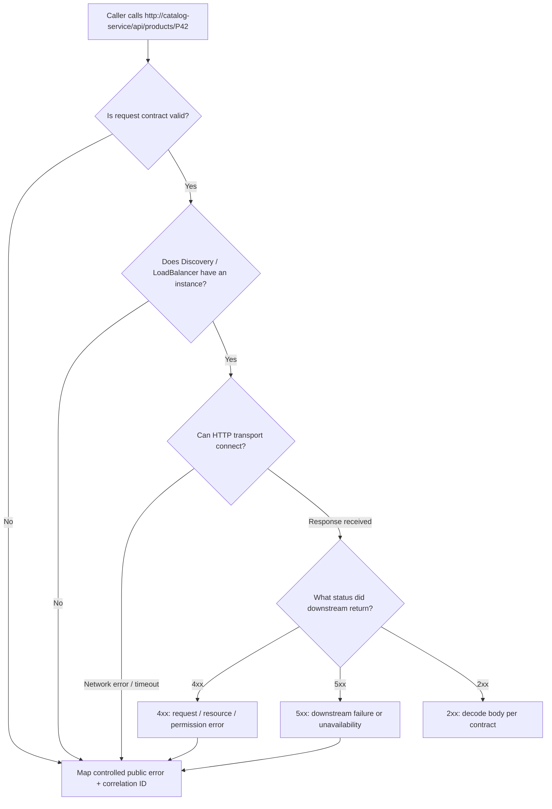
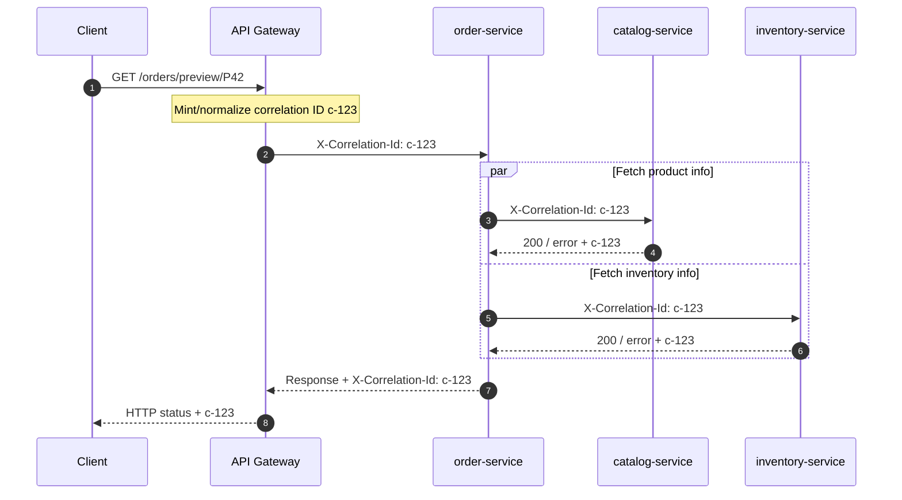

# Error Code Conventions, Error Payloads, and Correlation IDs

When `order-service` calls `catalog-service` through Spring Cloud LoadBalancer, a failed call can happen because the product does not exist, the request is malformed, no `ServiceInstance` is available, a connection fails, a timeout occurs, or `catalog-service` itself returns HTTP `500`. If each layer turns those situations into an arbitrary response, callers struggle to know whether to retry, operators struggle to pinpoint the root cause, and services easily leak internal details by accident.

An **HTTP error contract** aligns services on three questions: **what kind of error occurred, what should the client do next, and where can that error be looked up?** This lesson belongs to the `SPRING_CLOUD_SERVICE_COMMUNICATION_LOAD_BALANCING` module: applications select an instance by service ID via discovery/LoadBalancer and then communicate using `RestClient`, `WebClient`, or OpenFeign. Error conventions must stay consistent regardless of which instance is selected, while clearly separating business errors from infrastructure errors and propagating a correlation ID across the call chain.

## 1. Three Layers of Information in an Error

A useful error response should carry three layers of information with distinct responsibilities:

| Layer | Responsibility | Examples |
|---|---|---|
| **HTTP status** | Expresses the protocol-level outcome category | `404 Not Found`, `503 Service Unavailable`, `504 Gateway Timeout` |
| **Application error code** | Distinguishes business semantics or exact failure type, stable for clients | `PRODUCT_NOT_FOUND`, `DEPENDENCY_UNAVAILABLE`, `DOWNSTREAM_TIMEOUT` |
| **Correlation ID / trace context** | Links the response to logs and related hops for investigation | `X-Correlation-Id: 2d2f...`, W3C `traceparent` |

HTTP status serves every HTTP client; the application error code dictates the specific action; and the correlation ID enables diagnostics. You should neither send only `{"message":"Something went wrong"}` nor put full stack traces in the user-facing response body.

Example of two failures that both produce a failed response yet require different handling:

```text
GET /api/products/P42 → 404 + PRODUCT_NOT_FOUND
    → The product genuinely does not exist; immediate retry is usually pointless.

GET /api/products/P42 → 503 + DEPENDENCY_UNAVAILABLE
    → Dependent service is unreachable; bounded retry may be appropriate.
```

**Application error codes do not replace HTTP status codes.** A system that always returns `200 OK` and hides `success:false` inside the body misleads gateways, HTTP clients, caches, alerts, and circuit breakers about the actual outcome.

## 2. Classify Errors Before Defining Status Codes

Not every error occurring in a call chain originates from the same layer:



Root causes fall into these categories:

1. **Input/contract errors:** invalid parameters, body violates schema, missing credentials.
2. **Business errors:** product not found, ordered quantity exceeds stock, order state conflict.
3. **Discovery/LoadBalancer errors:** wrong service ID, no matching candidates, or no usable `ServiceInstance`.
4. **HTTP transport errors:** DNS, TCP/TLS, connection pool, connect timeout, response timeout.
5. **Downstream errors:** target server returns `5xx` or a response violating the contract.
6. **Orchestration/resilience errors:** deadline expired, circuit breaker OPEN, bulkhead rejected, retry budget exhausted.

A single request can traverse multiple failure types: for example, `order-service` runs out of its deadline **after** attempting connections to two instances. The public error contract should describe the appropriate outcome for the caller, while logs/tracing preserve details of the internal errors and attempts.

## 3. Common HTTP Status Convention Table

| Status | When to consider using it | Example application error code | Client retry? |
|---|---|---|---|
| `400 Bad Request` | Invalid syntax, parameters, or data types | `INVALID_REQUEST` | No, until the request is fixed |
| `401 Unauthorized` | Missing or invalid authentication | `AUTHENTICATION_REQUIRED` | Only after handling authentication |
| `403 Forbidden` | Identity established, but insufficient permissions | `ACCESS_DENIED` | Not by resending the exact same request |
| `404 Not Found` | Requested resource does not exist per contract | `PRODUCT_NOT_FOUND` | Usually no; depends on eventual consistency |
| `409 Conflict` | Operation conflicts with current state | `ORDER_STATE_CONFLICT` | Only after re-reading/resolving conflict |
| `422 Unprocessable Content` | Valid syntax, but content fails domain rules | `INSUFFICIENT_STOCK` | Usually requires changing input/request |
| `429 Too Many Requests` | Client exceeded applied rate limit | `RATE_LIMITED` | Conditional; honor `Retry-After` |
| `500 Internal Server Error` | Unexpected failure in the handling service itself | `INTERNAL_ERROR` | Never retry unconditionally |
| `502 Bad Gateway` | Component acting as gateway/proxy received an invalid upstream response | `BAD_UPSTREAM_RESPONSE` | Conditional based on operation semantics |
| `503 Service Unavailable` | Service is currently unable to serve or an essential dependency is unavailable | `DEPENDENCY_UNAVAILABLE` | Conditional, with backoff and deadline |
| `504 Gateway Timeout` | Gateway/orchestrator did not receive an upstream response in time | `DOWNSTREAM_TIMEOUT` | Conditional; be cautious with write operations |

This is a **design convention table**, not an automatic default mapping in Spring Cloud. For instance, when no instance is available, one LoadBalancer integration may synthesize a `503` response while another version or adapter may represent the failure as an exception. The API layer should normalize these situations into the published contract.

Do not arbitrarily turn a business `404` from catalog into `503` just because the call passes through `order-service`; equally, do not assume every upstream `404` means the resource requested by the user does not exist. If the upstream path is misconfigured, that may be an **internal integration bug** that should map to an appropriate service error, not `PRODUCT_NOT_FOUND` for the customer.

`408 Request Timeout` typically relates to the server waiting to receive a complete request from the client, **not** the default code for every downstream wait timeout. `499` sometimes appears in proxy logs to indicate the client closed the connection, but it is **not a standard HTTP status** for applications to emit on arbitrary timeouts.

## 4. Choosing a Body Format: Problem Details per RFC 9457

Instead of each API inventing its own JSON error shape, you can use **Problem Details for HTTP APIs** standardized by RFC 9457. Spring Framework supports the `ProblemDetail` type in modern releases, making it convenient to return structured error information.

Example public response from `order-service` when a dependency is temporarily unavailable:

```http
HTTP/1.1 503 Service Unavailable
Content-Type: application/problem+json
X-Correlation-Id: 7af0ad21-39b6-4702-8915-8ce07af2b5d0

{
  "type": "urn:problem:dependency-unavailable",
  "title": "Service temporarily unavailable",
  "status": 503,
  "detail": "Product information is temporarily unavailable.",
  "instance": "/orders/preview/P42",
  "code": "DEPENDENCY_UNAVAILABLE",
  "correlationId": "7af0ad21-39b6-4702-8915-8ce07af2b5d0"
}
```

Field meanings:

| Field | Role | Rules |
|---|---|---|
| `type` | Identifies the error category, typically a URI | Keep stable; provide documentation if using a dereferenceable URI |
| `title` | Short human-readable summary of the error type | Must not contain secrets; may be localized for UI |
| `status` | Corresponding HTTP status code | Must match the actual HTTP response status |
| `detail` | Safe, clear explanation of this specific occurrence | Never include stack traces, SQL, hostnames, or tokens |
| `instance` | Identifies the specific occurrence/request path | Must not expose internal hosts or query strings with secrets |
| `code` | Extension: application error code | Use a stable string so callers can branch logic safely |
| `correlationId` | Extension: incident lookup key | Must match the response header and logs |

The `code` and `correlationId` fields are **system-agreed extensions**, not mandatory RFC 9457 fields. A system may add `errors` for validation failures, provided its structure and data-exposure policy are clearly defined. Never force callers to parse English prose in `detail` to identify errors.

### Distinguishing status from `code`

One HTTP status can accompany multiple application error codes:

```json
{
  "status": 409,
  "code": "ORDER_STATE_CONFLICT"
}
```

```json
{
  "status": 409,
  "code": "DUPLICATE_IDEMPOTENCY_KEY"
}
```

Conversely, never reuse the same `code` with changing meanings across releases. When evolving the contract, **introduce a new code** or follow a versioning/migration process rather than silently altering the semantics of a published code.

## 5. What Is a Correlation ID and How Does It Differ from a Trace ID?

A **Correlation ID** is an identifier passed across components to tie together logs and events belonging to the same request. It is usually created at a trust boundary such as an API Gateway and propagated down to `order-service`, `catalog-service`, `inventory-service`, and HTTP clients.



A **Trace ID** is part of a distributed tracing system such as W3C Trace Context, typically carried in the `traceparent` header. Each hop can create its own **span** with a distinct span ID under the same trace ID to observe parent–child relationships and latency.

| Property | Correlation ID | W3C trace ID |
|---|---|---|
| Purpose | Correlate logs and errors per application convention | Connect spans in distributed tracing |
| Example header | `X-Correlation-Id` (internal convention) | `traceparent` (W3C standard) |
| How it is created | Generated and managed by Gateway/application | Generated and propagated by tracing instrumentation |
| Changes across retries? | Usually kept identical for the logical request | Individual attempts can be separate spans in the same trace |
| Usable as authentication proof? | **No** | **No** |

A correlation ID and a trace ID do **not have to be identical**. An organization may choose to use the trace ID as its correlation ID if applied consistently, without manually copying `traceparent` into `X-Correlation-Id` when the tracing system already provides equivalent capability.

In Spring Boot, Micrometer Observation/Tracing can automatically propagate trace context when dependencies and instrumentation are configured properly. `X-Correlation-Id` is an application-chosen header; **Spring Cloud LoadBalancer does not automatically generate or forward this header**. Avoid building a manual correlation mechanism that competes with standard tracing without a clear need.

## 6. Designing a Safe Correlation ID Lifecycle

A practical convention:

1. **Trusted ingress** mints a new correlation ID or accepts an ID from an authenticated, authorized upstream.
2. **Validate format and length limits** to prevent control characters, log injection, and oversized values.
3. **Preserve** the ID for the same logical request when calling downstream services; each retry/attempt can additionally carry its own attempt identifier.
4. **Attach the ID** to outbound request headers, public response headers, and relevant log/tracing events.
5. **Clear local context** after the request finishes; never let a reused thread or connection carry another user's ID.

If a public server receives requests directly from the Internet, never blindly trust and echo back an arbitrary string sent by the client. The gateway is usually where the **system mints its own ID** and overwrites headers from external sources. Internal services can accept the ID from the gateway after checking the trust boundary and validating it.

Format rules can specify a UUID or a short ASCII string containing only letters, digits, `-`, `_`, and `.`, capped at 64 characters. The ID should have enough randomness to reduce collisions, yet **never be used as an access token or authorization key**. Never embed emails, phone numbers, secret identifiers, or payload contents inside the ID.

## 7. Spring MVC Example: Creating/Accepting Correlation IDs Behind a Trusted Gateway

Example using `OncePerRequestFilter` in `order-service` **sitting behind a trusted gateway**. If the endpoint can be reached directly from the Internet, replace the header-acceptance strategy with always minting a new ID at ingress and enforcing the trust boundary first.

```java
package com.example.orders.web;

import jakarta.servlet.FilterChain;
import jakarta.servlet.ServletException;
import jakarta.servlet.http.HttpServletRequest;
import jakarta.servlet.http.HttpServletResponse;
import java.io.IOException;
import java.util.UUID;
import java.util.regex.Pattern;
import org.slf4j.MDC;
import org.springframework.stereotype.Component;
import org.springframework.web.filter.OncePerRequestFilter;

@Component
public class CorrelationIdFilter extends OncePerRequestFilter {

    public static final String HEADER = "X-Correlation-Id";
    public static final String ATTRIBUTE = "correlationId";

    private static final Pattern VALID =
            Pattern.compile("[A-Za-z0-9._-]{1,64}");

    @Override
    protected void doFilterInternal(
            HttpServletRequest request,
            HttpServletResponse response,
            FilterChain chain) throws ServletException, IOException {

        String received = request.getHeader(HEADER);
        String correlationId = received != null &&
                VALID.matcher(received).matches()
                ? received : UUID.randomUUID().toString();

        request.setAttribute(ATTRIBUTE, correlationId);
        response.setHeader(HEADER, correlationId);

        try (MDC.MDCCloseable ignored =
                     MDC.putCloseable(ATTRIBUTE, correlationId)) {
            chain.doFilter(request, response);
        }
    }
}
```

Key takeaways:

- `request.setAttribute` lets controllers/advice access the ID within request scope.
- `response.setHeader` gives the client the ID to report errors to support.
- `MDC` includes the ID in logs when the logging pattern is configured accordingly; it does not appear automatically unless the pattern references that key.
- `try-with-resources` guarantees the current thread's MDC context is cleaned up when the filter completes.
- With async servlets, `@Async`, `CompletableFuture`, and WebFlux, **ThreadLocal MDC does not automatically propagate across all threads**. Use supported context propagation/tracing mechanisms rather than uncontrolled manual MDC copying.

The sample above only validates ID syntax; it **does not authenticate the header source**. On public-facing systems, have the gateway overwrite untrusted IDs or modify the filter to always generate a fresh ID at the public boundary. Valid syntax on a header never makes it trustworthy for authorization.

## 8. Spring MVC Example: Returning Consistent ProblemDetail

Create two exception types representing two distinct error categories:

```java
package com.example.orders.error;

public class ProductNotFoundException extends RuntimeException {
    public ProductNotFoundException(String id) {
        super("Product not found: " + id);
    }
}
```

```java
package com.example.orders.error;

public class DependencyUnavailableException extends RuntimeException {
    public DependencyUnavailableException(String message, Throwable cause) {
        super(message, cause);
    }
}
```

In `@RestControllerAdvice`, use `ProblemDetail` to keep a uniform response structure without leaking internal `Throwable` details:

```java
package com.example.orders.error;

import com.example.orders.web.CorrelationIdFilter;
import jakarta.servlet.http.HttpServletRequest;
import java.net.URI;
import org.springframework.http.HttpStatus;
import org.springframework.http.MediaType;
import org.springframework.http.ProblemDetail;
import org.springframework.http.ResponseEntity;
import org.springframework.web.bind.annotation.ExceptionHandler;
import org.springframework.web.bind.annotation.RestControllerAdvice;

@RestControllerAdvice
public class ApiExceptionHandler {

    @ExceptionHandler(ProductNotFoundException.class)
    ResponseEntity<ProblemDetail> notFound(
            ProductNotFoundException exception,
            HttpServletRequest request) {
        return problem(HttpStatus.NOT_FOUND,
                "urn:problem:product-not-found",
                "PRODUCT_NOT_FOUND",
                "Product not found",
                "The requested product does not exist.", request);
    }

    @ExceptionHandler(DependencyUnavailableException.class)
    ResponseEntity<ProblemDetail> unavailable(
            DependencyUnavailableException exception,
            HttpServletRequest request) {
        return problem(HttpStatus.SERVICE_UNAVAILABLE,
                "urn:problem:dependency-unavailable",
                "DEPENDENCY_UNAVAILABLE",
                "Service temporarily unavailable",
                "Required product information is temporarily unavailable.",
                request);
    }

    private ResponseEntity<ProblemDetail> problem(
            HttpStatus status,
            String type,
            String code,
            String title,
            String safeDetail,
            HttpServletRequest request) {

        ProblemDetail detail = ProblemDetail.forStatusAndDetail(
                status, safeDetail);
        detail.setType(URI.create(type));
        detail.setTitle(title);
        detail.setProperty("code", code);

        String correlationId = (String) request.getAttribute(
                CorrelationIdFilter.ATTRIBUTE);
        if (correlationId != null) {
            detail.setProperty("correlationId", correlationId);
        }

        return ResponseEntity.status(status)
                .contentType(MediaType.APPLICATION_PROBLEM_JSON)
                .body(detail);
    }
}
```

In this example, the `X-Correlation-Id` header is added to the HTTP response by the filter; the handler adds the same ID to the body. These exceptions are **application-defined**—Spring does not automatically convert all transport/LoadBalancer errors into them. The downstream-calling layer must identify the actual cause and throw the appropriate exception, avoiding a blanket `catch (Exception)` for every failure.

`@RestControllerAdvice` does not necessarily cover errors raised before the controller or outside Servlet dispatch. Spring Security, gateway errors, filter chains, and reactive servers need matching error response configuration to uphold the status/body/correlation ID contract.

## 9. Propagating Correlation IDs When Calling with RestClient

A client created from `@LoadBalanced RestClient.Builder` can call by service ID and pass the correlation ID via a per-request header:

```java
package com.example.orders.catalog;

import org.springframework.cloud.client.loadbalancer.LoadBalanced;
import org.springframework.stereotype.Component;
import org.springframework.web.client.RestClient;

@Component
public class CatalogRestClient {
    private final RestClient client;

    public CatalogRestClient(@LoadBalanced RestClient.Builder builder) {
        this.client = builder.clone()
                .baseUrl("http://catalog-service")
                .build();
    }

    public ProductDto getProduct(String id, String correlationId) {
        return client.get()
                .uri("/api/products/{id}", id)
                .header("X-Correlation-Id", correlationId)
                .retrieve()
                .body(ProductDto.class);
    }
}
```

`ProductDto` is an application-defined DTO. Passing the ID **explicitly** avoids relying on `ThreadLocal` when execution hops across threads. In larger projects, an interceptor or observation can inject the header automatically, provided it reads the ID from the **active request** rather than storing one user's ID in a singleton client or global variable.

With `RestClient`, `4xx/5xx` responses are typically turned into exceptions by `retrieve()` according to its status handler. The application should classify the status and body per contract, then map them to the right internal error type. Never forward raw downstream error bodies out to the Internet if they might contain infrastructure info, SQL text, or implementation details.

## 10. Propagating Correlation IDs When Calling with WebClient

With `WebClient`, use the builder integrated with Spring Cloud LoadBalancer and attach the header to the **reactive request**:

```java
package com.example.orders.catalog;

import org.springframework.cloud.client.loadbalancer.LoadBalanced;
import org.springframework.stereotype.Component;
import org.springframework.web.reactive.function.client.WebClient;
import reactor.core.publisher.Mono;

@Component
public class CatalogWebClient {
    private final WebClient client;

    public CatalogWebClient(@LoadBalanced WebClient.Builder builder) {
        this.client = builder.clone()
                .baseUrl("http://catalog-service")
                .build();
    }

    public Mono<ProductDto> getProduct(
            String id, String correlationId) {
        return client.get()
                .uri("/api/products/{id}", id)
                .header("X-Correlation-Id", correlationId)
                .retrieve()
                .bodyToMono(ProductDto.class);
    }
}
```

In a reactive pipeline, HTTP error responses arrive as `onError` signals, **not necessarily thrown synchronously when constructing the `Mono`**. When using `onStatus` or `onErrorResume`, decide explicitly which cases have a valid fallback and which must propagate the failure.

Example mapping only a downstream `503` to an application infrastructure exception:

```java
Mono<ProductDto> result = client.get()
        .uri("/api/products/{id}", id)
        .header("X-Correlation-Id", correlationId)
        .retrieve()
        .onStatus(status -> status.value() == 503,
                response -> Mono.error(
                        new DependencyUnavailableException(
                                "Catalog service unavailable", null)))
        .bodyToMono(ProductDto.class);
```

This snippet illustrates `onStatus` on `WebClient.ResponseSpec`; `DependencyUnavailableException` is defined as above. Do not automatically turn every `404` into "product not found" if the error could stem from a wrong path or another downstream API. Never use `onErrorResume(error -> Mono.just(defaultProduct))` across all errors, because fake defaults hide outages.

When using Reactor Context and Micrometer Tracing, trace context can propagate automatically via instrumentation; `X-Correlation-Id` remains an application header you must configure yourself if used separately. Avoid setting a single request's ID on a shared `WebClient.Builder.defaultHeader(...)` used across requests or users.

## 11. Propagating Correlation IDs in OpenFeign

Feign can accept the correlation ID as a header parameter on the interface:

```java
package com.example.orders.catalog;

import org.springframework.cloud.openfeign.FeignClient;
import org.springframework.web.bind.annotation.GetMapping;
import org.springframework.web.bind.annotation.PathVariable;
import org.springframework.web.bind.annotation.RequestHeader;

@FeignClient(name = "catalog-service")
public interface CatalogFeignClient {

    @GetMapping("/api/products/{id}")
    ProductDto getProduct(
            @PathVariable("id") String id,
            @RequestHeader("X-Correlation-Id") String correlationId);
}
```

OpenFeign can use a `RequestInterceptor` to attach headers from the current context, but you must verify **how context propagates across thread pools/async execution** so it never reads another request's correlation ID. With explicit parameter passing above, callers know exactly which ID goes downstream.

When downstream returns `4xx/5xx`, Feign typically uses an `ErrorDecoder` to convert error responses into exceptions. If you decode Problem Details into specialized exceptions, handle the body carefully: it may be empty, invalid JSON, oversized, or already consumed once. Mapping a Feign `404` to `ProductNotFoundException` is safe only when **scoped to the corresponding method/endpoint**.

**Important:** `@FeignClient(name = "catalog-service")` uses the service ID so LoadBalancer chooses an instance when configured properly; specifying a fixed `url` can bypass discovery. The correlation ID neither influences replica selection nor replaces `X-Forwarded-*`, trace context, or authentication credentials.

## 12. When Errors Cross Multiple Services, Who Owns Mapping?

Suppose a user request traverses this chain:

```text
Client → Gateway → order-service → catalog-service
```

An error in `catalog-service` can surface at `order-service` in several forms:

| Error source | What `order-service` receives | Public contract to consider |
|---|---|---|
| Product genuinely does not exist | HTTP `404` with `PRODUCT_NOT_FOUND` | Return `404/PRODUCT_NOT_FOUND` if same resource/semantics |
| Catalog rejects due to missing internal auth | HTTP `401` or `403` | Never expose internal permission configuration; treat as integration error |
| No catalog instance available | Cannot pick `ServiceInstance`; may be `503`/exception | `503/DEPENDENCY_UNAVAILABLE` if the operation requires catalog |
| Cannot connect to chosen instance | Connect exception | `503/DEPENDENCY_UNAVAILABLE` or matching policy |
| Waiting on catalog exceeds deadline | Timeout or cancellation | `504/DOWNSTREAM_TIMEOUT` if order acts as upstream orchestrator |
| Catalog returns malformed JSON | Decode/mapping exception | Integration/upstream response error; never blame user input |
| Circuit breaker is OPEN | Call short-circuited; no HTTP response from catalog | `503/DEPENDENCY_UNAVAILABLE` or documented fallback |
| User submits invalid quantity | Validation right inside `order-service` | `400/INVALID_REQUEST` or `422` per contract |

There is no universal rule to "pass downstream HTTP statuses straight through." The API Gateway and `order-service` own their own **public contract boundaries** and must decide what outcomes callers should see. A `404` caused by `order-service` calling the wrong internal path cannot be treated as proof that a product does not exist.

When mapping errors, preserve the **root cause in logs/traces**, while keeping only `code`, a safe description, and the correlation ID in the public body. If an upstream returns Problem Details with a different correlation ID, standardize how they link: keep the logical request's correlation ID on the outer response, while internal spans/logs record per-attempt IDs as needed.

## 13. Discovery, LoadBalancer, and Transport Errors Must Be Separated

A common example:

```text
GET http://catalog-service/api/products/P42
  → ServiceInstanceListSupplier returns []
  → LoadBalancer picks no instance
  → HTTP request never reaches catalog-service
```

This is a **target selection** failure, distinct from a selected replica returning `503`:

```text
GET http://catalog-service/api/products/P42
  → LoadBalancer picks catalog-b
  → HTTP request reaches catalog-b
  → catalog-b returns 503 Service Unavailable
```

Both scenarios can result in a public `503`, yet investigation and remediation differ:

- In the first case, check the service ID, discovery/registry, zone/health filtering, named child context, and candidate list.
- In the second case, check instance B, health/readiness, its dependencies, server status, and response latency.
- If B was selected but TCP connection failed, inspect host/port, DNS/TLS, connect timeout, and network configuration.
- If the request stalls before connecting due to pool exhaustion, inspect `connectionRequestTimeout`, connection pool `leased/pending` counts, and concurrency limits.

`RestClient`, `WebClient`, and OpenFeign can surface the exact same underlying cause using **different exceptions and responses**. Do not write a generic mapper by guessing exception class names; verify your actual integration layer/version and translate failures into **standardized internal exceptions** at the client adapter boundary.

At the public API layer, you can still return a single `DEPENDENCY_UNAVAILABLE` code to avoid leaking infrastructure details, while logs/traces must record `failureStage=discovery|selection|connect|pool|response|decode`, service ID, and instance ID when present.

## 14. Correlation IDs and Retries

If a logical GET is retried twice, keep the same correlation ID so all attempts stay grouped in the same investigation trail:

```text
correlationId = c-123
  attempt 1 → catalog-a → connect timeout
  attempt 2 → catalog-b → 503
  attempt 3 → catalog-c → 200
```

Individual attempts can carry `attemptNumber` or separate span IDs. Do not mint a fresh correlation ID on each retry if doing so breaks the link back to the originating request. At the same time, never use a correlation ID as an idempotency key for write operations: **their purposes and lifecycles are different**.

| ID | Purpose | Rule |
|---|---|---|
| Correlation ID | Trace a logical request across hops | Keep identical across attempts of one request |
| Trace ID / span ID | Link latency measurements and parent–child hierarchy | Trace links the flow; individual spans/attempts can differ |
| Idempotency key | Prevent duplicate execution of a business operation | Keep the same key when retrying the same action, with payload validation |
| Business ID | Identify order/product/transaction | Domain-level; should not replace trace context |

A `POST /payments` can time out after the payment provider has already recorded the transaction. Retrying with the same correlation ID **does not prevent double charging**; you need an idempotency key and shared deduplication across replicas. Correlation aids investigation, whereas idempotency protects business execution.

## 15. Error Contracts and Retry Policies Must Align

When a caller receives an error, not every status warrants a retry. A sound policy evaluates **HTTP status, error code, method/idempotency, and remaining deadline** together:

| Situation | Recommended behavior |
|---|---|
| `400/INVALID_REQUEST` | Do not retry; client must fix request |
| `404/PRODUCT_NOT_FOUND` | Do not retry immediately unless the API explicitly has eventual consistency |
| `409/ORDER_STATE_CONFLICT` | Re-read state or resolve the conflict |
| `429/RATE_LIMITED` | Respect `Retry-After` if deadline remains and retries are allowed |
| `503/DEPENDENCY_UNAVAILABLE` | Retry sparingly with backoff/jitter and a retry budget |
| `504/DOWNSTREAM_TIMEOUT` | Conditional retry; for writes, verify idempotency |
| `500/INTERNAL_ERROR` | Do not blindly retry all server errors |

If Gateway, Spring Cloud LoadBalancer, Feign, and Reactor all retry independently, total HTTP attempts multiply. The error contract should supply clear enough signals for **a single layer owning retries** to decide; never trust an arbitrary upstream `retryable:true` field while ignoring retry budgets, idempotency, and system health.

`Retry-After` is a helpful standard header during rate limiting or temporary unavailability. Set values based on actual capacity/contracts and never force clients to wait past their deadline. A public error response must not promise that a retry will succeed when recovery time is unpredictable.

## 16. Security and Limiting Error Data Exposed Externally

Structured error bodies do not mean every internal detail should be exposed:

- **Never send** stack traces, SQL statements, connection strings, internal IP/host addresses, sensitive instance IDs, or topology configuration in `detail`.
- **Never echo** raw user-supplied input verbatim in error messages if it might contain sensitive data or control characters.
- **Never log** access tokens, cookies, passwords, payment data, or full request bodies solely for correlation ID lookup.
- **Bound length and allowed characters** on correlation IDs; client-supplied IDs are never proof of identity or authorization.
- **Separate public and internal error details:** internal logs capture root causes and appropriate stack traces; public bodies return error codes, safe messages, and support IDs.
- **Be careful with validation errors:** an `errors` field may name the invalid field and reason, while avoiding echoing full input values—especially for secret fields.

Example you **must not return**:

```json
{
  "status": 503,
  "detail": "Cannot connect to jdbc:postgresql://10.0.4.12:5432/inventory, password=..."
}
```

Replace with:

```json
{
  "type": "urn:problem:dependency-unavailable",
  "title": "Service temporarily unavailable",
  "status": 503,
  "detail": "Inventory information is temporarily unavailable.",
  "code": "DEPENDENCY_UNAVAILABLE",
  "correlationId": "7af0ad21-39b6-4702-8915-8ce07af2b5d0"
}
```

With the correlation ID, operations teams can look up the exact root cause in access-controlled logs and tracing systems rather than exposing sensitive details to every client.

## 17. Observability: Measuring Errors Without Misdiagnosing Root Cause

A public `503` alone does not tell you whether the registry failed or a server died. Correlate telemetry across layers:

| Observed field | Question it answers |
|---|---|
| `correlationId`, `traceId`, `spanId` | Which hops/attempts were involved? |
| Selected `serviceId`, `instanceId` | Which replica was chosen, or was no instance available? |
| `http.method`, route template | Which API failed? |
| `http.response.status_code` | What were the public and downstream statuses? |
| `error.code` | Which application error code occurred? |
| `failure.stage` | Did it fail at discovery, selection, connect, pool, response, or decode? |
| `attempt.number`, `retry.owner` | Are nested retries or request amplification occurring? |
| `remaining.deadline` | Did the request still have time budget when retrying? |
| `circuit.breaker.state` | Did it fail fast because the breaker was OPEN? |
| Duration/p95/p99 | How long did it wait before failing? |

Illustrative log example:

```text
INFO  correlationId=c-123 serviceId=catalog-service attempt=1
      instanceId=catalog-a outcome=connect_timeout durationMs=300
WARN  correlationId=c-123 serviceId=catalog-service attempt=2
      instanceId=catalog-b outcome=upstream_503 durationMs=140
INFO  correlationId=c-123 api=/orders/preview/{id}
      publicStatus=503 errorCode=DEPENDENCY_UNAVAILABLE
```

Never attach correlation IDs, trace IDs, or unbounded dynamic instance IDs as high-cardinality metric labels; use logs/traces to investigate individual requests, and keep aggregated metrics on bounded labels such as route template, HTTP status, error code, and service ID. If collecting per-instance metrics, control cardinality during autoscaling or large replica rollouts.

## 18. Lab: Consistent Errors Across Two Replicas

**Goal:** demonstrate that the error response contract stays consistent regardless of which instance LoadBalancer selects, correlation IDs flow across hops, and no-instance errors are separated from downstream HTTP errors.

### Setup

Run two `catalog-service` replicas on `localhost:8081` and `localhost:8082`, each exposing:

- `GET /api/products/P42`: returns `200` with a product DTO.
- `GET /api/products/NOT-FOUND`: returns Problem Details `404/PRODUCT_NOT_FOUND`.
- `GET /api/products/SLOW`: intentionally slow to test timeouts.
- `GET /api/products/ERROR`: returns a controlled `503/DEPENDENCY_UNAVAILABLE`.

In `order-service`, configure a static list via `SimpleDiscoveryClient`:

```yaml
spring:
  cloud:
    discovery:
      client:
        simple:
          instances:
            catalog-service:
              - uri: http://localhost:8081
              - uri: http://localhost:8082
```

`localhost` only works when the consumer and both replicas run in the same network context. In containers or Kubernetes, use addresses actually reachable by the consumer. Static discovery does not automatically remove stopped instances; health/filtering/retry must be designed separately.

### Test Cases

| Case | Action | What to verify |
|---|---|---|
| 1 — Success | Call `P42` via service ID | `200` response; valid instance selected |
| 2 — Not found | Call `NOT-FOUND` multiple times | Identical `404`, `PRODUCT_NOT_FOUND`, and Problem Details schema from both replicas |
| 3 — No instance | Call an unregistered service ID | Zero downstream HTTP calls; stable public error per contract |
| 4 — Connection failure | Stop one replica while keeping static discovery | Connect error distinguished from server-returned HTTP status |
| 5 — Slow downstream | Call `SLOW` with a tight timeout | Appropriate public timeout; logs show failure stage and correlation ID |
| 6 — Downstream returns `503` | Call `ERROR` | Upstream `503` distinguished from LoadBalancer finding no instance |
| 7 — Correlation propagation | Call Gateway → order → catalog | Same ID in request headers, response, and all service logs |
| 8 — Bounded retry | Trigger a transient failure and retry | Correlation ID stays constant; attempt numbers increment; no unbounded loop |
| 9 — Bad input | Send path/body violating contract | No stack trace, token, or internal info leaked |

When testing, do not look only at HTTP status or response order. Record the chosen instance, `X-Correlation-Id` header, Problem Details body, per-attempt logs, and actual upstream status. Add contract tests using `MockMvc`/`WebTestClient` on the server side and HTTP stubs such as WireMock or MockWebServer on the client side, matching your project's dependencies.

### Example Assertions for Contract Tests

For the product-not-found endpoint, key assertions:

```text
HTTP status = 404
Content-Type = application/problem+json
body.status = 404
body.code = PRODUCT_NOT_FOUND
body.type = urn:problem:product-not-found
body.correlationId = response.header[X-Correlation-Id]
body.detail MUST NOT contain stack traces or internal hostnames
```

For no-instance failures, verify **no request reaches the downstream stub**; for upstream `503` errors, verify the stub receives the request and returns the expected status. This proves the error contract accurately reflects the **failure stage** rather than guessing from identical public bodies.

## 19. Anti-Patterns to Avoid

| Anti-pattern | Consequence | Replacement |
|---|---|---|
| Returning `200` + `success:false` for every error | Clients/proxies/alerts misread real outcome | Proper HTTP status + standard error body |
| Returning `500 INTERNAL_ERROR` for everything | Loses distinction between business and infrastructure errors | Clear status/code mapping table |
| Client parsing `message` text for control flow | Breaks whenever wording or language changes | Stable `code` field |
| Forwarding raw downstream exceptions/stack traces publicly | Leaks topology and sensitive data | Sanitize public detail; keep root cause in internal logs |
| Using `correlationId` as an auth token | Can be spoofed/injected by clients | Dedicated authorization; mint IDs at trust boundaries |
| Not forwarding IDs through HTTP clients | Loses log linkage across hops | Propagate header or tracing context |
| Setting correlation ID on a singleton builder | Leaks IDs across requests/users | Per-request header or safe context propagation |
| Generating a new correlation ID on each retry | Cannot group attempts of the same logical request | Keep correlation ID; add separate attempt/span IDs |
| Turning every upstream `404` into product-not-found | Masks wrong paths or integration bugs | Map based on method/contract and root cause |
| Assuming every `503` means LoadBalancer had no instances | Ignores actual server-returned `503`s | Separate selection, transport, and upstream responses |
| Making correlation ID an unbounded metric label | Cardinality explosion, monitoring overhead | Use logs/traces; keep metric labels bounded |

## 20. Pre-Release Error Contract Checklist

1. Does the API publish an HTTP status and `code` table sufficient for callers to make decisions?
2. Is a consistent Problem Details schema used across error responses?
3. Does `status` in the body match the HTTP status, and is `Content-Type` correct?
4. Are application error codes stable across versions and documented for clients?
5. Are validation, business, discovery/LoadBalancer, transport, and downstream errors clearly separated?
6. Do `order-service`/Gateway enforce internal-to-public mapping rules rather than blind pass-through?
7. Is the correlation ID minted at the trust boundary, validated, and propagated through RestClient/WebClient/Feign?
8. Do correlation IDs match between response headers and bodies, and can logs/traces be queried by that ID?
9. With Reactor/async code, is context propagation tested across thread switches?
10. Do retries preserve the logical request ID while distinguishing attempts, and do write operations enforce separate idempotency?
11. Are error bodies free of stack traces, tokens, PII, and sensitive infrastructure details?
12. Have you tested the same contract across multiple instances, no-instance, connect timeout, read timeout, upstream `503`, and decode failures?

**Conclusion:** A solid error contract needs **semantically accurate HTTP statuses, stable application `code`s, safe structured bodies, and correlation IDs for tracing**. Spring Cloud LoadBalancer picks the `ServiceInstance` and HTTP clients execute the call; each layer can fail differently. By separating business errors from discovery/transport failures, standardizing responses with Problem Details, and propagating correlation IDs end to end, your system becomes easy for clients to integrate with and accurate to debug without exposing internal secrets.
