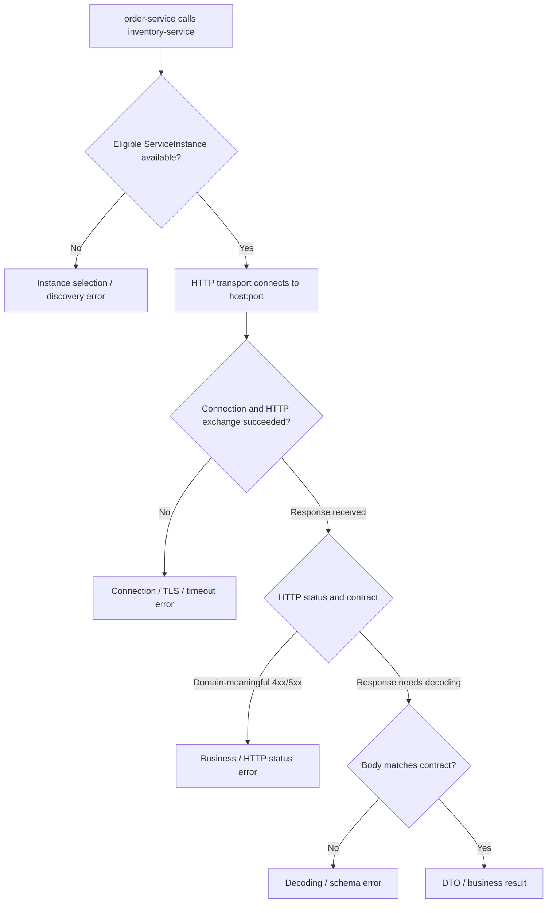
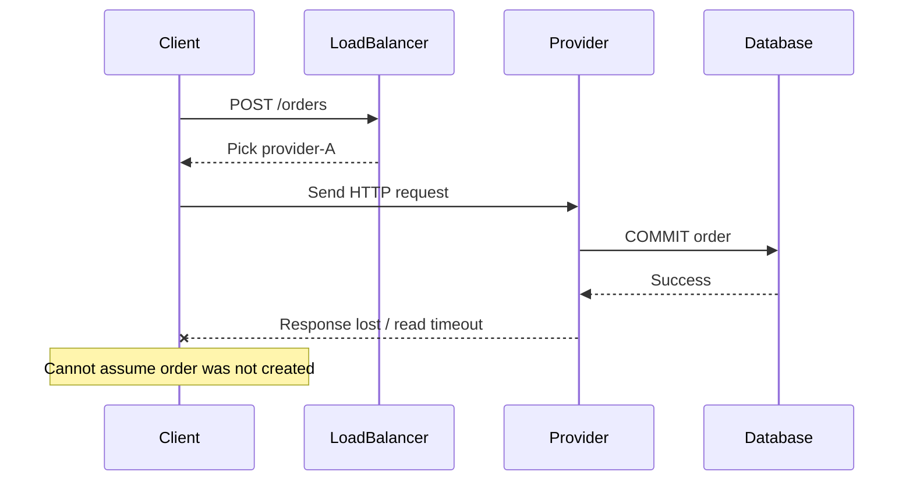
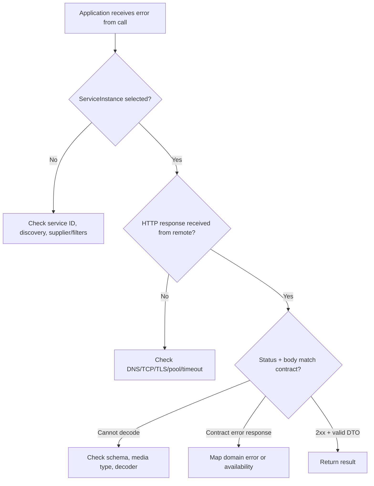

# Distinguishing Instance Selection, Connection, Decoding, and Business Errors

When one microservice calls another via Spring Cloud LoadBalancer, failures are not all of a single kind. `order-service` might fail to find an instance of `inventory-service`, pick an instance and fail to connect, receive HTTP `200` yet fail to parse JSON, or receive a valid `404`/`409` due to a business rule. All four situations can end the call with an exception, yet **their origin, handling responsibility, and retry policy are completely different**.

This lesson is part of the **Contracts and Errors** chapter in the Spring Cloud LoadBalancer module: we will trace the journey **service ID → `ServiceInstance` list → HTTP connection → status and body → business data**, separate the four error categories, and then apply them to `RestClient`, `RestTemplate`, `WebClient`, and OpenFeign. The goal is never to equate every HTTP 503 with "no instance," every timeout with "the server did not process it," or every 404 with "an unhealthy service."

## 1. Map of the Four Error Categories

Suppose the application calls a logical URL:

```http
GET /api/v1/items/42 HTTP/1.1
Host: inventory-service
Accept: application/json
```

In a LoadBalancer-backed call, the name `inventory-service` is treated as a **service ID**, not necessarily a directly resolvable DNS name. Depending on the integration, LoadBalancer retrieves the list from discovery/supplier, selects a replica, and builds the real URI for the HTTP client to connect to.



The diagram shows the **step where the failure is detected**, not that HTTP 5xx is always a business error: a 5xx response is typically a technical failure from the provider or gateway, whereas `400/404/409/422` can be expected business outcomes. Multi-layer cases can also occur—for instance, LoadBalancer **synthesizes a 503 response** when no instance is found; the client sees an HTTP status even though **no provider was ever called**.

| Category | Where does it occur? | Typical symptoms | First responder |
|---|---|---|---|
| **Instance selection** | Discovery, candidate list, load balancing policy | No instance for service ID; empty list after filtering | LoadBalancer/discovery config |
| **Connection/transport** | Target DNS, socket, TLS, connection pool, HTTP read/write | Connection refused, connect/read timeout, TLS handshake failure | HTTP transport and resilience |
| **Decoding/data contract** | Converting HTTP body into DTO | Malformed JSON, type mismatch, unsupported content type | Codec/decoder and API contract management |
| **Business** | Provider/caller interpreting status and domain error codes | ITEM_NOT_FOUND, STOCK_CONFLICT, VALIDATION_FAILED | Service/application layer |

**Diagnostic rule:** know **how far the request progressed** before choosing a remediation. A Java exception alone is not enough to infer root cause if an upper layer wrapped it or turned it into a generic message.

## 2. Instance Selection Errors: No Target to Call Yet

Spring Cloud LoadBalancer typically operates on a `service ID` and a set of `ServiceInstance` objects provided by `ServiceInstanceListSupplier`. An instance carries service ID, host, port, URI, secure flag, and metadata. Round Robin/Random algorithms can only pick among instances supplied by the supplier.

### 2.1. When Is There No Instance?

- The logical URL uses the wrong service ID: the application calls `inventory-svc` while discovery only has `inventory-service`.
- The discovery client has not registered yet, the registry is temporarily unreachable, or registration data has not propagated to the client.
- All candidates are eliminated by a custom version/zone/metadata filter chain.
- `SimpleDiscoveryClient`'s static list omits the service being called.
- Caching/supplier holds an empty snapshot or has not refreshed yet after a scale-out.

Example of **correctly** declaring two replicas in a lab profile:

```yaml
spring:
  cloud:
    discovery:
      client:
        simple:
          instances:
            inventory-service:
              - uri: http://localhost:8091
              - uri: http://localhost:8092
```

If code calls `http://inventory-service/api/v1/items/42`, the service ID matches the `inventory-service` key. If it mistakenly calls `http://inventory/api/v1/items/42`, the candidate list for `inventory` can be empty even while both providers are running fine.

### 2.2. Missing Instance Does Not Always Throw the Same Exception Type

Observed behavior depends on the client integration:

- With blocking LoadBalancer, some `LoadBalancerClient`/`ClientHttpRequestInterceptor` implementations throw an exception or represent a missing target as an error response.
- With `ReactorLoadBalancerExchangeFilterFunction` for WebClient, the no-instance path can synthesize a `ClientResponse` with status `503 Service Unavailable`, which `retrieve()` then turns into a `WebClientResponseException`.
- With Spring Cloud OpenFeign, `FeignBlockingLoadBalancerClient` can synthesize a `503` response when no instance exists, and that response passes through `ErrorDecoder`.

**Therefore, HTTP 503 or `FeignException.ServiceUnavailable` alone is insufficient to conclude the provider returned 503.** You need evidence such as `selectedInstance`, target URI, or server-side traces. Conversely, if no instance truly existed, do not hunt for bugs in the provider's JSON body: the request never reached the provider.

### 2.3. Different From Picking a Dead Target

Suppose discovery **still** returns `http://localhost:8092`, even though the process on port 8092 has stopped. LoadBalancer can select instance B normally; the HTTP client then reports `Connection refused`. That is a **post-selection connection error**, not a "no instance" error.

```text
Candidate list = []                 → cannot select a ServiceInstance
Candidate list = [A, B]; B is dead  → B can still be chosen, then HTTP connect fails
```

Health checks, discovery refreshes, and graceful shutdown reduce the chance of picking a dead target, but cannot completely eliminate the race condition between selecting an instance and sending the request.

## 3. Connection Errors: Target Exists, HTTP Exchange Fails

Transport errors happen when the HTTP client cannot initiate or complete a request, regardless of the intended business response.

| Symptom | Example causes | How to verify |
|---|---|---|
| `Connection refused` | Wrong port, stopped instance, proxy not listening | Call the instance URI directly from the client environment |
| DNS resolution failure | Instance's real host cannot be resolved | Check DNS/networking inside the container/JVM |
| Connect timeout | Firewall, routing, instance fails to accept connections in time | Inspect connect phase, network policy, and port |
| TLS handshake/certificate error | Invalid cert, hostname mismatch, truststore, protocol | Inspect truststore/hostname and TLS logs |
| Read/response timeout | Slow backend, congested network, pool wait, prolonged retries | Trace each phase and overall deadline |
| Connection reset / broken pipe | Peer closed connection or network dropped | Distinguish reset before vs. after request transmission |
| Pool acquisition timeout | Connection pool exhausted, too many concurrent requests | Monitor pending connections/concurrency |

### 3.1. Timeout Does Not Tell You Whether the Server Processed the Request

If the client times out **after sending a POST**, the server may have already committed the transaction without delivering the response. For write operations, this is an **indeterminate outcome**: retrying without an idempotency key or business key can create duplicate orders, payments, or events.



For idempotent GETs, bounded retries are generally safer, though still subject to deadlines. For POST/PATCH and side-effecting writes, build idempotency where data is actually written before enabling retries.

### 3.2. Do Not Collapse Every Transport Exception into "Service Has No Item"

Exceptions vary across HTTP clients and transports:

- `RestTemplate`/`RestClient` typically surface I/O errors as `ResourceAccessException`.
- `WebClient` typically emits `WebClientRequestException` or another transport exception, distinct from HTTP response errors.
- OpenFeign can wrap I/O failures into `RetryableException`, though actual retrying depends on `Retryer`.

Converting every exception into `ItemNotFoundException` tricks callers into thinking the resource does not exist even when connectivity is down. That hides availability outages and corrupts metrics and recovery policies.

## 4. Decoding Errors: HTTP Arrived, Body Violates Contract

A `200 OK` response does not guarantee the client can construct its DTO. For example, the provider returns:

```http
HTTP/1.1 200 OK
Content-Type: application/json

{"id":"42","available":"many"}
```

Yet the client expects this DTO:

```java
public record StockDto(String id, int available) {
}
```

The `available` field is declared as `int`, while the provider returns the string `"many"`; the JSON decoder typically cannot map that to an integer, throwing an exception **after receiving HTTP 200**.

Other scenarios:

- Body is not valid JSON (`{"id":...` truncated mid-stream).
- `Content-Type` is `text/html` or a media type with no configured decoder while the client expects a DTO.
- Field renames or object/array structural changes incompatible with the expected schema.
- Provider returns 204/empty body, while the calling layer assumes a **DTO is always present** and fails handling an empty result.
- A newer service version emits an enum value or date format unsupported by an older decoder.
- Large response payload exceeds the reactive HTTP client's decoder buffer limit.

**Distinguish three events:** HTTP transport successfully receives a response, HTTP status is 2xx, and deserialization into Java types succeeds. They are independent steps.

### 4.1. Signals Across HTTP Clients

| Client | Common decoding errors | Do not confuse with |
|---|---|---|
| `RestTemplate` | `RestClientException`/message-converter exception with JSON-related cause | Missing `ServiceInstance` |
| `RestClient` | Message conversion / `RestClientException` depending on converter | HTTP 404/503 from provider |
| `WebClient` | `DecodingException`, `UnsupportedMediaTypeException`, codec/buffer exceptions | `WebClientResponseException` for 4xx/5xx statuses |
| OpenFeign | `DecodeException` or converter/decoder exception | `ErrorDecoder` for HTTP error responses |

Exact class names depend on Spring Framework, Jackson, OpenFeign, and the HTTP transport in use. It is far better to **preserve the cause and trace** than to inspect `exception.getMessage()` strings to decide on retries.

### 4.2. Compatible Contracts Reduce Decode Failures

Define data types and schemas explicitly:

```json
{
  "id": "42",
  "available": 12
}
```

When evolving APIs, favor **backward-compatible** changes for running clients: add optional fields, keep existing field types intact, manage enums and versions, and run integration/contract tests between provider and consumer. Never change `available` from an integer to a string and expect LoadBalancer or retries to solve it. Retrying the exact same request repeatedly just repeats the **exact same schema error**.

## 5. Business Errors: Meaningful Responses Under the API Contract

A service can reject a request **per business rules** even when connectivity and decoding both work. Example:

```http
HTTP/1.1 409 Conflict
Content-Type: application/problem+json

{
  "type": "https://example.test/problems/stock-conflict",
  "title": "Stock conflict",
  "status": 409,
  "detail": "Requested quantity exceeds available stock",
  "code": "STOCK_CONFLICT"
}
```

This is an RFC 9457-style **Problem Details** body example. Standard fields include `type`, `title`, `status`, `detail`, and `instance` (optional); `code` is an **API-defined extension**, not a mandatory standard field. `example.test` is an illustrative URL only.

Typical business errors:

| HTTP status | Example business code | Meaning | Handling guidance |
|---|---|---|---|
| `400/422` | `VALIDATION_FAILED` | Invalid input | Return error so caller fixes request; do not retry verbatim |
| `404` | `ITEM_NOT_FOUND` | Resource does not exist | Expected outcome when defined by the endpoint |
| `409` | `STOCK_CONFLICT` | Stock/version conflict | Refresh data/adjust request; do not retry blindly |
| `412` | `PRECONDITION_FAILED` | `If-Match` or version condition failed | Handle optimistic concurrency |
| `401/403` | `NOT_AUTHORIZED` | Missing authentication/permissions | Fix auth; do not treat instance as dead |
| `429` | `RATE_LIMITED` | Rate/capacity limit reached | Respect `Retry-After`, backoff, and quota |
| `503` | `DEPENDENCY_UNAVAILABLE` | Unable to serve at this moment | Availability error, usually not a business rejection |

**Do not mechanically map every 404 to `ITEM_NOT_FOUND`.** If a 404 comes from a wrong path, a missing route on a new deployment revision, or a gateway, it is a contract/routing bug; distinguishing them requires checking the endpoint, body error code, and traces. Likewise, not every `409` is safe to retry verbatim.

### 5.1. HTTP Status, Error Code, and Message Have Distinct Roles

- **HTTP status:** protocol-level feedback useful for gateways, HTTP clients, and monitoring.
- **Stable business error code:** enables programmatic branching by callers, e.g., `STOCK_CONFLICT`.
- **Message:** meant for users/logs; may vary by locale and is unsuitable as a classification key.
- **Correlation/request ID:** traces a single request across multiple services.

Define explicit contracts for predictable errors: proper status, stable `code` type/values, `detail` free of internals, retry criteria, and versioning. For 5xx responses, never return stack traces, SQL queries, tokens, or infrastructure configuration to clients.

## 6. An HTTP Status Alone Does Not Prove Which Layer Failed

The most deceptive case in Spring Cloud LoadBalancer is **HTTP 503**:

| Scenario | Did provider receive request? | Who generated the status/error? | How to check |
|---|---|---|---|
| Instance list is empty | No | Possibly LoadBalancer synthesized 503 | Inspect supplier; `selectedInstance` is empty |
| Instance selected and backend returns 503 | Yes | Provider | Check provider access logs/traces |
| API gateway returns 503 before reaching provider | No or not yet at provider | Gateway/proxy | Inspect gateway traces and upstream connection |
| Dead port still in candidate list | Target selected, connection failed | HTTP transport raises connect error | Inspect real URI and socket error |
| Backend returns 200 with bad JSON | Yes | Client decoder raises error | Check status 200 and converter stack trace |

Never write `if (status == 503) { discoveryIsBroken = true; }` to assert the source of failure. With a LoadBalancer-synthesized 503, the client can receive an HTTP-like response object even though no backend was called. Instrument both sides of the LoadBalancer/transport boundary.

### Minimal Decision Flow



Without instrumentation showing whether an instance was selected, never guess from a single log line: add metrics or traces at the right boundary.

## 7. RestClient and RestTemplate: Separating HTTP Status from I/O and Decoding

With Spring Framework 6.1+ and a compatible Spring Cloud release, you can use `@LoadBalanced RestClient.Builder`:

```java
import org.springframework.cloud.client.loadbalancer.LoadBalanced;
import org.springframework.context.annotation.Bean;
import org.springframework.context.annotation.Configuration;
import org.springframework.web.client.RestClient;

@Configuration
class HttpClientConfiguration {

    @Bean
    @LoadBalanced
    RestClient.Builder loadBalancedRestClientBuilder() {
        return RestClient.builder();
    }
}
```

This bean enables `RestClient` to call `http://inventory-service` by service ID instead of sending that name straight to DNS like an unconfigured HTTP client. In real setups, include `spring-cloud-starter-loadbalancer` and a matching supplier/discovery configuration for the service ID.

### 7.1. Application DTO and Exceptions

Example domain client models:

```java
record ItemDto(String id, String name, int available) {
}

final class ItemNotFoundException extends RuntimeException {
    ItemNotFoundException(String id) {
        super("Item not found: " + id);
    }
}

final class StockConflictException extends RuntimeException {
    StockConflictException() {
        super("Stock conflict");
    }
}
```

Build a gateway whose `onStatus` handlers target only **known business errors**:

```java
import org.springframework.beans.factory.annotation.Qualifier;
import org.springframework.stereotype.Service;
import org.springframework.web.client.RestClient;

@Service
class InventoryRestGateway {
    private final RestClient client;

    InventoryRestGateway(
            @Qualifier("loadBalancedRestClientBuilder")
            RestClient.Builder builder) {
        this.client = builder
                .baseUrl("http://inventory-service")
                .build();
    }

    ItemDto findItem(String id) {
        return client.get()
                .uri("/api/v1/items/{id}", id)
                .retrieve()
                .onStatus(status -> status.value() == 404,
                        (request, response) -> {
                            throw new ItemNotFoundException(id);
                        })
                .onStatus(status -> status.value() == 409,
                        (request, response) -> {
                            throw new StockConflictException();
                        })
                .body(ItemDto.class);
    }
}
```

Here `onStatus` maps 404 and 409 according to the **`findItem` endpoint contract**. For unhandled 5xx statuses, `RestClient` applies default HTTP error handling, typically throwing `RestClientResponseException` or a matching subtype. If the provider returns 200 with invalid JSON, the decode error happens **after** status checks and will not turn into `ItemNotFoundException`.

This snippet illustrates **one** read method: if 404 means something else on another endpoint, do not install this mapping globally for every request.

### 7.2. Classification in the Service Layer

```java
import org.springframework.web.client.ResourceAccessException;
import org.springframework.web.client.RestClientException;
import org.springframework.web.client.RestClientResponseException;

ItemDto callInventory(InventoryRestGateway gateway, String id) {
    try {
        return gateway.findItem(id);
    } catch (ItemNotFoundException ex) {
        // Confirmed business error.
        throw ex;
    } catch (StockConflictException ex) {
        throw ex;
    } catch (RestClientResponseException ex) {
        // An HTTP status observed at the RestClient layer.
        // 503 may come from provider/proxy/LoadBalancer.
        throw ex;
    } catch (ResourceAccessException ex) {
        // I/O error: connect/read timeout, refused, etc. depending on transport.
        throw ex;
    } catch (RestClientException ex) {
        // Remaining errors, such as message conversion/decoder failures.
        throw ex;
    }
}
```

These `catch` blocks merely illustrate **classification for handling or metrics**, so they rethrow the exception. In production code, you can translate them into structured failure types, but never collapse everything into `RuntimeException("upstream error")` and discard the original cause and status.

**With RestTemplate:** use `@LoadBalanced RestTemplate` and an appropriate `ClientHttpRequestFactory`. By default, HTTP 4xx/5xx produce `HttpClientErrorException`/`HttpServerErrorException` (in the `RestClientResponseException` hierarchy); transport failures produce `ResourceAccessException`; and message conversion is a separate error category. Classification semantics mirror `RestClient`, though the error-handler API differs.

## 8. WebClient: HTTP Errors, Request Errors, and Decoding Errors in a Reactive Pipeline

In WebFlux, wire a LoadBalancer-enabled builder as follows:

```java
import org.springframework.cloud.client.loadbalancer.LoadBalanced;
import org.springframework.context.annotation.Bean;
import org.springframework.context.annotation.Configuration;
import org.springframework.web.reactive.function.client.WebClient;

@Configuration
class ReactiveClientConfiguration {

    @Bean
    @LoadBalanced
    WebClient.Builder loadBalancedWebClientBuilder() {
        return WebClient.builder();
    }
}
```

Create the client:

```java
import org.springframework.beans.factory.annotation.Qualifier;
import org.springframework.stereotype.Service;
import org.springframework.web.reactive.function.client.WebClient;
import reactor.core.publisher.Mono;

@Service
class InventoryReactiveGateway {
    private final WebClient client;

    InventoryReactiveGateway(
            @Qualifier("loadBalancedWebClientBuilder")
            WebClient.Builder builder) {
        this.client = builder
                .baseUrl("http://inventory-service")
                .build();
    }

    Mono<ItemDto> findItem(String id) {
        return client.get()
                .uri("/api/v1/items/{id}", id)
                .retrieve()
                .onStatus(code -> code.value() == 404,
                        response -> response.releaseBody()
                                .thenReturn(new ItemNotFoundException(id)))
                .onStatus(code -> code.value() == 409,
                        response -> response.releaseBody()
                                .thenReturn(new StockConflictException()))
                .bodyToMono(ItemDto.class);
    }
}
```

`retrieve()` emits `WebClientResponseException` by default for 4xx/5xx statuses; the two `onStatus` handlers above customize only `404` and `409`. `response.releaseBody()` explicitly releases the unused response body and then supplies the business exception.

**Do not misunderstand:** `onStatus(..., response -> Mono.empty())` does **not** turn the entire request into `Mono.empty()`; it simply suppresses turning that HTTP status into an exception and proceeds to process the body. If you genuinely want 404 to produce an empty result, use `exchangeToMono()` to branch on status or catch `WebClientResponseException.NotFound` after `retrieve()`.

### 8.1. Observing Exceptions by Layer

```java
import org.springframework.core.codec.DecodingException;
import org.springframework.web.reactive.function.client.WebClientRequestException;
import org.springframework.web.reactive.function.client.WebClientResponseException;
import reactor.core.publisher.Mono;

Mono<ItemDto> findWithDiagnostics(
        InventoryReactiveGateway gateway, String id) {
    return gateway.findItem(id)
            .doOnError(ItemNotFoundException.class,
                    ex -> System.err.println("BUSINESS: not found"))
            .doOnError(WebClientResponseException.class,
                    ex -> System.err.println(
                            "HTTP status=" + ex.getStatusCode().value()))
            .doOnError(WebClientRequestException.class,
                    ex -> System.err.println("TRANSPORT failure"))
            .doOnError(DecodingException.class,
                    ex -> System.err.println("DECODING failure"));
}
```

This code **illustrates error categories**, not production logging. In production, use SLF4J, tracing, and never log sensitive response bodies or tokens. `doOnError` only observes; it does **not** turn an error into success, retry, or fix schema mismatches.

Exception types may be wrapped by the codec or transport; inspect the root cause for accurate classification. Do not treat `DecodingException` as an exhaustive list of every decoding failure (for instance, buffer limits or unsupported media types may raise different types).

### 8.2. exchangeToMono() When 404 Means an Empty Result

If the API contract states that `404` means **item absent** rather than an exception:

```java
Mono<ItemDto> findOptional(WebClient client, String id) {
    return client.get()
            .uri("/api/v1/items/{id}", id)
            .exchangeToMono(response -> {
                if (response.statusCode().value() == 404) {
                    return response.releaseBody()
                            .then(Mono.<ItemDto>empty());
                }
                if (response.statusCode().is2xxSuccessful()) {
                    return response.bodyToMono(ItemDto.class);
                }
                return response.createError();
            });
}
```

This path **does not treat HTTP 503 or network failures as "item does not exist."** It returns empty only when the status is strictly 404; any other status still signals an error, and the 2xx decoder still validates the body.

In WebFlux, avoid calling `block()` on an event-loop thread because it blocks request-handling threads. To test reactive signals, use `StepVerifier` against a mock HTTP server; mocking too deep at `ExchangeFunction` only tests status handling and **does not prove** LoadBalancer selects real instances.

## 9. OpenFeign: ErrorDecoder Only Handles HTTP Responses

OpenFeign provides `ErrorDecoder` to convert **HTTP error responses** into exceptions. It does not cover every failure mode:

- HTTP 404/409 can pass through `ErrorDecoder` and map to domain exceptions.
- Uncustomized 5xx responses are typically converted by `ErrorDecoder.Default` into `FeignException`.
- Transport failures can surface as `RetryableException` or other Feign exceptions without a corresponding `Response`.
- HTTP 200 with a broken schema can raise `DecodeException` from the **data decoder**, not `ErrorDecoder`.
- When LoadBalancer synthesizes a `503` because no instance exists, `ErrorDecoder` can still see 503 even though no request reached any provider.

### 9.1. Defining the Feign Client

```java
import org.springframework.cloud.openfeign.FeignClient;
import org.springframework.web.bind.annotation.GetMapping;
import org.springframework.web.bind.annotation.PathVariable;

@FeignClient(
        name = "inventory-service",
        configuration = InventoryFeignConfiguration.class)
public interface InventoryFeignClient {

    @GetMapping("/api/v1/items/{id}")
    ItemDto findById(@PathVariable("id") String id);
}
```

### 9.2. Business-Aware ErrorDecoder

```java
import feign.Response;
import feign.codec.ErrorDecoder;

final class InventoryErrorDecoder implements ErrorDecoder {

    private final ErrorDecoder fallback = new ErrorDecoder.Default();

    @Override
    public Exception decode(String methodKey, Response response) {
        if (response.status() == 404) {
            return new ItemNotFoundException("unknown");
        }
        if (response.status() == 409) {
            return new StockConflictException();
        }
        // Do not consume the body before delegating to the default decoder.
        return fallback.decode(methodKey, response);
    }
}
```

The example passes `"unknown"` to `ItemNotFoundException` because `ErrorDecoder` receives only `methodKey` and `Response`; to capture the requested ID, safely inspect the request URI or design the exception to carry structured fields parsed from the error body per contract. Never guess IDs from error messages or log raw URLs/tokens verbatim.

Register it **specifically for the inventory client**:

```java
import feign.codec.ErrorDecoder;
import org.springframework.context.annotation.Bean;
import org.springframework.context.annotation.Configuration;

@Configuration(proxyBeanMethods = false)
public class InventoryFeignConfiguration {

    @Bean
    ErrorDecoder inventoryErrorDecoder() {
        return new InventoryErrorDecoder();
    }
}
```

Keep `InventoryFeignConfiguration` outside regular component scanning if you only want it applied via `@FeignClient(configuration=...)`. If scanned into the main context, the `ErrorDecoder` bean can affect other clients.

**404 and `dismiss404`:** when enabled, Feign routes 404 responses through the data decoder instead of `ErrorDecoder`. If 404 should always become `ItemNotFoundException`, keep `dismiss404=false` and verify with a real client. Not every 404 is a business error: if the URI is wrong, mapping 404 to "item not found" can hide version or routing bugs.

**Retry:** Spring Cloud OpenFeign typically registers `Retryer.NEVER_RETRY` by default, so seeing `FeignException` or `RetryableException` does not mean a request is actually retried. If retries are enabled at another layer (Spring Cloud LoadBalancer, gateway, Resilience4j, service mesh), verify total HTTP attempts.

## 10. Unified Error Contract and Returning Responses to Callers

A service-to-service design typically has two boundaries:

1. **Inbound API:** defines responses returned to callers, including HTTP status, domain error code, payload, and tracing.
2. **Outbound client:** calls upstreams and classifies failures into appropriate exceptions/types without leaking HTTP client internals throughout business code.

### 10.1. ProblemDetail for Domain Errors

Spring Boot 3 / Spring Framework 6 example with `ProblemDetail`:

```java
import org.springframework.http.HttpStatus;
import org.springframework.http.ProblemDetail;
import org.springframework.http.ResponseEntity;
import org.springframework.web.bind.annotation.ExceptionHandler;
import org.springframework.web.bind.annotation.RestControllerAdvice;

@RestControllerAdvice
class InventoryProblemAdvice {

    @ExceptionHandler(ItemNotFoundException.class)
    ResponseEntity<ProblemDetail> notFound(ItemNotFoundException error) {
        ProblemDetail body = ProblemDetail.forStatusAndDetail(
                HttpStatus.NOT_FOUND, "Item does not exist");
        body.setTitle("Item not found");
        body.setProperty("code", "ITEM_NOT_FOUND");
        return ResponseEntity.status(HttpStatus.NOT_FOUND).body(body);
    }

    @ExceptionHandler(StockConflictException.class)
    ResponseEntity<ProblemDetail> conflict(StockConflictException error) {
        ProblemDetail body = ProblemDetail.forStatusAndDetail(
                HttpStatus.CONFLICT, "Inventory state changed");
        body.setTitle("Stock conflict");
        body.setProperty("code", "STOCK_CONFLICT");
        return ResponseEntity.status(HttpStatus.CONFLICT).body(body);
    }
}
```

This snippet defines the **inbound** contract for business errors. Timeouts, connection failures, decode errors, or upstream HTTP 503s require a **separate policy** so they do not accidentally turn into 404/409 or expose stack traces. Depending on the service's role, it may return `502 Bad Gateway`, `503 Service Unavailable`, or `504 Gateway Timeout`, which is an **explicit service mapping decision**, not automatic behavior guaranteed by every HTTP client.

### 10.2. Do Not Echo Raw Upstream Errors Externally

Suppose `order-service` receives 503 from `inventory-service`. Never copy the raw upstream body directly to public callers: it may contain internal paths, stack traces, hostnames, and configuration details. Instead, return a stable error code like `UPSTREAM_UNAVAILABLE` and a lookup correlation ID.

Similarly, `RestClientResponseException.getResponseBodyAsString()`, `WebClientResponseException.getResponseBodyAsString()`, and `FeignException.contentUTF8()` may contain sensitive data or oversized bodies. Bound log sizes, protect PII/tokens, and record only what is needed for diagnosis.

### 10.3. Versioning Rules for Error Contracts

- Keep status codes and domain error codes stable while semantics stay the same.
- When adding JSON fields, ensure legacy consumers handle them; never alter existing data types arbitrarily.
- Cap error body sizes; never assume every 5xx returns JSON.
- For `204 No Content`, document clearly what callers receive instead of demanding a DTO body.
- Never turn decode failures into 404 or empty 200s via a catch-all `catch (Exception)`.
- If the API uses `ProblemDetail`, standardize `Content-Type: application/problem+json` and allowed extension fields.
- For write operations, define idempotency, conflicts, and indeterminate state on timeout.

## 11. Lab: Proactively Reproducing the Four Error Categories

Instead of waiting for production failures and guessing, build a small lab: `inventory-service` has two replicas and `order-service` calls it through LoadBalancer. The provider returns responses based on the path `id`; the client resolves the service ID from a static list.

### 11.1. Provider Returning Valid, Business, and Schema-Invalid Responses

In the `inventory-service` Spring Boot Web project:

```java
import java.util.Map;

import org.springframework.beans.factory.annotation.Value;
import org.springframework.http.MediaType;
import org.springframework.http.ResponseEntity;
import org.springframework.web.bind.annotation.GetMapping;
import org.springframework.web.bind.annotation.PathVariable;
import org.springframework.web.bind.annotation.RestController;

record ItemDto(String id, String name, int available) {
}

@RestController
class InventoryDemoController {
    private final int port;

    InventoryDemoController(@Value("${server.port}") int port) {
        this.port = port;
    }

    @GetMapping("/api/v1/items/{id}")
    ResponseEntity<?> getItem(@PathVariable String id) {
        return switch (id) {
            case "missing" -> ResponseEntity.status(404)
                    .body(Map.of("code", "ITEM_NOT_FOUND"));
            case "conflict" -> ResponseEntity.status(409)
                    .body(Map.of("code", "STOCK_CONFLICT"));
            case "unavailable" -> ResponseEntity.status(503)
                    .body(Map.of("code", "DEPENDENCY_UNAVAILABLE"));
            case "bad-json" -> ResponseEntity.ok()
                    .contentType(MediaType.APPLICATION_JSON)
                    .body("{\"id\":\"42\",\"name\":\"Book\","
                            + "\"available\":\"many\"}");
            default -> ResponseEntity.ok(
                    new ItemDto(id, "Item via port " + port, 12));
        };
    }
}
```

The `bad-json` branch intentionally returns **syntactically valid** JSON where `available` is the string `"many"` instead of an integer. This reproduces a **decode/schema mismatch** after HTTP 200. The `missing`/`conflict` branches return expected business outcomes, while `unavailable` returns HTTP 503 directly from **the provider itself**.

Run two replicas from the same JAR in the lab environment:

```bash
# Terminal A
java -jar inventory-service.jar --server.port=8091

# Terminal B
java -jar inventory-service.jar --server.port=8092
```

Verify directly:

```bash
curl -i http://localhost:8091/api/v1/items/42
curl -i http://localhost:8091/api/v1/items/missing
curl -i http://localhost:8092/api/v1/items/conflict
curl -i http://localhost:8092/api/v1/items/unavailable
curl -i http://localhost:8091/api/v1/items/bad-json
```

Before testing LoadBalancer, expect HTTP `200` with valid JSON, `404`, `409`, `503`, and **200 with the wrong field type** respectively. If the direct provider calls do not return these statuses, fix the lab setup before attributing failures to the client.

### 11.2. Client Calling by Service ID

In `order-service`'s `application-lab.yml`:

```yaml
server:
  port: 8080

spring:
  application:
    name: order-service
  cloud:
    discovery:
      client:
        simple:
          instances:
            inventory-service:
              - uri: http://localhost:8091
              - uri: http://localhost:8092
```

The client app needs `spring-cloud-starter-loadbalancer`, the matching HTTP starter, and a Spring Cloud BOM compatible with Spring Boot. Use one of the three gateways in Sections 7–9 to call `http://inventory-service/api/v1/items/{id}`.

`RestClient` controller example:

```java
import org.springframework.web.bind.annotation.GetMapping;
import org.springframework.web.bind.annotation.PathVariable;
import org.springframework.web.bind.annotation.RestController;

@RestController
class InventoryProxyController {
    private final InventoryRestGateway gateway;

    InventoryProxyController(InventoryRestGateway gateway) {
        this.gateway = gateway;
    }

    @GetMapping("/test/items/{id}")
    ItemDto getItem(@PathVariable String id) {
        return gateway.findItem(id);
    }
}
```

Call via the client:

```bash
curl -i http://localhost:8080/test/items/42
curl -i http://localhost:8080/test/items/missing
curl -i http://localhost:8080/test/items/conflict
curl -i http://localhost:8080/test/items/unavailable
curl -i http://localhost:8080/test/items/bad-json
```

With `InventoryProblemAdvice` from Section 10, the domain exceptions for `missing`/`conflict` can map to 404/409 responses from the proxy. However, `unavailable` and `bad-json` do **not automatically preserve their original status** at `order-service`'s API: without matching handlers, default error handling may return 500. Inspect **the HTTP client exception**, **the proxy's decided response**, and **the provider's direct status** as three distinct observations.

### 11.3. Testing Instance Selection Failure

To reproduce **no instance** without shutting down providers, in a separate lab profile call a service ID **absent from discovery**, such as `http://unknown-inventory/api/v1/items/42`, through **the same `@LoadBalanced` client**.

Observations:

1. Supplier returns no instances for `unknown-inventory`.
2. No provider receives this request.
3. The client may receive a synthesized 503 or an integration exception; **do not assume** all clients throw the same type.

Do not test using an unconfigured `WebClient.create("http://unknown-inventory")` without LoadBalancer, as that will simply produce a DNS error for hostname `unknown-inventory`—**different from** testing an empty instance selection.

### 11.4. Testing Connection Failure

In another lab profile, declare only:

```yaml
spring:
  cloud:
    discovery:
      client:
        simple:
          instances:
            inventory-service:
              - uri: http://localhost:8999
```

**Do not run a provider** on 8999. Start the client with this profile and call `http://inventory-service/...` through LoadBalancer:

1. Supplier returns a `ServiceInstance` with a concrete host/port.
2. LoadBalancer selects that instance.
3. TCP connect is refused or times out because no process listens on the target port.

This is a **transport error**, not an empty-discovery error, even though the end-user result is a failed request. Do not change the logical URL to `localhost:8999` and assume you tested LoadBalancer: keep the service ID so the call goes through target selection.

### 11.5. Testing Decoding Failure

While both providers and the instance list are healthy, call `GET /api/v1/items/bad-json` through `RestClient` or `WebClient` and deserialize into `ItemDto` with `available: int`.

Expectations:

- Provider sends HTTP 200.
- No connect timeout occurs and no instance switch is needed.
- JSON does not match the DTO, so the client raises a codec/decoder error.
- Retrying the identical request onto another instance **also returning the wrong schema** will not fix the root cause.

If you add a new provider returning a different schema, calls may succeed or fail depending on which instance gets picked. In that case, log **instance ID/deployment revision**, not merely status 200.

### 11.6. Testing Business Errors

Call `GET /api/v1/items/missing` and `GET /api/v1/items/conflict` through a gateway mapped as in Sections 7–9:

- HTTP 404 → `ItemNotFoundException`.
- HTTP 409 → `StockConflictException`.
- Both statuses are intentionally returned by the provider **per contract**.
- Circuit breakers/readiness should not treat expected domain exceptions as instance failures merely because the status is non-2xx.

**Remember:** a business error can still look like a "failed request" from the user's perspective while being "the provider doing its job properly" from an availability perspective. Track those two rates separately.

## 12. Automated Test Matrix and Acceptance Criteria

| Case | Setup | Client signal to assert | Provider-side evidence |
|---|---|---|---|
| Successful selection | 2 healthy instances | `selectedInstance` present, valid DTO | Provider has access log |
| No instance | Unregistered service ID | Empty supplier, failure before connect | Zero requests received |
| Dead instance | Static URI pointing to closed port | Target selected, transport failure | Zero requests at target |
| Contract 404 | Provider returns `ITEM_NOT_FOUND` | Domain exception/optional empty per policy | Provider received request |
| Contract 409 | Provider returns `STOCK_CONFLICT` | Conflict exception; no unconditional retry | Provider received request |
| Provider 503 | Provider actively returns 503 | HTTP status error; do not blame discovery | Provider logged request and 503 |
| 200 bad JSON | Incompatible field type returned | Decode exception, status 200 | Provider sent 200 response |
| Timeout after POST | Inject delay/dropped response in lab | Indeterminate result; no blind write retry | May have committed |
| Breaker OPEN | Circuit breaker rejects client | `CallNotPermittedException`/fail fast | Zero new attempts |

### 12.1. Measuring Multiple Layers Properly in Tests

In unit tests, you can mock an HTTP response to verify an `ErrorDecoder` or `onStatus` maps 404/409 properly. However, that test **does not prove** discovery and LoadBalancer work.

In integration tests, run real HTTP servers on dynamic ports, register their addresses in `SimpleDiscoveryClient` via test config, and verify:

1. A `ServiceInstance` selection took place and the real host/port was used.
2. The provider received—or **did not receive**—the request as expected for each case.
3. Original status/headers/body are recorded in traces or the mock HTTP server.
4. The client raises the right exception category and the proxy maps the response per contract.
5. No unexpected retries occurred; measure total HTTP attempts rather than inspecting only the final exception.

A guiding assertion pattern:

```text
selection-empty:
  selectedInstanceCount = 0
  providerRequestCount = 0

connection-refused:
  selectedInstanceCount >= 1
  providerRequestCount = 0

decode-error:
  providerResponseStatus = 200
  clientDecodedDto = false

business-not-found:
  providerResponseStatus = 404
  domainErrorCode = ITEM_NOT_FOUND
```

Field names in this example are **pseudocode for assertions/instrumentation**, not built-in Spring Cloud metric names. Add explicit instrumentation to measure `selectedInstanceCount` rather than inferring it from controller responses.

### 12.2. Never Mix Fault-Injection Tests with Production Failures

Scenarios like killing backends, altering discovery, corrupting JSON, or dropping responses belong in test/lab environments. A real proxy can share connection pools, caches, and circuit breakers across many requests; intentionally injecting faults in production can amplify retries and impact live traffic.

## 13. Retries and Fallbacks Matched to Error Type

Retry/fallback is an **application policy**, not uniform default behavior across all Spring Cloud HTTP clients.

| Error type | Retry? | Fallback/degrade? | Notes |
|---|---|---|---|
| No instance | Only if discovery can recover within deadline | Controlled error or valid cache | Repeated retries do not conjure instances |
| Connect timeout/refused | Possible if operation is safe and deadline remains | Cache/fail fast per contract | Check dead instance and health/discovery |
| Read timeout after POST | **Do not retry blindly** | Look up outcome; idempotency key | Server may have committed |
| 200 bad JSON | Usually do not retry same schema | Fail with diagnostic info | Fix contract or version |
| 404 item not found | Do not retry verbatim | Return not-found or `Optional.empty` | Do not mark instance unhealthy |
| 409 conflict | Do not retry blindly | Re-read data/change action | May require version/`If-Match` |
| 429 rate-limit | Consider retry per `Retry-After` and budget | Return appropriate capacity response | Avoid retry storms |
| HTTP 502/503/504 | Bounded retry for idempotent GETs | Cached read or fail fast | Distinguish 503 origin and deadline |
| Breaker OPEN | Do not loop retries immediately | Fail fast/safe fallback | Client is actively isolating downstream |

**There is no one-size-fits-all retry policy.** For truly read-only GETs, bounded retries with backoff and jitter can be allowed; for POST/PATCH, prove idempotency or business deduplication first. Per-attempt timeouts do not replace an **overall deadline** across multi-service calls.

### 13.1. Do Not Equate Circuit Breakers with Health-Check Suppliers

A `HealthCheckServiceInstanceListSupplier` checks readiness to build a candidate list. A circuit breaker like Resilience4j measures call outcomes per configured service/operation. If business 404s are counted as failures in the breaker, a burst of missing-item requests can trip the breaker even though the provider is healthy.

Conversely, if all health probes fail, a health-check supplier may **fall back to the unfiltered list** when discovered instances exist, depending on implementation. That is not proof the provider is healthy. If fail-closed behavior is required, design an explicit policy while still monitoring retries and deadlines.

For circuit breakers, distinguish `recordedFailures`, `ignoredBusinessExceptions`, slow calls, and `CallNotPermittedException`. For HTTP 429, track capacity/rate-limit metrics separately instead of marking instances dead.

## 14. Observability: Proving Where an Error Originated

A unified log/trace schema prevents misdiagnosis when failures occur across hops A → B → C:

| Field/signal | Why is it needed? |
|---|---|
| `traceId`, `spanId` | Link client calls with provider/gateway logs |
| `serviceId` | Distinguish logical name from real host |
| `selectedInstanceId` / `selectedHostPort` | Know whether LoadBalancer picked an instance and which one |
| `discoveredCount` / `eligibleCount` | Detect missing instances or total filtering |
| `attemptIndex` / `retryReason` | Know how many HTTP attempts a business operation generated |
| `transportPhase` | Separate DNS, connect, TLS, pool, and read |
| `responseOrigin` | Provider, proxy/gateway, LoadBalancer-synthesized, or unknown |
| `httpStatus` | HTTP status actually observed by the client |
| `domainErrorCode` | Separate business logic from protocol errors |
| `decoderFailureType` | Identify which codec/schema failed |
| `timeoutOrigin` / `remainingBudgetMs` | Separate hop timeout from overall deadline |
| `providerRequestSeen` | Is there evidence the request reached the provider? |

These names are **application instrumentation suggestions**, not all built-in metrics provided automatically by Spring Cloud, Reactor Netty, or OpenFeign.

### 14.1. Recommended Metrics

- **Selection failure rate:** calls with no candidate instance over total calls per service ID.
- **Transport failure rate:** connect/refused/TLS/pool/timeouts after target selection.
- **Decode failure rate:** responses received at the HTTP layer that failed DTO deserialization.
- **Business rejection rate:** rates of `ITEM_NOT_FOUND`, `STOCK_CONFLICT`, validation failures, etc., per operation.
- **Upstream 5xx rate:** separate real provider 5xx from synthesized/gateway responses when origin data is available.
- **Retry amplification:** HTTP attempts per logical operation, by method and error category.
- **Latency and deadline:** per-hop p95/p99 and remaining budget before calling downstream.

When configuring metrics, avoid using `traceId`, full URLs with personal IDs, `orderId`, or `Idempotency-Key` as unbounded-cardinality labels. Keep granular details in access-controlled logs/traces; keep metrics on service ID, endpoint template, exception category, and bounded labels.

### 14.2. Troubleshooting Workflow

1. **Identify the failing service ID and operation**; verify the logical URL and `@LoadBalanced` bean.
2. **Inspect candidate instances:** discovery state, health/zone filters, cache TTL, and `ServiceInstance` count.
3. **Inspect the selected instance** and target URI before looking at HTTP transport.
4. If no HTTP response arrived, **check network/transport:** real instance DNS, port, TCP, TLS, pool, connect/read timeouts.
5. If a response arrived, **determine the status origin:** provider/gateway or LoadBalancer-synthesized response.
6. If 2xx yet an exception occurred, **inspect codec/DTO and contract**.
7. If 4xx, **check the business error code:** avoid treating every 404/409 as an infrastructure outage.
8. Inspect retries, circuit breakers, fallbacks, and overall deadline; preserve causes in logs rather than overwriting exceptions.
9. Confirm findings on both client and provider before adjusting timeouts, retries, or health policies.

## 15. Common Pitfalls

| Pitfall | Consequence | Fix |
|---|---|---|
| "503 = no instance" | Misdiagnoses when provider/gateway itself returns 503 | Check `selectedInstance` and response origin |
| "Picked an instance means call succeeded" | Ignores connect/TLS/timeout errors | Measure every request phase |
| "200 = client processed successfully" | Bad JSON/schema can still fail | Inspect decoding and DTOs |
| "404 = unhealthy instance" | Breakers/health filters drop healthy providers | Classify per API contract |
| "Every WebClientResponseException is from the provider" | Misses LoadBalancer-synthesized 503s | Trace at both load balancer and HTTP transport |
| "Timeout = POST did not commit" | Retries create duplicate data/transactions | Use idempotency keys and reconcile outcomes |
| "Retry will fix decode errors" | Pointless loops when schema is consistently wrong | Fix contract, version, or rollout |
| "onErrorResume for all errors → empty" | Swallows 5xx, transport, and decode failures | Catch narrow exception types |
| "Feign ErrorDecoder handles every failure" | Misses connect errors and 2xx decode errors | Check transport and data decoder |
| "Enabling health check prevents ever picking a broken instance" | Stale discovery/cache and all-unhealthy fallback exist | Verify supplier behavior and policies |
| "Checking gateway responses is enough" | Misses upstream status and instance selection | Trace client, LB, and provider |

## 16. Completion Checklist

- [ ] Understand the pipeline **service ID → instance → transport → HTTP status/body → decode → domain**.
- [ ] Distinguish **no instance** from **instance selected but connection failed**.
- [ ] Know why HTTP 503 can originate from a provider, a gateway, or LoadBalancer.
- [ ] Know that 200 with an incompatible JSON body is a **decoding error**, not a target selection error.
- [ ] Convert 404/409 into business exceptions only when the API contract explicitly defines them.
- [ ] Use `onStatus`/`exchangeToMono`/`ErrorDecoder` at the right layer; avoid catch-all masking.
- [ ] Configure `@LoadBalanced` beans and discovery properly per service ID.
- [ ] Preserve status, root cause, and error code in protected logs/traces.
- [ ] Enforce retry budgets and timeouts; check idempotency for write operations.
- [ ] Maintain dedicated test cases for **selection-empty**, **connect-refused**, **decode-error**, and **business-404/409**.
- [ ] Maintain metrics separating selection, transport, decode, business rejection, and upstream 5xx.
- [ ] Never mark an instance unhealthy solely from a valid business rejection.

**Conclusion:** an inter-service call can fail **before picking a replica, after picking one before receiving an HTTP response, after receiving a response that fails decoding, or due to a valid business rule**. Spring Cloud LoadBalancer solves `ServiceInstance` selection; HTTP clients and the application layer handle transport, decoding, and contract interpretation. Precisely separating each error boundary enables accurate retries without hiding outages or wrongly isolating healthy replicas.

### References

- [Spring Cloud Commons — Spring Cloud LoadBalancer](https://docs.spring.io/spring-cloud-commons/reference/spring-cloud-commons/loadbalancer.html): service ID, supplier, selection, and health.
- [Spring Framework — REST Clients](https://docs.spring.io/spring-framework/reference/integration/rest-clients.html): `RestClient`, `RestTemplate`, and `WebClient`, status/error handling.
- [Spring Cloud OpenFeign](https://docs.spring.io/spring-cloud-openfeign/reference/spring-cloud-openfeign.html): `@FeignClient`, ErrorDecoder, and LoadBalancer integration.
- [RFC 9457 — Problem Details for HTTP APIs](https://www.rfc-editor.org/rfc/rfc9457): structured HTTP error format.
- [RFC 9110 — HTTP Semantics](https://www.rfc-editor.org/rfc/rfc9110): HTTP status and method semantics.
