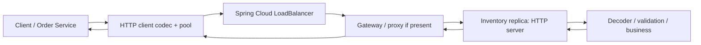
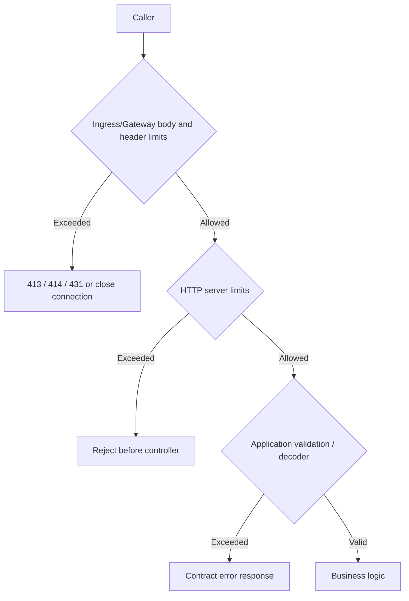
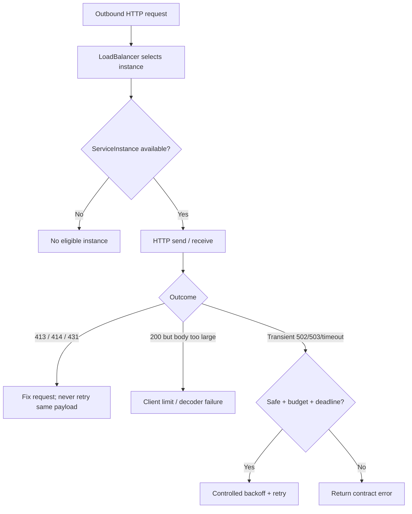

# Request and Response Size Limits

In a microservices system, an HTTP request can be completely valid in method, URI, and JSON schema yet still be **too large to process safely**. For example, `order-service` calls `inventory-service` through Spring Cloud LoadBalancer to fetch a list of items; if the endpoint returns millions of records in a single JSON payload, the caller can run out of memory while decoding the response. In the opposite direction, a large upload request can tie up bandwidth, memory, and connections on the target service even if it is eventually rejected.

Designing **request and response size limits** is part of the API contract, not merely a performance tuning knob. Limits must clearly answer: *at which layer are bytes counted, who enforces them, what error is returned, is streaming allowed, and how must callers behave when thresholds are exceeded?*

This lesson belongs to the **Contracts and Errors** chapter of the `SPRING_CLOUD_SERVICE_COMMUNICATION_LOAD_BALANCING` module. Within this module's scope, Spring Cloud LoadBalancer selects a `ServiceInstance` by service ID via discovery, health checks, and routing policies. It **does not enforce byte limits** on requests or responses for `RestClient`, `WebClient`, or OpenFeign. Those limits belong to the API contract, HTTP server, gateway/proxy, codecs, and configured HTTP clients.

## 1. Why Must Size Limits Be Part of the Contract?

Consider three scenarios:

1. `order-service` sends `POST /api/orders` with 200 line items; normally the JSON is only a few KB. A caller bug produces 200,000 line items in one request.
2. `inventory-service` exposes `GET /api/items` without pagination; item count grows from 1,000 to 2 million, inflating the response JSON from a few hundred KB to hundreds of MB.
3. A user uploads a 5 MB compressed file that decompresses to 2 GB of data. A **wire-byte limit** lets it through, while server memory and processing capacity are exhausted.

If the contract only states "accepts JSON" without maximum sizes, callers do not know where to batch; servers do not know when to reject; and gateways and SDKs cannot tell an oversized request apart from a transient service failure.

**Well-defined limits guarantee:**

- **Resource safety:** prevents a single request from exhausting heap, sockets, bandwidth, CPU, disk, or queues.
- **Predictable latency:** payload size is a major driver of transmission and processing time.
- **Predictable contracts:** clients know to paginate, chunk uploads, or switch strategies.
- **Clear errors:** avoids disguising limit-exceeded failures as timeouts, `500`s, or "no instance."
- **Scalability:** replicas enforce identical policies so requests do not succeed on instance A and fail on instance B.

## 2. Which Layers Should Enforce Limits?

A call can pass through multiple layers, each capable of enforcing its own limits.



When client-side LoadBalancer picks a `ServiceInstance`'s host/port directly, there is not necessarily a gateway between caller and replica. The diagram includes a gateway/proxy branch to emphasize that, if present, that layer can reject requests before the backend sees them. In some architectures, a gateway/VIP sits **in front of** instance selection at another layer; verify your actual topology rather than assuming a fixed order.

| Layer | What it can limit | Consequence of inconsistent config |
|---|---|---|
| Caller/business code | Item count, total bytes before sending, file/batch size. | Caller builds an oversized payload and fails late. |
| HTTP client/codec | Memory for encoding/decoding, buffered bodies, response size held in RAM. | `DataBufferLimitException`, OOM, or mid-stream cancellation. |
| Gateway / ingress / proxy | URI, headers, request body, uploads, timeouts, and buffering. | Requests rejected before LoadBalancer or downstream handles them. |
| HTTP server / container | Request line, headers, forms, multipart, connector-specific limits. | Application never enters the controller; logs stay in the container. |
| Application endpoint | Business limits, JSON depth, item count, decoded/decompressed size. | Syntactically valid payload consumes excessive resources. |
| Response producer | Record count, page size, compression level, streaming chunk size. | Client receives massive payloads or times out. |

**A limit at layer A does not automatically protect layer B.** For instance, WebClient's JSON buffer cap does not restrict how many bytes a server is permitted to send over the wire; a Servlet multipart cap does not automatically block arbitrary raw JSON bodies; and a small `Content-Length` does not prove decompressed content is also small.

## 3. Which "Sizes" Must Be Distinguished?

| Measure | Example | Characteristics |
|---|---|---|
| **URI length** | Long path caused by tens of thousands of IDs in the query string. | Processed before body; hits request-line/proxy limits. |
| **Header bytes** | Large cookies, JWTs, custom headers, or too many small headers. | Can cause server/proxy to reject before reaching application code. |
| **Wire request bytes** | `Content-Length` or bytes transferred via HTTP framing. | May be smaller than actual decompressed payload. |
| **Decoded request bytes** | JSON text after decoding content encoding; decompressed data. | Reflects the payload the decoder must actually process. |
| **Object size in memory** | DTOs, Strings, Lists, parsed JSON trees. | Can be multiples larger than raw JSON due to object overhead. |
| **Wire response bytes** | Compressed payload sent back to client. | Affects bandwidth, yet does not reliably reflect decode cost. |
| **Buffered response bytes** | Bytes held simultaneously in client RAM to construct DTOs. | Depends on codec, streaming, buffering, and conversion. |
| **Business element count** | 5,000 order lines, 10,000 records per page. | Valuable even when byte size is below threshold. |

For example, UTF-8 JSON containing many Vietnamese characters has a **different byte count than character count**:

```text
"a"  -> 1 UTF-8 byte
"á"  -> 2 UTF-8 bytes
"🚀" -> 4 UTF-8 bytes
```

Never use `String.length()` (which counts Java UTF-16 code units) to assert that a request body fits under a byte limit. When you genuinely need JSON byte size, measure using the **wire encoding** including serialization and escaping rules. Base64 expands binary data by roughly 4/3 before JSON overhead; for large uploads, multipart or streaming is usually better than embedding Base64 inside JSON.

## 4. Distinguishing HTTP Statuses When Limits Are Exceeded

An API contract must specify error codes, error bodies, and caller behavior:

| HTTP status | Typical scenario | How callers should handle it |
|---|---|---|
| **413 Content Too Large** (also called Payload Too Large) | Request body exceeds the server/proxy limit. | Shrink payload, split into batches/chunks, or switch API; never retry verbatim. |
| **414 URI Too Long** | Request-target/URI is too long. | Do not stuff large lists into query strings; use an appropriate API. |
| **431 Request Header Fields Too Large** | A single header or total headers exceed the limit. | Trim cookies/JWT/headers; do not retry another instance to dodge the cap. |
| **400 Bad Request** | Invalid syntax/framing, or contract validation failure. | Fix data or format; do not retry verbatim. |
| **415 Unsupported Media Type** | Unsupported content type sent. | Switch media type/encoding. |
| **422 Unprocessable Content** | Syntactically valid body violates domain rules fitting 422 semantics. | Fix data; use only if specified by API. |
| **429 Too Many Requests** | Traffic/rate quota exceeded—**not a pure byte-size limit**. | Slow down and honor `Retry-After` if present. |
| **502/503/504** | Gateway error, unavailability, timeout, or other infrastructure issue. | Diagnose before retrying; never lump into 413. |

Some proxies or HTTP containers **close the connection or reset the stream** before returning a proper response, especially when a request is mid-upload, headers are huge, or the body is rejected very early. Never assume *every* oversized request reliably receives a JSON `413`. Inspect access logs at the rejecting layer.

When a limit is a **permanent** API cap, retrying the same payload is pointless. RFC allows `Retry-After` on `413` for temporary rejection conditions, but do not attach that header unless the server genuinely has a grounded wait policy.

## 5. Content-Length Is Not a Complete Defense

`Content-Length` helps a server reject oversized requests **before reading the entire body**:

```http
POST /api/items/import HTTP/1.1
Host: inventory-service
Content-Type: application/json
Content-Length: 20000000
```

If the endpoint cap is 2 MiB, a valid `Content-Length` exceeding that threshold can be blocked early. However:

- With **chunked transfer encoding** or streaming transfers, total length is unknown upfront.
- `Content-Length` may be absent, malformed, or untrustworthy across intermediaries; the HTTP parser must enforce framing per spec.
- The header reflects bytes at one transport layer, not the size after `Content-Encoding: gzip` decompression.
- Once part of the body is read, the application still must manage time, bandwidth, and memory until it aborts.
- Checking response `Content-Length` is also insufficient because servers can stream unknown-length responses and clients may receive decompressed data.

**Principle:** check `Content-Length` when present to *fail early*, but always enforce an **actual byte counter while reading/streaming**, plus caps on decompressed data, element counts, and structural depth where needed.

### Compressed Data: Two Distinct Protection Thresholds

Suppose a 400 KB `gzip` request decompresses to 100 MB. Capping wire body at 2 MB will not stop the decoder from receiving 100 MB. Enforce limits on all of these together:

1. **Compressed/wire bytes:** prevents hogging network bandwidth and transport buffers.
2. **Decompressed/decoded bytes:** prevents memory/CPU exhaustion.
3. **Expansion ratio / processing resources:** depending on format and threat model, also cap entry counts, per-entry sizes, nesting depth, and processing time.

If an endpoint does not need compressed requests, reject unsupported `Content-Encoding` values per contract. Never enable decompression casually across multiple layers without knowing whether byte caps run before or after decompression.

## 6. Example Per-Endpoint Size Limit Contract

The numbers below are **illustrative proposals for a hypothetical environment**, not Spring Boot defaults or HTTP standards:

| API | Input limit | Output limit | Strategy when exceeded |
|---|---|---|---|
| `POST /api/orders` | JSON max 256 KiB and 500 items. | Response JSON max 128 KiB. | `413` if over byte limit; validation error if over item count; split operations if allowed. |
| `POST /api/items/import` | Multipart total 12 MiB, 10 MiB per file. | Small Job ID. | `413`/multipart error; use chunked/job uploads for large files. |
| `GET /api/items` | URI and headers within HTTP gateway/server limits. | Max 200 records and ~1 MiB per page. | Cursor pagination with capped page size; never dump entire inventory. |
| `GET /api/reports/{id}/download` | Small request. | Potentially multi-GB, **streamed**. | Stream response with quota, deadline, and cancel controls; never `bodyToMono(byte[].class)` the whole file. |
| `POST /api/search` | Structured JSON filter max 64 KiB. | Max 1 MiB per page. | Use POST for complex filters instead of huge query strings. |

A contract should specify: **units** (bytes/KiB/MiB), whether limits apply to wire or decoded bodies, whether they cover the **entire request** or individual parts, supported headers, error response format, and pagination/chunking rules.

Be explicit about units: `1 MiB = 1,048,576 bytes`, whereas `1 MB` may mean 1,000,000 bytes in some contexts. When configuration layers use `MB` notation differently, verify how each framework parses sizes; never assume `MB` equals `MiB`.

## 7. Enforcing Limits at Gateway, Ingress, and HTTP Server

**Early edge limits** keep huge requests from penetrating deep into service clusters. Still, enforce checks at the application server as well, because internal calls may bypass the edge or proxies may be configured inconsistently.



Limits must be deployed **consistently across all replicas** of the same service ID. If A accepts 4 MiB JSON while B caps at 1 MiB, the exact same request succeeds or fails with `413` depending on whether LoadBalancer picks A or B. Retrying onto another instance is no substitute for aligning the contract.

### Spring Boot Servlet/MVC: Multipart Limits

For Spring Boot with Servlet/MVC and its multipart resolver, example configuration:

```yaml
spring:
  servlet:
    multipart:
      max-file-size: 10MB
      max-request-size: 12MB
```

Here `max-file-size` caps a single file and `max-request-size` caps the total multipart request as enforced by Spring/the Servlet container. **This is not a limit applied to arbitrary JSON/raw request bodies.** An endpoint accepting `@RequestBody OrderRequest` may need dedicated body-size caps at the reverse proxy/container/filter plus item-count and business validation.

Some container properties such as `server.tomcat.max-http-form-post-size` apply to **form POST parsing**, not a universal switch blocking all JSON payloads. Header properties such as `server.max-http-request-header-size` vary in scope and behavior by Spring Boot version and server (Tomcat/Jetty/Undertow/Netty); test against your real server. Never claim every payload type is protected based on an unverified property.

### Error Contracts Using ProblemDetail

When the server **can actively return a response**, use a consistent error format (such as `application/problem+json` per RFC 9457) instead of unpredictable messages:

```json
{
  "type": "https://example.test/problems/request-too-large",
  "title": "Request content too large",
  "status": 413,
  "detail": "Request body exceeds the limit for this operation.",
  "limitBytes": 1048576
}
```

`limitBytes` is an illustrative extension field that must be agreed across the API. Never expose sensitive internal paths or infrastructure details. A proxy might return a different error page or no JSON at all; SDKs must handle empty error bodies as well.

Example controller advice handling multipart exceptions in Spring MVC:

```java
import org.springframework.http.HttpStatusCode;
import org.springframework.http.ProblemDetail;
import org.springframework.http.ResponseEntity;
import org.springframework.web.bind.annotation.ExceptionHandler;
import org.springframework.web.bind.annotation.RestControllerAdvice;
import org.springframework.web.multipart.MaxUploadSizeExceededException;

@RestControllerAdvice
class UploadErrorHandler {

    @ExceptionHandler(MaxUploadSizeExceededException.class)
    ResponseEntity<ProblemDetail> oversizedUpload(
            MaxUploadSizeExceededException ignored) {

        ProblemDetail problem = ProblemDetail.forStatusAndDetail(
            HttpStatusCode.valueOf(413),
            "Multipart upload exceeds the configured limit.");

        return ResponseEntity.status(413).body(problem);
    }
}
```

This only covers errors that reach application exception handling. If the container/proxy rejects the request before Spring MVC runs, `@RestControllerAdvice` **is not necessarily invoked**. Clients still must handle HTTP `413`, empty error bodies, or corresponding transport errors.

## 8. Spring WebFlux: Codec Buffer Limits Differ from Whole-Request Limits

Spring WebFlux applies memory limits to codecs when they must **buffer** data to decode it. For example, a WebFlux application may configure:

```yaml
spring:
  codec:
    max-in-memory-size: 1MB
```

This setting affects corresponding auto-configured Spring Boot codecs; it **does not guarantee total wire body size on every endpoint is at most 1 MB**. Streaming with `Flux<DataBuffer>` or `Flux<T>` may never buffer the entire body in memory; buffering caps do not equal total wire-byte caps over a connection.

If the server needs to enforce a **concrete byte threshold on a streaming body**, enforce it while reading the flux. Example endpoint accepting at most 1 MiB of binary upload for in-memory processing:

```java
import org.springframework.core.io.buffer.DataBuffer;
import org.springframework.core.io.buffer.DataBufferLimitException;
import org.springframework.core.io.buffer.DataBufferUtils;
import org.springframework.http.HttpStatusCode;
import org.springframework.http.MediaType;
import org.springframework.web.bind.annotation.PostMapping;
import org.springframework.web.bind.annotation.RequestBody;
import org.springframework.web.bind.annotation.RestController;
import org.springframework.web.server.ResponseStatusException;
import reactor.core.publisher.Flux;
import reactor.core.publisher.Mono;

@RestController
class SmallBinaryImportController {

    private static final int MAX_BYTES = 1024 * 1024;

    @PostMapping(
        path = "/api/import-small",
        consumes = MediaType.APPLICATION_OCTET_STREAM_VALUE)
    Mono<Integer> importSmall(@RequestBody Flux<DataBuffer> body) {
        return DataBufferUtils.join(body, MAX_BYTES)
            .map(buffer -> {
                try {
                    int size = buffer.readableByteCount();
                    byte[] bytes = new byte[size];
                    buffer.read(bytes);
                    // Example: pass bytes to dedicated processing logic.
                    return bytes.length;
                } finally {
                    DataBufferUtils.release(buffer);
                }
            })
            .onErrorMap(DataBufferLimitException.class,
                error -> new ResponseStatusException(
                    HttpStatusCode.valueOf(413),
                    "Upload exceeds 1 MiB",
                    error));
    }
}
```

`DataBufferUtils.join(body, MAX_BYTES)` joins buffers while enforcing a max total byte limit; when exceeded, it raises `DataBufferLimitException`. This example explicitly returns 413 and releases the received buffer once processed. **Never use this join pattern for multi-GB files**, as its purpose is still in-memory buffering; for large uploads, process as a stream with a running byte cap and release `DataBuffer`s properly along the lifecycle. Test cleanup and cancellation under reverse proxies, timeouts, and client disconnects.

This example does not cover every upload pattern (multipart, JSON, gzip, server-specific request filters). For JSON, alongside byte caps, constrain depth, item counts, string lengths, and schema processing cost.

## 9. WebClient: maxInMemorySize Protects Decoding, Not Total Download Size

On the caller side, `WebClient` typically decodes JSON into a DTO or `List<ItemDto>`. Whenever a decoder aggregates content in memory, set an intentional limit.

Example `@LoadBalanced WebClient.Builder` calling `inventory-service` and bounding memory used by the client's default codecs:

```java
import org.springframework.cloud.client.loadbalancer.LoadBalanced;
import org.springframework.context.annotation.Bean;
import org.springframework.context.annotation.Configuration;
import org.springframework.web.reactive.function.client.WebClient;

@Configuration
class InventoryWebClientConfiguration {

    @Bean
    @LoadBalanced
    WebClient.Builder loadBalancedWebClientBuilder() {
        return WebClient.builder();
    }

    @Bean
    WebClient inventoryWebClient(
            @LoadBalanced WebClient.Builder builder) {
        return builder.clone()
            .baseUrl("http://inventory-service")
            .codecs(configurer -> configurer.defaultCodecs()
                .maxInMemorySize(2 * 1024 * 1024))
            .build();
    }
}
```

Call:

```java
Mono<ItemPage> page = inventoryWebClient.get()
    .uri(uriBuilder -> uriBuilder
        .path("/api/items")
        .queryParam("limit", 100)
        .build())
    .retrieve()
    .bodyToMono(ItemPage.class);
```

`ItemPage` is an example DTO. Configuring `maxInMemorySize` causes decoding/buffering to fail with `DataBufferLimitException` when exceeded per codec semantics. **It is not a hard cap on total network bytes received across every response consumption pattern.** For instance, `bodyToFlux(DataBuffer.class)` can stream many chunks without holding them all in RAM; total downloaded bytes can still grow huge unless the caller tracks and cancels the stream.

| Scenario | Limits to watch |
|---|---|
| `bodyToMono(BigDto.class)` | Buffer/decoder memory cap, DTO size, heap. |
| `bodyToFlux(ItemDto.class)` | Per-element decode buffer cap (codec-dependent), item count, total stream size. |
| `bodyToFlux(DataBuffer.class)` | Total streamed bytes, handling/canceling/releasing `DataBuffer`s, sink write speed. |
| Gzipped download | Wire bytes vs. decompressed bytes, and which layer performs decompression. |
| HTTP `4xx`/`5xx` with huge error body | Error-response buffer caps; never assume error bodies are always small. |

If an API normally returns a few MB yet occasionally sends GBs, **never bump `maxInMemorySize` to gigabytes to "fix" the error**. Design pagination, streaming responses, or stream downloads directly to files/object storage.

### Client-Side Response Limits Must Not Mask Business Errors

`DataBufferLimitException` is a caller-side failure related to response buffering, not an HTTP `413` returned by upstream. Likewise, `WebClientResponseException` only fires for HTTP error statuses per status handling; a `200 OK` with an oversized body can still break the codec.

When catching errors, distinguish:

- **HTTP 413:** server/proxy says the request is too large.
- **HTTP 200 + decoder size limit:** upstream response exceeded the client's capacity/limit.
- **Transport/timeout error:** body interrupted, client canceled stream, or connection dropped.
- **No-instance from LoadBalancer:** no eligible `ServiceInstance` before HTTP was sent.

Never "retry all WebClient errors," causing an oversized response to be downloaded repeatedly.

## 10. RestClient: Bounding Memory When Reading Responses

`RestClient` is Spring's synchronous API. If a caller uses `body(byte[].class)` on an unbounded download, it can allocate too much heap. On hot paths, know exactly where bytes are buffered and which HTTP client factory is active.

One way to read a response **with a cap** is `exchange(...)`, stopping after at most `MAX_BYTES + 1` bytes:

```java
import java.io.IOException;
import java.util.Arrays;
import com.fasterxml.jackson.databind.ObjectMapper;
import org.springframework.http.HttpStatusCode;
import org.springframework.web.client.RestClient;

class LimitedInventoryReader {

    private static final int MAX_BYTES = 1024 * 1024;
    private final RestClient client;
    private final ObjectMapper mapper;

    LimitedInventoryReader(RestClient client, ObjectMapper mapper) {
        this.client = client;
        this.mapper = mapper;
    }

    ItemPage getPage() {
        return client.get()
            .uri("/api/items?limit=100")
            .exchange((request, response) -> {
                HttpStatusCode status = response.getStatusCode();
                if (status.isError()) {
                    throw new IllegalStateException(
                        "Inventory HTTP status " + status.value());
                }

                byte[] bytes =
                    response.getBody().readNBytes(MAX_BYTES + 1);

                if (bytes.length > MAX_BYTES) {
                    throw new IllegalStateException(
                        "Inventory response exceeds 1 MiB");
                }
                return mapper.readValue(bytes, ItemPage.class);
            });
    }
}
```

This is a **memory-bounded reader** for small responses, not a streaming downloader for large files. `ItemPage` is application-defined; `IOException` handling follows the callback signature and Spring version in use. With `exchange(...)`, `retrieve()`'s default status handlers do not run automatically: code must check status and define explicit response/error mapping. Spring closes `exchange` responses per API contract; if wrapping streams outside the callback, manage resource lifecycles carefully.

If the response carries a valid `Content-Length` exceeding `MAX_BYTES`, you can reject immediately; **still check actual bytes read**, because `Content-Length` may be absent, chunked, compressed, or altered by proxies. For payloads that can reach gigabytes, use a streaming download API and enforce byte limits while writing to the destination file rather than allocating giant `byte[]` arrays.

### Connections, Timeouts, and Size Limits Sit at Three Different Layers

- `ClientHttpRequestFactory` / HTTP engine controls connect/read timeouts, pooling, and certain stream/buffer behaviors.
- Business/API contract defines **valid byte and element thresholds**.
- Spring Cloud LoadBalancer selects the **target instance** by service ID and discovery list.

Picking the right replica does not stop a 200 MB response. Raising read timeouts does not make reading 200 MB memory-safe.

## 11. OpenFeign: Limits via Contract and Decoder

OpenFeign lets you declare clients via interfaces:

```java
@FeignClient(
    name = "inventory-service",
    contextId = "inventoryRead"
)
interface InventoryReadClient {

    @GetMapping("/api/items")
    ItemPage getPage(@RequestParam("limit") int limit);
}
```

Key considerations:

1. **Request limits:** validate DTOs, record counts, and serialized bytes before sending. Feign interceptors fit adding headers and tracing, **not as a generic mechanism to police arbitrary body streaming**.
2. **Response limits:** decoders may buffer responses or parse the entire JSON tree. For large endpoints, design paginated APIs first; when a hard limit is required, wrap the `Decoder` or HTTP `Client` with a decorator that reads bounded streams and guarantees body closure.
3. **Per-client configuration:** only clients handling large payloads need custom policies. Avoid registering specialized `Decoder`/`Retryer` beans in the parent Spring context where they affect unrelated Feign clients.
4. **Error responses:** `ErrorDecoder` and `Retryer` should not treat oversized statuses or bodies as transient errors; never retry a payload rejected for exceeding limits.

An illustrative decorator design (pseudocode focusing on the mechanism; exact API depends on Feign version):

```text
LimitedDecoder(maxBytes, delegate):
    if response body is empty: delegate
    if trusted content length > maxBytes: reject early
    read stream with counter up to maxBytes + 1
    if exceeded: stop reading, release body, raise limit error
    if within limit: pass checked byte[] to delegate to decode
```

Crucially, the decorator must **actually cap bytes while reading**, not just compare headers, and must close the response stream per contract. A decoder error triggered by exceeding a response limit is not a signal to pick another replica and retry.

## 12. Large Responses: Pagination, Streaming, or Async Jobs

Request size limits are usually solved by rejecting early and splitting inputs. Response limits require redesigning **how data is delivered** to avoid loading gigabytes into a single variable:

| Strategy | Best fit | Notes |
|---|---|---|
| Page/cursor pagination | Item lists, search results. | Must cap `pageSize`; cursors must be validated/opaque per contract. |
| Streaming HTTP | Large exports, line-delimited data, file downloads. | Bounded buffering, cancellation, backpressure, timeouts, content integrity. |
| Async export job | Long-running reports or multi-GB outputs. | Endpoint starts job and returns ID; caller polls/receives notification and downloads with auth. |
| Object storage + time-limited signed URL | Large downloads/uploads. | Enforce permissions, TTL, size quotas, MIME/content scanning, and sensitive data rules. |
| Field projection | Callers need only a few fields from huge records. | Explicit API contract; avoid arbitrary unbounded query complexity. |

### Pagination Is More Than Adding a limit Parameter

`GET /api/items?limit=100` requires the server to **clamp** or reject `limit=1000000`. If the API uses cursors, ensure cursors cannot trigger abusive queries or privilege bypasses. Quotas may cover record count, byte size, query complexity, and total execution time, since 100 huge records can still exceed 1 MiB.

With streaming, HTTP/2 flow control and Reactor backpressure pace data delivery in certain setups, yet **never create a total-byte hard cap**. Callers must still track cumulative bytes and cancel streams if policy forbids exceeding the cap.

## 13. How Size Limits Interact with Retries, Timeouts, and LoadBalancer

In multi-replica setups, classify failures before retrying:



**No instance** is a discovery/selection failure, not evidence an upload was too big. `413` signals the receiver or proxy rejected the body. Caller `DataBufferLimitException` can occur even on upstream `200 OK`; it indicates the consumer could or would not buffer the response.

### Retries Can Amplify Large-Payload Costs

Suppose an 8 MiB upload is retried three times due to read timeouts. If each attempt transmits the full body, the caller transfers **24 MiB** for one logical operation. When many callers retry concurrently, bandwidth, TLS overhead, connection pools, and CPU spike, triggering retry storms. For writes, the first attempt may have succeeded while the response was lost: use an idempotency key and server-side deduplication.

For a 100 MiB download, retrying after receiving 90 MiB restarts from scratch unless the API supports resumable/range requests and integrity checks. Never retry an entire stream on connection reset without understanding consumer semantics.

### Timeouts and Byte Limits Complement One Another

- **Size limit:** maximum bytes/elements allowed.
- **Deadline:** total time budget for one logical request, including retries and backoff.
- **Throughput/rate quota:** max bytes/requests over time if needed.
- **Bulkhead/connection pool:** max concurrent calls/sockets/threads holding resources.

A 100 KiB request can trickle slowly and pin a connection for minutes without a deadline; conversely, a 1 GiB payload can arrive instantaneously and blow the heap without a byte cap. You need **both** protections.

## 14. Common Mistakes and Fixes

| Mistake | Consequence | Fix |
|---|---|---|
| Checking only `Content-Length` and ignoring actual stream | Chunked/gzip payloads slip past the limit. | Cap real wire bytes, decoded size, and parser complexity. |
| Using `spring.servlet.multipart.*` to guard all JSON endpoints | Raw/JSON requests still exceed limits. | Configure per-route ingress/server body limits plus app validation. |
| Raising `maxInMemorySize` endlessly when WebClient fails | Heap/RSS growth, OOM, or GC pauses. | Paginate, stream, and bound decoded bytes. |
| Reading responses into unbounded `byte[]` | Loads gigabytes into RAM. | Read with caps or stream to file/object storage. |
| Leaving queries/filters unbounded | `414`, overly complex SQL/queries. | Use schema-validated POST filters; cap URL, fields, and complexity. |
| Mixing inconsistent `MB` definitions across client/server/gateway | Intermittent errors as layers enforce different limits. | Specify bytes/MiB and measure real byte counts. |
| Replicas having mismatched limits | Requests pass or return `413` depending on picked instance. | Sync contracts/configs and test every replica. |
| Retrying `413` or decoder limit errors | Multiplies bandwidth/load with identical payload. | Classify as non-retryable and require caller to fix input. |
| Returning `500` for every `DataBufferLimitException` | Callers misread it as transient. | Map inbound limits to 413; keep clear internal codes/logs on outbound. |
| Capping only wire bytes of gzip/zip | Compression bombs / parser exhaustion. | Cap decoded size, file counts, nesting depth, and time. |
| Assuming `200` responses are always small/safe | Client OOMs when server emits huge results. | Define output contracts, pagination, streaming, and consumer caps. |

## 15. Observability: Measuring Size Failures at the Right Layer

Track at least:

| Signal | Question to answer |
|---|---|
| `request_body_bytes` / `response_body_bytes` | How big are real payloads? Measuring wire or decoded bytes? |
| `413`, `414`, `431` by operation | Which limit tripped, and at the gateway or application? |
| `codec_buffer_limit_exceeded` | Did caller/server decoder exceed its in-memory cap? |
| `stream_cancelled` / `client_abort` | Are clients aborting due to limits or timeouts? |
| `content_length_missing` / chunked traffic | Do we need streaming byte counters instead of headers alone? |
| p95/p99 latency and parse time | Are large payloads inflating tail latency or CPU? |
| Heap/RSS, GC, direct memory | Are there buffering spikes or memory pressure? |
| Upload/download bandwidth | Are retries multiplying transferred bytes? |
| `ServiceInstance`/service ID | Is one replica misconfigured with a lower limit and failing more? |

These are **illustrative signal names**, not guaranteed defaults in every Spring Boot/Micrometer setup. Never use request IDs, filenames, URIs with personal IDs, or arbitrary headers as high-cardinality metric labels. Log only necessary fields (service ID, route template, limit category, measured bytes, threshold, stage)—never raw bodies, tokens, cookies, or sensitive payloads.

If a proxy emits `413` before the request reaches the application, `inventory-service` logs/metrics will show nothing. When diagnosing, correlate **gateway access logs → caller traces → server logs** to locate the exact rejecting layer.

## 16. Hands-On Lab: Proving Different Size Limits

Set up `order-service` using `@LoadBalanced WebClient.Builder` (or RestClient/OpenFeign) and `inventory-service` with two replicas A/B under the same service ID. In a test environment, configure explicit illustrative limits, ingress/server access logs, and client error counters.

| Experiment | Payload | Expected behavior to verify |
|---|---|---|
| Small JSON | `POST` under 64 KiB, valid schema. | Succeeds on both A and B if policies match. |
| Oversized JSON | `POST` exceeding app/proxy threshold. | `413` or rejecting-layer error clearly recorded; no verbatim retry. |
| Oversized URI | `GET` with thousands of IDs in query string. | Proxy/server returns `414` or matching request-line error. |
| Huge headers | Dummy cookie/JWT, high header count. | `431` or container/proxy rejection; never enters controller if blocked early. |
| Multipart | Single file over `max-file-size` or total over `max-request-size`. | Intentional size error; do not confuse multipart config with JSON limits. |
| Chunked/no `Content-Length` | Stream exceeding 1 MiB. | Real byte counter catches and aborts despite absent size header. |
| Gzip/zip expansion | Small wire body, huge decoded body. | Decoded limit blocks it, not only wire limit. |
| Oversized `200` response | Server returns JSON larger than codec memory cap. | WebClient decoder fails; never misinterpret as HTTP 413. |
| Streaming download | Many small chunks exceeding download policy total. | Caller stops after allowed bytes and releases buffers/connections cleanly. |
| Misconfigured retry | Configure retry on `413`/decoder limit. | Prove attempts and transferred bytes grow uselessly, then fix predicate. |
| Skewed replicas | A caps at 1 MiB, B caps at 2 MiB in test. | Same 1.5 MiB payload passes or fails by instance; detect rollout drift. |

### Example HTTP Test Command

With a prepared test payload:

```bash
curl -i -X POST http://localhost:8080/api/items/import \
  -H 'Content-Type: application/json' \
  --data-binary @payload-test.json
```

Measure exact file/encoded byte sizes before sending. For multipart, use `curl -F 'file=@sample.bin' ...` and account for total multipart body size including boundaries and per-part headers. Bound test resources when testing giant payloads; never send destructive payloads to production.

After each test, record: payload type, wire/decoded bytes if measured, HTTP status or exception, rejecting layer, whether a `ServiceInstance` was chosen, attempts, duration, peak memory, and downstream request count. Results must separate **server limits**, **client codec limits**, **transport errors**, and **LoadBalancer no-instance**.

## 17. Pre-Production Checklist

- Publish **byte and element limits** for every critical endpoint; state wire vs. decoded bytes and exact units.
- Configure limits at **edge/gateway and application** to match topology, avoiding internal paths that bypass checks.
- Synchronize limits across all replicas so LoadBalancer picking A vs. B never changes the contract.
- Cap URIs, request headers, and payloads separately; never treat multipart settings as JSON limits.
- Never rely solely on `Content-Length`; count real bytes for chunked/streaming transfers and guard decompression.
- Enforce JSON schema constraints: item counts, string lengths, nesting depth, and processing complexity.
- Use `413/414/431` semantically when HTTP error responses are generated; never lump everything into `500`.
- Return stable errors without leaking topology, tokens, or sensitive data in `ProblemDetail`.
- With WebClient, treat `maxInMemorySize` as a codec buffer cap, not a total network byte cap.
- With RestClient/OpenFeign, control how decoders/buffers read responses, bounding reads before materializing full byte arrays.
- Use pagination, streaming, or async export jobs for large datasets instead of endlessly enlarging buffers.
- Distinguish size rejections from timeouts, no-instance errors, open circuit breakers, and upstream HTTP errors.
- Never retry verbatim `413`s or oversized responses; enforce idempotency on retryable uploads/POSTs.
- Pair byte caps with timeouts/deadlines, rate/quota limits, bulkheads, and connection pools to avoid slow-loris holds.
- Monitor bytes, rejection rates, latency, memory, stream cancellations, retry attempts, and cross-replica consistency.
- Test chunked, compressed, multipart, oversized header/URI, and skewed-rollout scenarios.

**Remember:** **size limits are part of the API contract and resource protection**, not an automatic responsibility of Spring Cloud LoadBalancer. LoadBalancer selects a `ServiceInstance`; HTTP servers/gateways police incoming requests; HTTP clients/codecs control response buffering and decoding; and applications enforce post-decompression byte counts and business rules. Make explicit **where bytes are bounded**, return accurate errors, and never retry payloads that inherently exceed limits—that is how inter-service communication stays resilient as replicas, data volumes, and traffic grow.
