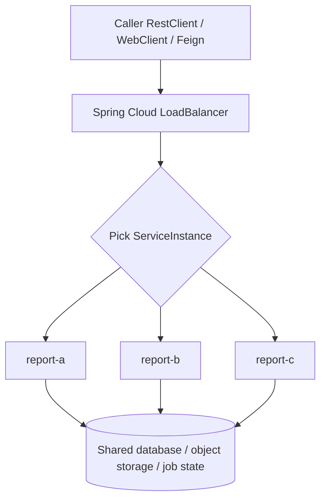
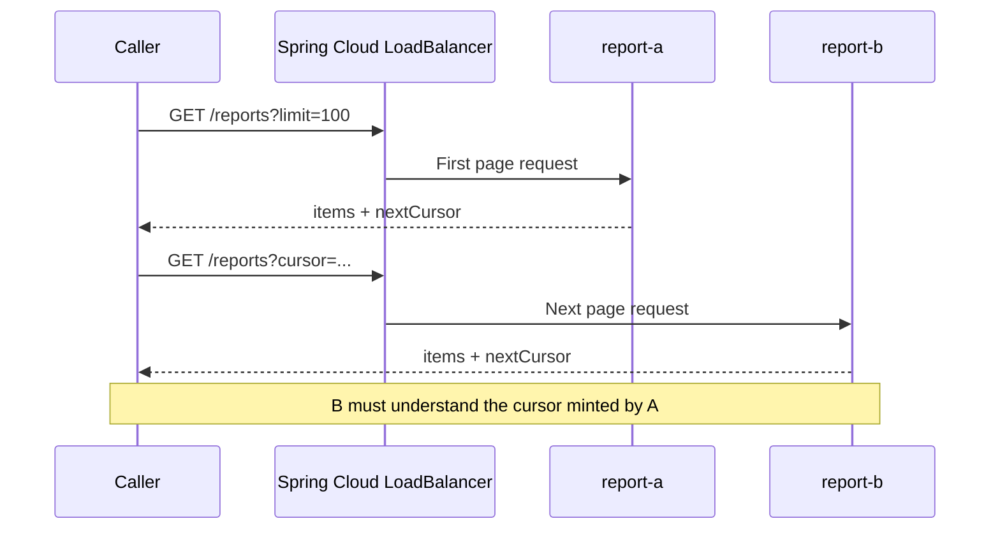
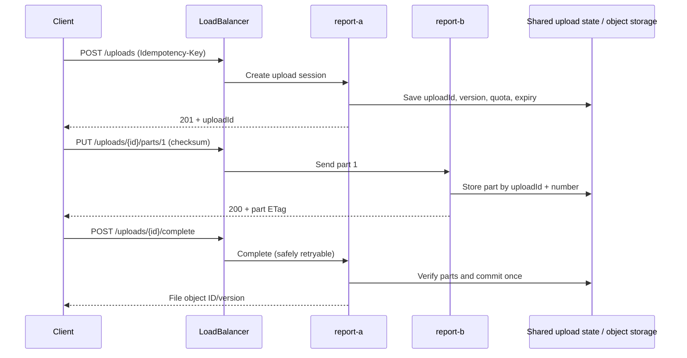
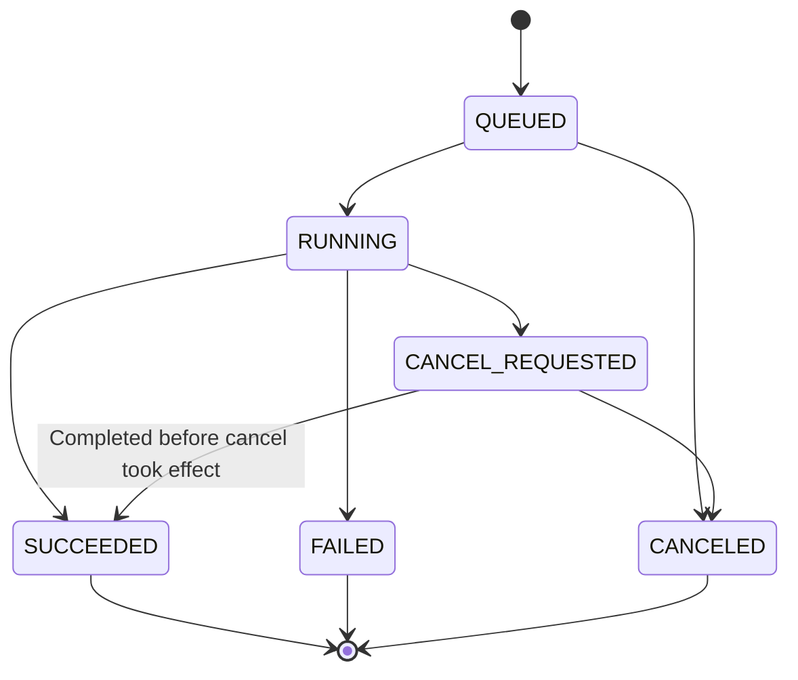
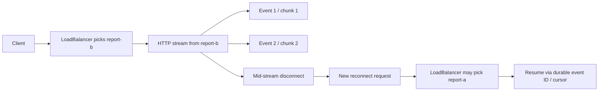

# Pagination, File Transfers, and Long-Running Calls

In a microservices system, a call like `GET http://catalog-service/api/products/42` is typically short, small, and easy to retry on connection failures. By contrast, operations such as **reading multiple pages of data**, **downloading multi-gigabyte files**, **multipart uploads**, or **waiting on a multi-minute processing job** impose very different constraints. Whenever Spring Cloud LoadBalancer selects a new `ServiceInstance` per request, implicit assumptions about replica-local state, returned data, request deadlines, and retry safety can break.

This lesson in the **Contracts and Errors** chapter of the **Spring Cloud Service Communication Load Balancing** module explains how to design API contracts for these three communication patterns using `RestClient`, `WebClient`, OpenFeign, and Spring HTTP Interfaces where appropriate. The goal is **preserving data correctness and resilience even when subsequent requests land on different replicas**, while controlling memory, connection pools, timeouts, backpressure, idempotency, and observability.

## 1. Why Do These Calls Need Dedicated Contracts?

Suppose discovery returns three instances for `report-service`:

| Instance | Host:port | Role |
|---|---|---|
| `report-a` | `10.0.1.10:8080` | Paginated report listings |
| `report-b` | `10.0.1.11:8080` | Pagination and file downloads |
| `report-c` | `10.0.1.12:8080` | Pagination, uploads, and job status |

From the caller's perspective, all three calls can share one service ID:

```text
GET  http://report-service/api/reports?limit=100
GET  http://report-service/api/files/abc/download
POST http://report-service/api/exports
```



Correctness depends on a **shared data contract**: page 2 must align with page 1, files need verifiable identities/versions, and job status must be queryable from any replica. LoadBalancer only picks an endpoint; it **does not** replicate in-memory session state, hold pagination snapshots, or stitch broken byte streams.

| Call type | Biggest risk | Required contract |
|---|---|---|
| Pagination | Skipping or duplicating items across pages, especially when data mutates or replicas switch | Deterministic ordering, cursors/snapshots, and properly scoped pagination tokens |
| Large file download | Memory exhaustion, mid-file disconnect, file version drift | Streaming, size limits, `ETag`, `Range`/resume, checksums |
| File upload | Retries re-sending parts and duplicating/corrupting files; replica-local upload state | Upload ID, chunk offsets, idempotency, shared storage, safe finalization |
| Long-running request | Gateway/connection timeouts, prolonged thread holds, client unsure whether job finished | `202 Accepted`, operation ID, polling/callback/streaming, deadline and cancellation semantics |

## 2. LoadBalancer Picks Instances per HTTP Request, Not per Session by Default

LoadBalancer runs whenever the client issues an HTTP request against the logical URI `http://report-service/...`. With round-robin, page 1 can go to `report-a` and page 2 to `report-b`; a resume request after a broken download can go to `report-c`.



**HTTP keep-alive does not force consecutive requests back to the same replica.** Connection pools are typically keyed by concrete target address; LoadBalancer chooses the instance before transport borrows a connection. Likewise, retries may try a different instance rather than staying on the original server.

Spring Cloud supports same-instance preference and certain sticky-session suppliers, yet **never rely on sticky sessions as the sole foundation for data consistency**. Instances can die mid-flight, rollouts replace replicas, or session cookies fail to propagate. The durable solution is storing pagination, upload, and job state **where all authorized replicas can reach it**, or issuing self-contained/signed tokens another replica can verify and continue.

## 3. Pagination: Offset, Cursor, and Snapshot

Pagination splits large datasets into smaller pages to bound response size and per-request latency. However, how pages are sliced directly affects consistency when rows are inserted, deleted, or reordered while a caller reads.

### 3.1. Offset Pagination: Simple, Yet Prone to Drift on Mutations

```http
GET /api/reports?offset=0&limit=3&sort=createdAt,desc
```

Suppose page 1 returns `[R9, R8, R7]`. A new report `R10` is inserted at the top before the caller requests `offset=3`; the next page becomes `[R7, R6, R5]`. `R7` is **duplicated**. Deleting an item prior to the offset **skips** an item.

| Property | Offset (`page`, `offset`) |
|---|---|
| Pros | Simple; easy arbitrary page jumps |
| Cons | Duplicates/skips when dataset mutates; deep offsets can scan expensively |
| When to use | Relatively static lists, UIs tolerant of drift, or backed by a snapshot |
| Does not solve | Consistency across replica switches or concurrent data updates |

**Deterministic ordering is mandatory:** `ORDER BY created_at DESC` is insufficient when records share timestamps. Add a unique tie-breaker such as `ORDER BY created_at DESC, id DESC` to prevent arbitrary ordering across queries or replicas.

### 3.2. Cursor/Keyset Pagination: Resuming from the Last Item's Key

A clean API can return:

```json
{
  "items": [
    {"id": 109, "createdAt": "2026-11-17T10:00:00Z"},
    {"id": 108, "createdAt": "2026-11-17T09:59:00Z"}
  ],
  "nextCursor": "opaque-token-from-server",
  "hasNext": true
}
```

Next page request:

```http
GET /api/reports?limit=100&cursor=opaque-token-from-server
```

With ordering `created_at DESC, id DESC`, the server decodes/verifies the cursor and applies an equivalent keyset predicate:

```sql
SELECT id, created_at, title
FROM reports
WHERE tenant_id = :tenantId
  AND (
    created_at < :lastCreatedAt
    OR (created_at = :lastCreatedAt AND id < :lastId)
  )
ORDER BY created_at DESC, id DESC
LIMIT :limitPlusOne;
```

`:limitPlusOne` is typically `limit + 1` to detect whether another page exists without an expensive `COUNT(*)`. Indexes on `(tenant_id, created_at DESC, id DESC)` can accelerate the query, though you should verify the actual database execution plan. When adding status or search filters, cursor predicates and indexes must match the same order and filter criteria.

**Cursors do not automatically create consistent snapshots.** If an older record's `createdAt` changes, or it is deleted or moved across tenants mid-pagination, the result set still changes. Cursors prevent offset-shift drift, not point-in-time read stability without an appropriate snapshot/version strategy.

### 3.3. Cursors Must Be Portable Across Replicas

Never build a cursor that is merely an index into a replica-local `Map<String, PageState>` in `report-a`'s RAM; the next request hitting `report-b` will fail to find the state. A portable cursor can contain or reference:

- Last sort keys (`lastCreatedAt`, `lastId`) and page/snapshot version.
- Fingerprint of active filters/sort and service API version.
- Snapshot ID or pagination job ID stored in a shared database/store when point-in-time consistency is required.
- Validity bounds, expiration timestamp, and tamper protection.
- Access scope (tenant/user scope) that the server **cross-checks against the authenticated identity** on each subsequent request.

Callers should treat cursors as **opaque tokens**. Base64 is only encoding, **not** encryption or signing; never pack PII/secrets into Base64 assuming safety. Use signed/HMAC tokens or IDs pointing to shared state, and validate version, scope, expiration, and authenticity.

### 3.4. Snapshot Consistency When Exporting Exact Lists

Exporting millions of rows often demands "no duplicates, no omissions, one consistent point in time." This requires a **stable snapshot**: versioned data, database-supported MVCC snapshots, a materialized result table/file, or an export job stored outside individual replica RAM. You cannot hold a database transaction open for minutes just to paginate an API without evaluating lock contention, MVCC retention, and resource cost.

```text
POST /api/report-snapshots -> snapshotId + expiresAt
GET /api/report-snapshots/{id}/pages?cursor=... -> items + nextCursor
DELETE /api/report-snapshots/{id} -> release if supported by contract
```

When a snapshot expires, return an explicit contract error (such as `410 Gone` in an intentional API design) instead of silently serving data from a different snapshot under the old cursor. If strong consistency is needed, specify snapshot semantics and data sources (primary vs. read replica, replication lag).

## 4. Designing a Verifiable Page Contract

A response can define:

| Field | Role | Caution |
|---|---|---|
| `items` | Items on the current page | Must not depend on which replica answered |
| `nextCursor` | Opaque token for the next page | May be null on the last page; never create token loops |
| `hasNext` | Indicates more data exists | Must stay consistent with `nextCursor` |
| `snapshotId` | Fixed dataset identifier if used | Must stay identical across the entire page sequence |
| `pageSize` | Requested/permitted item count | Server enforces hard cap; never trust arbitrary `limit` |
| `sort`/`filterVersion` | Describes active filter and sort contract | Forbid changing mid-stream while reusing old cursors |

DTO sample using Java records:

```java
public record PageSlice<T>(
        List<T> items,
        String nextCursor,
        boolean hasNext,
        String snapshotId) {
}

public record ReportSummary(long id, Instant createdAt, String title) {
}
```

These two `public` records belong in **two separate Java files**; they are shown together purely to illustrate the contract. Configure Java generics, `Instant`, and JSON serializers to match your Spring Boot/Jackson setup.

### 4.1. Blocking Caller Example via RestClient + LoadBalancer

```java
@Configuration(proxyBeanMethods = false)
class ReportClientsConfiguration {

    @Bean
    @LoadBalanced
    RestClient.Builder loadBalancedRestClientBuilder() {
        return RestClient.builder();
    }

    @Bean
    RestClient reportRestClient(
            @LoadBalanced RestClient.Builder builder) {
        return builder.baseUrl("http://report-service").build();
    }
}
```

Fetch pages via URI builder, passing the cursor as a query parameter:

```java
// DTO in this example should match the concrete JSON response type.
ReportPage first = reportClient.get()
        .uri(uri -> uri.path("/api/reports")
                .queryParam("limit", 100)
                .build())
        .retrieve()
        .body(ReportPage.class);

ReportPage second = reportClient.get()
        .uri(uri -> uri.path("/api/reports")
                .queryParam("limit", 100)
                .queryParam("cursor", first.nextCursor())
                .build())
        .retrieve()
        .body(ReportPage.class);
```

`ReportPage` is an application-specific DTO equivalent to `PageSlice<ReportSummary>`, not a Spring-provided class. Avoid infinite loops: check for `null` bodies, `hasNext`, blank/repeating cursors, and cap total page counts or elapsed time. For large datasets, process each page and drop old references; never `addAll` every item into an unbounded `ArrayList` only to write it out to a file at the end.

### 4.2. Reactive WebClient Example Preserving Backpressure

```java
record ReportPage(
        List<ReportSummary> items,
        String nextCursor,
        boolean hasNext,
        String snapshotId) {
}

Mono<ReportPage> fetchPage(String cursor) {
    return reportWebClient.get()
            .uri(builder -> {
                UriBuilder b = builder.path("/api/reports")
                        .queryParam("limit", 100);
                if (cursor != null) b.queryParam("cursor", cursor);
                return b.build();
            })
            .retrieve()
            .bodyToMono(ReportPage.class);
}

Flux<ReportSummary> streamPages() {
    return fetchPage(null)
            .expand(page -> page.hasNext() && page.nextCursor() != null
                    ? fetchPage(page.nextCursor())
                    : Mono.empty())
            .concatMapIterable(ReportPage::items);
}
```

`reportWebClient` is a `WebClient` built from a `@LoadBalanced WebClient.Builder` bean with `baseUrl("http://report-service")`; `UriBuilder` is from `org.springframework.web.util`. This is an **educational pattern** using `expand` to fetch token-linked pages sequentially; in production, add duplicate-cursor detection, page limits, total deadlines, snapshot consistency, and error-handling policies. Having a `Flux` does not automatically give database queries backpressure; the server must still enforce page sizes and concurrency limits.

**Warning:** never use unbounded-concurrency `flatMap` when pages must chain sequentially via cursors. Above, each page learns the next cursor only after the previous response finishes. With offset pagination, parallel page fetching is possible at higher cost/consistency tradeoffs while preserving ordering if downstream requires it.

## 5. Pagination and Errors: Distinguishing End of Data, Bad Cursors, and Mutating Data

| State/situation | Appropriate response | What NOT to do |
|---|---|---|
| Last page, `items=[]`, `nextCursor=null` | Complete normally | Retry endlessly looking for more data |
| Bad cursor signature or wrong scope | `400`/`403` per contract; audit log | Silently reset to page 1 and report success |
| Expired cursor or snapshot | `410 Gone` or equivalent contract error | Serve pages from a new snapshot without telling the caller |
| `429 Too Many Requests` | Reduce concurrency; honor `Retry-After` and deadline | Increase concurrency to "read faster" |
| `503`/network reset on page GET | Bounded retry when cursor/idempotency holds | Retry with mutated cursor or skip duplicate checks |
| Same cursor returns different data across replicas | Investigate DB replication/snapshot/serialization | Dismiss as normal load-balancing behavior |

When fetching the next page, an ordinary GET is safe to retry for side effects **if the backend honors semantics**, yet results can shift if underlying data mutates. Distinguish **transport retries** (re-issuing one request) from **snapshot guarantees** (stability of the dataset).

### 5.1. Sticky Sessions Do Not Replace Shared State

Spring Cloud LoadBalancer offers `SameInstancePreferenceServiceInstanceListSupplier` and request-based sticky mechanisms for supported clients/versions. They can reduce replica switches during pagination, yet never guarantee an instance survives across all pages. If a cursor lives only in one replica's RAM, a single scale-in event wipes out the entire session. A sound design uses portable cursors or shared state with explicit TTLs.

## 6. File Downloads: Metadata and Streaming Instead of Loading Whole Files into RAM

When `report-service` serves a 5 GB CSV, never use `body(byte[].class)` or `bodyToMono(byte[].class)` just for brevity. That tries to buffer the entire body on the heap, risking OOM or codec buffer limit failures.

Minimal download contract definition:

```http
GET /api/files/report-2026-11/download HTTP/1.1
Host: report-service
Accept: application/octet-stream
```

```http
HTTP/1.1 200 OK
Content-Type: application/octet-stream
Content-Length: 314572800
Content-Disposition: attachment; filename="report-2026-11.csv"
ETag: "report-v7-sha256-prefix"
Accept-Ranges: bytes
```

Values are illustrative; `Accept-Ranges` is meaningful only when the server actually supports byte ranges. With chunked transfer encoding, `Content-Length` may be absent. Do not treat a missing `Content-Length` as an error when streaming framing is valid, while still enforcing total byte limits on the consumer.

### 6.1. Why Are File Versions Necessary?

If a file is overwritten under the same ID, and a caller downloads the first 200 MB from replica A before retrying the rest on replica B serving a newer version, the assembled file becomes a **corrupted mix of two versions**. Use version-immutable file IDs, strong ETags, or checksums and metadata sufficient to prove every downloaded chunk belongs to the same object.

| Header/metadata | Purpose | Notes |
|---|---|---|
| `Content-Type` | Data format | Never trust blindly as proof of safe content |
| `Content-Length` | Body size when known | Enforce limits and reconcile against actual bytes received |
| `ETag` | Representation version validator | Prefer strong validators when using `If-Range` |
| `Last-Modified` | Modification timestamp for conditional requests | Weaker precision than a strong ETag in some cases |
| `Accept-Ranges` | Advertises byte-range support | Server must actually return `206` with valid semantics |
| `Content-Disposition` | Suggested filename | Never use raw filenames directly as local filesystem paths |
| `Digest`/checksum metadata | Detects file corruption | Requires agreed algorithm, representation, and trusted source |

## 7. Downloading with RestClient: Stream Directly Inside the exchange Callback

`RestClient` is a **blocking** client, so large files must be copied incrementally from `InputStream` to disk rather than materialized as `byte[]`. `RestClient.exchange(...)` exposes `ClientHttpResponse` inside the callback and **requires explicit status handling**. Status handlers registered via `retrieve()` do not apply automatically to `exchange()`.

```java
public Path downloadReport(RestClient client, String fileId)
        throws IOException {

    return client.get()
            .uri("/api/files/{id}/download", fileId)
            .accept(MediaType.APPLICATION_OCTET_STREAM)
            .exchange((request, response) -> {
                if (!response.getStatusCode().is2xxSuccessful()) {
                    throw new IOException(
                            "Download failed: " + response.getStatusCode());
                }

                Path tempFile = Files.createTempFile(
                        "report-download-", ".part");
                try (InputStream source = response.getBody();
                     OutputStream target = Files.newOutputStream(tempFile)) {
                    source.transferTo(target); // Stream in chunks without holding the whole file.
                    return tempFile;
                } catch (IOException ex) {
                    Files.deleteIfExists(tempFile);
                    throw ex;
                }
            });
}
```

This Java example uses a `RestClient` built from a `@LoadBalanced RestClient.Builder` bean with `baseUrl("http://report-service")`. Imports for `Path`, `Files`, `InputStream`, `OutputStream`, `IOException`, and `MediaType` are omitted. `transferTo` is a **blocking** operation, suitable on controlled Servlet/worker threads; **never call it directly on a Reactor Netty event loop**.

This sample only demonstrates **streaming byte transfer**. Production code must enforce size limits, checksum/ETag verification, safe `Content-Disposition` handling, disk quotas, controlled storage paths, orphan cleanup on crash, and atomic rename from `.part` to final filename only after verification. If the callback throws before returning, the catch block deletes the temp file; if a failure occurs **after** receiving the file, the caller remains responsible for cleanup. Never use `fileId` directly as a file write path.

### 7.1. Why Not Return InputStream from the Callback and Read Later?

`exchange()` scopes the HTTP response lifecycle to the callback. Once the callback exits, the response and connection may close or return to the pool; an `InputStream` obtained from the response **must not be held and read afterward** without an explicit lifecycle contract. Reading/writing inside the callback cleanly avoids use-after-close bugs.

In newer Spring Framework versions, `RestClientAdapter` for HTTP Interfaces may support `InputStream` or `ResponseEntity<InputStream>` per adapter contract. Whichever abstraction you use, understand **who closes the stream** and underlying HTTP connection, avoiding indefinitely held streams that starve the connection pool.

## 8. Downloading with WebClient: DataBuffer, Backpressure, and Cleanup

`WebClient` can receive bodies as `Flux<DataBuffer>` to process chunks incrementally instead of buffering into `Mono<byte[]>`. With a `WebClient` built from `@LoadBalanced WebClient.Builder` and `baseUrl("http://report-service")`:

```java
Mono<Path> downloadFile(WebClient client, String id, Path tempFile) {
    return client.get()
            .uri("/api/files/{id}/download", id)
            .accept(MediaType.APPLICATION_OCTET_STREAM)
            .exchangeToMono(response -> {
                if (!response.statusCode().is2xxSuccessful()) {
                    return response.createError();
                }

                Flux<DataBuffer> chunks =
                        response.bodyToFlux(DataBuffer.class);

                return DataBufferUtils.write(chunks, tempFile)
                        .thenReturn(tempFile);
            });
}
```

`DataBufferUtils.write(Publisher<DataBuffer>, Path)` returns `Mono<Void>`; it writes on subscription and signals completion or error when writing finishes. `tempFile` should reside in an **authorized, quota-bounded staging area**, created beforehand by a managed step; upon completion, verify checksum/size before publishing the file. On error or cancellation, delete the `.part` file per lifecycle policy. Never reuse the same `tempFile` across concurrent requests.

**Managing `DataBuffer`s is critical:** for `DataBufferUtils.write(...)` overloads taking an `OutputStream`/channel and returning `Flux<DataBuffer>`, the documentation warns that buffers are not automatically released under all consumption patterns; use `DataBufferUtils.release(...)` or `releaseConsumer()` when managing them yourself. Avoid `map`/`filter`/`take` operators that drop pooled buffers without `doOnDiscard(DataBuffer.class, DataBufferUtils::release)`, and verify the release contract of the specific overload used. Never release a buffer still in use downstream. **Do not just read buffers—free them along the exact right lifecycle.**

### 8.1. Notes on Codec Memory Limits

Spring WebFlux enforces buffer caps when operations aggregate data (for example, 256 KB by default in current Spring Framework docs). Decoding a huge response into `byte[]` or monolithic JSON can raise `DataBufferLimitException` or OOM; **bumping** `maxInMemorySize` to gigabytes is usually the wrong fix. Stream `DataBuffer`s to disk or parse line-delimited NDJSON with per-record caps when the API contract supports it.

When handling sensitive file payloads, never log full `DataBuffer` contents, Base64 strings, `Authorization` headers, or file contents. Record only controlled metadata and hashes.

### 8.2. How Does exchangeToMono Release the Response?

With `exchangeToMono`/`exchangeToFlux`, consume the body **inside the provided function**. Spring WebClient checks for unconsumed bodies and releases them once the returned publisher completes; never return `ClientResponse` and try reading its body outside the function's lifecycle. In the download example above, `DataBufferUtils.write` is part of the returned `Mono`, keeping the download inside the exchange lifecycle.

If you only need status and want to discard the body, use WebClient's supported release/discard helpers. If writing a custom `ExchangeFilterFunction` that decides not to forward `ClientResponse` downstream, ensure the body is consumed or released, or connections will leak from the pool.

## 9. Resuming Downloads via HTTP Range: Not an Ordinary Retry

When a 2 GB response drops at 200 MB, **retrying the whole GET** restarts from byte 0 and wastes bandwidth. An API supporting byte ranges allows resuming:

```http
GET /api/files/abc/download HTTP/1.1
Host: report-service
Range: bytes=209715200-
If-Range: "strong-etag-v7"
```

The server may reply:

```http
HTTP/1.1 206 Partial Content
Content-Range: bytes 209715200-314572799/314572800
Content-Length: 104857600
ETag: "strong-etag-v7"
```

Byte values illustrate a 300 MiB file resumed after 200 MiB. When `Range` is valid and supported by the backend, a 206 response contains **precisely** the requested byte slice. Never blindly append a new body to `.part` on HTTP `200`: the server may have ignored `Range` and sent the **entire file**, corrupting the merged output.

### 9.1. Key Status Contracts

| Status | Meaning | What callers should do |
|---|---|---|
| `200 OK` | Full representation, or server did not apply Range | Overwrite/restart from byte 0 per policy; never append as if 206 |
| `206 Partial Content` | Server honored valid Range | Verify `Content-Range`, ETag, and byte offset before appending |
| `304 Not Modified` | Conditional GET confirmed unchanged (not a body chunk) | Use valid cache; do not treat as byte slice |
| `412 Precondition Failed` | Condition like `If-Match` failed | Never stitch bytes from different versions |
| `416 Range Not Satisfiable` | Requested range invalid for representation | Read `Content-Range` if present; verify size/offset |

`If-Range` should use a strong validator to decide whether to fetch the remainder from the **same version** or restart from scratch. When file IDs point to mutable objects or un-converged CDN edges, enforce stricter version/ETag checks. A range download hitting instance B must reference the **exact same object bytes** served earlier by instance A.

### 9.2. Byte Offsets Count Bytes, Not Characters

UTF-8 files have multi-byte characters, and compressed files have distinct framing blocks; `Range: bytes=...` operates on **bytes of the selected HTTP representation**, not CSV line numbers or Unicode character indices. With `Content-Encoding: gzip`, byte offsets can apply to the encoded representation, complicating resuming an uncompressed file. Fix the representation/encoding or use chunked object downloads with per-chunk checksums when designing resumable protocols.

### 9.3. Spring MVC and ResourceRange

Spring MVC supports HTTP range requests for certain `Resource`/`ResponseEntity<Resource>` returns per framework contract. Spring documentation notes that automatic range support **does not apply identically to every `InputStreamResource`**; for `ResponseEntity<Resource>`, status must be `200` for automatic range handling to engage. If an endpoint uses `StreamingResponseBody` or proxies from an object store, you may need to handle `Range` and `Content-Range` per RFC 9110 yourself—do not assume adding `Accept-Ranges` implements range serving.

## 10. File Uploads: Multipart, Streaming, and Idempotency

Uploads face symmetric challenges to downloads: payloads can be huge, request bodies are not always replayable, and the server may have already written part of the payload before the caller hits a timeout. With `POST /api/files`, **automatic retries can create duplicate objects** or store duplicate content unless the contract enforces idempotency.

### 10.1. Multipart Upload via WebClient

```java
MultipartBodyBuilder parts = new MultipartBodyBuilder();
parts.part("purpose", "monthly-report");
parts.part("file", new FileSystemResource(filePath));

Mono<UploadReceipt> result = reportWebClient.post()
        .uri("/api/files")
        .header("Idempotency-Key", uploadKey)
        .bodyValue(parts.build())
        .retrieve()
        .bodyToMono(UploadReceipt.class);
```

In this example: `reportWebClient` uses a `@LoadBalanced` builder, `filePath` is an application-validated readable `Path`, `uploadKey` is a stable idempotency key for **the same logical upload**, and `UploadReceipt` is an application contract DTO. `MultipartBodyBuilder` and `FileSystemResource` are provided by Spring. Projects must check proxy/server multipart caps and how the encoder/transport reads files; **never assume every file read is non-blocking simply because the method returns `Mono`**.

Never force `Content-Type: application/octet-stream` onto an entire multipart request; multipart bodies require the boundary generated by the HTTP writer. Never read large files into `byte[]` and pass `.bodyValue(bytes)`, which just buffers the entire file in memory.

### 10.2. Server-Side Limits and Data Safety

Servers must enforce:

- **Max request size, max file size, max part count**, concurrency caps, and storage quotas.
- Actual content inspection, content-type/extension checks, checksums, and malware scanning per risk profile.
- Never trust `filename` from `Content-Disposition` as a filesystem path; prevent path traversal and overwrites.
- Write to staging/temporary storage; publish the final object only after validation passes and atomic commit succeeds where storage allows.
- Clean up expired temp files and upload sessions to avoid orphans on client disconnects.
- Enforce tenant/object authorization at **every** step, including retries, status checks, and downloads.

If a server returns `413 Content Too Large`, retrying the exact payload on another replica will not bypass the contract limit. Return a clear error and let callers switch to a chunked/resumable workflow or shrink the upload.

## 11. Large/Resumable Uploads: Upload ID, Part Numbers, and Commit

For multi-GB files, a single HTTP `POST` lasting several minutes risks gateway timeouts, rollout interruptions, and poor resumability. Instead of one giant request, design a **part-based upload protocol** backed by durable server state:



Suggested API:

| Endpoint | Semantics | Replay behavior |
|---|---|---|
| `POST /uploads` | Initialize session with `Idempotency-Key`, size, content type | Duplicate key must return the **same session** if payload matches |
| `PUT /uploads/{id}/parts/{number}` | Write a numbered part with checksum/length | Same part number + same hash is idempotent; hash mismatch reports conflict |
| `GET /uploads/{id}` | Query status, received parts list, expiry | Read-only; mutates no state |
| `POST /uploads/{id}/complete` | Verify checksums/total bytes and commit once | Must be idempotent by upload ID and version |
| `DELETE /uploads/{id}` | Abort when permitted | Clear state once completed or expired |

**Not a mandatory HTTP standard:** this is an application API design. Object stores like S3 multipart have their own protocols and ETag/checksum rules; never assume a multipart ETag equals the whole-file SHA-256. When content verification is required, store and check dedicated checksums per agreed algorithm and representation.

### 11.1. Shared State Over Fragile Sticky Sessions

Each part may land on a **different replica**. Upload state, total size, part checksums, locks/commit state, and byte chunks belong in a shared database/object store or appropriately consistent store. Sticky sessions can improve locality, yet a mid-upload instance crash must never lose the upload session.

### 11.2. Upload Timeouts and Retries

Network failures can happen after the server stores a part but before the client sees the response. Callers should **query part/upload status** or retry the exact part ID with its checksum—never spin up infinite new uploads. On `POST /uploads/{id}/complete`, servers must prevent double commits; two concurrent complete requests must never produce two output files.

### 11.3. Controlling Part Sizes and Concurrent Requests

Tiny parts generate excessive requests and metadata; huge parts make retries expensive in bandwidth. Bound concurrency according to bandwidth, connection pools, object-storage throughput, and tenant quotas. When uploading parts concurrently, cap active parts (e.g., `flatMap` with bounded concurrency) and keep commit ordering clear. Never buffer thousands of chunks in memory simultaneously.

## 12. Long-Running Requests: Sync HTTP or Async Jobs?

An export API taking 8 minutes should not hold `GET /exports/monthly` open for 8 minutes while gateways, load balancers, clients, and proxies enforce conflicting timeouts. Common models:

| Model | Best fit | Risks |
|---|---|---|
| **Long sync request** | Short/predictable duration, clients/proxies allow deadline, sufficient capacity | Holds connections and possibly threads; hard to tell timeout apart from completed job |
| **Async job + polling** | Multi-minute/hour tasks, heavy processing, needs resume/cancel/tracking | Requires state machine, retention, access control, and bounded polling |
| **SSE/WebSocket/streaming progress** | Needs continuous progress push | Proxies may buffer/timeout; reconnect/replay needs explicit contract |

### 12.1. `202 Accepted` Contract Pattern

Caller submits a job:

```http
POST /api/exports HTTP/1.1
Host: report-service
Content-Type: application/json
Idempotency-Key: export-order-2026-11-17-01

{"type":"orders","month":"2026-10"}
```

Server confirms **acceptance**, not completion:

```http
HTTP/1.1 202 Accepted
Location: /api/exports/jobs/job-6f21
Retry-After: 5
Content-Type: application/json

{"jobId":"job-6f21","status":"QUEUED"}
```

Client polls `GET /api/exports/jobs/job-6f21` until a terminal state:

```json
{
  "jobId": "job-6f21",
  "status": "SUCCEEDED",
  "resultFileId": "file-v7",
  "completedAt": "2026-11-17T11:30:00Z"
}
```

`Location`, `Retry-After`, and JSON payloads are **illustrative contracts**; choose real statuses/codes and document them. Every replica must read job state from a shared store. A retried `POST /exports` with the same idempotency key **must not spawn a second job** if the initial request was accepted before its response was lost.

### 12.2. Job State Machine



Cancellation is a **request**, not a guarantee that already-committed work rolls back. Include `expiresAt`, retention, result read permissions, cleanup, and idempotent transitions. Once succeeded, `resultFileId` points to an immutable object downloadable through any replica or via controlled redirect to object storage.

### 12.3. Polling with Backoff and Deadlines

Never poll every 10 ms when a job takes minutes; that generates useless traffic and can overload the service itself. Honor reasonable `Retry-After` hints, add jitter, enforce a total deadline, and stop on terminal states `SUCCEEDED`/`FAILED`/`CANCELED`. Never conflate a `404` caused by unsynced replica lag with a nonexistent `jobId` without a consistent contract.

## 13. SSE, NDJSON, and Long-Lived Streams Through LoadBalancer

Some APIs stream incremental output over one HTTP response rather than polling jobs: **Server-Sent Events (SSE)**, NDJSON, or chunked HTTP streams. Unlike pagination, **LoadBalancer picks the instance when establishing the connection, and the response byte stream stays bound to that chosen connection**. It does not live-migrate an open stream to another replica mid-flight.



For SSE, issue monotonic/stable event IDs and support replay from a shared event log when clients reconnect (e.g., via `Last-Event-ID` if supported). Heartbeats/comment events keep proxies from closing idle connections, **yet never prove job progress advanced**. HTTP/2 streams, WebSockets, and proxy buffering/idle timeouts behave differently; test on your real topology.

### 13.1. WebClient Flux Is Not Automatically Memory-Safe

```java
Flux<ReportEvent> events = reportWebClient.get()
        .uri("/api/exports/jobs/{id}/events", jobId)
        .accept(MediaType.TEXT_EVENT_STREAM)
        .retrieve()
        .bodyToFlux(ReportEvent.class);
```

`ReportEvent` needs an appropriate codec/contract; for SSE metadata/IDs, use `ServerSentEvent<ReportEvent>` instead of a plain DTO. Data flows upon subscription; if consumers lag, enforce backpressure, sampling, or bounded buffering per business rules. Never call `.collectList()` on an unbounded stream; it will never complete and can exhaust memory without bound.

### 13.2. Why Not Retry a Stream From Scratch or Skip Old Data?

If a stream drops after event 500, retrying the full GET replays from event 1, causing duplicate processing. Jumping to event 501 on another replica without a cursor/replay skips events 500–501. You need an `eventId`/offset contract and business-level deduplication or at-least-once/exactly-once handling rather than expecting load balancing to provide those semantics.

## 14. Timeouts: Separating Connection, Response, Idle, and Overall Deadlines

Long-running calls need distinct time limits:

| Limit | Applies to | Common mistake |
|---|---|---|
| Connect timeout | Opening TCP connection to chosen instance | Setting too high, stalling callers when targets are dead |
| TLS handshake timeout | Establishing TLS | Not accounted for identically inside every transport's connect timeout |
| Pool-acquire timeout | Waiting for a free HTTP connection | Confusing pool wait with slow server responses |
| Response/read timeout | Waiting for response data per transport semantics | Mistaking it for total file download duration |
| Proxy idle timeout | Periods of no traffic on a connection/hop | Streams without heartbeats get closed by proxies |
| Total deadline | One logical request including retries and backoff | Unchecked when each attempt only has its own timeout |
| Job deadline | Async business processing limit | Assuming HTTP client timeouts automatically stop backend jobs |

### 14.1. Reactor Netty WebClient Transport Timeout Example

```java
HttpClient http = HttpClient.create()
        .option(ChannelOption.CONNECT_TIMEOUT_MILLIS, 1000)
        .responseTimeout(Duration.ofSeconds(30));

WebClient.Builder builder = WebClient.builder()
        .clientConnector(new ReactorClientHttpConnector(http));
```

Here `HttpClient` comes from `reactor.netty.http.client`, `ChannelOption` from Netty, and the connector from Spring WebFlux. This is a **transport configuration example**; to call service IDs, annotate a `@LoadBalanced` builder or integrate LoadBalancer accordingly rather than using a direct-only builder. Reactor Netty timeouts carry specific semantics—never assume `.responseTimeout(30s)` means "the entire stream must finish within 30 seconds." For downloads or SSE, measure real data stalls and total lifetimes, and pair with explicit deadline/idle protections.

### 14.2. RestClient and OpenFeign Are Blocking Paths

`RestClient` and Spring Cloud OpenFeign typically occupy a worker thread for the full duration of synchronous downloads or uploads. Account for HTTP connection pools, Servlet worker thread pools, file descriptors, and disk throughput. Feign's underlying transport may be Apache HttpClient 5, OkHttp, or another implementation; timeouts, streaming, and body replayability depend on that transport. Spring Cloud OpenFeign defaults to `Retryer.NEVER_RETRY` at the Feign layer, though LoadBalancer or gateways may retry separately. Never configure retries for large file uploads based solely on `@FeignClient` annotations.

### 14.3. Overall Deadline Across Multi-Page Chains

If each page has a 3-second timeout and 100 pages are needed, a pagination loop can run for minutes even though **no individual request** ever times out. Set a workflow-level budget, cap total pages/bytes, and checkpoint the last processed cursor. If the workflow runs too long, move to an async snapshot export or stateful batch job rather than holding a synchronous HTTP call open across the whole chain.

## 15. Retries and Idempotency: Not Every Payload Can Be Replayed

Spring Cloud LoadBalancer can retry failed requests depending on client, dependencies, and config; `max-retries-on-same-service-instance`, `max-retries-on-next-service-instance`, and `retry-on-all-operations` are relevant properties. **Having retries enabled does not mean request bodies automatically replay safely**, especially for `InputStream`s or large multipart uploads.

| Request | Is simple retry reasonable? | Additional contract needed |
|---|---|---|
| GET one page with stable cursor | Yes, bounded on transient errors | Valid/portable cursor, snapshot/version where needed |
| GET download dropped after 500 MB | Do not blindly retry full download from start | `Range` + `If-Range`/ETag + checksum or resume protocol |
| POST uploading a large file | Risky | Idempotency key, resumable protocol, server-side dedup |
| PUT part 3 of an upload | Possible if part is idempotent | Part number, upload ID, checksum, identical bytes |
| POST complete upload | Possible if server is idempotent | Single commit; query outcome on timeout |
| POST creating export job | Possible if server deduplicates key | Stable job ID, durable state |
| GET job status | Usually safe | Bounded polling and deadline |
| SSE/stream reconnect | Cannot simply replay raw byte stream | Event ID/replay/dedup to avoid gaps or duplicates |

### 15.1. Retry Amplification and Connection Occupancy

Suppose a 2 GB download fails at 1.9 GB; if three layers each retry the full download, network traffic multiplies far beyond the original logical request. On long-running jobs, retrying a `POST` without an idempotency key can launch two heavy database queries concurrently, causing self-inflicted overload.

For these APIs, prefer **checkpoint + resume**, **at-most-once side effects via idempotency keys**, and **small retry budgets** over "retry every exception." Respect `429/503 Retry-After`, overall deadlines, and signs of backend overload.

## 16. Contract Errors and HTTP Codes Should Be Clearly Distinguished

| Situation | Suggested contract status | Caller handling |
|---|---|---|
| Malformed/unverifiable cursor | `400 Bad Request` | Do not retry blindly; fail and reinitialize if needed |
| Unauthorized to access file/upload/job | `403 Forbidden` or intentional `404 Not Found` to hide existence | Do not fall back to another replica/tenant |
| Snapshot/job result expired | `410 Gone` if API uses these semantics | Start a fresh workflow; never stitch old data |
| Upload exceeds size limit | `413 Content Too Large` | Stop upload; use valid size or chunked workflow |
| Part checksum/version conflict | `409 Conflict` | Inspect upload status and reconcile hashes |
| Upload accepted for async processing | `202 Accepted` | Poll status via operation ID |
| Valid range | `206 Partial Content` | Validate `Content-Range` before appending at offset |
| Invalid range | `416 Range Not Satisfiable` | Inspect offset, file size, and version |
| Too many requests | `429 Too Many Requests` | Reduce concurrency and honor `Retry-After` |
| Service temporarily lacking capacity | `503 Service Unavailable` | Backoff/circuit breaker; retry only when safe |
| Gateway waited too long | `504 Gateway Timeout` | Query job/upload state before repeating operation |

Never return `200 OK` with `{"error":"FAILED"}` for every error when proper HTTP statuses and error schemas fit. In Java applications, `ProblemDetail` (RFC 9457) provides structured error representation in Spring Framework, though contracts and status semantics must remain clear to clients. Status `499` in some proxies is not a standard HTTP status for API servers to return normally; in access logs it typically reflects client disconnects per that proxy's convention.

## 17. Observability: Monitor Logical Workflows, Not Just Single Requests

For pagination, downloads, uploads, and jobs, separate **workflow ID** from **HTTP request ID** and **attempt ID**. One logical workflow can span hundreds of requests, multiple replicas, and several retries.

| Metric group | Examples to measure |
|---|---|
| Pagination | Pages read, page size, query duration, cursor errors, duplicate/missing detection |
| Download | Bytes received, throughput, resume attempts, checksum failures, partial file cleanup |
| Upload | Bytes/parts uploaded, part retries, active sessions, orphaned parts, finalize conflicts |
| Async job | Queue wait, execution duration, status transitions, canceled/expired counts, result readiness |
| HTTP/LoadBalancer | Service ID, selected instance, connection acquire time, timeouts, retry counts, statuses/exceptions |
| Resources | JVM heap/direct memory, pooled `DataBuffer`s, active HTTP connections, disk usage, thread count |

Spring Cloud LoadBalancer provides Micrometer lifecycle metrics when enabled with a `MeterRegistry`, yet **workflow-level** metrics never appear automatically just from using LoadBalancer. Instrument server and client at the right layers and link them via safe tracing/correlation IDs.

### 17.1. Watch Metric Cardinality and Sensitive Data

**Never** attach `cursor`, `uploadId`, `jobId`, `fileId`, tokens, dynamic full paths, or usernames as unbounded metric labels. Log necessary IDs in access-controlled log/tracing systems with appropriate retention, while keeping metric labels on URI templates, service IDs, operation types, and normalized status groups. Never log raw multipart bodies or queries containing secrets.

### 17.2. LoadBalancer Metrics Do Not Prove a File Finished Cleanly

LoadBalancer selecting `report-b` does not prove the download succeeded, checksums matched, or the final job committed. When `WebClient` cancels mid-stream, inspect transport metrics, `DataBuffer` lifecycles, staging files on disk, and server access logs. Even HTTP 200 from an upload step does not prove a 5 GB upload succeeded: verify the final commit/result object response.

## 18. Integration Lab: Pagination, Download, and Upload Across Two Replicas

Set up two `report-service` stubs on ports 18081 and 18082 sharing a test dataset and object storage. Configure the caller with `SimpleDiscoveryClient`:

```yaml
spring:
  cloud:
    discovery:
      client:
        simple:
          instances:
            report-service:
              - uri: http://127.0.0.1:18081
              - uri: http://127.0.0.1:18082
```

If the caller runs inside a container, replace `127.0.0.1` with an address reachable from that container. Log instance IDs on the server so you know which replica handled each request. Disable unintended retries across layers first to establish a clean baseline.

### 18.1. Round A — Cross-Replica Pagination

1. Seed 250 records sorted by `(createdAt DESC, id DESC)` with page size 100.
2. Fetch page 1; save `nextCursor` and `snapshotId` if present.
3. Fetch the next page so LoadBalancer can pick the other replica; verify replica B understands the token minted by A.
4. Insert/delete records between page 1 and page 2: observe offset pagination drifting, and compare against keyset cursors and snapshots.
5. Tamper with the token or switch tenants and verify the server rejects it without leaking cross-tenant data.
6. Stop one replica mid-workflow and verify the caller continues from a valid cursor via the surviving replica.

### 18.2. Round B — Interrupted Large File Download

1. Create a test object with a known checksum (e.g., 100 MiB) served identically by both replicas.
2. Download via `WebClient` + `DataBufferUtils.write` to `.part`; measure heap/direct memory, byte counts, and checksum.
3. Drop the connection mid-transfer; verify the partial file is never promoted as complete.
4. Resume using `Range` + `If-Range`; verify `206`, `Content-Range`, validator checks, and final checksum.
5. Change the ETag between downloads: verify the caller restarts cleanly rather than appending to a mismatched version.
6. Have the server deliberately return `200` despite `Range`: verify the caller never appends the full body onto the old partial file.

### 18.3. Round C — Multipart/Resumable Upload

1. Upload a small file with `MultipartBodyBuilder`; verify the server receives all parts, sanitizes filenames, and enforces max-size.
2. For a large file, create an `uploadId` and send 3 numbered parts with checksums split across both replicas.
3. Simulate a lost response after one part commits; retry the exact part number and bytes and confirm no duplicate write occurs.
4. Send a part with the same number but a different checksum: confirm the server reports conflict.
5. Call complete twice with the same upload ID; confirm only one result file version is produced.
6. Shut down the replica that handled initiation; verify the remaining replica reads the shared upload state.

### 18.4. Round D — Long-Running Job and Polling

1. Send `POST /exports` with an idempotency key; server quickly returns `202 + jobId`.
2. Poll status with sensible intervals/backoff; confirm each poll can hit either replica without losing state.
3. Simulate a lost `POST` response after job creation, retry with the same key, and receive the **same job ID**.
4. Test `QUEUED → RUNNING → SUCCEEDED`, `FAILED`, `CANCEL_REQUESTED`, and expiration.
5. Once `SUCCEEDED`, download the result by file ID/version with checksum and range support if needed.

### 18.5. Passing Criteria

| Check | Expected outcome |
|---|---|
| Replica independence | Cursors, upload IDs, and job IDs work across A and B where permitted |
| Pagination | Deterministic ordering; no skips/duplicates outside documented snapshot semantics |
| Download | Large files never buffered in RAM; final file matches checksum |
| Resume | Never mixes bytes from two versions or appends a `200` response |
| Upload | Part and complete calls are idempotent; shared state; enforced size caps |
| Long calls | No unbounded sync holds for async jobs; polling enforces deadlines |
| Retries | Bounded attempt counts; zero duplicate side effects |
| Observability | End-to-end correlation across workflow, request, instance, and outcome |

## 19. Common Troubleshooting Table

| Symptom | Possible cause | Fix |
|---|---|---|
| Page 2 fails with `invalid cursor` only when switching replicas | Cursor relies on local RAM/session or mismatched signing keys | Use shared state or portable signed tokens with aligned keys/versions |
| Duplicate or skipped records across pages | Offset pagination on mutating data or non-unique sort | Use keyset pagination + unique tie-breaker; use snapshots for strict consistency |
| WebClient throws `DataBufferLimitException` on download | `bodyToMono(byte[])`/codec buffers huge body | Stream `Flux<DataBuffer>` to disk with size limits |
| Heap/direct memory climbs during downloads | Retaining `DataBuffer`s; missing release/discard/cleanup | Audit `DataBuffer` ownership, pool metrics; never `collectList()` |
| Download succeeds with 200 yet file is corrupt | Appended a full-body `200` response onto `.part` during resume | Append only on `206` + matching `Content-Range`/ETag |
| Downloads drop after tens of seconds | Client, proxy, or server read/response/idle timeout | Distinguish per-hop timeouts; use chunked resume or async jobs |
| Upload POST creates two objects after timeout | Missing server-side idempotency | Use idempotency keys, shared dedup, and status lookup |
| Large multipart file OOMs backend | Server buffers entire part; missing size/concurrency caps | Stream to staging with quotas, backpressure, and cleanup |
| Job created yet caller sees gateway 504 | Holding POST open until completion instead of returning 202 | Return job ID, expose status endpoint, and separate deadlines |
| Status poll says job missing on replica B | Replica-local state or read-replica lag | Use shared authoritative state and clear consistency policy |
| SSE reconnect replays duplicate data | Missing event IDs, replay cursor, or dedup | Use `Last-Event-ID`/offsets and at-least-once dedup |
| OpenFeign exhausts workers during file downloads | Blocking streams tie up threads/connections for long periods | Cap concurrency, set timeouts, or switch to WebClient/jobs/object storage |

## 20. Pre-Production Design Checklist

- [ ] Pagination uses deterministic sorting with a unique tie-breaker key and bounded page sizes.
- [ ] Cursors are opaque, validate scope/permissions/expiration, and survive `ServiceInstance` switches.
- [ ] Where snapshot consistency is required, state/versions are shared with explicit TTLs and cleanup.
- [ ] Large downloads avoid unbounded `byte[]`/`collectList()`; temp files and checksums are managed safely.
- [ ] Resume logic verifies `206`, `Content-Range`, and `ETag`/version, handling `200`/`416` distinctly.
- [ ] Uploads enforce max size/parts, quotas, sanitized filenames, staging storage, and malware checks.
- [ ] Resumable uploads track upload ID, part numbers/checksums, shared state, and idempotent completion.
- [ ] Long jobs use operation IDs and status endpoints where appropriate; `202` is never mistaken for completion.
- [ ] SSE/streams define reconnect/replay cursors, timeouts/heartbeats, and cancellation cleanup.
- [ ] HTTP clients define connect, pool-acquire, response timeouts, and overall deadlines separate from job deadlines.
- [ ] Retries trigger only when replay is safe without multiplying side effects, and attempts are measured.
- [ ] Correctness never depends on sticky sessions during rollouts or scale-in events.
- [ ] Correlation links logical workflows, HTTP requests, instances, and final outcomes.
- [ ] Cursors, idempotency keys, tokens, file paths, and secrets are never placed in unbounded metric tags or logs.

**Conclusion:** pagination, file transfers, and long-running calls introduce requirements that `ServiceInstance` selection algorithms cannot solve alone. Spring Cloud LoadBalancer can route successive requests to different replicas; therefore, **cursors must be portable, files must be versioned and integrity-checked, uploads must be resumable and idempotent, and jobs must persist durable state**. Whether using `RestClient`, `WebClient`, or OpenFeign, choose appropriate streaming primitives, bound resources and deadlines, and keep transport errors separate from business outcomes. Getting the contract right upfront keeps your system working seamlessly even when an instance disappears—without losing, duplicating, or corrupting data.

## References

- [Spring Framework — REST Clients](https://docs.spring.io/spring-framework/reference/integration/rest-clients.html): `RestClient.exchange`, HTTP Service Client return types, `InputStream`, and adapters.
- [Spring Framework — WebClient Request Body](https://docs.spring.io/spring-framework/reference/web/webflux-webclient/client-body.html): multipart uploads, `MultipartBodyBuilder`, `PartEvent`, and reactive bodies.
- [Spring Framework — WebClient Exchange](https://docs.spring.io/spring-framework/reference/web/webflux-webclient/client-exchange.html): `exchangeToMono`, response handling, and body release.
- [Spring Framework — Data Buffers and Codecs](https://docs.spring.io/spring-framework/reference/core/databuffer-codec.html): `DataBuffer` ownership, releasing, and handling discarded buffers.
- [Spring Framework — DataBufferUtils API](https://docs.spring.io/spring-framework/docs/current/javadoc-api/org/springframework/core/io/buffer/DataBufferUtils.html): streaming bytes to files and write overloads.
- [Spring Framework — MVC Range Requests](https://docs.spring.io/spring-framework/reference/web/webmvc/mvc-range.html): byte-range support with `Resource` and `InputStreamResource` limitations.
- [Spring Cloud Commons — Spring Cloud LoadBalancer](https://docs.spring.io/spring-cloud-commons/reference/spring-cloud-commons/loadbalancer.html): selecting `ServiceInstance`, sticky preference, health/retry, and metrics.
- [RFC 9110 — HTTP Semantics](https://www.rfc-editor.org/rfc/rfc9110.html): statuses `206`, `416`, `Range`, `If-Range`, and conditional requests.
