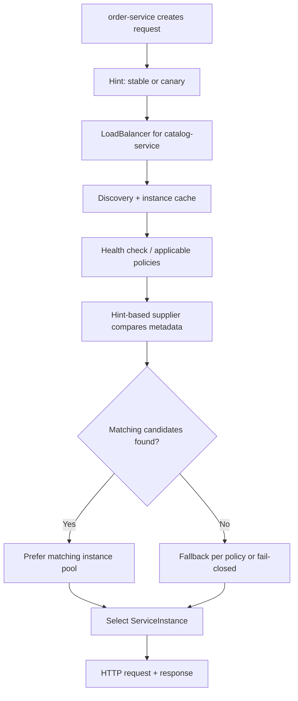

# Metadata-Based Routing Across Multiple Running Versions

When a microservices system runs old and new versions of `catalog-service` side by side, picking a replica at random can send two requests from the same business flow to two versions with **different API or data contracts**. Spring Cloud LoadBalancer can use `ServiceInstance` metadata and request context to prefer matching instances. This technique is valuable for *canary releases*, backward-compatibility testing, and controlled version transitions.

However, three concepts must be kept distinct: **instance discovery**, **label-based routing**, and **API contract guarantees**. Metadata identifies a version; it does not automatically stop a request from hitting an incompatible version, nor does it replace validation, readiness checks, or rollback planning.

This lesson belongs to the **Contracts and Errors** group for Spring Cloud LoadBalancer, focusing on publishing metadata from discovery, applying client-side hint-based routing, handling missing compatible instances, and observing errors when multiple versions serve concurrently via RestClient, WebClient, or OpenFeign.

## 1. The Problem: One Service ID, Multiple Versions

Suppose the system is migrating `catalog-service` from v1 to v2 while `order-service` keeps calling the logical URL:

```text
http://catalog-service/api/products/42
```

The registry publishes three instances:

| Instance ID | Service ID | API major version | Deployment group | Zone | Status |
|---|---|---|---|---|---|
| `catalog-1` | `catalog-service` | `v1` | `stable` | `az-a` | Ready |
| `catalog-2` | `catalog-service` | `v1` | `stable` | `az-b` | Ready |
| `catalog-3` | `catalog-service` | `v2` | `canary` | `az-a` | Ready |

If you only use round-robin with no version filtering or preference, all three become eligible candidates. Possible outcomes:

- The first request hits v1 and the next hits v2, even though the caller only understands the v1 schema.
- The client DTO fails to decode v2 JSON because fields or data types changed incompatibly.
- A new instance receives traffic too early before database migrations or warm-up finish.
- The experimental version throws errors yet the system cannot tell which release handled the request.

**Key point:** every instance can be healthy and LoadBalancer can validly pick a registered instance, yet **the call still violates the contract between caller and callee**. Instance selection must therefore be tied to compatibility constraints and deployment strategy.

## 2. What Is Metadata and Where Does It Live?

`ServiceInstance` in Spring Cloud exposes `getMetadata()` to read key–value labels supplied by discovery or configured instance sources. Common entries include:

| Illustrative metadata key | Value | Purpose |
|---|---|---|
| `api-major` | `v1` / `v2` | Distinguish major contracts |
| `release` | `1.8.4` / `2.0.0` | Track exact build versions |
| `channel` | `stable` / `canary` | Rollout group |
| `zone` | `az-a` / `az-b` | Support locality policies |
| `hint` | `stable` / `canary` | Label usable by the built-in hint-based supplier |
| `capability` | `bulk-pricing` | Advertise specific API capabilities per contract |

**Not every metadata key is understood by Spring Cloud LoadBalancer by default.** For example, `api-major=v2` is purely a descriptive label; plain round-robin will not filter by it automatically. A routing policy must be configured to **read the exact key**, compare the right values, and define fallback behavior.

In Java, you can inspect what discovery sees:

```java
import java.util.List;
import org.springframework.cloud.client.ServiceInstance;
import org.springframework.cloud.client.discovery.DiscoveryClient;

public void printInstances(DiscoveryClient discoveryClient) {
    List<ServiceInstance> instances =
            discoveryClient.getInstances("catalog-service");

    for (ServiceInstance instance : instances) {
        System.out.printf(
                "id=%s host=%s port=%d metadata=%s%n",
                instance.getInstanceId(),
                instance.getHost(),
                instance.getPort(),
                instance.getMetadata());
    }
}
```

This code only proves **which metadata the client currently sees**; it does not confirm which instance LoadBalancer selected or whether the metadata matches the running build. A registry, cache, or client can retain a stale snapshot for some time.

### 2.1. Publishing Metadata at Registration Time

For an instance registering with Eureka, metadata is commonly declared as follows:

```yaml
spring:
  application:
    name: catalog-service

eureka:
  instance:
    metadata-map:
      api-major: v2
      release: "2.0.0"
      channel: canary
      hint: canary
      zone: az-a
```

This is a **Eureka-specific example**. With Consul, Kubernetes, or another discovery mechanism, label configuration and how labels populate `ServiceInstance.getMetadata()` differ. Also verify how your registry maps zones into metadata or how Spring Cloud resolves zones, rather than assuming every platform uses the same key.

A deployment rule: metadata must reflect the **actual running artifact**, not just an environment name. If a pod is already running v2 while the registry still advertises `api-major=v1`, label filtering makes wrong decisions even when Java logic is correct.

## 3. Two Version-Routing Models

There are two primary strategies; choosing between them depends on API compatibility and isolation needs.

### 3.1. Same Service ID, Filter or Prefer by Metadata

Both v1 and v2 register under `catalog-service`. The caller supplies extra context, such as a `stable` or `canary` hint; a supplier selects the matching candidate subset before LoadBalancer runs round-robin/random.

The upside is callers keep one logical service name, convenient for canaries and traffic steering. The downside is **needing an exact filtering policy** and understanding fallback behavior when no instance carries the requested label.

### 3.2. Separate Service IDs for Incompatible Versions

When v1 and v2 have **mutually non-substitutable** contracts, publish them separately:

```text
catalog-v1 -> instances supporting only the v1 contract
catalog-v2 -> instances supporting only the v2 contract
```

v1-dependent callers use `http://catalog-v1/...`, while upgraded callers use `http://catalog-v2/...`. This keeps **routing boundaries far easier to control** because a v2 request cannot accidentally fall back into the v1 pool due to a bad hint.

In exchange, you manage extra service IDs, discovery configs, observability, and lifecycles. Sharing vs. splitting service IDs is an architectural choice: **not every patch or minor release needs its own service ID**.

| Criterion | Same service ID + metadata | Separate service IDs |
|---|---|---|
| Best suited for | Compatible versions, canaries, flexible routing | Incompatible major contracts requiring isolation |
| Control knob | Hint, zone, custom supplier/weight | Target service name |
| Fallback | Must be explicitly defined; may spill across groups | Usually isolated per pool if discovery is accurate |
| Rollback | Adjust cohort/routing | Point callers back to prior service ID or halt upgrade |
| Risk | Wrong header, stale label, accidental version fallback | Calling wrong service ID, migration gaps |

## 4. Metadata-Based Routing Flow

A clean flow for selecting canary instances via request hints:



This diagram shows the **required decisions**, not that every component is enabled in that exact order by default. Discovery, caching, and health checks are configurable steps; some suppliers have their own fallbacks, and actual ordering depends on the configured chain.

Snapshot comparison example:

| Stage | Instance list | Explanation |
|---|---|---|
| Discovery | `catalog-1`, `catalog-2`, `catalog-3` | Registered |
| After health (if enabled) | `catalog-1`, `catalog-2`, `catalog-3` | All three pass health probes |
| After `canary` hint | `catalog-3` | Only the instance with `hint=canary` |
| LoadBalancer | `catalog-3` | Picks a candidate from the final list |

If `catalog-3` becomes unavailable, a **hint-based preference with fallback** may return `catalog-1` and `catalog-2`. That is a **contract issue**, not just a performance concern: v1 may not understand v2 requests. Choose fail-closed behavior or separate service IDs whenever cross-version fallback is unacceptable.

## 5. Configuring Hint-Based Routing in Spring Cloud LoadBalancer

Spring Cloud LoadBalancer provides `HintBasedServiceInstanceListSupplier` to prefer instances by hint. In the built-in setup, the hint is typically passed via the `X-SC-LB-Hint` header or a client default, then matched against each instance's `hint` metadata key.

Distinguish:

- `hint=canary` in **instance metadata**: information supplied by discovery/registry.
- `X-SC-LB-Hint: canary` on the **request**: the preference the caller asks for.
- `api-major=v2` or `channel=canary`: auxiliary labels for auditing/contracts—they **do not become filters automatically** unless code or config reads them.

Dedicated supplier example for `catalog-service`:

```java
package com.example.lb.catalog;

import org.springframework.cloud.loadbalancer.core.ServiceInstanceListSupplier;
import org.springframework.context.ConfigurableApplicationContext;
import org.springframework.context.annotation.Bean;
import org.springframework.context.annotation.Configuration;

@Configuration(proxyBeanMethods = false)
public class CatalogLoadBalancerConfiguration {

    @Bean
    ServiceInstanceListSupplier catalogServiceInstanceListSupplier(
            ConfigurableApplicationContext context) {

        return ServiceInstanceListSupplier.builder()
                .withDiscoveryClient()
                .withCaching()
                .withHints()
                .build(context);
    }
}
```

Here `withDiscoveryClient()` fetches instances, `withCaching()` retains configured discovery snapshots, and `withHints()` adds hint-based preference. When combining health checks, zones, or custom steps, design the supplier chain order intentionally and verify `get(Request)` forwarding so request context is never lost.

Keep this configuration class **outside the main application's component scan** if it targets only one service ID. Wire it in the application as follows:

```java
package com.example.orders;

import com.example.lb.catalog.CatalogLoadBalancerConfiguration;
import org.springframework.boot.SpringApplication;
import org.springframework.boot.autoconfigure.SpringBootApplication;
import org.springframework.cloud.loadbalancer.annotation.LoadBalancerClient;

@SpringBootApplication
@LoadBalancerClient(
        name = "catalog-service",
        configuration = CatalogLoadBalancerConfiguration.class)
public class OrderApplication {

    public static void main(String[] args) {
        SpringApplication.run(OrderApplication.class, args);
    }
}
```

This example shows only the LoadBalancer configuration. The app still needs the Spring Cloud LoadBalancer dependency, matching discovery, and a load-balanced HTTP client. Builder APIs and properties can vary by Spring Cloud version; verify with integration tests before deploying.

### 5.1. Recognize a Key Limitation: Hints Are a Preference, Not a Hard Contract

With the built-in `HintBasedServiceInstanceListSupplier`, if no candidate matches the hint, the supplier can **return the original candidate list** instead of an empty list. That is helpful for soft routing, but unsafe when v1 and v2 are **incompatible**.

Hypothetical example:

```text
Request: X-SC-LB-Hint: canary
Discovery: [catalog-1(hint=stable), catalog-2(hint=stable)]
Hint matches: []
Default preference fallback: [catalog-1, catalog-2]
Possible selected instance: catalog-1
```

If `catalog-1` does not support the v2 contract, the request can fail even though the client sent the `canary` header. **Never rely on soft hint-based fallback to guarantee requests strictly reach the right major version.**

When hard isolation is required, use **separate service IDs**, mandatory gateway routes, or a custom supplier enforcing a *fail-closed* policy. In a custom supplier, if a request requires v2 and no eligible v2 instance exists, return an empty set or explicit routing failure **instead of silently routing to v1**; never unknowingly trade contract compatibility for availability.

## 6. Passing Routing Hints from HTTP Clients

### 6.1. WebClient

If `order-service` uses a LoadBalancer-integrated builder:

```java
import org.springframework.cloud.client.loadbalancer.LoadBalanced;
import org.springframework.context.annotation.Bean;
import org.springframework.web.reactive.function.client.WebClient;

@Bean
@LoadBalanced
WebClient.Builder loadBalancedWebClientBuilder() {
    return WebClient.builder();
}
```

You can pass a hint per call:

```java
Mono<ProductResponse> product = webClient.get()
        .uri("http://catalog-service/api/products/{id}", "42")
        .header("X-SC-LB-Hint", "canary")
        .retrieve()
        .bodyToMono(ProductResponse.class);
```

The second snippet assumes `webClient` is built from the `@LoadBalanced` builder and `ProductResponse` is an application DTO. For the request hint to influence selection, the HTTP client's exchange filter must propagate the header into the **request context** inspected by the hint supplier. Otherwise, the header merely travels downstream without affecting candidate filtering.

### 6.2. OpenFeign

A Feign interface can also declare the header in its request contract:

```java
package com.example.orders.client;

import org.springframework.cloud.openfeign.FeignClient;
import org.springframework.web.bind.annotation.GetMapping;
import org.springframework.web.bind.annotation.PathVariable;
import org.springframework.web.bind.annotation.RequestHeader;

@FeignClient(name = "catalog-service")
public interface CatalogClient {

    @GetMapping("/api/products/{id}")
    ProductResponse getProduct(
            @PathVariable("id") String id,
            @RequestHeader("X-SC-LB-Hint") String routingHint);
}
```

For example, calling `client.getProduct("42", "stable")` or `client.getProduct("42", "canary")`. Verify that your Spring Cloud OpenFeign–LoadBalancer integration forwards the header into `ServiceInstanceListSupplier`'s request context. Execution paths can differ across Feign blocking clients, WebClient, and RestClient; **sending the header** alone does not prove routing took effect.

### 6.3. RestClient and Intermediate Hops

With a `@LoadBalanced RestClient.Builder`, per-call HTTP headers look like:

```java
ProductResponse product = restClient.get()
        .uri("http://catalog-service/api/products/{id}", "42")
        .header("X-SC-LB-Hint", "canary")
        .retrieve()
        .body(ProductResponse.class);
```

Here `restClient` must be built from a LoadBalancer-enabled builder with matching dependencies; the snippet omits bean wiring. Verify that request context propagates to the supplier for your specific version and integration.

If a gateway or `order-service` receives a browser request and calls `catalog-service`, HTTP headers on the **browser → gateway** hop are not automatically copied onto the **gateway → catalog** hop. Decide which trusted component assigns the cohort and attaches the hint to internal calls. Never allow external clients to opt themselves into canary by blindly trusting an arbitrary incoming header.

## 7. Canary Routing: Stable Cohorts and Traffic Caps

Sending a `canary` hint on a subset of requests steers traffic to the new release, yet **a hint is not a percentage splitter**. If you want 5% of traffic, the cohort-assignment component must decide which requests receive `canary`, for example via a rollout rule:

```text
A request enters order-service.
    |
    +-- Customer in experimental cohort? -- Yes --> hint = canary
    |                                        |
    +-- No ----------------------------------+--> hint = stable
```

Cohort rules can use feature flags or consistent hashing over a protected identifier. Random per-request assignment can bounce **the same customer back and forth between v1 and v2**, which breaks behavioral consistency. Conversely, user/tenant-based cohorts must follow security policies and never leak sensitive IDs in hints, metadata, or logs.

Example policy:

| Cohort | Hint | Goal |
|---|---|---|
| Regular users | `stable` | Keep paths predictable |
| Internal test group | `canary` | Validate v2 in a narrow blast radius |
| Opted-in benchmark group | `canary` | Measure performance and compatibility before rollout |

If canary and stable still share **the same API major version and remain backward compatible**, soft fallback may be acceptable operationally. If canary makes breaking contract changes, enforce hard cohort isolation or separate service IDs.

Note that replica count does not directly dictate traffic percentage. Running one v2 instance out of three does not mean 33% of requests hit v2 once hints, zone preferences, affinity, weights, or load skew come into play.

## 8. API Contracts: Metadata Does Not Replace Backward Compatibility

Label-based routing cannot fix HTTP contract mismatches. Build a caller/callee compatibility matrix before rolling out:

| Caller | Callee v1 | Callee v2 | Decision |
|---|---|---|---|
| Legacy `order-service`, understands v1 schema only | Valid | Potentially incompatible | Stick to stable/v1 or keep v2 backward-compatible |
| New `order-service`, understands both schemas | Valid | Valid | Soft canary rollout is viable once verified |
| New `order-service`, requires v2-only fields | Invalid | Valid | Hard route to v2 or separate service ID; never fall back to v1 |

Changes that break contracts include:

- Renaming or changing types of JSON fields required by callers.
- Removing endpoints or altering required HTTP methods, paths, or query parameters.
- Changing business error code meanings, HTTP statuses, or idempotency semantics.
- Requiring new headers/tokens unknown to legacy callers.
- Database migrations that prevent old and new versions from safely reading/writing the same database.

**Tip:** distinguish `release` (a concrete build like `2.0.7`) from `api-major` (the contract like `v2`). Not every new build requires separate routing; often a release-level canary within the same API major version suffices.

When multiple versions run together, the safer rollout pattern for data schemas is **expand–migrate–contract**: first expand so old versions continue working, gradually transition callers/callees, and finally remove legacy fields or behaviors once nothing depends on them.

## 9. Instance Health, Caching, Zones, and Supplier Ordering

Hint-based routing only makes sense if the candidate list reflects **actually servable** instances. A stale or inaccurate list can still send a v2 request to an instance that just shut down.

Layers to inspect:

1. **Registry/discovery:** which versions are registered, with what metadata, and when do refreshes run?
2. **Cache:** how long are discovery snapshots cached? Could metadata change while clients hold old labels?
3. **Health check:** did probes filter out broken or unready instances? `registered` differs from `ready`.
4. **Zone preference:** if canary runs in `az-b` while callers sit in `az-a`, does zone preference hide the canary?
5. **Hint filter:** do the metadata key and request context actually match?
6. **LoadBalancer:** which version/cohort did the selected instance belong to?
7. **HTTP:** which release produced the observed contract compliance, latency, and error rate?

Order caching, health checks, and request-dependent filters carefully. **Never store a hint-filtered result inside a shared list cache without keying by request context**; otherwise a stable request can reuse a canary list or vice versa.

Example comparing snapshots at each boundary:

```text
Discovery:      [catalog-1(stable), catalog-2(stable), catalog-3(canary)]
After health:   [catalog-1(stable), catalog-3(canary)]
Request hint:   canary
After hint:     [catalog-3(canary)]
Chosen:         catalog-3
HTTP:           200, contract=v2
```

Never infer from **HTTP 200** that version routing worked: if both v1 and v2 return 200 on an endpoint, verify via logs/traces carrying instance ID/release or safe contract verification in test environments.

## 10. When No Matching-Version Instance Exists: Fallback or Fail-Closed?

Suppose callers request API v2 yet all v2 instances fail health checks:

| Policy | Outcome | Appropriate when |
|---|---|---|
| **Fall back to all candidates** | Calls v1 to preserve availability | Only when v1 can genuinely handle the request |
| **Fail-closed** | Refuses incompatible instances; returns no-matching-target error | Preserving v2 contract is mandatory |
| **Call v2 service ID** | Searches only within the v2 pool | Services are cleanly isolated and discovery is accurate |
| **Business fallback** | Returns cached/degraded data, explicitly flagged | Product policy allows it and data is trustworthy |

Decide this explicitly in the **contract** instead of relying on implicit fallback. When no valid v2 instance remains, failure may surface as no-instance-found, an upstream gateway/LoadBalancer error, or an HTTP client exception. Returning `404 Not Found` for a **product** simply because no v2 instance exists is semantically wrong. Applications should map that to a dependency-unavailable or version-unavailable error matching the external API contract.

In particular, retrying after a timeout can pick a different instance **inside or outside the cohort**, depending on the algorithm and whether hints propagate across attempts. When v2 is mandatory, verify **every attempt** preserves the version constraint. Never retry endlessly when only one broken release exists; retries amplify load and obscure root cause.

## 11. Observing Per-Version Errors and Controlling Drift

During a rollout, service-wide aggregate metrics can hide failures occurring exclusively on the canary. Monitor at least:

| Group | Observed fields | Purpose |
|---|---|---|
| Request intent | `serviceId`, `hint`, cohort logic | Which pool did the caller intend to hit? |
| Discovery | `instanceId`, `api-major`, `release`, `zone` | Which instances are available and with what metadata? |
| Selection | Candidate count, selected instance, post-selection metadata | Did routing follow policy? |
| HTTP | Status, connect errors, timeouts, latency, attempts | Which version caused failures? |
| Contract | Decoder errors, schema validation, business error codes | Are caller and callee compatible? |
| Rollout | Actual canary traffic share, error rates, p95/p99 | Should we expand or roll back? |

Never add every `instanceId`, `traceId`, or user ID as unbounded metric labels; use bounded release/service labels alongside sampled logs/traces when per-instance detail is needed. Never log bearer tokens, PII, or raw cohort seeds.

Track at least two separate per-release quality indicators: **HTTP/transport error rate** and **contract error rate** (decode mismatches, missing fields, unexpected statuses). A canary with low 5xx rates yet frequent DTO decoding errors is not ready for more traffic.

## 12. Hands-On Lab: Testing v1/v2 Routing

Prepare three instances as in Section 1. Two stable instances register `hint=stable`, `api-major=v1`; one canary registers `hint=canary`, `api-major=v2`. Each instance exposes a test endpoint returning version info in the **test environment** for easy verification (do not necessarily expose such endpoints publicly in production).

Run these checks:

1. **Preflight:** inspect `DiscoveryClient.getInstances("catalog-service")` right on the caller; confirm instance IDs, host:port, `hint`, and `api-major`.
2. **No hint:** send requests without `X-SC-LB-Hint` and record candidate lists and selected instances to verify actual default policy.
3. **Stable:** send `X-SC-LB-Hint: stable` repeatedly; confirm only matching instances are preferred while healthy.
4. **Canary:** send `X-SC-LB-Hint: canary` and observe `catalog-3` being selected. Confirm responses decode cleanly into the expected DTO.
5. **Unknown hint:** send `X-SC-LB-Hint: unknown`. Record actual fallback behavior—specifically whether traffic falls back into the stable pool.
6. **Canary down:** stop or fail health on `catalog-3`. Measure cache convergence time and fallback/fail-closed behavior; if v2 is incompatible, **forbid hitting v1**.
7. **Zones:** place canary in a different zone from the caller, test zone preference alongside hints, and observe ordering, fallback, and cross-zone latency.
8. **Retry:** inject controlled timeouts and confirm the cohort stays pinned across attempts; check attempt counts and budgets.
9. **Schema:** simulate v2 changing a critical field's type and run contract tests ensuring v1 callers never receive incompatible v2 payloads.
10. **Rollback:** drain canary from the cohort, verify stable requests continue succeeding, and confirm zero requests strictly require v2 before terminating the instance.

Example observation table:

| Trace | Hint | Eligible candidates | Selected instance | API contract | Outcome |
|---|---|---|---|---|---|
| `r-101` | `stable` | `1, 2` | `1` | `v1` | `200` |
| `r-102` | `canary` | `3` | `3` | `v2` | `200` |
| `r-103` | `canary` | None after health | Per configured fallback | Must not call v1 if v2 required | Controlled error |
| `r-104` | `unknown` | None matched | Inspect actual fallback | Never guess | Per policy |

Values are illustrative. Actual behavior depends on discovery source, supplier order, LoadBalancer, HTTP client integration, and API contracts.

## 13. Safe Multi-Version Rollout Checklist

**Before rollout:**

- Decide whether v1/v2 are backward compatible or require separate service IDs.
- Define a metadata schema (e.g., `api-major`, `release`, `hint`), avoiding conflicting names or values.
- Ensure metadata is stamped automatically from the artifact and readiness reflects true serving capability.
- Choose the fallback policy **before** starting the canary, especially for incompatible contracts.
- Prepare contract tests, integration tests for request hints, and per-release monitoring.

**During rollout:**

- Bring v2 up and wait for discovery, health checks, and caches to converge before shifting traffic.
- Shift a small, stable cohort; measure actual traffic share, error rates, latency, and decode errors by release.
- Test **no hint**, **bad hint**, **instance loss**, **cross-zone**, and **retry** paths.
- Ramp the cohort incrementally based on quality gates, never just replica count.

**During rollback:**

- Stop shifting new cohorts to v2; block or safely reroute incompatible requests.
- Wait for in-flight requests to drain gracefully.
- Verify discovery/LoadBalancer no longer routes stable callers to v2 instances.
- Audit shared data schemas, caches, events, and any writes produced by v2 before rolling back code.
- Document decisions and measurements to prevent repeating issues in future deployments.

## 14. Key Takeaways

In Spring Cloud LoadBalancer, `ServiceInstance` metadata identifies releases, API major versions, zones, or cohorts, yet **metadata does not automatically enforce routing policies**. `HintBasedServiceInstanceListSupplier` can prefer instances whose `hint` metadata matches request context, while round-robin/random selects from the filtered candidates. You must understand hint-routing fallback behavior, preserve context across HTTP clients and retries, and design supplier ordering across caches, health checks, and zones.

For **backward-compatible** versions, hint-based canary routing is a flexible rollout tool. For **incompatible** versions, prefer contract isolation via separate service IDs or a *fail-closed* policy, because silent fallback to older builds can trigger severe business bugs. Tracking metadata, candidate lists, chosen instances, HTTP responses, and contract errors per release is essential for safe rollouts, scaling, and rollbacks.
