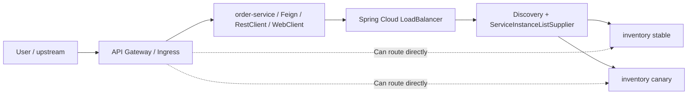
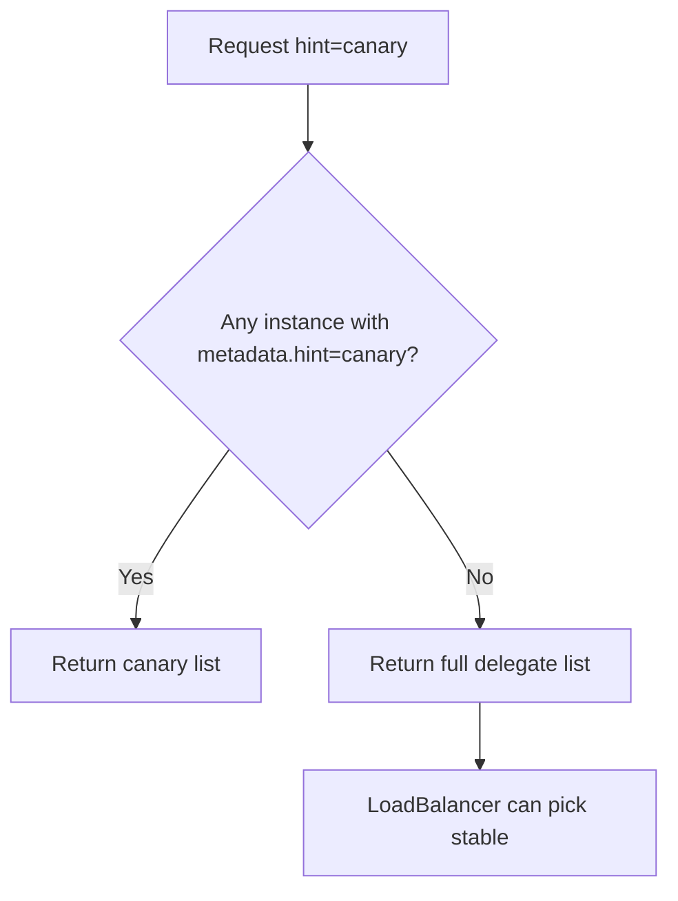
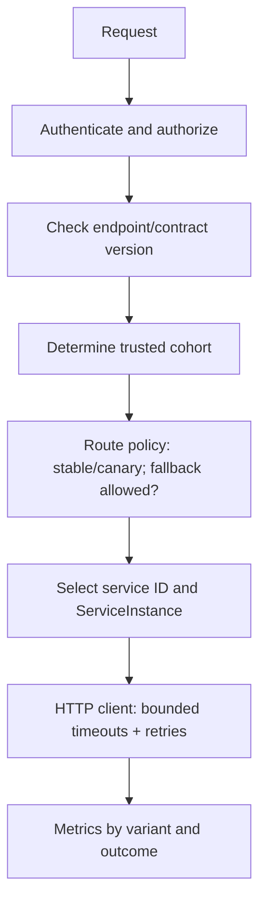
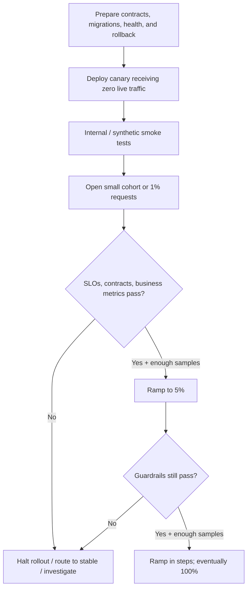

# The Boundary Between Canary Testing and a Full Routing Policy

## Objectives

When releasing a new version of `inventory-service`, teams often deploy one or a few **canary** replicas and send a small fraction of live traffic to observe behavior before expanding. Spring Cloud LoadBalancer helps select a `ServiceInstance` by service ID, metadata, hint, zone, or weight. However, **steering a slice of traffic to a canary does not mean you have a full routing policy**.

A production routing policy must also answer: who enters the canary, when cohort switching is allowed, what happens when no canary instance exists, whether HTTP contracts stay compatible between stable and canary, which errors can be retried, when to roll back, and how to prove traffic never crossed into the wrong pool.

After this lesson, you will be able to:

- Distinguish **canary experiments** from **routing governed by business, security, and reliability constraints**.
- Understand the scope of `WeightedServiceInstanceListSupplier`, `HintBasedServiceInstanceListSupplier`, and route weights in Spring Cloud Gateway.
- Design **per-request randomized** or **cohort/user-sticky** selection matching experiment goals.
- Distinguish **acceptable fallback** from **dangerous fail-open** behavior when no matching instance is available.
- Verify API contracts, error codes, retries, timeouts, and idempotency between stable and canary.
- Build a 95/5 canary lab using Gateway and two separate service IDs with rollback support.
- Define metrics, ramp-up criteria, and test suites verifying routing boundaries.

> Context: This lesson belongs to the **Contracts and Errors** chapter of the Spring Cloud Service Communication Load Balancing module. The focus is routing correctness, inter-service contracts, and error handling. A neat canary percentage on a dashboard is not proof that the system safely isolates traffic.

## 1. What Is a Canary Release Really?

A **canary release** is a rollout strategy that exposes a new version to a small slice of traffic or a small user group, observes key metrics, and decides whether to expand, hold, or roll back.

For example, `inventory-service` has:

| Group | Version | Instances | Status |
|---|---|---:|---|
| Stable | `v1.8` | 9 | Primary production serving |
| Canary | `v1.9-rc1` | 1 | Under evaluation |

A team may want **5% of inventory reads** handled by the canary. Yet saying "5%" leaves major questions unanswered:

- 5% of **requests**, 5% of **users**, or 5% of **orders**?
- Does it apply to the entire API or only `GET /api/items/{sku}`?
- Can one user bounce back and forth between stable and canary within the same session?
- Does it apply to payment or stock-reservation operations?
- If the canary has no healthy instances, should traffic fall back to stable?
- Can a 404 returned by canary be retried against stable?
- Who is authorized to adjust the percentage and halt the experiment?

Until these questions are answered, your setup is likely just a **traffic-splitting experiment**, not a complete routing policy.

## 2. Boundary: Canary Experiments vs. Production Routing

| Aspect | Minimal canary experiment | Full routing policy |
|---|---|---|
| Goal | Send a trickle of requests to the new version | Route the **right traffic** to the **right pool** under verifiable rules |
| Allocation | Roughly 95/5 random weights | Combines ratios, cohorts, tenants, APIs, regions, versions, and priorities |
| Group stability | A user may switch pools across requests | Sticky assignment when business rules or measurements require it |
| Missing backend | May fall back automatically per library defaults | Explicit fail-open vs. fail-closed defined per traffic type |
| API compatibility | Often tested on happy paths only | Verifies status, body, schema, semantics, and contract version |
| Retries | Uses defaults | Bounds attempts, re-selection, and cross-variant fallback |
| Security | Illustrative headers/metadata | Never trusts external headers; enforces independent authorization |
| Observability | Counts canary requests | Metrics segmented by variant, release, operation, cohort, and meaningful errors |
| Rollback | Manual weight reduction | Kill switch, change permissions, runbooks, and tested rollback |
| Data rollout | May share DB with stable | Forward/backward-compatible schema/data migrations, idempotency, and recovery |

**Canarying reduces the blast radius of a change; a routing policy is the mechanism guaranteeing that blast radius stays bounded as designed.**

## 3. Layers That Can Participate in Target Selection

In a Spring Cloud architecture, multiple places can distribute requests:



Identify **which layer owns the canary decision**:

1. **Gateway/ingress:** selects routes to `inventory-stable` or `inventory-canary`, optionally using route weights. Ideal when all traffic flows through Gateway.
2. **Client-side LoadBalancer:** selects a `ServiceInstance` within a single service ID, optionally by weight or hint.
3. **Service mesh/proxy:** applies version/label policies at the network layer; applications may remain unaware of target versions.
4. **Business application:** determines cohorts itself and targets distinct service IDs, with full access to tenant, order, or contract context.

If `order-service` calls `http://inventory-service` directly with `@LoadBalanced RestClient`, a route weight on the public Gateway **does not apply** to that internal call. Conversely, supplier policies inside `order-service` do not apply to traffic going straight through Gateway to the backend.

Never configure "5% canary" at multiple layers without calculating the combined effect. If Gateway sends 5% to a canary tier and LoadBalancer inside that tier routes only 10% to a canary instance, the actual fraction reaching canary diverges sharply from your target.

## 4. WeightedServiceInstanceListSupplier: Instance Weights Are Not Contract Cohorts

Spring Cloud Commons provides `WeightedServiceInstanceListSupplier`, reading `weight` from `ServiceInstance` metadata (defaulting to **1** when absent). Weights steer selection frequency across **instances** in the candidate list.

Suppose a service ID contains:

| Instance | Release | Metadata `weight` |
|---|---|---:|
| `inventory-stable-1` | stable | 19 |
| `inventory-canary-1` | canary | 1 |

The expected split in this simple two-instance setup is:

```text
stable : canary = 19 : 1
canary share = 1 / (19 + 1) = 5%
```

Now suppose stable scales to **nine instances**, each carrying weight `19`, alongside one canary with weight `1`:

```text
Total stable weight = 9 × 19 = 171
Total canary weight = 1
Canary share ≈ 1 / 172 ≈ 0.58%
```

This is a classic mistake: **weights apply per instance, not automatically as a 95/5 split per release label**. Adding or removing replicas shifts the effective ratio even while per-instance weight metadata stays unchanged.

### 4.1. Enabling the Weighted Supplier for a Service ID

Dedicated configuration example for `inventory-service`:

```java
import org.springframework.cloud.loadbalancer.annotation.LoadBalancerClient;
import org.springframework.cloud.loadbalancer.core.ServiceInstanceListSupplier;
import org.springframework.context.ConfigurableApplicationContext;
import org.springframework.context.annotation.Bean;
import org.springframework.context.annotation.Configuration;

@Configuration(proxyBeanMethods = false)
@LoadBalancerClient(
        name = "inventory-service",
        configuration = InventoryWeightedConfiguration.class
)
class InventoryLoadBalancerRegistration {
}

// Omit @Configuration if this class lives inside the main component-scan package.
class InventoryWeightedConfiguration {

    @Bean
    ServiceInstanceListSupplier inventoryInstanceListSupplier(
            ConfigurableApplicationContext context) {
        return ServiceInstanceListSupplier.builder()
                .withDiscoveryClient()
                .withCaching()
                .withWeighted()
                .build(context);
    }
}
```

This demonstrates **weighted load balancing from instance metadata**. It performs no tenant checks, API contract routing, per-user assignment stickiness, or hard stop when canary becomes unready.

In Eureka-based systems, instance metadata can be registered via `eureka.instance.metadata-map.weight`. With other discovery providers, check how metadata maps into `ServiceInstance.getMetadata()`.

### 4.2. Limitations of Weighted Routing

- Weights produce a **probabilistic or relative distribution**, never guaranteeing exactly 5 out of every 100 requests.
- On small samples, observed percentages fluctuate widely.
- Request share does not equal user, session, or transaction share.
- Retries generate extra **physical attempts**, skewing backend traffic ratios relative to logical requests.
- Zone, hint, and health-check suppliers can alter the candidate set before weights apply.
- Stale discovery caches can delay canary visibility or keep picking removed instances.
- Weights are **not an authorization gate** or mandatory data-isolation rule.

If the requirement is "5% of users stay pinned to canary for a full day," weighted instance selection **is insufficient**. You need cohort rules and persisted assignment state.

## 5. Hint-Based Routing: Steers Traffic, Not Fail-Closed by Default

`HintBasedServiceInstanceListSupplier` reads a hint from the `X-SC-LB-Hint` header or `spring.cloud.loadbalancer.hint.<serviceId>`, then filters instances whose `hint` metadata key matches that value.

Example instances under one service ID:

```text
inventory-service:
  instance stable-a: metadata.hint = stable
  instance stable-b: metadata.hint = stable
  instance canary-a: metadata.hint = canary
```

A `@LoadBalanced WebClient` can attach the hint on internal calls:

```java
Mono<String> response = webClient.get()
        .uri("http://inventory-service/api/items/{sku}", "SKU-42")
        .header("X-SC-LB-Hint", "canary")
        .retrieve()
        .bodyToMono(String.class);
```

This assumes `webClient` is built from a `@LoadBalanced` builder and `withHints()` is wired into the supplier chain. Sending the header without enabling the supplier will not activate hint-based routing.

### 5.1. Default Fallback Is a Dangerous Boundary

Per Spring Cloud Commons documentation, when **no instance matches the hint**, `HintBasedServiceInstanceListSupplier` **returns the full list from its delegate**.



For simple canary tests, falling back to stable if canary disappears is sometimes acceptable. However, when enforcing **regulatory tenant isolation**, **new-contract-only routing**, or **blocking sensitive data from stable**, this fallback behavior is unsafe.

**Hints are neither authentication nor authorization.** Never trust an external user's `X-SC-LB-Hint: canary` header as permission to access canary features. A trusted gateway or service must verify permissions, strip/overwrite untrusted headers, and make the routing decision.

### 5.2. When Fail-Closed Is Required

If policy states "canary requests **must never** execute on stable," choose an explicit mechanism:

- **Separate service IDs:** `inventory-canary` holds only canary instances; when none exist, callers receive an error or apply an explicit policy without ever falling back to stable instances.
- **Strict custom supplier:** after metadata filtering, return an empty list on zero matches instead of falling back to the delegate.
- **Gateway/mesh rule guaranteeing isolation:** route to a specific target group, tested for empty pools.

When writing a custom supplier, verify the entire chain, ordering of cache/discovery/health checks, and how LoadBalancer handles empty lists. Returning an empty list triggers an instance-selection failure—an intentional choice to **avoid crossing boundaries**.

## 6. Safer Design: Separate Service IDs for Stable and Canary

An easier-to-reason-about and easier-to-test pattern registers both pools under **two service IDs**:

| Service ID | Deployment | Purpose |
|---|---|---|
| `inventory-stable` | `inventory-service:v1.8` | Primary traffic |
| `inventory-canary` | `inventory-service:v1.9-rc1` | Experimental traffic |

Here, the **service ID is the backend pool boundary**. A route to `lb://inventory-canary` resolves exclusively against canary instances in discovery/LoadBalancer.

### 6.1. Weighted Routes in Spring Cloud Gateway

With **Spring Cloud Gateway Server WebFlux**, use the `Weight` route predicate:

```yaml
spring:
  cloud:
    gateway:
      server:
        webflux:
          routes:
            - id: inventory-stable-route
              uri: lb://inventory-stable
              predicates:
                - Path=/api/items/**
                - Weight=inventory-rollout, 95

            - id: inventory-canary-route
              uri: lb://inventory-canary
              predicates:
                - Path=/api/items/**
                - Weight=inventory-rollout, 5
```

Here:

1. Both routes match `/api/items/**` and share the weight group `inventory-rollout`.
2. Gateway distributes **approximately 95%** of matching requests to stable and **5%** to canary by weight.
3. `lb://inventory-stable` and `lb://inventory-canary` are resolved **separately by service ID** through Spring Cloud LoadBalancer.
4. Both backends must expose the same `/api/items/{sku}` path. If paths differ, configure rewrite filters intentionally and run contract tests.

This example targets **Gateway Server WebFlux** with matching Gateway/LoadBalancer dependencies; Gateway Server MVC uses different configuration. Never paste this YAML into an ordinary `order-service` expecting it to route internal Feign calls.

### 6.2. A 95/5 Route Weight Still Does Not Pin Users to One Pool

Gateway `Weight` splits at **per-request route selection**; it does not remember that user A hit canary on the previous request. A single user may see:

```text
User A request 1 -> inventory-stable
User A request 2 -> inventory-canary
User A request 3 -> inventory-stable
```

If an experiment needs consistent per-user behavior, **assign a cohort** via user ID/tenant ID or stored assignment and route by cohort through a trusted mechanism. `Weight` config does not replace an assignment policy.

### 6.3. Rolling Back Route Weights Does Not Roll Back Everything

To halt a canary at Gateway, update the config to **keep only the stable route** for the target path and apply it through a tested config rollout; avoid assuming `weight=0` behaves uniformly across all versions.

Yet routing rollback **never undoes** data writes, schema migrations, published queue messages, or side effects already produced by the canary. Safe rollout design must address both **traffic routing** and **data compatibility**.

## 7. When Do You Need Cohort/Sticky Assignment?

Depending on goals, "5% distribution" carries three distinct meanings:

| Goal | Assignment unit | Suitable mechanism |
|---|---|---|
| Technical smoke test with live traffic | Request | Route/instance weights, bounded scope |
| Evaluating consistent user experience | User/session | Stable cohort, cookie, or server-side assignment |
| Customer-level data/capability isolation | Tenant/account | Permission rules and mandatory routing, fail-closed |

### 7.1. Deterministic Bucketing

An illustrative cohort strategy using stable hashing over an internal subject identifier:

```java
final class CanaryCohort {
    static boolean assignedToCanary(String subjectId, int percentage) {
        if (percentage < 0 || percentage > 100) {
            throw new IllegalArgumentException("percentage must be 0..100");
        }
        if (subjectId == null || subjectId.isBlank()) {
            return false; // Unauthenticated: default to stable per policy.
        }

        long bucket = Integer.toUnsignedLong(subjectId.hashCode()) % 100;
        return bucket < percentage;
    }
}
```

For a given `subjectId` and `percentage`, the result stays consistent across calls. Still, this is **illustrative only**, not a complete production solution:

- `String.hashCode()` is not a cryptographic hash, and distribution can skew depending on ID format.
- To prevent users from guessing or gaming cohorts, use HMAC with a securely managed key/version.
- Changing `percentage` can shift some subjects across pools; persist assignments if users must stay once admitted.
- A user across multiple devices must resolve to the same authenticated `subjectId`.
- Never place raw user IDs or tenant IDs in logs or metric labels; use controlled identifiers.

Once the cohort is chosen, the router must target the **right service ID** rather than merely attaching a header hoping a hint supplier picks the right group. For operations needing strict isolation, missing target routes must raise a clear error instead of falling back to another pool.

### 7.2. Policy Evaluation Order

A routing decision pipeline may follow:



Never assign pools based solely on an untrusted client's `X-Canary` header. Moreover, **admitting a request to canary is a traffic decision**, never equivalent to granting internal API permissions.

## 8. API Contracts Are a Prerequisite Before Ramping Canary

Suppose stable and canary both expose:

```http
GET /api/items/SKU-42
Accept: application/json
```

Stable returns:

```json
{
  "sku": "SKU-42",
  "available": 12,
  "warehouse": "HN-01"
}
```

Canary returns:

```json
{
  "sku": "SKU-42",
  "available": 12,
  "warehouse": {
    "code": "HN-01",
    "region": "north"
  }
}
```

Even though both return HTTP 200 with valid JSON, **the type of `warehouse` changed**. If callers deserialize `warehouse` as `String`, canary requests fail decoding. Canary routing cannot repair contract breakage.

### 8.1. Compatibility Matrix to Verify

| Component | Must align between stable and canary |
|---|---|
| HTTP method and path | Unchanged or explicitly versioned |
| Request body | Required fields, types, validation, defaults |
| Response body | Field types/meanings, nullability, enums, backward compatibility |
| HTTP status | 200/201/204, 400/404/409/429/503 with identical semantics |
| Error body | Stable Problem Details structure and application error codes |
| Headers | Auth, correlation ID, cache control, idempotency keys |
| Side effects | Orders, reservations, messages, DB writes behave consistently |
| Data schema | Migrations and rollbacks compatible with both versions |
| Timeouts/retries | Calibrated per operation and safe to replay |
| Feature flags | Independently controllable; routing does not blindly enable every feature |

**Schema compatibility alone is not enough:** changing inventory calculation from "physical stock" to "sellable stock minus reservations" keeps the exact JSON shape while altering business semantics. Contract checks must cover data semantics, not just JSON structure.

### 8.2. Standardizing Error Contracts

Spring Framework supports `ProblemDetail` for RFC 9457 HTTP API errors. Example handler:

```java
import org.springframework.http.HttpStatus;
import org.springframework.http.ProblemDetail;
import org.springframework.http.ResponseEntity;
import org.springframework.web.bind.annotation.ExceptionHandler;
import org.springframework.web.bind.annotation.RestControllerAdvice;

@RestControllerAdvice
class InventoryErrorAdvice {

    @ExceptionHandler(ItemNotFoundException.class)
    ResponseEntity<ProblemDetail> itemNotFound(
            ItemNotFoundException exception) {
        ProblemDetail problem =
                ProblemDetail.forStatus(HttpStatus.NOT_FOUND);
        problem.setTitle("Item not found");
        problem.setDetail("Requested item does not exist");
        problem.setProperty("code", "ITEM_NOT_FOUND");
        return ResponseEntity.status(HttpStatus.NOT_FOUND)
                .body(problem);
    }
}
```

`ItemNotFoundException` is an application-defined business exception; never echo raw exception messages to users if they could leak internal details. Both stable and canary must keep identical **HTTP 404 + `code=ITEM_NOT_FOUND`** semantics when an item truly does not exist.

Illustrative response:

```json
{
  "type": "about:blank",
  "title": "Item not found",
  "status": 404,
  "detail": "Requested item does not exist",
  "code": "ITEM_NOT_FOUND"
}
```

If canary replaces 404 with 500 or returns 200 with `{"error":"not found"}`, error metrics and caller contracts both break. A sound policy verifies **semantics**, not just percentages.

## 9. Retries, Fallbacks, and Errors: Never Leak Canary Traffic to Stable Unintentionally

Spring Cloud LoadBalancer supports retries by status/exception and re-selecting a `ServiceInstance`. One logical request can therefore trigger multiple **physical HTTP attempts**.

Example:

```text
Logical request: GET /api/items/SKU-42

Attempt 1: inventory-canary-a -> 503
Attempt 2: inventory-canary-b -> 200

Caller outcome: 200
Physical attempts: 2
```

This is a valid retry **within the canary pool**. However, if attempt 2 jumps over to stable against policy, the 200 response **masks canary failures** and corrupts measurements.

### 9.1. Error Decision Table

| Situation | Recommended behavior | Why |
|---|---|---|
| Canary returns 404 for nonexistent SKU | Preserve 404 per contract; never fall back to stable | Business 404 is not a transient infrastructure fault |
| Canary returns 400 on bad input | Preserve 400; do not retry | Resending bad input cannot fix the error |
| Canary returns 503 on idempotent GET | Bounded retry **within canary group** | May be transient; still count the attempt failure |
| No eligible canary instance | Fail-closed or fall back to stable **only if policy explicitly allows** | Never let default fallback make business decisions |
| Canary hits read timeout on reservation POST | Do not retry or cross variants without idempotency | Backend may have committed before timeout |
| Canary and stable use incompatible DB schemas | Block rollout/rollback until compatible | Switching routes does not undo persisted data |
| Untrusted routing header | Strip/overwrite at trusted boundary | Prevents self-selection and feature leaks |

### 9.2. Bounding Retries per Service ID

Separate service IDs can enforce distinct retry policies:

```yaml
spring:
  cloud:
    loadbalancer:
      retry:
        enabled: true
        max-retries-on-same-service-instance: 0
        max-retries-on-next-service-instance: 1
        retry-on-all-operations: false
        retryable-status-codes: [502, 503, 504]
      clients:
        inventory-canary:
          retry:
            max-retries-on-next-service-instance: 0
        inventory-stable:
          retry:
            max-retries-on-next-service-instance: 1
```

This configuration illustrates **when clients actually enable LoadBalancer retries**. Note:

- Global `retry.enabled` acts as the master switch; per-service settings can narrow limits.
- `max-retries-on-next-service-instance: 0` prevents re-selecting another instance at that retry layer, making canary errors easier to observe cleanly.
- Retries in Feign, WebClient `retryWhen`, Gateway, or other resilience libraries can still generate separate attempts.
- When routes split by service ID, LoadBalancer retries on `inventory-canary` only see canary instances—**a major benefit of the service-ID boundary**.

Do not disable retries permanently merely for cleaner dashboards. Base retry rules on SLAs, idempotency, and experiment goals while recording both per-attempt errors and final logical outcomes.

### 9.3. Fail-Open vs. Fail-Closed Has No Universal Answer

- **Fail-open to stable** when canary is down can fit non-sensitive read experiences, provided clients tolerate behavioral differences and fallbacks are logged/metered.
- **Fail-closed** is mandatory when requests must run strictly inside an approved tenant/region/version or when stable cannot understand the new contract.
- **No route/instance** must produce a clearly classified error—such as 503 at gateway/upstream when no backend exists—never fabricating a 404 as though the resource did not exist.

In production rollouts, specify fail modes per **operation**, not merely per service ID. Within the same `inventory-service`, quantity reads might allow fallback while inventory reservations must never cross variants automatically.

## 10. Observability: Measure the Canary, Not Just Request Counts

To declare a canary healthy, inspect **the right cohorts** and **the right denominators**.

| Metric | Required dimensions | Meaning |
|---|---|---|
| Request count | stable/canary, endpoint, release | Actual traffic split |
| HTTP error rate | status class, variant | Is canary adding HTTP errors? |
| Business error rate | error code, operation | Is there an unexpected spike in domain errors? |
| p50/p95/p99 latency | variant, endpoint | Is canary inflating tail latency? |
| Timeout/connect errors | instance/release, caller | Pinpoints infrastructure and routing faults |
| Retry attempts | logical requests vs. physical attempts | Are retries masking faults or amplifying load? |
| Fallback count | from/to variant, reason | Is traffic leaking across pools unexpectedly? |
| No-instance count | service ID | Are discovery/caches/rollouts missing instances? |
| CPU/heap/DB latency | release/instance | Is canary saturating backends? |
| Business outcome | cohort, funnel/operation | Did business semantics shift unintentionally? |

Keep separate:

1. **Exposure count:** logical requests **assigned** to canary.
2. **Physical requests:** total HTTP attempts actually **reaching** canary instances.
3. **Successful outcomes:** logical requests that ultimately succeeded.

If canary receives 5% of logical requests yet each request retries once on average, canary backends can receive roughly 10% of physical traffic in some scenarios. Never treat "share of pod requests" as your sole measure of cohort assignment.

Never put user IDs, order IDs, or raw tenant IDs into metric labels—they are sensitive and explode cardinality. Use normalized cohort/variant tags, correlation IDs inside access-controlled traces/logs, and bounded release-version labels.

### 10.1. A 5% Canary Sample Is Not Automatically Statistically Significant

With only 100 total requests, 5% canary is roughly **5 requests**—far too few to evaluate rare failures or tail latency. Even zero errors across 5 requests proves nothing about safety at scale.

Before ramping percentages, define:

- Minimum observation window under live traffic.
- Minimum sample size per critical endpoint/operation.
- Error-rate and latency thresholds compared against stable **over the same time window**.
- Strict triggers for data corruption, security incidents, or duplicate payments: roll back immediately on severe signals without waiting for sample quotas.
- On missing data or broken metrics pipelines, **halt automatic traffic increases**.

Concrete thresholds must derive from your SLOs and system characteristics, never copied blindly from a generic success rate.

## 11. Guardrailed Rollout Workflow

A safe canary pipeline follows these stages:



Rollout sequence:

1. **Pre-rollout:** run unit/contract/integration tests, verify readiness probes, and confirm dual-version coexistence.
2. **Deploy canary dark (0% live traffic):** verify instances, endpoints, credentials, and observability.
3. **Open small slice:** route with a rollback-capable policy and record cohort assignments.
4. **Monitor:** compare stable vs. canary simultaneously on identical operation mixes; separate infra errors from contract errors.
5. **Ramp incrementally on evidence:** e.g., 1% → 5% → 10% → 25% → 100% (numbers are illustrative, not rigid rules).
6. **Roll back on guardrail breach:** stop routing to canary and drain in-flight requests and side effects—never just scale pods to zero instantaneously.
7. **Post-rollout:** keep monitoring, complete migrations, and remove compatibility shims only after the rollback window closes.

### 11.1. Never Scale to Zero Before Draining In-Flight Work

If you kill all canary pods the instant you remove the canary route, callers or gateways holding stale topology caches may keep sending requests to stopped instances. Coordinate readiness/deregistration, connection draining, graceful shutdown, timeouts, and retries. For write operations, ensure idempotency and transaction safety.

### 11.2. Data Contract Rollback

Suppose canary writes a new field that stable does not understand. Shifting traffic back to stable can cause stable to choke on bad data even after zero requests hit canary.

For database schemas, favor **expand-and-contract migrations**:

- Phase 1: add backward-compatible fields/tables so stable keeps reading and writing cleanly.
- Phase 2: deploy canary capable of handling both old and new representations.
- Phase 3: ramp traffic gradually, watching data integrity and fallbacks.
- Phase 4: remove the legacy representation only once rollback is no longer needed.

Never use canary routing as a substitute for a proper migration policy.

## 12. Hands-On Lab: 95/5 Canary with Two Service IDs

Goal: build a reproducible test that **separates routing fraction from failover policy**. The example assumes compatible Spring Boot, Spring Cloud Gateway Server WebFlux, and Spring Cloud LoadBalancer from the same Release Train.

### Step 1. Create Two Backends Sharing One API Contract

Run two application/instance groups exposing:

```java
import java.util.Map;
import org.springframework.beans.factory.annotation.Value;
import org.springframework.web.bind.annotation.GetMapping;
import org.springframework.web.bind.annotation.PathVariable;
import org.springframework.web.bind.annotation.RestController;

@RestController
class InventoryController {

    private final String release;

    InventoryController(@Value("${demo.release:stable}") String release) {
        this.release = release;
    }

    @GetMapping("/api/items/{sku}")
    Map<String, Object> getItem(@PathVariable String sku) {
        return Map.of(
                "sku", sku,
                "available", 12,
                "release", release
        );
    }
}
```

`release` is purely for observing cohorts in the lab. In production, you do not need to expose release identifiers in public responses; use internal tracing/metrics instead. Both stable and canary must keep **identical schemas and semantics** for `sku` and `available`.

Run the backends:

```text
Stable:
  --server.port=8081 --demo.release=stable

Canary:
  --server.port=8082 --demo.release=canary
```

### Step 2. Configure Two Service IDs on Gateway

To avoid running a separate registry for the demo, configure `SimpleDiscoveryClient`:

```yaml
server:
  port: 8080

spring:
  application:
    name: inventory-gateway
  cloud:
    discovery:
      client:
        simple:
          instances:
            inventory-stable:
              - uri: http://localhost:8081
            inventory-canary:
              - uri: http://localhost:8082
    gateway:
      server:
        webflux:
          routes:
            - id: inventory-stable-route
              uri: lb://inventory-stable
              predicates:
                - Path=/api/items/**
                - Weight=inventory-rollout, 95
            - id: inventory-canary-route
              uri: lb://inventory-canary
              predicates:
                - Path=/api/items/**
                - Weight=inventory-rollout, 5
```

Include compatible Gateway Server WebFlux/Reactive Web, Spring Cloud LoadBalancer, and Reactor Netty dependencies. This is a **single-gateway demo configuration**, not YAML to copy into each backend.

### Step 3. Verify Both Backends Directly First

```bash
curl "http://localhost:8081/api/items/SKU-42"
curl "http://localhost:8082/api/items/SKU-42"
```

Both must return JSON with identical `sku` and `available`, differing only in the diagnostic `release` field. If canary returns a broken schema, halt before sending live traffic.

### Step 4. Send Many Requests Through Gateway

```bash
curl "http://localhost:8080/api/items/SKU-42"
curl "http://localhost:8080/api/items/SKU-42"
curl "http://localhost:8080/api/items/SKU-42"
```

To measure a 95/5 ratio, send **hundreds or thousands of requests** in a test environment rather than drawing conclusions from the three curls above. Record `release`, HTTP status, and actual request counts on both backends. Roughly 95/5 across fresh requests is a statistical expectation when routes and backends are healthy; there is no guarantee of "exactly 5 canary requests out of every 100."

### Step 5. Test Rollback

Replace the two weighted routes with a single route:

```yaml
spring:
  cloud:
    gateway:
      server:
        webflux:
          routes:
            - id: inventory-stable-only
              uri: lb://inventory-stable
              predicates:
                - Path=/api/items/**
```

This snippet **replaces the `spring.cloud.gateway.server.webflux.routes` section**—do not append it at the bottom of `application.yml` creating duplicate YAML keys. Once the config is deployed/refreshed per your project's Gateway mechanism, all **new matching requests** route solely to stable. Account for Gateway route caches and in-flight requests in real systems.

### Step 6. Test Failure When Canary Disappears

1. Stop the canary backend on port 8082 while leaving the `SimpleDiscoveryClient` entry intact.
2. Send multiple requests through Gateway.
3. Observe: requests routed to `inventory-canary` hit connection errors/timeouts because static discovery has not evicted the instance.
4. Remove the `inventory-canary` entry and redeploy discovery config in the demo: LoadBalancer now has zero canary instances, so requests hitting the canary route fail before connecting.
5. **Never assume Gateway automatically fails over to stable.** If fallback is desired, configure an explicit policy and contract tests; without fallback, failing intentionally is expected.

This lab proves the difference between **routing fraction** (route selection ratio) and **routing availability/failover policy** (whether targets are healthy and cross-pool failover is allowed).

### Step 7. Test Hint Fallback Separately

In a separate test caller app, create three `ServiceInstance` entries under `inventory-service` with `hint=stable` or `hint=canary` metadata, enable `withHints()`, and send `X-SC-LB-Hint: canary`.

Then remove the canary instance from the list and repeat. Under `HintBasedServiceInstanceListSupplier`'s default behavior, when zero matches exist it returns **the entire delegate list**. This test shows why default hints must never be used for hard isolation.

When fail-closed behavior is required, switch to separate service IDs or a strict supplier, and assert that **zero requests reach stable when the cohort requires canary-only**.

## 13. Test the Policy, Not Just the Percentage

### 13.1. Minimum Scenario Suite

| ID | Condition | Outcome to verify |
|---|---|---|
| T01 | Stable + canary both ready, 1,000 GETs | Both pools receive traffic, roughly matching configured ratio |
| T02 | Only 10 GETs | Ratio may swing widely; test does not demand exact 95/5 |
| T03 | Zero canary instances | Canary-only requests fail closed or fall back strictly per policy |
| T04 | Canary returns business 404 | Never blindly retried/fallen back to a 200 on stable |
| T05 | Canary returns 503 | Retried within budget; never crosses pool boundary when forbidden |
| T06 | Canary POST writes data then times out | No duplicate side effects; idempotency holds |
| T07 | Add/remove stable replicas | Route-level ratios still follow groups; instance weights recalculated if using weighted LB |
| T08 | User A calls repeatedly | Sticky if policy mandates stable cohorts |
| T09 | User spoofs `X-SC-LB-Hint` header | Untrusted boundary blocks self-selection |
| T10 | Canary alters JSON field or status | Contract test catches incompatibility |
| T11 | Canary route disabled | Zero new requests hit canary once route config takes effect |
| T12 | Gateway metrics pipeline drops data | Automatic rollout ramp pauses when evidence is missing |

### 13.2. Separate Unit, Contract, and Integration Tests

- **Unit tests:** cohort assignment function, variant authorization, fail-open/fail-closed rules.
- **Contract tests:** request/response schemas, statuses, and error codes across stable and canary.
- **Integration tests:** run Gateway/LoadBalancer with real discovery or controlled mock suppliers, asserting routing to the exact service ID.
- **Resilience tests:** backend 503s, timeouts, lost instances, stale caches, retries, and rollbacks.
- **Load tests:** observe under realistic concurrency, separating logical request counts from physical attempt counts.

Avoid writing fragile tests like "10 requests must yield exactly 1 canary" when routing is randomized: such tests flake even without bugs. To test ratios, use sufficient sample sizes and statistical tolerance bands; to test strict isolation, assert **zero requests ever cross the boundary**.

## 14. Common Design Mistakes

| Symptom | Likely root cause | Fix |
|---|---|---|
| Canary gets far less traffic than intended | Weights set per instance while stable has more replicas | Recompute total weights or use route-level weights |
| One user sees alternating behavior back-to-back | Per-request weighted routing is not sticky | Use stable cohort assignment when required |
| No canary exists yet requests hit stable | Hint supplier defaults to falling back to full delegate list | Split service IDs or use strict filtering/fail-closed |
| Gateway canary enabled yet internal Feign unaffected | Feign calls bypass Gateway | Align where routing ownership lives |
| Canary returns 200 yet caller fails decoding | Schema/semantic contract diverges from stable | Add contract tests and compatible migrations |
| Canary fails yet overall dashboard looks green | Stable traffic dominates and masks canary error rates | Segment metrics by variant + endpoint + release |
| Traffic rolled back yet data errors persist | Canary wrote incompatible schema/side effects | Use expand-and-contract, idempotency, and recovery plans |
| Canary receives extra traffic from retries | One logical request spawns multiple physical attempts | Bound retries and measure attempt counts |
| Users spoof canary header | Treating routing headers as authorization | Enforce trusted routing boundaries and auth checks |
| Scaling in canary spikes timeouts | Discovery/cache and graceful shutdown uncoordinated | Use readiness/deregistration/draining before stop |
| Weight 5 set yet canary receives zero traffic | Stale cache/discovery, supplier filtered it out, or route mismatch | Inspect routes, service IDs, metadata, and metrics |
| Ramping canary before enough samples | Missing observation window or guardrails | Block auto-ramp whenever data is insufficient |

## 15. Checklist Before Calling It a Full Routing Policy

- [ ] Defined **experiment unit** as request share, user cohort, or tenant isolation.
- [ ] Know which layer selects the variant: Gateway, service mesh, application, or LoadBalancer.
- [ ] No two independent layers adjust canary splits simultaneously without accounting for combined effects.
- [ ] Distinguished **per-instance** weights from **per-route** weights.
- [ ] Never treated default `HintBasedServiceInstanceListSupplier` as fail-closed on zero matches.
- [ ] Clear rules defined when no canary instance exists or all backends are unhealthy.
- [ ] External routing headers are never trusted as authorization to select a variant.
- [ ] Stable assignment implemented whenever measurements or business rules require sticky cohorts.
- [ ] Stable and canary align on HTTP statuses, JSON schemas, error codes, and business semantics.
- [ ] Backward-compatible data migrations and rollback procedures cover both traffic and side effects.
- [ ] Retries never cross variant boundaries outside policy; POST/write operations enforce idempotency.
- [ ] Appropriate timeouts, deadlines, circuit breakers, and graceful shutdown are configured.
- [ ] Metrics split by stable/canary, release, endpoint, logical requests, and physical attempts.
- [ ] Canary guardrails and halt-on-missing-data rules are enforced.
- [ ] Rollback tested: removing canary route, draining in-flight work, and stabilizing stable traffic.
- [ ] Strict tests cover fail-closed, auth headers, 404/503, stale discovery, and scale-in.
- [ ] Spring Cloud Gateway/LoadBalancer configurations match actual versions and service IDs.

## Conclusion

**A canary test does not automatically become a full routing policy** just because 5% of traffic reaches a new build. `WeightedServiceInstanceListSupplier` distributes weights **per instance**; `HintBasedServiceInstanceListSupplier` steers requests yet defaults to **falling back to the full list on zero matches**; Spring Cloud Gateway `Weight` splits requests by **route**, without guaranteeing user stickiness, API contracts, or data rollbacks.

Production routing demands **trustworthy boundaries**: cohort rules, clear variant ownership, per-operation fail-open/fail-closed behavior, aligned HTTP contracts, bounded retries/timeouts, segmented metrics, and tested rollout/rollback procedures. Only with those boundaries in place does a canary genuinely reduce risk rather than shifting risk onto a small, poorly observed slice of traffic.

## References

- [Spring Cloud Commons — Spring Cloud LoadBalancer: weighted, hint, zone, and per-service configuration](https://docs.spring.io/spring-cloud-commons/reference/spring-cloud-commons/loadbalancer.html)
- [Spring Cloud Commons — Configuration Properties and retries](https://docs.spring.io/spring-cloud-commons/reference/configprops.html)
- [Spring Cloud Gateway Server WebFlux — Weight Route Predicate Factory](https://docs.spring.io/spring-cloud-gateway/reference/spring-cloud-gateway-server-webflux/request-predicates-factories.html#the-weight-route-predicate-factory)
- [Spring Cloud Gateway — Spring Cloud Gateway Server WebFlux](https://docs.spring.io/spring-cloud-gateway/reference/spring-cloud-gateway-server-webflux.html)
- [Spring Framework — Error Responses and ProblemDetail](https://docs.spring.io/spring-framework/reference/web/webmvc/mvc-ann-rest-exceptions.html)
- [RFC 9457 — Problem Details for HTTP APIs](https://www.rfc-editor.org/rfc/rfc9457.html)
- [RFC 9110 — HTTP Semantics, idempotent methods, and response codes](https://www.rfc-editor.org/rfc/rfc9110.html)
- [Spring Cloud OpenFeign — Declarative REST clients](https://docs.spring.io/spring-cloud-openfeign/reference/spring-cloud-openfeign.html)
