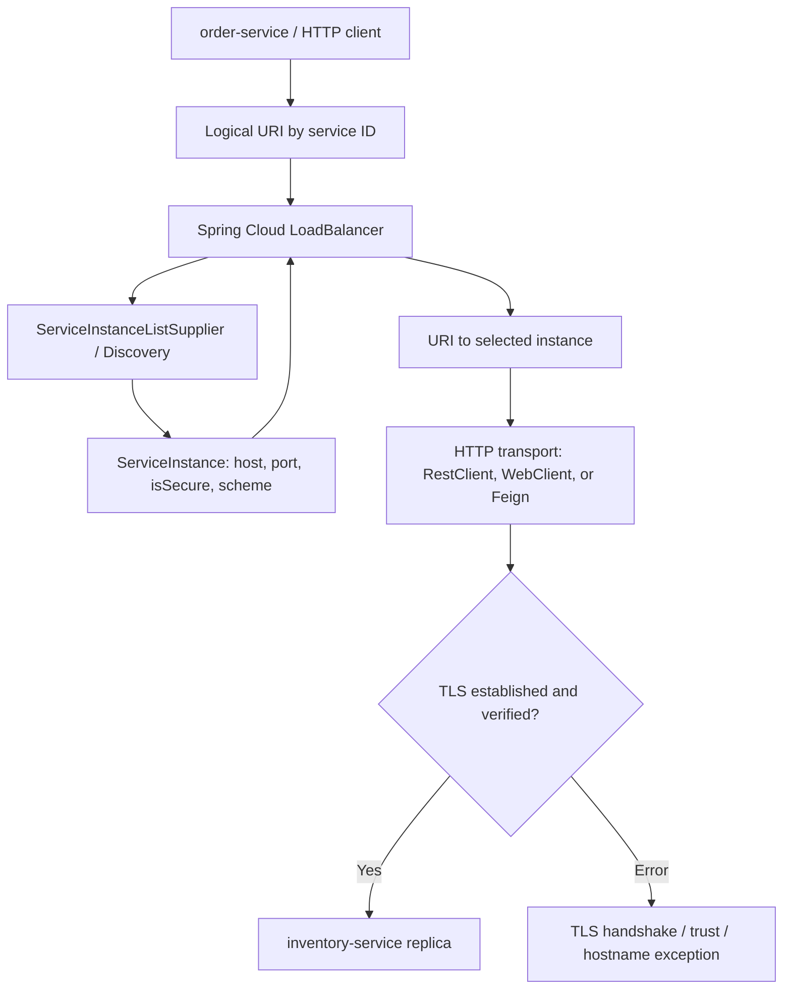
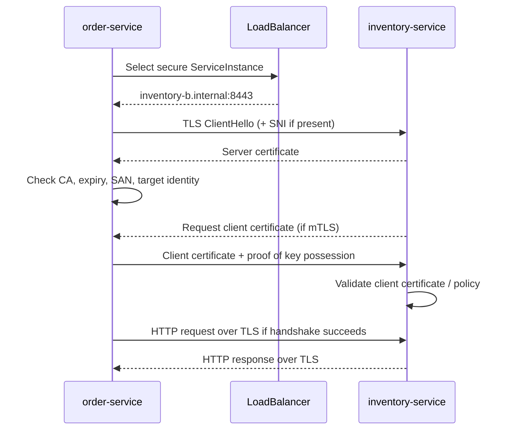

# HTTPS and ServiceInstance Secure Information

When `order-service` calls `inventory-service` using Spring Cloud LoadBalancer, the application does not necessarily know the actual address of the replica that will be selected in advance. It only knows the service ID, for example `inventory-service`. Spring Cloud retrieves the list of `ServiceInstance`s from discovery, selects an instance, and sends the HTTP request to the specific host/port. If communication between the two services needs to be encrypted with TLS, whether **the instance supports a secure connection** becomes an important part of the selection and URI-building process.

In Spring Cloud Commons, `ServiceInstance` has the **`isSecure()`** method to indicate whether the instance is advertised as using a secure connection. This value, along with host, port, URI scheme, and HTTP client configuration, affects whether the final request is executed over `http` or `https`.

However, **`isSecure() == true` does not prove that the transport is actually secure**. It is descriptive metadata provided by discovery or the implementation, not a substitute for enabling TLS on the server, validating certificates, verifying hostnames, managing CAs, or restricting access.

This lesson belongs to the **Communication Security** chapter of the `SPRING_CLOUD_SERVICE_COMMUNICATION_LOAD_BALANCING` module. The goal is to understand the exact boundary between service discovery, LoadBalancer, RestClient/WebClient/OpenFeign, and the network security layer; know how to configure HTTPS properly for each `ServiceInstance`, identify TLS errors, and test to prevent unintended plaintext connections.

## 1. What Does HTTPS Protect on the Service-to-Service Call Path?

HTTPS is HTTP running over TLS. With valid configuration and certificates, TLS provides essential properties:

- **Confidentiality in transit:** network eavesdroppers cannot directly read the encrypted request/response.
- **Data integrity in transit:** detects unauthorized tampering with data during exchange.
- **Server identity authentication:** the HTTP client checks the certificate and target name according to the trust/hostname verification policy.
- **Client authentication when using mTLS:** the server can require and verify the caller's certificate, in addition to the server certificate.

TLS does not automatically replace every security layer. For instance, HTTPS does not decide which tenant's inventory `order-service` is authorized to read; that still requires authentication/authorization at the API. Nor does TLS encrypt data once it has been decrypted inside an endpoint or persisted to a database.

Example of a flow with HTTPS from caller to replica:

```text
order-service
  -> logical URL: https://inventory-service/api/stocks/BOOK-001
  -> Spring Cloud LoadBalancer selects ServiceInstance B
  -> target URI is built from instance information and integration
  -> TLS to inventory-b.internal:8443
  -> HTTP GET is sent over the TLS channel
  -> inventory-service B returns response
```

**Note:** The logical URI visible in code is the input; you must verify the **actual target URI and transport**, not rely solely on the string `https://inventory-service`.

## 2. Security Boundaries Along the LoadBalancer Path



Each layer has a distinct responsibility:

| Component | Responsibility | Not Automatically Guaranteed |
| --- | --- | --- |
| DiscoveryClient | Provides host, port, metadata, and secure info of the instance | Server has TLS enabled or holds a valid certificate |
| `ServiceInstance` | Represents a replica and its declared secure connection capability | Server authentication during TLS handshake |
| Spring Cloud LoadBalancer | Selects an instance and coordinates building the target address | API access permissions, certificate issuance |
| HTTP client / transport | Establishes TCP/TLS, checks certificates per configuration | Business policies or replica selection |
| API server | Accepts HTTPS, performs authentication/authorization | Caller actually uses the right transport if metadata is wrong |
| Gateway / service mesh (if present) | Can terminate/originate TLS, enforce its own policies | End-to-end TLS maintained across all hops by default |

The biggest misconception is treating LoadBalancer selection and the TLS handshake as a single operation. In reality, LoadBalancer can successfully select instance B while the transport still fails with a certificate error.

## 3. The ServiceInstance Contract: host, port, isSecure, and URI

`ServiceInstance` belongs to Spring Cloud Commons and represents a concrete instance of a service ID. Key data typically includes:

| Property/Method | Example | Meaning |
| --- | --- | --- |
| `getServiceId()` | `inventory-service` | Logical service name |
| `getInstanceId()` | `inventory-b` | Replica identifier when provided by discovery |
| `getHost()` | `inventory-b.internal` | Target host/address of the instance |
| `getPort()` | `8443` | Port advertised by the instance |
| `isSecure()` | `true` | Instance is declared to support secure communication |
| `getUri()` | `https://inventory-b.internal:8443` | URI represented by the implementation |
| `getMetadata()` | `zone=zone-a` | Additional discovery-dependent metadata |
| `getScheme()` | May be `null` or a value provided by the implementation | Specific scheme if supported by the implementation |

**Meaning of `isSecure()`:** this information indicates that the instance should be contacted via HTTPS rather than HTTP according to the discovery/LoadBalancer contract. It is not the result of a TLS probe and does not validate the certificate chain.

Java example using the standard `DefaultServiceInstance` implementation:

```java
import org.springframework.cloud.client.DefaultServiceInstance;
import org.springframework.cloud.client.ServiceInstance;

ServiceInstance secureReplica = new DefaultServiceInstance(
        "inventory-b",
        "inventory-service",
        "inventory-b.internal",
        8443,
        true
);

System.out.println(secureReplica.getServiceId()); // inventory-service
System.out.println(secureReplica.isSecure());      // true
System.out.println(secureReplica.getUri());        // https://inventory-b.internal:8443
```

The constructor in the example creates an illustrative object in the Java application; **it does not automatically register the instance with Eureka/Consul/Kubernetes**. For LoadBalancer to see the instance, a real `DiscoveryClient` or supplier must provide that object.

### 3.1. The Secure Flag and Scheme Are Not the Same Field

In typical implementations, `isSecure()` may be used to decide the `https` scheme when constructing the URI. However, a discovery adapter or custom `ServiceInstance` may have its own `getScheme()` or `getUri()` logic. The final behavior also depends on the LoadBalancer and HTTP client integration.

You should not set `metadata["secure"] = "true"` and assume Spring Cloud will definitely read that arbitrary metadata as `isSecure() == true`. Mapping metadata to the secure flag **depends on the discovery implementation**. Directly inspect the `instance.isSecure()` value that the caller actually receives.

## 4. A Service ID Is Not a Replica Hostname

Suppose the caller invokes:

```text
https://inventory-service/api/stocks/BOOK-001
```

The service ID is `inventory-service`, while the discovery list may contain:

| Instance | Host | Port | `isSecure()` |
| --- | --- | ---: | --- |
| A | `inventory-a.internal` | 8443 | `true` |
| B | `inventory-b.internal` | 8443 | `true` |
| C | `inventory-c.internal` | 8443 | `true` |

If LoadBalancer selects B, the transport is expected to connect to `inventory-b.internal:8443` based on the instance information. The logical name `inventory-service` **does not by itself prove which name the TLS certificate uses**; that depends on the final URI, SNI, and how the transport connects.

Do not conflate:

- **Service ID:** used to look up the set of replicas.
- **Instance ID:** used to identify a single replica in discovery.
- **Hostname used for TLS:** the name that the transport validates against the target's certificate.
- **DNS record:** may assist in resolving a hostname, but does not replace Spring Cloud LoadBalancer's selection.

In some topologies with a proxy/service mesh, the transport actually connects to a sidecar or proxy hostname different from the application instance. In those cases, you must check exactly where TLS is established and which identity is verified.

## 5. How Do the Logical Request Scheme and Instance Secure Flag Interact?

During URI reconstruction, Spring Cloud LoadBalancer can use host, port, secure information, and scheme from `ServiceInstance`, along with the original URI. **The scheme precedence mechanism can depend on the version, implementation, and integration**, so one should not claim that every call path rewrites `http` to `https` by an immutable rule.

The following table lists **operational targets to verify**, not automatic guarantees across every adapter:

| Logical URI | Advertised Instance | What to Verify |
| --- | --- | --- |
| `https://inventory-service/...` | Secure=true, port 8443 | Final URI and transport actually use HTTPS to the instance |
| `http://inventory-service/...` | Secure=true, port 8443 | Whether the integration changes the scheme per the secure flag; do not rely on the input URI |
| `https://inventory-service/...` | Secure=false, port 8080 | Whether a downgrade to HTTP occurs; security policy must block if disallowed |
| `http://inventory-service/...` | Secure=false, port 8080 | Does plaintext HTTP fit the threat model or violate a mandatory TLS requirement? |
| `https://inventory-service/...` | Inconsistent metadata/secure | Risk that some replicas run HTTP while others run HTTPS |

When a system **mandates HTTPS**, treat it as an **invariant to test and enforce**: the instance list must be declared properly, the transport must validate certificates, and network/gateway policies must block unauthorized plaintext paths. A URI string starting with `https://` in source code **is not enough to prove the invariant**.

## 6. Sources of Secure Data from Discovery

The secure value usually originates from the service registry or an adapter for the deployment platform. Common sources include:

- The application self-registering with the registry along with secure/non-secure port details.
- A discovery adapter translating information from the endpoint's scheme/port.
- A static instance list used for testing.
- A custom `ServiceInstance` created by a supplier inside the application.
- Endpoint information from a service mesh/proxy, depending on how the system publishes it.

The point to verify is **which `isSecure()` value and port the caller receives on `ServiceInstance`**, not merely whether an operator enabled TLS on the server.

### 6.1. SimpleDiscoveryClient Example with HTTPS URIs

In a lab environment, static instances can be declared:

```yaml
spring:
  cloud:
    discovery:
      client:
        simple:
          instances:
            inventory-service:
              - uri: https://inventory-a.internal:8443
              - uri: https://inventory-b.internal:8443
```

Here the URI reflects the **intent** to call HTTPS endpoints. The discovery adapter and current version configuration must be checked to confirm that the resulting `ServiceInstance` data has `isSecure() == true`.

This configuration file **does not open port 8443**, does not generate certificates, and does not start a server automatically. In integration tests, real HTTPS servers must run at the declared addresses, and the HTTP client must trust the corresponding CA/certificates.

### 6.2. Example of Registering a Secure Port with Eureka

An `inventory-service` application using Eureka can advertise secure information as follows:

```yaml
server:
  port: 8443
  ssl:
    enabled: true

eureka:
  instance:
    non-secure-port-enabled: false
    secure-port-enabled: true
    secure-port: 8443
```

This snippet **only illustrates the relevant properties**. A real server still needs valid certificate/keystore or SSL bundle configuration, permissions to read secrets, and complete Eureka connection settings. Setting `server.ssl.enabled: true` alone without the required TLS material is not sufficient to run HTTPS successfully.

In Eureka integrations, enabling the secure port can affect how clients consider an instance secure, yet Eureka informational URLs such as status/home/health **may require separate configuration** if you want them to use HTTPS as well. Do not infer that every endpoint is secure from a single flag.

### 6.3. Application-Side TLS and Discovery Information Must Stay in Sync

When switching from HTTP to HTTPS, at a minimum you need to synchronize:

1. The HTTPS listener on the right host/port.
2. A valid server certificate for the name the client verifies.
3. The secure flag/scheme/port advertised by the registry.
4. The caller's trust configuration.
5. Health probes, readiness probes, and registration/deregistration paths.
6. Network policies/firewalls/gateways to prevent unwanted plaintext paths.

If the server enables HTTPS on 8443 while the registry still advertises port 8080 and `isSecure=false`, LoadBalancer may keep selecting an unsuitable target. Conversely, if the registry advertises secure=true while the server only listens on HTTP, the TLS handshake will fail.

## 7. HTTPS at Ingress Differs from Service-to-Service HTTPS

A common point of confusion:

```text
External client
     |
     | HTTPS
     v
Ingress / API Gateway (TLS termination)
     |
     | Internal plaintext HTTP
     v
inventory-service:8080
```

Traffic from the browser to the gateway is encrypted, **but the hop from the gateway to the service is not necessarily encrypted**. The browser displaying an HTTPS padlock does not prove that every hop behind it also uses TLS.

A more end-to-end architecture might look like:

```text
External client --HTTPS--> Gateway
Gateway --HTTPS or mTLS--> order-service
order-service --HTTPS or mTLS--> inventory-service
```

Depending on the system, a gateway or service mesh may decrypt and then establish a **new** TLS session on the next hop. This is **hop-by-hop encryption**, not necessarily a single TLS session traversing the entire path.

For `ServiceInstance.isSecure()`, the right question is: **does the hop that the caller's HTTP transport actually connects to require HTTPS?** If the caller connects to a local HTTP sidecar and the sidecar uses mTLS outbound to another replica, the secure flag of the endpoint seen by the caller may differ from the encryption status of the sidecar-to-sidecar hop. You must verify the discovery data structure against the actual architecture.

## 8. Connecting RestClient Through LoadBalancer to an HTTPS Instance

`RestClient` is Spring Framework's synchronous HTTP client. For logical URLs to be resolved by service ID using Spring Cloud LoadBalancer, create the client from a builder bean annotated with `@LoadBalanced`:

```java
import org.springframework.cloud.client.loadbalancer.LoadBalanced;
import org.springframework.context.annotation.Bean;
import org.springframework.context.annotation.Configuration;
import org.springframework.web.client.RestClient;

@Configuration
class InventoryRestClientConfiguration {

    @Bean
    @LoadBalanced
    RestClient.Builder loadBalancedRestClientBuilder() {
        return RestClient.builder();
    }
}
```

Create the business gateway:

```java
import org.springframework.cloud.client.loadbalancer.LoadBalanced;
import org.springframework.stereotype.Service;
import org.springframework.web.client.RestClient;

@Service
class InventoryGateway {

    private final RestClient client;

    InventoryGateway(@LoadBalanced RestClient.Builder builder) {
        this.client = builder
                .baseUrl("https://inventory-service")
                .build();
    }

    StockResponse getStock(String sku) {
        return client.get()
                .uri("/api/stocks/{sku}", sku)
                .retrieve()
                .body(StockResponse.class);
    }
}
```

`StockResponse` is an application-defined DTO matching the API's JSON. The example assumes the Spring Cloud LoadBalancer dependency, an instance source for `inventory-service`, and an appropriate HTTP transport are already present.

**Why use `https://inventory-service` in the example?** It makes the security requirement explicit in the caller's logical URL. Still, you must verify the final URI after LoadBalancer, because the secure flag and URI reconstruction can affect the actual scheme. If plaintext must never be used, combine enforcement policies and testing rather than relying solely on the base URL configuration.

### 8.1. Truststore and Request Factory

The TLS handshake takes place inside the HTTP client/transport used by `ClientHttpRequestFactory`. Across the JDK HTTP Client, Apache HttpComponents, or other factories, how truststores, client certificates, and hostname verification are configured can differ.

For example, in an internal system with a private CA:

- Distribute valid root/intermediate CAs to the truststore or SSL configuration used by the transport.
- Keep **hostname verification** enabled.
- Trust only the necessary CAs, with a mechanism for certificate rotation/revocation.
- Never use `trust-all` or disable hostname verification to work around PKIX errors in production.
- If using a Spring Boot SSL bundle, verify how the bundle is applied to the **exact HTTP client instance**; declaring a bundle does not mean every client will automatically use it.

JVM properties such as `javax.net.ssl.trustStore` can be helpful for transports using the default JSSE configuration, but **do not assume every Reactor Netty/Apache client reads them the same way**. Verify the actual configuration and use the appropriate SSL debugging tools.

## 9. WebClient and Reactive Connections

With `WebClient`, Spring Cloud LoadBalancer is typically integrated via a `@LoadBalanced WebClient.Builder` bean:

```java
import org.springframework.cloud.client.loadbalancer.LoadBalanced;
import org.springframework.context.annotation.Bean;
import org.springframework.context.annotation.Configuration;
import org.springframework.web.reactive.function.client.WebClient;

@Configuration
class InventoryWebClientConfiguration {

    @Bean
    @LoadBalanced
    WebClient.Builder loadBalancedWebClientBuilder() {
        return WebClient.builder();
    }
}
```

Calling code:

```java
import org.springframework.cloud.client.loadbalancer.LoadBalanced;
import org.springframework.web.reactive.function.client.WebClient;
import reactor.core.publisher.Mono;

class ReactiveInventoryGateway {

    private final WebClient client;

    ReactiveInventoryGateway(@LoadBalanced WebClient.Builder builder) {
        this.client = builder
                .baseUrl("https://inventory-service")
                .build();
    }

    Mono<StockResponse> getStock(String sku) {
        return client.get()
                .uri("/api/stocks/{sku}", sku)
                .retrieve()
                .bodyToMono(StockResponse.class);
    }
}
```

The instance-selection path also uses the `ServiceInstance` list, but the reactive HTTP transport (usually Reactor Netty) manages connections/TLS differently from synchronous clients. If a private CA or mTLS is needed, you must configure the appropriate `HttpClient`/`ClientHttpConnector` while preserving certificate checks.

A `Mono<StockResponse>` generally executes the request only upon subscription. Therefore, TLS errors may surface in the reactive error signal rather than at the moment the WebClient or publisher is created.

## 10. OpenFeign and HTTPS When Calling by Service ID

OpenFeign declares the HTTP contract via an interface:

```java
import org.springframework.cloud.openfeign.FeignClient;
import org.springframework.web.bind.annotation.GetMapping;
import org.springframework.web.bind.annotation.PathVariable;

@FeignClient(name = "inventory-service", path = "/api/stocks")
public interface InventoryFeignClient {

    @GetMapping("/{sku}")
    StockResponse getStock(@PathVariable("sku") String sku);
}
```

When **there is no physical URL override**, this client can use Spring Cloud LoadBalancer to select an instance by the name `inventory-service`, provided the appropriate dependencies and configuration are enabled.

However:

- `@FeignClient(name = "inventory-service")` **does not automatically enable TLS on the server**.
- Feign can use different transports depending on the classpath/configuration; CAs, certificate validation, and client certificates must be applied to the actual transport.
- If `url = "https://inventory-a.internal:8443"` is specified, requests typically go to that fixed URL instead of selecting an instance by service ID.
- Do not treat `@FeignClient` as a guarantee that hostname verification is properly configured if someone has swapped out the SSL client or built a custom transport.

Just like RestClient/WebClient, you must observe the **target instance, effective URI, and TLS handshake** to confirm a secure connection.

## 11. Certificates: Certificate Chain and Hostname Verification

TLS authenticates the server via a certificate issued by a trusted CA or an equivalent securely configured trust mechanism. Yet **trusting the CA is still not enough** if the certificate does not match the target name.

Suppose LoadBalancer selects:

```text
host = inventory-b.internal
port = 8443
isSecure = true
```

The transport connects to `inventory-b.internal`. In a standard HTTPS setup, the certificate needs to contain a matching name in **Subject Alternative Name (SAN)**; do not rely on the legacy Common Name (CN) in place of SAN.

Some examples:

| Certificate SAN | Target Verified by Client | Assessment |
| --- | --- | --- |
| `DNS:inventory-b.internal` | `inventory-b.internal` | Valid if CA and validity period are valid |
| `DNS:inventory-service.internal` | `inventory-b.internal` | Does not automatically match just for sharing the logical service |
| `DNS:*.svc.internal` | `inventory-b.svc.internal` | May match under valid wildcard rules |
| `IP:10.0.1.12` | `10.0.1.12` | May be valid when SAN contains the actual IP |
| `DNS:inventory-b.internal` | `10.0.1.12` | Does not automatically match an IP from a DNS SAN |

Do not "fix" errors by disabling hostname verification. The proper approach is usually:

1. Issue certificates with SANs matching the hostname the transport will use.
2. Advertise the matching hostname/port in discovery.
3. Ensure the caller has the corresponding CA/truststore.
4. Test the call path with a real HTTP client after LoadBalancer selects an instance.

### 11.1. Which Hostname Does SNI Relate To?

**Server Name Indication (SNI)** is the hostname information a client can send during the TLS handshake so the server/proxy can select the right certificate. When an endpoint serves multiple virtual hosts, missing or incorrect SNI can cause the server to return the wrong certificate.

In a LoadBalancer-backed system, the target URI may be rewritten from the service ID to the instance host; how the HTTP transport determines SNI and hostname verification depends on the client and configuration. When an error occurs only through the service ID while calling the DNS hostname directly succeeds, inspect the **effective host, SNI, and certificate SAN**, not just `isSecure()`.

## 12. mTLS: Both Sides Are Authenticated

Standard HTTPS primarily authenticates the server to the client. **Mutual TLS (mTLS)** also requires the client to present a certificate so the server can authenticate the caller.



Each side requires separate configuration:

- **Caller:** trust for the server certificate, plus the caller's own key/certificate when using mTLS.
- **Destination:** certificate/key for the HTTPS listener, trust for the client CA, and the policy requiring a client certificate.
- **Infrastructure:** distributing, rotating, and revoking certificates; restricting read permissions on private keys.

The `ServiceInstance.isSecure()` flag **does not fully represent mTLS**. It does not indicate whether the server requires a client cert, which CAs are valid, which principal is authorized, or how long the certificate remains valid. Those policies belong to the TLS transport, service mesh, and security layer.

## 13. TLS Termination and Hop-by-Hop Security

When an ingress proxy or service mesh is present, it is critical to know **who establishes TLS with whom**.

| Topology | Encrypted Hop | Questions to Verify |
| --- | --- | --- |
| Caller directly invokes HTTPS instance | Caller ↔ instance | Does the cert SAN match the host/port advertised by discovery? |
| Caller sends HTTP to local sidecar; sidecar uses mTLS outbound | Sidecar ↔ sidecar | Is the plaintext app ↔ sidecar hop acceptable under the threat model? |
| Gateway terminates TLS then uses HTTP to backend | Client ↔ gateway | Is encryption required on the gateway ↔ backend hop? |
| Gateway terminates then re-encrypts HTTPS to backend | Two separate TLS sessions | How are trust/identity policies applied to each hop? |

Do not mark `isSecure=true` on a backend just because external ingress uses HTTPS. The secure flag must describe the endpoint the caller/LoadBalancer actually uses and match the discovery adapter.

If the organization requires end-to-end TLS or internal mTLS, configure network policies and inspect the corresponding mesh/gateway settings. **TLS encrypting one hop does not automatically encrypt the remaining hops.**

## 14. Wrong Metadata, Wrong Ports, and Corresponding Connection Errors

Table distinguishing error classes:

| Symptom | Likely Cause | What to Check |
| --- | --- | --- |
| `Connection refused` | Wrong port, listener not running, firewall rejection | `getHost()`, `getPort()`, listener, network |
| TLS `handshake_failure` | Incompatible TLS/protocol, client cert, cipher, or policy | TLS config on both sides, certificate request |
| `PKIX path building failed` / trust error | CA/chain is not trusted | Server chain, HTTP transport truststore |
| `No subject alternative names matching` | Verified host is not in SAN | Effective host, DNS/SNI, certificate SAN |
| `NotSslRecordException` or HTTP on TLS port | Mismatched scheme/port | Secure flag, final URI, listener, proxy |
| HTTP `401` / `403` | TLS likely succeeded, but authn/authz failed | Token, principal, API policy |
| HTTP `404` / `503` | Server/gateway responded over HTTP | Path, routing, overload, and error contract |
| Only one replica reports TLS error | That instance's cert/port/scheme differs from the rest | Per-replica metadata, certificate rollout |

Specific exceptions vary across JDK/Apache/Reactor Netty/OpenFeign and client versions. When diagnosing, read the **root cause** rather than concluding every error containing "SSL" is caused by LoadBalancer.

### 14.1. Why TLS Errors Should Not Be Retried Indefinitely

If B's certificate has expired or its CA is untrusted, retrying B repeatedly will almost never fix the root cause. Retrying onto A might succeed if A has a valid certificate, but **that does not validate B**, nor does it mean TLS errors should be retried like ordinary transient network errors.

- Separate configuration/certificate errors from timeouts or connection resets.
- Do not retry indefinitely after a handshake/certificate validation error.
- If failing over to another instance under an explicit policy, bound attempts and deadlines.
- Surface the error to trigger certificate rotation/metadata fixes instead of masking the entire outage.
- For write APIs, preserve idempotency when retrying across replicas.

## 15. The Secure Flag Is Not an Authorization Mechanism

A request can travel over HTTPS properly and still lack access permissions. For example:

```http
GET /api/stocks/BOOK-001 HTTP/1.1
Host: inventory-service
Authorization: Bearer <token-redacted>
```

TLS protects the token's contents in transit over an encrypted hop, but the server still has to **verify the token**, scope, audience, expiration, and resource permissions.

Do not use the following values as proof of authorization:

- `ServiceInstance.isSecure()`.
- Zone name or request hint.
- Having selected the same replica or being on the same subnet.
- Headers self-reported by an external client such as `X-Forwarded-Proto` without validation by a trusted proxy.

If downstream requires token delegation or service identity, design token propagation/issuance explicitly following the principle of least privilege. Do not blindly copy the `Authorization` header to arbitrary external hosts; bind it to trusted downstream services and the corresponding auth contract.

## 16. Secure Migration: Moving Replicas from HTTP to HTTPS

A migration can proceed in phases:

1. **Prepare infrastructure:** issue valid certificates/SANs, distribute trust, and validate keystores.
2. **Open HTTPS listeners:** deploy port 8443 with appropriate readiness and health probes.
3. **Register endpoints accurately:** advertise `isSecure=true` and the HTTPS scheme/port for ready instances.
4. **Test callers:** confirm RestClient/WebClient/OpenFeign route via LoadBalancer and genuinely use TLS.
5. **Shift traffic gradually:** watch TLS errors, selected instances, and handshake latency.
6. **Remove legacy HTTP endpoints:** deregister them, wait for discovery/caches to converge, and block plaintext network traffic when policy permits.
7. **Ongoing monitoring:** certificate rotation and rollover, preventing instances with drifted metadata.

### 16.1. Risks During the Mixed HTTP and HTTPS Phase

If discovery returns both kinds of instances:

```text
A: inventory-a.internal:8080, secure=false
B: inventory-b.internal:8443, secure=true
C: inventory-c.internal:8443, secure=true
```

an algorithm such as Round Robin may pick A, B, and C in turn depending on the list. **As a result, the security posture of individual attempts can differ** if the HTTP client and LoadBalancer permit both schemes.

When HTTPS is mandatory, ensure **the entire candidate pool is TLS-compatible before accepting any selection**, or apply an explicit filtering/blocking policy so plaintext is never sent to A. Do not merely hope Round Robin will "rarely pick A" during rollout.

### 16.2. Deregistration and Stale Caches

After A is removed from the registry, `DiscoveryClient` or `CachingServiceInstanceListSupplier` may still retain a stale copy. The client can continue selecting port 8080 for some period of time.

Measure convergence time from registry → caller discovery view → final supplier → selected instance. If security policy requires **zero plaintext**, enforce it independently of cache TTL: network policies, closed listeners, or validation at the appropriate client/policy layer.

## 17. Observing HTTPS by Service ID and Instance

A useful log entry should be detailed enough to separate replica-selection issues from TLS failures without exposing sensitive data.

```text
traceId=4ab8... serviceId=inventory-service
selectedInstance=inventory-b.internal:8443
instanceSecure=true effectiveScheme=https
tlsResult=HANDSHAKE_OK httpStatus=200 durationMs=54
```

The log above is an **application-built illustrative format**, not a Spring Cloud default. Not every HTTP client directly exposes an event like `tlsResult=HANDSHAKE_OK`. Use appropriate instrumentation if you need to confirm TLS handshakes, certificate principals, and hostnames.

Useful fields:

| Category | Fields to Observe |
| --- | --- |
| LoadBalancer selection | Service ID, selected host/port, secure flag |
| URI/transport | Effective scheme, connection outcome, HTTP version if useful |
| TLS | Handshake/trust/hostname error category, certificate rotation timestamp |
| Performance | Connect/TLS handshake latency, response latency, retry attempts |
| Business | HTTP status, domain error code, final outcome |
| Health | Count of secure instances, eligible instances, discovery refresh time |

Never log private keys, full certificate chains when unnecessary, tokens, cookies, or sensitive request bodies. For metrics, avoid using every dynamic hostname/SKU/request ID as a label if cardinality could grow unbounded.

## 18. Reading the Real ServiceInstance on the Caller Side

To inspect what discovery data the caller is seeing, you can use:

```java
import org.slf4j.Logger;
import org.slf4j.LoggerFactory;
import org.springframework.cloud.client.ServiceInstance;
import org.springframework.cloud.client.discovery.DiscoveryClient;
import org.springframework.stereotype.Component;

@Component
class InventorySecureInspector {

    private static final Logger log =
            LoggerFactory.getLogger(InventorySecureInspector.class);

    private final DiscoveryClient discoveryClient;

    InventorySecureInspector(DiscoveryClient discoveryClient) {
        this.discoveryClient = discoveryClient;
    }

    void logInstances() {
        for (ServiceInstance instance :
                discoveryClient.getInstances("inventory-service")) {

            log.info("serviceId={} instanceId={} host={} port={} secure={} scheme={}",
                    instance.getServiceId(),
                    instance.getInstanceId(),
                    instance.getHost(),
                    instance.getPort(),
                    instance.isSecure(),
                    instance.getUri().getScheme());
        }
    }
}
```

This example reads the **discovery view** of `order-service`. The final list passing through caches, health checks, zones, or custom suppliers may differ. To prove a request traversed TLS to the selected instance, cross-check LoadBalancer selection and logs/traces from the HTTP transport or HTTPS server.

Note: `isSecure()` and `getUri().getScheme()` on a custom `ServiceInstance` may be inconsistent. Logging both helps uncover discrepancies before debugging the HTTP client.

## 19. HTTPS and Secure Flag Testing Matrix

An integration test suite should run at least two mock HTTPS servers with matching SAN certificates, plus controlled failure cases:

| Scenario | Expected Outcome to Verify |
| --- | --- |
| Two `secure=true` instances, valid HTTPS listener and CA | HTTP client sends request over TLS to a selected instance |
| Instance `secure=true` but only HTTP listener running | TLS handshake fails; not misinterpreted as a business error |
| Instance `secure=false` but only HTTPS running | Scheme/port mismatch between discovery and server is detected |
| CA not trusted by caller | Fails closed with trust error; trust-all is not enabled |
| Certificate SAN mismatches instance hostname | Hostname verification rejects the connection |
| Expired certificate | Error logged and rotation triggered; no infinite retries |
| mTLS server requires client certificate | Caller without cert is rejected; caller with valid cert succeeds |
| Caller has multiple HTTP builders | Only the `@LoadBalanced` builder resolves service IDs properly |
| Mixed HTTP and HTTPS replicas | Mandatory TLS policy prevents plaintext from leaking through |
| One instance changes port/certificate | Discovery/cache and trust update according to plan |
| HTTPS replica times out | Bounded retry, distinguishing timeouts from TLS config errors |
| OpenFeign with fixed URL | Direct URL calls are not confused with LoadBalancer replica selection |

### 19.1. Practice Steps

1. Spin up two test HTTPS servers on two hostnames with valid test certificates signed by the lab CA.
2. Add the test CA to the HTTP client's trust configuration.
3. Advertise two `ServiceInstance`s with `isSecure=true` and the corresponding ports.
4. Call the logical URL `https://inventory-service/...` through a `@LoadBalanced` RestClient or WebClient.
5. Observe the selected URI/instance and the HTTPS handshake on the server.
6. Intentionally swap in a certificate with a mismatched SAN and verify the request is rejected.
7. Intentionally set `isSecure=false` on one instance and verify the system does not accidentally fall back to plaintext against policy.
8. Shut down one server, verify timeouts/retries operate only for allowed failures and do not mask certificate errors.
9. If using mTLS, require a client certificate and test both missing and valid certificate cases.
10. Verify logs contain no tokens, private keys, or sensitive data.

Never use an "ignore SSL certificates" setting as a normal lab step, because that fails to test the core security property.

## 20. Diagnostic Workflow When HTTPS Fails Over Service ID

If calling `https://inventory-b.internal:8443` directly succeeds while `https://inventory-service` through Spring Cloud LoadBalancer fails, check in order:

1. **Client wiring:** Does RestClient/WebClient use a `@LoadBalanced` builder? Does Feign have a fixed `url` that bypasses LB?
2. **Service ID:** Does `inventory-service` match the discovery source?
3. **Discovery view:** Which instances, ports, and `isSecure()` values does the caller see?
4. **Supplier chain:** Do health/zone/hint/cache suppliers alter the candidate list?
5. **Selected instance:** Was the actual selected address B, or A/C with a different certificate?
6. **Final scheme:** Is the HTTP client using `http` or `https` after URI reconstruction?
7. **Hostname verification:** Is the hostname verified by the transport listed in the SAN?
8. **Trust:** Is the CA/chain accepted by the truststore or HTTP client SSL context?
9. **SNI/proxy:** Does the virtual host, ingress, or service mesh require SNI or specific TLS policies?
10. **mTLS:** Is a client cert required, and are server trust and access permissions aligned?
11. **Timeout/retry:** Is retry hitting multiple instances and masking a TLS error on one instance?
12. **Business outcome:** Did TLS succeed and return HTTP `401/403/404/5xx`, or did it fail before receiving a response?

An `HTTP 403` result from an HTTPS server usually means an HTTP response was received after the transport layer, not automatically a `ServiceInstance.isSecure()` bug. Conversely, an `SSLHandshakeException` can occur after LoadBalancer has already chosen a valid instance.

## 21. Design Mistakes to Avoid

1. **Treating secure=true as proof of valid TLS.** It is metadata/contract, not the result of certificate verification.
2. **Enabling HTTPS only at ingress and claiming all internal communication is encrypted.**
3. **Configuring server TLS while leaving the registry advertising the old HTTP scheme/port.**
4. **Seeing a logical URL starting with HTTPS and assuming the actual URI cannot be downgraded.**
5. **Disabling hostname verification or enabling trust-all to bypass cert errors.**
6. **Advertising an IP while the cert only has an incompatible DNS SAN.**
7. **Using an mTLS metadata flag as an authorization mechanism.** Access permissions must be verified at the server/security layer.
8. **Logging Authorization headers, cookies, private keys, or sensitive data when debugging handshakes.**
9. **Mixing HTTP and HTTPS replicas without a policy blocking plaintext.**
10. **Retrying trust/certificate errors continuously instead of fixing configuration or rotation.**
11. **Letting discovery caches hold stale ports/schemes too long during migration without measuring convergence.**
12. **Confusing HTTP status errors with TLS errors prior to receiving an HTTP response.**
13. **Assuming every RestClient/WebClient/OpenFeign transport reads the same truststore configuration.**
14. **Using zones/hints or service names in place of TLS identity verification and API authorization.**

## 22. Self-Check Questions

1. What is the role of `ServiceInstance.isSecure()` in Spring Cloud LoadBalancer? What does it not guarantee?
2. Why do `getHost()`, `getPort()`, and `getUri()` also matter when configuring HTTPS?
3. Does the logical URL `https://inventory-service` by itself prove every replica is called over TLS?
4. Why might setting `metadata["secure"] = "true"` alone be insufficient for an instance to be considered secure?
5. What is the difference between TLS termination at a gateway and hop encryption from `order-service` to `inventory-service`?
6. Why might a certificate with SAN `inventory-service.internal` fail validation when the transport verifies `inventory-b.internal`?
7. What additional requirements does mTLS introduce compared to standard server-auth HTTPS?
8. When `RestClient` calls a service ID, where must the `@LoadBalanced` annotation be placed?
9. If a replica has secure=true but only exposes HTTP on 8080, which error class do you expect?
10. Why can `HTTP 401` or `403` not be concluded to be a TLS error?
11. When migrating from HTTP to HTTPS, why must discovery cache TTL and rollout order be considered?
12. What tests prove that the caller never uses plaintext during a mixed-replicas phase?
13. When encountering `SSLHandshakeException`, why does retrying across multiple replicas not substitute for fixing the certificate?
14. When using a service mesh, along which hop should `ServiceInstance` secure info be determined?

**Conclusion:** Spring Cloud LoadBalancer selects a `ServiceInstance` based on the service ID and discovery list; `isSecure()`, scheme, host, and port describe how to contact that replica. However, **truly secure HTTPS** exists only when endpoints are properly configured with TLS, the HTTP transport connects over an encrypted channel, certificates/hostnames are verified, and every hop in the architecture complies with security policy. Always reconcile discovery metadata with actual connections, keep timeouts/retries bounded, and test fail-closed behavior so service-to-service communication is both resilient and secure.
