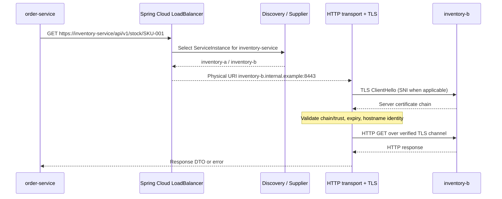
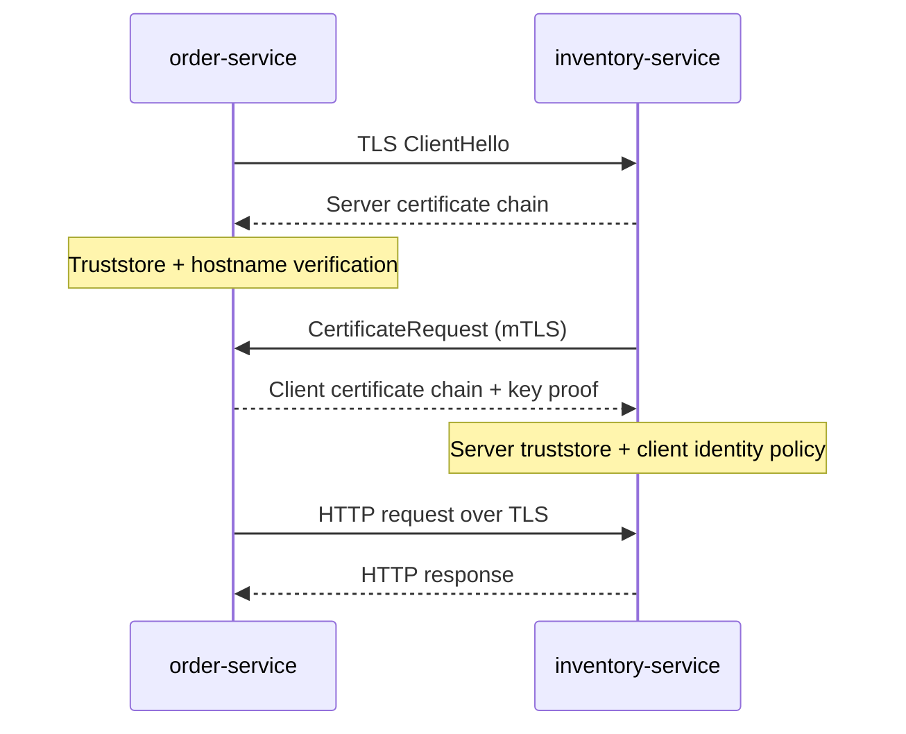

# Truststore, Hostname Verification, and Certificate Management

When `order-service` calls `inventory-service` through Spring Cloud LoadBalancer, the system does not just need to pick an active `ServiceInstance`. If the call uses HTTPS, the client must also verify that **the remote peer is genuinely an endpoint allowed to be trusted**. A misconfigured truststore, a certificate missing a hostname in Subject Alternative Name (SAN), or an unsynchronized certificate renewal can cause **all instances to be healthy while every request still fails at the TLS handshake**.

This lesson belongs to the **Communication Security** chapter of the `SPRING_CLOUD_SERVICE_COMMUNICATION_LOAD_BALANCING` module. It focuses on three areas: **truststores defining the source of trust**, **hostname verification confirming the exact endpoint identity**, and **certificate lifecycle management** to keep connections stable across deployments, scaling, retries, and rotations. Examples use RestClient, WebClient, OpenFeign, and Spring Cloud LoadBalancer; clearly distinguishing what TLS handles from what discovery, health checks, or load-balancing algorithms handle.

Learning objectives:

- Distinguish between truststore, keystore, CA, certificate chain, private key, and mTLS.
- Interpret `PKIX path building failed`, `certificate expired`, and `No subject alternative DNS name matching` errors.
- Understand why HTTPS calls to a logical service ID can fail when LoadBalancer picks an instance whose host/IP does not match the certificate.
- Configure per-HTTP-client trust material using Spring Boot SSL bundles without disabling TLS verification.
- Design tests with two HTTPS replicas, certificate/CA rotation procedures, and pre-expiration monitoring signals.

> **Safety rule:** Never resolve TLS errors using `TrustAll`, `InsecureTrustManagerFactory`, `NoopHostnameVerifier`, or by disabling certificate verification. Those approaches eliminate server identity guarantees and can open the door to man-in-the-middle attacks, even on internal networks.

## 1. Where Does TLS Sit in a Load-Balanced Communication Chain?

Suppose `order-service` uses a `@LoadBalanced RestClient.Builder` and calls:

```text
https://inventory-service/api/v1/stock/SKU-001
        └ logical service ID ┘
```

The discovery source advertises:

| Service ID | Instance | Actual URI |
|---|---|---|
| `inventory-service` | `inventory-a` | `https://inventory-a.internal.example:8443` |
| `inventory-service` | `inventory-b` | `https://inventory-b.internal.example:8443` |

Conceptual path:



Three separate responsibilities:

1. **Discovery/LoadBalancer:** the candidate list and which instance gets selected.
2. **TLS client/HTTP transport:** whether the server certificate is trusted and matches the connection identity.
3. **HTTP application:** Authorization, request/response payloads, status codes, timeouts/retries.

If the TLS step fails, it does not mean LoadBalancer picked the wrong thing: it may have selected **the right instance according to discovery**, while the instance's certificate failed to satisfy security policy.

### 1.1. A Service ID Is Not Automatically a TLS Hostname

`inventory-service` is the logical name used to look up instances. When `BlockingLoadBalancerClient` or the reactive LoadBalancer reconstructs the physical URI, the actual hostname may become `inventory-b.internal.example` or `10.0.2.12`. The TLS transport typically verifies the identity of **the host it actually connects to according to the post-LoadBalancer URI**, depending on the transport and how routing/SNI are configured.

Therefore, you must **test the hostname actually verified by the TLS client**. Do not assume that because the initial URL says `inventory-service`, the certificate only needs SAN `inventory-service`.

## 2. How Do Certificate, CA, Chain, Truststore, and Keystore Differ?

| Concept | What It Contains | Who Uses It | Purpose |
|---|---|---|---|
| **Leaf/server certificate** | Public key, SAN identity, validity period, issuer signature | Presented by the HTTPS server to the client | Proves endpoint identity |
| **Intermediate CA** | Intermediate CA public key/signature | Typically sent by the server in the chain; used by the client to build the path | Bridges the leaf to the trust anchor |
| **Root CA / trust anchor** | CA certificate accepted as the root of trust | Client-side trust manager | Determines which chains are trusted |
| **Truststore** | Allowed trusted certificates/trust anchors | HTTP client or server when verifying peer | Validates the peer's certificate chain |
| **Keystore** | A party's own private key and certificate chain | TLS server; TLS client when using mTLS | Proves that party's own identity |
| **Private key** | Secret used for signing/proving key possession | Only the owning party | Never shared with peers or committed to repos |
| **Certificate chain** | Leaf plus necessary intermediates | Presented by peer during handshake | Enables signature chain verification |
| **mTLS** | Both server and client use certificate identities | Both sides | Mutual authentication alongside encryption |

`truststore` and `keystore` can both use `PKCS12` or `JKS` formats, yet **their roles differ**. A truststore verifies the other side; a keystore normally holds the **client's or server's own** private key and certificate.

### 2.1. Example of a Trust Chain

```text
inventory-b.internal.example (leaf, serverAuth)
          signed by
Internal Service Issuing CA (intermediate)
          signed by
Company Internal Root CA (trust anchor)
```

The client only trusts the internal root CA. If the server presents a valid leaf and intermediate, the trust manager can build a path to that root CA. The client still has to verify the hostname and other constraints: validity dates, signatures, key usage/extended key usage, algorithm policies, etc.

**A truststore is not an allowlist of every server permitted to be called.** A broad root CA can issue many different valid certificates. Distinguishing `inventory-b.internal.example` from `payments.internal.example` relies on hostname verification and additional identity policies. If an organization needs stricter boundaries, use scoped CAs or appropriate service identity verification rather than trusting a single overly broad root CA.

### 2.2. Must the Server Always Send the Root CA?

Usually the server presents **the leaf + required intermediate certificates**. The root CA already resides in the client's truststore, so it normally does not need to be sent during the TLS handshake. If the server omits an intermediate, the client can fail certificate path building even though the valid root CA is already present.

### 2.3. Truststore Does Not Mean Certificate Pinning

Importing **a single leaf certificate** into a truststore can tightly couple the application to that exact certificate. When the leaf is rotated to a new certificate, trust can break even if the hostname has not changed. Trusting an appropriate internal CA usually makes leaf rotation smoother, provided issuance scope is protected and hostname verification is enforced.

Certificate/public-key pinning is a specialized policy requiring backup pin rotation plans; it should not be treated as default truststore behavior.

## 3. TLS Verification Consists of Multiple Independent Checks

When an HTTPS client connects, checks typically include:

1. **Handshake and algorithms:** negotiating the TLS version, cipher suite, and acceptable cryptographic parameters.
2. **Chain validation:** signatures, certificate path linking, CA constraints, and trust anchor.
3. **Validity period:** certificate is not before `NotBefore` and not past `NotAfter`.
4. **Certificate usage:** appropriate key usage/extended key usage, such as server authentication.
5. **Hostname verification:** endpoint identity matches the leaf certificate's SAN.
6. **Revocation policy** (if enabled/configured): OCSP/CRL and fallback behavior when lookup services are unavailable.

A certificate with a **valid chain** but a **mismatched hostname** must still be rejected. Conversely, a matching SAN with no trusted path to a trust anchor must also be rejected.

### 3.1. SAN Matters More Than CN

Example leaf certificate:

```text
Subject: CN=inventory.internal.example
X509v3 Subject Alternative Name:
    DNS:inventory-a.internal.example
    DNS:inventory-b.internal.example
```

If the TLS client connects to `inventory-b.internal.example`, that name matches a `dNSName` entry in the SAN. Connecting to IP `10.0.2.12`, however, generally requires an SAN entry of type **iPAddress:10.0.2.12**, not just a DNS entry whose text looks like an IP.

Do not rely on `Common Name` (CN) as a substitute for SAN; modern practice places all verified names in SAN.

| Verified Target | Leaf SAN | Expected Result |
|---|---|---|
| `inventory-a.internal.example` | `DNS:inventory-a.internal.example` | Match |
| `inventory-b.internal.example` | `DNS:inventory-a.internal.example` | Mismatch |
| `10.0.2.12` | `DNS:inventory-b.internal.example` | No IP match |
| `10.0.2.12` | `IP:10.0.2.12` | Match |
| `a.team.internal.example` | `DNS:*.internal.example` | Does not match across two label levels |
| `a.internal.example` | `DNS:*.internal.example` | May match per client wildcard rules |

Wildcards must follow hostname verification rules and organizational issuance policies; avoid overly broad wildcards when each service requires distinct identity boundaries.

### 3.2. SNI Is Not Hostname Verification

**Server Name Indication (SNI)** is the hostname hint a TLS client can send in ClientHello so the server/proxy picks the matching certificate. **Hostname verification** is checking whether the certificate presented by the server matches the identity the client intends to connect to.

They are related but not synonymous:

- SNI can help a reverse proxy choose the right leaf certificate.
- SNI does not prove that the certificate is trustworthy.
- A server presenting a valid chain whose SAN differs from the hostname will still fail.
- When using an IP literal, SNI may not be sent as it is with a DNS hostname, depending on the TLS client.
- Manually overriding SNI or the `Host` header is not a standard way to bypass hostname verification.

## 4. Specific Considerations When Using Spring Cloud LoadBalancer

### 4.1. Logical URI and Physical URI Differ

Suppose:

```text
Application calls:
https://inventory-service/api/v1/stock

Supplier returns:
inventory-a -> https://inventory-a.internal.example:8443
inventory-b -> https://inventory-b.internal.example:8443
```

LoadBalancer selects B and produces the physical target:

```text
https://inventory-b.internal.example:8443/api/v1/stock
```

For TLS to succeed, all of the following must hold simultaneously:

- Host `inventory-b.internal.example` is resolvable and reachable.
- The server certificate has a valid SAN for the hostname identity verified by the transport.
- The certificate chain is trusted by the client.
- The endpoint actually speaks HTTPS on that port.
- Network, TLS version, cipher, and time policies are satisfied.

**Adding a CA to the truststore cannot fix a wrong SAN error.** Dropping hostname verification to use a certificate issued only for the logical name is an insecure workaround.

### 4.2. Hostnames in Discovery Need to Be Stable

If discovery only advertises dynamic Pod/container IPs, certificates with DNS-name SANs can fail when clients connect by IP. Better design options include:

- Registering **resolvable DNS hostnames covered by certificates**, rather than raw IPs, when infrastructure allows.
- Using an ingress/gateway/service mesh with explicit TLS identities and controlled TLS termination points.
- Designing PKI and issuing certificates matched to each workload/instance identity if using internal mTLS.
- Testing the physical URL built by LoadBalancer and the actual TLS name verified during scaling.

Not every service needs per-Pod certificates if the architecture terminates TLS at a stable endpoint. However, you must document **where TLS terminates** and **which traffic segment is protected**.

### 4.3. Scheme and `ServiceInstance.isSecure()`

`ServiceInstance` advertises host, port, secure flag, and URI; Spring Cloud LoadBalancer reconstructs the URI from the selected instance. In some integrations, the `http`/`https` scheme may be adjusted according to the instance's `isSecure()` or `getScheme()`.

**It is not enough** to write `https://inventory-service` in code and assume every instance will be called over HTTPS. Inspect discovery metadata, actual URIs, the secure flag, and the integration in use. If an instance has an HTTP port or misconfigured secure metadata, requests may end up using the wrong scheme/port.

Example static list for testing:

```properties
spring.cloud.discovery.client.simple.instances.inventory-service[0].uri=https://inventory-a.internal.example:8443
spring.cloud.discovery.client.simple.instances.inventory-service[1].uri=https://inventory-b.internal.example:8443
```

The two example hostnames must resolve in DNS or the hosts file of the **test environment**, and the servers must present matching certificates. `SimpleDiscoveryClient` does not issue certificates or configure SSL on HTTP servers.

### 4.4. HTTPS Through a Proxy/Gateway Is a Different Architecture

```text
Client -> https://inventory-gateway.internal.example
                  |
                  +--> HTTP or HTTPS to backend A/B
```

Here the TLS client typically verifies the **gateway**, not each backend's certificate directly, if the gateway terminates TLS. The gateway → backend channel requires its own TLS policy if hop-to-hop encryption/authentication is desired.

A `@FeignClient(url="https://inventory-gateway...")` or a RestClient using a direct URL can bypass client-side Spring Cloud LoadBalancer, even though the **gateway** still performs its own load balancing. Do not conflate the two layers when diagnosing certificate errors.

## 5. Java's Default Truststore vs. Custom Truststores

Java JSSE normally uses the runtime's default trust material, such as `cacerts` in the JDK, unless the application or HTTP transport configures a different trust source. Different JDK/container runtimes can carry different sets of CAs.

| Case | How to Handle |
|---|---|
| Server uses a public CA already trusted by the JDK | A custom truststore may not be needed |
| Server uses an organization's internal CA | Must provide the appropriate trust anchor to the client |
| Server uses a self-signed leaf in tests | Generate a valid test CA/leaf or specific trust with rotation; do not disable verification |
| Application calls both internal APIs and public APIs | Partition trust per client or design a controlled combined truststore |
| Truststore lacks required root/intermediate | Can encounter `PKIX path building failed` |

**Note:** configuring a custom truststore does not necessarily **merge automatically** with all default JDK CAs. Depending on the HTTP client/SSL context, it may **replace** the default trust anchors. If a client needs both public and internal CAs, verify how trust material is combined explicitly; never disable validation automatically when one group of endpoints fails.

### 5.1. What Should a Truststore Contain?

In enterprise setups, you usually store **trusted CA certificates** (root or a policy-designated trust anchor) rather than copying every service's leaf certificate. Keep the scope as narrow as possible to avoid accidentally trusting an unrelated CA.

Obtain trust anchors from an organization-controlled PKI/CA, verifying fingerprints over an independent channel. **Never download an arbitrary certificate from a failing connection and immediately import it just to silence the error**; if the endpoint is spoofed, doing so grants trust to an attacker.

### 5.2. Creating a PKCS12 Truststore with keytool

Assuming you have `inventory-root-ca.pem` verified as a trusted CA:

```shell
keytool -importcert -trustcacerts -alias inventory-internal-ca -file inventory-root-ca.pem -keystore inventory-truststore.p12 -storetype PKCS12
```

`keytool` will prompt for a password when needed. Never put real passwords in documentation, commit scripts containing secrets, or pass `-storepass` directly in production process arguments when better secret management exists.

List entries:

```shell
keytool -list -v -keystore inventory-truststore.p12 -storetype PKCS12
```

When inspecting, verify:

- Alias and certificate fingerprint (prefer SHA-256).
- Subject/issuer, serial, and `NotBefore`/`NotAfter`.
- That it is the expected CA certificate and not an accidentally imported leaf from an untrusted source.
- File permissions and deployment path.
- How the password is supplied to the application at startup.

`PKCS12` is the standard format for exchanging key/trust material; `JKS` is also supported by JSSE and Spring Boot depending on version. The container format **does not determine whether a certificate is trustworthy**: valid trust anchors and validation policies are what matter.

## 6. Spring Boot SSL Bundles: Managing Per-Client Trust

Spring Boot supports **SSL bundles** to name a set of trust/key material, making it easy to reuse when configuring HTTP clients. This is usually much easier to manage than modifying `javax.net.ssl.trustStore` for the entire JVM.

For example, client `order-service` needs to trust the CA of `inventory-service`.

### 6.1. PKCS12/JKS Bundle

```yaml
spring:
  ssl:
    bundle:
      jks:
        inventory-internal:
          truststore:
            location: "file:/etc/order-service/tls/inventory-truststore.p12"
            password: "${INVENTORY_TRUSTSTORE_PASSWORD}"
            type: PKCS12
```

Here:

- `inventory-internal` is the bundle name chosen by the application.
- `truststore` contains the trust anchors to verify the server.
- `file:/etc/...` is an illustrative container/VM path, not a file automatically created by Spring.
- Password is supplied from the deployment environment's secret injection.
- Do not configure `keystore` on the client side if mTLS is not required.

If a truststore is placed on the `classpath` for testing, evaluate its lifecycle: updating a file inside a packaged artifact normally requires a rebuild/redeploy. For production, mounting the truststore from a managed config/secret source is usually more flexible.

### 6.2. PEM Bundle

If the organization provides CA certificates in PEM format, Spring Boot also supports:

```yaml
spring:
  ssl:
    bundle:
      pem:
        inventory-internal:
          truststore:
            certificate: "file:/etc/order-service/tls/inventory-root-ca.pem"
```

**Choose only one provider style for a bundle of the same name in a given environment** to avoid conflicts/confusion. A PEM certificate contains public data, yet you must still protect its **integrity**; an attacker who swaps the CA file can alter the set of servers the client trusts.

SSL bundles assist in building `SSLContext` and trust/key managers. However, **declaring a bundle does not automatically apply it to every RestClient/WebClient/Feign client**. You must bind it to the exact transport or builder your application uses.

## 7. Applying an SSL Bundle to @LoadBalanced RestClient

In **Spring Boot 3.2–3.5**, `RestClientSsl` lives in package `org.springframework.boot.autoconfigure.web.client`. Illustrative code for a synchronous client:

```java
package com.example.order.config;

import org.springframework.beans.factory.annotation.Qualifier;
import org.springframework.boot.autoconfigure.web.client.RestClientSsl;
import org.springframework.cloud.client.loadbalancer.LoadBalanced;
import org.springframework.context.annotation.Bean;
import org.springframework.context.annotation.Configuration;
import org.springframework.web.client.RestClient;

@Configuration(proxyBeanMethods = false)
public class InventoryRestClientConfiguration {

    @Bean("loadBalancedRestClientBuilder")
    @LoadBalanced
    RestClient.Builder loadBalancedRestClientBuilder() {
        return RestClient.builder();
    }

    @Bean
    RestClient inventoryRestClient(
            @Qualifier("loadBalancedRestClientBuilder")
            RestClient.Builder builder,
            RestClientSsl ssl) {

        return builder.clone()
                .baseUrl("https://inventory-service")
                .apply(ssl.fromBundle("inventory-internal"))
                .build();
    }
}
```

A gateway using this bean:

```java
package com.example.order.inventory;

import org.springframework.beans.factory.annotation.Qualifier;
import org.springframework.stereotype.Service;
import org.springframework.web.client.RestClient;

@Service
public class InventoryGateway {

    private final RestClient client;

    public InventoryGateway(
            @Qualifier("inventoryRestClient")
            RestClient client) {
        this.client = client;
    }

    public StockView findStock(String sku) {
        return client.get()
                .uri("/api/v1/stock/{sku}", sku)
                .retrieve()
                .body(StockView.class);
    }
}
```

`StockView` is an application-defined DTO. The configuration requires `spring-boot-starter-web` or the corresponding Spring Web dependency, `spring-cloud-starter-loadbalancer`, and a `ServiceInstance` source for `inventory-service`.

**Verification checkpoints:**

1. `@LoadBalanced` is placed on the **Spring-managed** builder.
2. The gateway is injected with the exact bean built from that builder.
3. Base URL uses the service ID, not an IP or a single instance's physical host.
4. SSL bundle `inventory-internal` exists in the application environment.
5. Each instance's certificate matches the host verified by the TLS transport.
6. TLS errors must fail the request; never fall back to unencrypted HTTP.

### 7.1. Differences Between Spring Boot 3.x and 4.x

The `RestClientSsl.fromBundle("...")` API remains the configuration approach, but **packages can change between major versions**:

| Spring Boot Line | RestClientSsl Package |
|---|---|
| Boot 3.2–3.5 | `org.springframework.boot.autoconfigure.web.client.RestClientSsl` |
| Boot 4.x | `org.springframework.boot.restclient.autoconfigure.RestClientSsl` |

This is a notable import difference when upgrading, not a reason to disable TLS. Always use a Spring Cloud release train compatible with the running Spring Boot version.

### 7.2. Applying SSL Can Replace the HTTP Request Factory

Per Spring Boot documentation, calling `builder.apply(ssl.fromBundle(...))` can **replace the previously configured `ClientHttpRequestFactory`**. If the client already configured a connection pool, proxy, TLS settings, timeouts, or a custom request factory, verify that they are preserved or reapplied using the appropriate builder/settings mechanism.

Do not merely assert that HTTPS succeeds and overlook that connect/read timeouts or pooling were overwritten after applying the SSL bundle. The ordering of customizers and request factories in your Spring Boot version is part of what needs testing.

## 8. Applying an SSL Bundle to @LoadBalanced WebClient

In Spring Boot **3.x**, `WebClientSsl` is in `org.springframework.boot.autoconfigure.web.reactive.function.client`; Boot **4.x** moves it to `org.springframework.boot.webclient.autoconfigure`.

Boot 3.x example:

```java
package com.example.order.config;

import org.springframework.beans.factory.annotation.Qualifier;
import org.springframework.boot.autoconfigure.web.reactive.function.client.WebClientSsl;
import org.springframework.cloud.client.loadbalancer.LoadBalanced;
import org.springframework.context.annotation.Bean;
import org.springframework.context.annotation.Configuration;
import org.springframework.web.reactive.function.client.WebClient;

@Configuration(proxyBeanMethods = false)
public class InventoryWebClientConfiguration {

    @Bean("loadBalancedWebClientBuilder")
    @LoadBalanced
    WebClient.Builder loadBalancedWebClientBuilder() {
        return WebClient.builder();
    }

    @Bean
    WebClient inventoryWebClient(
            @Qualifier("loadBalancedWebClientBuilder")
            WebClient.Builder builder,
            WebClientSsl ssl) {

        return builder.clone()
                .baseUrl("https://inventory-service")
                .apply(ssl.fromBundle("inventory-internal"))
                .build();
    }
}
```

Usage:

```java
public Mono<StockView> findStock(WebClient client, String sku) {
    return client.get()
            .uri("/api/v1/stock/{sku}", sku)
            .retrieve()
            .bodyToMono(StockView.class);
}
```

`Mono<StockView>` requires Project Reactor and WebFlux. The caller must subscribe or compose it into a reactive pipeline; creating the publisher alone does not guarantee the request has executed.

### 8.1. Differences Between Boot 3.x and 4.x

| Spring Boot Line | WebClientSsl Package |
|---|---|
| Boot 3.x | `org.springframework.boot.autoconfigure.web.reactive.function.client.WebClientSsl` |
| Boot 4.x | `org.springframework.boot.webclient.autoconfigure.WebClientSsl` |

`WebClientSsl` applies the SSL bundle onto the connector. Spring Boot documentation notes that applying SSL can **replace a previously configured `ClientHttpConnector`**. With Reactor Netty, re-verify connection pools, timeouts, proxies, tracing, and HTTP/2 if the application customized any of those.

TLS handshake validation belongs to the connector/transport; `@LoadBalanced` selects the service instance. Both capabilities must **be present together** for an HTTPS call to be both load-balanced and properly server-authenticated.

## 9. Do RestTemplate, OpenFeign, and HTTP Interfaces Share the Same Truststore?

Different HTTP clients can use different underlying transports, so **do not assume** an SSL bundle applied to `RestClient` automatically applies to all other clients.

| Client | LoadBalancer Integration | Where Trust Is Configured |
|---|---|---|
| `RestClient` | `@LoadBalanced RestClient.Builder` | SSL bundle via `RestClientSsl`/request factory |
| `WebClient` | `@LoadBalanced WebClient.Builder` | SSL bundle via `WebClientSsl`/client connector |
| `RestTemplate` | `@LoadBalanced RestTemplate` or corresponding builder | Request factory/`RestTemplateBuilder` and version-appropriate SSL bundle |
| OpenFeign | `@FeignClient(name="inventory-service")` without direct URL | Feign's HTTP client transport (JDK, Apache HC5, OkHttp...); needs proper trust/hostname verification per implementation |
| HTTP Interface | `HttpServiceProxyFactory` using RestClient/WebClient adapter | Trust resides on the underlying **RestClient/WebClient**, not on `@HttpExchange` |

OpenFeign example:

```java
@FeignClient(name = "inventory-service")
public interface InventoryFeignClient {
    @GetMapping("/api/v1/stock/{sku}")
    StockView findStock(@PathVariable("sku") String sku);
}
```

For this client to call over HTTPS, both a **valid HTTPS instance source** and a Feign transport with proper trust material are needed. Some Feign properties related to SSL validation are **insecure** options if they disable verification; do not use them to skip PKIX/hostname errors.

Do not assume `@FeignClient(name="inventory-service", url="https://inventory-a.internal.example")` will automatically switch to B if A fails. When `url` is specified directly, the client bypasses Spring Cloud LoadBalancer's instance selection by service ID for that target, even though the TLS handshake to A may still be verified.

### 9.1. HTTP Interfaces Do Not Configure TLS Automatically

If you declare:

```java
@HttpExchange("/api/v1")
interface InventoryHttpApi {
    @GetExchange("/stock/{sku}")
    StockView findStock(@PathVariable("sku") String sku);
}
```

`HttpServiceProxyFactory` only generates a proxy from the method contract. HTTPS trust and hostname validation are determined by the underlying **RestClientAdapter** or **WebClientAdapter**, along with its configured SSL bundle/transport. Do not put a certificate path in an annotation and assume it alters the trust manager.

## 10. When mTLS Is Needed Between Services

Standard HTTPS mainly authenticates the server to the client. **Mutual TLS (mTLS)** adds a step where the server validates the client's certificate.



The client has two roles:

- **Client truststore:** verifies `inventory-service`.
- **Client keystore:** contains the private key and certificate so `order-service` can prove its identity when the server requests mTLS.

The server also has:

- **Server keystore:** `inventory-service`'s certificate/private key.
- **Server truststore:** the client CAs/identities accepted by the server for mTLS.

### 10.1. Example Bundle Configuration with Both Truststore and Keystore

```yaml
spring:
  ssl:
    bundle:
      jks:
        inventory-mtls:
          truststore:
            location: "file:/etc/order-service/tls/inventory-truststore.p12"
            password: "${INVENTORY_TRUSTSTORE_PASSWORD}"
            type: PKCS12
          keystore:
            location: "file:/etc/order-service/tls/order-client-identity.p12"
            password: "${ORDER_CLIENT_KEYSTORE_PASSWORD}"
            type: PKCS12
```

Then apply the `inventory-mtls` bundle to the corresponding HTTP transport. This configuration only supplies **material for the client to present a certificate**; it does not automatically force `inventory-service` to require and verify client certs. The server must enable client authentication and enforce a valid identity policy.

Do not share the same private key across all microservices. If multiple workloads share a single identity certificate, auditability/revocation and blast-radius isolation degrade.

### 10.2. mTLS Does Not Replace Business Authorization

mTLS can prove "the request came from the workload identity of `order-service`", yet it does not automatically prove the user is authorized to view inventory, create a reservation, or access a specific tenant. The system may still require OAuth2/JWT tokens, service authorization, and scope/tenant checks per the API contract.

Never trust an `X-Service-Name` header from the Internet as a service identity unless it was minted inside an authenticated trust boundary.

## 11. Inspecting Certificates Before Deployment

### 11.1. Inspecting Certificate Contents

```shell
openssl x509 -in inventory-a.pem -noout -text
```

Check these fields:

- Subject and Issuer.
- `Not Before` / `Not After`.
- Subject Alternative Name: DNS names/IP addresses.
- Key Usage, Extended Key Usage (serverAuth).
- CA/leaf Basic Constraints.
- Public-key algorithm/size and signature algorithm.
- SHA-256 fingerprint when comparing against a trusted source.

### 11.2. Checking Handshake, SNI, Chain, and Hostname

```shell
openssl s_client -connect inventory-a.internal.example:8443 -servername inventory-a.internal.example -CAfile inventory-root-ca.pem -verify_hostname inventory-a.internal.example -verify_return_error
```

Here `-servername` sets SNI; `-verify_hostname` asks OpenSSL to verify hostname identity; `-CAfile` supplies the trusted CA for the check. Depending on OpenSSL version and shell setup, the command may wait for stdin input; send EOF after the handshake if needed.

**Do not just look at the `CONNECTED` line** and conclude TLS is valid. Inspect the verification result, certificate chain, SANs, and target endpoint.

### 11.3. Probing Both Replicas

```text
inventory-a.internal.example:8443
inventory-b.internal.example:8443
```

You must inspect **each host individually**, not just the service's DNS alias. A replica deployed without an intermediate or running an old certificate can cause **intermittent** request failures—for example, round robin picks A and succeeds, picks B and fails.

This scenario is easily mistaken for an "unstable LoadBalancer" bug, when the real cause is **inconsistent certificates across instances**.

## 12. Integration Testing Scenario with Two HTTPS Instances

A test can spin up two local HTTPS servers (WireMock, MockWebServer, embedded servers, or test containers) issued certificates by a **test-only CA**, each with the proper SAN.

Example test layout:

```text
Test CA (never use production CA)
  ├─ inventory-a.test.internal (DNS SAN)
  └─ inventory-b.test.internal (DNS SAN)

SimpleDiscoveryClient:
  inventory-service -> [
    https://inventory-a.test.internal:<portA>,
    https://inventory-b.test.internal:<portB>
  ]

HTTP client:
  @LoadBalanced
  SSL bundle containing Test CA
```

Both hostnames must resolve in the test environment; use test DNS or appropriate network configuration. **Do not simply swap the host to 127.0.0.1** if the certificate lacks an IP SAN for 127.0.0.1.

### 12.1. Minimum Test Matrix

| Test | Truststore | Server Certificate | Expectation |
|---|---|---|---|
| Valid trust + SAN | Has test CA | Full chain, SAN matches hostname A | HTTPS succeeds |
| B also valid | Has test CA | Full chain, SAN matches hostname B | HTTPS succeeds |
| Missing CA | Lacks test CA | Full chain, valid SAN | Trust validation fails |
| Wrong SAN | Has test CA | Valid chain but issued only for another hostname | Hostname verification fails |
| Expired | Has test CA | `NotAfter` in the past | Certificate validity error |
| Missing intermediate | Has test root CA | Server omits required intermediate | Path building may fail |
| Wrong protocol | Has test CA | Server only speaks HTTP on expected HTTPS port | TLS handshake/protocol error |
| CA rotation with overlap | Trusts both old and new CA | A uses old CA, B uses new CA | Both work during transition window |
| Old CA trust removed | Trusts only new CA | A still uses old CA | A is rejected — surfaces config/rollout error |

### 12.2. Asserting Real Endpoints Receive Requests

Each test server can return:

```http
HTTP/1.1 200 OK
Content-Type: text/plain
X-Instance-Id: inventory-a

inventory-a
```

Send multiple sequential requests to `https://inventory-service/whoami` via the bundle-configured client. With round robin and two valid candidates, the test observes both A/B; **do not** hardcode the exact sequence A,B,A,B unless initial selection state is controlled.

For the wrong-SAN test on B, verify:

1. A can still complete requests when selected.
2. Requests to B fail **before B's HTTP controller processes them**.
3. The exception chain originates from TLS/hostname verification.
4. There is no automatic fallback to plaintext HTTP.
5. Once B's certificate is fixed with the right SAN, requests selecting B succeed again.

This tests TLS and LoadBalancer **working together**, unlike unit tests that merely mock `RestClient`/`WebClient` to return 200.

### 12.3. Never Disable Hostname Verification to "Make Tests Green"

If tests use `127.0.0.1`, issue a test certificate with `IP:127.0.0.1` in SAN or use a test hostname covered by the certificate. Never place `NoopHostnameVerifier` or trust-all in test code where it could be copied into production. A test that skips endpoint identity verification no longer proves TLS security.

## 13. Common TLS Errors in Java

| Symptom | Possible Cause | How to Check |
|---|---|---|
| `PKIX path building failed` | Missing trust anchor or intermediate | Check chain sent by server and actual truststore |
| `unable to find valid certification path to requested target` | Cannot build path from leaf to trusted CA | Check issuer, truststore, CA, and intermediates |
| `No subject alternative DNS name matching ... found` | Host in effective URI is missing from DNS SAN | Check post-LoadBalancer hostname and SAN |
| `No subject alternative names present` | Certificate lacks an appropriate SAN | Reissue leaf with SAN |
| `CertificateExpiredException` | `NotAfter` has passed | Check system clock and certificate rotation |
| `CertificateNotYetValidException` | `NotBefore` is in the future or clock skew | Check time sync and validity window |
| `bad_certificate` / `unknown_ca` | Peer may be rejecting client cert in mTLS | Check TLS alert from server, client chain/identity |
| `handshake_failure` | Incompatible TLS version/cipher, client auth, cert, or policy | Run controlled handshake debug |
| `wrong version number` / `NotSslRecordException` | Calling TLS against HTTP/plaintext port or wrong proxy | Check scheme, port, `isSecure()` |
| `Unrecognized SSL message` | HTTP/HTTPS scheme mismatch with transport | Check instance URI and port |
| Fails only on instance B | B uses a different certificate/chain than A | Connect to and verify each instance individually |
| All outbound calls fail after rotation | New CA missing from trust bundle, process still holds old SSL context | Check trust-first rollout and reload/restart |
| HTTPS to public API breaks after adding custom truststore | Custom client trust replaced default CAs | Check trust material on the specific HTTP client |
| RestClient fails while WebClient succeeds | Two clients use different trust material/connectors | Compare bundles, request factories, connectors, proxies |
| Direct IP call fails while gateway URL works | Certificate only has gateway DNS SAN | Distinguish identities per TLS hop |

### 13.1. Controlled SSL Debugging

In staging environments, you can enable Java JSSE options at startup:

```text
-Djavax.net.debug=ssl,handshake,certpath
```

Depending on the JDK, certificate path debugging can be enabled separately with:

```text
-Djava.security.debug=certpath
```

Do not leave TLS debug logging enabled long-term in production. Handshake logs can expose server/client identities, certificate chains, and sensitive infrastructure connection details; protect logs and turn debugging off after diagnosis.

**Good diagnostic workflow:** find the selected instance's hostname/port → check the scheme → connect to that endpoint with SNI/hostname verification → inspect chain/SAN/expiry → check the truststore actually bound on the client → reproduce in an integration test.

## 14. Why Retries Do Not Fix Certificate Errors

Retries are designed for recoverable failures, such as transient connection resets or certain 5xx responses. **Trust/hostname mismatch errors are configuration/identity failures**, so resending the same request to the same server usually accomplishes nothing.

```text
Attempt 1 -> inventory-b -> TLS hostname mismatch
Retry same -> inventory-b -> TLS hostname mismatch
Retry next -> inventory-a -> may succeed
```

If retrying the next instance succeeds on A, it only **masks the symptom**. B is still treated as a candidate by discovery/health if those layers have not detected the TLS failure. The right fix is correcting B's certificate/configuration and limiting impact while resolving it.

Guidelines:

- Classify `SSLHandshakeException`, `SSLPeerUnverifiedException`, and `CertificateException` root causes rather than retrying every `IOException` blindly.
- Do not treat an invalid certificate as normal state to "just pick another instance until lucky".
- If an instance consistently fails TLS, remove it from the pool via appropriate operational/health mechanisms after verification, without relaxing security checks.
- Never downgrade from HTTPS to HTTP due to a TLS failure.
- Enforce retry limits and deadlines to prevent retry storms.
- For POSTs, retrying after a handshake/network failure requires reviewing business impact and idempotency, even though the handshake normally occurs before sending the HTTP payload.

Handshake errors usually happen **before the server processes the HTTP request**. Still, never deduce from a TLS exception at an arbitrary layer that no business side effects occurred: connection reuse, proxies, response-phase issues, and retries at other layers can complicate the picture. For write operations, always maintain idempotency.

## 15. Managing Certificates Across Their Lifecycle

Certificates follow a lifecycle: **issuance → distribution → verification → usage → renewal → revocation/replacement**.

| Stage | What to Do | What Not to Do |
|---|---|---|
| Issuance | Authorized CA, valid SAN/usage, strong private key | Generating ad-hoc self-signed leaves for production |
| Distribution | Secret manager, workload identity, or tightly permissioned file mounts | Committing private keys/passwords to Git |
| Deployment | Verify trust first, correct HTTPS endpoint on every instance | Testing only a single replica |
| Operations | Monitor expiry, handshake errors, and cert chains across all endpoints | Alerting only after certs have expired |
| Leaf renewal | Issue new cert with identical identity, monitored rollout | Assuming every process auto-reloads |
| CA change | Allow old/new CA overlap with a clear plan | Removing the old CA before all servers swap certs |
| Revocation | Follow PKI/revocation policy and application scope | Thinking deleting a server cert file revokes all trust |

### 15.1. Renewing a Leaf Certificate

If the CA does not change, the client truststore generally does not need updates when a leaf is validly renewed with the right SAN. However, the server must load the new certificate/private key and serve the full chain. Test every instance, not just a shared load-balanced endpoint.

### 15.2. Changing a CA: "Trust First, Serve Later"

A safe Root/Issuing CA migration plan typically looks like:

```text
Phase 1: client trusts old CA
         server uses leaf issued by old CA

Phase 2: client trusts old CA + new CA
         server still uses old CA

Phase 3: servers sequentially switch leaf/chain to new CA
         client trusts both during transition window

Phase 4: confirm all servers/clients have switched
         client removes old CA per policy and verifies
```

If Phase 3 runs **before Phase 2**, clients without the updated truststore can lose connectivity. If the old CA is removed before server rollout finishes, requests hitting instances still serving old certificates can fail intermittently.

Define a **maximum transition window** and constrain trust when temporarily keeping two CAs, avoiding a permanent "trust both old and new forever" state.

### 15.3. Reload or Restart?

Spring Boot supports **SSL bundle reloading** for certain consumers. Per Spring Boot documentation, reload support is documented for some **embedded web servers** such as Tomcat and Netty when appropriately configured; **you cannot assume every outbound RestClient/WebClient/Feign using an SSL bundle will automatically hot-reload its trust manager**.

Verify each consumer individually:

- Does it watch files and reload key/trust material?
- Are existing SSL contexts/connectors/connection pools rebuilt?
- Do already-open connections continue using old trust/certificates?
- Is pool draining, restart, or rolling deployment required for changes to take effect?
- How long does it take for all client replicas to load the new CA?

**Safe default when reload is unproven:** controlled rolling restart or client/connection-pool recreation after updating secrets, verified with a real connection test.

## 16. Storing Private Keys, Trust Material, and Secrets

Even though CA certificates are public data, the **integrity** of the truststore is critical. A truststore swapped with an attacker's CA can turn spoofed connections into "trusted" ones for the client.

### 16.1. Secure Management Practices

- Use a secret manager/Kubernetes Secret or PKI platform with least-privilege access.
- mTLS/server private keys must never appear in public images, source repositories, logs, or bug reports.
- Provision truststore material only to workloads that need it; avoid overly broad CAs.
- Never hard-code passwords; use appropriate secret injection/runtime mechanisms.
- Restrict file read permissions and avoid logging PEM/private key contents.
- Monitor changes to trust material and audit secret update permissions.
- Issue certs with policy-compliant SANs, EKUs, lifetimes, and scopes; automate lifecycle.
- Maintain a separate runbook for revocation or incidents apart from routine renewal.

### 16.2. Avoid Global Settings with Unintended Side Effects

JVM properties such as:

```text
javax.net.ssl.trustStore
javax.net.ssl.trustStorePassword
javax.net.ssl.trustStoreType
```

can affect multiple HTTP libraries in the same JVM, depending on the implementation and when the SSL context is created. A global truststore containing only internal CAs can accidentally break clients calling public APIs that no longer trust public CAs.

Prefer **per-client trust** using SSL bundles or clearly scoped transport configuration, especially when the application calls internal inventory, payment providers, and public APIs alike.

## 17. Certificate Observability and Alerting

Signals to monitor:

| Category | Metric / Event | Purpose |
|---|---|---|
| Certificate inventory | `notAfter` per service/endpoint | Early expiration alerts |
| Certificate chain | Issuer, serial, fingerprint, SAN, algorithm | Check consistency across instances |
| Handshake failures | Error counts by type: PKIX, hostname, expired, handshake | Detect certificate/configuration drift |
| LoadBalancer | Selected instance and candidate count | Identify which instance concentrates TLS errors |
| HTTP client | Connect/TLS handshake duration, timeouts, connect errors | Separate network from handshake |
| Rotation | Deployed CA version/secret revision | Identify clients that have not loaded new trust |
| Security operations | Certificate issuance, revocation, truststore changes | Investigation and auditing |

An internal log sample:

```text
event=tls.handshake.failure
serviceId=inventory-service
selectedInstanceId=inventory-b
peerHost=inventory-b.internal.example
failureCategory=HOSTNAME_MISMATCH
certificateIssuer=Internal-Service-CA
correlationId=req-801
```

The fields above are **suggested instrumentation**, not default Spring Cloud LoadBalancer metrics. Do not turn every certificate serial, request ID, or instance IP into an unbounded Micrometer tag. High-cardinality per-event details fit access-controlled logs/traces better.

### 17.1. Pre-Expiration Alerting

Configure tiered alerts matching organizational requirements (for instance, weeks ahead, a week ahead, a day ahead), rather than relying solely on issuance calendars. Automated checks should verify **the certificate the server is actually serving** on each instance; a new cert file sitting on disk does not prove the process reloaded it.

When a subset of requests fails TLS after a rolling deploy, prioritize correlating `selectedInstanceId` with the fingerprint/serial/expiration of the actual certificate served by each endpoint.

## 18. Practice Exercise: Diagnosing a Single Failing HTTPS Instance

Suppose telemetry shows:

```text
inventory-a: 100% TLS handshakes succeed
inventory-b: persistent No subject alternative DNS name matching errors
LoadBalancer: still sees both instances as healthy
```

Troubleshooting workflow:

1. Confirm the client actually uses the logical URI `https://inventory-service` and goes through LoadBalancer.
2. Record host/port/scheme of both `ServiceInstance`s.
3. Inspect which SSL bundle/truststore the client is using.
4. Use OpenSSL to verify chain and hostname for **each physical host**.
5. Compare B's SAN against the hostname in the physical URI the client is verifying.
6. Compare B's certificate with A's version and certificate.
7. Reissue/deploy B's certificate with the right SAN and full intermediates.
8. Verify server B loaded the new certificate; restart/reload per supported mechanism.
9. Send multiple test requests and observe both A and B succeeding.
10. Expand retries only with clear resilience intent; never use retries to mask persistent TLS errors.

**Practice output** should capture these pieces of evidence:

| Evidence | Before Fix | After Fix |
|---|---|---|
| Verified TLS host | `inventory-b.internal.example` | Unchanged |
| Leaf B SAN | Missing hostname B | Contains `DNS:inventory-b.internal.example` |
| Chain trust | Valid | Valid |
| HTTPS GET to B | Hostname mismatch | HTTP 200 |
| HTTPS GET via service ID | Intermittent failure when picking B | Succeeds on A/B |
| Hostname verification | Enabled | Still enabled |
| Trust-all / insecure mode | Unused | Unused |

The goal is to **restore connectivity without lowering security standards**.

## 19. Mistakes to Avoid

| Mistake | Why It Is Wrong | Proper Solution |
|---|---|---|
| Disabling hostname verification for mismatches | Allows certificates of other hosts to be accepted | Issue proper SAN, fix instance DNS/URI |
| Trusting all certificates | Loses server identity guarantees | Use valid trust anchors and verify chain |
| Importing arbitrary leaf from failing endpoint | Can trust an attacker, breaks later rotation | Verify CA/fingerprint via independent PKI |
| Only fixing truststore for SAN errors | Trust and identity are separate checks | Fix certificate hostname/SAN |
| Calling `https` against an HTTP port | Protocol/handshake error | Check scheme, port, `isSecure()` |
| Issuing cert only for logical service ID | Physical hosts behind LB can differ | Design TLS identity for actual hosts/routes |
| Testing only one instance | Remaining instances may run stale certs | Verify all endpoints |
| Switching server CA before clients | Clients do not trust the new CA | Roll out trust overlap first |
| Assuming SSL bundle auto-applies to all HTTP clients | Each transport has its own configuration | Bind bundle to exact request factory/connector |
| Assuming editing secret files triggers hot reload | Client contexts/pools may hold old SSL state | Verify reload or perform rolling restart |
| Retrying PKIX errors endlessly | Config errors do not heal via retry | Fix PKI/trust and instance selection |
| Logging private keys, tokens, or truststore passwords | Exposes secrets and widens blast radius | Mask/omit from logs and use secret manager |
| Using global truststore lacking public CAs | Breaks other dependencies | Partition trust per client |
| Assuming mTLS replaces Authorization | Does not enforce user/tenant scopes | Combine service identity with business permissions |

## 20. Production Readiness Checklist

- [ ] TLS termination point is identified: client → instance, client → gateway, or via service mesh.
- [ ] Client has Spring Cloud LoadBalancer and calls by **service ID** when client-side selection is needed.
- [ ] Discovery advertises accurate hostname, port, scheme, and secure metadata.
- [ ] Leaf certificates on **every** instance have SANs matching their actual TLS identities.
- [ ] Servers send the proper chain; truststores contain the exact required CAs.
- [ ] Hostname verification and chain validation remain enabled.
- [ ] Truststores contain only needed CAs and are updated through trusted channels.
- [ ] RestClient, WebClient, RestTemplate, OpenFeign have valid trust configuration **per transport**.
- [ ] SSL bundles are applied to the right request factory/connector beans without clobbering timeouts/pools.
- [ ] Integration tests cover two HTTPS instances plus missing CA/SAN/expired failure modes.
- [ ] Plans exist for leaf rotation, CA rotation with overlap, rollback, and step-by-step verification.
- [ ] Reload/restart policy is verified for outbound clients.
- [ ] No private keys/passwords committed, no trust-all/NoopHostnameVerifier used.
- [ ] Expiration alerts and per-endpoint TLS failure telemetry are in place.
- [ ] Retries/timeouts do not mask TLS errors, downgrade to HTTP, or cause duplicate writes.
- [ ] If using mTLS, the server genuinely requires/verifies client certificates and the app still enforces business authorization.

## 21. Conclusion

In Spring Cloud LoadBalancer, **picking a `ServiceInstance` is only the routing step**. A secure HTTPS connection also requires a **truststore to validate the certificate chain** and **hostname verification to confirm endpoint identity**. These two checks are independent: a valid CA cannot compensate for a wrong SAN, and a matching SAN cannot compensate for an untrusted CA.

When using a logical URI `https://inventory-service/...`, LoadBalancer can resolve it to `inventory-a.internal.example` or `inventory-b.internal.example`. Thus certificates and DNS must align with **the actual TLS target**, not just the service ID name. Spring Boot SSL bundles help configure per-client trust material, but they must be bound to the right transport, checked for changes between Boot 3.x and 4.x, and verified to keep hostname verification enabled.

Certificate management is a continuous process: issuing proper SANs/CAs, protecting private keys, rolling out trust before changing CAs, monitoring all instances, scheduling rotations, and verifying reloads/restarts. Never use retries or disabled verification to hide identity failures. The best test proves **both HTTPS instances** are called successfully via the service ID with full chain and hostname verification.

### References

- [Spring Boot — SSL Bundles](https://docs.spring.io/spring-boot/reference/features/ssl.html) — JKS/PKCS12, PEM, `SslBundles`, and SSL reload scope.
- [Spring Boot — Calling REST Services](https://docs.spring.io/spring-boot/reference/io/rest-client.html) — applying `RestClientSsl` and `WebClientSsl`, notes on request factories/connectors.
- [Spring Boot 3.5 — Calling REST Services](https://docs.spring.io/spring-boot/3.5/reference/io/rest-client.html) — SSL helper imports for Spring Boot 3.x.
- [Spring Cloud Commons — Common Abstractions](https://docs.spring.io/spring-cloud-commons/reference/spring-cloud-commons/common-abstractions.html) — `@LoadBalanced RestClient.Builder` and `@LoadBalanced WebClient.Builder`.
- [Spring Cloud Commons — LoadBalancer](https://docs.spring.io/spring-cloud-commons/reference/spring-cloud-commons/loadbalancer.html) — selecting instances and building URIs for service IDs.
- [Oracle — Java Secure Socket Extension (JSSE) Reference Guide](https://docs.oracle.com/en/java/javase/25/security/java-secure-socket-extension-jsse-reference-guide.html) — certificate trust, endpoint identification, and hostname verification.
