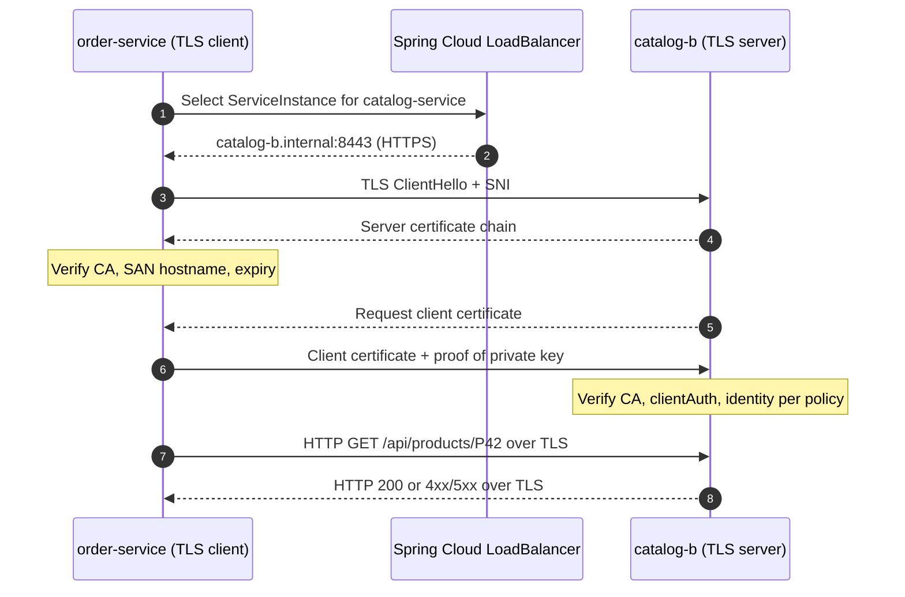
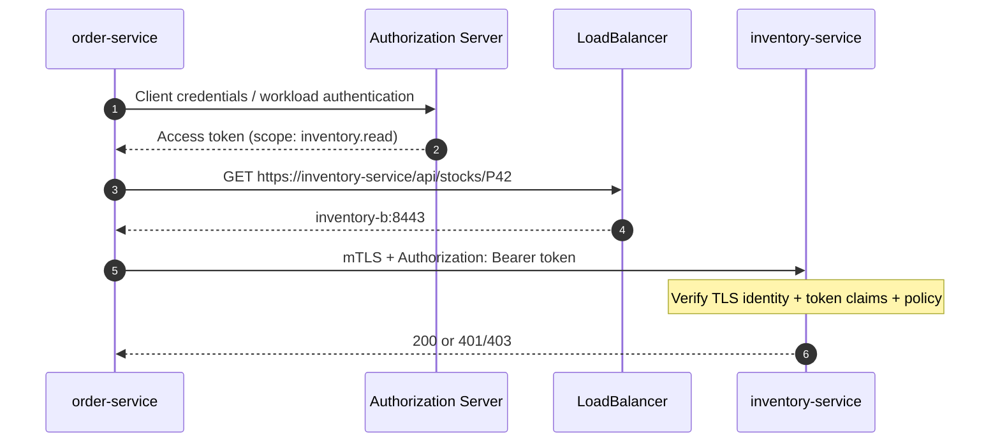

# mTLS and Service-to-Service Authentication

In microservices, `order-service` may call `https://catalog-service/api/products/P42` without knowing the specific replica of `catalog-service` in advance. Spring Cloud LoadBalancer uses the service ID, discovery, and `ServiceInstanceListSupplier` to select a host/port; then the HTTP client opens the connection. **Picking the right address does not mean the service has been authenticated.** If a replica is spoofed, the registry is misconfigured, or the network path is tampered with, requests can be sent to an untrusted destination. For data such as access tokens, orders, or inventory, the system must protect both the transport and mutual identities.

**mTLS (mutual Transport Layer Security)** adds *server authentication of the client via certificate*, alongside standard TLS where the client authenticates the server. However, mTLS does not automatically grant API permissions, replace `scope`/`role` checks, or substitute for bounding requests with timeouts, retries, or circuit breakers. In the `SPRING_CLOUD_SERVICE_COMMUNICATION_LOAD_BALANCING` module, this lesson covers how mTLS works when LoadBalancer picks across multiple `ServiceInstance`s, how to configure Spring Boot and HTTP clients, how to combine it with OAuth2, as well as testing, operations, and avoiding common mistakes.

## 1. Three Security Goals That Must Stay Separate

| Goal | Question to Answer | Typical Mechanism |
|---|---|---|
| **Channel security** | Can anyone read or alter requests/responses in transit? | TLS: encryption and integrity protection |
| **Workload authentication** | Which service is actually receiving? Does the caller hold the issued identity? | X.509 certificates, mTLS, SPIFFE/SVID, or equivalent identity |
| **Authorization** | Is the authenticated workload allowed to perform this action on this resource? | Authorization policies, OAuth2 access tokens, scopes/claims, policy engine |

One-way TLS generally protects the connection and lets the client check the server's certificate; mTLS adds identity via the client's certificate. **Never infer that "mTLS handshake succeeded" means every API is permitted.** A certificate signed by a trusted CA may belong to another workload and still must be matched against identity/privilege rules.

For example, `order-service` is allowed to read inventory, while `reporting-service` may only read aggregated data. Both can possess valid certificates from the same internal CA, yet that does not mean `reporting-service` is allowed to invoke `POST /api/stocks/reserve`.

## 2. One-Way TLS vs. mTLS: Handshake Flow

In standard HTTPS:

1. The client opens a connection to the selected host/port.
2. The server presents its certificate chain.
3. The client checks the chain up to a trusted trust anchor, validity period, target name in **SAN (Subject Alternative Name)**, and certificate usage policies.
4. Both sides establish session keys to protect exchanged data.

With mTLS, the server **also requests and verifies the client's certificate** during the TLS handshake. The client must hold the private key matching its certificate and a chain trusted by the server.



This diagram is simplified: TLS 1.3 has its own detailed handshake message ordering; some verification steps may be handled by a proxy or sidecar. The key point is that **the TLS handshake must complete before the regular HTTP endpoint processes the request**.

| Scenario | Client Authenticates Server? | Server Authenticates Client via TLS Certificate? |
|---|---|---|
| Unencrypted HTTP | No | No |
| Standard HTTPS/TLS | Yes, if verification is properly enabled | Usually no |
| mTLS | Yes | Yes |
| HTTPS + bearer token, no mTLS | Yes | No; server validates token at HTTP layer |

## 3. PKI: Certificate, Private Key, CA, and Truststore

To deploy mTLS, these components must be managed properly:

- **Server certificate + private key:** used by each replica of `catalog-service` or the TLS proxy in front of it; the private key must remain secret.
- **Client certificate + private key:** represents `order-service`'s identity when connecting downstream via mTLS.
- **CA certificate/trust anchor:** enables the verifier to confirm a certificate was signed by an issuer it trusts.
- **Certificate chain:** links the leaf certificate through intermediate CAs to the trust anchor.
- **Keystore/key material:** holds the certificate and private key of **that side itself**.
- **Truststore/trust material:** the set of CAs/certificates used to **trust the counterparty**.

| Side | Certificate Presented | Certificate/CA to Trust |
|---|---|---|
| `catalog-service` (server) | Server certificate containing SAN matching target hostname | CA issuing certificates for valid client workloads |
| `order-service` (client) | Client certificate for `order-service` workload identity | CA issuing certificates for valid `catalog-service` servers |

Certificates can include **EKU (Extended Key Usage)**: `serverAuth` for TLS servers, `clientAuth` for TLS clients. An internal CA can issue certificates for either or both, but using a certificate for the wrong purpose can cause the handshake to fail when implementations check EKU.

**Never distribute the CA's private key to applications.** The CA signing key belongs to the certificate issuance system; services only receive their own certificate/key and the required trust anchors. Use secret management, least-privilege mounted volumes, or a workload identity platform rather than committing `*.key` files, keystore passwords, or private certificates to Git.

## 4. Critical Point with LoadBalancer: Service ID Differs from TLS Hostname

In business code, the request is written as:

```java
ProductDto product = client.get()
        .uri("https://catalog-service/api/products/{id}", id)
        .retrieve()
        .body(ProductDto.class);
```

`catalog-service` is the **logical service ID** used to look up `ServiceInstance`s. However, LoadBalancer may select a concrete endpoint:

```text
Service ID: catalog-service
  ├─ catalog-a.internal.example:8443  (HTTPS)
  └─ catalog-b.internal.example:8443  (HTTPS)

Call 1 → catalog-a.internal.example:8443
Call 2 → catalog-b.internal.example:8443
```

At the TLS layer, the client must verify **the actual name the HTTP transport uses for the connection** according to its certificate/hostname verification policy. For instance, `catalog-b`'s server certificate may need SAN `DNS:catalog-b.internal.example`. If discovery advertises `10.20.1.12` while the certificate only has a DNS SAN, connecting by IP will not match unless the certificate includes SAN `IP:10.20.1.12` or the TLS architecture uses a properly configured matching identity name.

**Never fix certificate mismatch errors by disabling hostname verification.** Fix whichever layer owns the responsibility:

1. Discovery advertises a hostname the client can resolve and that matches the certificate.
2. The CA issues a certificate with SANs matching the name/IP being verified.
3. A TLS proxy/service mesh unifies termination points, identities, and routing.
4. Where SNI/authority must differ from the TCP connection target, configure it explicitly on the transport/proxy while keeping verification enabled.

Another subtlety: Spring Cloud LoadBalancer may build the actual URI based on `ServiceInstance.isSecure()` and the original scheme. **Do not look at `https://` in source code and assume the final request is guaranteed to use TLS.** Check registry metadata, `ServiceInstance.getUri()`, the secure flag, and the final HTTP request URI in your current version.

## 5. Two Ways to Deploy mTLS in Microservices

### 5.1. Direct mTLS in the Application

The Java application directly opens HTTPS, sends a client certificate, and verifies the server certificate. Spring Boot configures SSL for the inbound server, and the HTTP client uses an SSL bundle or corresponding SSL context.

Pros: identity and secure channel are configured inside the application, making client creation and usage explicit. Cons: keys/trust, rotation, client configs, and authorization rules must be managed across many applications.

### 5.2. mTLS in a Service Mesh or Proxy

Sidecars, ingress/egress proxies, or a service mesh can handle mTLS between proxies while the Java application communicates with the proxy per the deployment model.

```text
order-service → local proxy
                  └── mTLS ──→ remote proxy → catalog-service
```

This reduces the number of apps directly handling certificates, yet you must answer clearly: **is the app ↔ local proxy hop protected, who authenticates the workload, and where are authorization policies enforced?**

| Criterion | Application mTLS | Mesh/Proxy mTLS |
|---|---|---|
| TLS endpoint | Java HTTP client/server | Proxy/sidecar or gateway |
| Workload certificates | Managed by app or injected | Usually managed by mesh/control plane |
| URL seen by app | Typically `https://...` | May be HTTP to local proxy depending on architecture |
| Identity policy | Spring Security/custom authorization | Mesh authorization policy, optionally combined with app auth |
| Misconfiguration risk | Wrong SSL client, truststore, SAN, private key | Wrong mesh policy, mode, identity, or plaintext gap |
| Rotation | App/SSL context/connection lifecycle | Mesh-orchestrated, still requires testing |

Both approaches can be combined when end-to-end security or separate trust domains are required, but **never enable both haphazardly**. When TLS terminates at a proxy, the certificate actually checked by the Java client may belong to the proxy rather than the target app. The identity and authorization contract must make this explicit.

## 6. Configuring Inbound HTTPS/mTLS with a Spring Boot SSL Bundle

Example of `catalog-service` using Spring Boot 3.2+ (or a compatible release with SSL bundles), serving HTTPS on port `8443` and **requiring** a client certificate:

```yaml
server:
  port: 8443
  ssl:
    bundle: catalog-server
    client-auth: need

spring:
  ssl:
    bundle:
      pem:
        catalog-server:
          keystore:
            certificate: file:/etc/catalog/tls/server-chain.pem
            private-key: file:/etc/catalog/tls/server-key.pem
          truststore:
            certificate: file:/etc/catalog/tls/trusted-client-ca.pem
```

Meaning:

1. `keystore.certificate` is the server certificate (optionally including the intermediate chain).
2. `keystore.private-key` is the server's corresponding private key.
3. `truststore.certificate` specifies the trusted CA/certificate for validating **client certificates**.
4. `server.ssl.client-auth: need` requires the client to present a valid certificate during the handshake; missing or invalid certificates are rejected at the TLS layer.
5. `server.ssl.bundle` binds the HTTP server to the declared SSL bundle; integration details and hot reload depend on the Spring Boot version/container used.

The paths above illustrate a container with mounted secrets; they are not files to place in the source tree. **Never put private keys, passwords, or real secret contents into committed Markdown/YAML.** File permissions, rotation, and certificate issuance locations must be controlled independently.

If `client-auth: want` is set, the server may request a certificate but **does not require** every client to send one; that does not satisfy "only workloads with certificates may enter" unless the application adds corresponding checks. For mandatory mTLS on this endpoint, use `need` and verify in practice.

Beyond the TLS handshake, the service should still implement **authorization** verifying that the identity is permitted. For instance, a truststore trusting an entire internal CA might accept certificates from many workloads; the remaining job is ensuring only `order-service` can call the permitted APIs.

## 7. mTLS HTTP Client with Spring Boot SSL Bundle and RestClient

In `order-service`, declare an SSL bundle for calling internal services:

```yaml
spring:
  ssl:
    bundle:
      pem:
        catalog-client:
          keystore:
            certificate: file:/etc/order/tls/client-chain.pem
            private-key: file:/etc/order/tls/client-key.pem
          truststore:
            certificate: file:/etc/order/tls/trusted-server-ca.pem
```

On Spring Boot versions supporting `RestClientSsl`, you can create a `@LoadBalanced RestClient.Builder` bean configured with the SSL bundle:

```java
package com.example.orders.config;

import org.springframework.boot.autoconfigure.web.client.RestClientSsl;
import org.springframework.cloud.client.loadbalancer.LoadBalanced;
import org.springframework.context.annotation.Bean;
import org.springframework.context.annotation.Configuration;
import org.springframework.web.client.RestClient;

@Configuration(proxyBeanMethods = false)
public class CatalogHttpClientConfiguration {

    @Bean
    @LoadBalanced
    RestClient.Builder catalogLoadBalancedBuilder(RestClientSsl ssl) {
        return RestClient.builder()
                .apply(ssl.fromBundle("catalog-client"));
    }

    @Bean
    CatalogClient catalogClient(
            @LoadBalanced RestClient.Builder builder) {
        RestClient restClient = builder.clone()
                .baseUrl("https://catalog-service")
                .build();
        return new CatalogClient(restClient);
    }
}
```

```java
package com.example.orders.config;

import org.springframework.web.client.RestClient;

public class CatalogClient {
    private final RestClient restClient;

    public CatalogClient(RestClient restClient) {
        this.restClient = restClient;
    }

    public String getProduct(String id) {
        return restClient.get()
                .uri("/api/products/{id}", id)
                .retrieve()
                .body(String.class);
    }
}
```

In this example:

- `@LoadBalanced` tells Spring Cloud to configure the builder so logical URLs are resolved through LoadBalancer.
- `RestClientSsl.fromBundle(...)` wires the HTTP transport with the client certificate and trust anchors from the bundle. Automatic selection of `ClientHttpRequestFactory`, TLS provider, and customizers depends on the Spring Boot/HTTP library versions.
- `baseUrl("https://catalog-service")` expresses that the application **intends** to call an HTTPS endpoint; you must verify the post-LoadBalancer URI still uses a secure scheme.
- The server certificate must have an identity matching the selected endpoint; the client must verify chain/SAN rather than using trust-all.
- `CatalogClient` is reused rather than creating a new SSL context or TCP connection manager per request.

**Version note:** `RestClient` arrived in Spring Framework 6.1, and `RestClientSsl` is Spring Boot's integration for SSL bundles in supporting releases. Check the Spring Boot/Spring Cloud BOM and constructors/APIs before reusing code in a different version. In systems with multiple `RestClient.Builder` beans, use explicit qualifiers/bean names to avoid accidentally picking a non-mTLS builder.

## 8. Why Can HTTPS Fail When LoadBalancer Selects an Instance?

A local lab often declares:

```yaml
spring:
  cloud:
    discovery:
      client:
        simple:
          instances:
            catalog-service:
              - uri: https://catalog-a.internal.example:8443
              - uri: https://catalog-b.internal.example:8443
```

These are **illustrative addresses**, which must have valid DNS/hosts entries and certificates in the test environment. The goal is to force learners to cross-check:

| Field to Check | Requirement |
|---|---|
| `service ID` | `catalog-service` |
| Selected `ServiceInstance` | `catalog-a` or `catalog-b` with a reachable network address |
| Post-LoadBalancer URI/scheme | HTTPS, right host/port, and secure metadata |
| Trust chain | Client trusts the CA that issued the server certificate |
| SAN | Matches the hostname/IP actually verified by TLS |
| Client certificate | Server trusts the CA that signed the client certificate; matching private key |
| Authorization | This caller is permitted to use the called endpoint |

A common mistake: `catalog-a` and `catalog-b` hold certificates for `catalog-service.internal.example`, while discovery advertises `catalog-a.internal.example` and `catalog-b.internal.example`. If TLS verifies each instance's hostname, the certificate may be rejected. Never assume the service ID in `baseUrl` will always be the name verified after LoadBalancer rewrites the URI.

In environments where IPs change constantly, prefer stable identities designed consistently across DNS/discovery/PKI/mesh. If using IP SANs, establish a certificate reissuance workflow whenever IPs change; if using DNS SANs, ensure hosts are advertised and resolved accurately.

## 9. WebClient and OpenFeign Also Require Transport-Layer TLS

### WebClient

With `WebClient`, `@LoadBalanced WebClient.Builder` only handles `ServiceInstance` selection via an exchange filter. For direct mTLS, you must configure the SSL context on the actual **HTTP connector** (e.g., Reactor Netty) with:

- Client certificate along with its private key.
- Trust anchors to verify the server.
- Proper hostname/SAN verification and SNI.
- Secure TLS protocols/cipher suites.
- Appropriate connection timeout, handshake timeout, response timeout, and connection pool.

```java
// Illustrative integration skeleton: nettySslContext must be built from
// the workload's client certificate, private key, and trusted CA.
HttpClient nettyHttpClient = HttpClient.create()
        .secure(spec -> spec.sslContext(nettySslContext));

WebClient client = loadBalancedBuilder.clone()
        .clientConnector(new ReactorClientHttpConnector(nettyHttpClient))
        .baseUrl("https://catalog-service")
        .build();
```

This snippet assumes `nettySslContext` is securely configured; **it is not a complete production-ready snippet to copy blindly**. When customizing the SSL provider, verify that **hostname verification is actually enabled** for your Reactor Netty version (some custom setups require a corresponding `handlerConfigurator`). Never use `InsecureTrustManagerFactory`, skip SAN checks, or disable TLS validation to "fix" handshake failures.

When using Spring Boot SSL bundles, you can integrate the corresponding material into Reactor Netty via APIs supported by your version, or let a mesh/proxy own mTLS. Verify that the client genuinely uses the configured connector; declaring an SSL bean without wiring it into WebClient will not protect requests.

### OpenFeign

With OpenFeign, `@FeignClient(name = "catalog-service")` and Spring Cloud LoadBalancer determine the target; **Feign's Client/HTTP transport** (Apache HttpClient, OkHttp, or another implementation) is responsible for performing mTLS.

```java
@FeignClient(name = "catalog-service", path = "/api/products")
public interface CatalogFeignClient {
    @GetMapping("/{id}")
    ProductDto getProduct(@PathVariable("id") String id);
}
```

No annotation on that interface automatically loads a client certificate. You must configure the actual Feign HTTP client in use with key/trust material and hostname verification, or use a proxy/mesh to protect the channel. Setting a fixed `url = "http://..."` can bypass discovery and intended mTLS; that is a configuration risk, not an encoder/decoder bug.

## 10. mTLS Only Authenticates the Workload; the Application Must Still Authorize

Once the handshake succeeds, the server knows the client holds a certificate issued by a trusted CA. That **does not mean** the client is allowed to call every route.

Example service policy:

| Workload Identity | Allowed Permissions | Disallowed |
|---|---|---|
| `order-service` | `inventory.read`, `inventory.reserve` | Warehouse administration |
| `catalog-service` | `inventory.read` when needed | `inventory.reserve` |
| `reporting-service` | `inventory.read-aggregate` | Placing holds, payments |
| `payment-service` | `payments.capture` per contract | Editing product details |

Workload identity can be derived from DNS/URI SANs, SPIFFE IDs, or mappings from infrastructure-issued certificates. When using Spring Security X.509 authentication, do not blindly inspect an arbitrary CN string and grant broad privileges; check how the certificate chain is validated, which identity is extracted, and how it binds to policy. If TLS terminates at a proxy, the application may only trust identity headers provided by a **trusted** proxy over a protected channel—never read self-asserted headers from the Internet.

**mTLS authenticates "who is calling me"; authorization determines "what they are allowed to do".** Checks across these two layers must work alongside end-user data permissions rather than substituting service-account privileges for user permissions.

## 11. OAuth2 Client Credentials for Service-to-Service Calls

A common pattern combines mTLS with OAuth2 access tokens:

1. `order-service` authenticates at TLS using a client certificate.
2. `order-service` obtains an access token via `client_credentials` from the authorization server for the registered workload.
3. The HTTP request to `inventory-service` carries `Authorization: Bearer ...` inside the secure TLS channel.
4. `inventory-service` validates issuer, signature, expiration, audience, scopes, and other authorization conditions.



`client_credentials` issues tokens for an **application/workload**, not directly on behalf of an end user. Do not blindly forward a user's access token across every service if the token is not intended for that downstream; when delegation on behalf of a user is needed, use token exchange/on-behalf-of supported by your IAM infrastructure, with proper audience and scopes.

Sample Spring Security OAuth2 Client configuration (without secrets):

```yaml
spring:
  security:
    oauth2:
      client:
        registration:
          inventory-client:
            provider: internal-idp
            authorization-grant-type: client_credentials
            client-id: order-service
            scope: inventory.read
        provider:
          internal-idp:
            token-uri: https://idp.internal.example/oauth2/token
```

Client secrets or other client authentication credentials must be supplied through a secret manager/identity platform, never hard-coded. Include `spring-boot-starter-oauth2-client` and configure an `OAuth2AuthorizedClientManager` suited to the calling runtime (Servlet, background service, reactive).

**Do not assume adding properties alone makes every RestClient/WebClient/OpenFeign automatically attach tokens.** You need properly configured code or integration to acquire/cache tokens and attach `Authorization` to each request. With reactive WebClient, avoid invoking a blocking token manager on the event loop.

## 12. How to Verify Permissions on the Receiving Side

A service receiving bearer tokens can use Spring Security Resource Server to validate access tokens, such as a valid JWT from a trusted issuer:

```yaml
spring:
  security:
    oauth2:
      resourceserver:
        jwt:
          issuer-uri: https://idp.internal.example
```

With `spring-boot-starter-oauth2-resource-server`, Spring Security can fetch key verification metadata from the issuer. However, **never treat issuer configuration as sufficient for every policy**:

- Verify `aud`/audience matches the intended downstream API; reject tokens issued for other systems.
- Check scopes/authorities such as `SCOPE_inventory.read` or `SCOPE_inventory.reserve`.
- Validate `exp`, not-before, and signature; ensure clock skew stays within acceptable bounds.
- Never trust unsigned tokens or manually parse JWTs while skipping signature verification.
- Enforce authorization by route, method, and **data object**. A service with a read scope does not automatically have permission to read every tenant/order.
- If binding tokens to client certificates (certificate-bound tokens), configure and verify `cnf`/thumbprint per protocol support; mTLS by itself does not automatically bind every bearer token to a certificate.

When returning errors, distinguish `401 Unauthorized` (unauthenticated or invalid credential) from `403 Forbidden` (authenticated but lacking permission). Certificate failures usually happen during the TLS handshake before HTTP; at that stage there is not necessarily an HTTP 401/403 for the application to return.

## 13. Never Forward Credentials Blindly

When `order-service` calls multiple downstreams, each service may require different credentials:

| Credential / Info | Should It Auto-Propagate Across All Hops? | Principle |
|---|---|---|
| mTLS client certificate | Not an HTTP header | Bound to the TLS connection and workload identity |
| OAuth2 access token | **No** | Send only to the intended audience/resource server |
| User JWT | Not by default | Use only when downstream is permitted and needs user context |
| Browser session cookie | Not by default | Avoid copying cookies to arbitrary internal services |
| Correlation ID / W3C trace context | Usually yes, if controlled | Used for observability, not a credential |
| Internal API key | Only per explicit contract | Protect as a secret; prefer centrally managed token/identity |

In particular, when an HTTP client follows a redirect to another host or retries a request whose target changed, ensure **Authorization headers and credentials are never sent to endpoints outside the trust boundary**. Service IDs must never come directly from user input to target arbitrary internal endpoints; letting callers control the target URL introduces SSRF risk.

Tokens should have short lifetimes, bounded refresh/caching mechanisms, and handling for `401` on expired tokens. Never place tokens in query strings, and never log tokens into application logs, trace attributes, or error responses.

## 14. Timeouts, Retries, and mTLS: Security Does Not Replace Fault Tolerance

When an HTTP client uses mTLS, connections can incur extra TLS handshake latency and distinct errors: expired certificates, CA rotation issues, SAN mismatches, missing client certificates. These scenarios must be separated from discovery or HTTP status failures.

| Phase | Example Error | Should It Auto-Retry? |
|---|---|---|
| Discovery/LoadBalancer | No `ServiceInstance` available | Usually fail fast or very limited retry |
| TCP connect | Unreachable address | May try another instance if budget remains |
| TLS handshake | Untrusted CA, wrong SAN, expired cert | **Do not** retry in bulk; fix trust/identity |
| Client authentication | Missing certificate or client cert rejected | **Do not** retry with the exact same failing credential |
| HTTP authorization | 401/403 | Refresh valid credentials only if policy permits; no unconditional retry |
| Downstream HTTP | 502/503/504 | Conditional on idempotency, backoff, and deadline |
| Response decode | Bad JSON/schema | Fix contract; retries rarely help |

**Do not increase read timeouts to cure TLS handshake failures**, and never disable hostname verification to make a broken instance look "healthy". Measure connect, TLS handshake, pool acquisition, response, and total deadline times for your HTTP transport.

When retrying on a different `ServiceInstance`, TLS must re-verify the actual target endpoint if a new connection is opened. Connection pooling may retain TLS connections established prior to certificate rotation; rotation procedures must account for closing/draining old connections and synchronizing trust anchors.

## 15. Certificate Lifecycle Management and Key Rotation

Short-lived certificates limit the window of abuse if a private key leaks, but require lifecycle automation:

1. **Issuance:** the CA/identity platform authenticates the workload before issuing a certificate.
2. **Distribution:** certificates, private keys, and CA bundles are delivered to the right workloads over secure channels.
3. **Usage:** HTTP servers/clients load material into TLS contexts/SSL bundles.
4. **Monitoring:** track expiration times, handshake errors, rejected connections, and certificate identities.
5. **Renewal:** load new certificates **before** old ones expire, accounting for trust overlap periods.
6. **Revocation:** revoke/shorten lifetimes if a key is compromised; policies must reflect infrastructure trust and revocation needs.
7. **Connection cleanup:** verify clients/servers do not keep reusing contexts or connections with outdated state.

Replacing a file on disk does not mean every JVM/HTTP connection pool **automatically** reloads TLS material. Depending on version, Spring Boot SSL bundles may support reload in supported integrations; other HTTP clients/proxies may require swapping the SSL context, recreating pools, or a controlled restart. You must **test rotation for real**, not just check that the file changed on disk.

For CA rotation, you normally need an overlap window where clients/servers trust both the old and new CA to avoid breaking all service-to-service traffic at once. Never remove the old CA before all corresponding certificates/workloads have switched.

## 16. Practice Exercise: Two HTTPS Replicas and One mTLS Client

**Goal:** prove that Spring Cloud LoadBalancer selects instances while TLS still authenticates each endpoint, and that the server rejects clients without a valid mTLS identity.

### Local Environment Setup

- Create a **lab-only CA** and issue server certificates for two replicas.
- `catalog-a` runs HTTPS on `8443`, with an SAN matching its advertised hostname.
- `catalog-b` runs HTTPS on `8444` or a different hostname, with a matching SAN.
- Issue a client certificate for `order-service` with `clientAuth`; the server trusts the CA that signed it.
- The client trusts the CA that signed the server certificates and uses `order-service`'s key/cert.
- Configure `SimpleDiscoveryClient` with the `https://...` URIs and verify actual `isSecure`.
- Each replica exposes `/whoami` returning an instance ID containing no sensitive data.

Never use lab certificates or self-signed trust-all settings in production. If using `localhost` across two ports, the server cert SAN must include `DNS:localhost` and the connection path must use that matching name; if calling by loopback IP, the SAN must include that IP per the client's verification policy.

### Test Matrix

| Case | Change | Expectation |
|---|---|---|
| A — valid mTLS | Both server/client have keys, certs, and trusted CAs | Request `https://catalog-service/whoami` via LoadBalancer succeeds |
| B — missing client cert | Client has no keystore configured | TLS handshake is rejected when server requires client auth |
| C — wrong client CA | Client cert signed by CA untrusted by server | Handshake fails, not HTTP 403 from controller |
| D — wrong server CA | Client does not trust server's issuer | Handshake fails before HTTP |
| E — wrong hostname/SAN | Discovery returns hostname missing from cert | Hostname verification rejects connection |
| F — expired cert | Test expired certificate in lab | TLS validation fails, never auto-bypassed |
| G — another service with valid cert | Client `reporting-service` calls forbidden route | Handshake may succeed, authorization returns 403 or proxy policy denies |
| H — switch instance | Alternate between two instances with distinct certs | Each connection authenticates the specific selected endpoint |
| I — client token wrong audience | Token intended for another service | Resource server rejects even though mTLS succeeded |
| J — rotation | Rotate leaf cert/CA per runbook | No unexpected downtime, trust and pools update properly |

### Example Direct Per-Endpoint Calls

In the lab, assuming `ca.pem`, `client.pem`, and `client-key.pem` were issued by the test environment:

```bash
curl --cacert ca.pem \
  --cert client.pem \
  --key client-key.pem \
  https://catalog-a.internal.example:8443/whoami
```

This command tests mTLS **directly** against one instance; it **does not test the LoadBalancer algorithm**. Next, test via `@LoadBalanced RestClient` with the service ID URL and compare results. Never add `-k` or `--insecure` to curl because that disables server verification and hides the most important failures in the lab.

If a command fails, inspect hostname/SAN and CA chain first, then check client certificate, EKU, port, firewall, and server mTLS policy. Always distinguish handshake errors from HTTP 401/403/503 statuses.

## 17. Troubleshooting: Finding the Right Layer

| Symptom | Possible Cause | Where to Check |
|---|---|---|
| `No instances available` | Discovery/LoadBalancer returns no instances | Service ID, supplier, registry, zone, health; **before TLS** |
| `Connection refused` | Nothing listening on host/port | Network, service port, ingress policy |
| TLS `unknown_ca` | Verifier does not trust peer's issuer | Truststore and certificate chain in the right direction |
| TLS `bad_certificate` | Certificate rejected | Leaf/chain, key, EKU, validity, issuer |
| `No subject alternative DNS name` | SAN does not match connected host | Effective URI after LoadBalancer, DNS SAN/IP SAN |
| TLS handshake succeeds but HTTP 401 | Missing/invalid access token | OAuth2 client config, token expiry, JWT validation |
| TLS handshake succeeds but HTTP 403 | Workload/token lacks permission | Authorization policy, scope, audience, route |
| Only one replica fails TLS | That replica's cert/key/SAN differs or expired | Compare each `ServiceInstance` and cert |
| HTTP 503 from server | Server returned an error status | Response, readiness, downstream dependency |
| Fails only inside a new container | Wrong DNS/hostname, volume mount, permissions, or mesh config | Secret locations, network namespace, service identity |
| Many requests fail after rotation | Client/server did not reload key/trust or pool kept old connections | Rotation timeline, SSL context, connection lifecycle |

Follow **service ID → selected instance → URI/scheme → TCP → TLS verification → HTTP authentication/authorization → business logic**. Do not tweak retries or timeouts before identifying which layer failed.

Fields worth logging: service ID, authenticated identity at a safe level, instance ID, remaining certificate validity, TLS failure category, HTTP status, trace ID, and duration. Never log private keys, bearer tokens, client secrets, or raw sensitive certificate chains unless explicitly permitted by security requirements.

## 18. Anti-Patterns That Create Vulnerabilities

| Anti-Pattern | Risk | Proper Alternative |
|---|---|---|
| Using `TrustAll` or disabling hostname verification | Any spoofed server can be accepted | Proper CA trust and SAN verification |
| Treating any cert from the same CA as having full permissions | Other workloads with valid certs abuse privileges | Identity/scope-based authorization |
| Committing client secrets/private keys to Git | Long-term credential compromise | Secret manager, protected mounts, rotation |
| Using HTTPS base URL while registry returns non-secure instances | Actual protocol may not match expectations | Check generated URI and `isSecure` |
| Confusing service ID with instance SAN name | TLS hostname mismatch | Unified DNS/PKI/discovery design |
| Forwarding user JWT/cookies to every downstream | Credential leak and uncontrolled privilege spread | Scoped/audience-matched tokens |
| Trusting self-asserted identity headers from the Internet | Workload identity spoofing | Trust only authenticated proxies and trust boundaries |
| Retrying CA/cert errors indefinitely | Wastes load, hides root cause | Fail fast, alert, and fix material |
| Replacing cert files and assuming pools reloaded | Periodic failures or outage at expiry | Test reload/recreation of SSL context and connection pool |
| Using mTLS as proof of end-user authorization | Service identity replaces user permissions | Authorize both service **and** user per context |
| Enabling mTLS in proxy while leaving plaintext outside trust boundary | Data unprotected across full path | Audit every hop and security zone |
| Using `-k`/`insecure` to pass tests | Skips server authentication goal | Fix actual CA/SAN/cert |

## 19. Pre-Production Checklist

1. Have you defined the **TLS termination boundary**: in the Java app, gateway, or service mesh?
2. Does discovery advertise HTTPS URIs/secure flags and addresses matching the certificate SAN of **every** `ServiceInstance`?
3. Do both client and server have directional trust anchors, certificates/keys, and proper EKUs?
4. Is hostname verification enabled and trust-all/insecure disabled in the transport?
5. Does `server.ssl.client-auth=need` (or equivalent proxy policy) actually reject clients without valid certificates?
6. Is authorization enforced by workload identity, endpoint/method, and resource rather than only checking CA trust?
7. When using OAuth2, are issuer, signature, audience, scopes, and expiry verified, without sending tokens to the wrong audience?
8. Are SSL bundles/HTTP connectors attached to the **exact** `@LoadBalanced RestClient.Builder`, WebClient, or Feign Client in use?
9. Are secrets provisioned via secure channels with least privilege, never hard-coded or logged?
10. Do certificates/CAs have issuance, renewal, rotation, revocation, and expiration monitoring processes?
11. Has rotation been tested with connection pooling/retries to confirm TLS contexts reload or swap properly?
12. Are connect/handshake/response timeouts configured, retries bounded, and rejected certificates never retried pointlessly?
13. Have you tested wrong CA, wrong SAN, missing client certificate, expired cert, wrong token audience, missing scope, and single-replica failure?
14. Are traces/logs sufficient to separate discovery, TLS handshake, and HTTP 401/403/503 failures without leaking secrets?

**Conclusion:** Spring Cloud LoadBalancer solves **which replica to reach**, whereas TLS/mTLS solves **whether the connection is secure and both parties prove their identities**. After the handshake, applications still require authorization based on workload, tokens, and API contracts. By maintaining accurate trust chains, real `ServiceInstance` SANs, private key/rotation hygiene, and bounded deadlines/retries, service-to-service communication scales with discovery while preserving end-to-end security within designed boundaries.
