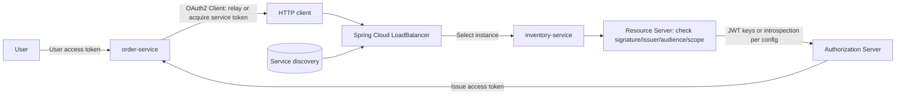
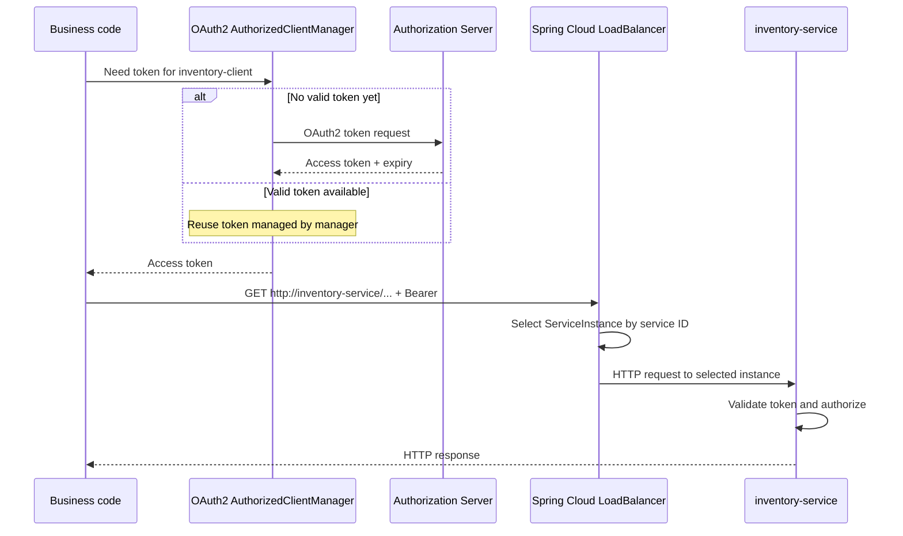
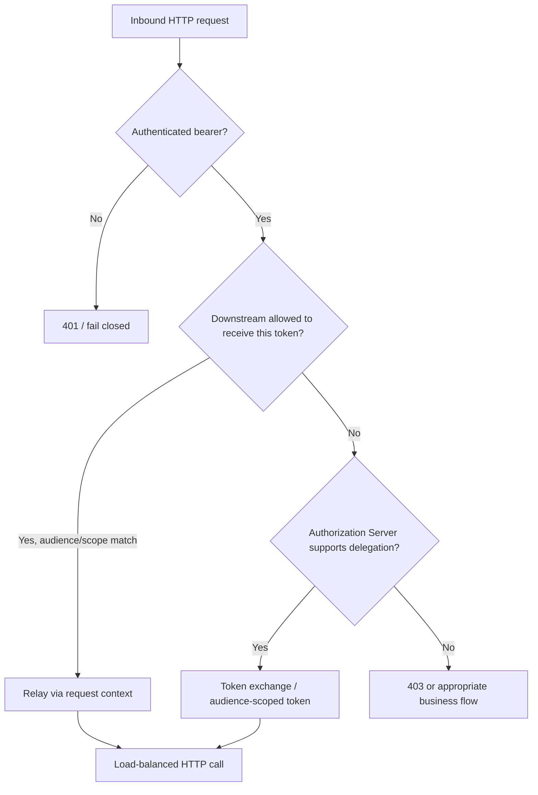
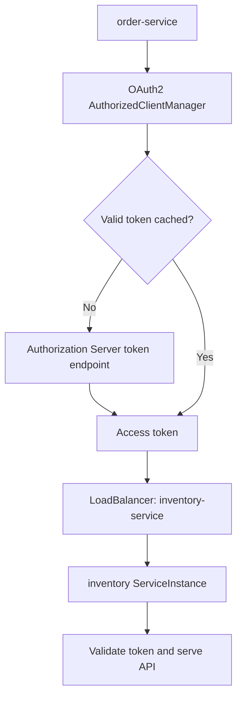

# Access Token Propagation and OAuth2 Integration by HTTP Client Type

In a microservice architecture, `order-service` may receive a user's HTTP request and call `inventory-service` using `RestClient`, `WebClient`, or `OpenFeign`. Spring Cloud LoadBalancer handles **selecting a `ServiceInstance` by service ID**; it **does not authenticate users, mint OAuth2 access tokens, automatically attach `Authorization` headers, or replace permission checks on the target service**.

For example, a call to `GET http://inventory-service/api/products/P-1001` can be routed accurately to an instance yet still receive `401 Unauthorized` if a bearer token is missing or `403 Forbidden` if the token lacks permissions. Conversely, attaching an arbitrary bearer token can leak credentials or create identity mismatches between services.

This lesson belongs to the **Communication Security** chapter in the Spring Cloud LoadBalancer module. The goal is to understand **when to propagate a user token vs. when to acquire a service-specific token**, how to integrate OAuth2 appropriately for each of the three HTTP client types, how to combine tokens with `@LoadBalanced`, and how to verify the system safely alongside discovery, health checks, timeouts, retries, and multiple instances.

## 1. Four Roles That Must Stay Separate

| Component | Role | What Is It Not Responsible For? |
|---|---|---|
| **OAuth2 Authorization Server** | Authenticates/authorizes per flow and issues access tokens to permitted clients. | Does not select microservice `ServiceInstance`s. |
| **OAuth2 Client** (e.g., `order-service` calling downstream) | Acquires, manages, and attaches access tokens to HTTP requests sent to resource servers. | Does not validate tokens on behalf of the target server. |
| **Resource Server** (e.g., `inventory-service`) | Validates tokens (JWT or opaque), issuer/audience/scopes, and enforces authorization. | Does not trust requests merely because they come from an internal instance. |
| **Spring Cloud LoadBalancer** | Selects a `ServiceInstance` from a service ID and forwards the call to the real address. | Does not issue, refresh, relay, or validate OAuth2 tokens in place of Spring Security. |

At the same time, distinguish the **HTTP client library** (`RestClient`, `WebClient`, `OpenFeign`) from the **security mechanism** (Spring Security OAuth2 Client and OAuth2 Resource Server). A client may target the right destination while sending the wrong token; a valid token does not guarantee proper routing or secure TLS.



The arrows to the Authorization Server only depict **possible** interactions: a resource server using JWTs can verify signatures against cached JWKS keys without calling the Authorization Server per request; opaque tokens typically require introspection or an equivalent validation mechanism.

## 2. Two Fundamentally Different Access Token Strategies

### 2.1. Token Relay: Forwarding the User's Token

The user calls `order-service` with a bearer access token. If `order-service` has already validated that token and **the security contract allows** downstream to receive the same token, the caller can relay it to `inventory-service`. Downstream uses the token to determine the **user's** permissions.

```text
User --(user's access token)--> order-service
order-service --(same access token, conditionally)--> inventory-service
inventory-service --(validate token + authorize)--> response
```

Relay only when all of the following hold:

- The token was originally issued for the target API or a valid set of resource servers; **`aud`/audience must be accepted by downstream per policy**.
- The token's scopes/permissions match the downstream action, not just the entry-layer endpoint.
- `order-service` has already authenticated the inbound request and is permitted to propagate that identity downstream.
- Downstream trusts the right issuer, signature/introspection, audience, expiry, token type, and required claims.
- Do not send a user token to another service merely because LoadBalancer has instances matching a service ID; never send tokens to unauthorized URLs or external domains.

**Common pitfall:** An access token whose audience is solely `order-api` **does not automatically become a valid token for `inventory-api`**. Passing the raw token along with the wrong audience is an authorization-model flaw, even if the Bearer header is syntactically valid.

### 2.2. Client Credentials: The Service Acquires a Token for Itself

When `order-service` runs an internal task not tied to a user—such as a nightly inventory sync—it can use OAuth2 **`client_credentials`** to obtain an access token for the **application/service identity**.

```text
order-service --(client authentication)--> Authorization Server
order-service <--(service access token)---- Authorization Server
order-service --(service token)-----------> inventory-service
inventory-service --(check service permissions)--> allow/deny
```

Characteristics:

- Scopes typically represent application permissions such as `inventory.read`.
- No end user is authenticated **merely because** the token contains a client ID or a username-like claim.
- Tokens are issued per OAuth2 client registration, carry an expiry, and are cached/managed via an appropriate authorized-client manager.
- Client secrets/private keys or client authentication methods must be managed securely; never store secrets in the repository.
- For operations requiring end-user identity auditing or user-specific permissions, a `client_credentials` token **does not automatically substitute** for token relay, token exchange, or an appropriate delegation model.

### 2.3. Token Exchange / On-Behalf-Of When Direct Relay Is Disallowed

Systems requiring audience-specific tokens can use **token exchange** or an "on-behalf-of" delegation flow supported by the Authorization Server. `order-service` uses the authenticated user context to request a new token targeted at `inventory-api`, with narrowed scopes and appropriate subject/delegation claims.

Do not assume Spring Cloud LoadBalancer or `client_credentials` performs this exchange automatically; it requires Authorization Server support, an application contract, and dedicated OAuth2 integration.

| Scenario | Option to Consider | Identity Downstream May Trust |
|---|---|---|
| User viewing inventory is allowed to use the same token across multiple APIs | Token relay **if audience and trust boundary allow**. | Verified end user. |
| Batch job automatically syncing stock counts | `client_credentials`. | Client/service identity. |
| User acts via API A, and API B requires a distinct token audience | Token exchange / delegated token per policy. | User delegation scoped to the new token. |
| Service wants to pass "userId" via an arbitrary header | Never treat self-added headers as identity proof. | Must be authenticated/authorized by a trusted mechanism. |

## 3. How Are Bearer Tokens Transmitted Over HTTP?

Following standard bearer token usage, the client places the access token in the header:

```http
GET /api/products/P-1001 HTTP/1.1
Host: inventory-service
Authorization: Bearer <access-token>
Accept: application/json
```

`<access-token>` is an illustrative placeholder, **not a real token**. Never put tokens in query strings or URLs because URLs are routinely logged by proxies, browsers, tracing, and monitoring. Do not default to passing tokens in cookies simply because an app uses session login: cookies belong to a different model with their own domain, CSRF, SameSite, and session semantics.

### An Access Token Is Not an ID Token

In OpenID Connect, an **ID token** informs the client of the authentication outcome, whereas an **OAuth2 access token** is used to invoke protected resources. Never place an ID token in an API's `Authorization: Bearer` header simply because it also happens to be a JWT string.

### JWT vs. Opaque Token

| Token Type | What Does the Resource Server Usually Need to Do? | Notes |
|---|---|---|
| **JWT access token** | Verify signature and claims: issuer, audience, expiry, permissions; use JWKS/trusted keys. | A JWT has a readable payload—**signing does not encrypt its contents**; avoid placing unnecessary sensitive data in claims. |
| **Opaque access token** | Use introspection or an Authorization Server/provider validation mechanism. | Can add latency/network dependency on the introspection service; configure timeouts and caching per policy. |

Downstream must never trust an `Authorization` header just because upstream claims "it was already checked". Each resource server must enforce authentication/authorization policies tailored to its own trust boundary.

## 4. Where Do OAuth2, Spring Security, and LoadBalancer Sit in a Request?



The diagram uses `client_credentials` to illustrate acquiring a separate token. With token relay, the token comes from the inbound security context after the caller's resource server authenticates it, so no new token request necessarily occurs.

**Do not confuse two distinct addresses:** the logical URL `http://inventory-service` is input to LoadBalancer, whereas the Authorization Server's `token-uri` (or issuer metadata) is an independent OAuth2 endpoint. Token requests typically do not need to route through the `inventory-service` LoadBalancer. If a separate transport/proxy/TLS setup is used for the Authorization Server, design its timeouts, truststore, and monitoring independently.

## 5. Common Configuration for Client Credentials

In a Spring Boot application with Spring Security OAuth2 Client, you can define an OAuth2 client registration for inventory. Example:

```yaml
spring:
  security:
    oauth2:
      client:
        registration:
          inventory-client:
            provider: corporate-iam
            client-id: ${INVENTORY_OAUTH_CLIENT_ID}
            client-secret: ${INVENTORY_OAUTH_CLIENT_SECRET}
            authorization-grant-type: client_credentials
            scope: inventory.read
        provider:
          corporate-iam:
            token-uri: https://identity.example.internal/oauth2/token
```

Environment variables `INVENTORY_OAUTH_CLIENT_ID` and `INVENTORY_OAUTH_CLIENT_SECRET` must be supplied through a secret manager or environment secret mechanism—**never store static passwords in Git, logs, or documentation**. The address `identity.example.internal` is purely illustrative and must be replaced with a real Authorization Server with TLS verified.

Spring Boot and Spring Security must use compatible versions; `spring-boot-starter-oauth2-client` provides OAuth2 Client capabilities. `spring-boot-starter-oauth2-resource-server` serves a **different role**: it is used on services receiving requests and validating access tokens. An application that both exposes protected APIs and calls downstream services may need **both**.

### Illustrative Dependencies

```xml
<dependencies>
    <dependency>
        <groupId>org.springframework.boot</groupId>
        <artifactId>spring-boot-starter-oauth2-client</artifactId>
    </dependency>
    <dependency>
        <groupId>org.springframework.cloud</groupId>
        <artifactId>spring-cloud-starter-loadbalancer</artifactId>
    </dependency>
</dependencies>
```

This Maven snippet covers **shared dependencies** and does not yet include Spring Web/WebFlux or OpenFeign. Add `spring-boot-starter-web`, `spring-boot-starter-webflux`, or `spring-cloud-starter-openfeign` matching the HTTP client in use. Use a Spring Boot parent/BOM and Spring Cloud BOM from compatible release trains; do not mix arbitrary Spring Security/Spring Cloud versions.

### Scopes and Audience Are a Security Contract

`scope: inventory.read` only describes what the client requests; whether the Authorization Server grants it depends on registration/policy. Downstream must independently verify sufficient permissions and audience. If the system requires audience `inventory-api`, how audience is requested depends on the Authorization Server (there is no single universal OAuth2 client property across all providers).

## 6. RestClient: Attaching Bearer Tokens Safely on the Right Builder

`RestClient` is Spring Framework's **blocking** HTTP client. When using Spring Cloud LoadBalancer, you need a `@LoadBalanced` `RestClient.Builder` bean. Token attachment lives in a `ClientHttpRequestInterceptor` or an OAuth2 Client integration provided by your Spring Security version.

### 6.1. Client Credentials via AuthorizedClientManager

The following example illustrates a **Spring MVC/servlet or synchronous application** using `OAuth2AuthorizedClientManager`. `AuthorizedClientServiceOAuth2AuthorizedClientManager` is suited to managing OAuth2 authorized clients outside a servlet request context, such as batch/service-to-service jobs.

```java
import org.springframework.context.annotation.Bean;
import org.springframework.context.annotation.Configuration;
import org.springframework.security.oauth2.client.OAuth2AuthorizedClientManager;
import org.springframework.security.oauth2.client.OAuth2AuthorizedClientProvider;
import org.springframework.security.oauth2.client.OAuth2AuthorizedClientProviderBuilder;
import org.springframework.security.oauth2.client.OAuth2AuthorizedClientService;
import org.springframework.security.oauth2.client.AuthorizedClientServiceOAuth2AuthorizedClientManager;
import org.springframework.security.oauth2.client.registration.ClientRegistrationRepository;

@Configuration(proxyBeanMethods = false)
class InventoryOAuth2ManagerConfiguration {

    @Bean
    OAuth2AuthorizedClientManager serviceAuthorizedClientManager(
            ClientRegistrationRepository registrations,
            OAuth2AuthorizedClientService authorizedClientService) {

        OAuth2AuthorizedClientProvider provider =
                OAuth2AuthorizedClientProviderBuilder.builder()
                        .clientCredentials()
                        .build();

        AuthorizedClientServiceOAuth2AuthorizedClientManager manager =
                new AuthorizedClientServiceOAuth2AuthorizedClientManager(
                        registrations, authorizedClientService);
        manager.setAuthorizedClientProvider(provider);
        return manager;
    }
}
```

The manager bean coordinates acquiring and managing authorized clients/tokens. The name `inventory-client` below must match the `registration` in YAML.

```java
import org.springframework.cloud.client.loadbalancer.LoadBalanced;
import org.springframework.context.annotation.Bean;
import org.springframework.context.annotation.Configuration;
import org.springframework.security.oauth2.client.OAuth2AuthorizeRequest;
import org.springframework.security.oauth2.client.OAuth2AuthorizedClient;
import org.springframework.security.oauth2.client.OAuth2AuthorizedClientManager;
import org.springframework.web.client.RestClient;

@Configuration(proxyBeanMethods = false)
class InventoryRestClientConfiguration {

    @Bean
    @LoadBalanced
    RestClient.Builder inventoryLoadBalancedRestClientBuilder(
            OAuth2AuthorizedClientManager serviceAuthorizedClientManager) {

        return RestClient.builder().requestInterceptor((request, body, execution) -> {
            OAuth2AuthorizeRequest authorizeRequest =
                    OAuth2AuthorizeRequest.withClientRegistrationId("inventory-client")
                            .principal("order-service")
                            .build();

            OAuth2AuthorizedClient authorizedClient =
                    serviceAuthorizedClientManager.authorize(authorizeRequest);
            if (authorizedClient == null) {
                throw new IllegalStateException(
                        "OAuth2 client authorization unavailable");
            }

            request.getHeaders().setBearerAuth(
                    authorizedClient.getAccessToken().getTokenValue());
            return execution.execute(request, body);
        });
    }

    @Bean
    RestClient inventoryRestClient(
            @LoadBalanced RestClient.Builder inventoryLoadBalancedRestClientBuilder) {
        return inventoryLoadBalancedRestClientBuilder
                .baseUrl("http://inventory-service")
                .build();
    }
}
```

In this example, the principal `"order-service"` is **a key representing the service client when managing authorized clients for `client_credentials`**, not a logged-in user's identity. The interceptor is dedicated to `inventory-service`; never reuse this bearer-token-attaching builder to call arbitrary hosts.

**Points to note:**

- The token manager can reuse a stored valid token and fetch a new one when needed per provider/configuration; **never design an approach that hits the token endpoint on every HTTP call**.
- `authorize(...)` is a synchronous call and may perform network I/O to obtain a token. Never run this blocking pattern on a Reactor event loop.
- If `authorize(...)` returns `null` or throws an exception, that is a **token acquisition failure**; no business HTTP request has been sent downstream yet.
- Manually calling `RestClient.builder()` may not inherit all Spring Boot customizers (HTTP transport, SSL, observation, timeouts). In production, integrate with a Boot-managed builder/configurer appropriate to your Boot version and verify the final client.
- If your Spring Security version provides `OAuth2ClientHttpRequestInterceptor`, you may use that adapter instead of a custom interceptor; **verify API availability and support for your Spring Security version**. Do not assume every Spring Boot release includes that class.

### 6.2. Do Not Read User Tokens from a Service Manager

The `client_credentials` snippet above is not token relay. Do not swap `principal("order-service")` with a user ID and assume the token becomes a user token: **the grant type has not changed**, so identity and permissions still belong to the client registration.

When a user token is needed, its source must be the authenticated/authorized security context of the inbound request, or an appropriate token exchange/delegation mechanism. If the application runs asynchronously or in scheduled tasks, a user security context may not exist.

### 6.3. RestClient Relay from a Servlet Resource Server

If inbound authentication is a bearer access token **already validated by the Resource Server** and downstream is allowed to receive the same token, you can define a **separate** `RestClient.Builder`:

```java
import org.springframework.cloud.client.loadbalancer.LoadBalanced;
import org.springframework.context.annotation.Bean;
import org.springframework.context.annotation.Configuration;
import org.springframework.security.access.AccessDeniedException;
import org.springframework.security.core.Authentication;
import org.springframework.security.core.context.SecurityContextHolder;
import org.springframework.security.oauth2.server.resource.authentication.AbstractOAuth2TokenAuthenticationToken;
import org.springframework.web.client.RestClient;

@Configuration(proxyBeanMethods = false)
class InventoryUserRelayRestClientConfiguration {

    @Bean
    @LoadBalanced
    RestClient.Builder inventoryUserRelayRestClientBuilder() {
        return RestClient.builder().requestInterceptor((request, body, execution) -> {
            Authentication authentication =
                    SecurityContextHolder.getContext().getAuthentication();
            if (!(authentication instanceof
                    AbstractOAuth2TokenAuthenticationToken<?> bearer)) {
                throw new AccessDeniedException(
                        "Verified user bearer token required");
            }

            request.getHeaders().setBearerAuth(
                    bearer.getToken().getTokenValue());
            return execution.execute(request, body);
        });
    }
}
```

This is an **alternative** to the client-credentials bean in `6.1`—do not register two beans of the same type without qualifiers and inject them ambiguously into the same gateway. Use this only from servlet requests with a security context and **after verifying the token carries the right audience/scopes for inventory**; this snippet does not perform token exchange or business authorization checks by itself. For scheduled jobs, create a separate client-credentials client with its own qualifier.

Do not confuse reading a token from `SecurityContextHolder` with reading user identity from a raw header value: the token must have already passed authentication. If `RestClient` runs off the request thread, handle context propagation explicitly or fail closed.

## 7. WebClient: OAuth2 Client in a Reactive Environment

`WebClient` is a reactive HTTP client returning `Mono`/`Flux`. When running on the WebFlux/Reactor Netty event loop, **never use a blocking OAuth2 manager** like `OAuth2AuthorizedClientManager.authorize(...)` inside a reactive filter, because fetching a token can block the I/O thread. Use `ReactiveOAuth2AuthorizedClientManager` and Spring Security's corresponding reactive filters.

### 7.1. Reactive Client Credentials for Service-to-Service

One setup for tasks not tied to a servlet request or end-user session uses `AuthorizedClientServiceReactiveOAuth2AuthorizedClientManager` with the `client_credentials` provider:

```java
import org.springframework.context.annotation.Bean;
import org.springframework.context.annotation.Configuration;
import org.springframework.security.oauth2.client.ReactiveOAuth2AuthorizedClientManager;
import org.springframework.security.oauth2.client.ReactiveOAuth2AuthorizedClientProvider;
import org.springframework.security.oauth2.client.ReactiveOAuth2AuthorizedClientProviderBuilder;
import org.springframework.security.oauth2.client.ReactiveOAuth2AuthorizedClientService;
import org.springframework.security.oauth2.client.AuthorizedClientServiceReactiveOAuth2AuthorizedClientManager;
import org.springframework.security.oauth2.client.registration.ReactiveClientRegistrationRepository;

@Configuration(proxyBeanMethods = false)
class ReactiveServiceOAuth2Configuration {

    @Bean
    ReactiveOAuth2AuthorizedClientManager inventoryReactiveAuthorizedClientManager(
            ReactiveClientRegistrationRepository registrations,
            ReactiveOAuth2AuthorizedClientService authorizedClientService) {

        ReactiveOAuth2AuthorizedClientProvider provider =
                ReactiveOAuth2AuthorizedClientProviderBuilder.builder()
                        .clientCredentials()
                        .build();

        AuthorizedClientServiceReactiveOAuth2AuthorizedClientManager manager =
                new AuthorizedClientServiceReactiveOAuth2AuthorizedClientManager(
                        registrations, authorizedClientService);
        manager.setAuthorizedClientProvider(provider);
        return manager;
    }
}
```

The next example uses Spring Security's `ServerOAuth2AuthorizedClientExchangeFilterFunction` to attach tokens to a `WebClient.Builder` dedicated to inventory:

```java
import org.springframework.cloud.client.loadbalancer.LoadBalanced;
import org.springframework.context.annotation.Bean;
import org.springframework.context.annotation.Configuration;
import org.springframework.security.oauth2.client.ReactiveOAuth2AuthorizedClientManager;
import org.springframework.security.oauth2.client.web.reactive.function.client.ServerOAuth2AuthorizedClientExchangeFilterFunction;
import org.springframework.web.reactive.function.client.WebClient;

@Configuration(proxyBeanMethods = false)
class InventoryReactiveHttpConfiguration {

    @Bean
    @LoadBalanced
    WebClient.Builder inventoryLoadBalancedWebClientBuilder(
            ReactiveOAuth2AuthorizedClientManager
                    inventoryReactiveAuthorizedClientManager) {

        ServerOAuth2AuthorizedClientExchangeFilterFunction oauth2 =
                new ServerOAuth2AuthorizedClientExchangeFilterFunction(
                        inventoryReactiveAuthorizedClientManager);
        oauth2.setDefaultClientRegistrationId("inventory-client");

        return WebClient.builder().filter(oauth2);
    }

    @Bean
    WebClient inventoryWebClient(
            @LoadBalanced WebClient.Builder inventoryLoadBalancedWebClientBuilder) {
        return inventoryLoadBalancedWebClientBuilder
                .baseUrl("http://inventory-service")
                .build();
    }
}
```

**Prerequisites:** Choose a compatible Spring Security/Spring Cloud WebFlux release train, configure `spring.security.oauth2.client.registration.inventory-client`, and register the `@LoadBalanced WebClient.Builder` as shown. An application using `ReactiveOAuth2AuthorizedClientManager` must have an appropriate context/principal per authorization request; for flows running outside a web request, verify that the manager and filter actually construct an `OAuth2AuthorizeRequest` for the service identity. If the filter is used in another model, supply the authorization attributes required for that flow rather than assuming a user session exists.

These examples only demonstrate **combining the OAuth2 filter with the LoadBalancer filter**; a standalone `WebClient.builder()` does not automatically carry Spring Boot's observation, codec, TLS, or connector customizations. In real deployments, use a Boot-managed `WebClientCustomizer`/builder appropriate to your version and inspect the resulting client.

### 7.2. Avoid Overusing Default Registration

`setDefaultClientRegistrationId("inventory-client")` applies the token policy to requests using that builder/client. Reusing the same builder to call an external URL like `https://third-party.example` risks sending a service token to the **wrong destination**.

Therefore, you should:

- Build dedicated `WebClient` instances per service ID/audience.
- Never allow callers to pass arbitrary full URLs through a client preconfigured with a default token.
- Verify the client does not follow redirects to different hosts with the `Authorization` header intact; configure transport redirect policies if needed.
- When an application calls multiple downstreams with distinct audiences/scopes, use dedicated client registrations and client objects for each downstream.

### 7.3. WebClient in a Servlet App Differs from WebFlux

A Spring MVC application can use `WebClient` as an outbound client **without** being a reactive server app. In the servlet stack, Spring Security provides mechanisms such as `ServletOAuth2AuthorizedClientExchangeFilterFunction` and servlet-request-aware blocking managers. Do not copy `ServerOAuth2AuthorizedClientExchangeFilterFunction`/`ReactiveOAuth2AuthorizedClientManager` directly into MVC if the application context lacks the required reactive beans.

When `WebClient` performs non-blocking HTTP and token acquisition involves network calls, prefer solutions that do not block event loops; if a project genuinely runs mixed MVC/WebFlux, clearly separate token managers, principals, transactions, and `SecurityContext` sources per stack.

### 7.4. Token Relay in a Reactive Pipeline

In a WebFlux resource server, the authenticated identity typically lives in the **Reactor Context**, not simply thread-local `SecurityContextHolder`. For relay, extract the token from `ReactiveSecurityContextHolder` or a Spring Security-supported mechanism, verify the authentication type and target recipient, and attach the header to that **specific request**. Never capture a token at startup or store a user's token in a singleton `WebClient` field.

When token exchange is used, requests may need an audience-specific token instead of relaying the original access token verbatim. Never assume servlet `SecurityContextHolder.getContext()` works inside a Reactor pipeline.

### 7.5. Example WebClient Filter Relaying Tokens via Reactor Context

Only for a **WebFlux Resource Server that has authenticated a bearer token** and a downstream permitted to accept the same audience/scope, you can create a filter reading the token when the publisher is subscribed:

```java
import org.springframework.cloud.client.loadbalancer.LoadBalanced;
import org.springframework.context.annotation.Bean;
import org.springframework.context.annotation.Configuration;
import org.springframework.security.access.AccessDeniedException;
import org.springframework.security.core.context.ReactiveSecurityContextHolder;
import org.springframework.security.core.context.SecurityContext;
import org.springframework.security.oauth2.server.resource.authentication.AbstractOAuth2TokenAuthenticationToken;
import org.springframework.web.reactive.function.client.ClientRequest;
import org.springframework.web.reactive.function.client.ExchangeFilterFunction;
import org.springframework.web.reactive.function.client.WebClient;
import reactor.core.publisher.Mono;

@Configuration(proxyBeanMethods = false)
class InventoryUserRelayWebClientConfiguration {

    @Bean
    @LoadBalanced
    WebClient.Builder inventoryUserRelayWebClientBuilder() {
        ExchangeFilterFunction relay = (request, next) ->
                ReactiveSecurityContextHolder.getContext()
                        .map(SecurityContext::getAuthentication)
                        .switchIfEmpty(Mono.error(new AccessDeniedException(
                                "Bearer context required")))
                        .flatMap(authentication -> {
                            if (!(authentication instanceof
                                    AbstractOAuth2TokenAuthenticationToken<?> bearer)) {
                                return Mono.error(new AccessDeniedException(
                                        "Verified bearer token required"));
                            }
                            ClientRequest authorized = ClientRequest.from(request)
                                    .headers(headers -> headers.setBearerAuth(
                                            bearer.getToken().getTokenValue()))
                                    .build();
                            return next.exchange(authorized);
                        });

        return WebClient.builder().filter(relay);
    }
}
```

This is an **alternative** to the `client_credentials` WebClient in `7.1`, not a filter to stack in parallel. The filter does not itself validate downstream audience or perform token exchange: the prior security contract must confirm the token is valid for `inventory-api`, and the downstream resource server must enforce audience, issuer, and scopes. Use this builder only for an approved service; never turn it into an HTTP client accepting user-controlled URLs.

If the publisher is subscribed outside a Reactor security context—such as a scheduled job—this example fails closed rather than "borrowing" the token from a recent request. Use a dedicated service-credentials WebClient for tasks without a user context.

## 8. OpenFeign: OAuth2AccessTokenInterceptor and Client Registration

`OpenFeign` is a **synchronous** declarative HTTP client. In Spring Cloud OpenFeign release trains that support built-in OAuth2 integration, you can enable the framework-provided interceptor to acquire an access token from the OAuth2 authorized-client manager and attach the bearer token to Feign requests.

Example `@FeignClient`:

```java
import org.springframework.cloud.openfeign.FeignClient;
import org.springframework.web.bind.annotation.GetMapping;
import org.springframework.web.bind.annotation.PathVariable;

@FeignClient(name = "inventory-service")
public interface InventoryFeignClient {

    @GetMapping("/api/products/{id}")
    ProductView getProduct(@PathVariable("id") String productId);
}
```

With the `inventory-client` registration from section 5:

```yaml
spring:
  cloud:
    openfeign:
      oauth2:
        enabled: true
        clientRegistrationId: inventory-client
```

With the right dependencies and auto-configuration conditions, Spring Cloud OpenFeign's `OAuth2AccessTokenInterceptor` attempts to obtain an access token for that registration and sets `Authorization: Bearer ...` on Feign requests. **Verify against your current version**, as property names, manager resolution, and bean conditions can vary across Spring Cloud releases.

If `clientRegistrationId` is omitted, some OpenFeign versions attempt to infer a registration from the service ID in the host URL, but that inference **is not guaranteed to be accurate**: `inventory-service` does not automatically equal `inventory-client`. Specifying the registration ID explicitly avoids relying on fallbacks and prevents mixing permissions across downstreams.

### Level of Protection from Built-In Configuration

| Condition | Expected Outcome |
|---|---|
| `spring-cloud-starter-openfeign`, OAuth2 Client, and supported integration properties present | Feign can attach access tokens via the auto-configured interceptor. |
| `spring-cloud-starter-loadbalancer` present and no fixed target URL set | Feign can select an instance by service ID before HTTP transport runs. |
| Valid `inventory-client` registration with `client_credentials` | A service-identity token can be acquired from the Authorization Server. |
| Downstream has proper resource-server validation | Token is verified and scopes/audience are enforced. |
| Custom `RequestInterceptor` or custom `feign.Client` also present | Must verify ordering and ensure wrappers or configured headers are preserved. |

**Enabling `spring.cloud.openfeign.oauth2.enabled=true` does not mean automatic user access token relay.** The built-in interceptor works with an authorized client/registration; if the registration uses `client_credentials`, the token normally reflects the service client identity.

### Custom Token Relay for Feign: When Truly Permitted

In a **Spring MVC OAuth2 Resource Server** receiving an authenticated bearer token, you can create a dedicated `RequestInterceptor` for a specific Feign client to relay the token **only when that token is permitted to call inventory-api**:

```java
import feign.RequestInterceptor;
import org.springframework.context.annotation.Bean;
import org.springframework.http.HttpHeaders;
import org.springframework.security.access.AccessDeniedException;
import org.springframework.security.core.Authentication;
import org.springframework.security.core.context.SecurityContextHolder;
import org.springframework.security.oauth2.server.resource.authentication.AbstractOAuth2TokenAuthenticationToken;

class InventoryTokenRelayFeignConfiguration {

    @Bean
    RequestInterceptor inventoryTokenRelay() {
        return template -> {
            Authentication authentication =
                    SecurityContextHolder.getContext().getAuthentication();

            if (!(authentication instanceof
                    AbstractOAuth2TokenAuthenticationToken<?> bearerAuth)) {
                throw new AccessDeniedException(
                        "No verified inbound bearer token");
            }

            template.header(
                    HttpHeaders.AUTHORIZATION,
                    "Bearer " + bearerAuth.getToken().getTokenValue());
        };
    }
}
```

Attach this configuration only to the Feign client requiring relay:

```java
@FeignClient(
        name = "inventory-service",
        configuration = InventoryTokenRelayFeignConfiguration.class)
public interface InventoryFeignClient {
    @GetMapping("/api/products/{id}")
    ProductView getProduct(@PathVariable("id") String productId);
}
```

These two `InventoryFeignClient` interfaces are **two alternative configurations**, not declarations to place side-by-side in the same project. Keep the Feign configuration class **outside global component scanning** if needed to prevent the interceptor from affecting all clients. In the relay example, do not simultaneously enable another `client_credentials` interceptor on the same request unless token-selection precedence is explicitly defined, as two interceptors can overwrite or produce duplicate `Authorization` headers.

**Mandatory security points:**

1. Use only when the inbound request has been authenticated by Spring Security Resource Server—never grab an unverified token string from a caller-supplied header.
2. Verify the trust boundary, token audience, and scopes of `inventory-service` **before deciding to relay**.
3. If no bearer authentication is present, **fail closed** as shown—never silently substitute a high-privilege token to "fix" the error.
4. Do not use thread-local `SecurityContextHolder` this way in reactive chains, `@Async`, or worker threads lacking deliberate security context propagation. In batch jobs without a user token, use `client_credentials`.
5. For opaque tokens, authentication classes may differ from JWT; the example uses Spring Security Resource Server's base token authentication class, yet you must still test against your project's actual resource-server flow.

### A Feign Interceptor Does Not Replace Downstream Authorization

Even after the interceptor attaches a token, `inventory-service` must still verify the token and enforce permissions. A custom interceptor running properly is not proof of complete security: also test rejections for wrong issuer/audience, expired tokens, and insufficient scopes.

## 9. Choosing the Right Approach by HTTP Client and App Stack

| Context | Appropriate Way to Acquire Token | Where Token Is Added | Risks Worth Verifying |
|---|---|---|---|
| **RestClient** in synchronous app, service identity | `OAuth2AuthorizedClientManager` with `client_credentials`. | `ClientHttpRequestInterceptor` or compatible OAuth2 adapter. | Blocking token endpoint calls, Boot builder customizations, timeouts, and retries. |
| **RestClient** relaying user token from servlet resource server | Authenticated security context or token exchange. | Per-request interceptor, never stored in a singleton field. | Audience/scope, thread-local context, and accidental calls to wrong host. |
| **WebClient** in WebFlux, service identity | `ReactiveOAuth2AuthorizedClientManager`. | `ServerOAuth2AuthorizedClientExchangeFilterFunction` or compatible filter. | Never block event loop; Reactor Context; filter ordering. |
| **WebClient** in Spring MVC | Corresponding servlet OAuth2 authorized-client integration. | Configured servlet exchange filter/authorized client. | Mixing up reactive managers with servlet security context. |
| **WebClient** relaying user token in WebFlux | Authenticated Reactor security context, or delegated token. | Context-aware exchange filter per request, no global user token cache. | Cross-request token leakage, missing context on background tasks. |
| **OpenFeign** service identity | Spring Cloud OpenFeign OAuth2 integration + client registration. | `OAuth2AccessTokenInterceptor` when enabled. | Wrong registration ID, auto-config inactive, overwritten by other interceptors. |
| **OpenFeign** relay from servlet resource server | Custom `RequestInterceptor` checking security context and audience. | Only on the approved target Feign client. | Thread-local context, custom config becoming global, missing token. |

**Never turn a builder wired with an access token into a general-purpose HTTP client for arbitrary hosts.** The core reason: an access token is issued only for a specific set of recipients and permissions, whereas LoadBalancer can route by service ID or a custom supplier can alter destinations. The application's job is to bind the right token to the **exact service/API contract**, not merely to a hostname.

## 10. The Target Service Must Authenticate and Authorize Independently

Sending `Authorization: Bearer ...` from the client is not enough to protect the target API. `inventory-service` must act as an **OAuth2 Resource Server**, validating access tokens and enforcing endpoint permissions. In a servlet application using JWTs and compatible Spring Security:

```yaml
spring:
  security:
    oauth2:
      resourceserver:
        jwt:
          issuer-uri: https://identity.example.internal/issuer
```

Example security filter chain:

```java
import org.springframework.context.annotation.Bean;
import org.springframework.context.annotation.Configuration;
import org.springframework.http.HttpMethod;
import org.springframework.security.config.Customizer;
import org.springframework.security.config.annotation.web.builders.HttpSecurity;
import org.springframework.security.web.SecurityFilterChain;

@Configuration(proxyBeanMethods = false)
class InventoryApiSecurity {

    @Bean
    SecurityFilterChain inventorySecurityFilterChain(HttpSecurity http)
            throws Exception {
        return http
                .authorizeHttpRequests(auth -> auth
                        .requestMatchers(
                                HttpMethod.GET, "/api/products/**")
                        .hasAuthority("SCOPE_inventory.read")
                        .anyRequest().denyAll())
                .oauth2ResourceServer(oauth2 ->
                        oauth2.jwt(Customizer.withDefaults()))
                .build();
    }
}
```

This example assumes a valid JWT issuer and `scope`/`scp` claims mapped to `SCOPE_inventory.read` per Spring Security defaults. In real systems, never assume every Authorization Server represents scopes identically; verify your resource server's converter.

### Validate Audience Instead of Signature Alone

Depending on version/configuration, specifying `issuer-uri` **does not automatically enforce a specific API audience**. The resource server needs a policy verifying tokens were issued **for `inventory-api`**, such as via a `JwtDecoder` with an `OAuth2TokenValidator<Jwt>` checking the `aud` claim, or an equivalent mechanism supported by your Boot/Security version.

Never treat a token valid for `order-api` as sufficient for `inventory-api` merely because both trust the same issuer. Never inspect only `sub`/`client_id` while ignoring scope/audience.

### Check Scopes, Subject, and Business Permissions

For a GET reading products, `SCOPE_inventory.read` may be the baseline. For APIs reserving stock, processing payments, or editing inventory, separate permissions are required—and sometimes tenant, store, order-owner, or attribute-based authorization checks. A service's client-credentials token carries no user-level permissions; if an operation requires explicit user consent/permissions, use an appropriate delegation model.

The resource server must return appropriate errors:

- **`401 Unauthorized`:** missing, invalid, expired, or unauthenticated token per policy.
- **`403 Forbidden`:** authenticated token lacking permission to perform the action.
- **`200/204`:** valid operation processed successfully, not merely because the token had Bearer syntax.

In practice, error mapping and `WWW-Authenticate` headers also depend on Spring Security version, exception handlers, and gateways. When investigating, inspect the actual response/error source rather than assuming every `401` means an expired token.

## 11. Authentication Context Does Not Automatically Propagate Across Threads or Schedulers

A common bug is calling:

```java
SecurityContextHolder.getContext().getAuthentication()
```

in a place that no longer has a request context, receiving `null` or a non-bearer authentication.

### In Servlet Applications

`SecurityContextHolder` normally stores context per request thread. A synchronous Feign call inside the request can access it; when offloading work to `@Async`, executors, scheduled jobs, or `CompletableFuture`, the thread may change and context **is not propagated automatically**.

The solution is not stuffing tokens into static fields, ad-hoc `ThreadLocal`s, or fake principals to bypass checks. When context must be carried, use Spring Security-compatible delegation/context propagation with bounded lifetime, scopes, and tenant constraints; even better, pass an operation identifier and acquire an audience-scoped delegated token when the work runs.

### In Reactive Applications

WebFlux uses the **Reactor Context** for security context. A reactive filter must read the security context inside the publisher at subscription time—never capture `SecurityContextHolder` at bean-creation time and bake a fixed token in.



**Isolate tokens per request:** If a singleton `WebClient` serves users A and B concurrently, token A and token B must be attached to the **right request**. Never store the latest token in a mutable field of a builder/client, as that creates severe cross-request token leakage.

## 12. When LoadBalancer Selects an Instance, the Token Must Still Match the Right Audience

Spring Cloud LoadBalancer selects a `ServiceInstance` given a service ID; the list may come from Eureka, Consul, Kubernetes, or `SimpleDiscoveryClient`. Tokens must be issued for the **logical API**, not automatically bound to a single specific IP/port.

Discovery example:

```yaml
spring:
  cloud:
    discovery:
      client:
        simple:
          instances:
            inventory-service:
              - uri: https://inventory-1.internal:8443
              - uri: https://inventory-2.internal:8443
```

Both instances belong to the same logical API. If policy requires token audience `inventory-api`, every instance of that service must enforce consistent issuer, audience, scope, and validation policies. When a canary deployment runs a new version, never accidentally configure the new instance to accept wrong-audience tokens or skip permission checks.

### Do Not Confuse URI Host with Audience

OAuth2 token audience is a claim/policy shared by the Authorization Server and resource server. Host `inventory-1.internal` or logical host `inventory-service` **does not automatically determine audience**. Never build a policy like "any token whose host matches the service ID is valid" without real token validation.

### Preventing Token Leakage During Routing/Redirects

- Issue bearer tokens only to approved endpoints, using dedicated WebClient/RestClient/Feign clients per service or registration.
- Verify custom `ServiceInstanceListSupplier` implementations, metadata, routing policies, and registries cannot be manipulated to route requests to malicious hosts.
- Control redirects at the HTTP transport; do not assume `Authorization` headers are automatically stripped on every cross-host redirect across all clients/versions.
- Never forward inbound `Authorization` to service B when the token is meant only for A; if call-chain delegation is required, perform token exchange.
- When using proxies/service meshes, verify the actual service identity/TLS/route the HTTP transport connects to.

**Prevent confused deputy vulnerabilities:** A service holding high-privilege client credentials must never accept requests from arbitrary users and call downstream with its privileged service token without first checking the user's business authorization.

## 13. OAuth2 Tokens and TLS/mTLS Are Distinct Protection Layers

A bearer token is a **bearer credential**: anyone possessing a valid token value can use it within its claims and policy bounds. Therefore, tokens must be protected from exposure in transit and in observability pipelines.

### HTTPS to Target APIs

Prefer HTTPS with valid certificates, trust chains, and hostnames/SANs for downstream connections per system policy. When discovery provides an HTTPS scheme while code uses logical URL `http://inventory-service`, verify **the actual scheme used by the client after load balancing**, as it depends on instance metadata and client integration. Never assume every combination automatically upgrades HTTP to HTTPS as desired.

Items to verify: TLS termination at ingress/sidecar, certificate rotation, hostname verification, internal CAs, mTLS client authentication, and proxy policies. **Never use trust-all SSL or disable hostname verification** just to make a demo work in production.

### HTTPS to the Authorization Server

The `token-uri` endpoint also requires secure TLS. Acquiring tokens can involve client authentication/secrets and returns sensitive bearer tokens. Authorization Server DNS/TLS failures can trigger errors **before** LoadBalancer ever selects an inventory instance.

### mTLS Does Not Replace OAuth2

mTLS proves endpoint/connection identity at the transport layer and encrypts the stream, whereas OAuth2 expresses delegated/user/service permissions per API. Systems may require **both**. When using certificate-bound access tokens or mechanisms binding tokens to client certificates, the resource server must also enforce the binding per contract; ordinary mTLS does not automatically bind bearer tokens to certificates unless policy is configured.

### Where Tokens Commonly Leak

| Location | Risk | Mitigation |
|---|---|---|
| HTTP request/response logging | Logging raw `Authorization` headers or error bodies containing credentials. | Redact headers, restrict Feign FULL logging, HTTP wiretaps, and tracing. |
| Trace/metric labels | Using tokens, user IDs, or URLs with sensitive query params as tags. | Tag only service ID, route template, auth outcome, and bounded client registration IDs. |
| Build/configuration | Hard-coding client secrets in YAML/Git or container images. | Secret manager/env vars with least privilege; rotation. |
| Redirects / client-supplied URLs | Sending bearer tokens to hosts outside the allowed set. | Dedicated clients + allowlisted routing + redirect policies. |
| Thread/Singleton state | User A's token reused for request B. | Bind tokens per request/security context; avoid mutable singleton fields. |
| Debug exceptions | Throwing or logging full `OAuth2AuthorizedClient`/claims. | Log error codes/correlation IDs; never serialize tokens/secrets. |

## 14. Token Caching, Expiration, and Reissuance

Access tokens typically have a finite lifetime. When using `client_credentials`, a properly configured authorized-client manager can manage tokens and acquire a fresh one when the current token expires per policy. **Never write an HTTP interceptor that hits the token endpoint on every single request** when Spring Security already provides managers to issue and cache authorized clients.

Scenarios to distinguish:

| Scenario | Symptom | How to Handle |
|---|---|---|
| First call with no service token yet | Acquires token before business request; adds Authorization Server latency. | Monitor token acquisition and timeouts independently; use authorized-client manager. |
| Token still valid | Reuses managed token without requesting a new one. | Do not issue a fresh token request per HTTP call. |
| Token near/past expiry | Manager acquires a new token per grant/provider. | Check clock skew, expiry policy, and manager/authorized-client service. |
| Token revoked prior to expiry | Resource server returns `401` even though caller thinks token is valid. | Inspect failure handling/eviction policy and version-supported reauthorization hooks. |
| Wrong scope or audience | `403` or `401` depending on resource server/validation. | Fix registration or policy/authorization contract; refreshing the same scope rarely helps. |
| Authorization Server unavailable | Token acquisition fails before business HTTP call is sent. | Bounded failsafe; inspect network/TLS/token endpoint, do not pointlessly retry inventory instances. |

### Client Credentials Usually Do Not Use Refresh Tokens

With the `client_credentials` grant, when an access token expires the client normally **requests a new access token using that grant**, rather than relying on a user refresh token. Do not design "fetch a refresh token for the service client" as the default.

### Handling `401` After a Token Was Attached

`401` **does not automatically mean an expired token**: wrong issuer, wrong audience, invalid signature, revoked token, clock skew, or overwritten headers can all cause it. Some OAuth2 integrations include handlers that evict the authorized client on qualifying failures, though behavior depends on manager/filter/interceptor and release train.

A controlled workflow:

1. Identify which **resource server** returned the response, and whether it was the expected instance/backend.
2. Inspect the error code/`WWW-Authenticate` per policy without logging the bearer token.
3. If it truly is an expired/rejected service token and re-acquisition is permitted, invalidate/reauthorize using version-supported APIs.
4. For safe requests, you may retry **at most once deliberately** with the fresh token; never loop infinitely or retry every `401`.
5. If `401` persists, stop and investigate issuer, audience, registration, clock skew, signing keys, or proxy/header handling.

Never automatically fall back to a high-privilege `client_credentials` token if a user token receives `403`. That can become **privilege escalation** when downstream rightly rejects the user's permissions.

## 15. An Authorization Server Outage Is Not an Inventory Instance Outage

A call using `client_credentials` has two logical dependencies:



If `token-uri` times out or returns `invalid_client`, it does not mean `inventory-1`/`inventory-2` are broken. Changing round robin or retrying another instance **cannot fix token acquisition failures**.

Resiliency design should separate:

- **Token acquisition:** timeouts/connect/TLS to the Authorization Server, auth failure classification, rate limiting, and a dedicated circuit breaker if needed.
- **Service call:** instance selection, connect/read timeouts to inventory, LoadBalancer retries, and business retries.
- **Authorization responses:** invalid/forbidden tokens must be handled per security contract, never lumped into `503`.

When the token endpoint is degraded, avoid layered retry loops causing clients to hammer it simultaneously (**refresh storm**). Use still-valid tokens per policy, coalesce concurrent requests, back off on transient failures, and honor deadlines. Never extend token lifetimes or skip validation just to "keep the system running".

### Avoiding Circular Dependencies When Configuring the Token Endpoint Client

If an interceptor attaches tokens to **all** HTTP clients and token acquisition itself uses that same HTTP client, you can create a "need a token to ask for a token" loop or send wrong headers to the Authorization Server. Use a dedicated HTTP transport/authorized-client configuration for the token endpoint, and never route the token endpoint through the `inventory-service` LoadBalancer.

## 16. Retries, Circuit Breakers, and Timeouts with OAuth2

When a call uses tokens alongside LoadBalancer, the number of failure layers increases: token acquisition, service discovery, HTTP transport, and resource-server authorization. Retry policies must classify failures accurately before retrying.

| Outcome / Error | Should Request to Inventory Be Retried? | How to Handle |
|---|---|---|
| `401` due to expired bearer token, valid reissuance available | **Conditionally**, once after fetching a new token for idempotent requests. | Inspect auth error; never retry indefinitely. |
| `401` due to wrong issuer/audience/signature | **No** with the same credential. | Fix issuer/trust/audience/registration. |
| `403` due to missing scope/permission | **No** with the same token. | Check granted permissions; never swap in a higher-privilege credential. |
| OAuth2 token endpoint `invalid_client` | **No** with the same client secret/config. | Fix OAuth2 registration, secret, or client authentication method. |
| Token endpoint `503` or transient timeout | May retry **token acquisition separately** within deadline. | Bounded backoff; avoid request storms. |
| LoadBalancer has no `ServiceInstance` | Not a token error. | Check service ID, discovery, health checks/cache. |
| HTTPS connection to inventory fails | Depends on error; wrong hostname/cert usually should not retry. | Check TLS and instance URI. |
| Inventory `503` after token was accepted | May retry for idempotent requests within limits. | Distinguish overload, health, timeouts, and backend capacity. |
| Inventory `429` | Honor quota and `Retry-After` if supported. | Rate-limit; do not retry immediately. |

A **sensible protection order** for a service-to-service GET might be: evaluate authorization policy → acquire valid token → select instance → send HTTP, with an overall deadline covering the necessary steps. However, interceptor/filter implementations may acquire tokens **after** the logical operation begins; verify via traces whether token acquisition time falls inside the operation's circuit breaker/timeout.

A system with a circuit breaker wrapping the entire gateway might report "inventory failed" when the Authorization Server actually timed out or failed at the token endpoint. To pinpoint root causes, instrument or classify outcomes: `TOKEN_ACQUISITION_ERROR`, `NO_SERVICE_INSTANCE`, `CONNECT_ERROR`, `AUTHENTICATION_REJECTED`, `AUTHORIZATION_DENIED`, `BACKEND_5XX`.

## 17. Health Checks and OAuth2 Do Not Necessarily Use the Same Client

Spring Cloud LoadBalancer can use `HealthCheckServiceInstanceListSupplier` to probe instance health. **Health-check HTTP requests do not automatically pass through the business RestClient/WebClient/Feign interceptors**, so you cannot assume the `inventory-client` token is attached to every probe.

If a health endpoint requires a bearer token while the probe supplies no credentials, it may return `401` or `403`; the health supplier may mark the instance unhealthy even though business APIs work. Consequently, LoadBalancer filters out all targets, causing "no ServiceInstance available" errors—which is **very different from** the target API returning 401 to a business request.

### Three Design Approaches

1. **Minimal readiness endpoint reachable only from internal network/management plane**, requiring no bearer token yet restricted by network policies and management paths. Never expose detailed health internals or sensitive actuator endpoints.
2. **Probes with their own service identity** if policy mandates authentication, using appropriate token/truststore attachment and least-privilege permissions. Verify that the actual probe HTTP client supports that authentication method.
3. **Health signals from the orchestrator or discovery provider** when the architecture fits, rather than gating every probe behind a business endpoint requiring user/service tokens.

Never copy a user-token-relaying interceptor onto health checks: probes can run outside request contexts, and user tokens have both the wrong subject and unstable expiry/context. Never use administrative client secrets just to ping readiness.

### TLS to Management Endpoints

If health endpoints sit on a management port or use separate HTTPS, configure the path, scheme, port, certificate, and network reachability accurately. Classify probe failures separately: unauthorized, forbidden, TLS handshake, connect timeout, HTTP 503 readiness—never collapse everything into a generic "DOWN" label.

## 18. Security Observability Without Leaking Credentials

To troubleshoot OAuth2 failures with LoadBalancer, record **safe metadata** instead of raw bearer token values.

| Field / Metric | Should Record | Should Not Record |
|---|---|---|
| Correlation | `traceId`, operation name, client registration ID, service ID. | Raw tokens, session cookies, client secrets. |
| Token acquisition | Grant type, success/failure code, duration, token endpoint health, acquisition count. | Client authentication headers, full token response JSON. |
| Downstream auth | HTTP 401/403, error class, route template, and selected instance. | Full `Authorization` header or bodies containing credentials. |
| LoadBalancer | Service ID, count of eligible instances, cardinality-controlled selected instance. | Tokens or user-specific info inside metric labels. |
| HTTP transport | Connect/TLS/read timeouts, proxy errors, retry count. | TLS private keys, secret values, full URLs with query strings containing tokens. |
| Authorization decision | Allowed/denied by policy and permission group, with proper auditing. | Full sensitive user claims in logs. |

**Illustrative** log example:

```text
traceId=8e52
serviceId=inventory-service
clientRegistrationId=inventory-client
grantType=client_credentials
selectedInstance=inventory-2
oauthTokenAcquisitionMs=35
httpStatus=403
authOutcome=INSUFFICIENT_SCOPE
accessTokenLogged=false
```

These fields do not appear automatically by default; deliberate instrumentation/correlation is required. `accessTokenLogged=false` is purely illustrative, not proof that a real system redacted every header. When enabling Feign logging or Reactor Netty wiretap for debugging, verify that `Authorization` values are masked or omitted.

### Never Use Tokens as Cache Keys or Metric Tags

Raw tokens or easily linkable hashes can become sensitive data and trigger high-cardinality explosions. Authorized-client caching should use Spring Security's mechanism keyed by client registration/principal per contract; never use tokens as metric tags. With token relay, never store user A's token in a global cache and reuse it for user B.

## 19. Practice Exercise: Two Instances, Two Token Modes

The goal of this lab is to verify **OAuth2 identity/permission enforcement** and **independent LoadBalancer instance selection**. Use a local/test environment with a lab-dedicated Authorization Server (or valid test identity provider), test JWT/opaque tokens, two backends, and synthetic data.

### Preparation

| Component | Responsibility |
|---|---|
| `order-service` | Caller with LoadBalancer-enabled `RestClient`, `WebClient`, or `OpenFeign`. |
| `inventory-1` at `localhost:8081` | Resource server exposing `GET /api/products/{id}`. |
| `inventory-2` at `localhost:8082` | Same resource-server policy and endpoint as inventory-1. |
| Test OAuth2 Authorization Server | Issues `client_credentials` tokens for registration `inventory-client`; optionally user tokens for testing relay. |
| Test client/load generator | Sends controlled requests, recording trace ID, routed instance, and HTTP outcome. |

Using plain HTTP on `localhost` for backends is **for the lab only**—never use it to justify unencrypted HTTP in production networks. Authorization Server token endpoints and real environments must follow TLS policies.

### Step A — Confirm the Call Path Before OAuth2

Register two instances via `SimpleDiscoveryClient` and call a non-sensitive test endpoint (if available) to verify routing, or inspect LoadBalancer logs/metrics showing instance selection; never disable authentication checks on real business APIs just for this step.

```yaml
spring:
  cloud:
    discovery:
      client:
        simple:
          instances:
            inventory-service:
              - uri: http://localhost:8081
              - uri: http://localhost:8082
```

Record round robin or the active policy, `instanceId`, and URI. With only one instance in the supplier, you cannot prove load balancing across two targets.

### Step B — Test Client Credentials

1. Register `inventory-client` on the test Authorization Server with scope `inventory.read`.
2. Configure Spring Security OAuth2 Client in `order-service` using `client_credentials`.
3. Wire one of the three HTTP clients as shown in the lesson, creating a dedicated client for `inventory-service`.
4. Send multiple GETs; verify both instances receive valid tokens and return results when authorized.
5. Inspect token acquisition: the first call may hit the token endpoint, while subsequent calls can reuse the valid managed token. Do not assume an exact constant count of token requests when multiple caller replicas exist.

### Step C — Test Token Relay with Valid Audience

1. Mint a test user access token with valid audience `inventory-api` and scope `inventory.read`.
2. Send the token into `order-service` through an inbound endpoint authenticated by Spring Security Resource Server.
3. Use a **dedicated relay client** to propagate that token on the outbound call; do not reuse the `client_credentials` client.
4. On `inventory-service`, verify user identity and permissions are enforced per policy, not merely by reading an `X-User-Id` header.
5. Repeat with a token whose audience is only `order-api`: downstream must reject it, even though the signature is valid from the same issuer.

### Step D — Test Missing Scopes and Missing Tokens

| Test Token | Expected Result |
|---|---|
| Missing bearer token, auth-required endpoint | Rejected, typically `401`. |
| Valid signature/issuer but missing `inventory.read` | Rejected, typically `403`. |
| Wrong audience for `inventory-api` | Rejected by audience validator/policy, typically `401`. |
| Wrong issuer or tampered signature | Rejected; no sensitive info in response/logs. |
| Expired token | Rejected; client token acquisition handled cleanly when reissuance is possible. |
| `client_credentials` with no user context | Never assumes a user identity or grants user-specific privileges. |

### Step E — Isolate Token Acquisition Errors from LoadBalancer Errors

Test each case **separately**:

- Shut down the test token endpoint: expect token acquisition errors, with no business requests reaching the backend once no valid cached token exists.
- Keep a valid token but stop the inventory backends: expect transport/health/instance errors per config, never `invalid_client`.
- Misconfigure the service ID: no `ServiceInstance` found, even while the token remains valid.
- Set the wrong audience: networking and LoadBalancer work normally, while the Resource Server rejects the request.

### Step F — Test Concurrent Users

For the relay flow, create users A and B with distinct tokens/permissions; send concurrent requests through a shared WebClient/Feign gateway bean. Verify **each outbound request preserves its own inbound request's token**, never overwritten by the other user's token. This is a critical test for singleton clients, thread pools, and Reactor.

### Step G — Retries and Health Checks

Trigger a transient `503` from one instance after successful authentication; for idempotent GETs with bounded retries, verify the retry still carries the proper token. Then test a health endpoint requiring auth while probes carry no token: observe `401` probe failures and their effect on eligible instances. Adjust the health probe design rather than accidentally disabling authentication across APIs.

**Never use production tokens/secrets, never stress-test a real Authorization Server, and never place test credentials in source files committed to Git.**

## 20. Troubleshooting Table

| Symptom | Likely Suspects | What to Check |
|---|---|---|
| `UnknownHostException: inventory-service` | HTTP client is not load-balanced or wrong builder/Feign URL. | Check `@LoadBalanced`, Feign wrapper, discovery; this is not a token error. |
| No eligible `ServiceInstance` | Empty registry, wrong ID, or health filter removed all instances. | Check supplier/health; do not lengthen OAuth2 token expiry to fix this. |
| Resource server returns `401` | Missing token, wrong issuer/audience, expired, bad signature, or overwritten header. | Check `WWW-Authenticate` and redacted server auth logs. |
| Resource server returns `403` | Insufficient scope/role/tenant permission. | Check registration, token claims, and authorization policy; never auto-escalate privileges. |
| Authorization Server reports `invalid_client` | Wrong client secret, client ID, auth method, or registration. | Check secret manager, provider config, and client auth. |
| `client_credentials` token rejected for audience | Token was issued for a different resource. | Configure audience/token request per Authorization Server and Resource Server. |
| Feign has OAuth2 properties yet sends no header | Wrong auto-config conditions/classpath/registration ID, or overridden by another interceptor. | Check delegate/interceptor chain and `clientRegistrationId`. |
| WebClient fails to acquire token in batch | Using web-request manager lacking principal/context, or mixing MVC/reactive. | Check `ReactiveOAuth2AuthorizedClientManager` and authorization context. |
| Relay works on request thread, fails under `@Async` | Thread-local security context not propagated across tasks. | Use proper context propagation or delegated service tokens. |
| User A occasionally uses user B's token | Token stored in a mutable singleton/shared builder. | Bind tokens per request/publisher; avoid global user token caches. |
| Token leaked in Feign FULL logs/traces | HTTP logging records raw Authorization headers. | Redact/disable sensitive logs and control trace attributes. |
| Health probe returns `401` while business calls work | Probe does not use the same OAuth2 filter/interceptor. | Define dedicated readiness policy/credentials with network and path controls. |
| `SSLHandshakeException` after LoadBalancer selects instance | Wrong certificate/CA/SAN/mTLS setup. | Check TLS and instance URI; never disable validation. |
| `503` after token was accepted | Backend overload/no instances/proxy failure. | Separate 503 source, selected instance, and retry policy. |
| Spike in `401` after token rotation | Client cached old token, clock skew, signing keys, or expiry policy. | Check authorized-client manager lifecycle, issuer keys, and failure handlers. |
| Slow before inventory request starts | Token endpoint latency, pool wait, discovery, or caller scheduling. | Measure token acquisition and business HTTP spans separately. |
| Redirect to external host | HTTP client redirect policy or unrestricted dynamic URLs. | Block cross-origin credential forwarding; use dedicated clients. |

## 21. Mistakes to Avoid

**Mistake 1 — Treating LoadBalancer as a security layer.** LoadBalancer picks instances; it does not replace OAuth2 Client/Resource Server, TLS, or authorization.

**Mistake 2 — Forwarding every inbound `Authorization` header.** Tokens may have the wrong audience, wrong scopes, or unverified origins. Relay only after verifying trust boundaries and policies; prefer token exchange when separate audiences are required.

**Mistake 3 — Using `client_credentials` tokens to represent end users.** Service tokens do not inherently carry user identity, consent, or user permissions. Using one to bypass a `403` can cause privilege escalation.

**Mistake 4 — Attaching tokens to a singleton client accepting arbitrary URLs.** A caller can leak tokens across host swaps, redirects, or when reusing the builder for external APIs.

**Mistake 5 — Using a blocking authorized-client manager on the WebFlux event loop.** Token acquisition can perform network I/O and stall many requests. Use the reactive manager and context matching the stack.

**Mistake 6 — Enabling Feign OAuth2 and assuming it relays user tokens.** Built-in `OAuth2AccessTokenInterceptor` uses the configured registration/manager; it normally does not relay user tokens like a custom servlet `RequestInterceptor`.

**Mistake 7 — Checking only JWT signature without audience/expiry/scope.** A token valid for the issuer does not mean it is authorized for a specific API.

**Mistake 8 — Retrying every `401`.** Issuer/audience/scope errors do not vanish on retry. Perform bounded reauthorization only when the cause is clear and the request is safe to retry.

**Mistake 9 — Assuming health checks carry business bearer tokens.** Probes can use different HTTP clients/transports, causing instances to be falsely dropped if protected endpoints reject unauthenticated probes.

**Mistake 10 — Skipping TLS because OAuth2 is enabled.** A bearer token stolen in transit can still be replayed; OAuth2 does not encrypt HTTP by itself.

## 22. Pre-Operations Checklist

- [ ] Determine per outbound operation whether it uses **user token relay, delegated token, or `client_credentials`**, never mixing arbitrarily.
- [ ] Explicitly design service IDs, OAuth2 client registration IDs, issuers, audiences, and scopes for every downstream.
- [ ] Transmit only access tokens—never use OIDC ID tokens as API bearer tokens.
- [ ] Resource servers validate signature/introspection, issuer, audience, expiry, and business authorization.
- [ ] Use Spring Security OAuth2 Client managers/filters/interceptors suited to **RestClient, WebClient, or OpenFeign** and servlet/reactive stacks.
- [ ] Pick compatible Spring Boot/Spring Security/Spring Cloud release trains and verify APIs for that version.
- [ ] Ensure `@LoadBalanced` builders or Feign wrappers are wired properly, with no accidental fixed URLs.
- [ ] Never share token-attaching clients with user-controlled hosts/URLs.
- [ ] Never relay user tokens with the wrong audience; use token exchange when required by the Authorization Server/API contract.
- [ ] Never turn service tokens into credentials that bypass user permission boundaries.
- [ ] Manage client credentials via secret manager, rotation, and least privilege.
- [ ] Never block Reactor event loops with synchronous OAuth2 managers or read the wrong security context.
- [ ] Attach user tokens **per request**, never cached in mutable singleton state; test concurrent users.
- [ ] Verify redirect policies, proxy/service mesh setup, TLS/mTLS, CAs, and hostname verification.
- [ ] Observe latency/errors separately for token endpoints, discovery/LoadBalancer, and business HTTP calls.
- [ ] Never log bearer tokens, client secrets, sensitive user claims, or full `Authorization` headers.
- [ ] Bound `401` retries; never retry `403`/`invalid_client` identically to avoid storms or privilege escalation.
- [ ] Confirm health probes have appropriate security policies and are not falsely marked DOWN due to `401/403`.
- [ ] Test missing, expired, wrong-signature/issuer/audience/scope tokens, TLS failures, and multiple instances.
- [ ] Test retries, token rotation, and failure recovery without production credentials.

**Conclusion:** Spring Cloud LoadBalancer is responsible for **selecting a `ServiceInstance` from a service ID**, OAuth2 Client is responsible for **acquiring or propagating access tokens**, and OAuth2 Resource Server determines **whether a token is valid and authorized for the API**. `RestClient` needs the right synchronous interceptor/manager; `WebClient` needs the proper reactive or servlet OAuth2 filter and context; `OpenFeign` can use its built-in OAuth2 interceptor or a client-scoped relay interceptor. Above all, security is not "having a Bearer header"—it is **right subject, right audience, right scopes, right destination, and zero credential leakage**, while keeping token acquisition, routing, TLS, and backend failures clearly separated for resilient service-to-service communication.
