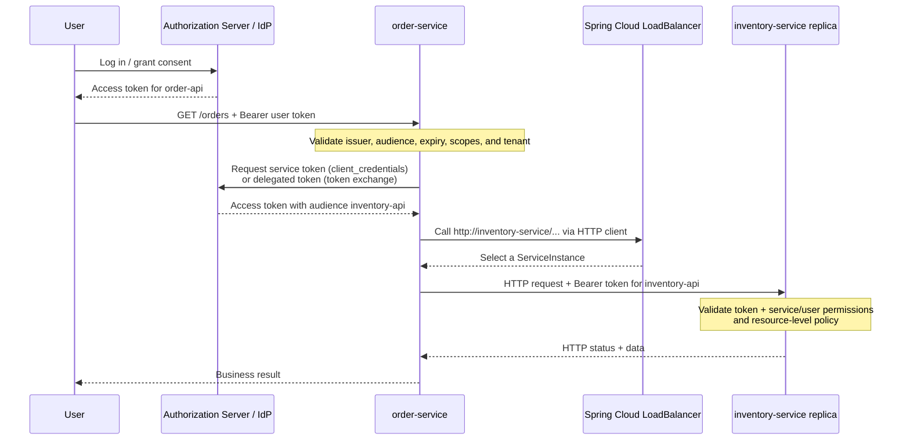
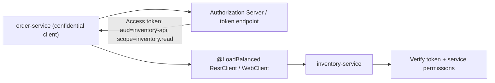
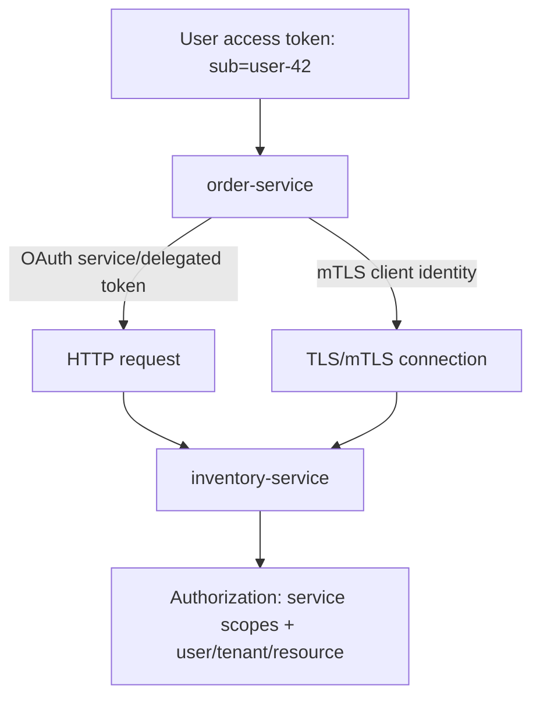

# Distinguishing User Identity from Service Identity

## 1. The Problem: Who Is Requesting and Which Service Is Calling?

In the **Communication Security** chapter of the `SPRING_CLOUD_SERVICE_COMMUNICATION_LOAD_BALANCING` module, we have seen how communication by service ID works: `order-service` calls `inventory-service` through Spring Cloud LoadBalancer; the `ServiceInstance` list comes from discovery, may be filtered by health/zone, and then `RestClient`, `WebClient`, or OpenFeign sends the HTTP request to the selected replica.

Now suppose a customer named An invokes the stock reservation feature. `order-service` receives the request and calls `inventory-service`:

- **Who is requesting the action?** End user An—are they logged in and permitted to reserve stock?
- **Which service is calling?** Workload `order-service`—which inventory APIs is it permitted to use?
- **Which service is receiving?** A genuine instance belonging to `inventory-service`, not a rogue host self-registered under the same service ID?
- **Is the action allowed?** Checking permissions across request type, product, tenant, quantity, and transaction state.

These four questions are related yet **not identical**. If an application simply receives an arbitrary bearer token and concludes "the request is safe", it can create a **confused deputy** vulnerability: an internal service with broad privileges performs actions on a user's behalf that the user was never authorized for.

Conversely, treating an IP, DNS name, or service ID as "identity" confuses **routing** with **authentication**. Spring Cloud LoadBalancer does not generate, validate, or authorize JWTs/mTLS for services; it picks a destination from an instance list.

### Learning Objectives

After this lesson, you will be able to:

1. Distinguish `end-user identity`, `OAuth client identity`, `workload/service identity`, instance identity, and service ID.
2. Understand JWT access tokens, issuer, audience, subject, scopes/roles, and how claims relate without automatically proving the same kind of principal.
3. Know when to use **OAuth2 client credentials** vs. when **user-scoped authorization** or **token exchange/on-behalf-of** is required.
4. Explain the distinct roles of TLS/mTLS, OAuth2/OIDC, Spring Security Resource Server, and Spring Cloud LoadBalancer.
5. Configure consumer/protected Spring Security services to validate tokens and acquire tokens for machine-to-machine calls via `OAuth2AuthorizedClientManager`.
6. Recognize 401/403/503 errors, wrong-audience token relays, spoofed headers, wrong retries, and risks of leaking tokens to untrusted instances.
7. Practice testing two inventory instances, valid/wrong-audience/wrong-scope tokens, user tokens, workload tokens, and mTLS.

## 2. Different Identity Types in a Microservice System

| Concept | Subject | Typical Authentication Source | Used to Decide |
|---|---|---|---|
| **End user** | An's account/login session | Identity Provider (IdP), OAuth2/OIDC, sessions, and MFA policy | Which products the user may view/reserve/purchase |
| **OAuth2 client** | Application issued a `client_id` | Client secret, private key JWT, mTLS client auth, or workload federation | Which tokens/permissions the application may request |
| **Workload/service identity** | Running `order-service` in the deployment environment | mTLS certificate/SPIFFE ID, workload identity, service account, issuer-minted token | Which workload is connecting and which APIs it may access |
| **Service ID in LoadBalancer** | Logical name like `inventory-service` | Mapping supplied by discovery/registry | **Routing** to a set of instances; not security proof by itself |
| **ServiceInstance** | Specific replica `inventory-a:8081` | Metadata/host/port from discovery | Which instance is selected; trust must still be verified on connect |
| **Caller principal in Spring Security** | Current `Authentication` object | Filter/resource server that validated the token | Access permissions at the current endpoint |

**A Service ID is not a cryptographically authenticated identity.** Even when discovery returns `inventory-a` from a trusted registry, the application still needs to trust the registry infrastructure, verify TLS/mTLS or appropriate mesh identity, and restrict permissions per endpoint.

**OAuth client identity does not necessarily equal workload identity.** An application may have `client_id=order-backend`, while its mTLS certificate carries a pod/deployment SPIFFE ID. They may represent the same workload under organizational policy, yet mapping between those two identities is a matter of **configuration and trust policy**, not automatic inference from two name strings.

### 2.1. Three Relationship Directions That Must Not Be Mixed

1. **User → order-service:** client calls the API; `order-service` must authenticate the user token/session and enforce business permissions.
2. **order-service → inventory-service:** `inventory-service` must authenticate that the calling workload is allowed to invoke the API.
3. **order-service on behalf of user → inventory-service:** beyond workload permissions, `inventory-service` needs the **authorized user** context, without blindly trusting an arbitrary user-id header.

For APIs reading generic system-wide data, service identity and an application's `inventory.read` permission may suffice. For stock reservation, tenant-scoped data, or customer-specific actions, **both** kinds of information and an explicit delegation mechanism may be necessary.

## 3. Authentication and Routing Flow Diagram



The diagram presents **two different options** for obtaining an outbound token: `client_credentials` or token exchange. It does not mean one request asks for both tokens or that every Spring version supports token exchange out of the box. Token issuance must follow your authorization server and organizational authorization model.

**LoadBalancer picks an instance after the caller decides which service ID to call.** A token with `aud=inventory-api` must be accepted consistently by every inventory replica under the same policy. If a client sends a token with `aud=order-api` to inventory, inventory must reject it even if the request originates from an `order-service` pod.

## 4. JWT Access Tokens: Each Claim Answers a Specific Question

An illustrative JWT access token (decoded payload, **not a validly signed token**):

```json
{
  "iss": "https://auth.example.test",
  "sub": "user-42",
  "aud": ["order-api"],
  "exp": 1795000000,
  "iat": 1794999700,
  "scope": "order.read order.create",
  "azp": "shop-web",
  "tenant": "tenant-a"
}
```

Claims to understand:

| Claim or Attribute | Interpretation | Caution |
|---|---|---|
| `iss` | Issuer that minted the token | Must match a trusted issuer and be verified with the signature |
| `sub` | Subject within the issuer's context | Does not prove **end user**, because machine tokens can also have `sub` |
| `aud` | Intended recipient(s)/API(s) allowed to accept the token | Resource server must check that its own audience is present |
| `exp`, `nbf`, `iat` | Validity timestamps | Apply reasonable clock skew and reject expired tokens |
| `scope`/`scp` | Granted permissions, in issuer-specific format | Do not assume user role = service OAuth scope |
| `azp`/`client_id` | OAuth client info per issuer profile | Not identical to user identity; not always both present |
| `tenant`/custom claim | Application context attested by issuer | Trust only when issuer and schema contract are agreed upon |
| `act` (in token exchange) | Can represent the actor acting on behalf of the subject | Depends on token exchange profile and authorization server |

Never base64-decode a JWT payload and treat it as valid. The resource server must **verify signature or introspection**, issuer, audience, validity, and permissions; claims become trustworthy only **after** verification.

### 4.1. Example: Machine Token Differs from User Token

Illustrative token from `client_credentials`:

```json
{
  "iss": "https://auth.example.test",
  "sub": "order-service-client",
  "aud": ["inventory-api"],
  "scope": "inventory.read",
  "client_id": "order-service-client",
  "exp": 1795000000
}
```

Here, `sub` represents the **OAuth client**, not user An. Never record `userId=order-service-client` in an order table meaning "the buyer".

Some IdPs emit machine tokens with `sub` as an internal ID, some include `gty` or `token_use` claims, and some identify clients via `azp` or `client_id`. **No single universal claim distinguishes user tokens from machine tokens across all issuers.** Define a token profile with your IdP, and inspect issuer/client/scope/claims alongside resource policies within the same trust domain.

### 4.2. Three Independent Conditions When Processing a Bearer Token

1. **Valid token:** signature/introspection, issuer, audience, validity window.
2. **Permitted principal and action:** scopes/roles and policies per actor type (user, workload, or delegated actor).
3. **Permitted specific resource:** SKU/tenant/warehouse/order owner; enforce business authorization rather than just checking `authenticated()==true`.

A valid access token with `aud=inventory-api` and `scope=inventory.read` **still does not automatically allow** returning another tenant's data. Object-level constraints and ownership must be checked at inventory or a service trusted under contract.

## 5. OAuth2 Client Credentials: Application Identity When Not Acting for a User

`client_credentials` fits when `order-service` performs **application-owned tasks**: background inventory synchronization, controlled health-related reads, or reading shared data requiring no individual user permissions.

Conceptual flow:



Clients must be granted least-privilege scopes by the IdP. If a service only needs `inventory.read`, never grant `inventory.write` or full admin rights. Store credentials in a secret manager or workload identity platform—never commit them to repositories or embed them in source code.

### 5.1. Declaring an OAuth2 Client Registration in Spring Boot

Example `application.yml` in `order-service` using Spring Security OAuth2 Client (URIs are placeholders):

```yaml
spring:
  security:
    oauth2:
      client:
        registration:
          inventory-machine:
            provider: company-auth
            client-id: ${INVENTORY_CLIENT_ID}
            client-secret: ${INVENTORY_CLIENT_SECRET}
            authorization-grant-type: client_credentials
            scope:
              - inventory.read
        provider:
          company-auth:
            token-uri: https://auth.example.test/oauth2/token
```

In real deployments, configure the client authentication method matching your IdP—such as `client_secret_basic`, `private_key_jwt`, or mTLS client authentication; not every IdP uses client secrets. Secrets via environment variables are **illustrative**; use a secret manager with rotation and read-access controls.

### 5.2. Letting OAuth2AuthorizedClientManager Manage Tokens

In Servlet/blocking apps, Spring Security provides `AuthorizedClientServiceOAuth2AuthorizedClientManager` to acquire/store tokens from a `ClientRegistrationRepository` and `OAuth2AuthorizedClientService`. Example:

```java
@Configuration(proxyBeanMethods = false)
class MachineTokenConfiguration {

    @Bean
    OAuth2AuthorizedClientManager machineAuthorizedClientManager(
            ClientRegistrationRepository registrations,
            OAuth2AuthorizedClientService authorizedClientService) {

        var manager = new AuthorizedClientServiceOAuth2AuthorizedClientManager(
                registrations, authorizedClientService);

        manager.setAuthorizedClientProvider(
                OAuth2AuthorizedClientProviderBuilder.builder()
                        .clientCredentials()
                        .build());
        return manager;
    }
}
```

This pattern suits calls **outside a user's HTTP request**, independent of a user's servlet request/session. The manager can reuse unexpired access tokens via the authorized client service/provider mechanism; there is no need to hit the token endpoint manually before **every** HTTP request.

The principal passed to authorize is the **calling workload name**, not an end user:

```java
OAuth2AuthorizeRequest request =
        OAuth2AuthorizeRequest.withClientRegistrationId("inventory-machine")
                .principal("order-service")
                .build();

OAuth2AuthorizedClient authorizedClient = manager.authorize(request);
if (authorizedClient == null) {
    throw new IllegalStateException(
            "No matching OAuth2 authorized client available");
}
String accessToken = authorizedClient.getAccessToken().getTokenValue();
```

Never log the `accessToken` value. If acquiring a token fails, never send a request to inventory with an empty token or try reusing an expired token.

### 5.3. Combining Service Tokens with @LoadBalanced RestClient

A self-contained blocking client configuration:

```java
@Configuration(proxyBeanMethods = false)
class InventoryRestClientConfiguration {

    @Bean
    @LoadBalanced
    RestClient.Builder loadBalancedRestClientBuilder() {
        return RestClient.builder();
    }

    @Bean
    RestClient inventoryRestClient(
            @LoadBalanced RestClient.Builder builder) {
        return builder.clone()
                .baseUrl("http://inventory-service")
                .build();
    }
}
```

A gateway using the machine token issued by the manager:

```java
@Service
class InventoryMachineGateway {

    private final RestClient client;
    private final OAuth2AuthorizedClientManager manager;

    InventoryMachineGateway(
            RestClient inventoryRestClient,
            OAuth2AuthorizedClientManager manager) {
        this.client = inventoryRestClient;
        this.manager = manager;
    }

    InventoryStock readStock(String sku) {
        OAuth2AuthorizeRequest authRequest =
                OAuth2AuthorizeRequest
                        .withClientRegistrationId("inventory-machine")
                        .principal("order-service")
                        .build();

        OAuth2AuthorizedClient authorized = manager.authorize(authRequest);
        if (authorized == null) {
            throw new IllegalStateException(
                    "Unable to obtain inventory service token");
        }

        String token = authorized.getAccessToken().getTokenValue();

        return client.get()
                .uri("/api/inventory/{sku}", sku)
                .headers(headers -> headers.setBearerAuth(token))
                .retrieve()
                .body(InventoryStock.class);
    }
}

record InventoryStock(String sku, int available) {}
```

Java/Spring Security/RestClient imports are omitted. This example requires compatible Spring Boot and Spring Cloud Release Trains, plus OAuth2 Client and OAuth2 Resource Server properly configured **on the respective applications**. An OAuth2 client registration alone does not guarantee `aud=inventory-api`: the IdP must issue an access token scoped for inventory via dedicated resource/scope/audience configuration.

**Key distinction:** the manager acquires a token for the **service client**; `@LoadBalanced RestClient.Builder` selects the **`ServiceInstance`**; the inventory resource server validates the token and permissions. These three responsibilities do not replace one another.

## 6. When Is User Identity Needed Downstream?

For an account-scoped stock reservation transaction, `inventory-service` may need to know **which user** owns the cart/order and which tenant; `order-service`'s `client_credentials` token alone is insufficient to decide whether that user has permission.

Three common patterns exist:

| Pattern | What the Outbound Request Carries | When Appropriate | Risks to Control |
|---|---|---|---|
| **Machine-to-machine** | `order-service`'s service access token | Technical tasks, shared system data | Lacks user permissions; never substitute for user authorization checks |
| **Controlled token relay** | Forwarded user access token | Only when the token **has matching audience/scopes** for downstream and policy permits | Overly broad privileges, wrong-audience token reuse, downstream confusing caller |
| **Token exchange/on-behalf-of** | Fresh token minted by AS for inventory carrying user context and authorized actor | Downstream needs user-specific authorization with least-privilege audience and scopes | Requires AS delegation support, delegation chain checks, actor constraints |

### 6.1. Why Not Forward Raw Bearer Tokens Blindly?

Suppose the browser holds a token:

```json
{
  "sub": "user-42",
  "aud": ["order-api"],
  "scope": "order.create"
}
```

`order-service` **should not** forward this raw token to `inventory-service` expecting inventory to accept it. The token was issued for `order-api`, not `inventory-api`. Inventory must reject it due to the wrong `aud`, even though the signature is valid, `sub` looks legitimate, and the connection comes from the internal network.

If you drop audience validation in inventory "to make it work", a token valid for API A can be replayed outside its intended scope at API B (**token substitution**). That is a severe trust boundary flaw.

Relay tokens only when the AS intentionally issues multi-audience tokens or downstream-targeted audiences, scopes suffice, and the delegation policy is approved. Broad/multi-audience privileges require careful review because they enlarge the blast radius if a bearer token leaks.

### 6.2. Token Exchange / On-Behalf-Of

Under RFC 8693, OAuth 2.0 Token Exchange lets a client ask the authorization server to mint a new token from an initial token/credential per policy. Conceptual flow:

```text
User -> order-service:
    Bearer access token (aud=order-api, sub=user-42)

order-service -> Authorization Server:
    token-exchange(subject_token=user-token,
                   audience=inventory-api,
                   requested_scope=inventory.reserve)
    + order-service client authentication

Authorization Server -> order-service:
    delegated access token
    (aud=inventory-api,
     subject/user context=user-42,
     actor/order-service per policy)

order-service -> inventory-service:
    Bearer delegated-token

inventory-service:
    validate signature/issuer/audience/expiry
    validate scope + actor + user/tenant/resource permissions
```

This is **protocol pseudocode**, not a bean that Spring Cloud LoadBalancer or Spring Security auto-provides for every AS. It requires an IdP supporting token exchange or an equivalent standards-based delegation mechanism with policies bounding scopes and lifetimes.

With a delegated token, `inventory-service` needs to know:

- Who is the user subject according to the issuer?
- Which caller/workload is acting on the user's behalf (actor), if provided by the protocol?
- Are both the user and the workload authorized to request that action?
- Does the token carry `aud` for inventory and matching scopes?
- Does the resource belong to the right tenant/owner?

**Checking `sub` alone is not enough.** In a machine token, `sub` may be the client; in a delegated token, actor and user can be two separate identifiers.

### 6.3. Is an X-User-Id Header Safe?

A header such as `X-User-Id: user-42` sent by `order-service` **is not by itself proof of user authentication**. If an external client can inject that header, or a gateway/proxy fails to strip and overwrite it before traffic enters the trusted zone, an attacker can impersonate another user.

If an architecture genuinely uses asserted identity headers between services, it must enforce **strict trust boundaries**: authenticated workload connections, external headers stripped, proxies issuing/signing or protecting assertions, downstream authorization checks, and no intermediate hop altering headers freely. For sensitive actions, cryptographically verified delegated tokens with explicit audience/scopes are usually easier to audit than freeform headers.

## 7. mTLS: Authenticates Workload Connections, Does Not Prove the User

TLS server authentication lets the caller verify that the server genuinely holds a valid certificate for the target endpoint identity and encrypts data in transit. **Mutual TLS (mTLS)** adds server verification of the calling workload's client certificate.



| Technology | What It Authenticates | What It Does Not Automatically Prove |
|---|---|---|
| HTTPS/TLS | Server endpoint identity via trust/hostname verification | Identity of the acting end user |
| mTLS | Both server and client workloads at the TLS layer | Specific user permissions and transaction semantics |
| SPIFFE/SPIRE or workload identity | Workload identity per trust domain/certificate/SVID | Automatic mapping to a user session |
| OAuth2 access token | Principal and permissions per token profile/issuer/audience | That the network channel is secure without TLS |
| Spring Cloud LoadBalancer | Instance selected by service ID/discovery | Validity of the instance's certificates/tokens |

### 7.1. Service Mesh and Trust Boundaries

When using Envoy/Istio or another service mesh, mTLS may **terminate at the sidecar proxy**, rather than inside the Spring Boot JVM. In that case:

- The proxy can authenticate the calling and receiving workload identities.
- The application may receive internal traffic from its proxy over a separate local hop depending on deployment mode; protect that hop.
- Mesh network/authorization policies can decide whether `order-service` is allowed to connect to `inventory-service`.
- **The application must still enforce user authorization** or delegated tokens for business flows needing user context.

Never treat an `X-Forwarded-Client-Cert` or similar proxy header as trustworthy if any external client can forge it. Allow only trusted proxies to insert/modify such headers and block bypass paths.

### 7.2. When LoadBalancer Switches Instances, How Does Security Hold Up?

`order-service` calls service ID `inventory-service`. LoadBalancer picks `inventory-a`, and on the next request may pick `inventory-b`. That implies:

- Both replicas must enforce **equivalent** resource-server configurations and policies for the API contract.
- TLS certificates/SANs/identities must align with the actual connected endpoints and routing setup. When using direct TLS to pods/hosts, hostname verification must rely on names genuinely covered by the certificates; never disable hostname verification.
- With mesh mTLS, sidecars/proxies authenticate destination workload identities within the trust domain; verify mesh policies instead of assuming every pod with an internal IP is trusted.
- A token with `aud=inventory-api` generally targets the **logical API resource**, without pinning the caller to one specific instance. Switching instances must not push a token outside its audience scope.

Never encode logic like "reachable at host:port means authenticated" into an API. Discovery metadata can be wrong or poisoned; restrict who can register instances and harden the registry. Protect admin/actuator endpoints as well, not just business endpoints.

## 8. Spring Security Resource Server Validating Tokens at inventory-service

A service receiving bearer tokens must **validate**, not merely parse them. Example using Spring Security 6.x in a Servlet (Spring MVC) app with OAuth2 Resource Server JWT.

Relevant dependencies:

```xml
<dependencies>
    <dependency>
        <groupId>org.springframework.boot</groupId>
        <artifactId>spring-boot-starter-security</artifactId>
    </dependency>
    <dependency>
        <groupId>org.springframework.boot</groupId>
        <artifactId>spring-boot-starter-oauth2-resource-server</artifactId>
    </dependency>
</dependencies>
```

### 8.1. Configuring Issuer, Signature, Expiry, and Audience Verification

Spring Security can auto-configure via the resource server's `issuer-uri`; here we write explicit code to ensure **audience validation** is not overlooked:

```java
@Configuration(proxyBeanMethods = false)
class InventoryResourceServerSecurity {

    @Bean
    SecurityFilterChain apiSecurity(HttpSecurity http) throws Exception {
        return http
                .authorizeHttpRequests(auth -> auth
                        .requestMatchers(HttpMethod.GET, "/api/inventory/**")
                            .hasAuthority("SCOPE_inventory.read")
                        .anyRequest().denyAll())
                .oauth2ResourceServer(oauth2 ->
                        oauth2.jwt(Customizer.withDefaults()))
                .build();
    }

    @Bean
    JwtDecoder inventoryJwtDecoder(
            @Value("${security.inventory.issuer}") String issuer,
            @Value("${security.inventory.jwk-set-uri}") String jwkSetUri) {

        NimbusJwtDecoder decoder =
                NimbusJwtDecoder.withJwkSetUri(jwkSetUri).build();

        OAuth2TokenValidator<Jwt> standard =
                JwtValidators.createDefaultWithIssuer(issuer);

        OAuth2TokenValidator<Jwt> audience = jwt ->
                jwt.getAudience().contains("inventory-api")
                        ? OAuth2TokenValidatorResult.success()
                        : OAuth2TokenValidatorResult.failure(
                                new OAuth2Error(
                                        "invalid_token",
                                        "Token audience is not inventory-api",
                                        null));

        decoder.setJwtValidator(
                new DelegatingOAuth2TokenValidator<>(
                        standard, audience));

        return decoder;
    }
}
```

Illustrative configuration for `inventory-service`:

```yaml
security:
  inventory:
    issuer: https://auth.example.test
    jwk-set-uri: https://auth.example.test/oauth2/jwks
```

These URIs are examples only. In production, issuer/JWKS must come from a trusted IdP over HTTPS with TLS validation; configure key rotation, permitted signing algorithms, and outage handling per security policy. Never derive JWKS URLs from user-supplied request values to prevent key/issuer selection attacks.

`JwtValidators.createDefaultWithIssuer` checks standard conditions for your Spring Security version, including issuer and timestamps; `audience` adds the `aud=inventory-api` constraint. With multiple issuers or token introspection instead of JWTs, the validation model differs, yet **audience/resource policy enforcement must still be guaranteed**.

`hasAuthority("SCOPE_inventory.read")` is only a scope check. If an endpoint exposes user/tenant-scoped data, add business-layer or method-security authorization to distinguish **user identity** from **workload identity**. **Identical scopes do not verify token class.** Cross-check the AS-defined token profile/claims/client identity; never assume every token carrying `SCOPE_inventory.read` is permitted to operate on user data.

### 8.2. Reading the Verified Principal

In a controller/resource service, you can inject `JwtAuthenticationToken`:

```java
@GetMapping("/api/inventory/me")
Map<String, String> whoAmI(JwtAuthenticationToken auth) {
    Jwt jwt = auth.getToken();

    return Map.of(
            "subject", jwt.getSubject(),
            "issuer", jwt.getIssuer().toString());
}
```

This is a **lab** endpoint; do not expose raw token/claim internals publicly in production. `auth` is the outcome after passing through Spring Security filters, unlike manually reading the `Authorization` header and decoding it unverified.

If `jwt.getSubject()` equals `order-service-client`, that may be a **machine subject**. Never display it as the user who owns an order. If token exchange issues tokens with both actor and user subject, read and authorize according to the agreed token profile rather than guessing from claim names alone.

### 8.3. Separating GET and POST Protection

The configuration in 8.1 only allows `GET /api/inventory/**` with scope `inventory.read`; all other paths hit `denyAll()`. If adding `POST /api/inventory/reservations`, define an explicit policy:

- Caller holds an appropriate scope/authority such as `inventory.reserve`.
- If the operation requires a user, delegated user context must be verified.
- Check tenant, order owner, quantity, idempotency key, and resource-level permissions.
- Permit the endpoint only from workloads with valid mTLS identity or through matching gateway policies when required by architecture.

Do not use a single broad scope like `inventory.admin` for both read-only APIs and state-changing transactions without a controlled justification.

## 9. Controlled Token Relay via WebClient

If a valid user access token truly exists for **inventory-api** and policy permits relaying it, the caller can pass the token to the HTTP client. *Adapter-level pseudocode* example—never extract arbitrary tokens straight from a browser input:

```java
// Precondition: delegated token was issued by IdP for inventory-api,
// satisfies audience/scope policies, and is handled securely.
Mono<InventoryStock> readForUser(
        String sku, String delegatedAccessToken) {

    return loadBalancedWebClient.get()
            .uri("http://inventory-service/api/inventory/{sku}", sku)
            .headers(headers ->
                    headers.setBearerAuth(delegatedAccessToken))
            .retrieve()
            .bodyToMono(InventoryStock.class);
}
```

`loadBalancedWebClient` is a `WebClient` built from a `@LoadBalanced` builder. This snippet shows where to attach the bearer token **after** an eligible token is obtained, not how to execute token exchange. Never blindly call `Authentication.getCredentials().toString()`: credential types/values depend on the authentication mechanism and may not contain a plain text access token or could expose secrets.

When using Spring Security OAuth2 Client, you can configure `ServletOAuth2AuthorizedClientExchangeFilterFunction` or `ServerOAuth2AuthorizedClientExchangeFilterFunction` per Servlet/WebFlux stack, provided you know **which client registration/authorized client** is selected, whether it draws from a user context or machine principal, and which defaults apply. Never enable "attach default token automatically" on a shared WebClient used for all downstreams; doing so can accidentally send inventory's token to payments or a redirect target.

### 9.1. Never Forward Authorization Across Arbitrary HTTP Redirects

A token is a **bearer credential**: anyone holding it can exercise it within its permitted scope. When an HTTP client follows redirects, proxies, or custom filters, verify policies governing whether `Authorization` is re-sent to another host. Never build an interceptor that copies bearer tokens from incoming requests onto **every** outbound request without validating destination/audience.

Across multiple service IDs, define per-resource client/token policies, such as `inventory-api` vs. `pricing-api`. Token exchanges or client credentials must request the exact intended audience; never lump tokens into a single global cache shared across APIs in different trust domains.

## 10. Authorization Is More Than "Service Authenticated"

There are three decision layers:

| Layer | Example | Failure If Skipped |
|---|---|---|
| **Workload/network policy** | Mesh allows only `order-service` to call `inventory-service` | Any arbitrary pod can invoke internal APIs |
| **Token/resource server policy** | `aud=inventory-api`, `scope=inventory.read` | Tokens meant for other APIs are accepted |
| **Domain authorization** | User belongs to tenant-a, permitted to reserve SKU in warehouse A | Broadly privileged workload acts on data not owned by the user |

An API can **simultaneously** authenticate workloads via mTLS, require an inventory-scoped JWT access token, **and** validate user/tenant ownership depending on the endpoint. Not every system must apply all three layers to every GET, yet skipping any layer must be a **risk-analyzed architectural decision**, never an unexamined default for "internal traffic".

### 10.1. User-Level Permissions Must Be Checked Where Data Lives

If `order-service` asserts "the user owns the order" while `inventory-service` stores tenant-scoped data, inventory still needs assurance that tenant/user context is neither forged nor used out of scope. To avoid duplicating business logic, you can use a policy service/authorization server or an agreed claims contract—but **never blindly trust an arbitrary caller-supplied `X-Tenant-Id`**.

If authorization decisions live exclusively in `order-service`, inventory must authenticate the calling workload and be designed as a **trusted internal API**, blocking calls from elsewhere. This trust boundary must be documented and bypass-tested.

### 10.2. Avoiding Confused Deputy

An example bug:

1. `order-service` holds service-wide permission to modify any reservation.
2. User An is only allowed to modify An's reservations.
3. An API on `order-service` accepts any `reservationId` without checking ownership.
4. `order-service` uses its powerful service token to call inventory and modify Binh's reservation.

JWTs, mTLS, and LoadBalancer may all be working **technically as configured**, yet business authorization is broken. Verify owner/tenant where full context exists or pass a narrowly scoped delegated token. Never treat a powerful service identity as an implicit pass to override user permissions.

## 11. Distinguishing Security Errors from Discovery and HTTP Errors

| Symptom | Originating Layer | Typical Meaning | Recommended Action |
|---|---|---|---|
| `401 Unauthorized` | Resource server/authentication | Missing token, expired/invalid token, wrong issuer/audience | Inspect token issuance/validation; do not retry unconditionally |
| `403 Forbidden` | Authorization | Principal authenticated but lacks permission/scope/tenant | Fix policy/permissions properly; do not retry identically |
| `503` from LoadBalancer having no instance | Caller before HTTP | No eligible target, not necessarily authentication-related | Inspect discovery, suppliers, health, cache |
| `503` returned by inventory | Downstream received HTTP | Server is unavailable | Classify availability, bounded timeouts/retries |
| `502` at edge API | Gateway/caller policy | Upstream or contract/transport failure, per contract | Trace end-to-end; do not blame tokens by default |
| `SSLHandshakeException` / hostname mismatch | TLS or mTLS | Broken trust/certificate/SAN/issuer/workload identity | Fix trust chain/identity; never disable verification |
| `invalid_client` at token endpoint | OAuth client authentication | Workload not authenticated/issued token | Check client credentials/config, rotation |
| `invalid_grant` or denied token exchange | Authorization Server | Invalid or disallowed delegation request | Check policy/AS/audience; do not fall back to broad token |
| `404 Not Found` from inventory | Domain or routing | SKU/endpoint absent per contract | Do not confuse with "service ID does not exist" |
| `429 Too Many Requests` | Rate limit | Caller overloaded or exceeded quota | Respect `Retry-After`, throttle retries |

HTTP **401** may include `WWW-Authenticate: Bearer ...` with helpful details. HTTP **403** does not mean a user token could not be parsed; the token can be valid yet lack permissions. A machine-to-machine call can receive 403 if service scopes are insufficient. Never automatically substitute another user's token or broaden client credentials just to "make 403 go away".

**Never retry authentication/authorization errors like 503s.** Retrying the exact same token does not change its issuer, audience, or permissions. If an access token expires, the OAuth2 client manager may acquire a new token per allowed rules; that is **token lifecycle**, not a reason to retry all 401s unboundedly.

## 12. LoadBalancer, Health Checks, and Retries Do Not Carry Identity

When `inventory-service` has two replicas, `RoundRobinLoadBalancer` selects A then B per policy; the algorithm neither knows nor cares whether a token belongs to a user or a service. Watch out for:

- **Both instances** must validate tokens using the same issuer/audience/scopes/API contract. One replica missing audience validation creates a vulnerability affecting a slice of traffic.
- **Retries** may select another instance. If retrying alters caller identity or token audience, that is a client integration bug; tokens should never be arbitrarily coupled to an instance hostname.
- **Health checks** verify readiness, not authorization. A `/actuator/health/readiness` returning 200 does not prove the service accepts tokens or enforces authorization properly.
- **Discovery/caches** can return stale instances. Connecting to an untrusted instance must never send bearer tokens merely because it appeared in a list. Harden the registry and transport trust.
- **Zone routing** is a locality policy, not a security boundary. If tenants/regions have legal or residency requirements, enforce hard routing policies, network segmentation, and tenant authorization—never rely on zone preferences with fallback.

### 12.1. Retries and Token Expiration

One logical request can span multiple attempts. A token could expire during backoff before the second attempt:

- A proper client manager can acquire a fresh token before sending, rather than caching expired tokens.
- For user delegated tokens, follow approved token-exchange/delegation mechanics; never artificially extend user privileges just because a request is retrying.
- Never auto-retry sensitive state-changing POSTs without idempotency keys and duplicate-write protection.
- If token exchange fails, never fall back to a stronger service token to bypass user checks.

### 12.2. DNS, Service ID, Certificates, and Audience Are Four Distinct Lists

Example:

```text
LoadBalancer Service ID: inventory-service
Discovery endpoint:      inventory-a.internal:8443
TLS server identity:     spiffe://example.test/ns/shop/sa/inventory
JWT audience:            inventory-api
```

These four values **do not have to be identical**, yet they must have a managed mapping checked against policy. Never validate audience by string-comparing it to the newly selected physical hostname; inventory can run across many hostnames/pods under the same API audience. Likewise, never drop hostname verification because certificate SANs lack the service ID: use an identity/certificate model suited to direct TLS or service mesh deployment.

## 13. Lab: Two Inventory Replicas and Two Token Types

### 13.1. Topology

| Component | Example Port / Address | Role |
|---|---|---|
| `order-service` | `localhost:8080` | Caller using `@LoadBalanced RestClient` |
| `inventory-a` | `localhost:8081` | Resource server validating tokens |
| `inventory-b` | `localhost:8082` | Resource server validating tokens |
| Authorization Server | `https://auth.example.test` | Issues validly signed access tokens |
| Discovery | `SimpleDiscoveryClient` in lab | List of two instances |

Caller configuration:

```yaml
spring:
  application:
    name: order-service
  cloud:
    discovery:
      client:
        simple:
          instances:
            inventory-service:
              - uri: http://localhost:8081
                instance-id: inventory-a
              - uri: http://localhost:8082
                instance-id: inventory-b
    loadbalancer:
      retry:
        enabled: false
server:
  port: 8080
```

Using HTTP on `localhost` is **solely for learning LoadBalancer mechanics** and assumes the processes share an isolated network namespace. Real security exercises require HTTPS/mTLS or a proper mesh and a real IdP; never send real bearer tokens over cleartext HTTP on untrusted networks. In Docker/Kubernetes, use addresses reachable by the caller rather than confusing a container's `localhost` with another pod.

### 13.2. Creating the Protected Endpoint

In both `inventory-a` and `inventory-b`, register `InventoryResourceServerSecurity` from section 8 and the endpoint:

```java
@RestController
class InventoryApiController {

    private final String instanceId;

    InventoryApiController(Environment env) {
        instanceId = env.getRequiredProperty("app.instance-id");
    }

    @GetMapping("/api/inventory/{sku}")
    Map<String, Object> stock(@PathVariable String sku) {
        return Map.of(
                "sku", sku,
                "available", 12,
                "instanceId", instanceId);
    }
}
```

A uses `app.instance-id=inventory-a`, B uses `inventory-b`. Both must enforce the **exact same issuer/audience and scopes policy** so authentication outcomes never vary by replica.

### 13.3. Test Token Set

Mint **real IdP-signed tokens** issued per policy—do not hand-craft fake unsigned JWT payloads expecting the resource server to accept them. Prepare:

| Token | Subject/Client | Audience | Scope | Expectation for `GET inventory` |
|---|---|---|---|---|
| A — valid service token | `order-service-client` | `inventory-api` | `inventory.read` | 200 when request/cert/tenant policies pass |
| B — user token for order | `user-42` | `order-api` | `order.read` | 401 due to wrong audience for inventory |
| C — under-scoped service token | `order-service-client` | `inventory-api` | `order.read` | 403 per `hasAuthority("SCOPE_inventory.read")` |
| D — expired | Any | `inventory-api` | `inventory.read` | 401 due to `exp` |
| E — wrong issuer | Any subject | `inventory-api` | `inventory.read` | 401 due to untrusted issuer/signature |
| F — valid delegated token | User subject, service actor per AS | `inventory-api` | `inventory.read` | 200 for read, while user/tenant permissions need separate checks |

If the endpoint only checks scope in the sample configuration, both token A and token F pass the scope layer; distinguishing token classes accurately is an **additional policy** designed with the AS. Never conclude machine token A is allowed to perform user-scoped transactions simply because GET returned 200.

### 13.4. Experiment Sequence

1. Start both inventory instances and the test IdP, verifying both share identical security config.
2. Send valid requests through `order-service` using `InventoryMachineGateway`; record instance IDs in responses and traces.
3. Call with wrong-audience/wrong-issuer/expired test tokens; confirm 401, with no anonymous fallback.
4. Call with valid issuer/audience but missing `inventory.read`; confirm 403.
5. Alternate A/B and temporarily remove B's audience validator in the lab; demonstrate a security gap affecting only a fraction of traffic, then restore policy parity.
6. Stop A while leaving A's URI in discovery; distinguish transport/timeout errors from 401/403.
7. Test mTLS/mesh policy from an unauthorized workload and confirm the connection is rejected **before** user token inspection; inspect mesh/proxy logs.
8. Verify logs/metrics never emit access tokens, refresh tokens, secrets, or private keys.

**Never practice disabling signature, audience, or TLS hostname verification on environments holding real data.** For "invalid token" tests, have the AS mint test tokens or spin up a test server with its own lab-trusted JWKS and issuer.

## 14. Error Matrix and Caller Handling

An API gateway or `order-service` must return consistent statuses to users when dependencies fail, without obscuring root causes:

| Upstream / Failing Layer | Appropriate Caller Behavior |
|---|---|
| User token sent to order-api is invalid | Return 401 to user; do not call inventory |
| User is authenticated but lacks permission | Return 403 to user; do not call inventory |
| Service token acquisition fails due to `invalid_client` | Alert and return dependency error; never send anonymous requests |
| Inventory rejects machine token for wrong audience | Security/config incident; **never retry the same token endlessly** |
| Inventory rejects for missing scope | Fix client policy/permissions; do not grab a broader token carelessly |
| No `ServiceInstance` available | 503 or dependency error per contract; investigate discovery/health |
| Instance selected but connection times out | Honor deadline; conditional retry for safe GETs |
| Circuit breaker is OPEN | Fail fast / appropriate business fallback; do not blame the user |
| HTTP 404 for nonexistent SKU | Handle domain `NOT_FOUND`; do not confuse with nonexistent service ID |
| Data/contract error | Never invent `available=0` or grant default permissions |

On internal APIs, propagating errors from inventory to order-service must **preserve root-cause classification**: a 401 from an unauthenticated user differs from a 401 from an expired service token, and each may require a different remediation. Never flatten all errors into `403` "to hide info" when an explicit API contract is expected.

### 14.1. Never Trust Unsigned Data

Cases that must be rejected:

- A decoded JWT whose signature has not been verified.
- A token whose `iss` differs from trusted issuers or whose `aud` lacks the resource API.
- An expired token or one whose `nbf` is still in the future.
- A token with a scope that lacks the user/actor context needed for a sensitive action.
- `X-User-Id`/`X-Tenant-Id` headers arriving from external clients without a trust boundary.
- An invalid service certificate or one not mapped to an authorized workload.
- Following a redirect to another host while still attaching the bearer token.
- A registry containing an unknown instance where the app assumes "same service ID means same trust".

## 15. Common Mistakes

| Misconception | Why It Is Wrong | How to Fix |
|---|---|---|
| "Being on the internal network means authenticated" | Internal IPs are not cryptographic proof | TLS/mTLS, network policies, resource server |
| "Service ID is a signed service identity" | It is primarily a discovery/routing key | Authenticate workloads via mTLS/tokens/mesh |
| "Any bearer token works across services" | Tokens carry specific `aud`/scopes | Validate audience; use token exchange when needed |
| "`sub` is always a user ID" | Machine tokens also have a subject | Rely on token profile and actor/client identity |
| "Having `scope=inventory.read` lets a user read every tenant" | API scope does not replace resource authorization | Enforce owner/tenant/warehouse checks |
| "With mTLS, user authorization is unnecessary" | mTLS authenticates workloads, not end users | Add delegated user context when required |
| "Caller-supplied `X-User-Id` is enough" | Headers can be spoofed | Trusted proxies/cryptographic delegation and policies |
| "`client_credentials` replaces user tokens at checkout" | Service tokens do not represent user permissions | Block the action or use user delegation |
| "Token exchange happens automatically with LoadBalancer" | LoadBalancer is not an OAuth2 client/token service | Configure AS/token exchange explicitly |
| "One healthy replica means all replicas are secure" | Security configs can drift across pods | Test A/B and canary security parity |
| "Once JWT is verified, audience checks are unnecessary" | Tokens minted for other APIs can be replayed | Validate `aud` at every resource server |
| "A parseable JWT is valid" | Payloads can be forged | Verify signature, issuer, expiry, audience |
| "On `SSLHandshakeException`, disable hostname verification" | Eliminates server authentication | Fix certificate/SAN/trust/mesh config |
| "401/403 should be retried like 503" | Missing permissions do not heal on retry | Handle token lifecycle/policies separately |
| "Health check 200 proves endpoints enforce permissions" | Readiness is unrelated to authentication | Test protected APIs with concrete tokens |
| "When retry picks a new instance, the token switches audience" | Tokens target the logical API/resource | Decouple token issuance from instance selection |
| "Log bearer tokens in traces for debugging" | Tokens are replayable credentials | Log only error codes and non-sensitive metadata |

## 16. Practice Exercises

### Exercise 1 — Draw the Trust Boundaries

Redraw the user → order → inventory diagram. Mark explicitly where the user token is authenticated, where the service token is issued, where JWT audience is verified, where mesh mTLS authenticates workloads, and where LoadBalancer selects an instance. Explain why none of these steps replaces another.

### Exercise 2 — Classify JWTs

Given three payloads: (A) `sub=user-42, aud=order-api`; (B) `sub=order-client, aud=inventory-api, scope=inventory.read`; (C) `sub=user-42, aud=inventory-api, act=order-client`. Classify each as user/service/delegated according to a **known issuer profile**, not `sub` alone. Identify cases requiring rejection due to missing scope/tenant.

### Exercise 3 — Client Credentials and Missing User Context

Write `InventoryMachineGateway` using `OAuth2AuthorizedClientManager` to call GET inventory from a background job. Then try using the same machine token to reserve stock for a user; explain why user/tenant permission checks or switching to a delegated token are mandatory.

### Exercise 4 — Never Forward Wrong Audience

Receive an `aud=order-api` token at `order-service`. Write a test confirming the inventory resource server rejects the request if that token is relayed as-is. Propose how to request a fresh `aud=inventory-api` token via the AS.

### Exercise 5 — Two Replicas, One Security Policy

Run two inventory instances sharing the same security code. Send 50 GETs through LoadBalancer, verifying all requests with valid token A succeed; wrong-audience token B must be rejected on **both** replicas. Intentionally alter B's config in the lab and measure instance-skewed failures.

### Exercise 6 — Independent mTLS and User Tokens

Enable mTLS/service mesh for the order → inventory path. Connect from an unauthorized workload: it must be blocked immediately at the mTLS/policy layer. Next, let authorized `order-service` connect while sending an under-scoped user token: the API must still reject it per bearer/authorization policy.

### Exercise 7 — Confused Deputy

Simulate user An trying to modify Binh's reservation through order-service. Even though order-service holds an `inventory.write` token, owner/tenant checks must block the operation. Propose where the check belongs and how to pass trustworthy delegated context.

### Exercise 8 — 401, 403, and 503

Build three separate tests: expired token (401), valid token lacking scope (403), and discovery returning no instances (caller-side 503). Consider bounded retries only for qualifying transient/timeout errors; specify distinct events/metrics per error class.

## 17. Pre-Operations Checklist

- [ ] User identity, OAuth client identity, workload identity, and service ID are defined separately.
- [ ] Every resource server validates token signature/introspection, issuer, audience, expiry, and permissions.
- [ ] `sub` is never assumed to always be a user ID; machine/delegated tokens have explicit profiles.
- [ ] Client credentials are used only for authorized service tasks, never substituting for user permissions.
- [ ] Token exchange or trusted delegation is in place whenever downstream needs user context.
- [ ] External user/tenant headers cannot be spoofed across trust boundaries.
- [ ] TLS/mTLS or service mesh policies cover transport encryption and workload identity when required.
- [ ] Hostname/certificate verification is never disabled to "fix" instance-selection errors.
- [ ] Two or more replicas sharing a service ID enforce identical resource-server policies.
- [ ] HTTP clients have `@LoadBalanced` on the right bean, without confusing routing with authentication.
- [ ] Token audience targets the receiving API, not an arbitrary replica host:port.
- [ ] Retries/timeouts, health checks, and circuit breakers never weaken authorization.
- [ ] Tested 401, 403, wrong audience, expired tokens, no-instance, TLS failures, and rollback.
- [ ] Never log tokens/secrets/private keys, and never send `Authorization` to untrusted hosts.
- [ ] Audit user/service/actor principal types, traces, and authorization decisions without leaking PII.
- [ ] Secret/certificate rotation and token revocation/introspection plans exist where policy requires.
- [ ] Write operations enforce idempotency and resource-level permissions, not just broad API scopes.

## Official References

- [Spring Security — OAuth 2.0 Resource Server JWT](https://docs.spring.io/spring-security/reference/servlet/oauth2/resource-server/jwt.html): JWT validation, issuer, JWK, JWT validators, and mapping scopes to authorities.
- [Spring Security — OAuth2 Client, Core Interfaces/Authorized Client Manager](https://docs.spring.io/spring-security/reference/servlet/oauth2/client/core.html): `OAuth2AuthorizedClientManager`, `client_credentials`, and authorized client services.
- [Spring Security — Reactive OAuth2 Client](https://docs.spring.io/spring-security/reference/reactive/oauth2/client/index.html): OAuth2 clients/filters in WebFlux systems.
- [Spring Cloud Commons — Spring Cloud LoadBalancer](https://docs.spring.io/spring-cloud-commons/reference/spring-cloud-commons/loadbalancer.html): service ID, `ServiceInstance`, discovery, health checks, retries, and target selection.
- [RFC 6749 — OAuth 2.0 Authorization Framework](https://www.rfc-editor.org/rfc/rfc6749): `client_credentials` and the authorization model.
- [RFC 7519 — JSON Web Token](https://www.rfc-editor.org/rfc/rfc7519): `iss`, `sub`, `aud`, `exp` claims and token semantics.
- [RFC 8707 — Resource Indicators for OAuth 2.0](https://www.rfc-editor.org/rfc/rfc8707): specifying target resources/audiences when requesting tokens.
- [RFC 8693 — OAuth 2.0 Token Exchange](https://www.rfc-editor.org/rfc/rfc8693): subject tokens, actor/delegation, and the token exchange model.
- [RFC 6750 — OAuth 2.0 Bearer Token Usage](https://www.rfc-editor.org/rfc/rfc6750): sending bearer tokens, 401 status, and `WWW-Authenticate`.
- [SPIFFE — Workload Identity Standard](https://spiffe.io/docs/latest/spiffe-about/overview/): workload identity and certificates/SVIDs.
- [Spring Cloud — Release Train](https://spring.io/projects/spring-cloud/): aligning Spring Cloud/Boot/Security versions when using examples and dependencies.

**Key takeaway:** **user identity** answers "which user and what permissions?", **service/workload identity** answers "which application is calling?", and **Spring Cloud LoadBalancer's service ID** answers "which set of instances to call?". Tokens meant for inventory must be issued and verified against **inventory's audience, scopes, and policies**, regardless of which replica handles the request. Trustworthy service communication requires authenticating **the right principal**, authorizing **the right resource**, and preserving trust boundaries at every step.
