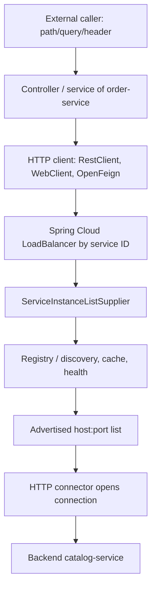

# Preventing Untrusted URLs and SSRF Risks on the Caller Side

In a microservice architecture, applications frequently send HTTP requests to other services via `RestClient`, `RestTemplate`, `WebClient`, or OpenFeign. With Spring Cloud LoadBalancer, a client can call a logical URL such as `http://catalog-service/api/products/42`, letting LoadBalancer find and select a suitable `ServiceInstance`. **However, instance selection is not a defense against untrusted URLs.**

When an application accepts a full URL, hostname, service ID, or redirect target from user parameters and uses it to make an HTTP call, an external party can abuse the server's network access to reach systems that should never be reachable. That is a form of **Server-Side Request Forgery (SSRF)**. The risk persists even when the application has service discovery, health checks, round-robin, retries, or TLS.

This lesson belongs to the **Communication Security** section of the Spring Cloud LoadBalancer module. It focuses on defining trust boundaries, never letting external input dictate connection targets, configuring clients around controlled service IDs, and combining URI checks with network policies when external URLs genuinely must be called.

## 1. What Is SSRF in Service-to-Service Communication?

SSRF occurs when a component with network access **issues requests to an address influenced by a less-trusted source**, going beyond the destinations the application was designed to call.

Suppose `order-service` exposes an endpoint to preview a product image. A dangerous implementation accepts a raw `url` string from the caller and makes the backend fetch that URL. Without controls, a caller can try forcing `order-service` to access:

- Loopback addresses such as `http://127.0.0.1:8080/...`, where only the server itself can connect.
- Link-local addresses or cloud infrastructure metadata endpoints.
- Internal services on private networks that external users are not allowed to reach directly.
- An external host that redirects to an internal address.
- A DNS name that initially looks valid and later resolves to a forbidden IP.

Consequences can include internal data exposure, unauthorized access to admin APIs, network resource exhaustion, or turning the application into a **confused deputy**: the server uses its own network privileges to perform actions the caller is not authorized to perform.

**Distinction:** SSRF does not strictly require an `http://...` URL in the API. If a user parameter is turned into a service ID, host, port, gateway route, or metadata hint to pick an internal instance, trust boundaries can be crossed as well.

## 2. Trust Boundaries in Spring Cloud LoadBalancer

A call through LoadBalancer typically traverses these layers:



There are **two distinct places where the destination is decided**:

1. **In application code:** choosing the service ID or logical URL, such as `catalog-service`; this must come from trusted configuration and business logic.
2. **In discovery and LoadBalancer:** picking a host/port from advertised instances; this list is only as trustworthy as the registry, registration identities, network policies, and operational controls.

For example, a controller accepting a parameter:

```text
GET /proxy?service=internal-admin&path=/...
```

and then building `http://{service}/{path}` to call via `@LoadBalanced` is a dangerous design. Even without calling raw IPs directly, the caller can choose **an internal service ID outside allowed business operations**. LoadBalancer merely picks an instance; it does not know whether the caller is allowed to use that service name.

**First rule:** URLs or service IDs for service-to-service requests must be chosen by **application code/trusted configuration**. Users may only supply **business data** such as product IDs, filters, dates, or quantities—never arbitrary hosts or protocols.

## 3. Distinguishing Which Parts of a URI May Come from Users

An HTTP URI has multiple components:

```text
https://api.partner.example:443/products/42?locale=vi#section
  │       │               │     │          │       │
scheme   host             port  path       query   fragment
```

Each part carries a different security impact:

| Component | Who Should Decide It? | Risk When Controlled Externally |
|---|---|---|
| Scheme (`http`/`https`) | Trusted configuration | TLS downgrade or unintended protocol usage |
| Host / service ID | Configuration, allowlist | SSRF into internal/loopback or another service |
| Port | Configuration, allowlist | Reaching admin ports or unauthorized ports |
| Path template | Application code | Calling privileged endpoints, path traversal/unintended routing |
| Path variable | Validated and encoded business data | Escaping a path segment or altering the route |
| Query value | Encoded business data | Altering parameters via bad concatenation; carrying secondary URLs |
| Header | Controlled code or policy | Spoofing `Host`, auth, proxy/forwarded headers, or routing hints |
| Fragment | Not sent in HTTP requests to the server | No server routing effect, but prone to bugs in naive string checks |

The `@` character in a URL is a classic reason **never to validate hosts with `startsWith`**: a string containing an allowed domain in the userinfo section can still have a completely different real host. Likewise, `api.partner.example.evil.example` is not the same host as `api.partner.example`.

Checks like `url.contains("api.partner.example")`, `startsWith("https://api.partner.example")`, or merely blocking the string `localhost` are insufficient for safety.

## 4. Preferred Defense: Fixed Destination, Variable Data Only

If the feature only needs to call `catalog-service`, the simplest and strongest solution is **never letting callers pass a URL**.

### 4.1. RestClient with a Fixed Service ID

Declare a `RestClient.Builder` with LoadBalancer:

```java
import org.springframework.cloud.client.loadbalancer.LoadBalanced;
import org.springframework.context.annotation.Bean;
import org.springframework.context.annotation.Configuration;
import org.springframework.web.client.RestClient;

@Configuration(proxyBeanMethods = false)
class HttpClientConfiguration {

    @Bean
    @LoadBalanced
    RestClient.Builder loadBalancedRestClientBuilder() {
        return RestClient.builder();
    }
}
```

Create a client dedicated to a single service ID:

```java
import java.util.regex.Pattern;

import org.springframework.beans.factory.annotation.Qualifier;
import org.springframework.stereotype.Component;
import org.springframework.web.client.RestClient;

@Component
public class CatalogClient {

    private static final Pattern SAFE_PRODUCT_ID =
            Pattern.compile("[A-Za-z0-9_-]{1,64}");

    private final RestClient restClient;

    public CatalogClient(
            @Qualifier("loadBalancedRestClientBuilder")
            RestClient.Builder builder) {
        this.restClient = builder
                .baseUrl("http://catalog-service")
                .build();
    }

    public ProductResponse getProduct(String productId) {
        if (productId == null
                || !SAFE_PRODUCT_ID.matcher(productId).matches()) {
            throw new IllegalArgumentException("Invalid product ID");
        }

        return restClient.get()
                .uri(uriBuilder -> uriBuilder
                        .path("/api/products/{id}")
                        .build(productId))
                .retrieve()
                .body(ProductResponse.class);
    }
}
```

This code assumes `ProductResponse` is an application DTO. Key points:

- `catalog-service` and the path template are **code-controlled literals**, never sourced from external requests.
- `productId` is strictly a path variable; the regex illustrates a simple ID contract disallowing `/`, `?`, `#`, or control characters.
- The URI builder handles expansion and URI encoding per Spring configuration; **never concatenate URL strings manually** from untrusted data.
- The LoadBalancer filter resolves the service ID via discovery, but is not tasked with validating product IDs or user permissions.

The regex here is an **illustrative business rule**, not a mandate that every API use the same ID format. If IDs allow Unicode, spaces, or other characters, validate/encode consistently with the API contract; the goal is to **confine data within a predetermined URI slot**, never letting it turn into a host or full URI.

Note that `baseUrl(...)` on an HTTP client does not always strictly prevent a method call from overriding it with an **absolute URI**. Never build a wrapper exposing `uri(String arbitraryUrl)` assuming `baseUrl` protects the target. Internal calling APIs should only expose **business methods** like `getProduct(id)`, never a `fetchUrl(url)` method.

### 4.2. WebClient with a LoadBalancer Builder

Similar pattern for WebClient:

```java
import org.springframework.cloud.client.loadbalancer.LoadBalanced;
import org.springframework.context.annotation.Bean;
import org.springframework.web.reactive.function.client.WebClient;

@Bean
@LoadBalanced
WebClient.Builder loadBalancedWebClientBuilder() {
    return WebClient.builder();
}
```

Then build the client with a trusted target:

```java
public final class CatalogReactiveClient {
    private final WebClient webClient;

    public CatalogReactiveClient(WebClient.Builder builder) {
        this.webClient = builder
                .baseUrl("http://catalog-service")
                .build();
    }

    public Mono<ProductResponse> getProduct(String id) {
        if (id == null || !id.matches("[A-Za-z0-9_-]{1,64}")) {
            return Mono.error(
                    new IllegalArgumentException("Invalid product ID"));
        }
        return webClient.get()
                .uri(uriBuilder -> uriBuilder
                        .path("/api/products/{id}")
                        .build(id))
                .retrieve()
                .bodyToMono(ProductResponse.class);
    }
}
```

The example assumes the injected builder is a `@LoadBalanced` bean, with `WebClient` and `Mono` imported. When using WebClient in Spring WebFlux, return `Mono` for the framework to manage subscription instead of calling `block()` or `subscribe()` arbitrarily.

Pattern **to avoid** in both WebClient and RestClient:

```java
// UNSAFE: userUrl could be an absolute URL or an unknown service ID.
webClient.get()
        .uri(userUrl)
        .retrieve()
        .bodyToMono(String.class);
```

If the caller can supply the entire URI, the application loses control over the HTTP destination. Using `@LoadBalanced` does not guarantee the chosen service ID belongs to an allowlist.

### 4.3. Query Parameters Are Not Freeform URL Templates

Product search should keep the endpoint fixed:

```java
Mono<List<ProductResponse>> search(
        String category, int page, int size) {
    if (page < 0 || size < 1 || size > 100) {
        return Mono.error(
                new IllegalArgumentException("Invalid pagination"));
    }
    return webClient.get()
            .uri(uriBuilder -> uriBuilder
                    .path("/api/products")
                    .queryParam("category", category)
                    .queryParam("page", page)
                    .queryParam("size", size)
                    .build())
            .retrieve()
            .bodyToMono(new ParameterizedTypeReference<
                    List<ProductResponse>>() {});
}
```

`ParameterizedTypeReference` belongs to `org.springframework.core`. Using the query builder avoids manual `"&"`, `"="`, or encoding mistakes. However, if a query parameter like `callbackUrl` is **used by the target backend to issue a follow-on HTTP request**, the SSRF risk moves to that backend. Validate and constrain URL values **right where the outbound request is executed**.

## 5. OpenFeign: Locking the Service ID in the Interface

With Spring Cloud OpenFeign, the standard approach is declaring a static service ID:

```java
import org.springframework.cloud.openfeign.FeignClient;
import org.springframework.web.bind.annotation.GetMapping;
import org.springframework.web.bind.annotation.PathVariable;

@FeignClient(name = "catalog-service")
public interface CatalogFeignClient {

    @GetMapping("/api/products/{id}")
    ProductResponse getProduct(@PathVariable("id") String id);
}
```

When invoked, Spring Cloud OpenFeign turns the annotations into an HTTP request; Spring Cloud LoadBalancer selects an instance for `catalog-service`. If strict ID validation is needed, validate in the service/gateway before invoking Feign and still enforce authorization on the product.

Areas needing extra control:

- `@FeignClient(url = "...")`: a fixed target can be appropriate when sourced from trusted config; **never take that URL from user requests**.
- Feign's **dynamic target** feature, or methods taking `java.net.URI` to override targets if supported by the current contract, must be treated as sensitive boundaries. Never pass untrusted URIs into that mechanism.
- `RequestInterceptor` can add headers from requests/contexts. Never let callers set `Host` or arbitrary routing hints if that could steer the client to an unintended service or internal cohort.
- When multiple Feign clients share a contract for different purposes, use separate interfaces/beans and `contextId` as needed—never create one Feign client capable of calling any user-supplied URL.

Likewise, `RestTemplate.exchange(userUrl, ...)` is unsafe if `userUrl` comes from the caller unconstrained. Switching from one HTTP client to another **does not automatically solve SSRF**.

## 6. Choosing Among Multiple Services: Use an Identifier Allowlist, Not a URL

Sometimes `order-service` needs to call either `catalog-service` or `inventory-service` based on a business choice. A safer design lets the caller select a **finite choice code**, then maps it in code to preconfigured clients:

```java
public enum LookupSource {
    CATALOG, INVENTORY
}
```

```java
public ProductView lookup(
        LookupSource source, String productId) {
    return switch (source) {
        case CATALOG -> catalogClient.find(productId);
        case INVENTORY -> inventoryClient.find(productId);
    };
}
```

Here `catalogClient` and `inventoryClient` are adapters with fixed targets; `ProductView` is an application type. There is no reason to build `"http://" + source + "/..."` from input.

If external input arrives as a string, convert it to an enum or validated ID at the API boundary; values outside the allowlist should be rejected. **Do not loosen the allowlist** to accept any service ID present in the registry. Discovery shows which services *exist*, not which services a caller *is permitted to invoke*.

## 7. When Accepting External URLs Is Unavoidable: Multi-Layered Controls

Some features genuinely require fetching images from partner URLs, verifying webhooks, or querying tenant-configured endpoints. Fixed service IDs cannot cover every case. You must enforce an **outbound URL policy** with explicit constraints.

Typical required layers:

1. **Narrow the feature:** when possible, accept only a resource ID or registered partner choice rather than a full URL.
2. **Parse URIs with a standard library:** never extract hosts via string regexes alone. Inspect scheme, host, port, userinfo, fragment, and path.
3. **Destination allowlist:** permit only contracted hostnames and ports; prefer exact matches against a small, config-approved list.
4. **Protocol restrictions:** for external calls, usually `https` only; reject other URI schemes or relative URIs.
5. **DNS/IP checks at connect time:** reject loopback, link-local, private, multicast, and policy-banned ranges, across all DNS results and IPv6/IPv4-mapped forms.
6. **Redirect controls:** disable automatic redirects if unneeded. If following redirects, cap hop counts and re-apply **the entire policy** to every target after redirect.
7. **DNS rebinding and TOCTOU defense:** do not resolve once to check and then let the HTTP client resolve again to a different address. Ensure the exact validated IP is connected to, or route through an egress proxy/gateway enforcing policy.
8. **Network access restrictions:** egress firewalls, network policies, or mandatory proxies to contain bugs in the application layer.
9. **Resource bounds:** timeouts, response-size caps, stream limits, redirect counts, concurrency/rate limits; never stream unbounded bodies from external URLs.

### 7.1. Static Hostname Validator Example

The code below only illustrates **the inbound URI check step** for a fixed set of partner hostnames. It is **not a complete SSRF solution**; passing it still requires DNS, connection, redirect, and egress controls.

```java
import java.net.URI;
import java.util.Locale;
import java.util.Set;

public final class PartnerUriPolicy {

    private static final Set<String> ALLOWED_HOSTS =
            Set.of("api.partner.example", "assets.partner.example");

    public URI validate(String input) {
        if (input == null || input.length() > 2_048) {
            throw new IllegalArgumentException("Invalid URL length");
        }

        final URI uri;
        try {
            uri = URI.create(input);
        } catch (IllegalArgumentException ex) {
            throw new IllegalArgumentException("Malformed URL", ex);
        }

        if (!uri.isAbsolute()
                || !"https".equalsIgnoreCase(uri.getScheme())
                || uri.getHost() == null
                || uri.getRawUserInfo() != null
                || uri.getRawFragment() != null) {
            throw new IllegalArgumentException("Unapproved URL form");
        }

        String host = uri.getHost().toLowerCase(Locale.ROOT);

        // Exact hostname match. No subdomain wildcard or string prefix.
        if (!ALLOWED_HOSTS.contains(host)) {
            throw new IllegalArgumentException("Host not allowed");
        }

        // For these endpoints, HTTPS default port only.
        if (uri.getPort() != -1 && uri.getPort() != 443) {
            throw new IllegalArgumentException("Port not allowed");
        }

        return uri;
    }
}
```

Policy behavior examples:

| Input URI | Validator Outcome | Reason |
|---|---|---|
| `https://api.partner.example/products/42` | Passes URI policy step | Scheme, host, port are in allowlist |
| `http://api.partner.example/products/42` | Rejected | Not HTTPS |
| `https://api.partner.example.evil.example/` | Rejected | Host is not an exact match |
| `https://api.partner.example@other.example/` | Rejected | Invalid user-info/host |
| `https://127.0.0.1/` | Rejected | Host not in allowlist |
| `https://assets.partner.example:8443/image` | Rejected | Port not in allowlist |

The `*.example` entries are documentation hostnames, not real endpoints. Never use these examples as production configuration.

**Explicit limitation:** the validator above does not check DNS resolution or the socket address to be connected, nor does it stop the HTTP client from following redirects. An **allowed** hostname can still resolve to an internal IP or return an HTTP redirect to a disallowed URL. Therefore, a passing `validate()` call **must never be treated as proof that the HTTP request is safe**.

When dynamic URLs come from multiple tenants, avoid letting tenants add arbitrary hostnames to an unchecked allowlist. Endpoint registration must include ownership verification and egress approval, especially if a hostname could point into internal systems.

### 7.2. DNS, Special IPs, and Rebinding

Blocking `127.0.0.1` or `localhost` alone is insufficient. Address classes an egress policy must consider include:

- IPv4 loopback, RFC 1918 private, link-local, unspecified, and environment-specific reserved ranges.
- IPv6 loopback, link-local, unique-local, and IPv4-mapped IPv6.
- Cloud link-local metadata addresses and privileged internal addresses.
- DNS names returning multiple IPs where at least one lies outside permitted ranges.
- CNAMEs or DNS answers changing between **check time** and **connect time**.

Methods such as `InetAddress.isLoopbackAddress()`, `isSiteLocalAddress()`, or `isLinkLocalAddress()` assist with some checks, yet **do not cover every range that must be blocked**, especially certain IPv6 and special-purpose addresses. Never implement a production IP filter using only a few boolean calls.

For apps needing strong guarantees, an **egress proxy** or a connection factory that validates and pins addresses at connect time is far more reliable than parsing a URL and pre-resolving beforehand. Account for connection pool reuse, proxy DNS differing from app DNS, and TLS SNI/certificate verification.

### 7.3. Redirects and Credential Leakage

Suppose an allowlisted hostname responds with `302 Location: ...` pointing to another hostname. If the HTTP client follows redirects automatically, **the second target must undergo the exact same checks** as the first; you cannot conclude "checking the initial URL was enough".

Best practices:

- Disable automatic redirect following in the HTTP client or connector when not required by business logic.
- When redirects are allowed, bound hop counts and re-verify scheme, host, port, resolved IP, and egress on **every hop**.
- Never auto-forward `Authorization`, cookies, or secret headers to another host.
- Never allow redirects to downgrade HTTPS to HTTP unless explicitly permitted by policy.

Different HTTP clients (Reactor Netty, Apache HttpClient, JDK HTTP client, Feign HTTP transports) have different default redirect behaviors. Never guess a universal default across versions: **inspect the actual connector your application uses**.

## 8. Protecting Discovery and ServiceInstance Data

Even when an app always calls `http://catalog-service`, the address source LoadBalancer selects from must stay protected. If an attacker can self-register an instance under an internal service ID or alter host/port metadata, callers can be steered to an attacker-controlled endpoint.

Controls to consider:

| Component | Protection Goal |
|---|---|
| Registry/service discovery | Authenticate registrations, authorize instance edits/deletes, prevent rogue services |
| Instance metadata | Constrain host, port, service ID, and namespace to trusted platform sources |
| Spring Cloud LoadBalancer | Configure policies only from managed sources, never take arbitrary service IDs from requests |
| Egress policy | Block caller connections to unnecessary networks/ports even if discovery is poisoned |
| TLS/mTLS | Authenticate endpoints or service identities when required by the security model |
| Audit/observability | Trace instance IDs, selected `host:port`, and call outcomes during incidents |

Health checks are **not** a defense against SSRF or spoofed service identities. A rogue endpoint can still return `200 OK`. Likewise, a valid registration does not replace TLS certificate verification or caller authentication on the target service.

When using mTLS or a service mesh, verify the post-LoadBalancer service identity and active access policies. Never assume a logical service ID guarantees the connected `host:port` belongs to the expected identity.

## 9. Preventing URL Injection via Headers, Metadata, and Forwarding

Target URLs do not always arrive in an explicit `url` parameter—they can be **derived from metadata or headers**:

- `Host` and `X-Forwarded-Host` can reflect client/proxy input. Never use them as the host for outbound HTTP requests without an explicit trusted-proxy policy.
- `X-Forwarded-Proto` can be untrustworthy if proxy chains are misconfigured. Never let this header decide whether internal calls use TLS.
- `X-SC-LB-Hint` or canary/zone metadata can alter the preferred instance set. Never let external clients pick a cohort or sensitive service outside their permissions.
- APIs accepting `redirectUrl`, `avatarUrl`, or `callbackUrl` may trigger follow-on requests in another backend. Validation must run **in the service that actually executes the outbound call**.
- Events/messages from queues or database records may contain user-supplied URLs stored earlier. Data passing through a database **does not make it trustworthy**.

A system may legitimately use headers for traffic splitting or authorization, yet routing choices must be governed by trusted applications/gateways rather than blindly trusting Internet-originated inputs.

## 10. Distinguishing Security Errors from Connection Errors

Effective SSRF defense does not stop at blocking requests—it also returns clean errors without exposing internal infrastructure.

| Scenario | Caller Handling | What Not to Do |
|---|---|---|
| Invalid/disallowed input URL | Reject **before** making HTTP calls; map to a validation error such as HTTP 400 | Send the request first and inspect status afterward |
| User lacks business permission | Enforce authorization; return 403 per contract | Treat URL allowlists as user authorization |
| No matching `ServiceInstance` | Handle discovery/availability error; map to dependency error | Return 404 "product not found" before reaching backend |
| DNS/connection timeout | Record as transport error, bound retries | Retry endlessly across hosts or widen the allowlist |
| 302 response | Follow redirect policy; validate next target or block | Follow automatically into internal networks |
| HTTP 4xx/5xx from upstream | Classify per contract; limit error bodies | Echo raw sensitive responses back to callers |

A blocked URL must be recorded as a **security decision**, not a network outage. You may log reason codes like `UNAPPROVED_HOST` or `BLOCKED_DESTINATION`, without logging full URLs, userinfo, tokens, or sensitive query strings in logs or responses.

`RestClient`, `WebClient`, and OpenFeign have different exception models, yet rejecting untrusted URLs must happen **before the HTTP client layer**. Once a request leaves the process, relying solely on HTTP status codes to detect SSRF is too late.

## 11. Testing SSRF as Part of Integration Tests

Tests must verify **no unintended outbound request is emitted**, rather than only asserting a validator returns `false`. A solid test suite can cover:

1. **Fixed URLs:** for APIs needing only `catalog-service`, pass IDs containing URL-like strings, `/`, `?`, `#`, or double dots; verify the method rejects them or keeps them safely inside the path variable without altering the host.
2. **Absolute URLs:** pass strings with schemes/hosts into parameters previously used for URI concatenation. Expect rejection before HTTP.
3. **Spoofed hosts:** test hosts with allowlist prefixes/suffixes, userinfo containing allowed hostnames, non-443 ports, casing/Unicode/IDN, and trailing dots per policy.
4. **Internal IPs:** test loopback, RFC 1918, link-local, IPv6 loopback/unique-local, and metadata addresses against the test environment's egress policy.
5. **Multi-record DNS:** use resolvers/mocks returning one valid IP and one forbidden IP; confirm no connection goes to the forbidden IP.
6. **Changing DNS:** simulate DNS rebinding between validation and connection; confirm the actual-connect or proxy layer still blocks it.
7. **Redirects:** have a test endpoint redirect to an unapproved target; confirm the client does not follow or blocks after checking the new target.
8. **Poisoned discovery:** inject a fake instance with a disallowed host/port into test discovery; verify network/identity policies prevent requests from reaching it.
9. **Retries:** blocked errors must never trigger retries or sweep across hosts; every HTTP attempt must obey the exact same policy.
10. **Timeouts and body limits:** have an external test URL respond slowly or return an oversized body; verify resource caps and cancellation.

Example unit test for the section 7 URI policy step:

```java
import static org.junit.jupiter.api.Assertions.assertThrows;

import org.junit.jupiter.api.Test;

class PartnerUriPolicyTest {
    private final PartnerUriPolicy policy = new PartnerUriPolicy();

    @Test
    void rejectsLocalAddress() {
        assertThrows(IllegalArgumentException.class,
                () -> policy.validate("https://127.0.0.1/"));
    }

    @Test
    void rejectsLookalikeHost() {
        assertThrows(IllegalArgumentException.class,
                () -> policy.validate(
                        "https://api.partner.example.evil.example/"));
    }

    @Test
    void rejectsUntrustedPort() {
        assertThrows(IllegalArgumentException.class,
                () -> policy.validate(
                        "https://api.partner.example:8443/data"));
    }
}
```

**Unit test limitation:** these tests only verify the parser/allowlist. Assessing real SSRF protection requires testing **HTTP transport/redirects/DNS/egress**, ideally in an isolated test network unable to reach sensitive internal resources. Never run SSRF tests against unauthorized third-party systems.

## 12. Observing and Responding to Suspicious Requests

Useful telemetry:

| Observation Area | Fields to Record | What to Avoid |
|---|---|---|
| URL policy decisions | Policy ID, rejection reason, appropriately anonymized API/tenant source | Logging full URLs with tokens/sensitive queries |
| Routing | Logical service ID, instance ID/remote class, allowlisted destination | Recording unvalidated metadata |
| Connection | HTTP connector, DNS/timeout/TLS error class, attempt | Treating every timeout as SSRF |
| Redirects | Hop count, blocked redirect count, normalized scheme/host | Following silently without telemetry |
| Egress network | Allowed/denied destination class, blocked ports | Widening egress rules to "fix errors" |
| Load and errors | Reject rate, timeout rate, concurrency, response size | Burst-retrying blocked URLs |

Alert when URL rejection rates spike or repeated requests target banned IP ranges. This could indicate a partner integration bug or active probing; correlate traces, caller identities, and deployment timelines before concluding.

During an incident, temporarily disable external URL fetching, tighten egress permissions, lock down abused endpoints/configs, review audit logs, and rotate credentials if exposure is suspected. **Never let responses from untrusted targets dictate security policy changes.**

## 13. Pre-Production Security Checklist

- [ ] All internal calls through Spring Cloud LoadBalancer use **predefined service IDs or business allowlists**, never arbitrary service IDs/absolute URIs from HTTP requests.
- [ ] Path templates and endpoints are code-declared; path/query variables are validated and encoded per contract.
- [ ] WebClient/RestClient/RestTemplate/Feign adapters never expose arbitrary-URL methods for features needing no dynamic URLs.
- [ ] Where external URLs are required, enforce strict URL policies on scheme, exact hostname, port, userinfo, and redirects; never use `startsWith` or `contains` for host checks.
- [ ] Actual connections undergo DNS/IP and egress checks; protect against DNS rebinding/TOCTOU, including IPv6 and special IP ranges.
- [ ] Never send credentials or internal headers to unapproved external hosts/redirects.
- [ ] Registries are authenticated and authorized; instance identities and network access are controlled.
- [ ] Timeouts, response sizes, concurrency, retries, and redirect hop counts are bounded.
- [ ] Test both **pre-request blocking** and redirect/DNS behavior when real HTTP requests execute.
- [ ] Metrics/logs/traces cover policy decisions and connection errors while keeping sensitive data out of logs.

## 14. Takeaways

**Never trust externally controlled URLs.** For service-to-service communication, the safest model lets application code pick fixed service IDs and pass only validated/encoded business parameters in paths, queries, or bodies. `@LoadBalanced`, service discovery, and `ServiceInstance` selection algorithms solve routing and availability—**they are not SSRF defenses**.

When business requirements force calling dynamic URLs, hostname string checks alone are not enough: enforce scheme, host, port, redirects, connect-time DNS/IP checks, instance registration permissions, network egress rules, credential-forwarding restrictions, and resource bounds. Defense layers should be independent and testable so that even a bug in request-building code cannot let the application reach unauthorized internal systems.
