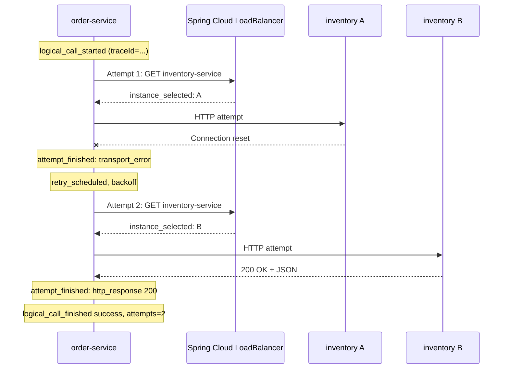

# Logging Service Identity, Replicas, and Call Outcomes

When one microservice calls another through Spring Cloud LoadBalancer, simply logging `GET /items failed` is rarely enough to troubleshoot an incident. Operations teams need to know **which logical service was called, which replica was selected, where the call actually went, what HTTP result or error occurred at which stage, and which business request the event belongs to**.

For example, `order-service` calls `inventory-service` by the service ID `http://inventory-service`. Spring Cloud LoadBalancer might select instance A on the first attempt; A stops accepting connections, so the caller retries and selects B. Eventually the client receives `200 OK`. If you only log the final result `200`, readers will not know that the request experienced a failure, took extra time, or generated additional load. If you only log a single line `inventory-service 503`, you will not know whether the `503` came from the upstream, a proxy, or a branch where no `ServiceInstance` was available.

This lesson belongs to the **System Observability** chapter in the `SPRING_CLOUD_SERVICE_COMMUNICATION_LOAD_BALANCING` module. The goal is to design structured logs for inter-service HTTP communication, coordinating `RestClient`, `WebClient`, OpenFeign, discovery, health checks, routing, timeouts, and retries. We will distinguish **service ID** from **instance ID**, identify the exact points to observe replica selection, record **per-attempt outcomes** and **overall logical request outcomes**, and protect sensitive data.

## 1. Four Questions a Good Log Line Must Answer

An outbound HTTP event should help answer:

1. **Who called whom?** The caller is `order-service`; the target service ID is `inventory-service`.
2. **Which replica?** If a destination was selected, record `instanceId` (or an equivalent identifier); do not infer it from the service ID.
3. **What result, at which layer?** HTTP status, exception, no-instance, timeout, decode error, or request rejected at the caller?
4. **Which operation is it tied to?** `traceId`/`spanId` or correlation ID, stable operation, attempt number, and duration.

Look at these condensed log examples:

```text
POOR: Inventory request failed.
POOR: GET /items/42 -> 503.

GOOD: targetService=inventory-service event=instance_selected
      instanceId=inventory-b attempt=2 traceId=4bf9...

GOOD: targetService=inventory-service event=outbound_attempt_finished
      attempt=2 outcome=http_response httpStatus=200 durationMs=48

GOOD: targetService=inventory-service event=logical_call_finished
      outcome=success attempts=2 totalDurationMs=276 traceId=4bf9...
```

The values in this lesson are **sample data**, not default logs emitted automatically by Spring Cloud LoadBalancer.

## 2. Service ID vs. Instance ID, Hostname, and Caller ID

| Field | Meaning | Example | Always available? |
|---|---|---|---|
| `callerService` | Application making the HTTP call. | `order-service` | Can be read from `spring.application.name` configuration. |
| `callerInstance` | Replica of the caller executing the call. | `order-7f9d` | Requires a runtime/deployment identifier; not always provided. |
| `targetService` | Logical service ID used for Spring Cloud LoadBalancer. | `inventory-service` | Usually known when creating RestClient/WebClient/Feign. |
| `selectedInstanceId` | `ServiceInstance` ID chosen by the algorithm. | `inventory-a12` | Only present if an instance was selected; some providers do not supply an ID. |
| `selectedHost`/`selectedPort` | Host/port of the `ServiceInstance`. | `10.20.1.12:8080` | Observable at the selection step; topology-sensitive. |
| `upstreamService` | Application name recorded by the **target server** itself. | `inventory-service` | Available if the server is instrumented. |
| `upstreamInstance` | Identifier of the process/Pod that actually received the request. | `inventory-a12` | Requires server logs or a protected debug response. |
| `route`/`operation` | Low-cardinality API identifier. | `GET /api/items/{id}` | Should be derived from the contract instead of logging URIs containing data. |

**`targetService` is not `selectedInstanceId`.** When discovery returns three replicas A/B/C, all three share the same service ID; a log line containing only `inventory-service` does not prove which replica was chosen.

**A selected replica is not guaranteed to have successfully processed the request either.** The connection may fail before sending HTTP, the request may be forwarded by a proxy, or the caller may cancel after the server has already started processing. Therefore, `selectedInstanceId` on the caller side must be distinguished from `upstreamInstance` in server-side logs.

`ServiceInstance.getInstanceId()` may return `null` depending on the discovery source and provider. When missing, you can derive an internal identifier based on endpoint information permitted for logging, but do not treat that fallback as a globally stable identifier across rollouts. Never use a short-lived IP as a business key or proof of access permissions.

## 3. Log Events Across the Request Lifecycle, Not Just the Final Line

One logical call can produce multiple attempts. Each attempt also has its own stages:



A fairly complete set of events:

| Event | When? | Important values |
|---|---|---|
| `logical_call_started` | Start of the business operation calling another service. | Service ID, operation, trace ID, deadline. |
| `loadbalancer_selection_started` | When candidate selection starts, if instrumented. | Service ID, valid policy/hint. |
| `instance_selected` | When a `ServiceInstance` is selected. | Instance ID, zone (if permitted), attempt number. |
| `no_eligible_instance` | Selected list is empty or no suitable target exists. | Service ID, known reason; **no instance ID**. |
| `outbound_attempt_started` | Before the HTTP transport executes an attempt. | Operation, attempt, selected target if any. |
| `outbound_attempt_finished` | Response status or transport error for that attempt. | Status/exception, duration, outcome. |
| `retry_scheduled` | Policy decides to retry. | Original error, next attempt, backoff, remaining budget. |
| `logical_call_finished` | The entire call operation finishes. | Final outcome, total duration, total attempts. |

It is not necessary to emit **all** of these events at INFO level in production; in high-RPS systems, per-attempt logging for every request can be too expensive. You should separate **critical events to log**, aggregate metrics, trace spans, and sampling. However, the schema must be clear enough to debug when selective logging is enabled.

### An HTTP Response Does Not Mean the Body Has Finished Decoding

A client can receive `200 OK` and response headers, then encounter invalid JSON or a body exceeding the codec buffer limit. Therefore:

- `http_response_received`: HTTP status is known; the DTO may **not** exist yet.
- `response_decoded`: the body has been read and converted into the expected data.
- `logical_call_finished`: the final business outcome is known.

A WebClient filter that stops at `next.exchange(request)` primarily observes the **receiving headers/ClientResponse** event and may not see errors thrown when the upper layer consumes `bodyToMono(...)`. To log decode errors, you need to instrument the body-processing pipeline or the gateway/service boundary as well.

## 4. Structured JSON Log Example

For a GET request via LoadBalancer, the schema can use stable fields:

```json
{
  "timestamp": "2026-11-17T14:00:00Z",
  "level": "INFO",
  "event": "outbound_attempt_finished",
  "callerService": "order-service",
  "callerInstance": "order-a1",
  "targetService": "inventory-service",
  "operation": "GET /api/items/{id}",
  "traceId": "4bf92f3577b34da6a3ce929d0e0e4736",
  "spanId": "00f067aa0ba902b7",
  "attempt": 2,
  "selectedInstanceId": "inventory-b12",
  "outcome": "http_response",
  "httpStatus": 200,
  "durationMs": 48,
  "retryable": false
}
```

The timestamp, trace/span ID, instance ID, and duration values above are illustrative. If no instance has been selected, the `selectedInstanceId` field should be **absent or null**—never record a fake ID like `unknown-instance` that could later be counted as a real replica.

Use **controlled vocabularies** for `event`, `outcome`, and `operation` values, because putting raw URIs, exception messages, or arbitrary headers into grouping fields makes dashboards harder to build and can leak data.

### Outcome Categories Should Have Clear Semantics

| `outcome` | What happened | Is there an HTTP status from upstream? |
|---|---|---|
| `success` | Logical request completed according to contract. | Usually yes. |
| `http_response` | HTTP transport received a response status, without assuming all 4xx/5xx are business errors. | Yes. |
| `no_instance` | Could not select a valid `ServiceInstance`. | No real response from a replica. |
| `transport_error` | Connect, TLS, reset, read timeout, or relevant I/O error. | Status may not exist. |
| `decode_error` | Response received, but parse/deserialize/codec failed. | Status may have existed earlier. |
| `client_cancelled` | Subscription/request on the caller side was cancelled. | Uncertain. |
| `bulkhead_rejected` | Caller rejected due to exhausted concurrency budget. | May not have called LoadBalancer yet. |
| `deadline_exceeded` | Overall logical request deadline expired. | Do not automatically assume upstream has not processed it. |

**HTTP `404` is not always an incident:** for a lookup API like `findOptional(id)`, "not found" may be an expected business outcome; another contract treats it as an error. Logs should preserve `httpStatus=404` and evaluate `outcome` per contract instead of marking every non-2xx status as `system_failure`.

## 5. Request Identifiers: traceId, spanId, correlationId, and Attempt

| ID | Scope | Purpose |
|---|---|---|
| `traceId` | A trace spanning across instrumented services. | Links inbound/outbound calls and hops of a distributed operation. |
| `spanId` | A specific span within a trace. | Distinguishes steps or HTTP attempts under the tracing model. |
| `correlationId` | Correlation ID defined by the application or gateway. | Queries logs when the system lacks full tracing or when a non-sensitive business ID is needed. |
| `logicalRequestId` | One logical call under an internal contract. | Groups attempts belonging to the same downstream call. |
| `attemptNumber` | Attempt sequence number within a logical call. | Shows how many retries occurred and to which instances. |

In systems with Micrometer Tracing or OpenTelemetry, prefer the already-configured trace propagation mechanism (typically W3C `traceparent`/`tracestate`) and avoid building a separate trace ID generator. A custom correlation ID can still be maintained if needed, but it **does not replace trace context** and must not be treated as proof of user authentication.

### Do Not Blindly Trust IDs Coming from External Callers

A client-sent header such as `X-Correlation-ID` could be very long, contain newline characters, or intentionally cause log injection. At ingress, you should:

- Only accept permitted lengths/formats, or generate a new ID if invalid.
- Never trust the header to determine tenant, role, access permissions, or hard routing constraints.
- Never embed tokens, cookies, emails, or personal information into the correlation ID.
- When automatic tracing is enabled, avoid overwriting trace headers managed by the instrumentation.

**MDC is not Reactor Context.** Traditional MDC is bound to a thread; a reactive pipeline may switch schedulers, so calling `MDC.put(...)` in a controller does not guarantee the data is present in every filter or callback. Integrate Micrometer Context Propagation/Tracing for your running version or read `Reactor Context` directly inside the reactive chain.

## 6. Inbound Servlet Example: Generating Correlation ID and Cleaning Up MDC

In a Spring MVC application, a `OncePerRequestFilter` can normalize the correlation ID and attach it to the current thread's MDC. For example:

```java
import java.io.IOException;
import java.util.UUID;
import jakarta.servlet.FilterChain;
import jakarta.servlet.ServletException;
import jakarta.servlet.http.HttpServletRequest;
import jakarta.servlet.http.HttpServletResponse;
import org.slf4j.MDC;
import org.springframework.stereotype.Component;
import org.springframework.web.filter.OncePerRequestFilter;

@Component
public class CorrelationFilter extends OncePerRequestFilter {

    private static final String HEADER = "X-Correlation-ID";

    @Override
    protected void doFilterInternal(
            HttpServletRequest request,
            HttpServletResponse response,
            FilterChain chain)
            throws ServletException, IOException {

        String incoming = request.getHeader(HEADER);
        String id = normalize(incoming);
        response.setHeader(HEADER, id);

        try (MDC.MDCCloseable ignored =
                 MDC.putCloseable("correlationId", id)) {
            chain.doFilter(request, response);
        }
    }

    private static String normalize(String candidate) {
        if (candidate != null && candidate.length() <= 80
                && candidate.matches("[A-Za-z0-9._-]{1,80}")) {
            return candidate;
        }
        return UUID.randomUUID().toString();
    }
}
```

This code illustrates how to set and clean up values **on the current thread** to prevent MDC leakage into the next servlet request. With async servlets, thread-switching, virtual threads, or reactive composition, verify the appropriate propagation/cleanup mechanism; the filter above does **not** guarantee that operations running on other threads see the same MDC.

If the deployment already has Micrometer Tracing enabled, generating and injecting `traceId`/`spanId` into logs can be handled by instrumentation. A custom correlation ID is supplementary data; do not generate an arbitrary "trace ID" that conflicts with the real trace.

## 7. Logging Outcomes with RestClient

A gateway calling `inventory-service` should know the exact **logical service ID** and **operation**, then log the status or exception according to contract. The `RestClient` bean must be built from a `@LoadBalanced RestClient.Builder` so that the host service ID is resolved by Spring Cloud LoadBalancer.

```java
import org.springframework.cloud.client.loadbalancer.LoadBalanced;
import org.springframework.context.annotation.Bean;
import org.springframework.context.annotation.Configuration;
import org.springframework.web.client.RestClient;

@Configuration
class HttpClientConfiguration {

    @Bean
    @LoadBalanced
    RestClient.Builder loadBalancedRestClientBuilder() {
        return RestClient.builder();
    }

    @Bean("inventoryRestClient")
    RestClient inventoryRestClient(
            @LoadBalanced RestClient.Builder builder) {
        return builder.clone()
            .baseUrl("http://inventory-service")
            .build();
    }
}
```

Logging in the synchronous gateway:

```java
import org.slf4j.Logger;
import org.slf4j.LoggerFactory;
import org.springframework.beans.factory.annotation.Qualifier;
import org.springframework.http.ResponseEntity;
import org.springframework.stereotype.Service;
import org.springframework.web.client.ResourceAccessException;
import org.springframework.web.client.RestClient;
import org.springframework.web.client.RestClientResponseException;
import java.util.concurrent.TimeUnit;

@Service
class InventoryGateway {

    private static final Logger log =
        LoggerFactory.getLogger(InventoryGateway.class);

    private final RestClient client;

    InventoryGateway(
            @Qualifier("inventoryRestClient") RestClient client) {
        this.client = client;
    }

    ItemDto findItem(String id) {
        long started = System.nanoTime();
        String operation = "GET /api/items/{id}";
        try {
            ResponseEntity<ItemDto> response = client.get()
                .uri("/api/items/{id}", id)
                .retrieve()
                .toEntity(ItemDto.class);

            log.info(
                "event=logical_call_finished targetService={} operation={} outcome=success httpStatus={} durationMs={}",
                "inventory-service", operation,
                response.getStatusCode().value(), elapsedMs(started));

            return response.getBody();
        } catch (RestClientResponseException ex) {
            log.warn(
                "event=logical_call_finished targetService={} operation={} outcome=http_error httpStatus={} durationMs={}",
                "inventory-service", operation,
                ex.getStatusCode().value(), elapsedMs(started));
            throw ex;
        } catch (ResourceAccessException ex) {
            log.warn(
                "event=logical_call_finished targetService={} operation={} outcome=transport_error exceptionType={} durationMs={}",
                "inventory-service", operation,
                ex.getClass().getSimpleName(), elapsedMs(started));
            throw ex;
        }
    }

    private static long elapsedMs(long start) {
        return TimeUnit.NANOSECONDS.toMillis(
            System.nanoTime() - start);
    }
}
```

This example omits the `ItemDto` class and some additional imports. It records the **logical outcome** and HTTP status when available. The `exceptionType` field is a controlled exception class name; **do not log raw messages, stack traces, or URLs** at continuous warning level if they may contain sensitive data. Use detailed exception logging with sampling or during active investigation.

**Intentional limitation of the example:** `InventoryGateway` does not know which `ServiceInstance` was selected and does not populate `selectedInstanceId`. Do not fabricate a replica field by parsing `http://inventory-service` or assuming an interceptor always sees the rewritten URI. To log the selected replica, instrument the **LoadBalancer instance-selection step** as described in section 10.

Besides the two caught exceptions, `RestClient` can still encounter decoding errors or unclassified errors, as well as errors from the LoadBalancer integration itself. Production code should add contract-based outcome mapping, ensure every logical call emits a completion event, and avoid logging both a warning in the gateway and the exact same error at every layer, which multiplies error log lines.

## 8. Logging HTTP Attempts with a RestClient Interceptor

If you need to record information at the HTTP client boundary for every request, you can use `ClientHttpRequestInterceptor`:

```java
import java.io.IOException;
import java.util.concurrent.TimeUnit;
import org.slf4j.Logger;
import org.slf4j.LoggerFactory;
import org.springframework.http.client.ClientHttpRequestInterceptor;
import org.springframework.http.client.ClientHttpResponse;

class OutboundResultInterceptor {

    private static final Logger log =
        LoggerFactory.getLogger(OutboundResultInterceptor.class);

    static ClientHttpRequestInterceptor forInventory() {
        return (request, body, execution) -> {
            long started = System.nanoTime();
            try {
                ClientHttpResponse response =
                    execution.execute(request, body);
                log.debug(
                    "event=http_response_received targetService={} httpStatus={} durationMs={}",
                    "inventory-service",
                    response.getStatusCode().value(),
                    TimeUnit.NANOSECONDS.toMillis(
                        System.nanoTime() - started));
                return response;
            } catch (IOException | RuntimeException ex) {
                log.warn(
                    "event=http_exchange_failed targetService={} exceptionType={} durationMs={}",
                    "inventory-service", ex.getClass().getSimpleName(),
                    TimeUnit.NANOSECONDS.toMillis(
                        System.nanoTime() - started));
                throw ex;
            }
        };
    }
}
```

Attach it to the inventory-specific builder:

```java
return builder.clone()
    .baseUrl("http://inventory-service")
    .requestInterceptor(
        OutboundResultInterceptor.forInventory())
    .build();
```

This interceptor sees the **HTTP exchange result at the position where it is installed**. Ordering relative to the LoadBalancer interceptor/transport and retries can vary by configuration and version. Therefore, **do not claim `request.getURI()` is always the selected instance's address**, and do not assume each interceptor invocation corresponds to exactly one socket attempt if retries happen inside. If you need accurate attempt counts, instrument the layer that owns retries or the corresponding transport layer.

An interceptor usually logs once response headers arrive; subsequent deserialization errors may only surface in the gateway. Never treat a `http_response_received=200` line as absolute business success.

## 9. Reactive WebClient: Logging on Subscribe, Completion, and Cancellation

WebClient uses Reactor. An HTTP call typically begins when the `Mono`/`Flux` is subscribed to; logging while **building the pipeline** can emit `outbound_start` lines even when no request is ever sent. Therefore, use `Mono.defer(...)`/`Mono.deferContextual(...)` and Reactor operators within an appropriate scope.

Example of a gateway using a WebClient built from `@LoadBalanced WebClient.Builder`:

```java
import java.util.concurrent.TimeUnit;
import org.slf4j.Logger;
import org.slf4j.LoggerFactory;
import org.springframework.web.reactive.function.client.WebClient;
import reactor.core.publisher.Mono;

class ReactiveInventoryGateway {

    private static final Logger log =
        LoggerFactory.getLogger(ReactiveInventoryGateway.class);

    private final WebClient client;

    ReactiveInventoryGateway(WebClient inventoryWebClient) {
        this.client = inventoryWebClient;
    }

    Mono<ItemDto> findItem(String itemId) {
        return Mono.deferContextual(context -> {
            String correlationId =
                context.getOrDefault("correlationId", "missing");
            long started = System.nanoTime();

            log.debug(
                "event=logical_call_started targetService={} operation={} correlationId={}",
                "inventory-service", "GET /api/items/{id}", correlationId);

            return client.get()
                .uri("/api/items/{id}", itemId)
                .retrieve()
                .bodyToMono(ItemDto.class)
                .doOnNext(item -> log.info(
                    "event=body_decoded targetService={} outcome=success correlationId={}",
                    "inventory-service", correlationId))
                .doOnError(error -> log.warn(
                    "event=logical_call_error targetService={} exceptionType={} correlationId={}",
                    "inventory-service",
                    error.getClass().getSimpleName(), correlationId))
                .doFinally(signal -> log.debug(
                    "event=logical_call_terminated targetService={} signal={} durationMs={} correlationId={}",
                    "inventory-service", signal,
                    TimeUnit.NANOSECONDS.toMillis(
                        System.nanoTime() - started),
                    correlationId));
        });
    }
}
```

`contextWrite(context -> context.put("correlationId", id))` downstream of this chain can supply the value to `deferContextual` under Reactor semantics; correlation ID propagation must be designed at ingress and preserved across subscriptions. The example above does **not** yet pass the ID as an HTTP header or classify specific HTTP statuses; Spring Security/Micrometer Tracing may already provide dedicated propagation mechanisms.

**Notes:**

- `doOnNext` does not run if the `Mono` completes empty; do not treat "no success log" as a network error by default.
- `doFinally` runs on complete/error/cancel; `signal=cancel` helps detect caller subscription cancellation, but does not prove the upstream never processed the request.
- `doOnError` can observe HTTP, transport, or decode errors; classify by exception type and stage if you need to distinguish them.
- If using `retryWhen`, placing `doOnError` and `doFinally` **before or after retry** determines whether they run per attempt or only for the combined logical request.
- Do not call `MDC.put(...)` on the event loop and assume it follows the entire pipeline; use Reactor Context or instrumentation context propagation.

### Capturing HTTP Status When Headers Arrive

If you need the status even when decoding subsequently fails, `exchangeToMono(...)` can record `ClientResponse.statusCode()` before reading the body:

```java
return client.get()
    .uri("/api/items/{id}", itemId)
    .exchangeToMono(response -> {
        int status = response.statusCode().value();
        log.debug(
            "event=http_response_received targetService={} httpStatus={}",
            "inventory-service", status);

        if (response.statusCode().is2xxSuccessful()) {
            return response.bodyToMono(ItemDto.class);
        }
        return response.createException()
            .flatMap(Mono::error);
    });
```

`exchangeToMono` is lower-level than `retrieve()`; the caller must properly define handling for non-2xx statuses and bodies. Logging `http_response_received` here **does not replace** `body_decoded`/`logical_call_finished` logs.

## 10. Observing the Exact Selected Replica in LoadBalancer

If you need to answer "why did the second request pick B?", instrument where **Spring Cloud LoadBalancer actually selects the `ServiceInstance`**, rather than guessing from the URI before the request passes through LoadBalancer.

In supported Spring Cloud LoadBalancer versions, relevant observability mechanisms include:

- **LoadBalancer lifecycle hooks**, such as the `LoadBalancerLifecycle` SPI, with callbacks at start / instance selection / completion stages according to the API of your version.
- **Micrometer Observation** and Spring Cloud LoadBalancer instrumentation/metrics if enabled, alongside HTTP client/server tracing.
- **LoadBalancer DEBUG logs** scoped to specific packages or components, enabled selectively for diagnostics.

Handling logic for a lifecycle observer (pseudocode, **not a verbatim copy-paste Java class**):

```text
on load-balancer selection start:
    event = loadbalancer_selection_started
    targetService = logical service ID

when response contains a selected ServiceInstance:
    event = instance_selected
    selectedInstanceId = ServiceInstance.getInstanceId(), if present
    selectedHost/port = only use when permitted to log
    traceId / logicalCallId / attemptNumber = valid correlation

when no ServiceInstance is available:
    event = no_eligible_instance
    selectedInstanceId = null

when completion is observed:
    event = loadbalancer_operation_completed
    record success/error/timing according to lifecycle API
```

Interface names, generic types, callback arguments, and `CompletionContext` types may vary across Spring Cloud versions. In a real project, consult the API of your BOM to create the lifecycle bean properly, verify the observer is registered for the **right service ID**, and check whether it executes on the corresponding `RestClient`, `WebClient`, or OpenFeign call path.

**Key point:** the `instance_selected` event should be emitted **after confirming the LoadBalancer response contains an instance**, not merely when a service ID is present. The `selectedInstanceId` field must be absent/null if selection failed.

A retry may select the same A again or B; never assume a retry always produces a different `selectedInstanceId`. If a retry occurs **inside the HTTP transport** after host/port selection, the lifecycle observer may only see **one** selection even though the HTTP transport retried. To explain the full picture, instrument both the retry owner and the transport.

### Server-Side Instance Identity for Cross-Referencing

In `inventory-service`, each process should have a service name and a runtime identifier supplied by the deployment, such as `spring.application.name=inventory-service` and `app.instance-id=inventory-b12`. Server-side logs can record:

```text
event=inbound_call_started service=inventory-service
instanceId=inventory-b12 traceId=... operation="GET /api/items/{id}"
```

The `app.instance-id` value must come from trusted configuration/deployment metadata (Pod UID/name, workload ID, or discovery instance ID as applicable), not from an `X-Instance-ID` header sent by an external caller. Do not expose endpoints returning detailed topology to the Internet; if debug endpoints exist, require authentication/authorization and restrict them to appropriate environments.

## 11. Where Do WebClient, RestClient, and OpenFeign Observe Events?

| HTTP client | Typical hook/logging | What does it know? | What should not be inferred? |
|---|---|---|---|
| `RestClient` | Gateway wrapper, `ClientHttpRequestInterceptor`, Micrometer Observation. | Logical outcome, HTTP headers/status, some transport errors. | That an arbitrary interceptor always knows the post-LB instance ID. |
| `WebClient` | `ExchangeFilterFunction`, `exchangeToMono`, Reactor operators, tracing. | Reactive request/response, status, signal/error/cancel. | That a filter receiving headers knows the body decoded cleanly. |
| OpenFeign | `Logger.Level.BASIC`, `RequestInterceptor`, `ErrorDecoder`, service wrapper, Micrometer Feign integration. | HTTP method/status, elapsed time depending on logger/instrumentation, exception. | That `RequestInterceptor` automatically sees every response or instance selection. |
| Spring Cloud LoadBalancer | Lifecycle/Observation/DEBUG at the instance-selection step. | Service ID and candidate/selected instance depending on hook. | That the HTTP call connected, decoded, or succeeded in business logic. |
| Upstream server | Inbound filter/interceptor, access log, tracing. | Which process actually received the request, status emitted. | That the caller definitely received the response if the server logged `200`. |

### Feign Logger and Configuration Scoping

Example setting BASIC level only for a specific Feign client:

```java
@FeignClient(
    name = "inventory-service",
    contextId = "inventoryRead",
    configuration = InventoryReadLoggingConfig.class
)
interface InventoryReadClient {

    @GetMapping("/api/items/{id}")
    ItemDto findItem(@PathVariable("id") String id);
}

// Place outside the main application's component scan if intended only for this client.
public class InventoryReadLoggingConfig {

    @Bean
    Logger.Level feignLoggerLevel() {
        return Logger.Level.BASIC;
    }
}
```

Feign logging also depends on the logger category/level (typically needing DEBUG for the Feign interface name), version, and how the HTTP client is integrated. `BASIC` is usually enough to observe method/URL/status/timing at a basic level; `FULL` can log bodies and headers, including `Authorization`/cookies. **Do not enable FULL broadly in production**, and do not let a client-specific configuration class get picked up by `@ComponentScan` into the parent context, leaking logging settings to other clients.

To observe the selected instance, you still need integration at **LoadBalancer selection** or an appropriate transport boundary; Feign's `RequestInterceptor` is not a hook that reports `ServiceInstance` selection results.

## 12. Three Error Groups to Separate in Logs

| Situation | Stage | Key evidence | What not to do |
|---|---|---|---|
| **No instance available** | Discovery/filter/LoadBalancer selection. | `targetService`, `outcome=no_instance`; no target replica. | Log "inventory A timeout" when A was never selected. |
| **Failure after selection** | HTTP connection/TLS/transport. | `selectedInstanceId` if present, exception type, duration, attempt. | Log `HTTP 503` when no actual 503 response existed. |
| **Upstream returns HTTP error** | Response status received. | `httpStatus=404/429/500/503`, selected instance, and contract. | Infer empty discovery or "no server available". |
| **Decode error after response** | Converting body to DTO/codec. | Previous response status, `decode_error`, decoder/exception type. | Rewrite as "upstream returned 500" if upstream returned 200. |
| **Caller rejects before sending** | Bulkhead/rate limit/circuit open. | `bulkhead_rejected`/`circuit_open`, no HTTP attempt. | Blame a specific replica. |

Some integrations map no-instance to an HTTP-like `503` status or exception. Therefore, a `status=503` field alone does not tell you whether it came from upstream. For accurate diagnosis, the schema needs **`errorStage`/`outcome`**, and should only record `httpStatus` as an upstream response when clear evidence exists.

### A Timeout Does Not Tell Whether the Server Processed the Request

If the caller logs `read_timeout` while the server logs that the transaction committed, the two lines do not contradict each other: the response may have been lost or arrived late. For `POST`/`PATCH`, use an idempotency key and server-side deduplication when retrying. **Never interpret every timeout as "the request was definitely not processed".**

## 13. Retries: Logging Each Attempt and the Final Outcome

Suppose there is 1 logical call with at most 3 attempts:

```json
{"event":"outbound_attempt_finished","targetService":"inventory-service","attempt":1,"selectedInstanceId":"inventory-a","outcome":"transport_error","durationMs":110}
{"event":"retry_scheduled","targetService":"inventory-service","nextAttempt":2,"backoffMs":120}
{"event":"outbound_attempt_finished","targetService":"inventory-service","attempt":2,"selectedInstanceId":"inventory-b","outcome":"http_response","httpStatus":200,"durationMs":54}
{"event":"logical_call_finished","targetService":"inventory-service","outcome":"success","attempts":2,"totalDurationMs":298}
```

With retries, fields belonging to the **same logical call** should share trace/correlation according to the chosen mechanism; `attemptNumber` increments on each attempt. The retry owner (gateway, client wrapper, Spring Cloud LoadBalancer, HTTP engine, proxy, etc.) must be clearly identified to avoid double-counting attempts.

**Log order is not always causal order:** in reactive pipelines or asynchronous logging, events may be recorded/flushed at different times. Use trace/span/logical IDs, monotonic durations, and attempt numbers to correlate them; do not simply sort by timestamp and assume strict ordering.

If retries happen **inside** the HTTP library, the business wrapper may only see one invocation; conversely, a `retryWhen` wrapper can cause WebClient filters to run again. Check where retries sit in the filter/operator chain. Do not promise "attempt count = number of gateway entries" if retries exist underneath.

## 14. Logging and Tracing: Complementary, Not Interchangeable

Three observability tools answer different questions:

| Tool | Best suited to answer | Limitations |
|---|---|---|
| **Structured logs** | How did a specific request fail, which instance was chosen, where did the error occur? | High data volume; sampling can miss cases; requires PII protection. |
| **Metrics** | Error rate, p95/p99, traffic distribution, retry rate, and resource consumption. | Not ideal for storing ever-changing requestId/instance IDs. |
| **Distributed tracing** | Request hops, span latency, caller/downstream relationships. | May be sampled and requires proper propagation/instrumentation. |

A `traceId` in logs is only useful if the system can actually query related events and propagate context across the relevant hops. Tracing does not replace logging a **reason code** in the calling service; and aggregate metrics do not tell you which replica received an individual request.

### Cardinality: Logs Differ from Metric Labels

An instance ID can be helpful in **detailed logs** or traces to investigate a specific replica's failure. However, attaching `selectedInstanceId`, IP/port, `traceId`, `userId`, or raw URIs to **metric labels** can cause time-series explosion as Pods churn. On metrics, prefer bounded-cardinality labels such as `targetService`, operation template, HTTP status class, and outcome group. If per-instance metrics are needed, design an explicit allowlist or cardinality cap.

## 15. Security and Privacy When Logging Outbound Calls

Not everything observable should be recorded:

| Consider logging | Do not log verbatim |
|---|---|
| Service ID, operation template, outcome, status code. | `Authorization`/Bearer token, API key, refresh token. |
| Length- and format-validated trace/correlation ID. | Cookie/Set-Cookie, credentials in query parameters. |
| Approved internal instance ID and event type. | Full `ServiceInstance.metadata` containing sensitive information. |
| Exception **type/category** and duration. | Exception messages containing sensitive URIs, tokens, headers, or bodies. |
| Retry count, timeout stage, and deadline. | Raw request/response bodies containing personal/financial data. |
| Normalized route, e.g., `GET /api/items/{id}`. | Full URI containing item IDs, emails, search queries, or signed URLs. |

Logging the host/port of every replica can expose internal topology, especially if logs are shared externally. Keep these fields in operational channels with appropriate access control; standard logs may only need `selectedInstanceId`. Also avoid automatically returning selected instance details in response headers sent to external users.

### Sampling and Log Volume

At 10,000 HTTP requests/second, if each attempt writes 5 INFO lines, the system can generate 50,000 lines/second **not counting retries**. A practical strategy can be:

- Log logical request summaries selectively at INFO, while using metrics for all traffic.
- Log errors/retries/no-instance in a controlled way at WARN, with sampling/rate limiting during error storms.
- Enable detailed DEBUG for instance selection or HTTP headers briefly, narrowly scoped, and with proper redaction.
- Comply with retention, masking, and log access-control policies.

If you enable DEBUG cluster-wide during an incident, log I/O can add load to an already overloaded system. Observability must **support recovery**, not become a new source of pressure.

## 16. Lab Exercise: Finding the Right Replica and Failure Stage

Set up `order-service` using `@LoadBalanced RestClient.Builder` or `@LoadBalanced WebClient.Builder` to call `inventory-service` by service ID, with three replicas A/B/C. Each inventory replica has its own runtime identifier configured and logs `traceId`/correlation ID on inbound calls. Run failure scenarios only in a load-limited test environment.

### Data to Record for Each Scenario

```text
logicalRequestId
traceId / spanId (if tracing is enabled)
callerService / callerInstance
targetService / operation
attemptNumber
selectedInstanceId (if present)
event / outcome / errorStage
httpStatus (only when a response is actually received)
attemptDurationMs / logicalDurationMs
retryOwner / retryBackoffMs (if applicable)
```

### Test Matrix

| Scenario | How to simulate | Logs needed to prove it |
|---|---|---|
| **200 OK from A/B/C** | Call multiple times via the same service ID. | `targetService` is always `inventory-service`, `selectedInstanceId` varies per actual selection, status 200. |
| **Empty discovery** | Provide no instances for the service ID. | `outcome=no_instance`, no fabricated replica, no upstream HTTP status. |
| **A connection refused** | A remains in cache while its listener has stopped. | `instance_selected=A` then `transport_error`; error distinct from an HTTP response. |
| **B returns `503`** | Stub B sends status 503. | `httpStatus=503` and `selectedInstanceId=B`; distinguished from no-instance. |
| **200 but invalid JSON** | Server returns an unparseable body. | `http_response_received=200`, followed by `decode_error`. |
| **Retry A -> B** | A has a transient failure, B is healthy; enable bounded retry. | One logical ID, at least two attempts, per-attempt instance logged per the actual mechanism. |
| **Retry A -> A** | Policy re-selects the same instance. | Do not assume the next attempt always picks a different instance. |
| **Bulkhead full** | Low concurrency limit, send multiple test requests. | `bulkhead_rejected` before HTTP attempt, not misattributed to A/B/C. |
| **Client timeout** | Upstream intentionally responds slowly. | Deadline/timeout stage, cancel if applicable; do not claim the server did not process it. |
| **Two concurrent callers** | Send parallel requests with different correlation IDs. | No MDC/Reactor Context cross-contamination between logical requests. |
| **Rolling shutdown** | Remove A from discovery with graceful drain. | Stale cache/connection reset observable; client and server instance IDs cross-referenced. |

### Procedure for Diagnosing a Real Failure

1. Find the `traceId`/correlation ID from the user response, ingress logs, or internal request ID.
2. Identify `callerService`, `targetService`, and `operation`; check the logical request outcome.
3. Count attempts and see across how many layers retries occurred; check remaining deadline.
4. For each attempt, determine whether a `ServiceInstance` was selected.
5. If an instance was selected, distinguish transport error, HTTP status, and decode error.
6. Use server-side logs of `upstreamInstance` to confirm whether the request reached the server.
7. Cross-check discovery/health/zone policies, instance rollouts, and connection pools when suspecting routing errors.
8. Synthesize the root cause; do not fix it by increasing retries or timeouts when the true issue is a contract error, security failure, or prolonged no-instance state.

If server logs show `200` while the caller experienced a timeout, inspect when the response was sent, the network, body transfer, and deadline. Do not immediately blame LoadBalancer, because the target-selection algorithm does not manage the entire HTTP lifecycle.

## 17. Observability Implementation Checklist for LoadBalancer

- Clearly distinguish **caller service**, **target service ID**, and **selected ServiceInstance** as separate concepts.
- Design a stable log schema: `event`, `outcome`, `errorStage`, `operation`, `traceId`, `attemptNumber`, `durationMs`.
- Only log `selectedInstanceId` after an actual selection result exists; leave it null/absent if there is no instance.
- Separate **logical request**, **LoadBalancer selection**, and **HTTP attempt**, especially with multi-layer retries.
- Separate no-instance, transport failure, upstream HTTP error, body decode failure, and caller-side rejection.
- Record HTTP status only when an actual HTTP response comes from an appropriate upstream/proxy; do not confuse synthesized statuses with instance responses.
- For RestClient, instrument the gateway and interceptors in the right order; for WebClient, use subscription-scoped Reactor operators; for Feign, scope loggers/interceptors per client.
- Use Micrometer Observation/Tracing and W3C propagation for your version where available; avoid creating arbitrary parallel trace IDs.
- Do not rely on `ThreadLocal`/MDC across reactive schedulers; verify propagation and cleanup.
- Consider Spring Cloud LoadBalancer lifecycle hooks/instrumentation to log replicas accurately.
- Attach trusted deployment-provided server-side instance identity to cross-reference against the selected instance.
- Never log tokens, cookies, raw request bodies, queries with personal data, or full instance metadata.
- Avoid high-cardinality metric labels such as raw URIs, trace IDs, IPs, or rapidly changing instance IDs.
- Apply sampling/rate limiting for logging during error bursts; never let logging overload the system further.
- Test no-instance, retry same/next replica, timeout, cancel, upstream `503`, decode error, and graceful shutdown.

**Remember:** inter-service communication logs need to tell you **which logical service was called, which replica was selected (if any), the outcome of each HTTP attempt, and the outcome of the overall logical request**. Spring Cloud LoadBalancer only handles selecting a `ServiceInstance` by service ID; that alone does not prove a TCP connection succeeded or a response decoded. Observe at the right boundaries—selection, transport, codec, and business logic—correlate events with trace/correlation IDs, and avoid exposing sensitive data. That way, when a service is slow or fails, logs show **where and why it failed**, rather than just a context-free final status.
