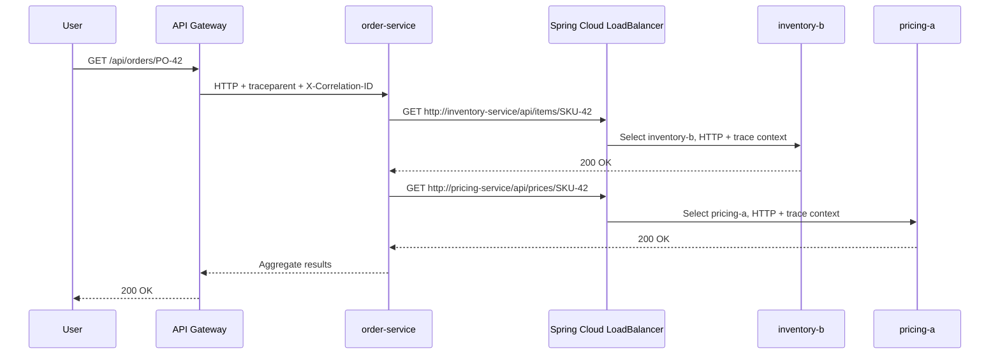
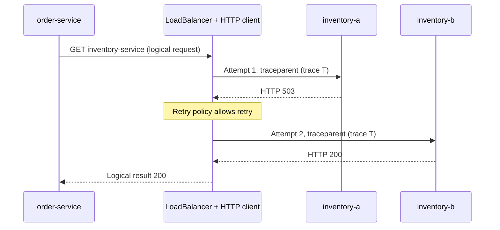

# Correlation ID, Trace ID, and Context Propagation over HTTP

## Objectives

In a microservices architecture, a single user request may traverse an API Gateway, `order-service`, `inventory-service`, and `pricing-service`. Spring Cloud LoadBalancer selects a `ServiceInstance` for each call based on the service ID, discovery, and routing policy. If a request encounters a timeout or HTTP 503, isolated logs in each service are rarely enough to answer: **which logs belong to the same request, which instance did the request hit, and at which step did the error occur?**

**Correlation IDs** and **distributed tracing** help link those events together. However, an application-managed `X-Correlation-ID`, a `traceId` issued by the tracing system, and a `spanId` for each processing step are **distinct** concepts. Nor can you assume an arbitrary HTTP client will propagate all context simply because you added Micrometer libraries.

After this lesson, you will be able to:

- Distinguish correlation ID/request ID, trace ID, span ID, parent span ID, and baggage.
- Read the W3C `traceparent` and `tracestate` formats and understand the role of `baggage`.
- Configure Micrometer Observation/Tracing in Spring Boot and propagate traces across `RestClient`, `RestTemplate`, `WebClient`, and OpenFeign.
- Integrate tracing with `@LoadBalanced` without losing Spring Boot customizers or observations.
- Propagate an application correlation ID via a dedicated HTTP header without confusing it with trace context.
- Understand how context behaves across thread switches, `@Async`, `CompletableFuture`, or Reactor.
- Track each attempt when LoadBalancer retries or re-selects an instance.
- Test inter-service propagation, distinguish missing traces from sampling, and handle headers from untrusted boundaries.

> This lesson belongs to the **System Observability** chapter of Spring Cloud Service Communication Load Balancing. The focus is on properly observing a chain of inter-service communication; trace context does not replace instance selection, health checks, timeouts, retries, or authentication.

## 1. A Single Request Can Produce Many Logs and Spans

For example, a user sends:

```http
GET /api/orders/PO-42 HTTP/1.1
Host: api.example.internal
X-Correlation-ID: request-2026-0012
```

Expected path:



Assuming tracing is fully operational:

- **One trace ID** links all spans belonging to the same transaction.
- **Each span ID** identifies a processing step or an HTTP client/server span.
- **Correlation ID** can stay the same across services if the application has a dedicated propagation policy.
- Spans have **parent-child relationships**, showing which call triggered which.
- The host/port of `inventory-b` selected by LoadBalancer is **not** a trace ID or correlation ID.

When `inventory-service` has multiple instances, the same trace can contain client/server spans from different instances, especially if the caller retries against another replica.

## 2. Correlation ID, Trace ID, Span ID: How Do They Differ?

| Identifier | Scope | Who issues/manages it? | How is it passed over HTTP? | What is it used for? |
|---|---|---|---|---|
| **Correlation ID** | Typically an application-defined business request or event chain | Gateway/app/operations team | E.g., `X-Correlation-ID` by internal convention | Finding related logs, customer support, cross-system linking |
| **Trace ID** | Entire distributed trace | Tracer (OpenTelemetry/Brave via Micrometer) | In W3C `traceparent` or B3 per propagation format | Linking spans and tracing latency |
| **Span ID** | One specific operation within a trace | Tracer creating the span | In the `parent-id` field of `traceparent` on outbound requests | Distinguishing individual steps and parent-child relationships |
| **Parent span ID** | Dependency relationship between spans | Tracer receiving remote context | Received via context header, then attached to the new span | Building the trace tree |
| **Baggage** | Selected context attributes propagated across services | Application/tracer per policy | W3C `baggage` or an appropriate propagation format | E.g., approved cohort labels, containing no PII |
| **Order ID / business key** | A business entity | Business system | Path/body or API contract | Querying orders; **does not replace trace ID** |

### 2.1. Correlation ID Has No Single HTTP Standard

Many organizations define an `X-Request-ID` or `X-Correlation-ID` header. This is an **application convention**, not a required field of W3C Trace Context. Some systems set correlation ID equal to trace ID; others issue a separate ID to link multiple traces belonging to the same business workflow.

When integrating Micrometer Tracing, Spring Boot also has the concept of a **"logging correlation ID"** built from `traceId` and `spanId` in MDC. That does not mean the application automatically generates and sends an `X-Correlation-ID` header.

**Define your policy explicitly:** if you need a code for customer support, issue a dedicated `X-Correlation-ID` at a trusted ingress and include it in the response. If you only need to trace spans, `traceId` from the tracing system is usually sufficient for trace lookup.

### 2.2. Span ID Can Change While Trace ID Usually Stays Constant

Within the same chain:

```text
traceId = 4bf92f3577b34da6a3ce929d0e0e4736

API Gateway span      spanId=1111111111111111
  order-service span  spanId=2222222222222222
    HTTP client span  spanId=3333333333333333
      inventory span  spanId=4444444444444444
```

These IDs are illustrative. When context propagates correctly, the **trace ID is continuous**, while span IDs do not need to match. If downstream logs show the same trace ID but a different span ID from the caller, **that is likely the exact right behavior**.

## 3. W3C Trace Context: traceparent and tracestate

W3C Trace Context defines a format for propagating trace information across systems using HTTP headers.

Example:

```http
traceparent: 00-4bf92f3577b34da6a3ce929d0e0e4736-00f067aa0ba902b7-01
tracestate: vendor=value
```

Version `00` of the `traceparent` field has the structure:

```text
version - trace-id                         - parent-id        - trace-flags
00      - 4bf92f3577b34da6a3ce929d0e0e4736 - 00f067aa0ba902b7 - 01
```

| Component | Size / meaning |
|---|---|
| `version=00` | Format version currently used in the example |
| `trace-id` | 32 hex characters, 16 bytes; must not be all zeros |
| `parent-id` | 16 hex characters, 8 bytes; represents the operation sending the context, must not be all zeros |
| `trace-flags` | 2 hex characters; the sampled bit is typically represented as `01` or `00` |
| `tracestate` | Optional header carrying tracing-vendor information, not a place to dump full business context |

When `order-service` receives `traceparent` and creates a new span, the tracer preserves the valid trace ID, links the current span to the remote parent, and updates `parent-id` accordingly when sending outbound requests. **Do not copy the raw `traceparent` header verbatim across every hop as an immutable string** if new spans are being created; the tracing library is responsible for injecting the current context.

### 3.1. The Sampled Flag Does Not Guarantee the Trace Appears in the Backend

The sampled bit in `trace-flags` is a sampling signal. A value of `01` does not guarantee the final exporter/collector receives every span; data loss at the exporter, collector, or tail-sampling can still occur. Conversely, `00` does not mean the application cannot write logs with a trace ID.

Therefore, **do not use `sampled=0` to conclude "context propagation is broken"**. Separate propagating identifiers over HTTP from exporting spans to storage.

### 3.2. W3C vs. B3

Some legacy systems use B3 headers such as `b3` or `X-B3-TraceId`/`X-B3-SpanId`. Spring Boot can configure which propagation formats it **consumes** and **produces**:

```yaml
management:
  tracing:
    propagation:
      consume:
        - W3C
        - B3
        - B3_MULTI
      produce:
        - W3C
```

According to current Spring Boot configuration defaults, it consumes W3C/B3/B3_MULTI and produces W3C. **Do not assume** services written in another framework can read all three formats. If one hop only understands B3 while upstream only sends W3C, the trace can split into two disconnected parts even though the HTTP request succeeds.

Only enable multiple produced propagation formats when real compatibility requires it; emitting unnecessary duplicate headers can cause conflicts if two context sets diverge.

## 4. Baggage: Controlled Propagation of Small Context Data

The W3C `baggage` header can carry key/value pairs for context:

```http
baggage: rollout_cohort=stable,client_channel=internal
```

Unlike `tracestate`, baggage is a set of application attributes that can be forwarded to downstream services when propagation is enabled.

**Do not put into baggage:**

- JWTs, access tokens, session cookies, or API keys.
- Emails, phone numbers, personally identifiable information, or payment details.
- Raw user IDs/tenant IDs if they are not permitted to travel through every dependency.
- Business payloads or large JSON strings; baggage inflates HTTP header size and transmission cost.

Baggage **must not be treated as trusted data** just because the tracing library propagates it. Metadata from the Internet must still be verified at trusted boundaries; never use baggage or correlation IDs as authorization proof.

Example creating baggage with Micrometer:

```java
import io.micrometer.tracing.BaggageInScope;
import io.micrometer.tracing.Tracer;
import org.springframework.stereotype.Service;

@Service
class InventoryPolicy {

    private final Tracer tracer;

    InventoryPolicy(Tracer tracer) {
        this.tracer = tracer;
    }

    void readInventory(Runnable remoteCall) {
        try (BaggageInScope ignored =
                     tracer.createBaggageInScope("rollout_cohort", "stable")) {
            remoteCall.run();
        }
    }
}
```

With W3C propagation, baggage can be propagated automatically depending on the tracer/provider; with B3, baggage propagation is not automatically equivalent and may require configuring `management.tracing.baggage.remote-fields`. If you want to write a baggage field into MDC, declare `management.tracing.baggage.correlation.fields` (for permitted fields) and verify actual behavior for your provider.

Do not use `baggage` solely to transmit `X-Correlation-ID` if the system already has a stable dedicated header convention: the two mechanisms have different lifecycles and security boundaries.

## 5. Spring Boot 4: Enabling Micrometer Tracing

In a Spring Boot 4.x project with a compatible Spring Cloud Release Train, you can use OpenTelemetry/OTLP:

```xml
<dependencies>
    <!-- Demo server uses Spring MVC. -->
    <dependency>
        <groupId>org.springframework.boot</groupId>
        <artifactId>spring-boot-starter-webmvc</artifactId>
    </dependency>

    <dependency>
        <groupId>org.springframework.boot</groupId>
        <artifactId>spring-boot-starter-opentelemetry</artifactId>
    </dependency>

    <dependency>
        <groupId>org.springframework.cloud</groupId>
        <artifactId>spring-cloud-starter-loadbalancer</artifactId>
    </dependency>
</dependencies>
```

Use the Spring Boot parent/dependency management and a compatible Spring Cloud BOM to manage versions; do not pin arbitrary versions on individual starters.

Local configuration example **when an OTLP Collector is already listening** for HTTP on `localhost:4318`:

```yaml
spring:
  application:
    name: order-service

management:
  tracing:
    sampling:
      probability: 1.0
  opentelemetry:
    tracing:
      export:
        otlp:
          endpoint: http://localhost:4318/v1/traces
```

`management.tracing.sampling.probability: 1.0` is appropriate for **labs**, not as a production default. Per Boot 4 documentation, the default sampling probability is around `0.1` (10%) to avoid overwhelming the trace backend.

If no Collector is running yet, the application may still create spans/context and log trace IDs, but **there will be no complete trace to inspect in a UI**; the exporter may also log connection errors. You can choose the Brave/Zipkin starter instead, though you do not need to install two different tracer exporters just for practice.

### 5.1. Logs Automatically Include Trace ID, Not Custom Correlation ID

When Micrometer Tracing is active, Spring Boot puts `traceId` and `spanId` into MDC/log correlation by default. Illustrative log example:

```text
2026-11-17 INFO [4bf92f3577b34da6a3ce929d0e0e4736-2222222222222222] order-service - start GET SKU-42
2026-11-17 INFO [4bf92f3577b34da6a3ce929d0e0e4736-4444444444444444] inventory-service - lookup SKU-42
```

To also display a custom `correlationId` added to MDC by your application, you can customize the Logback pattern:

```yaml
logging:
  pattern:
    correlation: "[${spring.application.name:},%X{traceId:-},%X{spanId:-},%X{correlationId:-}] "
  include-application-name: false
```

The pattern has a **trailing space** to separate it from the rest of the log line. `logging.include-application-name=false` prevents the application name from appearing twice when the pattern already prints it.

Spring Boot only manages `traceId`/`spanId` when tracing and MDC instrumentation are present. **The `correlationId` field must be issued and managed by you** if you use a custom header.

### 5.2. ObservationRegistry Connects Metrics and Traces

Micrometer `ObservationRegistry` provides instrumentation for HTTP servers/clients, recording metrics and creating tracing spans via the corresponding bridge. Spring Framework uses the observation named `http.client.requests` for instrumented HTTP clients.

```java
import io.micrometer.observation.Observation;
import io.micrometer.observation.ObservationRegistry;
import org.springframework.stereotype.Service;

@Service
class InventoryWorkflow {

    private final ObservationRegistry registry;

    InventoryWorkflow(ObservationRegistry registry) {
        this.registry = registry;
    }

    void run(Runnable action) {
        Observation.createNotStarted("inventory.lookup", registry)
                .lowCardinalityKeyValue("target.service", "inventory-service")
                .observe(action);
    }
}
```

This observation illustrates a business step; it does not replace the client span created by the HTTP client. Attach only low-cardinality tags such as `target.service`; do not use order IDs or user IDs as low-cardinality metric tags.

## 6. Configuring @LoadBalanced RestClient While Preserving Trace Propagation

A common mistake:

```java
// Do not treat this snippet as preserving all Boot instrumentation.
@Bean
@LoadBalanced
RestClient.Builder incompleteBuilder() {
    return RestClient.builder();
}
```

`@LoadBalanced` attaches service-instance selection logic, but **does not guarantee Spring Boot's customizers or `ObservationRegistry` are preserved**. If you build a client from a hand-rolled builder that omits observability, requests may still reach the right backend while **failing to inject `traceparent`**.

Spring Cloud Commons recommends using `RestClientBuilderConfigurer` to apply Spring Boot's enhancements:

```java
import org.springframework.boot.restclient.autoconfigure.RestClientBuilderConfigurer;
import org.springframework.cloud.client.loadbalancer.LoadBalanced;
import org.springframework.context.annotation.Bean;
import org.springframework.context.annotation.Configuration;
import org.springframework.web.client.RestClient;

@Configuration(proxyBeanMethods = false)
class LoadBalancedRestClientConfiguration {

    @Bean
    @LoadBalanced
    RestClient.Builder loadBalancedRestClientBuilder(
            RestClientBuilderConfigurer configurer) {
        return configurer.configure(RestClient.builder());
    }
}
```

Gateway calling `inventory-service`:

```java
import org.springframework.cloud.client.loadbalancer.LoadBalanced;
import org.springframework.stereotype.Component;
import org.springframework.web.client.RestClient;

@Component
class InventoryRestClientGateway {

    private final RestClient client;

    InventoryRestClientGateway(
            @LoadBalanced RestClient.Builder builder) {
        this.client = builder
                .baseUrl("http://inventory-service")
                .build();
    }

    String whoAmI() {
        return client.get()
                .uri("/whoami")
                .retrieve()
                .body(String.class);
    }
}
```

Flow:

1. The tracer obtains the active span context on the caller.
2. Client instrumentation creates an HTTP client observation/span and injects the appropriate propagation headers.
3. Spring Cloud LoadBalancer treats host `inventory-service` as a service ID, selects a `ServiceInstance`, and constructs the physical address.
4. The HTTP transport sends the request to the selected instance along with the observability headers.
5. The target service receives the context and creates a linked server span if instrumented.

Exact interceptor/observation ordering details may differ across Spring Cloud versions, but what you must verify is that **the same trace ID travels across both services** and the caller does not drop Boot customizers.

## 7. RestTemplate and WebClient: Right Builder, Right Context

### 7.1. RestTemplate

Spring Boot does not pre-create every `RestTemplate` bean automatically; you need to register and configure a builder with observability:

```java
import org.springframework.boot.restclient.RestTemplateBuilder;
import org.springframework.cloud.client.loadbalancer.LoadBalanced;
import org.springframework.context.annotation.Bean;
import org.springframework.context.annotation.Configuration;
import org.springframework.web.client.RestTemplate;

@Configuration(proxyBeanMethods = false)
class LoadBalancedRestTemplateConfiguration {

    @Bean
    @LoadBalanced
    RestTemplate loadBalancedRestTemplate(
            RestTemplateBuilder bootBuilder) {
        return bootBuilder.build();
    }
}
```

In Spring Boot 4, `RestTemplateBuilder` resides in `org.springframework.boot.restclient`. In older Boot versions, the package may differ. A Boot auto-configured builder can apply `ObservationRegistry`, whereas calling `new RestTemplate()` directly **does not guarantee** trace propagation.

An outbound call:

```java
String result = restTemplate.getForObject(
        "http://inventory-service/whoami",
        String.class
);
```

This snippet assumes `restTemplate` is the `@LoadBalanced` bean above. If you use that bean directly to call `http://localhost:8081`, LoadBalancer can misinterpret `localhost` as a service ID named `localhost`.

### 7.2. WebClient

`WebClient` uses the reactive model, so you should not read `MDC.get("traceId")` inside an asynchronous callback and treat it as a reliable source across the whole pipeline. Tracing context must be integrated via `ObservationRegistry` and **Reactor Context**.

Example configuring a `@LoadBalanced WebClient.Builder` wired with `ObservationRegistry`:

```java
import io.micrometer.observation.ObservationRegistry;
import org.springframework.cloud.client.loadbalancer.LoadBalanced;
import org.springframework.context.annotation.Bean;
import org.springframework.context.annotation.Configuration;
import org.springframework.web.reactive.function.client.WebClient;

@Configuration(proxyBeanMethods = false)
class LoadBalancedWebClientConfiguration {

    @Bean
    @LoadBalanced
    WebClient.Builder loadBalancedWebClientBuilder(
            ObservationRegistry observationRegistry) {
        return WebClient.builder()
                .observationRegistry(observationRegistry);
    }
}
```

This shows **explicitly attaching ObservationRegistry** for the example. When an application also relies on Spring Boot `WebClientCustomizer` beans (TLS, extra tracing, codecs, etc.), apply Boot's customizers or use a Boot-managed builder. Never replace the entire builder without auditing active instrumentation.

```java
import org.springframework.cloud.client.loadbalancer.LoadBalanced;
import org.springframework.stereotype.Component;
import org.springframework.web.reactive.function.client.WebClient;
import reactor.core.publisher.Mono;

@Component
class InventoryWebClientGateway {

    private final WebClient client;

    InventoryWebClientGateway(
            @LoadBalanced WebClient.Builder builder) {
        this.client = builder
                .baseUrl("http://inventory-service")
                .build();
    }

    Mono<String> whoAmI() {
        return client.get()
                .uri("/whoami")
                .retrieve()
                .bodyToMono(String.class);
    }
}
```

**Never call `block()` on a Netty event loop** just to inspect a trace ID. With WebFlux/Reactor, keep the pipeline reactive and verify propagation via traces/logs generated when the publisher is actually subscribed to.

## 8. OpenFeign: MicrometerObservationCapability

OpenFeign has dedicated instrumentation through `MicrometerObservationCapability`. According to Spring Cloud OpenFeign documentation, this capability is configured when:

1. `feign-micrometer` is on the classpath;
2. the application has an `ObservationRegistry` bean;
3. Micrometer integration is not disabled via properties (enabled by default when conditions are met).

Example dependencies on the caller:

```xml
<dependency>
    <groupId>org.springframework.cloud</groupId>
    <artifactId>spring-cloud-starter-openfeign</artifactId>
</dependency>
<dependency>
    <groupId>org.springframework.cloud</groupId>
    <artifactId>spring-cloud-starter-loadbalancer</artifactId>
</dependency>
<dependency>
    <groupId>io.github.openfeign</groupId>
    <artifactId>feign-micrometer</artifactId>
</dependency>
```

Configuration for a specific Feign context:

```yaml
spring:
  cloud:
    openfeign:
      client:
        config:
          inventoryFeignClient:
            micrometer:
              enabled: true
```

Feign interface:

```java
import org.springframework.cloud.openfeign.FeignClient;
import org.springframework.web.bind.annotation.GetMapping;

@FeignClient(
        name = "inventory-service",
        contextId = "inventoryFeignClient"
)
public interface InventoryFeignClient {

    @GetMapping("/whoami")
    String whoAmI();
}
```

With Spring Cloud OpenFeign, enable `@EnableFeignClients` in the application and ensure discovery contains `inventory-service`. If `@FeignClient` specifies a fixed `url`, the client may still be instrumented, but it will **not select a `ServiceInstance` via LoadBalancer**.

**Scope note:** `spring.cloud.openfeign.micrometer.enabled=false` disables OpenFeign's entire Micrometer capability regardless of per-client flags. If you want to toggle per Feign context, do not shut off the global switch. Also avoid registering both `MicrometerCapability` and `MicrometerObservationCapability` for the same client if that causes duplicate measurements.

Feign also provides `RequestInterceptor` for business headers; that interceptor **does not replace** the tracing capability or W3C propagation.

## 9. Propagating X-Correlation-ID over HTTP by Application Convention

An independent correlation ID helps support teams locate all logs from the gateway down to backends, even when a trace is sampled out or a dependency does not support W3C yet.

**Choose an explicit policy at ingress:**

1. At the Internet edge, generate a new ID or accept one only from a trusted source after validating format/length.
2. Store it in the request scope/logging context.
3. Send the same header name on outbound HTTP calls.
4. Downstream preserves the accepted ID according to trust boundaries.
5. Return the ID in the response so customers/support can quote it.
6. Clear the context when the request finishes to prevent leaking into someone else's request.

### 9.1. Filter in Spring MVC

Example of a `OncePerRequestFilter` for Servlet-based systems:

```java
import java.io.IOException;
import java.util.UUID;
import jakarta.servlet.FilterChain;
import jakarta.servlet.ServletException;
import jakarta.servlet.http.HttpServletRequest;
import jakarta.servlet.http.HttpServletResponse;
import org.slf4j.MDC;
import org.springframework.stereotype.Component;
import org.springframework.web.filter.OncePerRequestFilter;

@Component
class CorrelationIdFilter extends OncePerRequestFilter {

    static final String HEADER = "X-Correlation-ID";
    static final String MDC_KEY = "correlationId";

    @Override
    protected void doFilterInternal(
            HttpServletRequest request,
            HttpServletResponse response,
            FilterChain chain) throws ServletException, IOException {

        String supplied = request.getHeader(HEADER);
        String id = supplied != null
                && supplied.matches("[A-Za-z0-9_-]{8,64}")
                ? supplied
                : UUID.randomUUID().toString();

        String previous = MDC.get(MDC_KEY);
        MDC.put(MDC_KEY, id);
        response.setHeader(HEADER, id);

        try {
            chain.doFilter(request, response);
        }
        finally {
            if (previous == null) {
                MDC.remove(MDC_KEY);
            }
            else {
                MDC.put(MDC_KEY, previous);
            }
        }
    }
}
```

This pattern is suited for understanding the mechanism **in synchronous Servlet threads**. In real deployments, if ingress accepts requests from the Internet, **do not automatically trust** a header merely because it matches a regex; the gateway can proactively generate a new ID or only accept headers from authenticated upstreams. The filter must also be adapted for Servlet async/error dispatches if the application uses them.

A short, strict allowlist format helps prevent header injection, malformed strings, and log pollution. This ID is still **not a credential** or authentication data.

### 9.2. Attaching the Correlation Header to RestClient

For synchronous blocking calls, you can add an HTTP client interceptor to a **Boot-configured** builder:

```java
import org.slf4j.MDC;
import org.springframework.boot.restclient.autoconfigure.RestClientBuilderConfigurer;
import org.springframework.cloud.client.loadbalancer.LoadBalanced;
import org.springframework.context.annotation.Bean;
import org.springframework.web.client.RestClient;

@Bean
@LoadBalanced
RestClient.Builder loadBalancedRestClientBuilder(
        RestClientBuilderConfigurer configurer) {

    return configurer.configure(RestClient.builder())
            .requestInterceptor((request, body, execution) -> {
                String correlationId = MDC.get("correlationId");
                if (correlationId != null && !correlationId.isBlank()) {
                    request.getHeaders()
                            .set("X-Correlation-ID", correlationId);
                }
                return execution.execute(request, body);
            });
}
```

This bean is a **replacement** for the `loadBalancedRestClientBuilder` bean in section 6; do not register both under the same name. Place it inside a Spring-managed `@Configuration` class and include the relevant imports from earlier.

The interceptor only attaches the **`X-Correlation-ID`** header. Creating and injecting `traceparent` still belongs to Micrometer/HTTP client instrumentation. **Do not manually set `traceparent` to the correlation ID or fabricate a `spanId` inside an HTTP interceptor.**

When calling a dependency outside the trust boundary, you may need to **omit** the internal correlation ID or generate a fresh ID per data-sharing policy.

### 9.3. RestTemplate and OpenFeign

With `RestTemplate` via its builder, you can add a similar `ClientHttpRequestInterceptor`:

```java
import org.slf4j.MDC;
import org.springframework.boot.restclient.RestTemplateBuilder;

RestTemplate template = bootBuilder
        .additionalInterceptors((request, body, execution) -> {
            String id = MDC.get("correlationId");
            if (id != null && !id.isBlank()) {
                request.getHeaders().set("X-Correlation-ID", id);
            }
            return execution.execute(request, body);
        })
        .build();
```

This snippet assumes `bootBuilder` is injected by Boot; if you are defining a `@LoadBalanced RestTemplate`, ensure the returned bean is recognized by Spring Cloud under the qualifier. Use `additionalInterceptors(...)` rather than replacing the entire interceptor list unnecessarily.

With Feign, you can declare:

```java
import feign.RequestInterceptor;
import org.slf4j.MDC;
import org.springframework.context.annotation.Bean;

@Bean
RequestInterceptor correlationIdFeignInterceptor() {
    return template -> {
        String id = MDC.get("correlationId");
        if (id != null && !id.isBlank()) {
            template.header("X-Correlation-ID", id);
        }
    };
}
```

With Feign, `RequestInterceptor` only handles business headers and may need per-`contextId` configuration. `MicrometerObservationCapability` remains the key component for HTTP tracing. In production code, the bean must reside in a Spring-managed configuration and avoid being picked up by component scanning as an unintended global interceptor.

## 10. WebFlux/Reactor: Correlation ID Should Not Rely on MDC ThreadLocal

In a reactive HTTP pipeline, execution may hop across threads, return to the same thread to serve another request, or interleave multiple publishers. Because MDC relies on `ThreadLocal`, it **does not automatically follow a request** across every operator.

For a custom correlation ID, propagate it using **Reactor Context**:

```java
import org.springframework.web.reactive.function.client.ClientRequest;
import org.springframework.web.reactive.function.client.WebClient;
import reactor.core.publisher.Mono;

static final String CORRELATION_KEY = "correlationId";

WebClient client = builder
        .filter((request, next) -> Mono.deferContextual(context -> {
            String id = context.getOrDefault(CORRELATION_KEY, "");
            if (id.isBlank()) {
                return next.exchange(request);
            }

            ClientRequest enriched = ClientRequest.from(request)
                    .headers(headers ->
                            headers.set("X-Correlation-ID", id))
                    .build();
            return next.exchange(enriched);
        }))
        .build();
```

This illustrates using an injected/observability-configured `WebClient.Builder`, not a complete class. Sending a request:

```java
Mono<String> result = client.get()
        .uri("http://inventory-service/whoami")
        .retrieve()
        .bodyToMono(String.class)
        .contextWrite(context ->
                context.put(CORRELATION_KEY, "request-2026-0012"));
```

If `builder` is a `@LoadBalanced WebClient.Builder` with an `ObservationRegistry`, `WebClient` can propagate **both** trace context via Micrometer **and** the custom correlation header from Reactor Context.

The ID in `contextWrite` is only an example. In a WebFlux server, extract the validated ID at ingress and place it into Reactor Context via a `WebFilter` or orchestration layer; never hardcode a value for all requests.

### 10.1. ContextSnapshot When Crossing from MVC to Reactor or @Async

Micrometer Context Propagation provides `ThreadLocalAccessor`, `ContextAccessor`, and `ContextSnapshot` abstractions to transfer context between `ThreadLocal` and Reactor Context or when handing off to an executor.

Common situations where trace/correlation context is easily lost:

- `CompletableFuture.supplyAsync(...)` running on the common pool without a context-aware wrapper.
- `@Async` using a custom executor without propagation configured.
- Switching between blocking MVC code and a Reactor pipeline on a different scheduler.
- Spawning `new Thread(...)` manually for background tasks.
- Setting MDC manually without restoring/removing it when the request finishes.

In these cases, apply `ContextSnapshot`/`TaskDecorator` or framework-supported context-propagation hooks. **Do not blindly copy the entire MDC** or keep an old request scope alive inside a long-running task. Baggage, span context, and custom correlation IDs may have different propagation requirements; verify each field you intend to preserve.

### 10.2. Do Not Propagate Context Indefinitely to Background Jobs

An asynchronous job executing hours after the original request finished does not necessarily belong to the **same active span**. You can start a new trace and link it using a safely stored business correlation ID or a span link if the tracing backend supports it. Never keep a request scope alive indefinitely just to keep the same trace ID.

## 11. LoadBalancer, Retries, and Keeping Trace Context Across Attempts

Spring Cloud LoadBalancer cares about service IDs and `ServiceInstance`s; tracing cares about **relationships between operations**. When a retry switches backends, you need to observe both.



When context propagation works, attempts can share **trace ID T** while having different span IDs depending on the retry and HTTP client instrumentation implementations. **Do not assume every attempt always creates a separate client span** across all versions/integrations; verify actual output in your trace UI.

Key distinctions to make:

| Situation | Observable trace evidence |
|---|---|
| LoadBalancer finds no instance | Caller shows a selection error; **no HTTP server span on the backend** because the request never arrived |
| Attempt 1 to instance A returns 503, attempt 2 to B returns 200 | Logs/HTTP spans may exist on both A and B, yet only one logical request |
| Connect failure before sending request | Caller client span/error; backend has no server span |
| Backend succeeds but response times out | Backend has a server span; caller logs timeout, possibly triggering a retry |
| `@FeignClient(url=...)` uses a fixed URL | Feign trace spans may exist, but there is no LB instance-selection step |
| Low sampling | Logs may contain trace ID, while the trace UI is missing spans or has no exported spans |

To analyze retries, capture `serviceId`, `instanceId`, HTTP status/root cause, and attempt count at both the **logical call** and **physical attempt** levels. Avoid putting raw `traceId`/`correlationId` into Prometheus tags due to extreme cardinality; use traces/logs for ID-based lookups and normalized metric labels for statistics.

### 11.1. Do Not Mistake Header Propagation for a Retry Policy

`traceparent` provides traceability. It **does not guarantee idempotency**. For a `POST` creating an order, a read timeout can occur after the backend already persisted the data; uncontrolled retries can create duplicate results. You need a business idempotency key and backend deduplication logic.

`X-Correlation-ID` should also not be used in place of an idempotency key unless policy explicitly defines it that way: one correlation ID may link multiple distinct operations.

## 12. Observing Logs, Traces, and Metrics Together

The three observability channels answer different questions:

| Channel | Best for what? | What not to expect |
|---|---|---|
| **Logs** | Error details, sanitized inputs, instance and correlation IDs | Fully replacing parent-child span relationships |
| **Traces** | Request path, per-hop latency, which step failed | Capturing every request when sampling is low or the exporter fails |
| **Metrics** | Error rates, p95/p99 latency, 503 rate, retry counts, saturation | Querying individual request IDs as metric tags |

### 12.1. Log Fields Worth Standardizing

```text
timestamp=2026-11-17T14:30:00Z
service=order-service
operation=inventory.lookup
targetService=inventory-service
status=503
traceId=4bf92f3577b34da6a3ce929d0e0e4736
spanId=3333333333333333
correlationId=request-2026-0012
errorType=DOWNSTREAM_UNAVAILABLE
```

This is a key-value log example, not output generated automatically in full by Spring Boot. `targetService`, `errorType`, and custom correlation IDs must be added by your application/instrumentation if needed.

Never write access tokens, passwords, PII, raw URLs whose query strings contain secrets, or entire request/response bodies into logs or traces simply because you are debugging an HTTP 503. On metrics, constrain the `uri` tag to the URI template rather than a URL containing concrete IDs.

### 12.2. Size, Cardinality, and Tracing Overhead

Trace data can grow rapidly when:

- Sampling is set to 100% in high-traffic production.
- One logical request triggers many HTTP attempts/retries.
- Every tiny method is instrumented as a span.
- Span attributes contain long strings or dynamic values.
- Baggage carries many fields and is copied across every hop.

Select spans at steps that actually aid investigation, configure appropriate sampling, and set exporter/collector limits. Spring Boot supports span-attribute limit properties under the OpenTelemetry configuration branch.

## 13. Lab: Two Services, One Trace ID, and One Correlation ID

Goal: `order-service` calls `inventory-service` via `@LoadBalanced RestClient`, observe logs in both services, verify HTTP propagation, and intentionally trigger a failure.

### Step 1. Create Two Spring Boot Applications

The `inventory-service` application exposes:

```java
import java.util.Map;
import io.micrometer.tracing.Span;
import io.micrometer.tracing.Tracer;
import jakarta.servlet.http.HttpServletRequest;
import org.slf4j.MDC;
import org.springframework.web.bind.annotation.GetMapping;
import org.springframework.web.bind.annotation.RestController;

@RestController
class InventoryController {

    private final Tracer tracer;

    InventoryController(Tracer tracer) {
        this.tracer = tracer;
    }

    @GetMapping("/whoami")
    Map<String, String> whoAmI(HttpServletRequest request) {
        Span current = tracer.currentSpan();
        return Map.of(
                "service", "inventory-service",
                "traceId", current == null ? "none" :
                        current.context().traceId(),
                "spanId", current == null ? "none" :
                        current.context().spanId(),
                "correlationId",
                MDC.get("correlationId") == null ?
                        "none" : MDC.get("correlationId")
        );
    }
}
```

Returning trace/span IDs in the response is **for lab purposes only**; do not expose them in public APIs without a clear contract need. Automatic tracing does not require endpoints to return trace IDs in JSON.

In both `inventory-service` and `order-service`, add the tracing starter and the `CorrelationIdFilter` from section 9 if using Spring MVC. For the test app, the `X-Correlation-ID` header is accepted according to the defined regex.

### Step 2. Run inventory-service and Configure the Caller

Run the backend:

```text
inventory-service:
  --server.port=8081
```

`order-service` with `SimpleDiscoveryClient`:

```yaml
server:
  port: 8080

spring:
  application:
    name: order-service
  cloud:
    discovery:
      client:
        simple:
          instances:
            inventory-service:
              - uri: http://localhost:8081

management:
  tracing:
    sampling:
      probability: 1.0
```

On the backend, set `spring.application.name: inventory-service` and `management.tracing.sampling.probability: 1.0` similarly. To view spans in a UI, run an OTLP Collector/trace backend and configure the exporter in both applications; if you are only checking logs/JSON, you can verify IDs without a tracing UI yet.

### Step 3. Create a RestClient with LoadBalancer and Tracing

In `order-service`, register **one** `@LoadBalanced RestClient.Builder` bean from `RestClientBuilderConfigurer` with the interceptor attaching `X-Correlation-ID` as in section 9.2. Then create a controller:

```java
import org.springframework.web.bind.annotation.GetMapping;
import org.springframework.web.bind.annotation.RestController;

@RestController
class OrderDemoController {

    private final InventoryRestClientGateway inventory;

    OrderDemoController(InventoryRestClientGateway inventory) {
        this.inventory = inventory;
    }

    @GetMapping("/demo/trace")
    String trace() {
        return inventory.whoAmI();
    }
}
```

Ensure `InventoryRestClientGateway` from section 6 is a Spring bean and uses the logical URL `http://inventory-service/whoami`.

### Step 4. Send a Test Request

```bash
curl -i \
  -H "X-Correlation-ID: request-2026-0012" \
  "http://localhost:8080/demo/trace"
```

Verify:

1. The caller's response header includes `X-Correlation-ID: request-2026-0012` if the filter is active.
2. The backend JSON includes `correlationId=request-2026-0012` if the caller sent the header and the backend filter preserved the ID.
3. Logs on both caller and backend show the **same trace ID** within one observation chain.
4. `spanId` between caller and backend may differ; this is normal.
5. With a trace exporter running and 100% sampling, the UI displays the HTTP client/server span relationship.

If you manually send a `traceparent` header from curl to test W3C, use a **valid value**, not an arbitrary malformed string:

```bash
curl -i \
  -H "traceparent: 00-4bf92f3577b34da6a3ce929d0e0e4736-00f067aa0ba902b7-01" \
  -H "X-Correlation-ID: request-2026-0012" \
  "http://localhost:8080/demo/trace"
```

With a tracer that accepts remote W3C context, the trace ID can continue from the inbound header. **This is an experiment**: in production, never treat arbitrary user-supplied `traceparent`/`tracestate` headers as trusted controls for sampling, security, or quotas.

### Step 5. Expand to Two Instances and Retries

Add a second `inventory-service` backend on port 8082 in `SimpleDiscoveryClient`, with each instance logging its `instanceId`. Then configure one backend to intentionally return 503 on a test endpoint and enable bounded LoadBalancer retries.

Observe:

- One logical request can generate multiple attempts across two instances.
- Context can preserve the trace ID across attempts when properly instrumented.
- Not every attempt necessarily gets its own client span; check actual recorded events.
- When no instance is available, no HTTP request reaches the backend, even though the caller may still record error logs/observations.

### Step 6. Disable Sampling While Keeping Logs

Set:

```yaml
management:
  tracing:
    sampling:
      probability: 0.0
```

In tracer configurations that still maintain context, logs may still contain a trace ID while the exporter drops unsampled spans. Verify behavior for your exact tracer/Release Train; this experiment distinguishes **missing exported traces** from **broken HTTP propagation**.

## 14. Diagnosing Broken Traces Between Services

| Symptom | Possible cause | How to check |
|---|---|---|
| Caller has a traceId, backend generates a different traceId | `traceparent` not injected/consumed; uninstrumented HTTP client | Inspect auto-configured builder, `ObservationRegistry`, wire headers, and propagation format |
| RestClient works via LoadBalancer but has no child trace | Creating raw `RestClient.builder()` drops Boot customizers | Use `RestClientBuilderConfigurer` and inspect client observation |
| RestTemplate does not send context | Using `new RestTemplate()` instead of Boot builder/observation | Inspect `@LoadBalanced` bean and observation setup |
| WebClient loses context after switching schedulers | Broken context propagation or callback reading MDC on wrong thread | Use Reactor Context/context-propagation and verify under concurrent load |
| Feign has no observation | Missing `feign-micrometer`, missing `ObservationRegistry`, or micrometer disabled | Inspect Feign capability and per-client/global properties |
| X-Correlation-ID exists on caller but missing on backend | ID only generated in filter without attaching outbound header | Add HTTP interceptor / Feign RequestInterceptor / reactive filter |
| X-Correlation-ID changes at the next service | Downstream filter generates a new ID or rejects header | Align trusted ingress and validation policy |
| Same trace ID but different span ID | Normal; each operation creates its own span | Compare parent/child relationship in the trace UI |
| TraceId in logs but no trace in collector | Low sampling, exporter disconnected, or collector dropping spans | Check sampling, OTLP endpoint, and exporter errors |
| `traceparent` exists but no request on backend | LoadBalancer found no instance or connection failed | Separate `ServiceInstance` selection failures from HTTP errors |
| Log correlation "bleeds" into another request | `ThreadLocal`/MDC not removed/restored | Use `finally`/`TaskDecorator` and test under concurrent load |
| Baggage does not cross to another service | Different W3C/B3 config or `baggage.remote-fields` not enabled | Check propagation type and baggage policy |
| Single trace has very many spans due to retries | Multiple retry layers creating physical attempts | Count attempts and deadlines at each layer |
| Context spoofed from the Internet | Trusting `X-Correlation-ID`/`baggage` headers as identity | Sanitize at ingress; never use headers as access permissions |

### 14.1. Hop-by-Hop Investigation Workflow

1. Confirm which services the request actually traversed and which service ID/instance was selected.
2. Grab a `correlationId`/`traceId` from caller logs, not from a high-cardinality metric tag.
3. Check the tracing starter, `ObservationRegistry`, and auto-configured HTTP client.
4. Inspect outbound `traceparent` and correlation headers in a **controlled test environment**, avoiding logging headers containing sensitive data.
5. Verify downstream accepts the supported propagation format and starts a server span.
6. If the trace UI is missing data, check sampling/exporter/collector before concluding HTTP context was lost.
7. For async/reactive flows, inspect thread/scheduler switches and scope lifecycles.
8. For retries, separate logical requests, individual attempts, and backend spans.
9. Review trust policy and stripping headers when requests leave organizational boundaries.
10. After fixing, re-run under concurrency to confirm MDC/context does not leak between two requests.

## 15. Production Deployment Checklist

- [ ] Distinguish correlation ID, trace ID, span ID, and business ID.
- [ ] Recognize that Spring Boot defaults to logging correlation based on `traceId`/`spanId` when tracing is enabled, and does not create a custom `X-Correlation-ID` automatically.
- [ ] Define an explicit policy for issuing, validating, propagating, and returning a custom correlation ID if needed.
- [ ] Never use trace/correlation IDs for authentication, authorization, or idempotency keys.
- [ ] Standardize on W3C `traceparent`/`tracestate` or a B3 compatibility strategy for legacy services.
- [ ] Verify sampling and exporter behavior independently of context propagation.
- [ ] Ensure Micrometer Tracing/`ObservationRegistry` and the right tracer/exporter are configured.
- [ ] Build `RestClient` from a builder that received Spring Boot observability customizers.
- [ ] Build `RestTemplate` with Boot's `RestTemplateBuilder` or properly configure `ObservationRegistry`.
- [ ] Build `WebClient` from a builder with `ObservationRegistry`; ensure Reactor Context is not lost across schedulers.
- [ ] Ensure OpenFeign has `feign-micrometer`, `MicrometerObservationCapability`, and appropriate properties.
- [ ] Ensure HTTP clients calling service IDs have `@LoadBalanced`; tracing and LoadBalancer are two separate integrations.
- [ ] Propagate custom correlation headers consistently without leaking them across unauthorized external boundaries.
- [ ] Restore/clear MDC; test `@Async`/executor/context handoffs.
- [ ] Keep baggage strictly to approved, compact metadata with no PII/secrets.
- [ ] Ensure tracing can link retry attempts without assuming every attempt produces a separate span.
- [ ] Keep metric tags low-cardinality; keep high-cardinality IDs in logs/traces for per-request lookup.
- [ ] Test successful requests, backend 503, no-instance, timeouts, unavailable collector, and low sampling.
- [ ] Enforce security policies for inbound `traceparent`, `tracestate`, `baggage`, and `X-Correlation-ID`.
- [ ] Monitor exporter/sampling SLOs and latency; never unconditionally crank tracing to 100% under heavy traffic.

## Conclusion

**Correlation IDs** link logs by application convention; **trace IDs** link an entire distributed trace; **span IDs** identify individual operations. W3C `traceparent`/`tracestate` propagate trace context, while `baggage` should carry only controlled metadata. A service can keep the same trace ID across multiple HTTP hops while generating different span IDs—that is expected distributed tracing behavior.

With Spring Cloud LoadBalancer, selecting a `ServiceInstance` is a routing step, whereas **context propagation depends on HTTP client instrumentation**. Use Spring Boot-configured builders/`ObservationRegistry` for `RestClient`, `RestTemplate`, and `WebClient`, properly enable the Micrometer capability for OpenFeign, and verify `MDC`/Reactor context across thread switches. Combining logs, traces, metrics, and realistic retry/timeout tests lets you pinpoint **which request hit which replica and where the failure occurred**, without relying on false assumptions about headers or trace sampling.

## References

- [Spring Boot 4 — Tracing, log correlation, sampling, baggage, and HTTP propagation](https://docs.spring.io/spring-boot/reference/actuator/tracing.html)
- [Spring Boot — Common Application Properties: tracing, propagation, baggage, and exporter](https://docs.spring.io/spring-boot/appendix/application-properties/)
- [Spring Boot — Observability and OTLP](https://docs.spring.io/spring-boot/reference/actuator/observability.html)
- [Spring Framework — Observability Support, HTTP Client Instrumentation](https://docs.spring.io/spring-framework/reference/integration/observability.html)
- [Spring Cloud Commons — RestTemplate, RestClient, WebClient as LoadBalancer Clients](https://docs.spring.io/spring-cloud-commons/reference/spring-cloud-commons/common-abstractions.html)
- [Spring Cloud OpenFeign — Micrometer Support](https://docs.spring.io/spring-cloud-openfeign/reference/spring-cloud-openfeign.html)
- [Micrometer Tracing — Reference Documentation](https://docs.micrometer.io/tracing/reference/)
- [Micrometer Context Propagation — ThreadLocalAccessor and ContextSnapshot](https://docs.micrometer.io/context-propagation/reference/purpose.html)
- [W3C Trace Context — traceparent and tracestate](https://www.w3.org/TR/trace-context/)
- [W3C Baggage — HTTP Metadata Propagation](https://www.w3.org/TR/baggage/)
