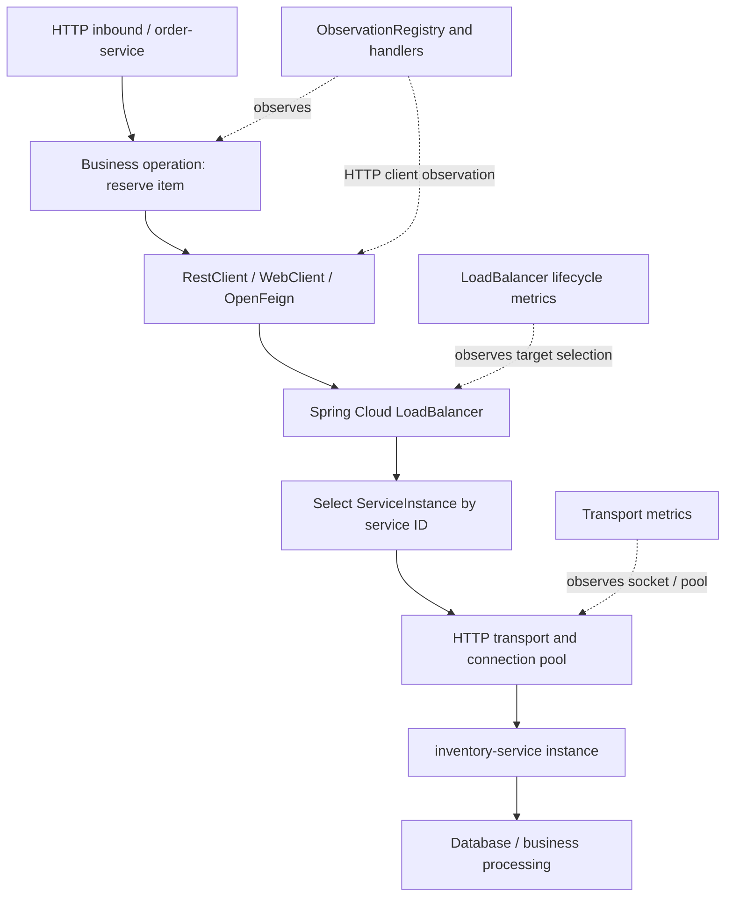
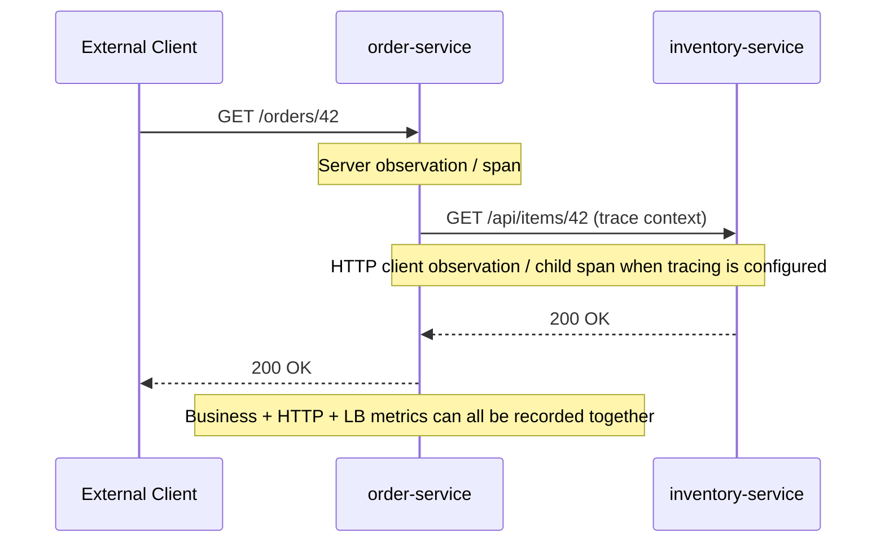
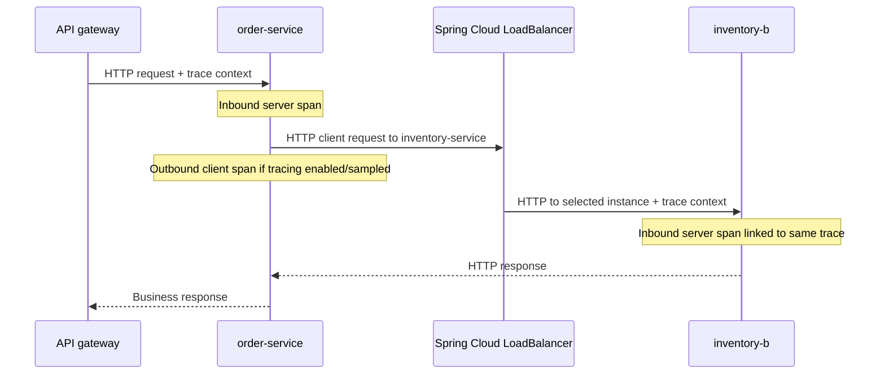
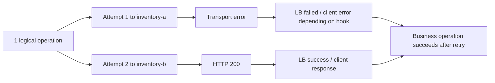
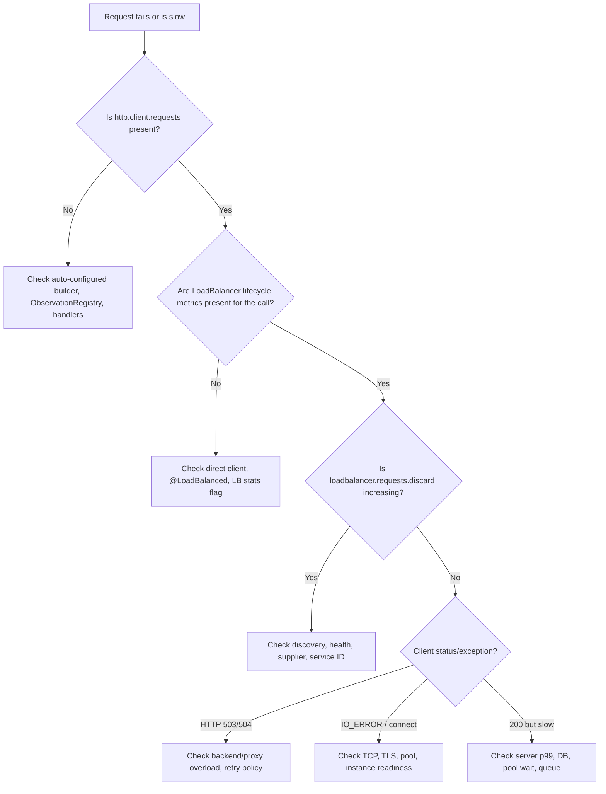

# Micrometer Observation and Integration Points per HTTP Client

In a microservices system, an HTTP call can pass through **business service → HTTP client → Spring Cloud LoadBalancer → connection pool → target instance**. When a request to `http://inventory-service` is slow or fails, knowing only the total HTTP duration is not enough to identify the cause: did the client fail to select a `ServiceInstance`, is it waiting on the connection pool, or did the server receive the request and process it slowly? To answer this, the system needs to combine **metrics, distributed traces, and logs** without generating excessive monitoring data.

This lesson belongs to the **System Observability** chapter of the **Spring Cloud Service Communication Load Balancing** module. The direct topic is **Micrometer Observation and integration points per HTTP client**: `RestClient`, `RestTemplate`, `WebClient`, Spring Cloud OpenFeign, and HTTP Interface. It also clarifies Spring Cloud LoadBalancer's own metrics, their relationship with discovery/health/retries/timeouts, the distinction between **one business call** and **HTTP attempts**, trace context propagation, and testing real instrumentation.

## 1. Placing Observations at the Right Layer

An `order-service → inventory-service` call spans multiple time scopes:



| Measurement point | Description | Questions it can answer |
|---|---|---|
| Business observation | Wraps the overall business operation, including multiple downstream calls, retries, and fallbacks if scoped properly | How long did it take to complete `reserveItem`? |
| HTTP client observation | Wraps one HTTP exchange according to client instrumentation scope | Which HTTP requests failed/were slow, method, URI template, status? |
| LoadBalancer lifecycle | Observes instance selection decisions and load-balancing step outcomes | Was a `ServiceInstance` selected? How many were discarded? |
| HTTP transport/pool metrics | Tracks connections, connection acquisition, and response time at the transport layer | Is there pool contention, connect timeout, or socket reset? |
| HTTP server observation | Measures received requests on the `inventory-service` side | How long did the backend take to process? Which status was returned? |

**Do not add latencies from nested layers** and treat that sum as total real time: they typically **overlap**. For instance, a 250 ms HTTP client observation may already include 20 ms to connect and 200 ms of server processing. A 300 ms business observation may contain that same 250 ms HTTP observation.

Likewise, **do not infer** that the presence of `http.client.requests` guarantees LoadBalancer metrics exist. A direct HTTP client calling a real URL still produces client observations when configured, without performing Spring Cloud LoadBalancer `ServiceInstance` selection.

## 2. What Does Micrometer Observation Consist Of?

Micrometer defines `Observation` so an application can record an operation in a monitoring-backend-agnostic way. Depending on the registered `ObservationHandler`s, a single observation can produce **timer metrics**, **trace spans**, events, or other integrated behaviors.

| Component | Role |
|---|---|
| `ObservationRegistry` | Registry storing Observation configurations, handlers, predicates, filters, and conventions |
| `Observation` | Lifecycle of an activity: `start`, `error`, `event`, `stop` |
| `Observation.Context` | Contextual data for the observed activity |
| `ObservationHandler` | Reacts to lifecycle events; can record metrics/spans |
| `ObservationConvention` | Defines observation names and metadata per contract |
| `MeterRegistry` | Registry managing meters/timers/counters/gauges and connecting to the metrics backend |
| Micrometer Tracing | Bridge from Observation to a tracing implementation such as OpenTelemetry or Brave |
| Context propagation | Preserves trace context across thread/scheduler/async boundaries when configured |

Having an `ObservationRegistry` present is **not enough** to prove traces are exported to a backend; the corresponding handlers/bridge/exporter are required. Similarly, having a `MeterRegistry` does not guarantee every HTTP client type is automatically instrumented.

### 2.1. Metrics and Tracing Are Different

- **Metrics** aggregate counts, durations, and rates; suited for tracking p95/p99, error rates, and active requests over a time window.
- **Distributed tracing** links spans of a single request across services; suited for investigating an individual case through the gateway, LoadBalancer, HTTP client, and backend.
- **Logs** store detailed events, letting you inspect exceptions, messages, and controlled metadata; trace IDs are commonly used to correlate with traces.



Trace sampling can cause some requests **not to export traces**, while metrics still capture aggregate data. Never treat a 10% trace sample rate as recording only 10% of HTTP metrics: the two systems have separate recording mechanisms and configurations.

### 2.2. An Observation Example in Blocking Business Logic

```java
import io.micrometer.observation.Observation;
import io.micrometer.observation.ObservationRegistry;

@Service
class InventoryLookupService {
    private final RestClient inventoryClient;
    private final ObservationRegistry observationRegistry;

    InventoryLookupService(
            RestClient inventoryClient,
            ObservationRegistry observationRegistry) {
        this.inventoryClient = inventoryClient;
        this.observationRegistry = observationRegistry;
    }

    ItemReply findItem(long id) {
        return Observation
                .createNotStarted("inventory.lookup", observationRegistry)
                .lowCardinalityKeyValue("dependency", "inventory-service")
                .lowCardinalityKeyValue("operation", "find-item")
                .observe(() -> inventoryClient.get()
                        .uri("/api/items/{id}", id)
                        .retrieve()
                        .body(ItemReply.class));
    }
}
```

`ItemReply` is an illustrative DTO and `inventoryClient` is a `RestClient` built from a LoadBalancer-integrated builder. `observe(...)` manages the observation lifecycle around the synchronous function; exceptions thrown inside the lambda can be recorded. When the HTTP client is also instrumented, **`inventory.lookup` and `http.client.requests` are two observations with different scopes**, not two independent measurements to add together.

**Do not create a new observation per item or turn individual paths into metric names** like `inventory.lookup.42`. Observation names should be stable; a record `id` is not an appropriate metric tag.

## 3. Prerequisites for Spring Instrumentation to Work

An application using Spring Boot and Spring Cloud typically needs:

1. `spring-boot-starter-actuator` for management/observability infrastructure.
2. `spring-cloud-starter-loadbalancer` for instance selection by service ID.
3. Spring Web/`RestClient` or Spring WebFlux/`WebClient` depending on the HTTP client model.
4. A `ServiceInstance` source such as Eureka, Consul, Kubernetes discovery, `SimpleDiscoveryClient`, or a custom supplier.
5. A metrics backend implementation such as the Micrometer Prometheus registry if exporting to Prometheus.
6. A Micrometer Tracing bridge and matching exporter if distributed traces are desired.
7. For OpenFeign, `feign-micrometer` if you want Micrometer capability as documented by Spring Cloud OpenFeign.

Minimal Maven dependencies for Actuator and LoadBalancer:

```xml
<dependency>
    <groupId>org.springframework.boot</groupId>
    <artifactId>spring-boot-starter-actuator</artifactId>
</dependency>

<dependency>
    <groupId>org.springframework.cloud</groupId>
    <artifactId>spring-cloud-starter-loadbalancer</artifactId>
</dependency>
```

Tracing/exporter starters depend on the **Spring Boot version and backend choice**. Boot 4 has its own OpenTelemetry/Zipkin starters and exporter configuration; Boot 3.x has a different dependency arrangement. Use the matching BOM and never mix arbitrary dependency versions across release trains.

**Note:** simply adding `spring-boot-starter-actuator` does not automatically turn clients created via constructors or static builders into instrumented clients. The deciding factor is **whether the HTTP client builder/instance receives the right `ObservationRegistry` and customizers**.

## 4. Configuring HTTP Clients Using Auto-Configured Builders

Spring Boot manages instrumentation for `RestTemplate`, `RestClient`, and `WebClient` when you use Boot's auto-configured builders:

| HTTP client | Standard path to Observation | If created manually with raw APIs |
|---|---|---|
| `RestTemplate` | Auto-configured `RestTemplateBuilder` | Needs `ObservationRegistry` or an observation customizer |
| `RestClient` | Auto-configured `RestClient.Builder` | Needs `observationRegistry(...)` / applying Boot configurer |
| `WebClient` | Auto-configured `WebClient.Builder` | Needs `observationRegistry(...)` / applying Boot customizers |
| OpenFeign | `MicrometerObservationCapability` when eligible | Check `feign-micrometer`, registry, and per-client flags |
| Spring HTTP Interface | Goes through `RestClient` or `WebClient` adapter | Not automatically instrumented merely by `@HttpExchange` |

Spring Framework names the default HTTP client exchange observation **`http.client.requests`** for both blocking and reactive paths. Spring Boot allows changing the name via `management.observations.http.client.requests.name` where appropriate.

### 4.1. Why Use Boot-Provided Builders?

Boot can attach `RestClientCustomizer`/`WebClientCustomizer` beans, the observation registry, message converters/codecs, request factories, TLS, and other settings. A fresh bean like:

```java
@Bean
RestClient.Builder customRestClientBuilder() {
    return RestClient.builder();
}
```

should not be assumed to carry all the settings of the auto-configured builder. A common symptom: HTTP calls succeed, yet **`http.client.requests` and trace headers never appear**.

When you need a dedicated `@LoadBalanced` builder, preserve the appropriate customizers or at least attach `ObservationRegistry` explicitly, then verify actual instrumentation with a test request.

## 5. RestClient: Observation on the Builder and LoadBalancer on the Interceptor

`RestClient` is a synchronous client. Spring Cloud LoadBalancer integrates with a `RestClient.Builder` annotated with `@LoadBalanced` to resolve logical hostnames as service IDs. Micrometer Observation is configured via **`observationRegistry(...)`** on the builder.

Minimal, **self-managed Observation** example:

```java
import io.micrometer.observation.ObservationRegistry;
import org.springframework.cloud.client.loadbalancer.LoadBalanced;
import org.springframework.context.annotation.Bean;
import org.springframework.context.annotation.Configuration;
import org.springframework.context.annotation.Primary;
import org.springframework.web.client.RestClient;

@Configuration(proxyBeanMethods = false)
class ObservedRestClientConfiguration {

    @Bean
    @LoadBalanced
    RestClient.Builder loadBalancedRestClientBuilder(
            ObservationRegistry observationRegistry) {
        return RestClient.builder()
                .observationRegistry(observationRegistry);
    }

    @Bean
    @Primary
    RestClient.Builder directRestClientBuilder(
            ObservationRegistry observationRegistry) {
        return RestClient.builder()
                .observationRegistry(observationRegistry);
    }

    @Bean
    RestClient inventoryRestClient(
            @LoadBalanced RestClient.Builder builder) {
        return builder
                .baseUrl("http://inventory-service")
                .build();
    }
}
```

- `@LoadBalanced` tells the builder to select a `ServiceInstance` from `inventory-service`.
- `observationRegistry(...)` enables Spring Framework to create HTTP client observations.
- `@Primary` on the direct builder makes unqualified injection default to a normal client so partner URLs are not mistaken for service IDs.
- In production with multiple gateways, avoid sharing a single mutable builder singleton and mutating `baseUrl`, headers, or request factory in different places. Use a prototype builder/clone and dedicated client configurations.

**This is a minimal example to understand wiring, not a complete replacement for Boot auto-configuration.** When a project relies on converters, request factories, trace propagation, and customizers applied by Spring Boot, use your Boot version's `RestClientBuilderConfigurer` to configure the builder before adding custom settings. In Boot 3.x, the class is in `org.springframework.boot.autoconfigure.web.client`; in Boot 4.x, it moved to `org.springframework.boot.restclient.autoconfigure`.

### 5.1. Verifying RestClient Observation

```java
ItemReply item = inventoryRestClient.get()
        .uri("/api/items/{id}", 42L)
        .retrieve()
        .body(ItemReply.class);
```

When `ObservationRegistry` has meter handlers/instrumentation, you can observe `http.client.requests` with general attributes such as method `GET`, URI template `/api/items/{id}`, status, and outcome.

There is no guarantee every request through this client automatically produces an **exported span** unless a tracing bridge/exporter is installed. Distinguish:

1. The `ObservationRegistry` bean is injected.
2. The HTTP client registered instrumentation.
3. The registry has handlers producing metrics.
4. Tracing is configured and the request is sampled/exported.

### 5.2. RestTemplate Still Appears in Many Legacy Applications

With `RestTemplate`, using Boot's `RestTemplateBuilder` configures Observation; if you instantiate a `RestTemplate` yourself, you must configure the registry explicitly, for example:

```java
RestTemplate template = new RestTemplate();
template.setObservationRegistry(observationRegistry);
```

This snippet only demonstrates Observation setup; to use service IDs, you still need proper `@LoadBalanced` bean/integration registration and a discovery source. **Attaching `ObservationRegistry` does not enable LoadBalancer.** Conversely, adding `@LoadBalanced` does not enable metrics/tracing.

## 6. WebClient: HTTP Exchange Observation and Reactive Context

`WebClient` uses a reactive pipeline. With Spring WebFlux, `WebClient.Builder` has an `observationRegistry(ObservationRegistry)` method, and Spring Boot typically configures the registry on the builder bean automatically.

Example of a builder that is both load-balanced and observed:

```java
import io.micrometer.observation.ObservationRegistry;
import org.springframework.cloud.client.loadbalancer.LoadBalanced;
import org.springframework.context.annotation.Bean;
import org.springframework.context.annotation.Configuration;
import org.springframework.web.reactive.function.client.WebClient;

@Configuration(proxyBeanMethods = false)
class ObservedWebClientConfiguration {

    @Bean
    @LoadBalanced
    WebClient.Builder loadBalancedWebClientBuilder(
            ObservationRegistry observationRegistry) {
        return WebClient.builder()
                .observationRegistry(observationRegistry);
    }

    @Bean
    WebClient inventoryWebClient(
            @LoadBalanced WebClient.Builder builder) {
        return builder
                .baseUrl("http://inventory-service")
                .build();
    }
}
```

Like the `RestClient` example, this raw declaration highlights the lesson's two prerequisites: **LB filter** and **ObservationRegistry**. Review Boot's other customizers/codecs/connectors/observability settings when assembling a complete production configuration.

### 6.1. When Does an HTTP Observation Actually Start and Stop?

```java
Mono<ItemReply> result = inventoryWebClient.get()
        .uri("/api/items/{id}", 42L)
        .retrieve()
        .bodyToMono(ItemReply.class);
```

Merely constructing the `Mono` variable does not prove any HTTP request was sent. The publisher normally executes when **subscribed to**; do not expect meters to increment immediately upon building the pipeline. An HTTP client observation can record responses, exceptions, and cancellations according to framework/transport lifecycle semantics, though exact timing/cancel details should be verified for your Spring Framework version.

**Never call `block()` inside an `ExchangeFilterFunction` or on a Reactor Netty event loop just to "wait for the full span".** Doing so can block the event loop and distort latency numbers. With reactive APIs, pass the publisher to the appropriate framework/subscriber.

### 6.2. Reactor Pipeline Observation vs. HTTP Client Observation

If you want to measure an additional section **outside the scope of a single HTTP exchange**, Reactor provides `Micrometer.observation(...)` via the `reactor-core-micrometer` dependency:

```java
import reactor.core.observability.micrometer.Micrometer;

Mono<ItemReply> result = inventoryWebClient.get()
        .uri("/api/items/{id}", 42L)
        .retrieve()
        .bodyToMono(ItemReply.class)
        .name("inventory.lookup.pipeline")
        .tap(Micrometer.observation(observationRegistry));
```

The `inventory.lookup.pipeline` observation covers a **separate reactive pipeline segment**; `http.client.requests` remains the HTTP exchange observation created by `WebClient`. The two measurements can be nested. If you want to record signal/flow metrics instead of an Observation, Reactor also offers `Micrometer.metrics(MeterRegistry)`, which produces **different meter types** than `Micrometer.observation(ObservationRegistry)`.

In pipelines with retries, pay attention to where `tap` sits relative to `retryWhen`: that determines whether you measure **one subscription/attempt** or the scope of the **logical operation**. Use fault-injection tests to confirm semantics rather than guessing from operator order.

### 6.3. Context Propagation Across Thread Switches

Reactive signals can run across multiple schedulers; never assume the original Servlet thread's `ThreadLocal` or MDC remains present. Tracing in Spring Boot/WebFlux relies on the combination of `ObservationRegistry`, Reactor Context, Micrometer Context Propagation, and appropriate instrumentation.

- Use official integrations rather than copying `traceId` into `ThreadLocal` ad hoc.
- If creating custom `ExecutorService`, `CompletableFuture`, or custom schedulers, check snapshot/context-propagation mechanisms or compatible task decorators.
- Test **parent-child trace links** across `publishOn`, `subscribeOn`, async callbacks, and retries.
- Never copy arbitrary HTTP trace headers from an untrusted user request and treat them as access permissions on a new request.

Context propagation settings vary across Boot/Reactor versions; lock down your BOM and test realistically instead of adding a global hook without knowing its impact on all pipelines.

## 7. OpenFeign: MicrometerObservationCapability and Per-Client Configuration

Spring Cloud OpenFeign typically uses a **blocking** HTTP client, integrating with LoadBalancer via `FeignBlockingLoadBalancerClient` when the required dependencies are present. For Micrometer, the documented hook point is a **Feign Capability**, specifically `MicrometerObservationCapability`.

Spring Cloud OpenFeign creates and registers this capability when **all** of the following hold:

1. The `feign-micrometer` dependency is on the classpath.
2. An `ObservationRegistry` bean is available.
3. Feign's Micrometer properties allow instrumentation (enabled by default when the other conditions are met).

```xml
<dependency>
    <groupId>io.github.openfeign</groupId>
    <artifactId>feign-micrometer</artifactId>
</dependency>
```

Example interface:

```java
@FeignClient(name = "inventory-service")
public interface InventoryFeignClient {
    @GetMapping("/api/items/{id}")
    ItemReply getItem(@PathVariable("id") long id);
}
```

With `@EnableFeignClients`, the right dependencies, and proper configuration, Feign can emit HTTP observations without requiring the application to write manual `Timer` code inside each interface method.

### 7.1. Global Flag and Client-Level Flag Are Asymmetric

```yaml
spring:
  cloud:
    openfeign:
      client:
        config:
          inventory-service:
            micrometer:
              enabled: true
          partner-client:
            micrometer:
              enabled: false
```

Behavior table:

| Configuration | Meaning |
|---|---|
| Global `spring.cloud.openfeign.micrometer.enabled` omitted | Can be toggled per client when dependencies/registry are present |
| `spring.cloud.openfeign.micrometer.enabled=false` | **Disables Micrometer support for all Feign clients**; client-level `true` cannot re-enable it |
| `spring.cloud.openfeign.client.config.<name>.micrometer.enabled=false` | Disables for one specific Feign client |
| `spring.cloud.openfeign.client.config.<name>.micrometer.enabled=true` | Enables for that specific client unless globally disabled |

When testing, verify the Feign client config name (especially when using `contextId`), the `ObservationRegistry` bean, and actual `Capability` registration. Putting `feign-micrometer` on the classpath is **not enough** if the registry is missing or the global switch is disabled.

### 7.2. MicrometerObservationCapability vs. MicrometerCapability

Spring Cloud OpenFeign documentation distinguishes:

- `MicrometerObservationCapability` uses `ObservationRegistry`; it can serve both metrics and tracing via configured handlers.
- `MicrometerCapability` is the older **metrics-only** option using `MeterRegistry`; to use it, disable Feign Micrometer observation auto-support and supply the capability manually.

Do not register **both** capabilities on the same call and accidentally measure it twice through two overlapping paths. And do not equate meters emitted by Feign's capability with `loadbalancer.requests.*`: they observe different layers.

### 7.3. Feign Logging and Observation Are Separate Concerns

Enabling Feign `FULL` logging can print headers, bodies, and responses, exposing tokens or personal data. Never use FULL logging as a way to produce metrics. Instead:

- Use Micrometer Observation/Tracing to measure latency, status, and errors.
- Use a logger that filters sensitive data when debugging is needed.
- Avoid putting request bodies or partner `Authorization` headers into span attributes, metric tags, or logs.
- Bound trace sampling, and configure retention and data access permissions.

## 8. Spring HTTP Interface: Hook Point Is the Adapter, Not the Annotation

With Spring HTTP Interface, developers define a contract:

```java
@HttpExchange("/api/items")
public interface InventoryHttpApi {
    @GetExchange("/{id}")
    ItemReply getItem(@PathVariable("id") long id);
}
```

`@HttpExchange` and `@GetExchange` **do not create their own HTTP client observations**. Actual observability comes from the underlying client wired into the proxy adapter:

```java
@Bean
InventoryHttpApi inventoryHttpApi(
        @LoadBalanced RestClient.Builder builder) {

    RestClient client = builder
            .baseUrl("http://inventory-service")
            .build();

    HttpServiceProxyFactory factory =
            HttpServiceProxyFactory.builderFor(
                    RestClientAdapter.create(client))
                    .build();

    return factory.createClient(InventoryHttpApi.class);
}
```

If the builder carries `ObservationRegistry`, HTTP exchanges through this proxy are instrumented like a standard `RestClient`. Likewise, using `WebClientAdapter` relies on `WebClient` observations and reactive semantics.

Spring Boot 4 / Spring Cloud 5 introduce HTTP Service Client groups and newer LoadBalancer integrations; with auto-configured groups, verify **base-url/serviceId semantics for your release train** and check that the registry and customizers are applied. Do not assume Boot 4 group configurations translate verbatim to Boot 3.

### 8.1. Should One Request Have Three Observations?

A business request can have:

- `inventory.lookup`: business-level observation.
- `http.client.requests`: HTTP exchange from `RestClient` or `WebClient`.
- `loadbalancer.requests.success/failed/discard`: dedicated meters for the LB lifecycle.

This is **not double instrumentation** when they represent **three activities with distinct purposes and scopes**. Double instrumentation occurs when the same HTTP exchange is recorded by two equivalent interceptors/handlers emitting duplicate timers or spans because custom code wrapped the exact same default layer without distinction.

## 9. Spring Cloud LoadBalancer Metrics Are an Independent Layer

Spring Cloud LoadBalancer provides `MicrometerStatsLoadBalancerLifecycle` (a `LoadBalancerLifecycle` implementation). Per the documentation, creating this bean requires:

- `spring.cloud.loadbalancer.stats.micrometer.enabled=true`.
- A `MeterRegistry` (typically configured by Boot Actuator).
- Requests **actually passing through Spring Cloud LoadBalancer**.

Example:

```yaml
spring:
  cloud:
    loadbalancer:
      stats:
        micrometer:
          enabled: true
        include-path: false
```

`include-path: false` helps reduce high cardinality on the URI tag; details by HTTP client/LoadBalancer release train are explained below.

### 9.1. Exact Metric Names and Meanings

According to Spring Cloud Commons documentation:

| Meter | Type | Meaning |
|---|---|---|
| `loadbalancer.requests.active` | Gauge | Number of currently active requests per LoadBalancer lifecycle data |
| `loadbalancer.requests.success` | Timer | Duration of load-balanced requests that finish by **handing a response** back to the client layer |
| `loadbalancer.requests.failed` | Timer | Duration of load-balanced requests that end with an **exception** |
| `loadbalancer.requests.discard` | Counter | Requests discarded because LoadBalancer **could not obtain a ServiceInstance** |

**Crucial:** the name `loadbalancer.requests.success` **does not necessarily mean HTTP 2xx or business success**. By official definition, it marks the lifecycle branch when a response is passed to the client layer; an HTTP 404/503 is still an HTTP response at that step. To compute **HTTP error rates**, check `http.client.requests`/server metrics/statuses and explicit exception mappings. Never define an alert assuming "every LB success equals a successful API call".

`loadbalancer.requests.discard` represents **failing to select an instance**, not every server-returned 503. A client calling a direct URL might receive a 503 from a proxy with zero LB discard events.

### 9.2. URI Templates and High-Cardinality Pitfalls

Spring Cloud LoadBalancer documentation notes:

- With LoadBalancer for `WebClient` and `RestClient`, the system can use `uriTemplate` for the `uri` tag when available.
- On some `RestTemplate` paths without a suitable URI template, the tag can contain the full path with dynamic IDs.
- You can set `spring.cloud.loadbalancer.stats.include-path=false` to omit the path from the `uri` tag when you need to curb cardinality.

Never use values like `/orders/987654321` as a metric tag if each request has a different ID. Metrics backends have series limits; high cardinality rapidly drives up memory usage, storage cost, and query latency.

### 9.3. LB Metrics Are Not Tracing Spans

`MicrometerStatsLoadBalancerLifecycle` is documented to produce **meters**. Do not assume every `ServiceInstance` selection cycle automatically creates a distributed tracing span complete with host/port, list supplier, and retry context. If you need detailed traces of target selection, design **selective** custom instrumentation that is safe on cardinality and test it with a real trace exporter.

## 10. Transport Metrics: Reactor Netty and Apache HttpClient 5

HTTP client Observation generally reports HTTP exchange duration, without always separating connection acquisition, connect, TLS, queuing, and socket lifecycle.

### 10.1. WebClient's Reactor Netty

When using a Reactor Netty `ConnectionProvider` with metrics enabled, you can observe:

| Typical metric | Meaning |
|---|---|
| `reactor.netty.connection.provider.active.connections` | Connections currently in use |
| `reactor.netty.connection.provider.idle.connections` | Idle connections |
| `reactor.netty.connection.provider.pending.connections` | Requests waiting for the pool to lease a connection |
| `reactor.netty.connection.provider.pending.connections.time` | Wait time to acquire a connection |
| `reactor.netty.connection.provider.total.connections` | Total active + idle |
| `reactor.netty.http.client.response.time` | Response time at the Reactor Netty HTTP client layer when HTTP metrics are enabled |

**Distinction:** `ConnectionProvider` metrics and `HttpClient` metrics are not necessarily enabled by the same flag. For example, `ConnectionProvider.builder(...).metrics(true)` provides pool metrics; HTTP client response time may require `HttpClient.metrics(...)` or an appropriately instrumented connector. Never assume enabling pool metrics alone produces `reactor.netty.http.client.response.time`.

### 10.2. Blocking Transports

`RestClient` or OpenFeign may use Apache HttpClient 5, JDK HttpClient, OkHttp, or another transport. Their connection pools may expose `leased`, `available`, `pending`, or acquisition wait stats, yet **not every transport automatically publishes these metrics to Micrometer**. Choose the appropriate instrumentation and clearly identify pool ownership and lifecycle.

### 10.3. Distinguishing Different Causes Behind Elevated Latency

| Symptom | HTTP client metrics | LB metrics | Transport/backend to inspect |
|---|---|---|---|
| No instance available | Client may record an error | `discard` increases | Discovery, supplier, health |
| DNS/connection refused after selection | HTTP error/exception | `failed` may increase | Connect errors, routing, server readiness |
| Connection pool exhausted | HTTP requests slow | Selection may not finish or send yet | Pool pending/acquire time |
| Backend returns HTTP 503 | `status=503` | LB `success` can still record since a response arrived | Backend 5xx, load shedding |
| Backend is slow but returns 200 | p99 rises, status 200 | Timers may rise | Server p99, DB waits, queues |
| Multiple retries | Depends on instrumentation placement | Each LB attempt may be recorded | Compare logical requests vs. outbound attempts |

**Do not assume LB meter event counts always equal HTTP client observation counts.** With retries, one logical request can produce multiple attempts; where interceptors/filters sit determines whether one observation covers a single exchange, a retry loop, or an instance selection. Inspect actual requests received by the backend to verify.

## 11. Low-Cardinality and High-Cardinality: Tag Design Rules

Every new combination of tag values can create a new time series in your monitoring system. Observation conventions therefore distinguish:

| Metadata category | Good examples | Usage |
|---|---|---|
| Low cardinality | `method=GET`, `status=200`, `uri=/api/items/{id}`, `dependency=inventory-service` | Metric tags, aggregation |
| High cardinality | Full URI with item ID, raw query, trace ID, request ID, upload ID | Suitable in traces/logs if free of secrets and governed by access policy |
| Sensitive | Authorization bearer tokens, cookies, PII, full bodies | **Never record** in metric tags, traces, or default logs |

Spring Framework HTTP client observations typically use keys such as:

- `method`.
- `uri` (the HTTP path template if available, excluding scheme/host/port).
- `client.name` (derived from request URI host; for logical URLs via LoadBalancer this can be the service ID).
- `status`.
- `outcome`.
- `error` (exception class or `none`).

A high-cardinality key such as `http.url` may exist in the observation/tracing context. **Having a high-cardinality attribute in a trace does not mean you should promote it to a Prometheus label.** Review your conventions and actual exporter rules, especially if URIs contain sensitive query parameters.

### 11.1. URI Templates Matter More Than Expanded URIs

Good:

```java
client.get()
        .uri("/api/items/{id}", 42L)
        .retrieve()
        .body(ItemReply.class);
```

Avoid building a resolved URI/string with all variables substituted and recording the full path in a custom metric tag:

```java
// Unsuitable as a metric tag: every item ID can create a new series.
String rawUri = "/api/items/" + itemId;
meterRegistry.counter("inventory.calls", "uri", rawUri).increment();
```

Better:

```java
meterRegistry.counter(
        "inventory.calls",
        "operation", "get-item",
        "dependency", "inventory-service")
        .increment();
```

When you need to diagnose a specific ID, use controlled traces/logs instead of expanding metric cardinality indefinitely.

### 11.2. Cardinality Grows Multiplicatively

Suppose metrics track 10 methods/status groups, 100 URI templates, and 500 instance IDs; theoretical combinations can reach:

```text
10 × 100 × 500 = 500,000 time series
```

This calculation is illustrative, not a prediction that every system hits all combinations. Adding `tenantId` or raw `requestId` with millions of values escalates cost far faster. Keep metrics tagged by service/operation, and reserve detailed instance IDs for tracing or controlled dashboards.

## 12. Actuator Configuration for Testing

Example configuration suitable for modern Spring Boot/Spring Cloud releases, adjusted for your release train:

```yaml
management:
  endpoints:
    web:
      exposure:
        include: health,info,metrics,prometheus
  tracing:
    sampling:
      probability: 0.1

spring:
  cloud:
    loadbalancer:
      stats:
        micrometer:
          enabled: true
        include-path: false
```

- `/actuator/metrics`: queries meter names and measurements/tags when the management endpoint is enabled.
- `/actuator/prometheus`: available only when the Prometheus registry dependency and endpoint are present.
- `management.tracing.sampling.probability`: adjusts trace sampling rate; **does not change** how many HTTP metrics are recorded.
- `spring.cloud.loadbalancer.stats.micrometer.enabled`: enables LoadBalancer's own stats; per current configuration property tables, it defaults to `false`.
- `include-path=false`: reduces the risk of URI paths exploding time-series counts in LB metrics.

**Production security:** never expose Actuator endpoints such as metrics/prometheus directly to the Internet without network access control, authentication, or corresponding infrastructure policies. Metrics can reveal service names, instances, or network topology.

### 12.1. Inspecting Meters via Actuator

After calling an instrumented HTTP client, try:

```text
GET /actuator/metrics/http.client.requests
GET /actuator/metrics/loadbalancer.requests.success
GET /actuator/metrics/loadbalancer.requests.failed
GET /actuator/metrics/loadbalancer.requests.discard
```

A meter appears only once a matching sample exists: `failed` may be absent if no exception has occurred; `discard` may be absent if an instance was always selected. Do not conclude the configuration is broken merely because an error-branch meter has not appeared after exclusively successful requests.

Names exported to Prometheus may be transformed per naming conventions—for instance, dots turned into underscores with timer/counter suffixes depending on the backend. Use native Micrometer names in `/actuator/metrics`; do not guess exact Prometheus strings before inspecting the real exporter output.

## 13. Cross-Service Tracing: Propagate Context, Not Instance IDs

When `order-service` receives an HTTP request and calls `inventory-service`, HTTP client instrumentation can create a **child span** and inject context propagation headers into the outbound request. Server instrumentation on inventory continues that trace according to compatible tracer/propagator settings.



Important rules:

1. Service IDs in logical URIs and selected instance host/ports are no substitute for `traceId`.
2. Do not create a fresh trace ID in every filter and wipe out the parent trace.
3. Do not use request ID/trace ID as a low-cardinality metric tag.
4. Do not expect the exporter to export every request if sampling is 10%.
5. In WebFlux or async work, preserve Reactor/Observation context across scheduler/ThreadLocal boundaries using compatible integrations.
6. With proxies/service meshes, extra infrastructure spans may exist; they do not necessarily match spans emitted by the Java client one-to-one.

### 13.1. A Common Mistake: Clients Created via Static Builders

```java
// May lack Boot observability setup, trace propagation, and converters.
RestClient unconfigured = RestClient.create("http://inventory-service");

// Framework-managed and verifiable approach:
RestClient configured = observedLoadBalancedBuilder
        .baseUrl("http://inventory-service")
        .build();
```

With the first approach, you also risk **having no LoadBalancer at all** if the client was not created from a `@LoadBalanced` builder. If the environment happens to have a DNS hostname `inventory-service`, requests might succeed while bypassing LB policies. Check trace spans together with LB metrics and backend logs to prove the actual path.

## 14. Retries Complicate Observation Counts

Suppose a logical operation `reserveItem(42)`:

- Attempt 1 picks `inventory-a` and gets `Connection reset`.
- Attempt 2 picks `inventory-b` and returns HTTP 200.
- The business method ultimately succeeds.



A business observation wrapping the retry may record only **one final success**, whereas the LB lifecycle records **two attempts** and the transport records one connection failure plus one success. HTTP client observations may sit outside or inside retries depending on instrumentation and how retries are wired.

**Never apply a blanket rule like "one Java method = one HTTP metric sample".** Determine:

- Whether retries occur in a `RestClient` filter/interceptor, Spring Cloud LoadBalancer, Reactor `retryWhen`, Feign retryer, or gateway.
- Whether the observation starts before or after the retry layer.
- When retries yield HTTP 503 followed by 200, whether HTTP status metrics and LB success/failed reflect the same boundary.
- Whether cancellations/timeouts in reactive pipelines are recorded in client and server metrics as expected.

Maintain separate metrics for **logical operation count**, **outbound attempts count**, **retry count**, and **backend received requests**. They are not guaranteed to match because attempts can fail before reaching the server.

## 15. Avoiding Double Instrumentation and Misleading Meters

Common pitfalls:

| Configuration mistake | Symptom | Fix |
|---|---|---|
| Using Boot's auto-configured builder and manually adding an interceptor that records the same HTTP timer | Two timers/spans for one exchange | Identify the instrumentation owner and remove the duplicate layer |
| Creating `RestClient.builder()` manually without attaching a registry | HTTP works but `http.client.requests` is missing | Use the proper builder/configurer or attach the registry |
| Having `MeterRegistry` but no `ObservationRegistry` on WebClient | Other metrics exist but HTTP client observations are missing | Inspect client builder and registry |
| Enabling `feign-micrometer` while the global flag is `false` | Feign is uninstrumented | Fix flags at the right scope |
| Interpreting LB `success` as HTTP 2xx | Falsely rosy availability dashboards | Use client/server statuses and business contracts |
| Enabling `include-path` for URIs with dynamic IDs | High metric cardinality | Use URI templates or `include-path=false` |
| Putting instance ID/trace ID on every custom meter | Excessive series and high cost | Keep low-cardinality tags |
| Retrying at multiple layers | Outbound attempts exceed logical requests | Establish one primary retry policy and track attempt metrics |
| Calling `block()` to preserve traces in a WebFlux filter | Event loop blocked, latency spikes | Use proper reactive context propagation |
| Logging unfiltered raw `http.url`/headers into logs/traces | Token/PII leakage | Redact, restrict attributes, and enforce access control |

### 15.1. Do Not Write Custom Observations to "Measure Everything"

More granular observations are not always better. If every `ServiceInstanceListSupplier`, every filter, and every converter creates its own span on every request, instrumentation overhead can become a bottleneck, especially for ultra-low-latency calls. Start with HTTP client, LB metrics, and backend server observations, then add **custom observations at high-value business boundaries** once you have specific diagnostic questions.

## 16. Testing Observations with Two Simulated Instances

A solid test should prove **requests go through LB** and **metrics match each layer**. Setup:

```yaml
spring:
  cloud:
    discovery:
      client:
        simple:
          instances:
            inventory-service:
              - uri: http://127.0.0.1:18081
              - uri: http://127.0.0.1:18082
    loadbalancer:
      stats:
        micrometer:
          enabled: true
        include-path: false
```

Run two HTTP stub servers on `18081` and `18082`, each returning its own instance ID. If the caller runs in a different container, replace `127.0.0.1` with an address reachable from that container. This configuration uses `SimpleDiscoveryClient` and needs no external registry for the test.

### 16.1. Scenarios to Test

| Scenario | Evidence to collect |
|---|---|
| GET service ID returns 200 | `http.client.requests` is recorded when Observation handlers are active; LB success has a sample |
| Direct URL GET with observed client | HTTP client observation exists, **no** LB lifecycle event for that direct call |
| Discovery returns empty | LB discard increments when lifecycle data is recorded; inspect client exception |
| Backend returns 503 | HTTP client/server metrics record status 503; LB success may still increment because a response arrived |
| Backend resets connection | LB failed or client error/exception depending on integration and timing |
| Single retry to another instance | Count attempts at stubs A/B; compare with LB/client metrics |
| Vary route ID from 1 to 10,000 | URI template does not create 10,000 extra metric tags |
| Disable Feign micrometer per client | Feign capability records no observations for the disabled client |
| WebClient reactive cancel | Connection not held indefinitely; check signal/cancel and corresponding metrics |
| Trace context propagation | Server spans in both services share the same trace when sampled |

### 16.2. A Test Verifying the HTTP Client Meter After a Call

```java
@SpringBootTest
class InventoryClientObservationIT {

    @Autowired
    RestClient inventoryRestClient;

    @Autowired
    MeterRegistry meterRegistry;

    @Test
    void clientHasHttpRequestMetric() {
        inventoryRestClient.get()
                .uri("/api/items/{id}", 42L)
                .retrieve()
                .toBodilessEntity();

        long samples = meterRegistry.find("http.client.requests")
                .timers()
                .stream()
                .mapToLong(Timer::count)
                .sum();

        assertTrue(samples >= 1L);
    }
}
```

This example assumes the context has an instrumented `inventoryRestClient` and the stub backend is running. JUnit 5/Spring Test/Micrometer imports are omitted. `Timer.count()` sums across all tags of the meter in the test's registry. **This is a basic wiring test**, not enough to verify trace exporters or that LoadBalancer picked the right instance; check server stubs and `loadbalancer.requests.*` when enabled.

Tests should avoid depending on registry data from concurrently running tests. Prefer an isolated test context, a dedicated `SimpleMeterRegistry`, or before/after deltas on the exact series if tests share a registry. If a test only checks `samples >= 1` in a context that already saw traffic, it can pass even when the current request is uninstrumented; formal integration tests must therefore control the baseline.

### 16.3. Observing Traces Across Two Services

With a tracing bridge/exporter and 100% sampling **in a test environment**, send a request from the caller to an instrumented stub backend. Verify:

1. Server and client create spans with the same trace ID when propagation works.
2. The client span is the proper child/descendant of the server/business span per configuration.
3. Retries may emit multiple spans or log events depending on hook placement—do not assume strictly one span.
4. No raw tokens/cookies or personal data appear in span attributes.
5. Under 10% production sampling, a missing trace is not proof that the HTTP call never happened.

## 17. Incident Diagnosis Workflow Using Both Observation and LoadBalancer Metrics



A request may lack an HTTP client meter because:

- The client was built with an uninstrumented builder.
- `ObservationRegistry` has no handlers for that observation type.
- The code path never actually subscribed/sent the request.
- The HTTP call was rejected **before** reaching the HTTP instrumentation point.
- The meter has no samples yet, was filtered, renamed, or hidden by the exporter.

Before drawing conclusions, do not look solely at `/actuator/prometheus`; compare `/actuator/metrics`, registry configuration, LoadBalancer lifecycle, HTTP server access logs, and the trace exporter.

### 17.1. When Should You Add Custom Metrics?

Only add a new metric when the three default sources cannot answer your question. Examples:

- Number of times the discovery cache returned a stale snapshot.
- Number of times the health supplier filtered out all candidates.
- Time requests spent inside a custom zone-selection policy.
- Retry rate from `inventory-a` to `inventory-b` during an incident.
- Bulkhead rejections / open circuit breaker events for a dependency.

Every added metric needs a defined **unit**, **label set**, **lifecycle**, **owner**, and **recording frequency**. Do not over-log/trace or add raw instance URIs/tenant IDs as labels for temporary debugging needs.

## 18. Pre-Production Checklist

- [ ] Understand the differences among `ObservationRegistry`, `MeterRegistry`, and Micrometer Tracing/exporters.
- [ ] `RestClient`/`RestTemplate`/`WebClient` use Spring Boot builders/instrumentation or have the registry explicitly attached.
- [ ] For HTTP Interface, verified observations come from the underlying `RestClientAdapter` or `WebClientAdapter`.
- [ ] For OpenFeign, `feign-micrometer`, `ObservationRegistry`, and per-client flags are properly configured; no accidental duplicate metrics-only capability enabled.
- [ ] HTTP clients calling service IDs actually have `@LoadBalanced` integration and the right `ServiceInstance` source.
- [ ] Enabled `spring.cloud.loadbalancer.stats.micrometer.enabled` if LB metrics are needed, knowing it is off by default.
- [ ] Understand `loadbalancer.requests.success` marks the response lifecycle, not HTTP 2xx by default.
- [ ] URI tags use templates, or LB stats path inclusion is disabled where needed to curb cardinality.
- [ ] Never place trace IDs, user IDs, tokens, raw queries, file IDs, or cursors in metric tags.
- [ ] Transport/connection pool metrics are available if pool wait needs to be separated from backend processing.
- [ ] Tracing bridge/exporter works, sampling is reasonable, and headers propagate across services.
- [ ] For WebClient, Reactor Context/propagation is tested across scheduler boundaries and retries.
- [ ] No double instrumentation of the same HTTP exchange via two equivalent interceptors.
- [ ] Integration tests cover success, 503, exceptions, no instance found, and retries.
- [ ] Logical requests, outbound attempts, backend received requests, and local rejections are clearly distinguished.
- [ ] Actuator endpoints and traces/logs are secured; retention, sampling, and access controls are in place.

**Conclusion:** Micrometer Observation is the unified bridge for **metrics and tracing**, yet each HTTP client has its **own hook point**: `ObservationRegistry` on `RestClient`/`WebClient` builders, `RestTemplate` or its builder, `MicrometerObservationCapability` for OpenFeign, and the underlying HTTP client adapter for HTTP Interface. Spring Cloud LoadBalancer also provides an **independent `MicrometerStatsLoadBalancerLifecycle`** to observe `ServiceInstance` selection. Properly combining **business observations + HTTP client observations + LB meters + transport/server evidence** lets you diagnose discovery, health, retries, timeouts, and connection failures without conflating measurement scopes or causing cardinality explosions.

## References

- [Spring Framework — Observability Support](https://docs.spring.io/spring-framework/reference/integration/observability.html): `http.client.requests`, `ObservationRegistry` for `RestClient`/`RestTemplate`/`WebClient`, observation keys.
- [Spring Boot — Metrics](https://docs.spring.io/spring-boot/reference/actuator/metrics.html): auto-configured HTTP client builders, observation conventions, and Actuator metrics.
- [Spring Boot — Tracing](https://docs.spring.io/spring-boot/reference/actuator/tracing.html): Micrometer Tracing, trace propagation, and sampling.
- [Spring Cloud Commons — Spring Cloud LoadBalancer](https://docs.spring.io/spring-cloud-commons/reference/spring-cloud-commons/loadbalancer.html): `MicrometerStatsLoadBalancerLifecycle` and `loadbalancer.requests.*` meters.
- [Spring Cloud Commons — Configuration Properties](https://docs.spring.io/spring-cloud-commons/reference/configprops.html): `spring.cloud.loadbalancer.stats.micrometer.enabled` and defaults.
- [Spring Cloud OpenFeign — Features, Micrometer Support](https://docs.spring.io/spring-cloud-openfeign/reference/spring-cloud-openfeign.html): `MicrometerObservationCapability`, `feign-micrometer`, and per-client flags.
- [Micrometer — Observation Introduction](https://docs.micrometer.io/micrometer/reference/observation/introduction.html): registry, handlers, observation lifecycle, and conventions.
- [Reactor — Exposing Reactor metrics](https://projectreactor.io/docs/core/release/reference/metrics.html): `tap(Micrometer.observation(...))` and `tap(Micrometer.metrics(...))`.
