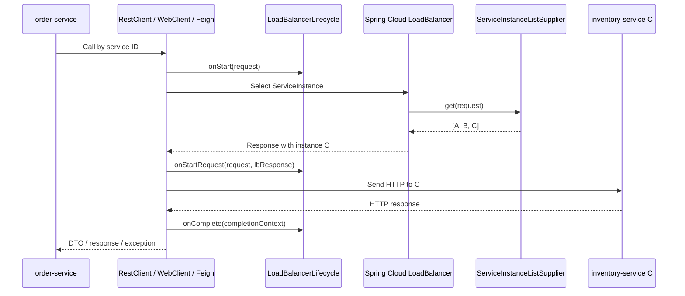

# LoadBalancerLifecycle and Capturing Replica Selection Outcomes

When `order-service` calls `http://inventory-service/api/stocks/BOOK-001`, Spring Cloud LoadBalancer can pick one of several `ServiceInstance`s of `inventory-service`. If the call is slow or fails, merely seeing HTTP `503` or `Connection refused` in logs is not enough to answer the critical questions: **which instance did LoadBalancer select, was an instance found at all, did the request actually reach the target, and how many times did retries re-select?**

**`LoadBalancerLifecycle`** is Spring Cloud Commons' extension point for observing milestones before and after the load-balancing process. Its callbacks let you attach **request context**, **selected instance**, and **execution outcome** to logs, metrics, or diagnostics. Spring Cloud also provides `MicrometerStatsLoadBalancerLifecycle` to collect load statistics via Micrometer when enabled and when a `MeterRegistry` is present.

This lesson belongs to the **System Observability** chapter of the `SPRING_CLOUD_SERVICE_COMMUNICATION_LOAD_BALANCING` module. It targets observability for inter-service communication using RestClient, WebClient, and OpenFeign, where `ServiceInstanceListSupplier`, discovery, health checks, zones, retries, and timeouts all influence which replica is chosen. The goal is accurate measurement and evidence-based diagnosis—never equating a successful selection with a successful business transaction.

## 1. Why Observe at the LoadBalancer Layer?

Suppose `inventory-service` advertises three instances:

| Instance | Address | Assumed state |
| --- | --- | --- |
| A | `10.0.1.11:8080` | Active |
| B | `10.0.1.12:8080` | Just died; registry/cache not yet updated |
| C | `10.0.1.13:8080` | Active |

A single call might unfold as follows:

```text
order-service receives an inventory check request
  -> Spring Cloud LoadBalancer selects B
  -> HTTP client connects to 10.0.1.12:8080
  -> Connection refused
  -> Retry policy allows a retry
  -> LoadBalancer selects C
  -> HTTP client calls C and receives HTTP 200
  -> order-service returns the business result
```

Looking only at the final HTTP response, we see `200 OK` and might assume the system is healthy. Behind the scenes, however, there were **two instance selections**, **two HTTP attempts**, and one network failure. That visibility matters when:

- One replica fails repeatedly while held in the cache.
- Retries inflate HTTP attempt counts and shift load onto surviving instances.
- Zone preference alters the same-zone selection ratio.
- A custom supplier filters out every candidate, leaving no target address.
- LoadBalancer picks a healthy instance, yet timeouts occur due to pool/network/server latency.
- You need proof that changing a selection algorithm actually improves outcomes.

The strength of `LoadBalancerLifecycle` is **placing observation hooks right at the `ServiceInstance` selection decision boundary**, instead of guessing from outer-layer HTTP logs.

## 2. The Three Main Callbacks in a Lifecycle

Spring Cloud Commons defines three key callbacks:

| Callback | Conceptual timing | Key information |
| --- | --- | --- |
| `onStart(Request<RC> request)` | Start of the load-balancing process | Request context used to select an instance |
| `onStartRequest(Request<RC> request, Response<T> lbResponse)` | After selection, before executing the request to the target | Request context and LoadBalancer selection result |
| `onComplete(CompletionContext<RES,T,RC> context)` | When the load-balanced call finishes per the integration | Selected instance, status, client response if any, and exception if any |

A simple diagram:



This is a **logical diagram**, not a guarantee that every HTTP client or failure path fires identical callbacks across all versions. When no instance is found, `onStartRequest` may not carry a valid server. If an error happens before LoadBalancer is invoked (for instance, an un-integrated client), the lifecycle will not observe the request at all.

## 3. Java Contract and the Meaning of the Three Generic Parameters

The interface conceptually looks like:

```java
public interface LoadBalancerLifecycle<RC, RES, T> {

    void onStart(Request<RC> request);

    void onStartRequest(
            Request<RC> request,
            Response<T> lbResponse);

    void onComplete(
            CompletionContext<RES, T, RC> completionContext);

    default boolean supports(
            Class requestContextClass,
            Class responseClass,
            Class serverTypeClass) {
        return true;
    }
}
```

Where:

- **`RC` (request context):** the context type used by the integration during selection; may relate to HTTP requests, hints, or retries.
- **`RES` (client response):** the response type provided to the lifecycle by the HTTP client/integration.
- **`T` (server type):** the target object type returned by LoadBalancer, typically `ServiceInstance`.

`Response<T>` in the callback is the **LoadBalancer server selection result**, not an HTTP `200`/`404`. For example, `Response<ServiceInstance>` can hold instance B before a single HTTP packet has been sent to B.

`supports(...)` lets a lifecycle decide whether it handles the context/response/server types supplied by an integration; the default usually returns `true`. When implementing a lifecycle that depends on a concrete `RequestDataContext` or `ResponseData`, restrict supported types or perform safe type checks rather than casting blindly.

## 4. The Request in Lifecycle Is Not the Raw HTTP Request

`Request<RC>` is a Spring Cloud LoadBalancer abstraction. It carries context for the selection step; depending on the HTTP client, that context may include request data and hints. It is **not necessarily** the application's `HttpServletRequest`, `ClientHttpRequest`, or `WebClient.RequestHeadersSpec`.

Examples of useful pieces of information:

| Information | Observability benefit | Caveat |
| --- | --- | --- |
| Service ID | Identifies which downstream is being selected | May reside in integration/config rather than every `Request` |
| Hint or routing context | Explains why a particular instance was preferred | Requires reading the right context type for your running version |
| Retry context | Distinguishes initial attempt from subsequent attempts | Not all integrations pass the same data type |
| HTTP method | Distinguishes GET/POST and checks retry safety | Only present if context/instrumentation supplies it |
| URI template | Groups latency by endpoint | Do not log URLs containing user IDs/tokens |
| Correlation/trace ID | Joins selection with HTTP attempts and final result | Requires a unified tracing context |

Do not dump `request.getContext().toString()` into production logs: the context may hold headers or sensitive data, and string formatting is unstable across versions.

## 5. onStart: Knowing When a Selection Begins

The `onStart(...)` callback runs before the load-balancing step on integration paths that support the lifecycle.

Here it is appropriate to:

- Count selection starts per service ID if a reliable context identifier is available.
- Mark a start milestone to correlate events within the same selection pass.
- Emit a low-level debug event when investigating routing policies.
- Inspect the context format supplied by an integration in a test environment.

At this point, **the selected instance is not yet known**. Therefore, you cannot measure "instance B selection ratio" inside `onStart`.

One important caution: never store per-request state in mutable instance fields on the lifecycle bean such as `lastRequest` or `lastStartNanos`. Many requests execute concurrently, so shared fields get overwritten. If you need custom timing/correlation, use the request context, tracing scope, or per-call storage suited for blocking or reactive execution.

## 6. onStartRequest: Knowing the Replica Selection Result

The `onStartRequest(request, lbResponse)` callback runs after selection completes and before the client executes the load-balanced request, per the lifecycle contract.

The key piece of information is:

```java
ServiceInstance selected = lbResponse.getServer();
```

Here, `selected` is the **chosen instance**, not an HTTP response. From the instance you can read:

```java
selected.getServiceId();
selected.getInstanceId();
selected.getHost();
selected.getPort();
selected.isSecure();
selected.getMetadata();
```

Example:

```text
event=lb.selection
serviceId=inventory-service
instanceId=inventory-c
host=10.0.1.13
port=8080
secure=false
```

With this data you can analyze selection distribution across instances/zones and verify routing policies. However, **being selected does not mean the HTTP request reached the server**. A connect timeout, TLS handshake failure, or connection refused can still happen after this callback.

Always check whether `lbResponse` and `getServer()` are non-null, especially when no instances are available. Calling `getHost()` on an empty result without checking will break your own observability code.

## 7. onComplete: Outcome of the Load-Balanced Path

`onComplete(CompletionContext<RES,T,RC>)` is where selection information can be paired with the **execution outcome**. `CompletionContext` exposes useful data:

| API | Contents |
| --- | --- |
| `status()` | Completion status according to lifecycle semantics |
| `getLoadBalancerResponse()` | Instance selection result from LoadBalancer |
| `getClientResponse()` | Response supplied by the client/integration if present |
| `getThrowable()` | Associated exception if present |
| `getLoadBalancerRequest()` | Selection context when passed through by the integration |

In common versions, `CompletionContext.Status` has the following values:

| Status | Meaning at the lifecycle layer |
| --- | --- |
| `SUCCESS` | The load-balanced path ended by handing a response back to the client per framework convention |
| `FAILED` | The execution path encountered an exception |
| `DISCARD` | No request was sent to a server on a discarded/skipped branch, e.g., no instance selected |

**`SUCCESS` does not mean HTTP 2xx or business success.** An HTTP `404` or `503` response is still a received HTTP response; whether status codes become exceptions and get recorded as `SUCCESS` or `FAILED` depends on callback placement and the HTTP integration. You must also inspect HTTP status/error handlers at the client layer to compute business outcomes or status breakdowns.

Likewise, `DISCARD` does not necessarily mean the entire system registry is empty: a supplier may have filtered out all instances due to health, zone, hint, configuration, or another issue. The lifecycle only reports that no valid destination existed on the path it observed.

## 8. Example Custom LoadBalancerLifecycle Logging Selection and Outcome

A minimal Java example that logs the selected instance and completion outcome. To avoid coupling to a single HTTP client type, the snippet uses generic `Object` for the request context and client response, with `ServiceInstance` as the server type.

```java
package com.example.order.observability;

import org.slf4j.Logger;
import org.slf4j.LoggerFactory;
import org.springframework.cloud.client.ServiceInstance;
import org.springframework.cloud.client.loadbalancer.CompletionContext;
import org.springframework.cloud.client.loadbalancer.LoadBalancerLifecycle;
import org.springframework.cloud.client.loadbalancer.Request;
import org.springframework.cloud.client.loadbalancer.Response;

public final class SelectionLoggingLifecycle
        implements LoadBalancerLifecycle<Object, Object, ServiceInstance> {

    private static final Logger log =
            LoggerFactory.getLogger(SelectionLoggingLifecycle.class);

    @Override
    public void onStart(Request<Object> request) {
        log.debug("event=lb.started");
    }

    @Override
    public void onStartRequest(
            Request<Object> request,
            Response<ServiceInstance> lbResponse) {

        ServiceInstance selected = serverOf(lbResponse);

        if (selected == null) {
            log.debug("event=lb.selection outcome=no_instance");
            return;
        }

        log.info(
                "event=lb.selection serviceId={} instanceId={} secure={}",
                selected.getServiceId(),
                selected.getInstanceId(),
                selected.isSecure());
    }

    @Override
    public void onComplete(
            CompletionContext<Object, ServiceInstance, Object> context) {

        ServiceInstance selected =
                serverOf(context.getLoadBalancerResponse());
        Throwable failure = context.getThrowable();

        log.info(
                "event=lb.complete status={} serviceId={} instanceId={} "
                        + "exceptionType={}",
                context.status(),
                selected == null ? "unknown" : selected.getServiceId(),
                selected == null ? "none" : selected.getInstanceId(),
                failure == null ? "none"
                        : failure.getClass().getSimpleName());
    }

    private static ServiceInstance serverOf(
            Response<ServiceInstance> response) {
        return response == null ? null : response.getServer();
    }
}
```

Key design choices in this example:

1. Log **service ID/instance ID**; avoid logging full URIs with query parameters.
2. Check for `null` to handle the no-instance-selected branch.
3. Log the **exception type**, rather than automatically logging messages or stack traces containing URLs/tokens on every request.
4. Use no per-request mutable fields, avoiding state mixing across concurrent calls.
5. Never claim `status=SUCCESS` means HTTP 2xx.
6. The callback neither alters instance selection nor controls retries.

This is illustrative code matching the `LoadBalancerLifecycle` contract in Spring Cloud Commons versions with those three callbacks. In production, consider **log sampling** and Micrometer/Tracing instead of INFO logging on every request under high traffic.

### 8.1. Registering a Lifecycle Specifically for One Service ID

Spring Cloud LoadBalancer typically creates a child context per service ID. You can attach a dedicated configuration for `inventory-service`:

```java
package com.example.order;

import com.example.order.observability.SelectionLoggingLifecycle;
import org.springframework.cloud.client.ServiceInstance;
import org.springframework.cloud.client.loadbalancer.LoadBalancerLifecycle;
import org.springframework.cloud.loadbalancer.annotation.LoadBalancerClient;
import org.springframework.context.annotation.Bean;
import org.springframework.context.annotation.Configuration;

@Configuration
@LoadBalancerClient(
        name = "inventory-service",
        configuration = InventoryLbObservabilityConfiguration.class)
class LoadBalancerConfiguration {
}

// Configuration dedicated to inventory-service's child context.
// Do not annotate with @Configuration and do not let component scan pick it up globally.
class InventoryLbObservabilityConfiguration {

    @Bean
    LoadBalancerLifecycle<Object, Object, ServiceInstance>
            inventorySelectionLoggingLifecycle() {
        return new SelectionLoggingLifecycle();
    }
}
```

In this example, `InventoryLbObservabilityConfiguration` is the configuration class declared in `@LoadBalancerClient` and must not be scanned as a primary application configuration bean. If the class sits inside component scan and gets registered globally, the lifecycle can unintentionally affect other service IDs.

You do not need a custom `ServiceInstanceListSupplier` just to log selections. Never modify the supplier or Round Robin algorithm when the requirement is purely observability.

## 9. HTTP Client Wiring: Lifecycle Only Observes Calls Through LoadBalancer

All the callbacks above are useful only if requests **actually pass through Spring Cloud LoadBalancer**.

### 9.1. RestClient

```java
import org.springframework.cloud.client.loadbalancer.LoadBalanced;
import org.springframework.context.annotation.Bean;
import org.springframework.context.annotation.Configuration;
import org.springframework.web.client.RestClient;

@Configuration
class HttpClientConfiguration {

    @Bean
    @LoadBalanced
    RestClient.Builder loadBalancedRestClientBuilder() {
        return RestClient.builder();
    }
}
```

Business call:

```java
RestClient client = loadBalancedBuilder
        .baseUrl("http://inventory-service")
        .build();

StockResponse stock = client.get()
        .uri("/api/stocks/{sku}", "BOOK-001")
        .retrieve()
        .body(StockResponse.class);
```

`loadBalancedBuilder` is injected from the `@LoadBalanced` bean; `StockResponse` is an illustrative DTO. If you use standalone `RestClient.create()` or call a physical URL directly, the request can bypass Spring Cloud LoadBalancer and thus trigger no lifecycle callbacks.

### 9.2. WebClient

With reactive WebClient, you can use `@LoadBalanced WebClient.Builder` similarly. A call returning `Mono<StockResponse>` normally sends HTTP only upon subscription, so callbacks may run **after building the publisher**, not when assembling the reactive chain.

```java
@Bean
@LoadBalanced
WebClient.Builder loadBalancedWebClientBuilder() {
    return WebClient.builder();
}
```

When testing reactive tracing, verify that Reactor/Observation context propagation is properly configured instead of assuming thread-bound MDC (Mapped Diagnostic Context) is always present as in synchronous flows.

### 9.3. OpenFeign

`@FeignClient(name = "inventory-service")` can use Spring Cloud LoadBalancer when no fixed URL is set and the required dependencies/integrations are present. If a Feign client declares `url = "http://10.0.1.13:8080"`, it typically does not select a `ServiceInstance` by service ID; LoadBalancer lifecycle will not observe the same selection chain as a registry-based call.

Always verify Feign's actual wiring, retryer, and transport; do not expect all three HTTP client types to expose identical request/response context contents inside callbacks.

## 10. Built-in Statistics Collection with MicrometerStatsLoadBalancerLifecycle

If your primary goal is statistics rather than custom logs, Spring Cloud provides **`MicrometerStatsLoadBalancerLifecycle`**. Enabling it requires a `MeterRegistry` and the property:

```yaml
spring:
  cloud:
    loadbalancer:
      stats:
        micrometer:
          enabled: true
```

Common Spring Boot metric dependencies:

```xml
<dependency>
    <groupId>org.springframework.boot</groupId>
    <artifactId>spring-boot-starter-actuator</artifactId>
</dependency>
<dependency>
    <groupId>io.micrometer</groupId>
    <artifactId>micrometer-registry-prometheus</artifactId>
</dependency>
```

When auto-configuration conditions are met, the framework registers the metric-recording lifecycle bean. Meters documented by Spring Cloud Commons include:

| Micrometer meter name | Type | Meaning |
| --- | --- | --- |
| `loadbalancer.requests.active` | Gauge | Number of currently active load-balanced requests |
| `loadbalancer.requests.success` | Timer | Duration of calls where a response was handed back to the client per lifecycle definition |
| `loadbalancer.requests.failed` | Timer | Duration of calls that ended with an exception |
| `loadbalancer.requests.discard` | Counter | Number of calls discarded because no instance could be obtained to execute |

**Important note:** the `success` meter here still **does not automatically mean** "HTTP status is 2xx" or "business success". An API error like `404` may need to be analyzed via HTTP client/server metrics or custom error mappings.

In some implementations (especially certain blocking paths), request/response context is incomplete, so tags for HTTP method, path, or response may be missing. Meters are registered only once an event is recorded; not seeing `discard` in a completely healthy environment **does not necessarily** mean the feature is inactive.

### 10.1. Enabling the Prometheus Endpoint in a Controlled Environment

```properties
management.endpoints.web.exposure.include=health,info,metrics,prometheus
```

The `/actuator/prometheus` endpoint should only be exposed over a management network or protected access path. Never expose metrics and logs containing sensitive host/instance metadata to the Internet just to debug.

Before relying on Prometheus metric strings, check the actual output of your running Micrometer version: dotted meter names are normally converted to snake_case, and timers typically get `_seconds_count`, `_seconds_sum`, and possibly `_bucket` suffixes if histograms are enabled.

## 11. Reading LoadBalancer Metrics Correctly

Under typical Prometheus naming conventions, the meters above may be exported with names like:

```text
loadbalancer_requests_active
loadbalancer_requests_success_seconds_count
loadbalancer_requests_success_seconds_sum
loadbalancer_requests_failed_seconds_count
loadbalancer_requests_failed_seconds_sum
loadbalancer_requests_discard_total
```

Exact names, tags, and whether series exist at scrape time must be verified on the real endpoint. These are **illustrative names following naming conventions**, not a guarantee across every registry/version.

### 11.1. Counting Rate of Load-Balanced Calls Receiving a Response

```promql
sum(rate(loadbalancer_requests_success_seconds_count[5m]))
```

The result is in *calls/second* per the lifecycle Timer definition. It does not equal the **successful business request rate** if retries occurred or if error HTTP statuses still returned a response.

### 11.2. Counting Exception-Based Failure Rate

```promql
sum(rate(loadbalancer_requests_failed_seconds_count[5m]))
```

You can correlate this series with timeouts, connection refused, TLS handshake failures, and HTTP client error metrics. Do not use it as a complete measure of HTTP `5xx`.

### 11.3. Counting No-Instance Discards

```promql
sum(rate(loadbalancer_requests_discard_total[5m]))
```

An upward trend indicates call branches were dropped/discarded before sending requests to a server per the metric's semantics. Cross-check discovery lists, health/zone/hint filters, caches, and supplier configuration to pinpoint the cause.

### 11.4. Active Request Count

```promql
sum(loadbalancer_requests_active)
```

This is a gauge reflecting active calls within the scraped instrumentation scope, not exact HTTP sockets or system-wide concurrency. Scrape interval, request lifetime, and how the framework updates the gauge affect what is observed.

### 11.5. Latency Percentiles from Histograms When Available

```promql
histogram_quantile(
  0.95,
  sum by (le) (
    rate(loadbalancer_requests_success_seconds_bucket[5m])
  )
)
```

This query **returns results only** when Timer histogram buckets are exported. Spring Cloud allows enabling distribution statistics via an appropriate `MeterFilter`; do not assume `_bucket` is always present. The p95 from this metric reflects **latency of passes recorded in the success timer**, excluding requests that ultimately failed if they were recorded in the separate failed timer.

## 12. Why Not Attach Instance IDs to Every Metric Label?

`LoadBalancerLifecycle` can see the selected instance. However, emitting metrics like:

```text
lb_selection_total{instanceId="inventory-c", serviceId="inventory-service"}
```

requires careful thought. In autoscaling systems, instance IDs churn constantly, causing Prometheus time-series counts to surge. If you also attach SKU, user ID, raw URI, trace ID, token, or request body as labels, cardinality can explode and leak sensitive data.

A safer observability layering approach:

| Tier | Appropriate fields |
| --- | --- |
| Aggregate metrics | Service ID, lifecycle status, exception category, HTTP method |
| Cardinality-governed metrics | Normalized zone, client type, small lifecycle-controlled instance ID sets |
| Sampled structured logs | Selected instance ID/host, trace ID, attempt index, status |
| Distributed traces | Span attributes for route, selected instance, error, and duration |
| Dedicated audit logs | Who accessed which resource; never substitute LB logs for security audit logs |

Avoid enabling INFO logging on every request at thousands of RPS when you only need trend monitoring; default metrics, trace sampling, and conditional detailed logs are far more economical.

## 13. Linking Lifecycle with Trace ID and HTTP Client Observation

Each call traverses multiple layers:

```text
Business request
  -> RestClient/WebClient/OpenFeign logical call
     -> LoadBalancer selection
        -> HTTP transport
           -> inventory-service replica
```

A desirable log model:

```text
traceId=52ac... event=lb.started serviceId=inventory-service
traceId=52ac... event=lb.selection instanceId=inventory-b
traceId=52ac... event=http.client error=ConnectException
traceId=52ac... event=lb.complete status=FAILED instanceId=inventory-b
traceId=52ac... event=lb.selection instanceId=inventory-c attempt=2
traceId=52ac... event=lb.complete status=SUCCESS instanceId=inventory-c
traceId=52ac... event=business.completed outcome=success
```

These are **illustrative multi-layer logs**, not lines automatically generated in full by `LoadBalancerLifecycle`. Getting `traceId` and `attempt` index requires observation/tracing integration and an appropriate retry policy. In reactive flows, verify context propagation across operators; never read MDC on one thread and assume it follows the publisher onto another thread.

**Do not double-count one event across layers:** a business request that succeeds after a retry may emit one business timer, one logical HTTP call timer, and two or more load-balanced attempt timers. Name them distinctly and document what each metric means.

## 14. Counting Selections, HTTP Attempts, and Business Outcomes

The following events are **not equivalent**:

| Event | When can it occur? | Meaning |
| --- | --- | --- |
| `lb.started` | Framework starts the load-balancing step | Selection process begins |
| `lb.selection` | LoadBalancer returns a valid instance | A target exists to try sending to |
| `http.attempt.sent` | Transport transmits the request over the network | Attempt may reach the server or fail mid-flight |
| `lb.complete status=SUCCESS` | Framework hands a response to the client | Not necessarily HTTP 2xx |
| `lb.complete status=FAILED` | An exception occurred at the integration boundary | Inspect the exception type |
| `lb.complete status=DISCARD` | No request sent to a server on that branch | Usually related to missing target |
| `business.success` | Service fulfills the business contract | Determined by business logic, not LB alone |

For instance, a `POST` reaches the server, then the response times out: the HTTP attempt was sent and the server may have already written data. A `FAILED` lifecycle does not prove the business operation did not execute; retries must account for idempotency. Picking a new instance after a timeout does not eliminate duplicate risk either.

## 15. Retry-Aware Suppliers and Per-Attempt Data to Record

Spring Cloud LoadBalancer can use `RetryAwareServiceInstanceListSupplier` to avoid re-selecting the previous instance when the retry policy and request context support it.

```text
Attempt 1:
  candidates=[A,B,C]
  selected=A
  result=CONNECTION_REFUSED

Attempt 2:
  previous=A
  candidates_after_retry_filter=[B,C]
  selected=C
  result=HTTP_200
```

To observe accurately:

1. Attach **one trace ID** for the business request.
2. Attach an **attempt index** if supplied by the integration/retry engine or reliably tracked by the application.
3. Record **previous instance** from retry context at the supporting layer.
4. Record **selected instance** from `onStartRequest`.
5. Record **status/exception** from `onComplete`.
6. Record total actual attempts and final business outcome.

Avoid inferring the attempt index from a global counter inside a singleton bean: concurrent requests interleave and corrupt counts. Note also that Feign/Reactor retries do not always traverse the exact same LoadBalancer integration or carry identical context; verify in the real system.

## 16. No Instance Available: Observing the DISCARD Branch Properly

Suppose `DiscoveryClient` has no instances for `inventory-service`, or suppliers filtered all of them out due to health/zone/hint.

```text
Service ID: inventory-service
Discovery candidates: []
Eligible candidates: []
LoadBalancer selection: no server
HTTP request to inventory-service: NOT SENT
Lifecycle: DISCARD branch if recorded by integration
```

Key distinctions:

- **No `ServiceInstance` found:** failure at the discovery/supplier/LoadBalancer boundary.
- **Instance selected, then connection refused:** transport/network error after selection.
- **Received HTTP `503`:** server/gateway returned an HTTP response.
- **Received HTTP `200` with body `success=false`:** business-contract failure or rejection.

If `loadbalancer.requests.discard` rises, inspect the discovery source and the post-filtering list. `LoadBalancerLifecycle` does not automatically expose the full list of eliminated instances; to explain **why** the list became empty, log or instrument the supplier chain or discovery components at an appropriate level.

## 17. Combining Selection Data with Health, Zone, and Cache

For example, the caller runs in `zone-a`, and the registry returns:

| Instance | Zone | Assumed readiness |
| --- | --- | --- |
| A | `zone-a` | Healthy |
| B | `zone-a` | Unhealthy |
| C | `zone-b` | Healthy |

A supplier chain with health and zone filters may return only A for a selection pass. The lifecycle logs `selected=A`, but does not by itself explain that B was filtered by health or C was outside the same-zone preferred set.

Distinguish these datasets:

```text
Discovery view: [A, B, C]
Eligible after health: [A, C]
Preferred in zone-a: [A]
Chosen by LoadBalancer: A
```

If A dies and the cache has not refreshed yet, many requests may still select A; lifecycle data reveals that symptom. Removing A from the list, however, belongs to registry updates, health filtering, and cache refresh—not `LoadBalancerLifecycle`.

A strong observability dataset correlates **selection** with pre/post-supplier instance counts during deep investigations. Do not add heavy instrumentation to every supplier just for an everyday dashboard.

## 18. Measuring Latency at the Right Scope

You may have the following timestamps:

```text
t0: Business request starts
t1: onStart in LoadBalancer
t2: onStartRequest after instance selection
t3: HTTP transport starts/completes connection
t4: Server processes and returns response
t5: onComplete
t6: Business response finishes
```

Intervals of interest:

| Interval | Interpretation |
| --- | --- |
| `t2 - t1` | Load-balancing step cost in the illustrative model |
| `t5 - t2` | Post-selection execution until completion callback |
| `t5 - t1` | Lifecycle call path duration per integration |
| `t6 - t0` | End-to-end latency observed by caller/user |

Real systems involve concurrency, callback scheduling, backoff/retries, and response processing that deviate from this linear path. Never subtract two timestamps from **different processes** to infer network time without clock synchronization.

If measuring elapsed time manually within the same process, use a monotonic clock such as `System.nanoTime()`. Avoid storing a shared `startNanos` field on the lifecycle bean across all requests. When you only need latency statistics, using Micrometer's built-in Timer is simpler and safer than managing correlation state yourself.

## 19. Lifecycle Test Matrix

An integration test should include two test servers A/B, a controlled `DiscoveryClient` or `ServiceInstanceListSupplier`, and a real client calling by service ID.

| Scenario | What to verify |
| --- | --- |
| Two instances present, GET succeeds | Lifecycle receives start, instance selection, and matching completion |
| Supplier returns empty list | No-server/`DISCARD` branch runs when supported by integration; no HTTP request hits servers |
| Instance A not listening | A is selected, then transport fails; matching exception is recorded |
| Server returns HTTP `404` | HTTP response received; do not treat every `404` as an instance-selection failure |
| Server returns HTTP `503` | Distinguish HTTP status from lifecycle exception/metrics |
| Retry after A fails, succeeds on B | Observe attempts, selected instances, and business outcome |
| Zone preference enabled | Selection matches same-zone preference list when present |
| Cache retains stopped instance | Selection still sees old instance; cross-check registry/supplier |
| Custom lifecycle scoped to inventory only | No logs appear for other service IDs outside the configured scope |
| Reactive WebClient | Callbacks tie to subscription time; do not assume a request occurs merely by creating `Mono` |
| OpenFeign with fixed URL | Do not confuse direct client with load-balanced client |
| Micrometer stats enabled | Corresponding meters appear after events; verify actual names/tags |
| Histograms not enabled | Do not assume `_bucket` exists for p95 calculation |
| High load | Logs do not explode; cardinality and overhead stay within bounds |

**Mocking only the HTTP client interface** may suffice for business logic tests, but does not prove `LoadBalancerLifecycle` is invoked. To verify lifecycle behavior, requests must traverse the real Spring Cloud LoadBalancer integration inside the test context.

## 20. Diagnostic Workflow When Callbacks or Metrics Are Missing

If `onStartRequest` or `loadbalancer.requests.success` does not appear, check in order:

1. **Is the HTTP client using LB?** Are RestClient/WebClient builders annotated with `@LoadBalanced` and injected properly? Does Feign have a fixed URL?
2. **Is the lifecycle configured in the right context?** Does the bean exist in the child context of the target service ID?
3. **Package scan:** was the per-service configuration class accidentally scanned globally or never loaded?
4. **`supports(...)`:** did the lifecycle reject the request/response/server types provided by the integration?
5. **Was a request actually sent?** In reactive flows, was the publisher subscribed to?
6. **Does the error path have a server?** When no instance is available, do not expect a callback requiring a selected server to contain one.
7. **Stats property:** has `spring.cloud.loadbalancer.stats.micrometer.enabled` taken effect?
8. **MeterRegistry/Actuator:** is the registry present, and are metrics/prometheus endpoints exposed per policy?
9. **Has an event occurred yet?** Some meters are not created before their first recorded sample.
10. **Metric name:** did Prometheus rename it by convention, or did a `MeterFilter` rename/drop it?
11. **Tags/client type:** blocking paths may omit request/response data; is a PromQL selector filtering the data out?
12. **Access control:** are metrics endpoints blocked by management network rules or authentication by design?

If the lifecycle shows `onStart` with no selected instance, check the supplier/discovery and `DISCARD` path. If `onStartRequest` shows B with no HTTP response, check transport/network/timeouts. If HTTP `200` arrived yet business KPIs still degrade, inspect domain logic on caller and server.

## 21. Design Mistakes That Skew Measurements

1. **Calling lifecycle `SUCCESS` "business success".** It does not replace HTTP status and domain error codes.
2. **Counting selections as server-received requests.** Requests can fail in DNS/TLS/connect before reaching the target.
3. **Omitting null checks on response/server.** The no-instance branch can cause your logging code to throw.
4. **Writing to a global `currentInstance` field.** Concurrent requests mix log data.
5. **Logging every request at INFO without sampling.** Creates I/O pressure and slows down the very call path being measured.
6. **Dumping request context/headers into logs.** Risks leaking tokens, cookies, or personal data.
7. **Using trace ID/SKU/raw URI as metric labels.** Causes high cardinality and storage cost.
8. **Looking only at the final response and ignoring retries.** Hides failing replicas and retry-induced load.
9. **Using success timer p95 as p95 for all business requests.** Ignores failed/discard branches and retry overhead depending on scope.
10. **Assuming instrumentation behaves identically across every adapter and version.** Verify with tests.
11. **Placing a custom bean globally by accident.** Can add logging or instrumentation to every service ID.
12. **Changing the selection algorithm just to fix missing logs.** Fix wiring and observability first.
13. **Enabling histograms without controlling tags.** Time-series counts can surge rapidly with many instances.

## 22. Official Documentation and Self-Check

Reference documentation to cross-check against your project's Spring Cloud Commons / Spring Cloud LoadBalancer version:

- [Spring Cloud Commons – Spring Cloud LoadBalancer](https://docs.spring.io/spring-cloud-commons/reference/spring-cloud-commons/loadbalancer.html), sections *Spring Cloud LoadBalancer Lifecycle* and *Spring Cloud LoadBalancer Statistics*.
- [Spring Cloud Commons – Configuration Properties](https://docs.spring.io/spring-cloud-commons/reference/configprops.html), property `spring.cloud.loadbalancer.stats.micrometer.enabled`.
- [Spring Cloud Commons – LoadBalancerLifecycle API](https://javadoc.io/doc/org.springframework.cloud/spring-cloud-commons/latest/org/springframework/cloud/client/loadbalancer/LoadBalancerLifecycle.html), to check generics, callbacks, and context types for your dependency version.

Self-check questions:

1. What are the three callbacks of `LoadBalancerLifecycle`, and which phase does each correspond to?
2. Why is `Response<ServiceInstance>` in `onStartRequest` not an HTTP response?
3. Does `CompletionContext.status() == SUCCESS` guarantee HTTP `200` or business success?
4. When no instance is available, what outcome should be observed and why does no HTTP request reach the server?
5. How do you distinguish selecting instance B from B actually receiving the request?
6. A GET that fails on A and retries successfully on C produces how many selections and how many business requests?
7. Why is `onStart` not the place to identify the selected instance?
8. Why shouldn't you use a shared `currentStartNanos` field to time requests in a singleton lifecycle bean?
9. How do you enable `MicrometerStatsLoadBalancerLifecycle`, and which dependency provides `MeterRegistry`?
10. How does `loadbalancer.requests.failed` differ from HTTP `5xx`?
11. Why shouldn't trace IDs or raw URIs containing IDs be attached as metric tags?
12. If no callbacks fire when calling OpenFeign, which configuration should you inspect first?
13. When a zone/health filter removes B from candidates, does the lifecycle itself explain why B was filtered?
14. Why must HTTP attempts, lifecycle status, and business outcomes be recorded separately?

**Conclusion:** `LoadBalancerLifecycle` provides three essential vantage points into a load-balanced call: **selection start**, **instance selected**, and **completion with status/exception/response**. Combining it with Micrometer metrics, tracing, and HTTP client/server observability explains retries, missing instances, stale caches, and connection failures without guessing from the final HTTP status. The key is **keeping each measurement's scope clear**, avoiding sensitive data and high cardinality, and verifying that callbacks actually fire with the `RestClient`, `WebClient`, or OpenFeign configuration used in your system.
