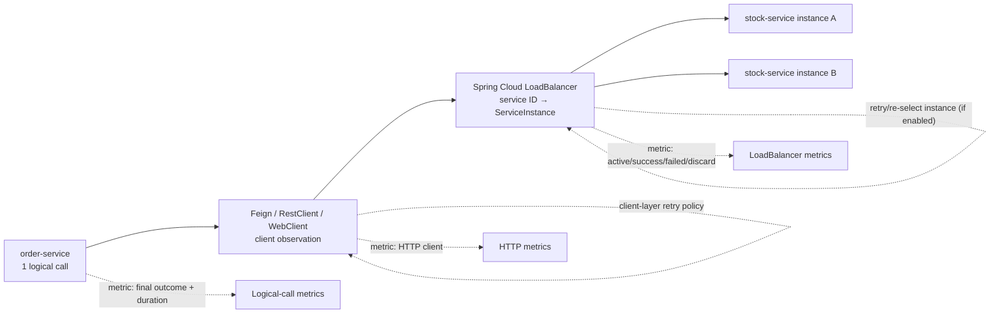

# Metrics by Service, Outcome, Latency, and Retry Count

## Objectives

When one service calls another through **Spring Cloud LoadBalancer**, a question like "is `stock-service` slow or failing?" cannot be answered merely by total HTTP 500 counts. We need to know **which target service**, **the outcome at which layer**, **the call latency**, **how many retries occurred**, and **which instance received the requests**.

After this lesson, you will be able to:

1. Design metrics by `service ID` and appropriate observation layers: business operation, HTTP client, LoadBalancer, and instance.
2. Enable and interpret built-in meters from `MicrometerStatsLoadBalancerLifecycle`, without confusing the `success` meter name with HTTP 2xx.
3. Capture response time, throughput, error rates, and retries using **MeterRegistry**, Micrometer Observation, Actuator, and Prometheus.
4. Distinguish **one logical call** from **one HTTP send attempt**; recognize the limits of looking only at default metrics.
5. Design verifiable dashboards and experiments while controlling metric label cardinality.

This lesson belongs to the **System Observability** chapter of the `SPRING_CLOUD_SERVICE_COMMUNICATION_LOAD_BALANCING` module. The module scope covers client-side load balancing by `service ID`, discovery, health checks, `ServiceInstance` selection and routing policies, `RestClient`/`WebClient`/`OpenFeign` integration, timeouts/retries, and failure observation. Metrics must therefore illuminate inter-service call behavior rather than stopping at inbound controller HTTP traffic.

## 1. Choosing Measurement Boundaries: Logical Call, HTTP Attempt, and LoadBalancer

Consider `order-service` calling `stock-service` to check inventory. Retries may happen in Feign, Spring Cloud LoadBalancer, a gateway, or another layer. Ultimately `order-service` receives **one final result**, even when downstream saw multiple requests.



| Observation unit | Suggested meter / source | What it answers | Caveats |
| --- | --- | --- | --- |
| **Logical call** of a business operation | Custom timer `client.call.duration` | Did the caller's request succeed or fail? How long did it take including retries? | Count **once** at the business boundary |
| **HTTP client** | Micrometer Observation of Feign/RestClient/WebClient | Method, URI template, HTTP code, latency per instrumented client | Meter/tag names and attempt scope vary by instrumentation/version |
| **LoadBalancer** | `loadbalancer.requests.*` | Were instances available to pick? Did the load-balanced request end with a response or exception? | "success" here does **not** automatically mean HTTP 2xx |
| **Retry decision** | Custom counter inside the retry policy itself | How many retries did the policy approve? | Does not prove all attempts reached the server |
| **Actually received requests** at instance | HTTP server metrics, access logs, distributed traces | Which instance actually received how many requests? | One logical call can become multiple hits |

Example: `GET /stocks/SKU-42` times out twice and returns 200 on the third try. Here you can observe **1 successful logical call**, **2 approved retry decisions**, and **up to 3 HTTP attempts**. You cannot prove all three attempts reached the server from a caller-side retry counter alone. You need server-side metrics/logs or tracing.

## 2. Built-In LoadBalancer Meters and Their Exact Meanings

Spring Cloud Commons provides a `LoadBalancerLifecycle` implementation named `MicrometerStatsLoadBalancerLifecycle`. When a `MeterRegistry` is present and `spring.cloud.loadbalancer.stats.micrometer.enabled=true` is enabled, it records these meters:

| Micrometer meter | Type | Meaning |
| --- | --- | --- |
| `loadbalancer.requests.active` | Gauge | Number of active load-balanced requests, optionally tagged with service instance info |
| `loadbalancer.requests.success` | Timer | Duration of LoadBalancer calls that finished by handing a **response** to the underlying client |
| `loadbalancer.requests.failed` | Timer | Duration of LoadBalancer calls that ended with an **exception** |
| `loadbalancer.requests.discard` | Counter | Number of calls discarded because LoadBalancer **could not obtain a ServiceInstance** |

**Be careful with `success`:** an HTTP 500 or 503 can still be handed back to the HTTP client as a response. By lifecycle definition, that increments the `loadbalancer.requests.success` timer even though the business operation subsequently fails. Conversely, `failed` signals an exception in the LoadBalancer flow, not a complete count of HTTP 5xx responses. To measure HTTP error rates or final outcomes, measure at the corresponding layer too.

Service instance, request, and response details may appear in tags **when available**. With `RestClient` and `WebClient`, LoadBalancer can use `uriTemplate` for the `uri` tag when context preserves the template. With `RestTemplate`, the concrete URI may appear and increase cardinality. Never assume every client produces identical tags; inspect the actual emitted metric series.

A meter may also **not appear until its first recorded sample**. Therefore, "meter not found" right after startup is not enough to conclude instrumentation is broken.

Reference: [Spring Cloud Commons – LoadBalancer Statistics](https://docs.spring.io/spring-cloud-commons/reference/spring-cloud-commons/loadbalancer.html).

## 3. Enabling Actuator, MeterRegistry, and LoadBalancer Metrics

Example Maven dependencies for a Spring Boot application using Spring Cloud LoadBalancer and OpenFeign (let Spring Boot/Spring Cloud BOMs manage compatible versions):

```xml
<dependencies>
    <dependency>
        <groupId>org.springframework.cloud</groupId>
        <artifactId>spring-cloud-starter-loadbalancer</artifactId>
    </dependency>
    <dependency>
        <groupId>org.springframework.cloud</groupId>
        <artifactId>spring-cloud-starter-openfeign</artifactId>
    </dependency>
    <dependency>
        <groupId>org.springframework.boot</groupId>
        <artifactId>spring-boot-starter-actuator</artifactId>
    </dependency>
    <dependency>
        <groupId>io.micrometer</groupId>
        <artifactId>micrometer-registry-prometheus</artifactId>
    </dependency>
    <dependency>
        <groupId>io.github.openfeign</groupId>
        <artifactId>feign-micrometer</artifactId>
    </dependency>
</dependencies>
```

Example `application.yml`:

```yaml
spring:
  application:
    name: order-service
  cloud:
    loadbalancer:
      stats:
        micrometer:
          enabled: true
        include-path: false
    openfeign:
      micrometer:
        enabled: true
      client:
        config:
          stock-service:
            connectTimeout: 500
            readTimeout: 1500

management:
  endpoints:
    web:
      exposure:
        include: "health,info,metrics,prometheus"
```

- `spring.cloud.loadbalancer.stats.micrometer.enabled=true` **enables** LoadBalancer statistics; do not assume adding Actuator turns this on automatically. `include-path=false` prevents real URIs containing IDs from entering LoadBalancer's `uri` tag.
- With `feign-micrometer`, an `ObservationRegistry` bean, and Feign Micrometer configuration enabled, Spring Cloud OpenFeign registers `MicrometerObservationCapability`. The observation name provided by Feign Micrometer is typically `http.client.requests`; this is **a different layer** from LoadBalancer statistics.
- `connectTimeout` and `readTimeout` only bound their respective stages; retries can make logical call duration much longer than a single timeout.
- Only expose `/actuator/metrics` and `/actuator/prometheus` to authorized monitoring systems; configure network/auth controls appropriate for your environment.

Verify in a running application:

```bash
# Send at least one call through LoadBalancer before checking.
curl -s http://localhost:8080/actuator/metrics
curl -s http://localhost:8080/actuator/metrics/loadbalancer.requests.success
curl -s http://localhost:8080/actuator/metrics/loadbalancer.requests.failed
curl -s http://localhost:8080/actuator/prometheus
```

`/actuator/metrics` uses **Micrometer meter names** (with dots). Prometheus export typically converts dots to underscores and adds `_count`, `_sum`, `_bucket`, or `_total` suffixes depending on meter type. Inspect names and labels **in actual output**, especially across versions or custom naming conventions.

## 4. Label Design: By Service, Outcome, Latency, and Instance

Define **data source, meaning, and value cardinality** for every label upfront.

| Label (custom example) | Illustrative values | Benefit | Rule |
| --- | --- | --- | --- |
| `target.service` | `stock-service`, `payment-service` | Group by service ID | Use normalized service names, bounded set of values |
| `result` | `success`, `http_4xx`, `http_5xx`, `retryable_error`, `other_error` | Separate final outcomes | Keep a small, well-defined enum-like set |
| `operation` | `read_stock`, `reserve_stock` | Separate operations on the same service | Use fixed operation names only |
| `http.method` | `GET`, `POST` | Break down by HTTP method | Can leverage built-in HTTP metrics |
| `instance` (if used) | `stock-1`, `stock-2` | Spot a slow/failing instance | Attach only when needed; pod/instance churn grows series count |
| `uri` | `/stocks/{sku}` | Compare endpoints | Use **URI templates**, avoid paths with concrete IDs |

**Never use** order IDs, concrete SKUs, email addresses, tokens, trace IDs, exception messages, or URLs with dynamic query parameters as metric labels. They create **high cardinality**, inflate memory and TSDB costs, and risk data leaks. Trace IDs belong in **traces/logs**, not Prometheus labels.

In dashboards, clearly distinguish:

- `target.service` is the **called service**, distinct from `application`/`service.name` of the **service emitting the metrics**.
- `result` at the caller is the **final outcome of the logical call**. An HTTP 503 on the first attempt followed by a successful second attempt can yield `result=success` for the logical call.
- HTTP `status` and `loadbalancer.requests.success` are two different concepts.

## 5. Measuring Duration and Final Outcome of a Logical Call

Built-in metrics do not replace instrumentation placed right at the business boundary. The example below measures the entire `StockGateway.lookup` duration, including any retries occurring inside Feign or LoadBalancer.

Feign client calling by `service ID`:

```java
import org.springframework.cloud.openfeign.FeignClient;
import org.springframework.web.bind.annotation.GetMapping;
import org.springframework.web.bind.annotation.PathVariable;

@FeignClient(name = "stock-service")
public interface StockClient {
    @GetMapping("/stocks/{sku}")
    StockResponse getStock(@PathVariable("sku") String sku);
}

public record StockResponse(String sku, int available) {}
```

Attach a timer where the caller invokes Feign:

```java
import feign.FeignException;
import feign.RetryableException;
import io.micrometer.core.instrument.MeterRegistry;
import io.micrometer.core.instrument.Timer;
import org.springframework.stereotype.Service;

@Service
public class StockGateway {
    private final StockClient client;
    private final MeterRegistry meters;

    public StockGateway(StockClient client, MeterRegistry meters) {
        this.client = client;
        this.meters = meters;
    }

    public StockResponse lookup(String sku) {
        Timer.Sample sample = Timer.start(meters);
        String result = "other_error";
        try {
            StockResponse response = client.getStock(sku);
            result = "success";
            return response;
        } catch (RetryableException ex) {
            result = "retryable_error";
            throw ex;
        } catch (FeignException ex) {
            int status = ex.status();
            result = status >= 500 ? "http_5xx"
                : status >= 400 ? "http_4xx" : "other_error";
            throw ex;
        } finally {
            sample.stop(Timer.builder("client.call.duration")
                .description("Elapsed time for one logical downstream call")
                .tag("target.service", "stock-service")
                .tag("operation", "read_stock")
                .tag("result", result)
                .publishPercentileHistogram()
                .register(meters));
        }
    }
}
```

**Measurement characteristics:**

1. `Timer.Sample` starts **once** before the call and stops in `finally`; when internal retries occur, the timer still captures the full duration of the logical call.
2. `result=success` here means the Feign method **returned normally**. Special handling of 404 via `dismiss404` or fallbacks may alter business criteria; adjust classification accordingly.
3. `RetryableException` is caught before `FeignException` because it is a subclass. Other errors keep `other_error`; the example intentionally keeps a small label set.
4. Histograms allow Prometheus to estimate p95/p99. Enabling histograms across too many label combinations consumes substantial storage; configure buckets/SLOs per need and measure actual metric volume.
5. `client.call.duration` is a **custom metric** in this example, not a name emitted automatically by Spring Cloud LoadBalancer.

To separate HTTP outcomes more precisely, add HTTP client observations or extract `status` from the response/exception. Avoid registering both `MicrometerObservationCapability` and `MicrometerCapability` to double-measure the same Feign call.

## 6. Measuring Retries: Define Exactly "What Is Being Counted"

The `loadbalancer.requests.*` meters listed earlier are **not a universal retry-attempt counter**. Furthermore:

- Default `Retryer.NEVER_RETRY` at the **Spring Cloud OpenFeign** layer does not prevent other layers from retrying if configured.
- A policy may decide to retry, yet the next connection fails before reaching the server.
- An HTTP transport, Spring Cloud LoadBalancer, Feign, and a gateway may have **separate counters**. Their sum is not the number of retries actually received by downstream.

### Example: Counting Retry Decisions Approved by Feign

This example illustrates a dedicated `Retryer` for `stock-service`. `continueOrPropagate` increments the counter only **after** the delegate approves a retry; the counter tracks **retry decisions at the Feign layer**. It is **not** a counter of wire attempts or retries happening in LoadBalancer.

```java
import feign.RetryableException;
import feign.Retryer;
import io.micrometer.core.instrument.Counter;
import io.micrometer.core.instrument.MeterRegistry;
import org.springframework.context.annotation.Bean;

public class StockFeignMetricsConfig {
    @Bean
    Retryer stockRetryer(MeterRegistry meters) {
        Counter accepted = Counter.builder("client.retry.accepted")
            .description("Retries accepted by this Feign Retryer")
            .tag("target.service", "stock-service")
            .tag("layer", "feign")
            .register(meters);
        return new CountingRetryer(
            new Retryer.Default(100, 300, 3), accepted);
    }

    static final class CountingRetryer implements Retryer {
        private final Retryer delegate;
        private final Counter accepted;

        CountingRetryer(Retryer delegate, Counter accepted) {
            this.delegate = delegate;
            this.accepted = accepted;
        }

        @Override
        public void continueOrPropagate(RetryableException ex) {
            delegate.continueOrPropagate(ex);
            accepted.increment(); // Only when the delegate approves the retry
        }

        @Override
        public Retryer clone() {
            // Delegate holds per-call attempt state.
            return new CountingRetryer(delegate.clone(), accepted);
        }
    }
}
```

Apply it to the Feign client with `@FeignClient(name = "stock-service", configuration = StockFeignMetricsConfig.class)`. Keep the configuration class outside global component scan if it should apply only to this client.

**Note:** `Retryer.Default(100, 300, 3)` caps at **3 total attempts**, typically at most 2 approved retries after the initial try; it applies to `RetryableException` and does not retry every HTTP 500 by default. The counter above may increment by `2` when all three tries hit a retryable error, yet that still does not guarantee all three HTTP requests reached the server. For LoadBalancer retries, instrument that specific retry policy/mechanism or use tracing/logs at both the HTTP sender and the target server.

If you do not want retries enabled, keep `Retryer.NEVER_RETRY` and rely on client + LoadBalancer metrics. **Never enable retries just to get a counter**; retry policy must follow idempotency, deadlines, resilience, and downstream capacity.

### Distinguishing Three Numbers

| Metric | For 1 logical call with 3 attempts (2 retries) | Reliable source |
| --- | --- | --- |
| Logical calls | **1** | `StockGateway.lookup` or business layer |
| Retries approved by policy | **2** if approved by a Feign Retryer like the example | Counter right inside the retry policy |
| HTTP requests hitting instances | **At most 3**, possibly fewer if an error happens before reaching the server | Access logs / HTTP server meters + trace/correlation ID |

Do not take LoadBalancer's `requests.success + requests.failed` as an exact attempt count and subtract logical calls to compute retries: lifecycles and measurement boundaries do not necessarily map 1-to-1, especially with outer interceptors or retries.

## 7. Prometheus Queries: Traffic, Error Rate, p95, and Retry Rate

With the custom metrics **from sections 5 and 6**, Prometheus typically exports the `client.call.duration` Timer as:

- `client_call_duration_seconds_count`: completed logical calls.
- `client_call_duration_seconds_sum`: total elapsed time (seconds).
- `client_call_duration_seconds_bucket`: cumulative samples per bucket, since histogram is enabled.
- `client_retry_accepted_total`: retries approved by the example Feign policy.

Example PromQL (verify names after export, as systems may transform names/tags):

**Logical call throughput (calls/sec) by service and outcome:**

```promql
sum by (target_service, result) (
  rate(client_call_duration_seconds_count[5m])
)
```

**Failed logical call ratio, including http_4xx/http_5xx/retryable_error/other_error:**

```promql
sum by (target_service) (
  rate(client_call_duration_seconds_count{result!="success"}[5m])
)
/
sum by (target_service) (
  rate(client_call_duration_seconds_count[5m])
)
```

**Logical call latency p95 by service:**

```promql
histogram_quantile(
  0.95,
  sum by (le, target_service) (
    rate(client_call_duration_seconds_bucket[5m])
  )
)
```

**Retries approved by Feign policy per logical call:**

```promql
sum by (target_service) (
  rate(client_retry_accepted_total{layer="feign"}[5m])
)
/
sum by (target_service) (
  rate(client_call_duration_seconds_count[5m])
)
```

The final ratio can exceed 1 when one logical call retries multiple times; it represents **approved retries per call**, not "percentage of requests retried", and excludes retries from other layers. When traffic is 0, ratio expressions may yield no data or `NaN`; dashboards should handle that cleanly.

For built-in LoadBalancer metrics, Prometheus typically exposes series such as `loadbalancer_requests_success_seconds_count`, `loadbalancer_requests_failed_seconds_count`, and `loadbalancer_requests_discard_total`. Inspect actual tags via `/actuator/metrics/loadbalancer.requests.success` or `/actuator/prometheus` before writing queries grouped by service/instance; do not assume they share the exact label names of the custom tags above.

## 8. Which Operational Questions Should Dashboards Answer?

| Panel | Signal to track | How to interpret |
| --- | --- | --- |
| Traffic per target service | Logical calls/sec by `target.service` | Which service is receiving the highest call volume? |
| Final outcome rate | `success` vs `http_4xx`/`http_5xx`/`retryable_error` | What result did the caller actually receive? |
| Latency p50/p95/p99 | Logical call histogram by service/operation | Does overall latency climb when retries kick in? |
| Feign retry decisions | `client.retry.accepted` / logical calls | Is a transient failure triggering more retries than normal? |
| LoadBalancer discard | `loadbalancer.requests.discard` | Is discovery/health checking leaving zero eligible instances? |
| LB exceptions | `loadbalancer.requests.failed` and available instance tags | Are there selection/send infrastructure errors per instance? |
| Instance-side traffic | HTTP server metrics by normalized instance | Is load skewed or is one instance behaving abnormally? |

Never alert solely on high/low `loadbalancer.requests.success`. To assess healthy inter-service communication, combine:

1. **Final outcome** of the logical call.
2. **Latency percentiles** alongside traffic.
3. **Retry rate** and **total attempt amplification**.
4. LoadBalancer **discard/no-instance** and discovery health.
5. **Correlated traces/logs** when tracing back to instances, timeouts, statuses, or multi-layer paths.

A notable warning sign: final success rate stays steady while retries spike and p95 worsens. That often means the service is masking transient errors with retries while consuming extra connections and resources. Conversely, rising `discard` while downstream HTTP error rates stay low points investigations toward discovery and eligible instance lists.

## 9. Lab Verification with Two Instances

Set up `order-service` calling `stock-service` by service ID with two instances A/B, or use a mock discovery / `ServiceInstanceListSupplier` in a test environment. Enable the metrics from section 3; if testing retries at a particular layer, configure, note the version, and bound retries for **that exact layer**.

| Scenario | Data to observe | Expected conclusion |
| --- | --- | --- |
| A/B return 200 quickly | Logical call success, low latency, LB metrics appear | Establishes baseline per service/instance and outcome |
| One instance returns 503 | HTTP client status + final outcome + LB timer | "LB success" can still increment when HTTP 503 is returned |
| Instance slower than read timeout | Client exception, logical duration, retry counter | Distinguishes per-attempt timeout from total duration |
| Bounded Feign retry enabled | Retry accepted, request counts on A/B, final outcome | Verifies expected attempt count and induced load |
| Remove all instances from discovery | `loadbalancer.requests.discard`, final caller error | Observes the "no `ServiceInstance`" failure mode |
| Dynamic URI `/stocks/SKU-42` | Metric series count and `uri` tag | Confirms concrete SKUs are not added as labels |

Manual verification sequence:

1. Send one successful `GET`; confirm `/actuator/metrics` and `/actuator/prometheus` show the new meters after the first call.
2. Send multiple calls with varied latencies; compare `_count`, `_sum`, and histogram buckets. Do not substitute averages for p95.
3. Trigger a 503 error, then a timeout: identify which layer records each metric and which `result` category is emitted.
4. Enable retries in **one** layer, compare retry decisions with requests received by servers A/B; test both same-instance and next-instance cases if policy supports it.
5. Take down all available instances, check `discard`; bring instances back up and confirm requests recover.
6. Audit label values, time-series counts, and dashboards before scaling out to more services/endpoints.

In automated tests, you can use `SimpleMeterRegistry` to assert the custom timer recorded `count=1` and the `result` tag, plus `Counter.count()` for accepted retries. However, **end-to-end tests with servers counting received requests** remain essential to verify actual send counts; unit tests on meters do not prove network behavior.

## 10. Self-Assessment Questions

1. Can an HTTP 503 call through LoadBalancer be recorded in the `loadbalancer.requests.success` meter? Why does that not contradict a business failure?
2. If 1 logical call takes 2 seconds due to two timeouts and a third-attempt success, which metric shows caller latency and which metric shows retry decisions?
3. Why is `uri="/stocks/SKU-42"` a much more dangerous label than `uri="/stocks/{sku}"`? What options exist when the client no longer retains the URI template?
4. How do you distinguish "2 retries **approved**" from "the server **received** 3 requests"?
5. When `loadbalancer.requests.discard` increases while the target HTTP server's error rate stays low, how would you inspect discovery, health checks, and `ServiceInstanceListSupplier`?

**Practical takeaway:** Proper observability for Spring Cloud LoadBalancer combines built-in lifecycle meters with caller-boundary metrics and intentional retry instrumentation. Use **service ID** for grouping, **final outcome** to judge caller success, **histograms** for p95/p99, and **tracing/server metrics** to verify actual network sends. Define layers and units clearly before building dashboards, especially when combining OpenFeign, RestClient/WebClient, discovery, and retries.

### References

- [Spring Cloud Commons – Spring Cloud LoadBalancer](https://docs.spring.io/spring-cloud-commons/reference/spring-cloud-commons/loadbalancer.html): `MicrometerStatsLoadBalancerLifecycle`, meters, and configuration.
- [Spring Cloud OpenFeign – Micrometer Support](https://docs.spring.io/spring-cloud-openfeign/reference/spring-cloud-openfeign.html): `MicrometerObservationCapability`, dependencies, and toggling.
- [Spring Boot – Actuator Endpoints](https://docs.spring.io/spring-boot/reference/actuator/endpoints.html): exposing `metrics` and `prometheus`.
- [OpenFeign – Micrometer](https://github.com/OpenFeign/feign/blob/master/micrometer/README.md): Feign Observation and instrumentation capabilities.
