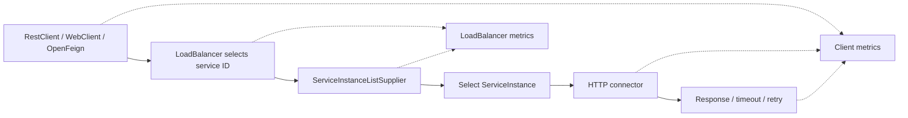

# Controlling Label Cardinality to Avoid Metric Series Explosion

When deploying Spring Cloud LoadBalancer, an application needs to know how long calls to `catalog-service` take, whether a `ServiceInstance` was selected, and whether timeouts, retries, or HTTP 5xx occurred. Micrometer and metrics systems like Prometheus answer these questions using **counters, timers, gauges, and histograms**.

However, each combination of **label (tag)** values can create a separate **time series**. If you attach `instanceId`, URLs containing product IDs, `traceId`, or user identifiers to metrics, the number of series grows rapidly with traffic, replica count, and deployments. The result can be higher application memory consumption, heavy collection/storage resource usage in the metrics system, slow dashboard queries, and elevated operational costs.

This lesson belongs to the **System Observability** section of the Spring Cloud LoadBalancer module. The goal is to design metric labels rich enough to analyze **service IDs, instance selection, HTTP errors, timeouts, retries, and latency**, without causing cardinality explosions when using `RestClient`, `WebClient`, `RestTemplate`, or OpenFeign.

## 1. How Do Tag, Label, Meter, and Time Series Differ?

An HTTP client timer can record the latency of calls to a service. Suppose the metric is exported with these labels:

```text
http_client_requests_seconds_count{
  application="order-service",
  client_service="catalog-service",
  method="GET",
  uri="/api/products/{id}",
  status="200"
} 15340
```

In this Prometheus-formatted example:

- **Metric name**: `http_client_requests_seconds_count`, corresponding to the sample count recorded on a timer exported per registry conventions.
- **Label names**: `application`, `client_service`, `method`, `uri`, `status`.
- **Label values**: `order-service`, `catalog-service`, `GET`, `/api/products/{id}`, `200`.
- **One time series**: the metric name paired with one specific combination of label values, recorded over time.

Changing just `status="200"` to `status="503"` yields a **different series**. Changing `uri="/api/products/{id}"` to `uri="/api/products/42"` and then `/api/products/43` causes every product ID to create its own series.

In Micrometer, `Meter.Id` consists of the name, tags, and other meter attributes. When exported to a metrics backend, timers and histograms can expand into **multiple series** such as `_count`, `_sum`, and `_bucket`s. Therefore, do not equate the number of Java meters in a single process with the total number of time series the backend must store.

**Cardinality** in this context is the number of distinct label values or combinations. Even a label with few values can contribute to an explosion when multiplied across many other labels.

## 2. Why Does Cardinality Grow Exponentially?

Estimating maximum combinations for a metric family:

```text
Maximum label combinations ≈ C1 × C2 × ... × Cn
```

Where `Ci` is the number of distinct values of the `i`-th label within the same collection scope. This is a **simplified upper bound**: in practice not every combination occurs, and some labels only apply to certain request groups. Yet it is very useful for budgeting before introducing a new label to production.

Suppose an application calls multiple services with these labels:

| Label | Illustrative value count |
|---|---:|
| `client_service` | 8 |
| `method` | 5 |
| `uri` (route template) | 12 |
| `outcome` | 6 |
| `zone` | 3 |

If every combination occurs, the theoretical number **per scrape target** is:

```text
8 × 5 × 12 × 6 × 3 = 8,640 label combinations.
```

With five replicas of `order-service` carrying a target label like `instance` or `pod`, that can grow to **43,200 combinations across targets**. If timer histograms with many buckets are also exported, total backend series can multiply several times further depending on registry export behavior and histogram configuration.

Adding a `product_id` label with 100,000 values makes potential series soar dramatically. Adding a nearly unique `trace_id` per request can generate **a brand-new combination for every single request**.

This is not an issue exclusive to millions of RPS: even a small application using continuously changing label values accumulates many series over time.

### 2.1. Cardinality and Churn Are Related Problems

- **High point-in-time cardinality**: very many label combinations active simultaneously.
- **High churn**: new combinations continuously appear while old ones vanish, such as when `instanceId` changes on every rollout or URLs contain fresh request IDs.

Churn forces the metrics system to ingest many new series over time even if active series at any single instant do not grow endlessly. Thus, looking only at a single snapshot of active series can miss costs accumulated across deployments.

## 3. Choose Labels by Operational Questions, Not Available Data

Metric design should start with the question: *"If this alert fires, along which dimensions must we compare to identify the root cause?"*

Examples:

| Question | Usually useful labels | Labels to keep out of metrics |
|---|---|---|
| Which target service is slow? | `client_service` or normalized client name | Arbitrary URL/hostname from requests |
| Which HTTP method is failing? | `method` | Raw request line |
| Which API operation has high p95? | `uri` as a **template** or `operation` | Paths containing product/user/order IDs |
| Which status is spiking? | `status` or `outcome` group | Error messages containing dynamic data |
| Network or HTTP failure? | `failure_category` with a bounded value set | Raw exception messages, arbitrary hostnames |
| Is one zone degraded? | `zone` from a controlled catalog | Arbitrary instance metadata |
| Did a release introduce failures? | `release_channel` or stable major API version | Build hashes constantly changing across all metrics |
| Which instance handled a specific request? | **Trace/log** carrying instance ID and trace ID | `instance_id`/`trace_id` as labels on every request |

The label `client_service=catalog-service` is typically useful because service IDs are selected by the application from an allowed set. Conversely, `request_id`, `trace_id`, `user_id`, `session_id`, `product_id`, or `full_url` vary per request and are unsuitable for aggregated metrics.

**Do not assume a label is low-cardinality just from its name.** If the application allows constructing arbitrary service IDs from user input, even `client_service` can take unbounded values. Value sets must be constrained by data sources and configuration controls.

## 4. Where Should You Measure in Spring Cloud LoadBalancer?

An HTTP call by service ID passes through several observation points:



Metric groups serve distinct purposes:

1. **HTTP client metrics**: call counts, duration, method, route template, status, and error category. Used to see what problems the caller is having with downstream.
2. **LoadBalancer metrics/observations**: counts with or without candidates, selection duration, and selection outcome where instrumentation/version supports it. Used to separate discovery/routing failures from HTTP failures.
3. **Supplier chain diagnostics**: instance lists before/after health, zone, hint, or retry filters. Better suited to sampled logs/traces rather than attaching every ID to metric labels.
4. **Backend metrics**: server latency, in-flight requests, CPU, thread/connection pools, database pools, and business errors. Used to determine whether the target instance is genuinely overloaded.

Not all of the labels above are auto-generated by **Spring Boot/Micrometer/Spring Cloud LoadBalancer** in every version. For example, the metric name `http.client.requests` may be used for certain HTTP client timers, while exact meter names/labels for Observation, Feign, Reactor Netty, and LoadBalancer depend on version and auto-configuration. Inspect the actual emitted meters before hardcoding dashboards or `MeterFilter`s to fixed names.

A common mistake is adding `instanceId` to **every HTTP client timer** simply because a `ServiceInstance` selection hook is available. That multiplies series by every running or historical instance and rarely helps overall SLA dashboards; keep instance IDs in spans/logs for tracing specific errors.

## 5. Normalize URI Templates Instead of Attaching Concrete URLs

Two HTTP requests:

```text
GET /api/products/42
GET /api/products/43
```

should aggregate into one operation:

```text
method=GET
uri=/api/products/{id}
```

If raw paths become labels, every new product creates another series. If route templates are used, the number of `uri` values typically matches the number of application endpoints—a controllable set.

### 5.1. WebClient

Declare a LoadBalancer-integrated builder when calling by service ID:

```java
import org.springframework.cloud.client.loadbalancer.LoadBalanced;
import org.springframework.context.annotation.Bean;
import org.springframework.web.reactive.function.client.WebClient;

@Bean
@LoadBalanced
WebClient.Builder loadBalancedWebClientBuilder() {
    return WebClient.builder();
}
```

At the call site, prefer passing the template and variables separately:

```java
Mono<ProductResponse> product = webClient.get()
        .uri("/api/products/{id}", productId)
        .retrieve()
        .bodyToMono(ProductResponse.class);
```

Here `webClient` must be built from the LoadBalancer-enabled builder with `baseUrl("http://catalog-service")`, and `ProductResponse` is an application DTO. Using the template gives instrumentation **route-template metadata** to normalize the URI, instead of receiving only a pre-concatenated path string. Still, verify actual labeling in live metrics.

Pattern to avoid:

```java
// Easily causes observability to see many distinct URIs:
String path = "/api/products/" + productId;
webClient.get().uri(path).retrieve().bodyToMono(ProductResponse.class);
```

### 5.2. RestClient

Similarly, with a `RestClient` built from `@LoadBalanced RestClient.Builder`:

```java
ProductResponse product = restClient.get()
        .uri("/api/products/{id}", productId)
        .retrieve()
        .body(ProductResponse.class);
```

If code passes an absolute URL using a service ID, still declare a template:

```java
ProductResponse product = restClient.get()
        .uri("http://catalog-service/api/products/{id}", productId)
        .retrieve()
        .body(ProductResponse.class);
```

Using `RestTemplate.exchange(...)` or a URI builder should likewise keep the route template separate from variables. Never use arbitrary query strings, bodies, or resource IDs as metric labels.

### 5.3. OpenFeign

With Spring Cloud OpenFeign, the method contract already expresses the route:

```java
@FeignClient(name = "catalog-service")
public interface CatalogClient {
    @GetMapping("/api/products/{id}")
    ProductResponse getProduct(@PathVariable("id") String id);
}
```

Use a bounded operation name such as `get-product` or the method's route template for measurement. Avoid extracting the expanded URL from a Feign request and attaching it directly as a `uri` tag on a custom timer.

**Note:** declaring a route template at the call site helps provide clean labels at the source, but does not guarantee every instrumentation consumes it automatically. Verify the output in `/actuator/metrics` or your backend; if raw IDs still appear, fix the convention/instrumentation rather than merely adding a `MeterFilter` to drop new series.

## 6. Normalizing Failure Categories, Statuses, Instances, and Metadata

URIs are not the only source of high cardinality. When a request times out or JSON decoding fails, developers may be tempted to attach full exception names and error messages to metrics. That easily produces unbounded, fluctuating labels.

### 6.1. Bounded Failure Categories

A `failure_category` set could be:

| Label value | Classification |
|---|---|
| `none` | Success |
| `no_instance` | LoadBalancer found no eligible instance |
| `connection` | TCP/TLS/network failure |
| `timeout` | Connection or response exceeded time limit |
| `http_4xx` | Upstream returned HTTP 4xx |
| `http_5xx` | Upstream returned HTTP 5xx |
| `decode` | Response body failed contract parsing |
| `other` | Remaining failures |

Not every service must use this exact set; this is an **illustrative policy**. What matters is assigning values from an approved catalog rather than pulling from `exception.getMessage()`, stack traces, URLs, DB state, or external inputs.

### 6.2. HTTP Status

Labels like `status=200`, `404`, `503` have fewer possibilities than user IDs, yet still multiply across every other dimension. If a dashboard only needs success/error rates, `status_family=2xx/4xx/5xx` or `outcome` may suffice. For dashboards needing to track `429` separately, keeping status codes is fine as long as the combined series budget is respected.

### 6.3. `instanceId`, Zone, and Release

- `zone` can be safe when zones are few; yet combining it with every URI/status/method still multiplies series.
- `release_channel=stable/canary` is usually better than labels containing build SHAs or per-deployment UUIDs.
- `instanceId` changes during scaling and rollouts, causing churn. If per-instance metrics are genuinely needed for backend operations, collect them from **the backend itself** (via the collector's target labels) instead of adding downstream instance IDs to every client-side metric.
- `ServiceInstance.getMetadata()` is an arbitrary map; **never** convert all metadata pairs into metric tags. Select only keys that directly serve operational questions.

## 7. Example Creating Custom Micrometer Metrics with Stable Labels

An application timer can measure total call duration to `catalog-service` and classify errors without attaching product IDs or target hosts.

```java
package com.example.orders.observability;

import feign.FeignException;
import io.micrometer.core.instrument.MeterRegistry;
import io.micrometer.core.instrument.Timer;
import org.springframework.stereotype.Component;

import com.example.orders.client.CatalogClient;
import com.example.orders.client.ProductResponse;

@Component
public final class ObservedCatalogGateway {

    private final CatalogClient client;
    private final MeterRegistry registry;

    public ObservedCatalogGateway(
            CatalogClient client,
            MeterRegistry registry) {
        this.client = client;
        this.registry = registry;
    }

    public ProductResponse getProduct(String productId) {
        Timer.Sample sample = Timer.start(registry);
        String outcome = "success";

        try {
            return client.getProduct(productId);

        } catch (FeignException exception) {
            outcome = classifyStatus(exception.status());
            throw exception;

        } catch (RuntimeException exception) {
            outcome = "other_failure";
            throw exception;

        } finally {
            Timer timer = Timer.builder("catalog.client.duration")
                    .description("Duration of catalog product lookups")
                    .tag("client_service", "catalog-service")
                    .tag("operation", "get-product")
                    .tag("outcome", outcome)
                    .register(registry);

            sample.stop(timer);
        }
    }

    private static String classifyStatus(int status) {
        if (status < 0) {
            return "transport";
        }
        if (status >= 400 && status < 500) {
            return "4xx";
        }
        if (status >= 500 && status < 600) {
            return "5xx";
        }
        return "other_http";
    }
}
```

This example assumes `CatalogClient` is a declared Feign interface and `ProductResponse` is its DTO. Feign may represent some transport errors with other exceptions depending on the connector; the `other_failure` branch here is a simplified classification, not a complete error taxonomy.

Key points:

- `client_service` and `operation` come from **code-controlled literals**, not untrusted URLs.
- `outcome` maps into a bounded set of buckets via `classifyStatus`.
- `productId` is **excluded from metric tags**, even though it is very useful for finding logs of a specific request.
- `Timer.Sample` records execution time of the Feign call at the gateway boundary. If retries happen underneath, the timer includes those attempts; this is **gateway end-to-end duration**, not single-attempt latency.
- `finally` still records the timer on errors; classification must never swallow the original exception.

If Spring Boot or Feign already instruments the same operation automatically, avoid creating a custom metric with **overlapping meaning** unless boundaries are clear, or dashboards may double-count. This example aims to demonstrate controlled tag design, not mandate adding a manual timer to every HTTP client.

## 8. Using `MeterFilter` as a Fallback Guardrail

Micrometer offers `MeterFilter` to deny, transform, or cap meters by name and tag. One fallback safeguard is capping the number of **distinct values** for the `uri` tag within a metric group.

Example Spring configuration:

```java
import io.micrometer.core.instrument.config.MeterFilter;
import org.springframework.context.annotation.Bean;
import org.springframework.context.annotation.Configuration;

@Configuration(proxyBeanMethods = false)
public class ClientMetricsGuardConfiguration {

    @Bean
    MeterFilter limitHttpClientUriValues() {
        return MeterFilter.maximumAllowableTags(
                "http.client.requests",
                "uri",
                80,
                MeterFilter.deny());
    }
}
```

Meaning:

- Applies only to meters whose names start with the `http.client.requests` prefix per this `MeterFilter` rule.
- The example caps at **80 distinct values** of the `uri` tag within the filtered registry/meter scope; it is not an 80-series limit for the entire backend.
- Once new values exceed the threshold, `MeterFilter.deny()` **rejects registering the corresponding meter**, dropping part of your observability data rather than normalizing the URL automatically.
- This limit does **not retroactively delete** series already created in the registry or data already stored in the backend; it does not fully solve churn or other metrics.

The name `http.client.requests` and tag `uri` are **examples for a specific configuration**; depending on your Spring Boot/Micrometer version and HTTP client, actual meter names or observed tag sets may differ. Always inspect live meters before applying prefix-based caps.

**Why is this only a last-resort guardrail?** If the application embeds raw product IDs in URIs, after the first 80 values are seen, all subsequent IDs are dropped from metrics. Dashboards then **stop reflecting full traffic**, even though series counts stay down. The real fix is **preserving the route template when building the request** or designing a custom convention to normalize labels before meters are registered.

Never add `MeterFilter.deny()` silently; maintain monitoring logs/metrics or series-count checks to spot dropped data. An observability system must be transparent about what it fails to record.

## 9. Keep Request Identifiers in Traces and Logs, Not Metric Labels

Some questions cannot be answered by aggregated metrics: which instance did LoadBalancer pick for user X's request, how many times did it retry, and why did the second request pick a different instance? That is the job of **distributed tracing** and **structured logging**.

A sensible division of responsibilities:

| Data | Where to store | Reason |
|---|---|---|
| Service ID, operation, status family | Metric label | Bounded value set, suited for aggregation |
| Duration, request count, retry count | Timer/counter/histogram | Used for p95/p99, error rates, and alerts |
| Trace ID, span ID | Trace/log or exemplar if supported | Used to look up individual requests without multiplying metric series |
| Selected instance, host:port | Controlled and sampled span/log | Per-request routing path details |
| Product/user/order ID | Data-governed log, ideally masked/hashed per policy | Sensitive and highly variable |
| Full URL and exception message | Secret-filtered, length-capped log | Unsuitable as metric labels |

Micrometer Observation distinguishes **low-cardinality key values** and **high-cardinality key values**. Under standard conventions, metric labels draw from low-cardinality keys, while high-cardinality context feeds tracing. Still, check your observation handlers/exporters to ensure high-cardinality values are not accidentally exported as metric tags.

A trace suitable for investigation might show:

```text
trace_id=...                        (not attached to metrics)
service.id=catalog-service
operation=get-product
request.route=/api/products/{id}
attempt=2
selected.instance=catalog-3         (in span/log)
http.status=503
failure.category=http_5xx
```

Starting from an elevated `5xx` alert on `client_service=catalog-service`, an operator can open a sampled trace to inspect `selected.instance`. **You do not need to attach instance IDs and trace IDs to every time series** to do this.

## 10. Observing Retries, Timeouts, and Different HTTP Client Types

In a Spring Cloud LoadBalancer environment, one business request can generate **multiple HTTP attempts** when retries are configured. Distinguish:

- **Logical request**: one caller request to fetch a product.
- **Attempt**: one actual effort by the HTTP client to call an instance.
- **LoadBalancer selection**: choosing an instance for an attempt under the active policy.

If one logical request makes three attempts, the business-level gateway metric may record **once with total elapsed time**, while the HTTP client metric may record **three times**. Both are right when named and documented with clear boundaries; never compare the two counters directly and assume missing or duplicate data.

### 10.1. Label Design Patterns

| Metric type | Suggested tags | Values to avoid |
|---|---|---|
| Gateway latency | `client_service`, `operation`, `result` | Product ID, raw URL |
| HTTP attempt latency | `client_service`, `uri_template`, `method`, `status_family` | Trace ID, retry request ID |
| Retry count | `client_service`, `operation`, `retry_reason` | Stack trace, raw exception message |
| No-instance counter | `client_service`, `reason_category` | Listing all instance IDs inside a tag |
| Connection pool | **Normalized** pool ID, state | Per-request remote address unless required |
| Backend overload | API route, outcome, resource pool type | Request payload, user ID |

When using multiple HTTP clients (`RestClient`, `WebClient`, OpenFeign), keep operation and outcome naming conventions consistent so dashboards can compare flows. Not every client emits identical metric names; dashboards should normalize across data sources rather than assuming a single universal name.

### 10.2. Cardinality Multiplies with Histograms and Replica Counts

A subtle configuration mistake is enabling overly detailed histograms **across every label combination** at once. Histograms help compute p95/p99 and SLOs, yet each bucket can become a separate backend series.

If you need histograms for critical downstreams, enable them selectively on specific metrics/routes or tailored SLO buckets rather than turning on wide bucket configs everywhere without estimating cost. Also note that client-computed percentiles have aggregation caveats across instances; never average or sum per-instance percentiles to infer a cluster-wide percentile.

## 11. Where to Inspect Active Series Counts

Three scopes must be distinguished:

1. **Inside the JVM/Micrometer registry**: number of registered meters and tag sets.
2. **At scrape/export time**: number of series generated per metric family, including timer/histogram suffixes.
3. **Inside the storage backend**: total series per target, infrastructure-added labels, retention, and churn over time.

If the application uses Spring Boot Actuator, inspect live metric names via `/actuator/metrics` (when enabled and properly secured) or `/actuator/prometheus` when the Prometheus registry is configured. Never expose these endpoints publicly to the Internet.

### 11.1. Prometheus Query Examples

If the backend exports `http_client_requests_seconds_count` as in the earlier example, a query showing **active series with data** for the `_count` family is:

```promql
count(http_client_requests_seconds_count)
```

To see series count by application/job (if the `job` label exists):

```promql
count by (job) (http_client_requests_seconds_count)
```

To check how many distinct `uri` values currently exist:

```promql
count(count by (uri) (http_client_requests_seconds_count))
```

To find the route templates generating the most series combinations:

```promql
topk(10, count by (uri) (http_client_requests_seconds_count))
```

These queries **count series present in the queried samples**, not all historical series in the TSDB. Metric names and labels vary by registry, version, and relabeling; if the metric above does not exist, look up the exact name exported by your application. Results also depend on scrape timing and target set.

Specifically, Prometheus may add infrastructure labels such as `job`, `instance`, and `pod`. Factor them into real series totals, but never confuse `instance` with the **backend instance selected by LoadBalancer**; it normally identifies the **scraped target**.

## 12. Setting a Cardinality Budget and Governing Changes

An operational process needs a metric **budget** rather than reacting only after storage overloads.

Example budget table for a client metric group (illustrative; measure for your own system):

| Label | Desired limit | Value source and control |
|---|---:|---|
| `client_service` | ≤ 20 | Service ID list controlled by trusted code/config |
| `operation` | ≤ 50 | Defined enum or route templates |
| `method` | ≤ 8 | Supported HTTP methods |
| `result` | ≤ 8 | Bounded status family / failure category catalog |
| `zone` | ≤ 5 | Configured zone set |
| `trace_id` | **0** | Move to logs/traces |
| `user_id` | **0** | Never use as a metric label |
| `instance_id` on client metrics | Default **0** | Store in spans/logs or measure on the backend |

Never look at individual limits in isolation. Even when each label has "only a few values", the product of five or six labels can exceed the overall budget. Avoid attaching `zone`, `release`, `tenant_type`, and `status` to every metric when only a couple of dashboards actually need them.

### 12.1. Governing an Instrumentation Change

When a team wants to add a new label:

1. **State the question to answer** and which dashboard or alert will consume the label.
2. **Bound the value set** in code or config, including new values during rollouts and error values.
3. **Estimate label multiplication** against existing tags, replica counts, histogram buckets, and target services.
4. **Test with dynamic data** such as thousands of product IDs and many trace IDs in a test environment.
5. **Compare meter/series counts before and after** in both the registry and backend, accounting for runtime churn.
6. **Set guardrails/alerts** on abnormal cardinality growth; guardrails must never silently discard critical data.
7. **Approve against the budget** before merging the label into shared instrumentation libraries.

If a label lacks a clear operational question or holds nearly unique per-request values, use logs or traces instead of metrics.

## 13. Lab: Detecting and Fixing URI Cardinality

Suppose `order-service` uses `WebClient` to call `catalog-service`; run the following experiment in a controlled environment.

### Step 1: Record a Baseline

Enable instrumentation/Actuator and confirm an HTTP client metric with a route label exists. Send a few requests:

```text
GET /api/products/1
GET /api/products/2
GET /api/products/3
```

Inspect `uri` in metrics. If the value is `/api/products/{id}`, the route is normalized properly; if three distinct values appear, there is a high-cardinality risk.

### Step 2: Generate Diverse Inputs

Send hundreds or thousands of distinct product IDs to a controlled test endpoint. Do not hit real services outside test scope. Compare before/after:

- Distinct `uri` values.
- Series count for the HTTP client metric.
- Memory/scrape cost if monitoring tools are available.
- Whether requests or data points are dropped by a meter filter.

### Step 3: Fix at the Source

Replace dynamic URL concatenation:

```java
// Before: builds a URI from a string already containing productId.
webClient.get().uri("/api/products/" + productId);

// After: passes the route template and variable separately.
webClient.get().uri("/api/products/{id}", productId);
```

Ensure `client_service` comes from a trusted service ID. If using a custom timer, replace `tag("uri", rawPath)` with `tag("operation", "get-product")` or an approved template.

### Step 4: Verify the Guardrail

In a test environment, temporarily enable `MeterFilter.maximumAllowableTags(...)` with a small cap to observe meter rejection behavior. Note that **once the threshold is reached, data gets dropped**. Then fix the label source and re-test; never mistake flat series counts for having fixed the underlying bug.

### Step 5: Verify Realistic Traffic

Trigger 404, 503, timeout, no-instance, and controlled retry scenarios one by one. Verify:

- Every error maps into a small set of `outcome` or `failure_category` values.
- Logical requests and HTTP attempts are kept distinct.
- Trace IDs, instance IDs, and error messages appear only in appropriate traces/logs, never as metric labels.
- During scale-out/scale-in, dashboards continue reporting accurate error rates/latency by **service ID and operation**, rather than fragmenting by replica UUIDs.

## 14. Common Mistakes and Fixes

| Symptom | Common cause | Fix |
|---|---|---|
| Series count grows with product IDs | Attaching raw URL or path as `uri` | Normalize route templates; keep product IDs out of tags |
| Series count jumps after every deployment | Attaching build hash/instance UUID to client metrics | Use stable channel/major labels; move detailed IDs to traces |
| Prometheus memory/TSDB grows rapidly | Combining many labels and histogram buckets | Measure series per family; trim unnecessary tags/buckets |
| `MeterFilter` blocks series, dashboards lose traffic | Filter drops meters past the threshold | Fix the label source, check dropped metrics, adjust guarded thresholds |
| One request creates a brand-new series | Attaching `traceId`/`requestId` | Use distributed tracing/exemplars |
| Dashboard cannot separate discovery vs. HTTP errors | Measuring only HTTP status or lumping all exceptions | Add bounded failure categories and LB-boundary metrics |
| Retry rate mismatches business call counts | One logical request has multiple attempts | Name and separate metric boundaries clearly |
| Cardinality remains high even with small individual tags | Tag sets multiply across large replica counts | Budget by combinations and targets, not single tags alone |
| An API group lacks metrics after rollout | Prefix/tag guardrail drops newly registered meters | Monitor dropped/denied counts and review conventions/registry |

## 15. Takeaways

**Metrics are for aggregation; traces and logs are for investigating individual requests.** With Spring Cloud LoadBalancer, bounded-value labels such as `controlled service ID`, `operation`, `HTTP method`, and `outcome` let you analyze latency, failures, retries, and `ServiceInstance` selection. Conversely, URLs containing IDs, `traceId`, `userId`, raw exception messages, and churning instance IDs do not belong in metric labels.

Always **normalize URIs at request creation**, instrument only the dimensions you genuinely need, estimate the combined impact of tags and histograms, and treat `MeterFilter` as a **monitored fallback guardrail** rather than a substitute for fixing cardinality at the source. When you combine a metric budget, service-ID observability, and traces carrying selected-instance details, your system can diagnose inter-service failures without exploding time-series counts.
