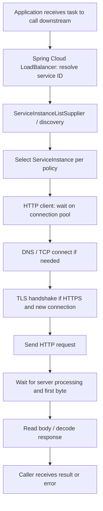
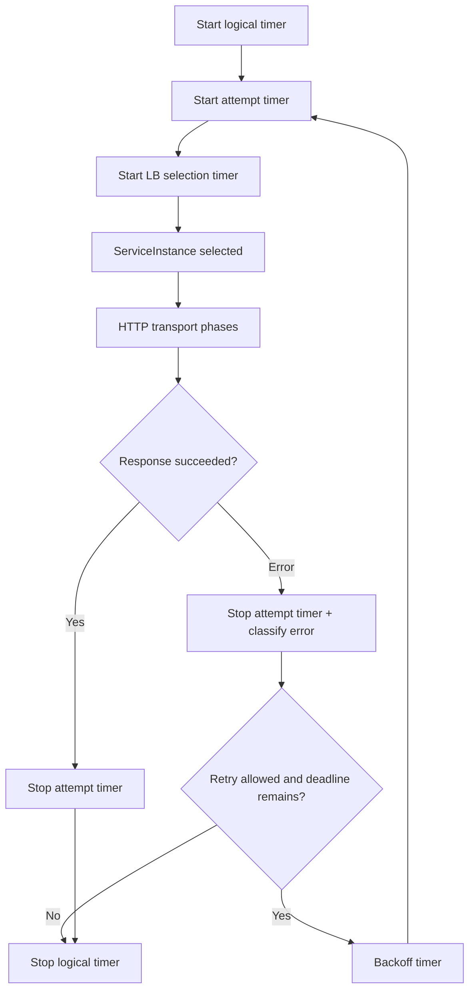

# Separating Target Selection Time from Connection and Processing Time

When `order-service` calls `http://catalog-service/api/products/P42` via Spring Cloud LoadBalancer, a log might simply state: "HTTP request took 850 ms". That number **cannot answer** where the 850 ms was spent: waiting for discovery, selecting a `ServiceInstance`, waiting for a connection from the pool, TCP/TLS handshakes, waiting on downstream processing, or reading/decoding the response. Simply raising `readTimeout` on a slow request can inadvertently hold connections longer when the real culprit is an **exhausted pool** or a **slowly updating instance list**.

This lesson belongs to the **System Observability** chapter of the `SPRING_CLOUD_SERVICE_COMMUNICATION_LOAD_BALANCING` module. The goal is to build a measurement model with clear boundaries between **Spring Cloud LoadBalancer's target selection time** and **HTTP execution time in RestClient, WebClient, and OpenFeign**, then use metrics, tracing, and controlled fault testing to pinpoint the exact bottleneck. All examples of metric/hook names must be verified against your running Spring Boot, Spring Cloud, and HTTP transport versions; never treat adding Actuator as proof that every stage is automatically measured.

## 1. An HTTP Call Actually Consists of Multiple Phases

When an application calls a URL containing a service ID, it breaks down into these parts:



These steps can be grouped into three areas of responsibility:

| Area | Primary work | Example observation signals |
|---|---|---|
| **A. Target selection** | Fetch `ServiceInstance` list, apply health/zone/sticky policies, pick one replica | `service.id`, `instance.id`, duration from selection start to result |
| **B. Connection setup and usage** | Wait for pooled connection, DNS resolution, TCP connect, TLS handshake, send HTTP request | Pool pending/leased/available, connect time, handshake time, transport timeouts |
| **C. Downstream and response** | Server receives request, runs business/DB logic, emits first byte, transfers body, client decodes | Server processing, time-to-first-byte, response time, bytes, decode errors |

**Special detail:** a connection reused from a pool may **need no new DNS/TCP/TLS handshake**. Therefore, do not try to record "TLS handshake = 0 ms" on every request; for requests reusing a connection, the handshake event simply **did not occur** during that attempt.

LoadBalancer filters and the HTTP client sit at different layers. `RoundRobinLoadBalancer` picks from candidates; `ClientHttpRequestFactory`, Reactor Netty, or Feign's HTTP transport creates and sends the actual request. Fast instance selection does not guarantee a fast connection, and a fast connection does not guarantee fast server business processing.

## 2. Distinguishing Logical Request, Attempt, and TCP Connection

When retries are enabled, a single business action can emit multiple HTTP attempts:

```text
Logical request: order-service needs Product P42
  ├─ Attempt 1: selects catalog-a → connect timeout
  ├─ Backoff 100 ms
  └─ Attempt 2: selects catalog-b → HTTP 200

A separate connection pool may reuse a TCP connection from an earlier call.
```

At least three units of measurement should be captured:

1. **Logical request duration:** from when business logic starts the downstream call until completion/failure, **including** retries, backoff, and result handling at the measured boundary.
2. **Attempt duration:** duration of each individual send attempt; may cover re-selecting an instance, pool wait, connecting, and response.
3. **Connection lifecycle:** from creating/borrowing/returning/closing a connection, potentially spanning multiple attempts and multiple logical requests.

Conflating these three concepts can cause a dashboard to report "50 slow requests" when 50 logical requests actually produced 150 attempts all stalled on the same pool. Or a connect metric can spike simply because new connections were opened during a deployment rather than slow server processing.

**Measurement conventions must specify boundaries:** HTTP client metrics may start after LoadBalancer completes certain steps depending on the adapter/interceptor; server metrics typically measure only after the HTTP request reaches the server. Never add or compare them as if every instrument started at the exact same instant.

## 3. A Quantitative, Readable, Comparable Timeline

Suppose a logical request makes a single attempt with no retries and no overlapping phases. We intentionally define **non-overlapping** intervals to illustrate:

| Illustrative phase | Duration | Meaning |
|---|---:|---|
| Waiting to be processed at caller | 30 ms | Scheduling/queuing before target selection starts |
| Discovery/supplier and instance selection | 15 ms | Obtained `catalog-b` to call |
| Waiting to acquire connection from pool | 85 ms | Route to `catalog-b` is congested |
| DNS name resolution | 10 ms | Only if transport needs a fresh lookup |
| TCP connect | 35 ms | Opening a new socket |
| TLS handshake | 55 ms | HTTPS/mTLS, only on new connections |
| Sending HTTP request | 5 ms | Writing headers/body onto the network |
| Waiting for first response byte | 240 ms | Network + server processing + return network |
| Reading/decoding response | 50 ms | Receiving body, converter/Jackson, and finishing |
| **Total** | **525 ms** | From caller start to receiving result |

The numbers above are **purely simulated data** to teach analysis; they are not real Spring Cloud measurements. When real instrumentation sits on overlapping hooks (for example, HTTP client total wrapping connect/TLS/response), **never sum the timers directly** because you will double-count.

```text
0ms          30     45            130  140    175      230  235              475   525
| caller wait | LB | pool acquire | DNS | TCP | TLS | send | wait first byte | body/decode |
```

In this example, seeing only `http.client.duration=525ms` makes tuning `connection pool` or `readTimeout` pure guesswork. With per-phase data, we see waiting for the first byte (240 ms) is largest, and pool wait (85 ms) also warrants investigation. Correlate these clues with server spans, pool statistics, and new-connection creation rates.

## 4. The "Target Selection" Metric Must Be Defined Precisely

With Spring Cloud LoadBalancer, the instance selection chain can include:

```text
Logical URL: http://catalog-service/api/products/P42
      ↓
Service name: catalog-service
      ↓
ServiceInstanceListSupplier
      ├─ DiscoveryClient or static data
      ├─ cache/refetch if present
      ├─ health filtering / zone preference if present
      └─ other suppliers
      ↓
ReactorLoadBalancer.choose(...)
      ↓
ServiceInstance: catalog-b.internal:8081
```

An **LB selection duration** measurement can start when the consumer initiates selection and end when a `ServiceInstance` result is determined or fails. It may **include fetching the list from suppliers**, especially when discovery needs to query/refresh. Calling this metric "round robin time" is therefore inaccurate: the round-robin index calculation is usually tiny, while most delay comes from discovery or supplier filters.

Factors to separate when deep investigation is required:

| Component | Can it add latency? | How to interpret correctly |
|---|---|---|
| `DiscoveryClient`/registry lookup | Yes, if I/O is needed or data is uncached | Measures list retrieval, do not blame HTTP TCP |
| Instance list cache | Cache hits are usually fast; misses/refreshes can be slow | Observe hit/miss rates and list freshness |
| `HealthCheckServiceInstanceListSupplier` | Health probes run periodically and results are replayed | Do not count background probe time as per-request latency |
| Zone/hint/sticky filters | Filter cost, usually small | Verify candidate counts before/after filtering |
| `RoundRobinLoadBalancer`/Random | Picks one element from the list | Do not confuse selection algorithm with network latency |
| No `ServiceInstance` | Cannot proceed to connect to a target | Count `no_instance` separately; do not turn it into connect timeout |

**Note on health checks:** if a periodic probe takes 800 ms while the request consumes a replayed probe result, **never attribute that 800 ms to the request's target selection time**. Measurements must bind to hooks actually on the request-processing path.

## 5. Three Observation Layers to Run in Parallel

No single metric covers every question. An operable design includes:

| Observation layer | Measurement boundary | Questions answered |
|---|---|---|
| **Application/outbound logical** | Before calling client until caller receives terminal signal/result | How long did the user/business wait in total, including retries/backoff? |
| **Spring Cloud LoadBalancer** | Selection request until selection response/lifecycle completion per hook | Does the service ID have instances? Which replica was chosen? What is selection latency? |
| **HTTP transport** | Borrow/create connection, connect, TLS, send request, receive response | Bottleneck in pool, TCP, TLS, or server/response? |
| **Downstream server** | Server receives request → controller/handler/DB → emits response | How much time did the server itself spend processing? |
| **Cross-service tracing** | Span chain across services/attempts | Which hop caused the slow request, and did retries/queues stack up? |

These layers should share the **same trace context** wherever possible, without copying high-cardinality fields onto every metric label. For example, `traceId`, `spanId`, raw product IDs, and full URLs belong in controlled traces/logs, not standard Prometheus metric labels.

## 6. Spring Boot Actuator, Micrometer, and HTTP Client Observation

A Spring Boot application can use Micrometer Observation, Actuator, and an appropriate registry to emit metrics/traces:

```xml
<dependencies>
    <dependency>
        <groupId>org.springframework.boot</groupId>
        <artifactId>spring-boot-starter-actuator</artifactId>
    </dependency>
    <dependency>
        <groupId>io.micrometer</groupId>
        <artifactId>micrometer-registry-prometheus</artifactId>
    </dependency>
    <dependency>
        <groupId>org.springframework.cloud</groupId>
        <artifactId>spring-cloud-starter-loadbalancer</artifactId>
    </dependency>
</dependencies>
```

When using `RestClient`/`WebClient`/Feign, the application also needs the respective starters (`spring-boot-starter-web`, `spring-boot-starter-webflux`, `spring-cloud-starter-openfeign`) and proper HTTP client configuration. Versions must align via **Spring Boot dependency management** and the **Spring Cloud BOM**.

In an internal test environment:

```yaml
management:
  endpoints:
    web:
      exposure:
        include: health,info,prometheus
  metrics:
    tags:
      application: order-service
```

Expose only necessary endpoints to authorized users; **never expose Prometheus/Actuator carelessly to the Internet**. The configuration above assumes the Prometheus registry is present; adding Actuator alone without a registry/exporter does not automatically provide `/actuator/prometheus`.

When using Spring Boot auto-configured HTTP clients, instrumentation can emit metrics/observations for the **entire HTTP exchange**. However, exact meter/span names, payloads, and hook order differ across Spring Boot/Spring Cloud/HTTP client versions. Operators must verify whether those timers **include instance selection, retries, pool wait, and body decoding**, rather than guessing from the name `http.client.requests`.

## 7. What Do Spring Cloud LoadBalancer Micrometer Metrics Tell You?

Spring Cloud LoadBalancer offers extension points like `LoadBalancerLifecycle` and, in supported versions, Micrometer statistics collection for load-balancing requests.

Distinguish these signal types:

- **Count of selection/LoadBalancer invocations**: succeeded, failed, or no instance.
- **Service ID** being load-balanced and outcome.
- **Selected instance** when lifecycle/metrics/tracing allow capturing it.
- **Lifecycle duration** measured by the instrumentation.

Depending on the release train, metrics may use names in the `loadbalancer.requests.*` family or emit via a dedicated observation. **Do not assume this is a pure instance-selection timer.** A lifecycle callback may start before selection while the completion callback fires **after the HTTP request finishes**. Measuring `onStart → onComplete` and calling the whole span "selection duration" conflates transport/response time and distorts meaning.

### Designing a Custom Selection Timer

To get a genuine "instance selection completed" metric, instrument the **exact selection boundary** in your running version. The pseudocode below illustrates the concept, **not a Java implementation of a specific API interface**:

```text
on_before_choose(serviceId):
    selectionStart = monotonicClock.now()

response = actualLoadBalancer.choose(request)

on_selection_response(response):
    selectionDuration = monotonicClock.now() - selectionStart
    emitHistogram(
        "app.lb.selection.duration",
        serviceId = sanitizedServiceId,
        outcome = response.hasServer ? "selected" : "no_instance",
        value = selectionDuration
    )
    trace/log selected instance safely (avoid high-cardinality metric tags)
```

If `choose()` returns `Mono<Response<ServiceInstance>>`, measure when the publisher **is subscribed to** and produces a result, not how long constructing the `Mono` took. With replay/caching, request-scoped context, and differing schedulers, ensure each selection gets its own start/end pair. Avoid activating a custom timer in a spot that runs only on background health checks and attributing it to logical HTTP requests.

**Implementation note:** `LoadBalancerLifecycle` has callbacks around request start and end (such as `onStart`, `onStartRequest`, `onComplete` in supported versions). Before using a callback as a boundary, check the docs/source of your exact release train to know whether it fires **before selection, after selection, or after HTTP**, and name metrics strictly according to the verified scope. Never assume "any callback with `request` in its name means TCP start".

## 8. Measuring Logical Requests with RestClient: Micrometer Timer Example

The following example measures **total call duration at the application layer**. It intentionally **does not** name it a selection timer:

```java
package com.example.orders.catalog;

import io.micrometer.core.instrument.MeterRegistry;
import io.micrometer.core.instrument.Timer;
import org.springframework.cloud.client.loadbalancer.LoadBalanced;
import org.springframework.stereotype.Component;
import org.springframework.web.client.RestClient;

@Component
public class CatalogClient {

    private final RestClient client;
    private final MeterRegistry registry;

    public CatalogClient(
            @LoadBalanced RestClient.Builder builder,
            MeterRegistry registry) {
        this.client = builder.clone()
                .baseUrl("http://catalog-service")
                .build();
        this.registry = registry;
    }

    public ProductDto getProduct(String id) {
        Timer.Sample sample = Timer.start(registry);
        String outcome = "success";

        try {
            return client.get()
                    .uri("/api/products/{id}", id)
                    .retrieve()
                    .body(ProductDto.class);
        } catch (RuntimeException exception) {
            outcome = "error";
            throw exception;
        } finally {
            Timer timer = Timer.builder("app.outbound.logical.duration")
                    .description("Duration of one logical downstream call")
                    .tag("service.id", "catalog-service")
                    .tag("client.kind", "restclient")
                    .tag("outcome", outcome)
                    .register(registry);
            sample.stop(timer);
        }
    }
}
```

`Timer.Sample` uses Micrometer's monotonic clock to track elapsed time, and `sample.stop(timer)` records the sample against the meter with the chosen tags. In this example, client call exceptions get `outcome=error`, while normal returns get `success`. Wrapping the entire method measures the logical call at this boundary; if retries occur inside the HTTP client, duration includes retry time, though **a single sample does not reveal attempt count**.

For MVC applications, this is a blocking call-lifecycle measurement. With HTTP Interface's `RestClientAdapter` or OpenFeign, you can wrap the proxy/service method similarly, provided you declare distinct boundaries if placement differs. **Never reuse the exact same meter name for measurements with different scopes.**

## 9. Measuring Reactive WebClient at Exact Subscription Time

In Reactor, a `Mono` is a publisher that may execute after the method returns. Measuring from **constructing** the publisher until result emission can include idle time before subscription and misrepresent actual request execution.

Example measuring from subscription until terminal/cancel signal:

```java
package com.example.orders.catalog;

import io.micrometer.core.instrument.MeterRegistry;
import java.util.concurrent.TimeUnit;
import org.springframework.cloud.client.loadbalancer.LoadBalanced;
import org.springframework.stereotype.Component;
import org.springframework.web.reactive.function.client.WebClient;
import reactor.core.publisher.Mono;

@Component
public class ReactiveCatalogClient {

    private final WebClient client;
    private final MeterRegistry registry;

    public ReactiveCatalogClient(
            @LoadBalanced WebClient.Builder builder,
            MeterRegistry registry) {
        this.client = builder.clone()
                .baseUrl("http://catalog-service")
                .build();
        this.registry = registry;
    }

    public Mono<ProductDto> getProduct(String id) {
        return Mono.defer(() -> {
            long started = System.nanoTime();

            return client.get()
                    .uri("/api/products/{id}", id)
                    .retrieve()
                    .bodyToMono(ProductDto.class)
                    .doFinally(signal -> registry.timer(
                            "app.outbound.logical.duration",
                            "service.id", "catalog-service",
                            "client.kind", "webclient",
                            "terminal.signal", signal.name())
                        .record(System.nanoTime() - started,
                                TimeUnit.NANOSECONDS));
        });
    }
}
```

`Mono.defer` establishes the start timestamp **per subscription**. `doFinally` executes when the publisher completes, errors, or cancels. `signal.name()` belongs to a bounded set and is safe as a low-cardinality tag; product `id` is not. If a pipeline is subscribed to multiple times, each subscription records its own measurement—keep that in mind when interpreting logical requests.

When Reactor retries are present, timer placement is critical:

```java
// Outer timer: measures all attempts and pipeline backoff.
return Mono.defer(() -> {
    long started = System.nanoTime();
    return fetchOneAttempt()
            .retryWhen(retryPolicy)
            .doFinally(signal -> recordLogicalDuration(started, signal));
});

// Timer inside fetchOneAttempt(): measures each individual attempt.
// The two measurements serve different purposes; do not share the same meter name.
```

In this snippet, `fetchOneAttempt`, `retryPolicy`, and `recordLogicalDuration` are illustrative application components. When multi-layer retries are active, include `attempt_number` in traces/logs and check actual requests received at the server; a single total timer will not reveal retry amplification.

## 10. Measuring Transport with Reactor Netty and ConnectionProvider

When `WebClient` uses Reactor Netty, the transport can emit dedicated metrics when enabled for compatible versions and registries—such as connect, TLS handshake, HTTP response, and connection pool pending/acquire durations.

```java
import java.time.Duration;
import org.springframework.http.client.reactive.ReactorClientHttpConnector;
import org.springframework.web.reactive.function.client.WebClient;
import reactor.netty.http.client.HttpClient;
import reactor.netty.resources.ConnectionProvider;

ConnectionProvider provider = ConnectionProvider.builder("catalog-outbound")
        .maxConnections(40)
        .pendingAcquireMaxCount(80)
        .pendingAcquireTimeout(Duration.ofMillis(300))
        .metrics(true)
        .build();

HttpClient transport = HttpClient.create(provider)
        .metrics(true, uri -> "/catalog-api")
        .responseTimeout(Duration.ofSeconds(2));

WebClient catalogClient = loadBalancedBuilder.clone()
        .clientConnector(new ReactorClientHttpConnector(transport))
        .baseUrl("http://catalog-service")
        .build();
```

`loadBalancedBuilder` must be an `@LoadBalanced WebClient.Builder`, and `ConnectionProvider` must have a **managed lifecycle** so it is disposed on application shutdown. The snippet assumes the builder bean exists and focuses on transport setup; in real code, wire the provider/connector into proper Spring beans. Pool/timeout values above are lab numbers, not production defaults.

Reactor Netty exposes meter groups depending on version, such as:

| Metric/observation group | Meaning when present | What not to infer |
|---|---|---|
| `reactor.netty.connection.provider.*` | Pool active/idle/pending counts, acquire wait time | Not `RoundRobinLoadBalancer` instance selection time |
| `reactor.netty.http.client.connect.time` | Time to establish a new TCP connection at transport | Does not cover requests that reused an existing connection |
| `reactor.netty.http.client.tls.handshake.time` | TLS handshake cost on new connections | Not server endpoint processing |
| `reactor.netty.http.client.response.time` | Response time per Reactor Netty hook | Does not automatically equal logical latency including LB/retry/deserialize |
| `http.client.requests` or HTTP observation | Request duration per Spring instrumentation | Must verify measurement boundaries and response-body coverage |

**Do not assume exact meter and tag names exist identically across all versions**: inspect live output at `/actuator/metrics`, `/actuator/prometheus`, or your metrics backend while the app is running. Some transport timers register only once real requests occur with matching registry/enablement. Constructing a separate HTTP client instead of the injected one can leave operators seeing none of the expected numbers.

Pay attention to **URI mapping** in `metrics(true, uri -> "/catalog-api")`: the goal is avoiding turning `/api/products/P42`, `P43`, ... into unbounded metric labels. In production, map paths by route template so you preserve necessary per-API visibility. Avoid collapsing every route into a single value if that erases critical diagnostic granularity.

## 11. RestClient/OpenFeign: Distinguishing Request Factory and HTTP Transport

`RestClient` or `RestTemplate` can use `HttpComponentsClientHttpRequestFactory` backed by Apache HttpClient 5. Proper request factory setup lets you inspect:

- **Lease/pool wait:** waiting to lease a connection from `PoolingHttpClientConnectionManager`.
- **Connect:** opening a connection to the route selected by LoadBalancer.
- **Response/socket:** awaiting request data over that connection.
- **Pool stats:** leased, available, and pending connection counts globally or per route.

Example taking a snapshot of the connection manager **actually used** by the application:

```java
import org.apache.hc.client5.http.impl.io.PoolingHttpClientConnectionManager;
import org.apache.hc.core5.pool.PoolStats;

// connectionManager must be the exact manager used to build CloseableHttpClient.
PoolStats stats = connectionManager.getTotalStats();

int leased = stats.getLeased();
int available = stats.getAvailable();
int pending = stats.getPending();
int max = stats.getMax();
```

These values are **pool state gauges**, not per-request HTTP durations. To know how long pool waits last, instrument the lease/transport point appropriately or correlate pending counts with latency. Seeing `pending > 0` alone does not prove every slow request was caused by the pool; correlate across matching timestamps and routes.

OpenFeign can use various transports: Feign's default, Apache HttpClient, OkHttp, or a Spring Cloud-integrated implementation. Observing and tuning timeouts/connection pools must target the **actual active client**, not merely whatever dependency sits on the classpath. When using Micrometer with OpenFeign, observation capabilities/auto-configuration provide Feign metrics; verify enabled flags and proxy creation. Feign error decoding also has its own cost after receiving a response; never lump decode errors into "connect timeout".

## 12. Connection Reuse Reshapes Latency Distributions

When HTTPS connections are reused, subsequent requests skip the handshake. Real measurements often mix cases like:

```text
Request A: LB 10ms + pool 5ms + TCP 25ms + TLS 40ms + response 150ms
Request B: LB  8ms + pool 1ms + TCP N/A  + TLS N/A  + response 145ms
Request C: LB 12ms + pool 90ms + TCP N/A + TLS N/A  + response 150ms
```

Looking only at averages can hide a subset of requests spending 90 ms waiting on the pool. Measure **p50, p95, p99** or histograms alongside sample counts, broken down by connection behavior where instrumentation supports it.

Details worth noting:

1. **Keep-alive:** connections can be reused unless closed by the server or proxy.
2. **Idle eviction / TTL:** evicting stale connections can raise TCP/TLS handshake frequency.
3. **Route-per-instance:** LoadBalancer picks different host:ports; pools often enforce **per-route** limits in addition to total caps.
4. **Deployments/scaling:** new instances or IP changes force fresh connections.
5. **Stale connections:** reusing a closed socket can trigger I/O errors/retries, increasing logical latency even when one attempt received no response.
6. **mTLS:** certificate rotation and pool lifetimes can trigger new handshakes or expiry mismatches.

Never infer "TCP connect time = 0" from the absence of connect events; the request may simply have reused a socket, or transport metrics may not be enabled.

## 13. Server Latency and Time-to-First-Byte Are Not the Same

Clients observe **time-to-first-byte (TTFB)** as the duration from sending the request until receiving the first byte of the response; it typically includes:

```text
network client→server
+ server queue/scheduling wait
+ controller/service processing, DB, downstream calls
+ writing the first response byte
+ network server→client
```

A server may record an `http.server.requests` timer from when the HTTP request enters the application until response completion, though boundaries shift with proxies, filters, streaming responses, or middleware. Client TTFB is **not** server processing duration, and subtracting two timers from different hosts is **not exact** unless clocks, hooks, and network delays are accounted for.

Typical patterns:

- **Client TTFB rises, server duration rises too:** suspect server processing, DB, server queues, or server's own downstream dependencies.
- **Client TTFB rises, server duration stays flat:** suspect network, proxy/ingress queuing, connection reuse issues, packet loss, or instrumentation differences.
- **Decode time rises, TTFB stays flat:** inspect JSON size, schema/converter cost, or client-side CPU/GC.
- **Only large response bodies are slow:** measure receive throughput, streaming, compression, or backpressure; TTFB does not reflect total transfer time.

With streaming responses, first-byte latency can be tiny while reading the full body takes much longer. Define "request completed" clearly as **headers received**, **full response body read**, or **DTO parsed**.

## 14. Tracing: Connecting Instance Selection with Transport and Downstream Spans

Metrics show trends and distributions; distributed tracing reveals which hops a specific request traversed. A trace can look like:

```text
traceId=ab12... OrderPreviewHandler                         620ms
  └─ logical catalog-service call                        570ms
       ├─ attempt 1                                       300ms
       │    ├─ LB selection                                18ms → catalog-a
       │    ├─ pool acquire                                12ms
       │    └─ connect timeout                            270ms
       ├─ backoff                                        100ms
       └─ attempt 2                                       170ms
            ├─ LB selection                                10ms → catalog-b
            ├─ pool acquire                                 5ms
            └─ HTTP exchange                              155ms
                 └─ catalog-b server span                110ms
```

These numbers and span names are an **illustrative model**. Individual spans may start and stop at different hooks; automatic tracing does not necessarily emit `LB selection` and `pool acquire` spans out of the box. If you need those spans, add custom instrumentation at the right boundaries.

Use W3C Trace Context `traceparent` or framework-supported context propagation to link spans across RestClient/WebClient/OpenFeign and servers. Each retry can produce its own attempt span while sharing the logical request's trace ID. If the application uses a custom `X-Correlation-Id`, treat it as a supplementary convention—it does **not** replace distributed tracing.

Attributes to consider:

| Attribute / log field | Good placement | Caution |
|---|---|---|
| `service.id` | Low-cardinality metrics and traces | Keep registry service names controlled |
| `instance.id` or chosen host | Diagnostic traces/logs | Can be high-cardinality under autoscaling |
| `attempt.number` | Attempt spans/logs | Do not use as an unbounded label |
| `lb.outcome` | Metrics and traces | Bounded set: selected/no_instance/error |
| `http.method`, route template | Metrics and traces | Never use URLs containing product IDs/tokens |
| `failure.stage` | Metrics and traces | Bounded set: selection, pool, connect, tls, response, decode |
| `traceId` | Logs/traces | Never place in Prometheus labels |
| `deadline.remaining` | Call-time traces/logs | Do not leak sensitive details |

In a service with thousands of replicas, attaching IP or instance ID to every time series causes huge cardinality. To debug per-instance errors, prefer traces/sampled logs or a tightly scoped dashboard rather than adding every dimension to global metrics.

## 15. Placing Timers at the Right Boundaries with Retries and Timeouts

A reference measurement diagram:



Key takeaways:

- The **logical** timer encompasses attempt 1, attempt 2, backoff, and retry wait time.
- The **attempt** timer excludes backoff before the next attempt.
- The **selection** timer starts and ends around actual instance selection, not around the whole HTTP exchange.
- **No instance** is a distinct outcome; there is no pool/connect/TTFB phase for an attempt that never found a target.
- **Pool acquire timeout** occurs after selecting an instance and before any request reaches the server.
- **Connect timeout** differs from read/response timeout; retrying an attempt can cause both to appear.
- **Overall/deadline timeout** can cancel the pipeline; record `cancelled`/`deadline_exceeded` rather than treating it as HTTP `200`.
- When an outbound HTTP transport retries internally, actual network requests can exceed application-layer attempt counts; check every retry owner across the stack.

To compute "average instance selection time", use only samples genuinely measuring selection. **Never mix** `loadbalancer.requests.*` (which may span a broader lifecycle) with custom `app.lb.selection.duration` unless their scopes are proven identical.

## 16. Symptom-Based Diagnosis: Measure Correctly to Fix Correctly

| Symptom | Suspected stage | How to verify before changing anything |
|---|---|---|
| No instance found | Discovery/selection | Service ID, supplier list, registry, health/zone, `no_instance` |
| Selection p95 rises, connect flat | Discovery refresh/cache/suppliers | Measure cache hit/miss, retrieval latency, filter chain |
| Pool pending and acquire latency rise | HTTP connection pool | Leased/available/pending, per-route caps, response release |
| TCP connect p95 rises | Network/instance reachability | IP/port, firewall, packet loss, routes, connect timeout |
| TLS handshake rises or fails | TLS/mTLS/PKI | CA, SAN, certificate expiry, connection churn |
| TTFB rises with slow server spans | Downstream processing | DB, queues, CPU, server's downstream dependencies |
| TTFB rises while server spans are normal | Proxy/network boundary | Gateway/ingress queue, egress, network latency |
| Body/decode time rises | Large response, JSON parser/GC | Body size, CPU, converters, compression |
| Logical duration rises while attempt duration doesn't | Backoff/retry/pre-attempt queuing | Attempts per request, backoff, and scheduler |
| Only p99 degrades after rollout | Connection churn, cold caches | New connection ratio, DNS/SSL, cache refresh |
| Immediate `503` with no connect event | No instance / circuit breaker | Stage generating `503`, traces, and outcomes |
| `503` after HTTP response | Downstream actually returned error | Server logs/traces, selected instance, and response status |

From this table, remediation differs completely:

- **Slow selection:** inspect discovery refresh, caching, and suppliers; do not enlarge the connection pool as a first move.
- **Pool exhausted:** shorten connection hold times, cap concurrency, check connection release/lease timeouts, and size the pool.
- **Slow connect:** inspect network, DNS, instance addresses, TCP errors, or TLS; do not blame server business methods.
- **Slow server processing:** optimize downstream, DB, queues, reduce payload size, or scale capacity as appropriate.
- **Retries inflating total latency:** cut unreasonable attempts and backoff instead of arbitrarily extending deadlines.

## 17. Lab Exercise: Creating Three Types of Slowness and Reading Per-Phase Metrics

**Goal:** from a single "HTTP call took 800 ms" observation, isolate whether delay sits in **target selection**, **connection/pool**, or **server processing**, while verifying the effects of retries and connection reuse.

### 17.1. Prepare Two Replicas

Run `catalog-service` on ports `8081` and `8082` exposing:

- `GET /whoami`: returns instance ID and port so you know which replica LoadBalancer picked.
- `GET /fast`: returns a small payload immediately.
- `GET /slow?ms=...`: intentionally delays in the test environment.
- `GET /large`: returns a controlled large JSON/body to test reading/decoding.

Declare static discovery in the consumer:

```yaml
spring:
  cloud:
    discovery:
      client:
        simple:
          instances:
            catalog-service:
              - uri: http://localhost:8081
              - uri: http://localhost:8082
```

`localhost` is valid only when the consumer and both processes share the same network namespace. In Docker/Kubernetes, use hostnames/IPs reachable **from the consumer**. Never raise timeouts to paper over broken DNS or container networking.

Enable Actuator/Micrometer, measure `app.outbound.logical.duration` using the code shown earlier, enable appropriate transport metrics, and collect spans/traces carrying service ID, attempt, and instance. You do not need—and should not send—heavy production load for this exercise.

### 17.2. Case A — Baseline

Call `http://catalog-service/fast` repeatedly. Measure:

1. Logical duration p50/p95/p99.
2. LB selection duration if properly instrumented.
3. Pool pending, active, idle; connect events and connect times.
4. HTTP client response duration.
5. Server duration.
6. Selected instance and request split across replicas.

Specifically check whether subsequent requests reuse connections. New-connection timing events should appear far less often than total HTTP requests.

### 17.3. Case B — Slow Server

Have `catalog-b` serve `/slow?ms=800` without changing discovery or pool settings. Expected:

- Selection duration stays near baseline if discovery/suppliers remain healthy.
- Pool connect does not necessarily rise.
- Client response time and B's server handling time increase.
- If the transport timeout is under 800 ms, the client may stop waiting while the server continues processing.

If server spans look fast while the client is slow, inspect proxies/network and how TTFB is measured before concluding.

### 17.4. Case C — Contended Connection Pool

In a test environment, configure a route with a small `maxConnections` or `maxConnPerRoute` and send concurrent requests that hold connections open. Expected:

- Pool pending count and acquire wait time climb.
- Selection duration does **not necessarily** climb.
- Connect time may look normal since stalling happens before obtaining a connection.
- A **pool acquisition timeout** may trigger before any HTTP request is actually sent.

When LoadBalancer distributes across two routes, measure or constrain the exact route to prove per-route contention. Do not treat combined requests across two replicas as sharing one per-route pool queue.

### 17.5. Case D — Slow Instance Selection

To simulate slow selection, use a **mock supplier in an isolated test app** that intentionally delays returning the instance list. Wrap `choose` with a custom timer while keeping server and transport responses fast. Expect selection duration to rise while actual attempt connect/response times stay flat.

Never inject artificial delays into a shared environment's real registry. Never put `Thread.sleep` arbitrarily onto a Reactor event loop for testing, as it stalls the event loop and skews every measurement.

### 17.6. Case E — Retries Inflating Total Latency

Make the first attempt hit a connection error on one instance and the second attempt succeed on another under a controlled configuration. Measure:

- Logical duration increases due to attempt 1 + backoff + attempt 2.
- Each attempt has its own selected instance and duration.
- Total actual attempts seen downstream, avoiding mistaking one logical request for one TCP request.
- If multiple layers retry simultaneously, look for signs that attempts exceed a single retry owner's limit.

### 17.7. Result Recording Table

| Case | Selection p95 | Pool pending/acquire | Connect/TLS | Server/response | Logical outcome |
|---|---|---|---|---|---|
| Baseline | Low | Low | Low or reused | Fast | Succeeded |
| Slow server B | Near baseline | May rise with load | Usually not the root cause | High on B | Slow/timeout |
| Exhausted pool | Near baseline | High | Connect may not have started yet | Server may look normal | Pool timeout |
| Slow supplier | High | Normal | Normal after selection | Normal | Slow at LB step |
| Bounded retry | Per attempt | Depends on load | May fail on attempt 1 | Attempt 2 may succeed | Total includes backoff |

The table above reflects **qualitative expectations**, not guaranteed output figures. If a metric does not support a field, mark it `not measured` instead of filling in `0`.

## 18. Common Dashboard Traps

| Wrong measurement | Why it misleads | Fix |
|---|---|---|
| Using total HTTP client timer as "LB selection" | Includes network/server, or instrumentation boundary is unclear | Measure close to `choose` and name the metric accurately |
| Summing HTTP total, connect timer, and server timer | Intervals overlap | Use trace timelines and define non-overlapping boundaries |
| Using `System.currentTimeMillis()` for short durations | Wall clock can jump | Use a monotonic clock/`System.nanoTime()` or Micrometer `Timer.Sample` |
| Measuring duration from `Mono` creation | Publisher may not be subscribed yet | Measure inside `Mono.defer` or a per-subscription hook |
| Timing `onStart → onComplete` and labeling it "choose time" | Completion callback can fire after HTTP | Check lifecycle semantics for your version |
| Looking only at averages | Hides tail latencies and queue spikes | Use histograms/p95/p99, sample counts, and error rates |
| Omitting retry attempts | One logical request produces multiple HTTP attempts | Add attempt spans/logs and amplification metrics |
| Recording `0 ms` for TLS on reused connections | No handshake occurred, not a 0 ms handshake | Mark as not-applicable / omit sample |
| Using full URLs as metric tags | Product IDs/tokens create unbounded cardinality and leak data | Use route templates or safe URI mapping |
| Watching caller metrics without measuring server | Cannot distinguish network/proxy from server processing | Join distributed traces with server metrics |
| Seeing a metric on a dashboard and assuming it's the right client | May have instrumented an unused bean | Verify the active bean/adapter/connector and request counts |
| Enabling Actuator without verifying registry/exporter | No data is actually collected | Verify live meters, scrapes, and endpoint permissions |

## 19. Production Adoption Checklist

1. Are start/end boundaries clearly defined for **logical request**, **HTTP attempt**, **LB selection**, and **transport exchange**?
2. Do you distinguish service ID from selected `ServiceInstance`, and `no_instance` from connect timeout?
3. Are pool acquire/pending, TCP connect, TLS handshake, and HTTP response measured on the **actual client in use**?
4. Is every metric documented as to whether it includes discovery, retries, backoff, and decoding?
5. With WebClient, do measurements start at subscription and finish on complete/error/cancel?
6. With RestClient/OpenFeign, do you know which `ClientHttpRequestFactory` or Feign transport owns connections?
7. Does tracing preserve the same trace ID across services, emit separate attempt spans on retries, and allow inspecting the selected instance?
8. Are server processing, client TTFB, body download, and response decoding separated?
9. Were exact meter/tag names verified against your Spring Boot/Spring Cloud/Reactor Netty versions rather than guessed?
10. Do metrics avoid URLs, `traceId`, `userId`, `productId`, or dynamic instance IDs that cause unbounded cardinality?
11. Do dashboards track p50/p95/p99 distributions, request counts, error rates, pool saturation, and retry amplification?
12. Were slow servers, exhausted pools, slow discovery/suppliers, TCP/TLS errors, and retries tested under **bounded** load?
13. Are Actuator/metrics endpoints exposed only to authorized consumers without leaking internal details?
14. When latency climbs, can operations prove with data whether the fault is in **instance selection**, **connection leasing**, **connect/TLS**, or **server response**?

**Conclusion:** Latency of a request through Spring Cloud LoadBalancer is not a single number. You must **measure `ServiceInstance` selection separately from connection pool wait, TCP/TLS, downstream processing, and response decoding**, join measurements via tracing, and distinguish logical requests from individual retry attempts. When boundaries are well-defined, instrumentation is verified per version, and overlapping intervals are not double-counted, engineering teams can fix the true bottleneck instead of blindly raising timeouts, retries, or connection pool sizes.
