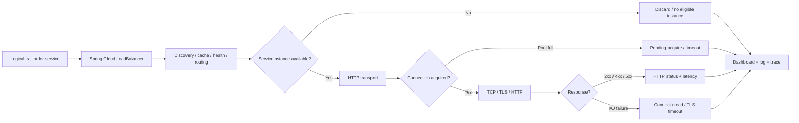
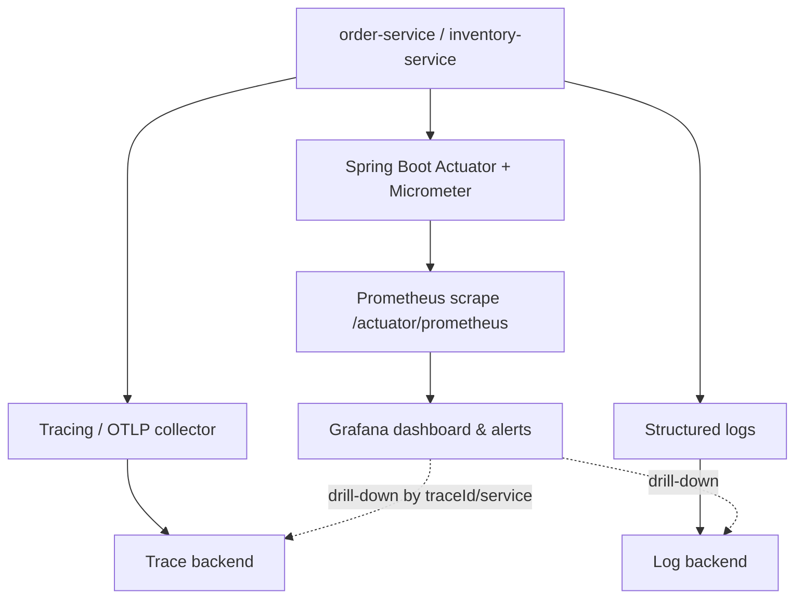
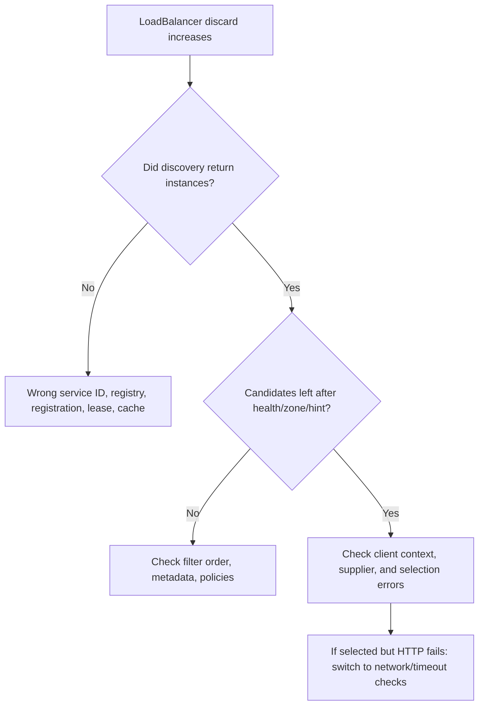

# Dashboards for Errors, Timeouts, Pools, and Unavailable Replicas

When inter-service communication uses Spring Cloud LoadBalancer, a failed request can stem from **HTTP 5xx**, **timeouts**, **connection pool exhaustion**, **no `ServiceInstance` available**, or **a replica still returned by discovery that is no longer serving**. All five scenarios may appear to users as "slow API" or "service call failed", yet their remedies are completely different.

This lesson belongs to the **System Observability** chapter of the `SPRING_CLOUD_SERVICE_COMMUNICATION_LOAD_BALANCING` module. The goal is designing an **operational dashboard** for calls by service ID using metrics from Spring Boot Actuator, Micrometer, Spring Cloud LoadBalancer, and the HTTP transport (e.g., Reactor Netty), while linking charts to logs/traces and runbooks. Examples prioritize RestClient/WebClient with notes for RestTemplate/OpenFeign, discovery, health checks, caching, retries, and timeouts.

A good dashboard must answer four questions within minutes:

1. **Who is failing?** HTTP status errors, transport errors, instance selection failures, or caller application errors?
2. **Which stage is stuck?** Waiting on the connection pool, TCP connect, TLS, awaiting response, or exceeding the total deadline?
3. **Are eligible replicas still available?** What are the discovery list and the post-health/zone/hint-filtered list?
4. **How severe is user impact?** Did logical requests ultimately succeed or fail, even after multiple retries?

> **Version note:** Meter names cited in this lesson are Micrometer names per Spring Boot/Spring Cloud/Reactor Netty documentation. When exported to Prometheus, names usually convert to `snake_case` with type suffixes—for instance, `loadbalancer.requests.discard` becomes `loadbalancer_requests_discard_total`. Tags, histograms, and meter registration also depend on your exact libraries, configuration, and HTTP client. Always inspect `/actuator/metrics` and `/actuator/prometheus` **in your own application** before copying PromQL.

## 1. Observability Map of a Load-Balanced Call

Suppose `order-service` calls:

```text
GET http://inventory-service/api/v1/items/SKU-001
```

Discovery advertises two replicas of `inventory-service`:

| Replica | Illustrative address | Actual state |
|---|---|---|
| `inventory-a` | `10.0.2.11:8081` | Healthy |
| `inventory-b` | `10.0.2.12:8082` | TCP connect timeout |
 
Spring Cloud LoadBalancer receives the service ID, fetches candidates from `ServiceInstanceListSupplier`, picks an instance, and lets the HTTP client send the request. Each step needs a distinct observation source.



Observability layers cannot substitute for one another:

| Layer | Metric source | What it answers |
|---|---|---|
| Inbound API | `http.server.requests` and business SLIs | What errors/latency do users see? |
| HTTP client | `http.client.requests` | What status did outbound requests return, and how long did they take? |
| LoadBalancer | `loadbalancer.requests.*` | Was an instance selected, and how did the selection lifecycle end? |
| Transport/pool | Reactor Netty `connection.provider.*` or other transport metrics | Is the pool saturated; are requests queuing for connections? |
| Discovery/supplier | **Custom-added** metrics, registry client/health instrumentation | How many instances existed before/after filtering? |
| Retry | **Custom-added** metrics or from your resilience library | How many attempts did one logical request generate? |
| Trace/log | Micrometer Tracing/OpenTelemetry and structured logs | Which replica did a specific request pick, and where did it fail? |

**Never lump every error into one `error` counter.** An HTTP 503 returned by a backend differs from a 503 caused by the client finding zero instances, even if the user-facing UI looks identical.

## 2. Define Measurement Objects Before Opening Grafana

The two most important concepts are **logical request** and **HTTP attempt**.

Suppose an inventory read operation is retried:

```text
Logical request #501
  attempt 1: inventory-a -> connection reset
  attempt 2: inventory-b -> HTTP 200
  final outcome: SUCCESS
```

For this operation:

- **Logical requests:** 1.
- **HTTP attempts:** up to 2 in this example (the first attempt may fail before reaching the server).
- **Selected instances:** possibly 2 if the retry picked a different instance.
- **Final outcome:** success.
- **Is the system degraded?** Yes: the first try failed, and the request relied on a retry to recover.

If a dashboard only plots error rate by **final outcome**, this operation hides as zero errors. If a dashboard only plots errors per **attempt**, it may report high error rates while final error rates are low. **You need both.**

### 2.1. SLI Definitions

| SLI | Numerator | Denominator | What it answers |
|---|---|---|---|
| Final error rate | Logical calls ending in failure | All logical calls | How severely are customers affected? |
| Outbound 5xx ratio | HTTP client requests returning 5xx | HTTP client requests receiving a response | How often is the dependency returning errors? |
| Timeout ratio | Attempts or logical calls timing out (specify which) | Matching attempts or logical calls | How frequent are timeout failures? |
| Retry amplification | Total HTTP attempts | Total logical calls | How many sends does one operation cost? |
| No-instance rate | Selections discarded due to no instance | Matching LB selections | Are discovery/filters dropping all targets? |
| Pool saturation | Active connections / max connections | Total pool capacity | How saturated is the pool? |
| Pool queue | Pending acquires or pool wait latency | Per pool | Is congestion occurring before opening TCP? |
| Dependency latency P95/P99 | Latency percentile on the **same unit** | Histogram of logical or HTTP calls | Where is slowness happening? |

**Never take a denominator from one layer to compute a ratio at another layer** without proving equivalent semantics. For instance, `loadbalancer.requests.success` is a lifecycle metric: "success" means the load-balanced request finished by handing a response to the client—**not necessarily HTTP 2xx**.

### 2.2. Rules for SLOs

User-facing SLOs should start from the **final outcome of the logical operation**—for example, "99.9% of inventory check requests complete within deadline." HTTP attempt, pool, and LoadBalancer layers exist to **explain causes**, not replace SLOs. A request completing 200 after 4 retries must still count toward total latency and downstream pressure.

## 3. Collection Architecture for Metrics, Logs, and Traces

An illustrative setup:



**Metrics** reveal trends and anomalies. **Traces** follow a single logical request across services, each HTTP attempt, and per-step timing. **Logs** explain error messages, selected instances, exception causes, and detailed diagnostic data. Each of the three sources plays a distinct role.

For fast investigation, an error panel should link to traces/logs filtered by service, time range, and error category. Never add a `traceId` or `requestId` metric label per request: series counts will explode rapidly.

## 4. Enabling Observability with Spring Boot Actuator and Prometheus

With compatible Spring Boot and Spring Cloud BOMs, illustrative Maven dependencies:

```xml
<dependencies>
    <dependency>
        <groupId>org.springframework.boot</groupId>
        <artifactId>spring-boot-starter-actuator</artifactId>
    </dependency>

    <dependency>
        <groupId>io.micrometer</groupId>
        <artifactId>micrometer-registry-prometheus</artifactId>
    </dependency>

    <dependency>
        <groupId>org.springframework.cloud</groupId>
        <artifactId>spring-cloud-starter-loadbalancer</artifactId>
    </dependency>

    <!-- Choose Spring Web or WebFlux matching your actual HTTP client. -->
    <dependency>
        <groupId>org.springframework.boot</groupId>
        <artifactId>spring-boot-starter-webflux</artifactId>
    </dependency>
</dependencies>
```

Example `application.yml`:

```yaml
management:
  endpoints:
    web:
      exposure:
        include: health, info, prometheus
  metrics:
    distribution:
      percentiles-histogram:
        http.client.requests: true

spring:
  cloud:
    loadbalancer:
      stats:
        micrometer:
          enabled: true
        include-path: false
```

Notes:

1. `management.endpoints.web.exposure.include` permits endpoint access. **Protect `/actuator/prometheus`** with network policies/authentication and monitoring-only scrape rules; never expose internal metrics to the Internet.
2. `spring.cloud.loadbalancer.stats.micrometer.enabled=true` enables `MicrometerStatsLoadBalancerLifecycle` when a `MeterRegistry` and matching integration exist.
3. `spring.cloud.loadbalancer.stats.include-path=false` lowers the risk of high-cardinality `uri` labels. With RestTemplate, paths are often harder to normalize into URI templates.
4. Histograms on `http.client.requests` enable P95 via `histogram_quantile`. Histograms carry series/CPU/memory cost: enable them only for meters/endpoints you need and verify bucket counts in practice.
5. Not every metric appears immediately at startup: some meters register **only upon their first recorded observation**.

### 4.1. HTTP Clients Must Be Instrumented Properly

Spring Boot only auto-observes clients built through appropriate builders/customizers—such as `RestTemplateBuilder`, `RestClient.Builder`, and `WebClient.Builder` wired with Observation. Calling `new RestTemplate()`, `RestClient.create()`, or `WebClient.builder()` directly in scattered places can bypass Boot instrumentation.

Example WebClient with an explicit `ObservationRegistry`:

```java
import io.micrometer.observation.ObservationRegistry;
import org.springframework.cloud.client.loadbalancer.LoadBalanced;
import org.springframework.context.annotation.Bean;
import org.springframework.context.annotation.Configuration;
import org.springframework.web.reactive.function.client.WebClient;

@Configuration(proxyBeanMethods = false)
class ObservedHttpClientConfiguration {

    @Bean("observedLoadBalancedBuilder")
    @LoadBalanced
    WebClient.Builder observedLoadBalancedBuilder(
            ObservationRegistry observationRegistry) {

        return WebClient.builder()
                .observationRegistry(observationRegistry);
    }
}
```

In applications relying on Spring Boot's auto-configured builders and customizations, preserve those settings when declaring load-balanced beans; do not accidentally drop TLS, connection pools, trace propagation, or timeouts. The snippet above focuses on showing **where Observation is attached** on the builder that Spring Cloud further configures for LoadBalancer.

## 5. Inspect Live Metrics Before Building Dashboards

Check `/actuator/metrics` and `/actuator/prometheus` after sending a few test calls.

### 5.1. Standard Meter Names to Look For

| Micrometer meter name | Type | Meaning |
|---|---|---|
| `http.client.requests` | Timer | Observed client-side HTTP calls |
| `http.server.requests` | Timer | HTTP calls hitting the API server |
| `loadbalancer.requests.active` | Gauge | Currently active load-balanced requests |
| `loadbalancer.requests.success` | Timer | LB calls ending with handing a response to the client; **does not guarantee 2xx** |
| `loadbalancer.requests.failed` | Timer | LB calls ending with an exception |
| `loadbalancer.requests.discard` | Counter | LB could not obtain an instance to forward the request |
| `reactor.netty.connection.provider.active.connections` | Gauge | Active connections in the Netty pool |
| `reactor.netty.connection.provider.max.connections` | Gauge | Maximum active connections limit |
| `reactor.netty.connection.provider.idle.connections` | Gauge | Idle connections |
| `reactor.netty.connection.provider.pending.connections` | Gauge | Requests waiting to acquire a connection |
| `reactor.netty.connection.provider.pending.connections.time` | Timer | Wait time to acquire a connection |
| `jvm.memory.used` | Gauge | Used JVM memory by area |
| `process.cpu.usage` | Gauge | Process CPU usage |

Metrics named `reactor.netty.*` **apply only when the actual HTTP transport is Reactor Netty with metrics enabled**. A RestClient using Apache HttpClient 5 or JDK HttpClient has its own meters/pools; never inspect a Netty panel and conclude its pool is empty.

### 5.2. Names Exported to Prometheus

Common examples:

```text
Micrometer: http.client.requests
Prometheus: http_client_requests_seconds_count
            http_client_requests_seconds_sum
            http_client_requests_seconds_bucket  (when histogram is enabled)

Micrometer: loadbalancer.requests.failed
Prometheus: loadbalancer_requests_failed_seconds_count
            loadbalancer_requests_failed_seconds_sum

Micrometer: loadbalancer.requests.discard
Prometheus: loadbalancer_requests_discard_total

Micrometer: reactor.netty.connection.provider.pending.connections
Prometheus: reactor_netty_connection_provider_pending_connections
```

These are **examples following Prometheus naming conventions**, not a substitute for checking live exposition. Tags may be normalized, omitted in some integrations, or vary across versions. `http.client.requests` typically includes tags like `method`, `uri`, `status`, `client.name`, and `exception`, though you must inspect live exported samples before writing filters.

### 5.3. Why Might a Metric Be Missing?

- Missing Micrometer registry starter or Actuator.
- Endpoint not exposed or Prometheus cannot scrape it.
- Client constructed manually outside an instrumented builder.
- LoadBalancer stats not enabled or no requests sent yet.
- HTTP client uses a transport other than Reactor Netty.
- Pool metrics not enabled.
- A label or meter was dropped by a `MeterFilter`.
- No event has occurred yet to trigger meter creation.
- Scrape failure, pod restart, or vanished target.

**"No series" does not mean "value equals 0".** Dashboards should include a scrape-health panel like `up` and `No data` alerts when telemetry sources disappear.

## 6. Designing Dashboard Layout

An effective dashboard uses **rows aligned with the diagnostic flow**, rather than scattering 30 unrelated charts.

| Row | Core panels | Operational question |
|---|---|---|
| **A. Overview** | Traffic, final error rate, outbound HTTP 5xx, P95/P99 latency | Is there an incident and how are users impacted? |
| **B. Error classification** | HTTP 4xx/5xx, transport exceptions, timeout phase, LB failed/discard | Which layer is failing? |
| **C. Connection pool** | Active/max, idle, pending, pending acquire time, acquire failures | Is congestion happening before opening connections? |
| **D. LoadBalancer and instances** | No-instance/discard, candidate count, healthy count, selected instance distribution | Are discovery/health/filters losing targets? |
| **E. Retries and freshness** | Attempts per logical call, retry amplification, retry success, cache/discovery lag | Are retries masking errors or adding load? |
| **F. Investigation** | Recent deploys, log/trace links, runbook, scrape health | What is the next action? |

Put filter variables at the top of the dashboard: `environment`, `namespace`, `caller`, `dependency/serviceId`, and `region`. Only show variables that actually exist in your data or are produced via controlled recording rules/instrumentation; never assume every `service_id` label exists automatically.

### 6.1. Choosing Chart Units

- Counter: use `rate(...)` or `increase(...)` over a window; never plot raw cumulative counters as requests/sec.
- Timer: use `_count`, `_sum`, `_bucket` per Prometheus backend; `_count` counts observations, **not necessarily logical operations**.
- Gauge: plot instantaneous values or `max_over_time` where appropriate; **never apply `rate` to a gauge**.
- Histogram percentiles: use `histogram_quantile` over buckets properly summed by `le` and required labels.
- Statuses and exceptions: compute ratios using denominators from the exact same layer; never lump out-of-policy codes into "5xx".

## 7. Row A — Traffic, HTTP Errors, and Latency

First filter to a specific caller, such as a Prometheus scrape target labeled `job="order-service"`.

### 7.1. HTTP Client Throughput (requests/second)

```promql
sum(rate(http_client_requests_seconds_count{
  job="order-service"
}[5m]))
```

This query counts instrumented **HTTP client observations**. If retries are instrumented per attempt, one logical request appears multiple times. Do not use it as the denominator for logical-call SLOs without verifying counting behavior.

### 7.2. Outbound 5xx Ratio

```promql
sum(rate(http_client_requests_seconds_count{
  job="order-service", status=~"5.."
}[5m]))
/
clamp_min(
  sum(rate(http_client_requests_seconds_count{
    job="order-service"
  }[5m])),
  1e-9
)
```

If the client fails with a TCP timeout or DNS error without receiving an HTTP response, `status` will not be 5xx. **Never treat a 5xx chart as representing all dependency failures.**

### 7.3. HTTP Client P95 Latency

Enable histograms appropriately and use:

```promql
histogram_quantile(
  0.95,
  sum by (le) (
    rate(http_client_requests_seconds_bucket{
      job="order-service"
    }[5m])
  )
)
```

Values are normally in **seconds** under Prometheus export. To display milliseconds, multiply by `1000` in the query or select the matching unit in Grafana. Do not run `histogram_quantile` when `_bucket` series do not exist; `_count`/`_sum` alone cannot produce accurate P95s.

### 7.4. Final Outcome of Logical Calls

When retries are frequent, add metrics at the **business boundary**:

```text
app.dependency.logical.requests  (Counter)
  tags: dependency, outcome

app.dependency.logical.duration  (Timer)
  tags: dependency, outcome
```

For example, `outcome` accepts only `success`, `failure`, `cancelled`—never raw exception messages as labels. These `app.dependency.*` metrics are **recommended custom metrics**, **not** built-in Spring Cloud metrics.

SLO dashboards should prioritize the final error ratio on this counter, while `http.client.requests` helps break down outbound attempts.

## 8. Row B — Classifying HTTP Errors, Timeouts, and Transport Failures

An HTTP client can fail across multiple phases:

```text
Pool acquire → DNS → TCP connect → TLS handshake → Send request
    → Wait for response headers → Read body → Decode → Complete
```

No single default client metric automatically classifies every one of these phases accurately. Combine transport metrics with an application/adapter **error taxonomy**.

### 8.1. Incident Classification Table

| Category | Example signal | Root causes to investigate |
|---|---|---|
| HTTP 4xx | `status=400/401/404/429` | Contract, auth, rate limit, missing resource |
| HTTP 5xx | `status=502/503/504` | Backend or proxy returning errors |
| Pool acquire timeout | Prolonged pending acquires, acquire timeout | Low max pool size, leaks, streams holding connections |
| TCP connect timeout | `ConnectTimeoutException` | Unreachable endpoint/firewall/routing |
| TLS handshake failure | `SSLHandshakeException` | Truststore, SAN, certificates, TLS policy |
| Response/read timeout | Client waits too long for headers/body | Slow dependency or network congestion |
| Deadline exceeded | Combined multi-attempt budget exhausted | Overlapping retries/timeouts, prolonged processing |
| No-instance | LB discard or zero candidates | Discovery/cache/health/zone/hints |
| Decode/contract error | JSON deserialization, DataBuffer limit | Response schema/codec/payload |
| Cancelled | Caller cancelled, downstream closed connection | Separate intentional cancellation from errors |

With a custom taxonomy, you can use a bounded `phase` label:

```text
POOL_ACQUIRE
DNS
CONNECT
TLS
WRITE
RESPONSE
READ
DECODE
TOTAL_DEADLINE
SELECTION
UNKNOWN
```

Never classify every `IOException` as "timeout"; connection refused, resets, and TLS handshake failures are fundamentally different.

### 8.2. Custom Metric for Timeouts

A clean design:

```text
app.dependency.attempts
  type: Counter
  tags:
    dependency: inventory-service
    result: success | http_error | timeout | network_error |
            no_instance | cancelled
    phase: pool_acquire | connect | tls | response |
           read | total_deadline | selection | none
```

Place the counter **at the exact layer that observes each attempt outcome**. If code only catches the final exception in `@Service`, it sees the final outcome, **not every retried attempt underneath**. For retries, instrument at the interceptor/filter/transport or actual resilience layer.

Prometheus typically exports this custom counter as:

```promql
sum by (phase) (
  rate(app_dependency_attempts_total{
    job="order-service", result="timeout"
  }[5m])
)
```

This query **only works once the application itself registers** `app.dependency.attempts` with those tags and Prometheus scrapes it. Do not treat it as a built-in Spring Boot metric.

## 9. Row C — Connection Pool Dashboard

A request can time out **before ever being allowed to open a connection** because every connection is in use and the pool wait queue is backed up.

With WebClient running Reactor Netty, available meters typically include:

- `reactor.netty.connection.provider.active.connections`.
- `reactor.netty.connection.provider.max.connections`.
- `reactor.netty.connection.provider.idle.connections`.
- `reactor.netty.connection.provider.pending.connections`.
- `reactor.netty.connection.provider.pending.connections.time`.
- `reactor.netty.connection.provider.max.pending.connections`.

Provider metrics must be explicitly enabled. Example Java configuration using **one shared provider** rather than creating a new one per request:

```java
import java.time.Duration;

import io.micrometer.observation.ObservationRegistry;
import io.netty.channel.ChannelOption;
import reactor.netty.http.client.HttpClient;
import reactor.netty.resources.ConnectionProvider;

import org.springframework.cloud.client.loadbalancer.LoadBalanced;
import org.springframework.context.annotation.Bean;
import org.springframework.context.annotation.Configuration;
import org.springframework.http.client.reactive.ReactorClientHttpConnector;
import org.springframework.web.reactive.function.client.WebClient;

@Configuration(proxyBeanMethods = false)
public class PoolMonitoringConfiguration {

    @Bean(destroyMethod = "dispose")
    ConnectionProvider downstreamConnectionProvider() {
        return ConnectionProvider.builder("downstream-pool")
                .maxConnections(64)
                .pendingAcquireTimeout(Duration.ofSeconds(2))
                .metrics(true)
                .build();
    }

    @Bean("observedLoadBalancedBuilder")
    @LoadBalanced
    WebClient.Builder loadBalancedBuilder(
            ConnectionProvider downstreamConnectionProvider,
            ObservationRegistry observationRegistry) {

        HttpClient httpClient =
                HttpClient.create(downstreamConnectionProvider)
                        .option(
                                ChannelOption.CONNECT_TIMEOUT_MILLIS,
                                2_000)
                        .responseTimeout(Duration.ofSeconds(5))
                        .metrics(true);

        return WebClient.builder()
                .clientConnector(
                        new ReactorClientHttpConnector(httpClient))
                .observationRegistry(observationRegistry);
    }
}
```

This snippet illustrates configuration using Reactor Netty and compatible API versions. In real Spring Boot apps, verify whether customizing the builder/connector drops auto-configured customizers, TLS, proxies, tracing, or other metrics; define **only one bean** named `observedLoadBalancedBuilder` if you already used the example in section 4.

### 9.1. Pool Utilization

```promql
sum by (name) (
  reactor_netty_connection_provider_active_connections{
    job="order-service"
  }
)
/
clamp_min(
  sum by (name) (
    reactor_netty_connection_provider_max_connections{
      job="order-service"
    }
  ),
  1
)
```

This computes the **active/max ratio** per provider name, assuming both metrics share compatible tags and pool scope. If a provider spans multiple remote addresses/instances, inspect how aggregations are exported so you do not sum a repeated cap across non-equivalent series. Breaking down by remote address can also help, provided you **never use unbounded dynamic addresses as custom labels**.

### 9.2. Requests Waiting on the Pool

```promql
sum by (name) (
  reactor_netty_connection_provider_pending_connections{
    job="order-service"
  }
)
```

If `active/max` is high and `pending` stays elevated, suspect pool saturation. If the pool has spare capacity while clients still time out, look at TCP/TLS/response or deadlines instead.

### 9.3. P95 Pool Wait Time

When the `pending.connections.time` timer histogram is enabled:

```promql
histogram_quantile(
  0.95,
  sum by (le, name) (
    rate(
      reactor_netty_connection_provider_pending_connections_time_seconds_bucket{
        job="order-service"
      }[5m]
    )
  )
)
```

If no `_bucket` series exist, percentiles cannot be computed this way; observe the mean via `_sum / _count` or configure histograms after checking overhead.

### 9.4. Which Pool Is Actually Being Measured?

HTTP clients typically maintain pools per connection provider and per remote endpoint—not a single shared "Spring Cloud LoadBalancer pool". When LB picks a different instance, the HTTP transport may use a different connection group.

Under HTTP/2, one connection carries multiple streams; `active.connections` alone does not reflect full utilization. If using HTTP/2, inspect active/pending stream metrics for your Reactor Netty version.

**For RestClient/RestTemplate using Apache HC5 or JDK transport**, build panels from that pool implementation's metrics or custom instrumentation; never treat Netty queries as proof those client pools are healthy.

## 10. Row D — Unavailable Replicas and Instance Selection Failures

Spring Cloud LoadBalancer provides `MicrometerStatsLoadBalancerLifecycle`. Per Spring Cloud Commons docs, the primary meters are:

| Meter | Type | How to read it? |
|---|---|---|
| `loadbalancer.requests.active` | Gauge | Currently active LB requests, by available tags |
| `loadbalancer.requests.success` | Timer | Ended by passing a response to the client layer |
| `loadbalancer.requests.failed` | Timer | Ended with an exception |
| `loadbalancer.requests.discard` | Counter | Failed to obtain a `ServiceInstance` to run the request |

### 10.1. Alert/Panel for "No-Instance"

Illustrative PromQL:

```promql
sum by (job) (
  increase(loadbalancer_requests_discard_total{
    job="order-service"
  }[5m])
)
```

The result is the **number of discards in 5 minutes**, not the count of dead replicas. Discards can happen because of:

- Wrong service ID.
- Discovery returning an empty list.
- Instances deregistered.
- Supplier health/zone/hint/filters eliminating every candidate.
- Custom supplier/routing chains returning empty due to misconfiguration.
- Client context querying the wrong service or data source.

**Never assume a discard metric automatically means "Eureka is down" or "0 Pods exist".** Pair it with candidate-list observations from discovery/suppliers and log context.

### 10.2. LoadBalancer Failure Does Not Mean HTTP 5xx

`loadbalancer.requests.failed` measures calls ending with an exception in LoadBalancer's lifecycle. In some blocking integrations, not every request/response field is available. If a real backend returns `503`, the client may treat it as a **response** when the LB lifecycle finishes, while `RestClient.retrieve()` throws an exception afterward during status handling.

Therefore:

- `loadbalancer.requests.success` is **not the HTTP 2xx rate**.
- `loadbalancer.requests.failed` is **not the total of all HTTP 5xx**.
- `loadbalancer.requests.discard` does **not count every unhealthy instance**.
- Use `http.client.requests` for statuses and app telemetry for final outcomes.

### 10.3. Distinguishing Discovery Candidates from Eligible Candidates

To know "why there is no instance", you need at least two counts:

```text
discoveredInstances = 3
eligibleInstancesAfterFilters = 0
```

That differs from:

```text
discoveredInstances = 0
eligibleInstancesAfterFilters = 0
```

Recommended custom metric example:

```text
app.loadbalancer.instances.discovered
  Gauge: serviceId

app.loadbalancer.instances.eligible
  Gauge: serviceId

app.loadbalancer.selection.empty
  Counter: serviceId, reason
```

**This is custom instrumentation, not meters guaranteed by Spring Cloud LoadBalancer.** To record them accurately:

1. Identify observation points *before* and *after* all suppliers/filters.
2. Never call `supplier.get()` casually just to feed a gauge if it triggers network traffic or alters selection context.
3. Capture snapshots safely when the list refreshes or during selection.
4. Constrain the `reason` label to a defined enum, e.g., `discovery_empty`, `health_filtered`, `zone_filtered`, `no_matching_instance`, or `unknown`.
5. Never treat health state as immutable; caches/discovery can lag.
6. If unsure which filter eliminated instances, record `unknown` rather than guessing.

### 10.4. "Unhealthy Instance" Differs from "No Instance"

A replica still listed in discovery while refusing TCP connections can still be selected. A health-check supplier may not have noticed the change yet, or the health endpoint may only check process liveness without verifying the real request path.

Dashboards should distinguish:

- `discovered`: how many replicas the registry holds.
- `eligible`: how many candidates survive filtering.
- `selected`: which replica the algorithm chose.
- `reachable`: whether the HTTP transport can actually connect.
- `healthy`: status from the health/supplier source (explicitly defined).

If A/B get selected while B repeatedly times out, inspect B and health/cache freshness. If both A and B vanish from the list, inspect discovery/registration. If A/B are discovered yet filters leave 0, inspect zone, hint, metadata, or routing policies.

## 11. Row E — Retries, Recovery, and Masked Failures

A dashboard showing only final outcomes can hide degradation masked by retries.

Example:

```text
Request 1: A -> 503, retry B -> 200
Request 2: A -> timeout, retry B -> 200
Request 3: A -> 503, retry B -> 200
```

Final error rate = 0%, yet:

- Every logical call costs 2 HTTP attempts.
- A has a very high error rate.
- P95 latency rises due to retries/backoff.
- B absorbs substantial extra load.

Add these panels:

| Panel | Formula / purpose |
|---|---|
| Logical request throughput | Business operations/sec |
| HTTP attempt throughput | HTTP sends/sec |
| Retry amplification | `HTTP attempts / logical requests` |
| Retried logical calls | Share of operations needing at least 1 retry |
| Retry success rate | Share of initially failed operations rescued by retries |
| Retry exhausted | Operations exhausting retry budget |
| Retry by outcome | Timeout/503/connect reset/no-instance |
| Attempt distribution | Sends per instance/zone, with bounded tags |

These metrics usually require custom instrumentation or metrics from the Resilience4j/Spring Retry/Reactor instrumentation **actually in use**. Never assume Spring Cloud LoadBalancer creates all of those counters automatically.

### 11.1. PromQL for Retry Amplification Once Custom Counters Exist

Suppose the application exposes:

```text
app_dependency_attempts_total{dependency="inventory-service"}
app_dependency_logical_requests_total{dependency="inventory-service"}
```

Query:

```promql
sum(rate(app_dependency_attempts_total{
  job="order-service",dependency="inventory-service"
}[5m]))
/
clamp_min(
  sum(rate(app_dependency_logical_requests_total{
    job="order-service",dependency="inventory-service"
  }[5m])),
  1e-9
)
```

Normal baseline sits near `1` when retries are unnecessary, and rises above `1` when extra attempts occur. However, if attempts are never sent due to no-instance, the ratio can drop below `1`; document counting rules clearly and never assume the ratio is always `>= 1`.

### 11.2. Avoid Double-Counting Metrics When Adding Retry Layers

Some retries occur at the LoadBalancer layer, others in WebClient/Reactor/Feign/Resilience4j or an API gateway. A single "logical request" in `order-service` can emit multiple client observations, yet not every library instruments attempts identically. Choose **one official boundary** to count logical calls and **one clear boundary** to count attempts. Verify with stub servers by comparing received request counts against counter increments before relying on the ratio operationally.

## 12. Adding Controlled Custom Metrics with Micrometer

When built-in metrics are insufficient for classification, add lightweight failure telemetry once hook placement is confirmed.

Example **illustrating metric/label format only**, not automatically wired into every interceptor:

```java
package com.example.order.observability;

import io.micrometer.core.instrument.MeterRegistry;
import org.springframework.stereotype.Component;

@Component
public final class DependencyAttemptRecorder {

    private final MeterRegistry registry;

    public DependencyAttemptRecorder(MeterRegistry registry) {
        this.registry = registry;
    }

    public void recordAttempt(
            String dependency,
            Outcome outcome,
            Phase phase) {

        // dependency must come from a trusted service ID,
        // never from an arbitrary URI or user input.
        registry.counter(
                "app.dependency.attempts",
                "dependency", dependency,
                "result", outcome.metricValue(),
                "phase", phase.metricValue())
                .increment();
    }

    public enum Outcome {
        SUCCESS("success"),
        HTTP_ERROR("http_error"),
        TIMEOUT("timeout"),
        NETWORK_ERROR("network_error"),
        NO_INSTANCE("no_instance"),
        CANCELLED("cancelled");

        private final String value;
        Outcome(String value) { this.value = value; }
        String metricValue() { return value; }
    }

    public enum Phase {
        NONE("none"),
        POOL_ACQUIRE("pool_acquire"),
        CONNECT("connect"),
        TLS("tls"),
        RESPONSE("response"),
        READ("read"),
        SELECTION("selection"),
        TOTAL_DEADLINE("total_deadline"),
        UNKNOWN("unknown");

        private final String value;
        Phase(String value) { this.value = value; }
        String metricValue() { return value; }
    }
}
```

**Important:** this class only provides a counter-recording API. To accurately reflect an *attempt*, invoke `recordAttempt` where **a single attempt finishes**, not merely in a service method called once. If unsure which failure phase occurred, record `UNKNOWN`. Classifying `SSLHandshakeException`/`ConnectTimeoutException`/pool timeouts must inspect the **specific transport's** exception chain and be tested—never parse messages with `contains("timeout")`.

If you want a counter for final outcomes, create a **separate** counter at the logical-call boundary, such as `app.dependency.logical.requests`, to avoid recounting every retry.

## 13. Tag Cardinality: Risk of Overloading Observability Itself

The following labels have high cardinality if uncontrolled:

- `sku`, `orderId`, `tenantId` (huge value spaces).
- `traceId`, `correlationId`, `requestId` (nearly unique per request).
- Raw URIs containing path variables such as `/orders/123456`.
- Query strings and access tokens.
- Dynamic container/pod IPs as long-lived labels on custom metrics.
- Raw exception messages containing request URLs or user parameters.

Prefer:

| Safe as metric tags | Keep in access-controlled traces/logs |
|---|---|
| `serviceId` from a configured allowlist | Per-attempt detailed instance ID |
| `method` | Request ID and trace ID |
| Normalized `uriTemplate` | Redacted raw path/query if valid |
| `status` or `statusClass` | Sanitized error body |
| `errorCategory` enum | Full exception chain |
| Bounded `poolName` | Specific remote address if needed for debugging |
| Bounded `region/zone` | High-cardinality dynamic metadata |

Spring Cloud Commons offers `spring.cloud.loadbalancer.stats.include-path=false` to keep varying paths out of the LB metric `uri` tag. For `http.client.requests`, ensure normalized URI templates are used instead of dynamic raw URIs; if a client fails to populate a template tag, apply observation conventions or meter filters to curb cardinality.

**Measure cardinality directly:** inspect active series/label values and scrape payload size—never rely solely on config review on paper.

## 14. Alerts Should Combine Rate, Traffic Volume, and Duration

A 50% error rate across 2 requests in 10 minutes means something completely different from 5% across 100,000 requests. Alerts require **minimum volume gates**, **`for` durations**, and **severity tied to impact**.

The values below are **discussion examples**, not real project SLOs:

| Alert | Illustrative condition | Priority |
|---|---|---|
| User-facing final error | High final logical error rate over 10m with sufficient traffic | High |
| Outbound HTTP 5xx surge | >5% over 10m, at least 100 outbound observations | Medium/high |
| No-instance | Multiple LB discards in 5m for a critical dependency | High |
| Pool saturation | Active/max >85% **and** pending >0 continuously | Medium/high |
| Pool acquire latency | P95 acquire time elevated above baseline | Medium |
| Timeout phase surge | Pool/connect/response timeouts rising continuously | Based on impact |
| Retry amplification surge | Attempts/logical > baseline and latency rising | Early warning |
| Metrics scrape lost | Target down or required series missing | Separate observability alert |

Do not page on-call engineers for a single counter tick on a rare endpoint. Conversely, for a critical dependency, **even one no-instance event** may warrant an urgent log/notification per severity policy.

### 14.1. Prometheus Alert Rule Example for Outbound 5xx

```yaml
groups:
  - name: order-service-dependency-alerts
    rules:
      - alert: OutboundDependency5xxElevated
        expr: |
          (
            sum(rate(http_client_requests_seconds_count{
              job="order-service", status=~"5.."
            }[10m]))
            /
            clamp_min(
              sum(rate(http_client_requests_seconds_count{
                job="order-service"
              }[10m])),
              1e-9
            )
          ) > 0.05
          and
          sum(increase(http_client_requests_seconds_count{
            job="order-service"
          }[10m])) > 100
        for: 5m
        labels:
          severity: warning
        annotations:
          summary: "Elevated outbound HTTP 5xx in order-service"
          description: "Check dependencies, statuses, and retry amplification."
```

This rule assumes job labels and metric names match the illustrative environment. It **does not detect network timeouts lacking a 5xx status**. For critical flows, add separate rules for timeouts and final error rate.

### 14.2. No-Instance Alert

```yaml
      - alert: LoadBalancerNoInstance
        expr: |
          sum(increase(loadbalancer_requests_discard_total{
            job="order-service"
          }[5m])) > 0
        for: 2m
        labels:
          severity: warning
        annotations:
          summary: "Spring Cloud LoadBalancer could not obtain an instance"
          description: "Cross-check discovery, health, zone, hints, and service ID."
```

This is a sensitive rule; low-traffic environments or test calls to nonexistent service IDs can fire it. In production, add environment, dependency, and severity filters. If metrics vanish completely, this rule will not fire—monitor scrape health and `No data` separately.

### 14.3. Pool Saturation Alert

```yaml
      - alert: ConnectionPoolSaturated
        expr: |
          (
            sum by(name) (
              reactor_netty_connection_provider_active_connections{
                job="order-service"
              }
            )
            /
            clamp_min(
              sum by(name) (
                reactor_netty_connection_provider_max_connections{
                  job="order-service"
                }
              ), 1
            )
          ) > 0.85
          and on(name)
          sum by(name) (
            reactor_netty_connection_provider_pending_connections{
              job="order-service"
            }
          ) > 0
        for: 5m
        labels:
          severity: warning
        annotations:
          summary: "Reactor Netty connection pool near saturation"
          description: "Check active/max, pending connections, and acquire latency."
```

This query applies only when Reactor Netty pool metrics are present with a matching `name` label. If clients use another transport or have multiple `remote.address`/sub-pools with differing caps, adjust aggregation based on actual exposition.

## 15. Runbook: Rising HTTP 5xx Errors

When the outbound 5xx panel spikes:

1. Identify **which dependency** spiked and when it started.
2. Compare status codes: `500`, `502`, `503`, and `504` can have very different origins.
3. Cross-check caller and target server traces/logs. A 503 returned by the server differs from a 503 generated at a gateway.
4. Check recent deploys/config changes, rate limits, and downstream resources.
5. Compare selected instances/zones: are failures concentrated on B?
6. Check whether retries keep final errors low while inflating attempts.
7. For POST/PUT requests, never raise retries before verifying idempotency.
8. Keep ownership clear: client, registry, backend, or gateway.

**Never use `loadbalancer.requests.success` to conclude HTTP 5xx is normal.** It does not mean "HTTP success code".

## 16. Runbook: Rising Timeouts

`timeout` symptoms can appear alongside pool saturation or single-instance failures.

| Clue | Likely cause | Action |
|---|---|---|
| High `pending.connections`, active near max | Waiting for a connection | Check pool caps, connection leaks/long-lived streams, downstream latency |
| Normal pool, connect timeouts to B | B/network/firewall unreachable | Test TCP to exact host/port, check instance and security groups |
| TLS handshake timeout/failure | PKI, TLS termination, handshake overload | Check SAN, truststore, ciphers, certificate rollouts |
| Slow header receipt, normal pool | Slow server processing | Compare server P95, DB/CPU/queues |
| Response stalls mid-stream | Downstream/network/disk/backpressure | Monitor stream duration/bytes and cancellations |
| Total deadline hit while attempts individually didn't time out | Cumulative retry/backoff | Review deadlines and retry budgets |
| Timeouts confined to one zone | Route/network/zone preference | Inspect supplier filters and instance metadata |

Never raise `readTimeout` or `responseTimeout` endlessly to "fix" timeouts. Doing so holds connections/threads longer, increases pending pool waits, and prolongs incidents.

## 17. Runbook: Congested Connection Pool

Diagnostic steps:

1. Select the exact pool used by WebClient/RestClient/Feign.
2. Compare `active`, `idle`, `max`, and `pending` across the exact same tag set.
3. Measure connection acquire wait times and acquire timeouts.
4. Hunt for long-lived SSE streams, huge downloads/uploads, unconsumed response bodies, or resource leaks.
5. Check concurrency, retry storms, and client pools opening too many per-host/instance connections.
6. Measure CPU, event-loop health, and downstream latency.
7. Prioritize fixing whatever holds connections too long or capping concurrency; raise pool limits **only when downstream has spare capacity**.
8. Re-test under realistic load after changes rather than just checking `pending==0` while idle.

If Netty charts show all "No data", confirm whether the connector is actually Reactor Netty and whether provider/HttpClient metrics are enabled—never conclude the pool is empty.

## 18. Runbook: No Instance or Unavailable Instance

Start from `loadbalancer.requests.discard` and selection logs, then branch:



Specific checks:

- **Wrong service name:** do `inventory-service` in the URI and the registry match?
- **Registry/deregistration:** did the backend register, renew its lease, or get deregistered?
- **Caching:** is the client's cached list stale? Do TTLs or the discovery SDK have separate caches?
- **Health checks:** is the health endpoint accurate, is the check interval fast enough, and what is the fallback when zero healthy instances exist?
- **Zone/hint/metadata:** do suppliers apply soft preference or hard filtering? Are request hints missing or invalid?
- **Circuit breaker:** is it rejecting calls before they reach LoadBalancer?
- **Direct URLs:** an OpenFeign client with a fixed `url` or a RestClient using a static IP can **bypass** service-ID selection, producing none of the expected LB metrics.

**A replica suffering TCP timeouts** does not imply `discard`. If discovery still returns that replica and the algorithm picks it, the failure is at the transport layer rather than no-instance.

## 19. Testing to Ensure Dashboards Receive Accurate Data

Before using dashboards in production, intentionally generate every signal type with a controlled test suite.

### 19.1. Operational Test Matrix

| Simulated scenario | Expected observation |
|---|---|
| Backends A/B both return HTTP 200 | HTTP client observations increase; LB active; zero spurious errors |
| A returns HTTP 503, B returns 200, retry off | 503 recorded under HTTP status; per-instance breakdown if instrumented |
| A returns HTTP 503, B returns 200, retry on | HTTP attempts may rise; logical final outcome can succeed |
| Unregistered service ID | LB discard/no-instance increments if lifecycle instrumented; zero server requests |
| Supplier has instances, filters drop all | Eligible candidates=0, discard; discovery count remains >0 |
| B port closed | Transport connect failure; HTTP response status may be absent |
| Server delays response | Client response/read timeout fires; latency rises |
| Small pool, high in-flight calls | Active/max nears 1, pending/acquire latency rises |
| Server returns large body | Memory/codec errors may rise; not misclassified as no-instance |
| Prometheus scrape lost | `up` drops or series vanish; monitoring alert fires separately |
| B deregistered | Observe discovery/cache refresh delay and selections to B drop |
| Client restart | Counter reset handled by `rate`/`increase`; do not sum raw counters |

### 19.2. Using Two HTTP Stubs to Verify Measurements

Use two stubs A/B returning an `X-Instance-Id` response header in tests, for example:

```text
inventory-a:
  GET /whoami -> HTTP 503

inventory-b:
  GET /whoami -> HTTP 200
```

Start with `retry.enabled=false` and confirm each request makes a single attempt. Then enable retries per your target config, count requests hitting each stub, and cross-check client/LB observation counts.

If Round Robin starts from a random index or the client runs concurrently, **do not always assert A then B**. Use correlation IDs, instance markers, and the candidate set to trace the exact sequence.

### 19.3. Inspecting Actuator Data Before Writing PromQL

A workflow:

1. Call test endpoints so real meters register.
2. Read `/actuator/metrics` and confirm `http.client.requests` and `loadbalancer.requests.*` appear.
3. Query `/actuator/metrics/http.client.requests` and inspect actual tags.
4. Read `/actuator/prometheus` exposition to verify normalized names and label keys.
5. For Netty, enable pool metrics, send concurrent requests, and confirm gauges populate.
6. Trigger a no-instance event and verify `loadbalancer.requests.discard` actually increments.
7. Run PromQL queries in Prometheus before importing Grafana panels.
8. Cross-check counts against stub servers/logs to ensure zero double-counting or gaps.
9. Verify dashboard behavior when traffic is 0 and when scrapes drop.

## 20. Testing Diagnostic Capability with a Simulated Incident

Suppose at 09:15 an alert reports "High Order API timeouts".

**Step 1 — User impact:** `http.server.requests`/logical SLO shows P95 rising and final error rate edging up.

**Step 2 — Outbound:** `http.client.requests` to `inventory-service` shows rising latency, while 5xx does not rise proportionally. Suspect timeouts/network rather than HTTP 5xx.

**Step 3 — Pool:** `active/max` at 95%, `pending` sustained high, pending acquire P95 climbing. Clear evidence the pool is saturated before sending requests.

**Step 4 — LoadBalancer:** `discard` near 0, discovered/eligible still show A and B. This is **not a total loss of instances**.

**Step 5 — Traces/logs:** most large file-download streams route to B and hold connections long; retries on the same/other instance drive attempts up.

**Step 6 — Action:** cap concurrent downloads, verify bodies are properly consumed/closed, and evaluate pool size and downstream capacity. Do not blindly raise retries or disable health filters.

This is an **illustrative scenario showing how to read the panels**, not real captured system data. The point is assembling a chain of evidence rather than guessing from a single graph line.

## 21. Mistakes That Lead to Wrong Conclusions

| Mistake | Consequence | How to fix |
|---|---|---|
| Treating LB `success` as HTTP 2xx | Hides HTTP 500/503 errors | Use `http.client.requests` for statuses |
| Treating `discard` as "dead Pod count" | Misdirects investigation | Measure discovered/eligible, check suppliers |
| Plotting raw counters in Grafana | Graph only climbs; hides rates | Use `rate`/`increase` over an appropriate window |
| Applying `rate` to pool gauges | Nonsensical/wrong values | Plot gauge values or proper time aggregations |
| Treating missing metrics as 0 | Hides scrape/instrumentation outages | Monitor `up`, `No data`, and meter existence |
| Enabling histograms on every URI | Inflates metric cardinality and cost | Enable selectively and normalize URIs |
| Putting `requestId`/`orderId` in tags | Time-series explosion | Keep them in traces/logs |
| Seeing final 200 and ignoring retries | Misses dependency degradation | Measure attempts and retry amplification |
| Lumping proxy 503 with no-instance | Misclassifies failure origin | Record error origin and phase |
| Using Netty metrics for Apache HC5 clients | Pool dashboard shows "No data" | Instrument the actual HTTP transport |
| Blindly enlarging pool when pending is high | Risks overloading downstream | Check leaks/streams/latency/capacity |
| Blindly raising timeouts on slow responses | Holds pool connections longer | Analyze root causes and deadlines |
| Counting healthy instances by registry records | Misses filter/transport reachability | Separate discovered/eligible/reachable |
| Testing only HTTP 200 | Error/no-instance metrics go unverified | Run controlled fault injection |
| Alerting on rates at tiny traffic | Noisy paging | Add volume gates and `for` windows |
| Assuming every client is auto-instrumented | Missing metrics on hand-built clients | Use auto-configured builders/customizers |

## 22. Production Dashboard Rollout Checklist

- [ ] Document definitions of **logical requests**, HTTP attempts, and LB selections.
- [ ] Include both final error rate and outbound HTTP status/transport errors.
- [ ] Confirm `http.client.requests` is genuinely instrumented on the active HTTP client.
- [ ] Enable `MicrometerStatsLoadBalancerLifecycle` and verify `loadbalancer.requests.*` meters exist.
- [ ] Ensure 5xx charts do not use LB `success` as the HTTP success denominator.
- [ ] Collect pool metrics for the **actual transport**, without assuming every client uses Reactor Netty.
- [ ] Pool panels cover active/max, pending, and pending acquire latency where supported.
- [ ] Track discovered vs. eligible candidates; distinguish custom metrics from built-ins.
- [ ] Include an LB discard panel and investigation pointers for service ID/discovery/filters.
- [ ] Use a stable phase-based timeout taxonomy instead of a single `error` tag.
- [ ] Measure retry amplification with clearly scoped counters and no double-counting.
- [ ] Enable HTTP client latency histograms and verify real `_bucket` series exist.
- [ ] Provide dashboard filters for environment, caller/dependency, and region using bounded tags.
- [ ] Ensure URIs are templates or omit dynamic path data from metric labels.
- [ ] Keep secrets, request IDs, tokens, and raw queries out of metric tags.
- [ ] Secure Prometheus scrapes/Actuator endpoints and monitor `up`/No data.
- [ ] Configure alerts with volume thresholds, `for` durations, and matching severities.
- [ ] Link every key panel to traces/logs and runbooks.
- [ ] Test at least HTTP 503, no-instance, connect timeout, pool saturation, and lost scrapes.
- [ ] Verify exact meter names/tags against your live Spring Boot/Spring Cloud/Reactor Netty versions.
- [ ] Assign a dashboard owner, update process on BOM/transport changes, and periodic reviews.

## 23. Conclusion

A great Spring Cloud LoadBalancer dashboard reveals **both user-facing outcomes and what happened inside the call**. HTTP 5xx, timeouts, pool saturation, and no `ServiceInstance` are four distinct root-cause groups that must never be lumped into an unattributed "service unavailable".

Use `http.client.requests` for HTTP client status/latency, `loadbalancer.requests.discard` to detect missing instances, `loadbalancer.requests.failed`/`success` strictly per lifecycle semantics, and connection pool metrics from the **actual transport in use**. Supplement with controlled custom metrics for post-filter candidates, timeout phases, attempt counts, and logical-call outcomes. When deploying Prometheus/Grafana, verify live metric names and tags, curb high cardinality, gate alerts on volume, and attach runbooks.

With this setup, whenever an API times out, operators can rapidly tell whether it was **waiting on the pool, unable to connect to an instance, returned an error by the backend, or left with zero eligible instances**—and fix the right layer instead of guessing with timeouts, retries, or load-balancing algorithms.

### References

- [Spring Cloud Commons — Spring Cloud LoadBalancer Statistics](https://docs.spring.io/spring-cloud-commons/reference/spring-cloud-commons/loadbalancer.html) — `MicrometerStatsLoadBalancerLifecycle`, the four `loadbalancer.requests.*` meters, and `include-path` configuration.
- [Spring Boot — Actuator Metrics](https://docs.spring.io/spring-boot/reference/actuator/metrics.html) — `http.client.requests`, HTTP client observations, histograms, and reading meters via Actuator.
- [Spring Boot — Actuator Endpoints](https://docs.spring.io/spring-boot/reference/actuator/endpoints.html) — `/actuator/prometheus` and endpoint security.
- [Reactor Netty — HTTP Client / Connection Pool Metrics](https://projectreactor.io/docs/netty/release/reference/http-client.html) — active/idle/max/pending connections and pool metrics.
- [Micrometer — Concepts: Timers, Counters and Histograms](https://docs.micrometer.io/micrometer/reference/concepts.html) — timer/counter semantics, high-cardinality metrics, and histograms.
- [Prometheus — Querying Basics and Functions](https://prometheus.io/docs/prometheus/latest/querying/basics/) — `rate`, `increase`, `histogram_quantile`, and alerting queries.
