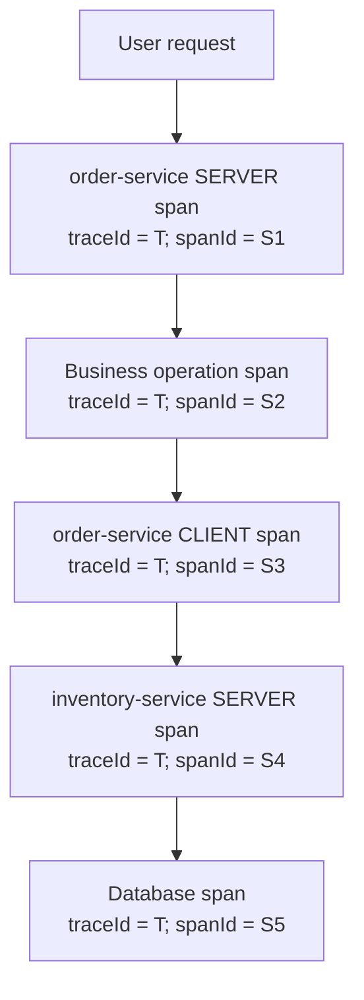
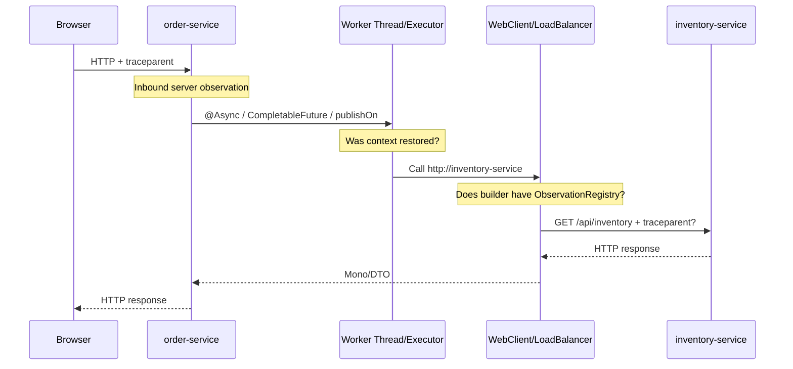

# Testing for Trace Loss Across Thread Switches and Reactive Pipelines

## 1. The Problem: HTTP Succeeds, Yet the Trace Breaks

In the **System Observability** chapter of the `SPRING_CLOUD_SERVICE_COMMUNICATION_LOAD_BALANCING` module, we observe calls from `order-service` to `inventory-service`. Spring Cloud LoadBalancer resolves a `ServiceInstance` by service ID, uses discovery/health/routing to choose a replica, and `RestClient`, `WebClient`, or OpenFeign executes the HTTP call. Beyond response times and errors, a well-operated system must identify **which caller request triggered which downstream request**, even across thread switches, retries, or reactive pipelines.

Suppose initial logs look like:

```text
2026-11-17 10:00:00.010 INFO [order-service,traceId=7e2...,spanId=91a...] accept order
2026-11-17 10:00:00.015 INFO [order-service,traceId=,spanId=] query inventory on parallel-2
2026-11-17 10:00:00.029 INFO [inventory-service,traceId=4b1...,spanId=8c3...] GET /api/inventory
```

From a business perspective, the call still succeeded. Yet `traceId` in the middle log line is blank, and downstream started a brand-new trace ID. Operations can no longer inspect a unified span tree spanning `user → order → inventory`.

There are several independent causes:

1. `MDC` holding `traceId` is a **ThreadLocal**, yet code switched threads without propagating context.
2. Reactor drives `Mono`/`Flux` via **subscriptions and Reactor Context**; trying to read context via `ThreadLocal` inside arbitrary operators without configuring context propagation is unreliable.
3. The HTTP client was built with a raw builder and **lacks observation instrumentation**, so it never attaches `traceparent` to outbound requests.
4. Code called `subscribe()` manually, spawning an independent reactive flow detached from the parent request's lifecycle and propagation.
5. Spans were created, yet never reached the backend due to **sampling, exporter, collector, or retention**—not a thread switch.

**Lesson goal:** distinguish different kinds of "lost traces", properly use `Micrometer Tracing`/`ObservationRegistry`/`Reactor Context`, preserve correlation across thread hops and service-ID calls, and verify with logs, headers, spans, and reproducible tests.

## 2. What Makes Up a Trace?

| Component | Meaning | Proper usage |
|---|---|---|
| **Trace ID** | Identifies a distributed execution flow | Related spans in the same trace normally share `traceId` |
| **Span ID** | Identifies a specific span | Changes across server spans, client spans, and custom spans; differing values are **not** a bug |
| **Parent span** | Parent of the current span | Builds the dependency tree; does not need to live in the same JVM |
| **Trace context** | Current span info, sampling flag, tracestate, and propagation | Must cross thread/reactive boundaries and HTTP boundaries |
| **MDC** | Key/value map bound to the **current thread** for log formatting | `traceId`/`spanId` in MDC are only **representations at log time**, not the sole source of truth |
| **Observation** | Micrometer measurement lifecycle: start, scope, stop, error | Can drive metrics and tracing via appropriate `ObservationHandler`s |
| **Reactor Context** | Immutable context bound to a **subscriber** in `Mono`/`Flux` | Carries contextual data through a reactive chain; not fixed to a single thread |
| **W3C traceparent** | Header propagating trace context across processes | Must be generated/parsed by tracer + propagation instrumentation, never taken from query params |

Example HTTP request with W3C propagation:

```http
GET /api/inventory/ABC-1 HTTP/1.1
Host: inventory-service
traceparent: 00-4bf92f3577b34da6a3ce929d0e0e4736-00f067aa0ba902b7-01
```

In `traceparent`, the trace ID is 32 hex chars, the parent/span ID is 16 hex chars, and `01` is an example flags byte. The header's presence **does not guarantee** the trace lands in Zipkin/Tempo/Jaeger; sampling and exporters can still drop or skip spans. Never treat `traceparent` as proof of user identity or permissions.

### 2.1. Different Span IDs Are Normal

Diagram of a healthy trace:



**`spanId` is not supposed to stay identical across two services or after adding custom observations.** What you verify is that the trace ID links properly, parent/child or link relationships make semantic sense, and downstream spans do not accidentally become unrelated root traces.

### 2.2. Four Diagnostic Questions

- **MDC is empty, yet the trace backend still builds the tree?** You may only have lost log correlation in one operator/thread.
- **MDC shows a trace ID, yet the backend shows two separate root traces?** You may have copied MDC manually while HTTP propagation is broken.
- **HTTP `traceparent` is valid, yet no spans appear?** Check sampling/exporter/collector before blaming Reactor Context.
- **Service spans exist, yet custom business spans are missing?** Check observation lifecycle, scopes, AOP, and whether the publisher was subscribed to.

## 3. Four Boundaries Where Context Is Easily Lost



| Boundary | Propagation mechanism | Symptom when broken |
|---|---|---|
| HTTP inbound into `order-service` | HTTP server observation/extractor reads trace headers | Caller starts a new root or lacks a server span |
| `order-service` → executor/`@Async` | Context Propagation snapshot, `TaskDecorator` | Logs on worker thread lose `traceId` |
| Reactor operator → operator | `Reactor Context` and bridge to ThreadLocal when needed | `MDC.get("traceId")` is empty in some operators |
| Caller → HTTP outbound | Instrumented `RestClient`/`WebClient`/Feign and propagator | Inventory starts a new trace due to missing/bad `traceparent` |
| Inventory inbound → business logic | Resource server/observation + app context | Server span exists, yet internal correlation is lost |

**Spring Cloud LoadBalancer is not a trace-context propagator.** It resolves logical URLs to the selected instance's `host:port`. Outbound tracing must be wired into the HTTP client and appropriate observation instrumentation. A single service ID may pick different instances on retries, yet attempts within one logical request should be correlated via trace and attempt metadata.

## 4. Enabling Tracing for a Verifiable Baseline

The following example uses **Spring Boot 3.5.x + a compatible Spring Cloud Release Train** (check APIs and properties against your running BOM). In Spring Boot 3.x, tracing runs via Spring Boot Actuator, a Micrometer Tracing bridge, and an exporter; do **not** mix Spring Cloud Sleuth 3.x dependencies/auto-config or Boot 4 properties without upgrading the stack.

### 4.1. Illustrative Maven Dependencies Using OpenTelemetry Bridge and Zipkin Exporter

```xml
<dependencies>
    <dependency>
        <groupId>org.springframework.boot</groupId>
        <artifactId>spring-boot-starter-actuator</artifactId>
    </dependency>

    <dependency>
        <groupId>io.micrometer</groupId>
        <artifactId>micrometer-tracing-bridge-otel</artifactId>
    </dependency>

    <dependency>
        <groupId>io.opentelemetry</groupId>
        <artifactId>opentelemetry-exporter-zipkin</artifactId>
    </dependency>

    <dependency>
        <groupId>io.micrometer</groupId>
        <artifactId>context-propagation</artifactId>
    </dependency>
</dependencies>
```

Let the Spring Boot BOM manage versions; add `spring-boot-starter-webflux` or `spring-boot-starter-web` and `spring-cloud-starter-loadbalancer` per your project. In Spring Boot 4.x, current documentation provides different starters (e.g., `spring-boot-starter-opentelemetry`/`spring-boot-starter-zipkin`); never copy Boot 3.x dependencies into Boot 4 without checking migration guides.

To inspect traces in the lab, run a collector/backend (such as Zipkin) or your system's collection endpoint. **The exporter must be running and reachable.** Having tracing libraries without an exporter/backend may still populate local MDC/correlation while showing zero traces in the UI.

### 4.2. Illustrative Configuration for a Test Environment

```yaml
spring:
  application:
    name: order-service
  reactor:
    context-propagation: auto

management:
  tracing:
    sampling:
      probability: 1.0
  zipkin:
    tracing:
      endpoint: http://localhost:9411/api/v2/spans
```

Explanation:

- `spring.application.name` distinguishes services in logs and the trace backend.
- `spring.reactor.context-propagation=auto` enables ThreadLocal restoration across reactive operators in Spring Boot 3.5 when Micrometer Context Propagation is present.
- `management.tracing.sampling.probability=1.0` samples 100% of traces for **lab diagnostics**, avoiding confusing sampling with propagation.
- `management.zipkin.tracing.endpoint` points to a compatible Zipkin collector—for instance, running on `localhost` in the same network namespace.

**Never keep 100% sampling as the default in high-traffic production** without evaluating cost/volume and sampling policy. Verify defaults and parent-based sampling behavior for your version and backend. If the backend uses OTLP/OpenTelemetry Collector, configure the matching exporter/endpoint instead of keeping a Zipkin URL.

In Spring Boot 3.x, log correlation typically relies on `traceId`/`spanId` in MDC when Micrometer Tracing is active. Never rely solely on `%X{traceId}` appearing in logs to conclude HTTP spans were exported.

### 4.3. Check Sampling Before Rewriting Context Code

| Symptom | Invalid conclusion | Check further |
|---|---|---|
| Some requests are missing from Zipkin | "Reactor dropped the context" | Sampling probability, parent flag, collector, exporter queue/batching |
| Zipkin has spans, logs lack trace ID | "There is no trace" | Correlation pattern and thread MDC scope at log time |
| Neither logs nor backend show spans | "LoadBalancer is definitely broken" | Are tracing bridge/exporter, instrumentation, app context, and HTTP server observation present? |
| Still missing spans after setting `probability=1.0` | "Sampling fixed everything" | Propagation, exporter connectivity, filter ordering, and async handoffs |
| Backend shows multiple root spans at once | "Span IDs must match" | Compare trace IDs/parent links and outbound `traceparent` |

## 5. Spring Cloud LoadBalancer and HTTP Clients Must Both Be Instrumented

### 5.1. Calling by Service ID

`SimpleDiscoveryClient` configuration for the lab:

```yaml
spring:
  cloud:
    discovery:
      client:
        simple:
          instances:
            inventory-service:
              - uri: http://localhost:8081
                instance-id: inventory-a
              - uri: http://localhost:8082
                instance-id: inventory-b
    loadbalancer:
      retry:
        enabled: false
      stats:
        micrometer:
          enabled: true
```

`localhost` applies only when running the lab on the same host/network namespace. In Docker/Kubernetes, use addresses reachable from the caller. **LoadBalancer metrics are not distributed tracing**: `MicrometerStatsLoadBalancerLifecycle` emits meters like `loadbalancer.requests.success`, `failed`, and `discard`, which do not replace HTTP client/server spans.

### 5.2. Trap of Hand-Rolling WebClient.Builder

The following configuration **can drop Boot customizers**, including observation setup, if you create a fresh builder without applying the required customizers:

```java
// Easily misses Spring Boot's tracing/observation customizations.
@Bean
@LoadBalanced
WebClient.Builder loadBalancedWebClientBuilder() {
    return WebClient.builder();
}
```

With Spring Boot, ensure the LoadBalancer builder **has both the LoadBalancer filter and Boot customizers applied**. An illustrative pattern for Spring Boot 3.x:

```java
import org.springframework.beans.factory.ObjectProvider;
import org.springframework.boot.web.reactive.function.client.WebClientCustomizer;
import org.springframework.cloud.client.loadbalancer.LoadBalanced;
import org.springframework.context.annotation.Bean;
import org.springframework.context.annotation.Configuration;
import org.springframework.web.reactive.function.client.WebClient;

@Configuration(proxyBeanMethods = false)
class InstrumentedWebClientConfiguration {

    @Bean
    @LoadBalanced
    WebClient.Builder loadBalancedWebClientBuilder(
            ObjectProvider<WebClientCustomizer> customizers) {

        WebClient.Builder builder = WebClient.builder();
        customizers.orderedStream()
                .forEach(customizer -> customizer.customize(builder));
        return builder;
    }
}
```

`WebClientCustomizer` here is the Spring Boot 3.x API. This pattern applies Boot-supplied customizers onto the new builder; crucially, the project must actually have an `ObservationRegistry` and valid tracing config, and Spring Cloud must register the reactive LoadBalancer filter on the `@LoadBalanced` builder.

Avoid applying a custom observation filter **a second time** onto an already-instrumented builder, as that can produce duplicate spans/metrics. On other Boot versions, verify auto-configuration/bean scoping and customizer ordering; this recipe is an example to test rather than a guarantee across every Release Train.

### 5.3. Gateway Using the Instrumented Builder

```java
@Service
class InventoryGateway {

    private final WebClient client;

    InventoryGateway(@LoadBalanced WebClient.Builder builder) {
        this.client = builder.clone()
                .baseUrl("http://inventory-service")
                .build();
    }

    Mono<InventoryStock> get(String sku) {
        return client.get()
                .uri("/api/inventory/{sku}", sku)
                .retrieve()
                .bodyToMono(InventoryStock.class);
    }
}

record InventoryStock(
        String sku, int available, String instanceId) {}
```

Imports for `@Service`, `Mono`, `WebClient`, and `@LoadBalanced` are omitted. A GET from `order-service` may select `inventory-a` or `inventory-b`. When HTTP client instrumentation is right, outbound `traceparent` carries the trace ID linked to the inbound request, and inventory's resource server creates a server span in the same trace per the supported propagation format.

**Do not assume tracing works merely because `@LoadBalanced` works.** Verify step by step: (1) URL resolves to an instance host, (2) HTTP request carries the trace propagation header, (3) inventory joins the same trace, (4) backend exports the spans.

### 5.4. RestClient and OpenFeign

For `RestClient` (blocking), Spring Boot likewise recommends building clients from the **auto-configured `RestClient.Builder`** or ensuring `RestClientCustomizer`/observation settings apply to the `@LoadBalanced` builder. Calling `RestClient.builder()` and setting only a base URL does not prove tracing is active.

For OpenFeign, Spring Cloud OpenFeign provides `MicrometerObservationCapability` when:

- `feign-micrometer` is on the classpath;
- an `ObservationRegistry` bean is present;
- `spring.cloud.openfeign.micrometer.enabled` and client-level properties do not disable instrumentation.

```yaml
spring:
  cloud:
    openfeign:
      micrometer:
        enabled: true
```

If `ObservationRegistry` is absent and only `MeterRegistry` exists, the integration may provide `MicrometerCapability` for **metrics only**; never treat that as guaranteeing tracing spans and HTTP propagation. Verify the Feign capability and client-level config for your version.

## 6. Why ThreadLocal/MDC Does Not Automatically Follow Thread Switches

In imperative code, logging frameworks typically use `MDC` bound to the **current thread**:

```java
log.info("before switch, traceId={}", MDC.get("traceId"));
```

If a task is submitted to a pool worker thread, that worker is a different thread. Without context propagation, `MDC.get("traceId")` may be `null`—or, if copied carelessly without cleanup, leftover from a previous request.

```mermaid
flowchart LR
  A["http-nio-8080-exec-1\nMDC traceId=T"] -->|submit()| B["app-worker-3\nMDC lacks T"]
  B --> C["Log missing traceId\nor tagged with wrong request"]
  A -->|capture + restore scope| D["decorated executor\nMDC traceId=T while task runs"]
```

This is a **context propagation** issue, not just a log-pattern setting. Adding `%X{traceId}` to the log format does not move `ThreadLocal` across executors.

### 6.1. Example: @Async Losing Trace When Executor Lacks Decoration

```java
@Service
class StockAuditService {

    @Async("stockExecutor")
    CompletableFuture<Void> audit(String sku) {
        log.info("audit sku={}, traceId={}",
                sku, MDC.get("traceId"));
        return CompletableFuture.completedFuture(null);
    }
}
```

If `stockExecutor` has no context propagation, `traceId` may be empty on the thread running `audit`. `@Async` must be enabled and invoked through a proper Spring proxy; self-invoking an `@Async` method within the same instance may not actually switch threads, invalidating the test.

### 6.2. Using ContextPropagatingTaskDecorator

In Spring Boot 3.5 / Spring Framework 6.x, configure a dedicated executor with `ContextPropagatingTaskDecorator`:

```java
@Configuration(proxyBeanMethods = false)
@EnableAsync
class StockExecutorConfiguration {

    @Bean(name = "stockExecutor")
    ThreadPoolTaskExecutor stockExecutor() {
        ThreadPoolTaskExecutor executor = new ThreadPoolTaskExecutor();
        executor.setThreadNamePrefix("stock-audit-");
        executor.setCorePoolSize(2);
        executor.setMaxPoolSize(4);
        executor.setQueueCapacity(100);
        executor.setTaskDecorator(
                new ContextPropagatingTaskDecorator());
        executor.initialize();
        return executor;
    }
}
```

`TaskDecorator` captures context from the **submitting** thread, transfers and restores it on the **executing** thread, and cleans up when the task finishes. This prevents leaking context from earlier requests across pooled threads.

If using Boot's auto-configured `AsyncTaskExecutor` instead of a custom executor, Spring Boot 3.5 docs also show registering a `ContextPropagatingTaskDecorator` bean so Boot applies it automatically. Spring Boot 4 adds properties like `spring.task.execution.propagate-context` depending on version. **Never copy a Boot 4 property expecting Boot 3.5 to honor it.**

### 6.3. Never Copy MDC Manually Without try/finally

Anti-pattern:

```java
Map<String, String> copy = MDC.getCopyOfContextMap();
executor.execute(() -> {
    MDC.setContextMap(copy);  // May be null; never cleaned up.
    doWork();
});
```

What is wrong with this:

- `copy` may be null depending on the logging implementation.
- The code fails to clean up `MDC` at task end; pooled worker threads can leak request A's correlation onto request B.
- Copying MDC alone **does not** transfer full `Observation`, `Tracer`, baggage, or security context.
- Seeing `traceId` in logs does not prove the outbound HTTP client sent that `traceId`.

Use `ContextPropagatingTaskDecorator`/`ContextSnapshot` rather than rolling a custom MDC mechanism unless thoroughly justified and tested.

## 7. CompletableFuture and Self-Managed ExecutorService

When using `CompletableFuture.supplyAsync(...)`, `ExecutorService.submit(...)`, or an SDK spawning internal tasks, Spring's `TaskDecorator` **does not apply automatically** if tasks run on an independent executor.

Typical failure example:

```java
CompletableFuture.runAsync(() -> {
    log.info("trace in common pool={}", MDC.get("traceId"));
});
```

The common `ForkJoinPool` is not automatically equipped with Spring Boot's `ContextPropagatingTaskDecorator`. To propagate context onto a specific `Executor`, capture it at **task submission time** with Micrometer Context Propagation:

```java
ContextSnapshot snapshot = ContextSnapshot.captureAll();

executor.execute(snapshot.wrap(() -> {
    log.info("inside propagated task, traceId={}",
            MDC.get("traceId"));
    runAudit();
}));
```

Here `executor` is an `Executor` with managed lifecycle, and `runAudit()` is an illustrative business method. `ContextSnapshot.wrap(Runnable)` opens and closes the scope restoring all `ThreadLocal`s registered via `ContextRegistry`.

**Prerequisites:** `io.micrometer:context-propagation` and appropriate `ThreadLocalAccessor`s for observation/tracing context must be present. The snapshot captures only values present on the calling thread **at that exact instant**. Capturing after the current observation ended or on a context-less thread cannot "resurrect the old trace".

### 7.1. Capturing Is Not Creating a Span

Context propagation **preserves the parent/current context** while the task runs. It does not automatically give each task a brand-new child span. If you want a meaningful child span for an operation, instrument that operation deliberately with Micrometer Observation/Tracer at the right lifecycle boundary instead of assuming a thread hop creates a span.

### 7.2. Persisted Tasks Running Later Need Different Boundaries

A task stored for hours, queued, or scheduled for the next day **should not** keep the original HTTP request's live tracing scope/credentials open indefinitely. For durable async work, pass a **correlation/causation ID** in the event payload and optionally use an OpenTelemetry **span link** back to the origin trace—never hold `ThreadLocal`s or spans open indefinitely.

## 8. Reactor Context: Bound to Subscription, Not Thread

Spring WebFlux uses `Mono`/`Flux`, where execution can hop across schedulers via `publishOn`, `subscribeOn`, `flatMap`, or asynchronous I/O.

```java
Mono<InventoryStock> pipeline = gateway.get("ABC-1")
        .publishOn(Schedulers.boundedElastic())
        .doOnNext(stock ->
                log.info("sku={}, thread={}, traceId={}",
                        stock.sku(),
                        Thread.currentThread().getName(),
                        MDC.get("traceId")));
```

Without context propagation, `MDC.get("traceId")` in `doOnNext` can be null. Never use `Thread.currentThread().getName()` as evidence of which span is parent; threads are scheduling resources and **do not** carry trace identity.

### 8.1. Context Travels with the Subscriber

Reactor `Context` is an API-immutable map attached to a subscriber. Values written with `contextWrite` affect **upstream** operators, without implying the entire JVM can read them via `ThreadLocal`.

```java
Mono<String> readDiagnosticContext() {
    return Mono.deferContextual(ctx -> {
        String diagnosticId = ctx.getOrDefault(
                "diagnostic-id", "missing");
        return Mono.just(diagnosticId);
    });
}

Mono<String> result = readDiagnosticContext()
        .publishOn(Schedulers.parallel())
        .contextWrite(Context.of(
                "diagnostic-id", "request-123"));
```

When subscribed, `readDiagnosticContext` reads `diagnostic-id=request-123` even across scheduler switches. This is merely an **illustrative business key** in Reactor Context, **not** automatic W3C trace context creation. Never put raw access tokens, PII, or passwords into Reactor Context just for trace debugging.

### 8.2. ThreadLocal, Reactor Context, and Observation

| Data source | Bound to | When readable | Common mistake |
|---|---|---|---|
| `MDC.get("traceId")` | Current thread | When tracer/bridge restored MDC in scope | Thinking MDC exists in every operator |
| `Tracer.currentSpan()` | Current tracing scope | When observation/tracing context is restored | Thinking null proves no request exists |
| `ContextView#get(...)` | Subscriber | Inside `deferContextual`/Context-aware operators | Thinking it flows into unbridged `CompletableFuture`s |
| `ObservationRegistry.getCurrentObservation()` | Current Observation scope | While scope is created/restored | Spawning a new thread without transferring scope |
| W3C `traceparent` | HTTP/message transport | When propagator injects/extracts | Treating the header as user authentication proof |

Spring Boot + Micrometer Context Propagation acts as the **bridge** between these mechanisms. Reactor Context serves as the subscriber's source of truth; when automatic mode is enabled, registered `ThreadLocal`s can be restored while operators run across different threads.

## 9. Context Propagation Modes in Reactor

Reactor Core 3.5+ integrates with the Micrometer Context Propagation SPI. Two modes matter:

- **Default/limited mode:** only select operators restore registered `ThreadLocal`s; `MDC` is not promised inside every callback.
- **Automatic mode:** restores `ThreadLocal`s across operator boundaries from Reactor Context when `context-propagation` and matching `ThreadLocalAccessor`s are present.

In Spring Boot 3.x, the documented configuration is:

```yaml
spring:
  reactor:
    context-propagation: auto
```

In plain Reactor code or environments without Boot auto-config, the API is:

```java
Hooks.enableAutomaticContextPropagation();
```

**Pick one primary management approach**, rather than toggling global hooks mid-flight. Per Reactor docs, the hook primarily affects **new subscriptions**; enable it at application startup before traffic arrives, never on every HTTP request.

### 9.1. contextCapture() When Crossing from Imperative to Reactive

If a `ThreadLocal` holds context at **subscription time**, `contextCapture()` can transfer registered values into Reactor Context in certain scenarios. Conceptual example:

```java
Mono<String> pipeline = Mono.deferContextual(ctx ->
        Mono.just(ctx.hasKey("diagnostic-id")
                ? ctx.get("diagnostic-id")
                : "missing"))
        .contextCapture();
```

This example only works when a `ThreadLocalAccessor` is registered for `diagnostic-id` and the subscribing thread already holds a value; the chain itself **neither registers accessors nor invents context values**. In Spring Boot apps with automatic mode and instrumented inbound HTTP tracing, capture/restoration is already handled in many cases; do not sprinkle `contextCapture()` randomly as a "universal cure for lost traces".

### 9.2. publishOn vs. subscribeOn

| Operator | Scheduling effect | Tracing implication |
|---|---|---|
| `publishOn(scheduler)` | Moves execution of **downstream** operators to the scheduler | MDC remains available downstream only if context is restored |
| `subscribeOn(scheduler)` | Affects where subscription and upstream source execute | Current scope at subscribe/capture time matters |
| `flatMap(inner)` | Merges publishers running asynchronously and interleaved | Each inner subscription must preserve context; never use shared mutable MDC |
| `parallel().runOn(scheduler)` | Splits into concurrent rails | Trace is not pinned to one thread; test every rail |
| `delayElement`/`Mono.delay` | Signals arrive on a different scheduler | If logs lose context, check hooks and placement |
| `retryWhen` | Re-subscribes publisher on eligible errors | Attempt traces must be observed without assuming identical span IDs |

`contextWrite` and composition must be verified by actual subscription order, not just top-to-bottom reading order. In pipelines with multiple subscriptions, adding `cache()`/`share()` can change HTTP request and span counts; do not blame every trace count change on LoadBalancer.

## 10. Trap of Manual subscribe() Detaching the Lifecycle

Anti-pattern in a WebFlux controller:

```java
@GetMapping("/bad/{sku}")
Mono<String> bad(@PathVariable String sku) {
    gateway.get(sku)
            .publishOn(Schedulers.boundedElastic())
            .subscribe(stock ->
                    log.info("detached inventory={}", stock.sku()));
    return Mono.just("accepted");
}
```

Problems:

- `subscribe()` fires an independent subscription inside the controller, detached from the HTTP response publisher's lifecycle.
- The client can receive `accepted` before the inventory call completes or fails.
- Error callbacks are unmanaged, and inbound request cancellation does not cancel the outbound call.
- Context may be captured from the wrong scope timing, breaking parent/root span links.
- No backpressure or timeout is coordinated with the logical request.

Better approach when the HTTP API must **await inventory**:

```java
@GetMapping("/good/{sku}")
Mono<String> good(@PathVariable String sku) {
    return gateway.get(sku)
            .map(stock -> "available=" + stock.available())
            .doOnNext(answer ->
                    log.info("answer assembled: {}", answer));
}
```

The WebFlux runtime subscribes to the publisher returned by the controller. The server request observation and operators properly share context, and the instrumented outbound `WebClient` injects trace headers. Never call `block()` on a WebFlux event loop to "preserve traces": blocking starves throughput and can trigger runtime exceptions.

**Intentional exception:** true fire-and-forget requires a dedicated async design with a message broker/job queue, error handling, correlation context, and clear ownership—never an orphaned `subscribe()` inside a controller.

## 11. Instrumenting Business Operations Without Wrong Observation Lifecycles

Relying solely on HTTP server/client spans can hide time spent inside domain logic. Micrometer `ObservationRegistry` lets you create stably named observations.

### 11.1. Imperative Code

```java
@Service
class InventoryDecisionService {

    private final ObservationRegistry registry;

    InventoryDecisionService(ObservationRegistry registry) {
        this.registry = registry;
    }

    boolean decide(InventoryStock stock) {
        return Observation.createNotStarted(
                        "inventory.business.decision", registry)
                .lowCardinalityKeyValue(
                        "operation", "availability-check")
                .observe(() -> stock.available() > 0);
    }
}
```

`Observation#observe(...)` manages start/scope/stop automatically in imperative flows. With matching tracing handlers/bridges, it creates child spans; with metrics handlers, it emits metrics. Never put SKUs, user IDs, or raw URLs into **low-cardinality metric tags**, as cardinality explodes and data can leak.

### 11.2. Reactive Must Bind Lifecycle to Subscription

Wrong lifecycle:

```java
// WRONG: observation can finish before the HTTP publisher completes.
Mono<InventoryStock> read(String sku) {
    return Observation.createNotStarted(
            "inventory.read", registry)
            .observe(() -> gateway.get(sku));
}
```

`observe(() -> gateway.get(sku))` here only measures **how long constructing the Mono took**, not HTTP execution upon subscription. To measure actual publisher execution, use reactive instrumentation supporting Reactor observations, such as `reactor-core-micrometer` and `tap(Micrometer.observation(registry))` for your Reactor version/BOM:

```java
Mono<InventoryStock> readObserved(String sku) {
    return gateway.get(sku)
            .name("inventory.read")
            .tap(Micrometer.observation(registry));
}
```

This requires `reactor-core-micrometer` and the corresponding `reactor.core.observability.micrometer.Micrometer` import. Overloads/capabilities vary by Reactor version; verify observation handlers, especially alongside automatic HTTP client spans, to avoid emitting redundant spans. Never create an extra span merely to log a line.

### 11.3. Scope and Cleanup Are Mandatory

If opening an observation scope manually in blocking code, always close it with try-with-resources and stop the observation exactly once, even when exceptions occur:

```java
Observation observation =
        Observation.start("inventory.validation", registry);
try (Observation.Scope scope = observation.openScope()) {
    validateInventory();
}
catch (RuntimeException ex) {
    observation.error(ex);
    throw ex;
}
finally {
    observation.stop();
}
```

`validateInventory()` is illustrative logic. Never open a scope inside a reactive callback and leave it open across asynchronous emissions without proper lifecycle management; it could close on a different thread or leak `ThreadLocal` when the thread is reused.

## 12. HTTP Propagation Across RestClient, WebClient, and OpenFeign

### 12.1. Responsibility Table

| Client | Required configuration | Healthy outbound sign | Trap |
|---|---|---|---|
| `RestClient` | Builder from Boot auto-config or full customizers; `@LoadBalanced` for service IDs | `traceparent`/B3 per propagator config on request | Creating `RestClient.create(...)` and dropping observation |
| `WebClient` | Instrumented builder + reactive LoadBalancer + context propagation | W3C `traceparent` appears when HTTP exchange is subscribed | `WebClient.create(...)` or custom filter wiping tracing |
| `RestTemplate` | `RestTemplateBuilder`/auto-instrumentation per Boot version + `@LoadBalanced` | Trace headers on downstream call | `new RestTemplate()` missing `ObservationInterceptor` |
| OpenFeign | `feign-micrometer` + `ObservationRegistry` + `MicrometerObservationCapability` | Client observation/span and trace propagation | Enabling metrics-only `MicrometerCapability` instead |
| Custom HTTP client | Dedicated instrumentation/propagator | Valid trace headers on the wire | Copying MDC alone is insufficient |

Path when calling by service ID:

```text
order-service SERVER observation
  -> current trace context / Reactor Context
  -> instrumented WebClient/RestClient/Feign
  -> Spring Cloud LoadBalancer resolves inventory-service
  -> HTTP CLIENT observation + inject traceparent
  -> inventory-service HTTP SERVER observation extracts traceparent
  -> business operation spans
```

The client span does not have to be a direct child of the server span if custom business spans or intermediate filters exist. **Matching trace ID and valid parent/link relationships** are the real goal.

### 12.2. Do Not Manually Propagate traceId via X-Trace-Id

You may use `X-Request-Id`/`X-Correlation-Id` for operational correlation, but manually setting:

```java
headers.set("X-Trace-Id", MDC.get("traceId"));
```

**does not replace** W3C propagation. A bare trace ID string lacks parent span ID, sampling state, tracestate, and baggage; downstream cannot reconstruct a proper span tree from an ad-hoc header. Let the tracer and instrumented HTTP client inject/extract `traceparent` (or B3 if standardized across your system).

### 12.3. Mixing B3 and W3C

Two services may use different propagation formats (W3C `traceparent`, `b3`, or `X-B3-*`). If downstream only reads B3 while the caller only emits W3C, downstream starts a brand-new root trace even though the W3C header arrived. Align **consume/produce propagation types** in Boot/tracer settings and during migrations.

Never blindly enable every format without checking side effects: it can cause header conflicts, duplication, network overhead, or trust-policy issues. Test exact injected headers, extracted context, and backend span IDs.

## 13. Traces Vanishing After Retries or Schedulers: Diagnose by Attempt

Spring Cloud LoadBalancer may pick a new instance on retry, while a single **logical request** spans multiple HTTP attempts. When tracing:

- Record a stable **logical correlation ID** for the request.
- Each HTTP attempt may have its **own client span**; distinct span IDs are valid.
- On retry, `traceId` should remain tied to the logical request if the retry executes within its context.
- If a retry runs in an independent scheduled task, queue, or unbridged callback, it can appear as a separate root trace; propagate context per policy.
- When LoadBalancer finds no instance, **no real HTTP client/server exchange occurs**. Do not expect an inventory server span for an attempt discarded before HTTP.

### 13.1. LoadBalancer Metrics Are Not Trace Spans

Spring Cloud Commons includes `MicrometerStatsLoadBalancerLifecycle`, enabled with:

```yaml
spring:
  cloud:
    loadbalancer:
      stats:
        micrometer:
          enabled: true
```

Documented meters include:

| Meter | Description |
|---|---|
| `loadbalancer.requests.active` | Requests currently active in LoadBalancer at observation time |
| `loadbalancer.requests.success` | Duration of requests counted as successful per lifecycle semantics |
| `loadbalancer.requests.failed` | Duration of requests ending with an exception per lifecycle |
| `loadbalancer.requests.discard` | Requests discarded because no instance could be selected |

Exact names/tags depend on version and instrumentation; `failed` does not always equal server HTTP 5xx, nor does it guarantee trace spans exist in the backend. For URIs containing SKUs or order IDs, avoid high-cardinality path labels; where needed, set `spring.cloud.loadbalancer.stats.include-path=false` as supported by Spring Cloud Commons.

### 13.2. Retries Can Be Double-Observed

If retries are enabled simultaneously in Spring Cloud LoadBalancer, Reactor `retryWhen`, OpenFeign `Retryer`, and a gateway, each layer can emit attempts. When an HTTP call retries, you may see multiple client spans in the same trace—or even separate traces if async context wasn't transferred. Use attempt counts, service IDs, and instance IDs in traces/logs to distinguish legitimate retries from accidental duplicate subscriptions.

**Never "fix missing traces" by turning off retries or pinning to a single instance.** Fix context propagation across asynchronous boundaries and HTTP client instrumentation instead.

## 14. Reproducible Lab: Two Instances and Thread-Switch Points

### 14.1. Topology

| Component | Example port | Role |
|---|---:|---|
| `order-service` | 8080 | HTTP inbound + WebClient + LoadBalancer |
| `inventory-a` | 8081 | Instrumented HTTP server |
| `inventory-b` | 8082 | Instrumented HTTP server |
| Zipkin/collector | 9411 | Collects and displays spans in the lab |

Configure `SimpleDiscoveryClient` in `order-service` as in section 5.1; all three services share compatible tracing bridges/exporters. Use sampling `1.0` **only in the lab**. If running inside containers, update hostnames/ports for registry, collector, and service instances to match real network routing.

Demo endpoint on inventory:

```java
@RestController
class InventoryController {

    private final String instanceId;

    InventoryController(Environment env) {
        instanceId = env.getRequiredProperty("app.instance-id");
    }

    @GetMapping("/api/inventory/{sku}")
    InventoryStock get(@PathVariable String sku) {
        log.info("inventory instance={} sku={}", instanceId, sku);
        return new InventoryStock(sku, 12, instanceId);
    }
}
```

Run A with `app.instance-id=inventory-a`, and B with `inventory-b`. Both must share the same propagation format and backend exporter; otherwise traces can diverge by instance. Log `instanceId` on the server to separate context issues from instance-selection issues.

### 14.2. Three-Scenario Controller

Example using `InventoryGateway` from section 5.3:

```java
@RestController
@RequestMapping("/demo/trace")
class TraceDemoController {

    private final InventoryGateway gateway;

    TraceDemoController(InventoryGateway gateway) {
        this.gateway = gateway;
    }

    @GetMapping("/baseline/{sku}")
    Mono<InventoryStock> baseline(@PathVariable String sku) {
        log.info("baseline controller");
        return gateway.get(sku)
                .doOnNext(stock ->
                        log.info("baseline done {}", stock.instanceId()));
    }

    @GetMapping("/switch/{sku}")
    Mono<InventoryStock> switchThread(@PathVariable String sku) {
        return gateway.get(sku)
                .publishOn(Schedulers.boundedElastic())
                .doOnNext(stock ->
                        log.info("switch done thread={}, instance={}",
                                Thread.currentThread().getName(),
                                stock.instanceId()));
    }

    @GetMapping("/many/{sku}")
    Flux<InventoryStock> many(@PathVariable String sku) {
        return Flux.range(1, 3)
                .flatMap(i -> gateway.get(sku), 3);
    }
}
```

- `baseline`: one HTTP request from order to inventory; trace IDs across both services must link when tracing works.
- `switch`: still one HTTP request, with `publishOn` before logging; inspect `traceId`/MDC in logs after the thread switch.
- `many`: three separate outbound GETs. Different instances may be chosen and multiple client spans emitted; do not expect a single span for three attempts. Bound concurrency and verify actual request counts.

Test with:

```bash
curl -i http://localhost:8080/demo/trace/baseline/ABC-1
curl -i http://localhost:8080/demo/trace/switch/ABC-1
curl -i http://localhost:8080/demo/trace/many/ABC-1
```

Never use `Thread.sleep` on a WebFlux event loop to "keep the trace alive"; to simulate latency, use `Mono.delay`/`delayElement` and observe scheduler/context behavior.

### 14.3. Testing Automatic Context Propagation Off vs. On

Run two passes (restart between runs so hooks apply to **new subscriptions**):

**Pass A — default/limited mode**:

```yaml
spring:
  reactor:
    context-propagation: limited
```

**Pass B — automatic mode**:

```yaml
spring:
  reactor:
    context-propagation: auto
```

Verify supported property/values for your **exact Spring Boot version**; for example, Boot 3.5 documents `auto` to enable automatic mode. Do not rely solely on MDC logs: compare the full trace tree, outbound `traceparent`, and exported trace counts. Some steps may still retain context under limited mode via framework-instrumented operators; measure rather than assuming every log line goes blank.

### 14.4. Testing @Async With and Without TaskDecorator

First configure the executor **without** `ContextPropagatingTaskDecorator`, invoke `@Async("stockExecutor")` from an HTTP request, and log `MDC.get("traceId")` before and inside the worker. Then add the `TaskDecorator` and repeat. Verify:

- The method is called through a real Spring proxy, not self-invocation.
- The executor uses the exact bean name and does not fall back to a common pool.
- The task is submitted while the inbound observation is still active.
- Never conclude from a single request; send concurrent requests to catch MDC leaking across requests.

### 14.5. Testing an Uninstrumented Builder

Temporarily swapping `WebClient` for `WebClient.create("http://inventory-service")` can send the service ID through DNS and fail **before tracing can be measured**. To isolate tracing specifically, temporarily use a physical URL `http://localhost:8081` (lab only) with a hand-created `WebClient`: HTTP succeeds, yet observation/propagation disappears.

Then switch back to the Boot-customized, LoadBalancer-enabled `WebClient` builder. Compare request headers and span trees; never blame `UnknownHostException` on context loss.

## 15. Test Matrix and What Must Be Proven

| ID | Scenario | What to verify |
|---|---|---|
| T01 | Baseline single GET via LoadBalancer | Linked server/client spans with shared trace ID per sampling policy |
| T02 | `publishOn(boundedElastic)` | Post-switch log contains trace ID when auto propagation is enabled |
| T03 | `subscribeOn(parallel)` | Context at subscribe/capture time is valid; no unintended root |
| T04 | `flatMap` three HTTP GETs | Three HTTP attempts; client spans may have distinct span IDs linked to the trace |
| T05 | `@Async` without TaskDecorator | Worker may lose MDC/current observation |
| T06 | `@Async` with TaskDecorator | Correlation restored and cleaned up; no cross-request leakage |
| T07 | `CompletableFuture.runAsync` common pool | Proves Spring's TaskDecorator does not apply to unrelated executors |
| T08 | `ContextSnapshot.wrap(Runnable)` | Restores context captured at submission time |
| T09 | Uninstrumented HTTP client | HTTP works while trace propagation/spans are missing |
| T10 | OpenFeign with/without `MicrometerObservationCapability` | Distinguishes tracing observation from metrics-only |
| T11 | Sampling `0.0` vs `1.0` | Exported trace counts differ even though the app runs fine |
| T12 | Tracing exporter wrong endpoint | Local logs show correlation while collector receives zero spans |
| T13 | No instance in discovery | LoadBalancer discards; no inventory server span expected |
| T14 | HTTP 503 then retry to another replica | Distinct span IDs while logical request keeps clear trace/attempt links |
| T15 | Two concurrent inbound requests | Request A's trace ID never leaks into request B's logs |
| T16 | Stopping inventory instance mid-traffic | Distinguishes transport exception from context loss and no-instance |
| T17 | Detached `subscribe()` | Observes broken span lifecycle / missing errors; fixed by returning publisher |
| T18 | Producer/consumer mismatch on W3C/B3 | Downstream starts a new trace when unable to extract caller's format |

**PASS criteria:** reproducible measurements, valid trace trees and parent relationships when expected, zero cross-request context leaks, and clear separation of sampling/export failures from propagation failures. A log line "showing a traceId" is not enough to prove end-to-end distributed tracing.

### 15.1. What Can Be Automated?

- **Unit tests:** test `ContextSnapshot` and `TaskDecorator` using two tasks with distinct correlations; assert cleanup after each task scope.
- **Spring Boot integration tests:** start instrumented HTTP server and client; use an in-memory test tracer/collector or test exporter suited to your stack, independent of production Zipkin.
- **End-to-end tests:** run two inventory replicas, LoadBalancer client, and tracing backend; verify `traceparent`, shared trace IDs, and parent-child spans.
- **Load/concurrency tests:** fire concurrent requests to catch MDC leaks, context loss under full queues, or retry edge cases.

Never mark a test "PASS" merely because an `ObservationRegistry` bean exists; verify the right `ObservationHandler`/tracer/exporter is active and data actually arrives.

## 16. Investigation Playbook When Traces Break

Follow this sequence to avoid fixing the wrong root cause.

### Step 1 — Isolate Where It Was "Lost"

1. Does the inbound `order-service` log show `traceId`?
2. Do logs in operators after `publishOn`/`@Async` show the same trace ID?
3. Does the outbound HTTP request carry `traceparent` or the expected header format?
4. Does inventory inbound extract context and link the trace?
5. Does the backend store/display the spans? What happens at `1.0` sampling in the lab?

Do not touch application code first if the UI simply lacks spans because the network exporter lost connectivity.

### Step 2 — Check Dependencies and Builders

- Are `spring-boot-starter-actuator` and a valid tracing bridge/exporter present?
- Is `context-propagation` on the classpath with `ThreadLocalAccessor`s registered?
- Are `WebClient`/`RestClient` created from Boot-customized builders?
- Does OpenFeign use `MicrometerObservationCapability` or only `MeterRegistry`?
- Is `@LoadBalanced` properly integrated without a custom filter stripping observation?

### Step 3 — Check Thread-Switch Boundaries

- Are there `@Async`, custom `ThreadPoolTaskExecutor`, `CompletableFuture`, `parallelStream`, or async SDKs?
- Was `TaskDecorator`/snapshot captured **before** hopping threads or at the wrong time?
- Is `spring.reactor.context-propagation=auto` enabled in Reactor for your Boot version?
- Does any code read `MDC`/`SecurityContextHolder` directly inside operators without context restoration?
- Is there a misplaced `subscribe()` or `block()` breaking the expected lifecycle?

### Step 4 — Check Wire Propagation and Sampling

- Caller produces W3C `traceparent`—does downstream support that format?
- Does any gateway/proxy strip or overwrite `traceparent`/`tracestate`?
- Are parent sampling flags, `management.tracing.sampling.probability`, and exporter sampling aligned?
- Does the OTLP/Zipkin exporter suffer queue drops, network errors, auth failures, or retention expiry?
- Are sensitive values kept out of baggage and log tags?

### Step 5 — Check Which Instance LoadBalancer Actually Picked

- Is the service ID correct? Are `ServiceInstance`s present?
- Did health/cache/discovery route to an uninstrumented replica?
- Did the server return 503, or did the caller have no instance?
- Did retries switch instances, emit extra client spans, or start detached subscriptions?
- Did you check `loadbalancer.requests.discard`/HTTP client metrics and cross-check traces/logs by instance ID?

### Step 6 — Fix Scoped Root Causes, Re-Measure, and Keep Rollback Safe

- Enable auto context propagation only after understanding performance/compatibility impacts and load testing.
- Equip required executors with `TaskDecorator`; never replace proper propagation with ad-hoc MDC copies.
- Restore Boot customizers/`ObservationRegistry` on `@LoadBalanced` HTTP clients.
- Align propagation formats between producers and consumers.
- Re-run T01–T18 and compare missing-context metrics, spans per request, and trace completion rates.
- Verify cancellation handling, retry errors, leaks, and latency overhead after the change.

## 17. Anti-Patterns and Correct Solutions

| Anti-pattern | Why it fails | Right approach |
|---|---|---|
| `MDC.put("traceId", id)` in every operator | Changes log text only; leaks easily, creates no parent span | Let tracing bridge/context propagation manage scopes |
| Copying `traceId` via `X-Trace-Id` without W3C | Lacks parent, sampling, and tracestate | Use instrumented HTTP clients with `traceparent` |
| Pinning one fixed `spanId` across steps | Distinct spans must have distinct IDs | Check shared trace ID and proper parent/child/link |
| Treating thread name as trace context | One thread serves many requests over time | Use Reactor Context and `TaskDecorator` |
| Using `WebClient.create` on a service ID expecting LB + tracing | Lacks LB filter and Boot observation | Use a fully customized `@LoadBalanced` builder |
| Turning off sampling to fix "lost traces" | Sampling controls export, not propagation | Separate sampling from context loss |
| Leaving 100% sampling on indefinitely | Raises backend cost and load | Use controlled lab/debug sampling; set SLO-appropriate rates |
| Calling `subscribe()` manually inside controllers | Detaches lifecycle, error/cancel, and context | Return `Mono`/`Flux` to WebFlux |
| Calling `block()` to preserve traces | Blocks event loops and fails to restore cleanly | Use reactive pipelines + auto propagation |
| Wrapping `Mono` assembly in an observation | Times publisher construction, not HTTP | Instrument operators at subscription/lifecycle |
| Keeping an observation scope open across threads | Leaks `ThreadLocal`, breaks parent spans | Scope properly and close in `finally` |
| Copying only MDC into `CompletableFuture` | Drops full observation/tracing context | Use `ContextSnapshot`/decorated executors |
| Skipping cleanup on worker threads | Request A bleeds trace ID into request B | Use snapshot scopes/`TaskDecorator` |
| Expecting inventory spans on no-instance | No HTTP request was ever sent | Monitor LB discard and trace caller failures |
| Collapsing all retry attempts into one event | Hides which requests actually hit the wire | Record per-attempt spans/attributes and logical correlation |
| Using SKU/user ID as metric tags | High cardinality and data leakage | Tag operation/route template; keep details in secured traces |
| Treating `traceparent` as a security token | Tracing headers are not authentication | Use JWT/mTLS and proper authorization |

## 18. Practice Exercises

### Exercise 1 — Pinpoint Where It Was Lost

Logs show an inbound trace ID, the operator after `publishOn` lacks a trace ID, yet inventory has a linked span in the same trace. Did you lose **MDC in the operator** or HTTP propagation? Prove it using the trace tree and outbound headers rather than a single log line.

### Exercise 2 — Compare Two Builders

Create one `WebClient` with `WebClient.create("http://localhost:8081")` and another with a Boot-customized builder. Keep the same physical URL to isolate discovery variables. Measure differences in `traceparent` and client spans; then enable `@LoadBalanced` and switch back to base URL `http://inventory-service`.

### Exercise 3 — @Async and Executors

Call `StockAuditService.audit` through a proxy from an HTTP request. Test executors without and with `ContextPropagatingTaskDecorator`. Send 50 concurrent requests and verify each task carries the right trace ID with zero cross-request leakage.

### Exercise 4 — Reactor Context and MDC

Build `Flux.range(1,10).publishOn(Schedulers.parallel()).flatMap(...)`. Toggle `spring.reactor.context-propagation=auto` and compare `MDC.get("traceId")`, `deferContextual(...)`, and the trace backend. Explain why Reactor Context and `ThreadLocal` do not stay in sync automatically.

### Exercise 5 — Sampling vs. Propagation

Keep the exact same code and instrumented HTTP client, testing sampling `0.0` then `1.0` in the lab. Inspect `traceparent`, log correlation, and exported span counts. Never claim "context lost" solely from the sampler's UI view.

### Exercise 6 — Retries Switching Instances

Use two inventory replicas. Make A return 503, and retry GET once to re-select. Record attempts, instance IDs, client span IDs, and trace ID. Explain why client span counts can exceed logical requests and why different span IDs are expected.

### Exercise 7 — Multiple HTTP Calls in One Flux

Compare `bodyToFlux` on a single JSON array against `Flux.fromIterable(skus).flatMap(gateway::get)`. Count HTTP attempts, LoadBalancer selections, and spans; explain why multiple items do **not** always mean multiple HTTP exchanges.

### Exercise 8 — Non-Spring CompletableFuture

Launch a task via `CompletableFuture.runAsync` on the common pool; compare against an executor task wrapped with `ContextSnapshot.wrap(Runnable)`. Record thread names, trace IDs, capture timing, and verify cleanup.

### Exercise 9 — W3C/B3 Migration

Assume the caller only emits W3C `traceparent` and downstream only parses B3. Reproduce downstream starting a new trace, configure compatible consume/produce propagators for your stack, and verify two root traces are no longer generated.

### Exercise 10 — Isolating Exporter Failures

Run Zipkin in the lab, then stop it while applications remain up. Observe that local logs and HTTP headers continue carrying trace context while spans stop being stored. Fix the exporter path and verify recovery/queuing—never rewrite Reactor Context merely because the UI has no data.

### Completion Checklist

- [ ] Understand differences among trace ID, span ID, MDC, Observation, and Reactor Context.
- [ ] Can inspect a full trace tree without expecting identical span IDs.
- [ ] Verify tracing bridge/exporter and sampling before concluding context loss.
- [ ] Use properly instrumented HTTP clients with `@LoadBalanced`.
- [ ] Configure `ContextPropagatingTaskDecorator` on custom executors/`@Async`.
- [ ] Do not assume `TaskDecorator` automatically applies to the common pool or standalone SDK executors.
- [ ] Capture `ContextSnapshot` at the right moment for custom thread handoffs.
- [ ] Understand `publishOn`, `subscribeOn`, `flatMap`, and `contextWrite`.
- [ ] Have a tested auto-propagation setup enabled prior to subscriptions.
- [ ] Avoid detached `subscribe()` calls inside WebFlux controllers.
- [ ] Avoid wrapping reactive work in an observation that closes at publisher assembly time.
- [ ] Have tests verifying HTTP `traceparent`/parent relationships across order and inventory.
- [ ] Cover retries, no-instance, 503, concurrency, and sampling/exporter in test matrices.
- [ ] Keep tokens/PII out of baggage, traces, and metric labels.
- [ ] Maintain a runbook distinguishing lost MDC, lost HTTP propagation, and exporter drops.

## Official References

- [Spring Boot 3.5 — Observability: Context Propagation](https://docs.spring.io/spring-boot/3.5/reference/actuator/observability.html): `spring.reactor.context-propagation=auto`, `ContextPropagatingTaskDecorator`, and thread boundaries.
- [Spring Boot 3.5 — Tracing](https://docs.spring.io/spring-boot/3.5/reference/actuator/tracing.html): Micrometer Tracing, bridges/exporters, sampling, correlation IDs, and using auto-configured HTTP builders.
- [Current Spring Boot — Tracing](https://docs.spring.io/spring-boot/reference/actuator/tracing.html): comparing Boot 4.x changes, starters, and exporter configuration.
- [Project Reactor — Context-Propagation Support](https://projectreactor.io/docs/core/release/reference/advanced-contextPropagation.html): `Hooks.enableAutomaticContextPropagation()`, limited/automatic modes, `contextCapture()`, and ThreadLocal restoration.
- [Project Reactor — Adding a Context to a Reactive Sequence](https://projectreactor.io/docs/core/release/reference/advancedFeatures/context.html): `Context`, `ContextView`, `contextWrite`, and subscriber semantics.
- [Micrometer Context Propagation — Purpose](https://docs.micrometer.io/context-propagation/reference/purpose.html): `ContextSnapshot`, `ContextRegistry`, and `ThreadLocalAccessor`.
- [Micrometer — Observation](https://docs.micrometer.io/micrometer/reference/observation/introduction.html): start/stop/scope/error lifecycle and bridging to tracing.
- [Spring Cloud Commons 4.3 — Spring Cloud LoadBalancer](https://docs.spring.io/spring-cloud-commons/reference/4.3/spring-cloud-commons/loadbalancer.html): `MicrometerStatsLoadBalancerLifecycle`, `loadbalancer.requests.*` meters, and suppliers/lifecycle.
- [Spring Cloud OpenFeign — Micrometer Support](https://docs.spring.io/spring-cloud-openfeign/reference/spring-cloud-openfeign.html): `MicrometerObservationCapability` vs. metrics-only capability.
- [W3C — Trace Context](https://www.w3.org/TR/trace-context/): `traceparent`, `tracestate`, and wire propagation.
- [Spring Cloud — Release Train](https://spring.io/projects/spring-cloud/): verifying Spring Boot/Spring Cloud compatibility before copying config.

**Remember:** losing `traceId` in logs after `publishOn`/`@Async` does not automatically mean the distributed trace is lost, and missing spans in Zipkin do not automatically mean Reactor broke propagation. Inspect **thread/operator context**, **HTTP client observation**, **inter-service header propagation**, and **sampling/exporters** in order. Spring Cloud LoadBalancer selects the destination instance; Micrometer/Context Propagation preserves and propagates traces accurately across every boundary.
