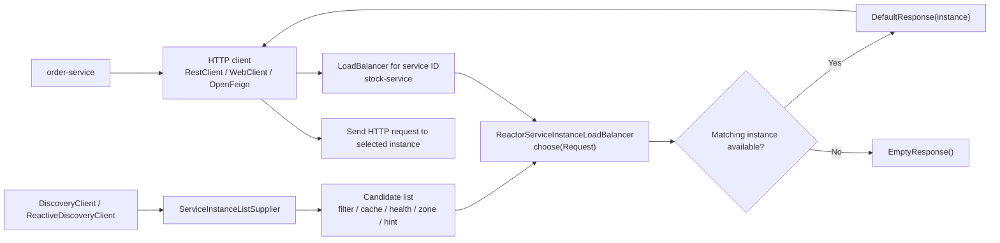

# Writing a ReactorServiceInstanceLoadBalancer and the Target Selection Contract

## 1. Problem Statement and Goals

Suppose `order-service` calls `stock-service` by service ID. During a staged rollout, `stock-service` has two instances:

| Instance | Metadata `traffic-weight` | Desired routing |
| --- | ---: | --- |
| `stock-a:8081` | `3` | Receives roughly 75% of selections |
| `stock-b:8082` | `1` | Receives roughly 25% of selections |

Spring Cloud LoadBalancer's default algorithm is typically **Round Robin**, which is suitable for rotating evenly across instances. However, some scenarios require changing the **target selection rule**: prioritizing instances by weight, region, processing capacity, or business attributes. In those cases, you can provide a custom `ReactorServiceInstanceLoadBalancer` implementation.

This lesson belongs to the **Customizing LoadBalancer** chapter of the `SPRING_CLOUD_SERVICE_COMMUNICATION_LOAD_BALANCING` module, where learners explore client-side load balancing: fetching `ServiceInstance` lists via discovery by service ID, combining health checks and routing policies, and integrating with `RestClient`, `WebClient`, OpenFeign, timeouts, retries, and error observability. The focus here is the **selection contract**: how an algorithm consumes a candidate list and answers "which instance should receive this call?".

After completing this lesson, you will be able to:

1. Explain the inputs and outputs of `choose(Request)`, distinguishing success, no available instance, and list-retrieval failure.
2. Write a custom LoadBalancer weighted by metadata without performing blocking I/O during target selection.
3. Register the algorithm **specifically for one service ID** using `@LoadBalancerClient`.
4. Ensure compatibility with the `ServiceInstanceListSupplier` chain, request context, and `SelectedInstanceCallback`.
5. Test empty instances, single instances, invalid metadata, and probabilistic distribution, and interpret results accurately alongside retries/health checks.

> **Scope:** `ReactorServiceInstanceLoadBalancer` decides **which instance is selected**. It does not send HTTP requests itself, guarantee that the instance remains alive when the request arrives, handle retries, or replace client timeouts.

## 2. Architecture: Fetch Candidates First, Select Target Second



Spring Cloud LoadBalancer typically creates a **child context per service ID**. `ServiceInstanceListSupplier` is the source of the instance list in that context. One layer may fetch instances from discovery, while other layers filter by zone/hint, manage caching, or perform health checks. `ReactorServiceInstanceLoadBalancer` consumes the supplied list and **picks one instance** according to its algorithm.

For example, once `stock-a` disappears from the list published by the supplier, the algorithm must not "remember" instance A on its own and keep returning it. If both A and B are unavailable, it must reflect the **no target** state. Conversely, having an instance in the list does not guarantee TCP/HTTP will succeed, because network state can change between selection and transmission.

## 3. API Contract of `ReactorServiceInstanceLoadBalancer`

The core interface (omitting unrelated details) is:

```java
public interface ReactorServiceInstanceLoadBalancer
        extends ReactorLoadBalancer<ServiceInstance> {
    // Method inherited from ReactorLoadBalancer<T>:
    Mono<Response<ServiceInstance>> choose(Request request);
}
```

In real code, import the interface from `org.springframework.cloud.loadbalancer.core` and `Request`/`Response` types from `org.springframework.cloud.client.loadbalancer`. Package names and helper APIs may vary across Spring Cloud release trains; the examples below target modern Spring Cloud LoadBalancer using Reactor and Java 17+.

| Component | Role | What must be guaranteed |
| --- | --- | --- |
| `Request<?> request` | Client context; may contain HTTP request info, hints, or retry context | Pass **this exact request** to `supplier.get(request)` to preserve context-based filtering |
| `ServiceInstanceListSupplier` | Supplies `Flux<List<ServiceInstance>>`, potentially pre-filtered | Select only from the returned list; never bypass health/discovery |
| `Mono<Response<ServiceInstance>>` | Asynchronous result completing a selection decision | When subscribed, emit an explicit `Response`; never return `null` as a result |
| `DefaultResponse` | Successfully selected an instance | `hasServer() == true`, `getServer()` is the chosen candidate |
| `EmptyResponse` | No available target in the list result | `hasServer() == false`; caller layer decides how to handle no-instance |
| `Mono.error(...)` | List query failure or unrecoverable configuration error | Let the error propagate and be recorded; do not silently turn all exceptions into "no instance" |
| `SelectedInstanceCallback` | Notifies certain suppliers which instance was just chosen | Invoke **if** the supplier implements the callback and the response has a server |

Two common mistakes:

- `supplier.get(request)` returns a **Flux of lists**, not `Flux<ServiceInstance>`. Use `.next()` to obtain one list snapshot for the current selection, then pick one element from that list.
- `Mono.empty()` means **no `Response` emitted**. It does not explicitly substitute for `new EmptyResponse()` when the list is empty or the supplier completes without emitting a list.

In this example, we use `Mono.defer(...)` to query the supplier and draw a candidate upon subscription. Do not use `.block()`, `Thread.sleep()`, HTTP I/O, or synchronous discovery calls directly inside `choose(...)`. Even though `RestClient` can be a blocking client, the selection layer still follows the Reactor contract.

### 3.1. The Contract Does Not Include Retries or Health-Check Policies

`choose(Request)` returns only a single selection result. If the HTTP request fails, the HTTP client/LoadBalancer layer may decide to invoke `choose(...)` again depending on policy and version; this method itself should not resend requests. Components such as `HealthCheckServiceInstanceListSupplier`, `RetryAwareServiceInstanceListSupplier`, or zone/hint filters can alter the **candidate set** seen by the algorithm.

Some suppliers use `SelectedInstanceCallback` to remember the previously chosen instance to support policies like same-instance preference. Skipping the callback can break those suppliers even when the algorithm still returns a valid `DefaultResponse`.

## 4. Complete Example: `TrafficWeightLoadBalancer`

Let's build a **weighted random** algorithm driven by `traffic-weight` metadata. Within this example's scope:

- Each instance has an integer weight from **1 to 100**; if metadata is missing/invalid, default to `1`.
- Selection probability equals `instance weight / total weight`.
- When there are no candidates: return `EmptyResponse`.
- When `ServiceInstanceListSupplier` is missing due to incomplete configuration: emit a clear configuration error.
- When the supplier emits an error: **propagate the error**; do not hide discovery errors behind a silent fallback.
- After selection: notify `SelectedInstanceCallback` if the supplier supports it.

**Java Code (Java 17+):**

```java
package example.loadbalancer;

import java.util.List;
import java.util.Map;
import java.util.Objects;
import java.util.concurrent.ThreadLocalRandom;

import reactor.core.publisher.Mono;

import org.springframework.beans.factory.ObjectProvider;
import org.springframework.cloud.client.ServiceInstance;
import org.springframework.cloud.client.loadbalancer.DefaultResponse;
import org.springframework.cloud.client.loadbalancer.EmptyResponse;
import org.springframework.cloud.client.loadbalancer.Request;
import org.springframework.cloud.client.loadbalancer.Response;
import org.springframework.cloud.loadbalancer.core.ReactorServiceInstanceLoadBalancer;
import org.springframework.cloud.loadbalancer.core.SelectedInstanceCallback;
import org.springframework.cloud.loadbalancer.core.ServiceInstanceListSupplier;

public final class TrafficWeightLoadBalancer
        implements ReactorServiceInstanceLoadBalancer {

    private final ObjectProvider<ServiceInstanceListSupplier> supplierProvider;
    private final String serviceId;

    public TrafficWeightLoadBalancer(
            ObjectProvider<ServiceInstanceListSupplier> supplierProvider,
            String serviceId) {
        this.supplierProvider = Objects.requireNonNull(supplierProvider);
        this.serviceId = Objects.requireNonNull(serviceId);
    }

    @Override
    @SuppressWarnings("rawtypes")
    public Mono<Response<ServiceInstance>> choose(Request request) {
        return Mono.defer(() -> {
            ServiceInstanceListSupplier supplier =
                    supplierProvider.getIfAvailable();

            if (supplier == null) {
                return Mono.error(new IllegalStateException(
                        "Missing ServiceInstanceListSupplier for " + serviceId));
            }

            return supplier.get(request) // Preserve request context.
                    .next()               // Take the first List<ServiceInstance>.
                    .map(instances -> select(supplier, instances))
                    .switchIfEmpty(Mono.just(new EmptyResponse()));
        });
    }

    private Response<ServiceInstance> select(
            ServiceInstanceListSupplier supplier,
            List<ServiceInstance> instances) {

        if (instances.isEmpty()) {
            return new EmptyResponse();
        }

        long totalWeight = 0L;
        for (ServiceInstance instance : instances) {
            totalWeight += weight(instance);
        }

        // totalWeight > 0: every instance has a minimum weight of 1.
        long ticket = ThreadLocalRandom.current().nextLong(totalWeight);

        for (ServiceInstance instance : instances) {
            ticket -= weight(instance);
            if (ticket < 0L) {
                if (supplier instanceof SelectedInstanceCallback callback) {
                    callback.selectedServiceInstance(instance);
                }
                return new DefaultResponse(instance);
            }
        }

        // Unreachable unless weights change during selection.
        throw new IllegalStateException(
                "Weighted selection failed for " + serviceId);
    }

    static int weight(ServiceInstance instance) {
        Map<String, String> metadata = instance.getMetadata();
        String raw = metadata == null
                ? null : metadata.get("traffic-weight");

        if (raw == null) {
            return 1;
        }
        try {
            int value = Integer.parseInt(raw);
            return value >= 1 && value <= 100 ? value : 1;
        } catch (NumberFormatException invalid) {
            return 1;
        }
    }
}
```

**Why do these details matter?**

1. `supplier.get(request)` allows request-filtering suppliers (hints, retry context, etc.) to receive context. Calling `supplier.get()` directly can accidentally bypass request-based filtering.
2. `.next()` grabs the first emitted snapshot for that selection. It does not guarantee the list is always live; refresh/cache policies belong to the supplier.
3. `new EmptyResponse()` is emitted when the list is empty **or when the publisher emits no list**. Never convert genuine supplier errors into `EmptyResponse`.
4. `ThreadLocalRandom` is thread-safe for concurrent random draws without a contended global counter. A 3:1 weight creates only a **probabilistic tendency**, not a guarantee that every four requests produce exactly three A and one B.
5. `long totalWeight` avoids overflow across many scenarios compared to `int`; each weight is capped at 100. Per-selection complexity is `O(n)` in instance count; for very large lists, consider optimization.
6. `SelectedInstanceCallback` is invoked **precisely when an instance has been chosen**. Call it only if the supplier implements the interface; never call it for `EmptyResponse`.
7. `serviceId` is used here for context identification and error messages. The code assumes the supplier belongs to the service context created by Spring Cloud; never fetch instances of another service on your own.

This is a **weighted selection** example, not a health-check or circuit-breaker mechanism. A high-weight instance that is overloaded can still be chosen as long as it remains in the supplier's list.

### 4.1. Do Not Use `traffic-weight=0` to "Drain" an Instance in This Example

Under the contract chosen in this lesson, `0` and values outside 1–100 are **invalid** metadata and fall back to `1`. Therefore, to stop sending requests to an instance, remove it from the list via discovery, health status, or an appropriate candidate-filtering supplier. Do not assume setting `traffic-weight=0` will drain traffic from an instance.

If business logic genuinely needs weight 0, you must **explicitly change the policy**, guard against all weights summing to 0 to avoid `nextLong(0)`, and align deployment with instance lifecycle management.

## 5. Registering a Custom LoadBalancer Specifically for `stock-service`

Spring Cloud LoadBalancer manages contexts per service ID. We attach this algorithm to **one** service while keeping Round Robin for other services.

First, create a configuration class for the child context. **Do not annotate this class with `@Configuration` if it lies within the main application's component scan**, as the bean could be registered globally unintentionally.

```java
package example.loadbalancer;

import org.springframework.cloud.client.ServiceInstance;
import org.springframework.cloud.loadbalancer.core.ReactorLoadBalancer;
import org.springframework.cloud.loadbalancer.core.ServiceInstanceListSupplier;
import org.springframework.cloud.loadbalancer.support.LoadBalancerClientFactory;
import org.springframework.context.annotation.Bean;
import org.springframework.core.env.Environment;

// Per-client configuration; do not annotate with @Configuration inside component scan scope.
public class StockLoadBalancerConfiguration {

    @Bean
    ReactorLoadBalancer<ServiceInstance> stockLoadBalancer(
            Environment environment,
            LoadBalancerClientFactory clientFactory) {

        String serviceId = environment.getRequiredProperty(
                LoadBalancerClientFactory.PROPERTY_NAME);

        return new TrafficWeightLoadBalancer(
                clientFactory.getLazyProvider(
                        serviceId, ServiceInstanceListSupplier.class),
                serviceId);
    }
}
```

Next, bind the configuration to the target service ID:

```java
package example.config;

import example.loadbalancer.StockLoadBalancerConfiguration;
import org.springframework.cloud.loadbalancer.annotation.LoadBalancerClient;
import org.springframework.context.annotation.Configuration;

@Configuration(proxyBeanMethods = false)
@LoadBalancerClient(
        name = "stock-service",
        configuration = StockLoadBalancerConfiguration.class)
public class StockClientLoadBalancerRegistration {
}
```

`LoadBalancerClientFactory.getLazyProvider(...)` retrieves the supplier from the **corresponding service's** context. This also avoids eagerly initializing interdependent components. Do not manually instantiate `DiscoveryClientServiceInstanceListSupplier` by bypassing existing discovery, cache, health check, or filter layers.

**Prerequisites:** The application must include `spring-cloud-starter-loadbalancer` and a mechanism supplying `ServiceInstance` lists (real discovery or static instance configuration for test environments). Use compatible Spring Boot and Spring Cloud BOMs rather than mixing versions manually.

### 5.1. Using with HTTP Clients

The target selection algorithm is independent of the HTTP client API. Example with `RestClient`:

```java
import org.springframework.cloud.client.loadbalancer.LoadBalanced;
import org.springframework.context.annotation.Bean;
import org.springframework.context.annotation.Configuration;
import org.springframework.web.client.RestClient;

@Configuration(proxyBeanMethods = false)
public class RestClientConfiguration {
    @Bean
    @LoadBalanced
    RestClient.Builder loadBalancedRestClientBuilder() {
        return RestClient.builder();
    }
}
```

```java
import org.springframework.cloud.client.loadbalancer.LoadBalanced;
import org.springframework.stereotype.Service;
import org.springframework.web.client.RestClient;

@Service
public class StockReader {
    private final RestClient restClient;

    public StockReader(@LoadBalanced RestClient.Builder builder) {
        this.restClient = builder.build();
    }

    public String getStock(String sku) {
        return restClient.get()
                .uri("http://stock-service/stocks/{sku}", sku)
                .retrieve()
                .body(String.class);
    }
}
```

Here `stock-service` is a **service ID**, not a fixed hostname. The LoadBalancer layer intercepts this name and uses the registered algorithm to select an instance before sending HTTP traffic.

With `WebClient`, use a `@LoadBalanced WebClient.Builder` or the corresponding LoadBalancer filter. With **OpenFeign**, a `@FeignClient(name = "stock-service")` without a fixed URL routes through Spring Cloud LoadBalancer when the corresponding starter is present. Configuring `@FeignClient(url = "...")` to point directly to a URL can bypass discovery-based instance selection.

> Having *Reactor* in the interface name does not mean only `WebClient` can use this algorithm. Spring Cloud LoadBalancer also integrates with synchronous clients; instance selection still runs through Spring Cloud's load-balancing mechanism.

## 6. Distinguishing Algorithm Customization from Candidate List Customization

In many cases, **you do not need to write** a new `ReactorServiceInstanceLoadBalancer`. If your goal is simply filtering by zone, hint, health, or applying weights, consider the `ServiceInstanceListSupplier` implementations provided by Spring Cloud.

| Requirement | Appropriate place to handle | Reason |
| --- | --- | --- |
| Uniform random selection | Built-in `RandomLoadBalancer` | Avoids writing a new algorithm |
| Round-robin selection | Built-in `RoundRobinLoadBalancer` | Common default choice |
| Zone/hint routing | `ZonePreferenceServiceInstanceListSupplier` / `HintBasedServiceInstanceListSupplier` | Filters candidates before selection |
| Health check, caching | `HealthCheckServiceInstanceListSupplier` or `CachingServiceInstanceListSupplier` | Manages candidate state |
| Retries preferring another instance | Retry-aware supplier and corresponding retry config | Preserves request context and previous instance |
| Weighted distribution | Built-in weighted supplier, or this lesson's custom algorithm | Pick **one** place to apply weights to avoid doubling |
| Specialized policy combining multiple conditions | Custom LoadBalancer + suitable supplier | Separates list retrieval/filtering from final decision |

Example supplier configuration for an application using **ReactiveDiscoveryClient** with zone preference:

```java
import org.springframework.cloud.loadbalancer.core.ServiceInstanceListSupplier;
import org.springframework.context.ConfigurableApplicationContext;
import org.springframework.context.annotation.Bean;

public class StockSupplierConfiguration {

    @Bean
    ServiceInstanceListSupplier stockInstances(
            ConfigurableApplicationContext context) {
        return ServiceInstanceListSupplier.builder()
                .withDiscoveryClient()
                .withCaching()
                .withZonePreference()
                .build(context);
    }
}
```

The snippet above is an **alternative/extension configuration option** registered in the child context, not required alongside the weighted example. For a blocking `DiscoveryClient`, use `withBlockingDiscoveryClient()` or an appropriate supplier chain. When using the health-check supplier, note that Spring Cloud documentation recommends placing it immediately after the instance source; avoid stacking an unnecessary caching supplier because health-check has its own state replay mechanism.

**Warning about "weight multiplication":** If you already use the framework's `WeightedServiceInstanceListSupplier` and also add a weighted algorithm at the selection step, the actual distribution can diverge from the intended ratio. Designate **one** layer to own distribution and verify with request counts.

## 7. Testing the Selection Contract

You should test the **return values**, **request context**, and **callback**. You do not need to start an HTTP server to test pure selection logic.

### 7.1. Testing Empty, Single-Instance, and Metadata Cases

JUnit 5 example (place the test in package `example.loadbalancer` alongside `TrafficWeightLoadBalancer` to access package-private helpers):

```java
package example.loadbalancer;

import org.junit.jupiter.api.Test;
import org.springframework.cloud.client.DefaultServiceInstance;
import org.springframework.cloud.client.ServiceInstance;
import org.springframework.cloud.client.loadbalancer.DefaultRequest;
import org.springframework.cloud.client.loadbalancer.Response;
import org.springframework.cloud.loadbalancer.support.ServiceInstanceListSuppliers;

import static org.junit.jupiter.api.Assertions.*;

class TrafficWeightLoadBalancerTest {

    @Test
    void noInstancesReturnsResponseWithoutServer() {
        var lb = new TrafficWeightLoadBalancer(
                ServiceInstanceListSuppliers.toProvider("stock-service"),
                "stock-service");

        Response<ServiceInstance> response =
                lb.choose(new DefaultRequest()).block();

        assertNotNull(response);
        assertFalse(response.hasServer());
    }

    @Test
    void oneInstanceIsAlwaysChosen() {
        var a = new DefaultServiceInstance(
                "a", "stock-service", "localhost", 8081, false);
        a.getMetadata().put("traffic-weight", "3");
        var lb = new TrafficWeightLoadBalancer(
                ServiceInstanceListSuppliers.toProvider("stock-service", a),
                "stock-service");

        for (int i = 0; i < 100; i++) {
            Response<ServiceInstance> response =
                    lb.choose(new DefaultRequest()).block();
            assertNotNull(response);
            assertTrue(response.hasServer());
            assertEquals("a", response.getServer().getInstanceId());
        }
    }

    @Test
    void invalidOrMissingWeightFallsBackToOne() {
        var a = new DefaultServiceInstance(
                "a", "stock-service", "localhost", 8081, false);
        assertEquals(1, TrafficWeightLoadBalancer.weight(a));

        a.getMetadata().put("traffic-weight", "not-a-number");
        assertEquals(1, TrafficWeightLoadBalancer.weight(a));

        a.getMetadata().put("traffic-weight", "0");
        assertEquals(1, TrafficWeightLoadBalancer.weight(a));

        a.getMetadata().put("traffic-weight", "3");
        assertEquals(3, TrafficWeightLoadBalancer.weight(a));
    }
}
```

`ServiceInstanceListSuppliers.toProvider(...)` in this example provides a fixed list, letting you verify logic without real discovery. When testing application integration, use a real supplier and HTTP client to verify the full chain.

### 7.2. Verifying the 3:1 Probability

Create `stock-a` with `traffic-weight=3` and `stock-b` with `traffic-weight=1`, and run **10,000 selections** against the same list. The expected probabilistic distribution is around `7,500` selections of A and `2,500` of B; observed counts will fluctuate. Do not write a test asserting **exact** 75.00%; choose a reasonable tolerance band or run multi-batch statistics to avoid flaky tests.

More importantly, when two instances exist but A is excluded by health checks, **100% of remaining selections can go to B**. That is the correct outcome when the supplier only supplies B; it does not mean the weighted algorithm is broken.

### 7.3. Testing Request Context and Callback

To prove the input contract, create a mock supplier with two distinct behaviors:

- `get()` returns both A and B.
- `get(Request)` inspects the `Request` hint/attributes and returns only B when the hint matches.

When calling `choose(requestWithHint)`, the algorithm must return B, proving it **forwarded the request into the supplier**. With a supplier implementing `SelectedInstanceCallback`, record the argument passed to `selectedServiceInstance(...)` and compare it with `response.getServer()`. When no server is available, the callback must not be invoked.

These tests are more valuable than merely testing the random generator: they catch integration bugs with sticky sessions, hints, and retry-aware suppliers.

## 8. Contract Edge Cases That Must Be Handled Explicitly

| Case | Example's behavior | Operational takeaway |
| --- | --- | --- |
| Supplier returns a 1-instance list | Selects the sole instance | Weights make no difference |
| Supplier returns an empty list | Emits `EmptyResponse` | Upstream client handles no-instance; exact HTTP outcome depends on integration |
| Supplier returns `Flux.empty()` | Emits `EmptyResponse` via `switchIfEmpty` | Selection never hangs without a result |
| Missing supplier bean | `Mono.error(IllegalStateException)` | Configuration error; inspect the service context |
| Supplier throws/emits exception | Error propagates | Not conflated with "0 healthy instances" |
| Invalid metadata | Falls back to default weight 1 | Log/alert on malformed metadata in an appropriate place |
| Two instances, 3:1 weight | Probabilistic ~75/25 split | No ratio guarantee over small request windows |
| Retry occurs | May call `choose` again | Retry policy sits outside the algorithm; preserves request context |
| Discovery changes | Picks from list emitted at call time | Do not cache the list permanently inside LoadBalancer |
| Supplier has callback | Calls `selectedServiceInstance` on pick | Properly supports stateful suppliers tracking prior picks |

### 8.1. Do Not Multiply Retries Inside Target Selection

Suppose `POST /orders` times out after the server already persisted the order. If the selection algorithm sends extra HTTP requests itself or secretly retries internally, the caller loses control over idempotency and deadlines. The right approach is letting the **retry** policy of Feign/RestClient/WebClient/LoadBalancer operate in its designated layer, while capping attempts and monitoring actual server-received requests.

### 8.2. Do Not Perform Network Calls Inside `choose`

Every HTTP request may require target selection. If `choose` pings each instance, queries a database, calls a registry, or runs `Thread.sleep`, latency and load scale up with instance count and request rate. Use `ServiceInstanceListSupplier` for discovery/health integration and keep `choose` limited to fast computation over the provided list.

### 8.3. Do Not Let Per-Service Configuration Become Global

Keep `StockLoadBalancerConfiguration` outside packages scanned by the main application as `@Configuration`, or omit `@Configuration` as shown in the example. Then register it solely via `@LoadBalancerClient`. If the configuration class is accidentally scanned as a shared bean configuration, you can alter algorithms for unrelated services and struggle to diagnose why.

## 9. Observing and Verifying in a Real System

Selecting an instance does not mean an HTTP call succeeded. Once the algorithm is enabled, monitor:

- **Service ID:** e.g., `stock-service`, to confirm the right child context and algorithm are active.
- **Selected instance ID, host/port:** useful in logs/tracing at appropriate levels; avoid putting dynamic hostnames into high-cardinality metric labels unnecessarily.
- **No-instance count:** frequency of `EmptyResponse`/LoadBalancer discard results.
- **HTTP outcome, latency, attempts:** examine alongside per-instance hit counts to validate weight ratios.
- **Health, zone, discovery refresh:** confirm what list the live supplier actually provides rather than inferring from static config.

A practical experiment:

1. Start instances A and B and register 3:1 metadata in service discovery (or static instances in test config).
2. Send a large number of independent GET calls using the **service ID**, not direct per-instance URLs.
3. Inspect logs/metrics on A and B and observe distribution close to the expected ratio within statistical tolerance.
4. Remove A from the supplier via deregistration/health check; wait for cache/refresh to update and verify B receives all selections.
5. Remove all instances; verify the client receives the appropriate no-instance error.
6. Bring A back, trigger requests with retry, and compare `choose` invocation counts with HTTP attempts arriving at the servers.

If the ratio diverges significantly from 3:1, first inspect **the actual instance list returned by the supplier** and active metadata. Gateways, other clients, or retries from the same caller also affect observed server hit ratios. Additionally, very small request counts naturally exhibit random variance.

## 10. Exercises and Self-Check Questions

1. Why does `supplier.get(request).next()` match the `Flux<List<ServiceInstance>>` contract? What happens if you mistakenly write `supplier.get().next()`?
2. When no instances exist, should you return `Mono.empty()` or `Mono.just(new EmptyResponse())`? Contrast this with a genuine supplier error.
3. Why is `SelectedInstanceCallback` called only after an instance is selected? How is a stateful supplier affected if the callback is skipped?
4. With metadata A=3, B=1, C=1, approximately what probability does each instance have of being selected? How does this change when B is excluded by health checks?
5. Design an algorithm variant that only picks instances with metadata `tier=gold` when requested. Should filtering happen in `ServiceInstanceListSupplier` or inside `choose(...)`? Explain the trade-offs with request hints.
6. Design a plan to shift 10% of traffic to a new version and roll back if p95 latency rises. Which metrics and failure conditions should be monitored besides selection ratio?

## 11. References

- [Spring Cloud Commons: Spring Cloud LoadBalancer](https://docs.spring.io/spring-cloud-commons/reference/spring-cloud-commons/loadbalancer.html) — custom configuration, service-specific child context, suppliers, health checks, hints, and retries.
- [RoundRobinLoadBalancer Source](https://github.com/spring-cloud/spring-cloud-commons/blob/main/spring-cloud-loadbalancer/src/main/java/org/springframework/cloud/loadbalancer/core/RoundRobinLoadBalancer.java) — official implementation example of `choose(Request)`, `EmptyResponse`, `DefaultResponse`, and `SelectedInstanceCallback`.
- [LoadBalancerClientConfiguration Source](https://github.com/spring-cloud/spring-cloud-commons/blob/main/spring-cloud-loadbalancer/src/main/java/org/springframework/cloud/loadbalancer/annotation/LoadBalancerClientConfiguration.java) — how Spring Cloud registers the default algorithm and suppliers.

**Key takeaway:** `ServiceInstanceListSupplier` determines **which instances are eligible for selection**; `ReactorServiceInstanceLoadBalancer` determines **which single instance to pick from that list**. A solid contract respects `Request`, returns an explicit `Response`, invokes callbacks at the right moment, and preserves clean boundaries with discovery, health checks, retries, and HTTP transport.
