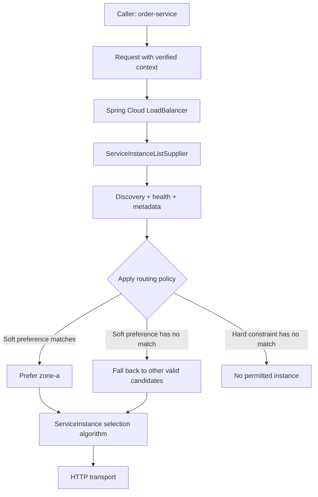
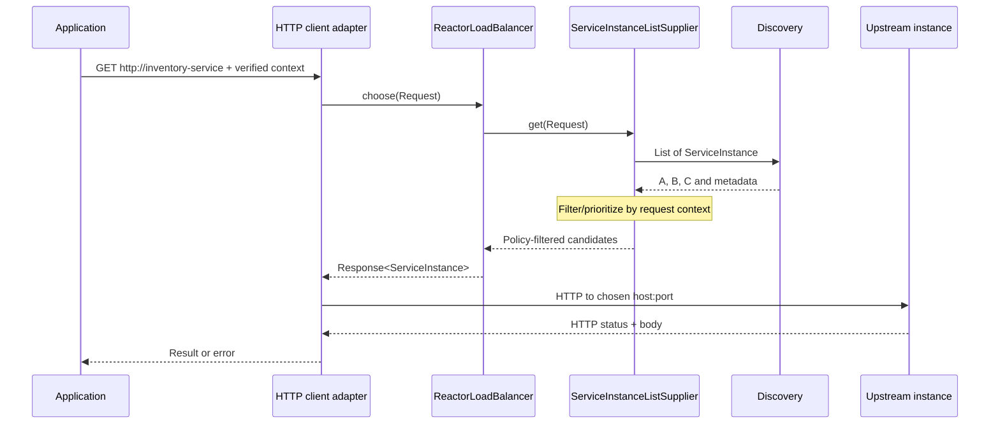
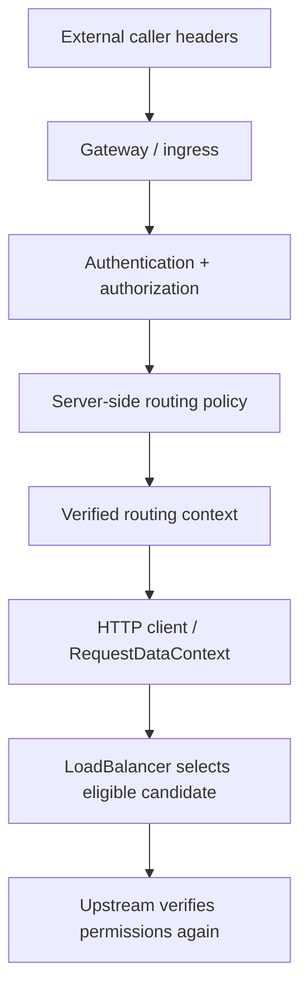
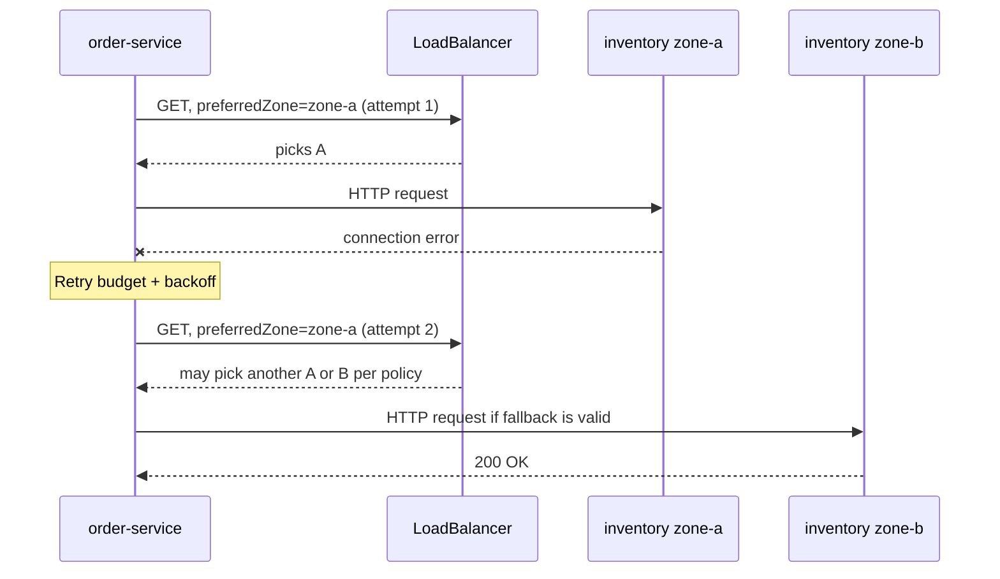

# Reading Request Context to Select the Right Replica

In Spring Cloud LoadBalancer, two calls using the same service ID `inventory-service` do not necessarily need to be routed to the same group of replicas. For example, an inventory lookup request arriving from `zone-a` might prefer instances in the same zone to reduce latency; a report-export request might prefer a replica group dedicated to batch jobs; and a tenant subject to mandatory data residency requirements may only be processed in a specific region.

These decisions cannot rely solely on a static instance list. LoadBalancer needs to **read each request's context**, combine that context with `ServiceInstance` data from discovery, health checks, and metadata, and pick the appropriate replica. However, a header self-declared by an external client cannot automatically be treated as a trustworthy routing policy.

This lesson belongs to the **Customizing LoadBalancer** chapter of the `SPRING_CLOUD_SERVICE_COMMUNICATION_LOAD_BALANCING` module. Its goals are to understand:

- How an HTTP call's context is passed into Spring Cloud LoadBalancer.
- How to distinguish service ID, LoadBalancer's `Request`, `RequestDataContext`, HTTP headers, Reactor Context, and `ServiceInstance` metadata.
- How to customize `ServiceInstanceListSupplier` to read request context and filter/prioritize replicas, instead of embedding routing algorithms inside every HTTP client.
- How to distinguish a **soft preference** (fallback allowed) from a **hard constraint** (never fall back in violation of policy).
- How to preserve correct behavior across `RestClient`, `WebClient`, and OpenFeign alongside retries, timeouts, health/discovery, security, and observability.

## 1. The Practical Problem: One Service ID, Multiple Replicas with Different Metadata

Suppose `order-service` needs to call:

```http
GET http://inventory-service/api/items/42
```

Discovery provides four `ServiceInstance` entries:

| Instance | Zone | Workload group | Health |
|---|---|---|---|
| `inventory-a1` | `zone-a` | `online` | Healthy |
| `inventory-a2` | `zone-a` | `online` | Healthy |
| `inventory-b1` | `zone-b` | `online` | Healthy |
| `inventory-b2` | `zone-b` | `batch` | Healthy |

The `zone` and `workload` attributes in the table are **example metadata** supplied by the registry/deployment, not keys guaranteed to exist by default in every discovery provider. If you want to route on them, you must define how labels are attached and verify accuracy during deployment.

Two independent requests to `inventory-service`:

1. Interactive `GET` from `order-service` in `zone-a` should **prefer** `inventory-a1/a2`. If zone A has no healthy replicas left, policy permits failing over to zone B.
2. Data for tenant `tenant-eu` is required to stay in `region-eu`. When the EU region has no healthy replicas, the request must **fail in a controlled manner**, never shifting automatically to another region.

The core distinction is that the policies in examples 1 and 2 differ: a **preference** is not the same as a **mandatory condition**.



Never replace a hard-constraint rule with "just pick any living instance," because doing so can violate tenant isolation, data residency, or security boundaries.

## 2. What Does Request Context Include?

The word "context" in the Spring ecosystem can be confusing because multiple mechanisms exist:

| Source | Location / lifecycle | Relationship to LoadBalancer |
|---|---|---|
| **HTTP headers** | Sent over the network in the HTTP request, e.g., `Accept`, `X-Preferred-Zone`. | Can be converted by adapters into `RequestData` for target selection; the header itself does not prove its value is trustworthy. |
| **HTTP method, URI, attributes** | Call-specific data; some attributes exist only on the caller side. | Certain integrations can include them in LoadBalancer's request context. |
| **LoadBalancer `Request<T>`** | Logical request object passed into `choose(Request)`/`get(Request)`. | Direct input to the instance selection policy when supplied by the integration. |
| **`RequestDataContext`** | Spring Cloud LoadBalancer context holding `RequestData` and API-specific extra info. | Provides access to request headers/method/URI on integration paths that supply this context. |
| **Reactor Context** | Bound to a Reactor subscription. | **Not automatically identical** to `RequestDataContext`; requires an appropriate integration/filter to forward metadata to LB. |
| **Security Context** | Authentication/authorization details processed by the application. | The source for verifying policy, not an arbitrary user-filled HTTP header. |
| **`ServiceInstance.getMetadata()`** | Descriptive instance metadata fetched from registry/provider. | Used to match against routing requirements, e.g., zone/role/region. |

**Caller context** answers *what the request needs*; **instance metadata** answers *what capabilities the replica has*. LoadBalancer needs to compare both sides:

```text
verified request context: preferredZone = zone-a
ServiceInstance metadata: zone = zone-a
=> instance satisfies preference
```

Do not assume Reactor Context is automatically turned into HTTP headers: those are two separate mechanisms. Likewise, WebClient's `ClientRequest.attribute(...)` does not automatically become part of `RequestDataContext` in every version or adapter.

## 3. Data Flow Through Spring Cloud LoadBalancer

Conceptually, an HTTP call using a service ID passes through:



Depending on version and integration layer, this pipeline may include caching, health filtering, zone preference, retries, and multiple chained `ServiceInstanceListSupplier` instances. The core idea stays the same: **the `Request` object must reach the layer applying the policy** if replicas are to be chosen using per-call data.

Common SPIs:

- `ReactorServiceInstanceLoadBalancer.choose(Request)`: final decision point to pick one instance; many implementations use a supplier and round-robin/random/weighted selection.
- `ServiceInstanceListSupplier.get(Request)`: retrieves the candidate list, optionally inspecting request context to **filter** before the selection algorithm runs.
- `DelegatingServiceInstanceListSupplier`: wraps an existing instance source instead of rewriting discovery and caching from scratch.
- `RequestDataContext`/`RequestData`: how certain HTTP integrations pass request details into LoadBalancer.
- `@LoadBalancerClient`: registers configuration scoped to a specific service ID, avoiding unintended side effects on all downstream services.

Class names, method signatures, and supplier configuration vary across Spring Cloud releases. The examples below illustrate building policies with APIs commonly found in modern Spring Cloud LoadBalancer; **check your exact BOM and run integration tests in your project**, especially when supporting both blocking and reactive clients.

## 4. Reading RequestDataContext Instead of Relying on ThreadLocal

When an HTTP adapter supplies `RequestDataContext`, LoadBalancer code can read headers from `RequestData`. Illustrative helper:

```java
import org.springframework.cloud.client.loadbalancer.Request;
import org.springframework.cloud.client.loadbalancer.RequestDataContext;

final class RoutingContextReader {

    private static final String HEADER =
        "X-Internal-Preferred-Zone";

    private RoutingContextReader() {}

    static String preferredZone(Request request) {
        if (request == null
                || !(request.getContext()
                     instanceof RequestDataContext dataContext)) {
            return null;
        }

        String raw = dataContext.getClientRequest()
            .getHeaders()
            .getFirst(HEADER);

        if (raw == null) {
            return null;
        }

        return switch (raw) {
            case "zone-a", "zone-b" -> raw;
            default -> null;
        };
    }
}
```

In the snippet above:

1. `Request` is an object at the **LoadBalancer layer**, not a controller's `HttpServletRequest`.
2. `getContext()` is type-checked before access; another adapter or request type might not use `RequestDataContext`.
3. Only a known allowlist of values is accepted, preventing oversized or malformed values from skewing routing or logging.
4. **This header is only "internal" if the caller/gateway validated it and set it after stripping any external header of the same name.** The prefix `X-Internal-*` does not make a header trustworthy by itself.
5. When context is missing or unrecognized, the helper returns `null` so the policy caller can choose appropriate behavior.

If zone depends on the caller's location, prefer reading it from trusted deployment metadata of `order-service` or a verified policy, rather than trusting an arbitrary user-sent `X-Preferred-Zone` header to pick processing regions. If a tenant-specific region is needed, derive it from authenticated identity/claims and server-side policy.

### Why Avoid MDC/ThreadLocal for Instance Selection?

In `WebClient`, instance selection can execute inside a reactive chain across changing schedulers. Data placed into `ThreadLocal` in a controller is not guaranteed to remain present during `choose(Request)`. With blocking `RestClient` and OpenFeign, `ThreadLocal` may appear to work in purely synchronous paths yet still easily leaks across thread pools/retries/async boundaries and is not LoadBalancer's explicit context API.

**Prefer data carried inside the request context explicitly passed by the integration**, and use Reactor Context or Spring Security context appropriately to build a **verified routing decision** before entering LB.

## 5. Example: A ServiceInstanceListSupplier Filtering by Preferred Zone

Suppose this is a **soft preference**, not a security requirement: if healthy instances exist in the same zone, use that subset; otherwise fall back to other candidates that passed prior valid filters.

You can wrap the discovery supplier with a custom supplier:

```java
import java.util.List;
import org.springframework.cloud.client.ServiceInstance;
import org.springframework.cloud.client.loadbalancer.Request;
import org.springframework.cloud.loadbalancer.core.DelegatingServiceInstanceListSupplier;
import org.springframework.cloud.loadbalancer.core.ServiceInstanceListSupplier;
import reactor.core.publisher.Flux;

public final class PreferredZoneServiceInstanceListSupplier
        extends DelegatingServiceInstanceListSupplier {

    public PreferredZoneServiceInstanceListSupplier(
            ServiceInstanceListSupplier delegate) {
        super(delegate);
    }

    @Override
    public Flux<List<ServiceInstance>> get() {
        return delegate.get();
    }

    @Override
    public Flux<List<ServiceInstance>> get(Request request) {
        String zone = RoutingContextReader.preferredZone(request);

        return delegate.get(request).map(instances -> {
            if (zone == null || instances.isEmpty()) {
                return instances;
            }

            List<ServiceInstance> preferred = instances.stream()
                .filter(instance -> zone.equals(
                    instance.getMetadata().get("zone")))
                .toList();

            // Valid ONLY for a SOFT preference.
            // When there is no match, keep using the original valid candidates.
            return preferred.isEmpty() ? instances : preferred;
        });
    }
}
```

This code assumes Java 17+, a normalized `zone` key in registry metadata, and the matching Spring Cloud supplier API. If the metadata key is missing, that instance does not match the zone, though it can still participate in fallback. Partitioning by zone does not guarantee instances are healthy — combine with health/discovery checks.

**Why call `delegate.get(request)` instead of just `delegate.get()`:** downstream suppliers may themselves require request context, such as hints, affinity, or other filters. Dropping `Request` at one link in the chain can silently break request-aware policies without throwing an explicit exception.

### Supplier Ordering Matters

A supplier chain might look like:

```text
Discovery -> cache -> health filtering -> request-aware zone filter -> choose()
```

The exact order should align with how Spring Cloud's builder and existing suppliers are composed in your version. If a supplier caches a **per-request personalized list** under a key containing only the service ID, a `zone-a` request can accidentally reuse `zone-b`'s result. Therefore:

- Cache the shared service-ID/discovery instance set first, then apply **request-dependent** filters per invocation.
- Never cache tenant- or zone-specific results under a single undifferentiated service-ID cache key.
- If hard constraints are applied across multiple layers, ensure a downstream fallback supplier cannot "reintroduce" prohibited instances.
- Health checks should apply to genuinely eligible instances, not merely those with matching metadata.

A safe mental model is that each step only narrows **the candidate set that already satisfied mandatory conditions**; fallback is permitted only within that remaining set.

## 6. Registering Per-Service-ID Configuration

Not every downstream service has `zone` metadata or requires the same routing policy as `inventory-service`. Custom supplier configuration should therefore be scoped to the specific service ID.

Example in `order-service`:

```java
import org.springframework.boot.autoconfigure.SpringBootApplication;
import org.springframework.boot.SpringApplication;
import org.springframework.cloud.loadbalancer.annotation.LoadBalancerClient;

@SpringBootApplication
@LoadBalancerClient(
    name = "inventory-service",
    configuration = InventoryLoadBalancerConfiguration.class)
public class OrderApplication {

    public static void main(String[] args) {
        SpringApplication.run(OrderApplication.class, args);
    }
}
```

Configuration class dedicated to the LoadBalancer child context:

```java
import org.springframework.cloud.loadbalancer.core.ServiceInstanceListSupplier;
import org.springframework.context.ConfigurableApplicationContext;
import org.springframework.context.annotation.Bean;

// Place this class outside the main application's component scan scope.
public class InventoryLoadBalancerConfiguration {

    @Bean
    ServiceInstanceListSupplier inventorySupplier(
            ConfigurableApplicationContext context) {

        ServiceInstanceListSupplier discovery =
            ServiceInstanceListSupplier.builder()
                .withDiscoveryClient()
                .build(context);

        return new PreferredZoneServiceInstanceListSupplier(
            discovery);
    }
}
```

This is an **illustrative** layout showing responsibility boundaries. In a real application, you may add compatible caching and health-check suppliers, and you must inspect other beans created by auto-configuration to avoid two competing suppliers with unclear precedence. Do not place an `inventory-service`-only `@Configuration` inside a package scanned by `@SpringBootApplication` as global configuration assuming `@LoadBalancerClient` will isolate it. Put it in a separate package or exclude it from main component scanning.

If a project has multiple service IDs, each service can use a different setup:

```text
inventory-service -> request-aware preferred zone
payment-service   -> verified hard region/authorization policy
catalog-service   -> standard round robin/weighted policy
```

There is no need to write a custom supplier for every service if built-in mechanisms already meet the requirement. Spring Cloud LoadBalancer includes built-in hint/zone/sticky-session suppliers depending on version; prefer built-in solutions before writing custom algorithms.

## 7. Soft Preference vs. Hard Constraint: A Critical Difference

The pattern above intentionally falls back to all candidates when no zone matches. This is **only valid when zone is a soft preference**, such as reducing latency.

| Rule | Can fall back to another zone? | When no instance matches |
|---|---|---|
| Prefer same zone to lower latency | Yes, if policy permits. | Pick from remaining healthy/eligible set. |
| Prefer cache-warm replica | Yes, if reading from another replica still meets the contract. | Drop cache-warm preference. |
| Mandatory region for data residency | **No.** | Fail closed; return a controlled error. |
| Tenant restricted to authorized instance group | **No.** | Never pick an unauthorized instance. |
| Batch API only handled by dedicated workers | Depends on contract; usually no if other workers lack API support. | Return capacity/no-eligible-candidate error or enqueue job separately. |

For a hard constraint, the logic must differ:

```java
// Pseudocode illustrating a verified hard constraint.
List<ServiceInstance> allowed = candidates.stream()
    .filter(instance -> verifiedRegion.equals(
        instance.getMetadata().get("region")))
    .toList();

if (allowed.isEmpty()) {
    // Do not automatically fall back to all candidates!
    return List.of();
}
return allowed;
```

`verifiedRegion` **must** come from an authenticated server-side policy, not an unverified header. If mandatory context is missing, do not treat that as "no preference" and allow all instances. Fail closed at the proper boundary — ideally checking permissions/region at the application/security layer **before** invoking LoadBalancer so you can return an appropriate error; the downstream server must still enforce its own authorization and data residency.

**Important:** a `ServiceInstanceListSupplier` returning an empty list does not explain why it is empty. It could be empty discovery, health checks excluding everything, or a hard policy leaving zero candidates. Instrument the reason in the policy layer so "no servers left" is not conflated with "tenant is not permitted to cross regions."

## 8. Ensuring Routing Data Is Actually Trustworthy

Suppose an Internet client sends:

```http
GET /api/orders/123 HTTP/1.1
Host: order.example.test
X-Internal-Preferred-Zone: zone-b
X-Tenant-ID: another-tenant
```

These headers are **client-controlled data**. Naming them `X-Internal-*` does not make them trustworthy. If a gateway simply forwards headers to `order-service`, a routing algorithm consuming these values directly could let callers manipulate processing location, instance tier, or tenant isolation.

A safer pipeline:



Practices:

1. **Strip or overwrite sensitive routing headers from external requests** at the trust boundary.
2. Determine region/tenant from authenticated identity and server policy, optionally combined with trusted caller deployment metadata.
3. If data must travel over internal HTTP, use trusted connections, workload authentication, or signed tokens/claims; downstream services must never trust an arbitrary header.
4. Constrain allowed values, lengths, formats, and metadata keys; never feed raw user input into metric tags or hard policies.
5. Keep authorization rules in the upstream service. LoadBalancer is an instance selector, **not an authorization engine**.

If `X-Internal-Preferred-Zone` is attached on the caller side, it may also be sent over the wire as an HTTP header to the downstream service unless stripped by a filter after LoadBalancer reads it. Never store secrets or personal data in it. If metadata must remain strictly internal, use an appropriate context/adapter mechanism rather than attaching everything to outbound headers hoping it will not cross the network.

## 9. Passing Context into LoadBalancer from WebClient

With WebClient, use a bean built from a `@LoadBalanced WebClient.Builder`:

```java
import org.springframework.cloud.client.loadbalancer.LoadBalanced;
import org.springframework.context.annotation.Bean;
import org.springframework.context.annotation.Configuration;
import org.springframework.web.reactive.function.client.WebClient;

@Configuration
class WebClientConfiguration {

    @Bean
    @LoadBalanced
    WebClient.Builder loadBalancedWebClientBuilder() {
        return WebClient.builder();
    }

    @Bean
    WebClient inventoryWebClient(
            @LoadBalanced WebClient.Builder builder) {
        return builder.clone()
            .baseUrl("http://inventory-service")
            .build();
    }
}
```

Once the business/service layer computes `preferredZone` from a valid policy:

```java
Mono<ItemDto> findItem(
        WebClient inventoryWebClient,
        String itemId,
        String verifiedPreferredZone) {

    return inventoryWebClient.get()
        .uri("/api/items/{id}", itemId)
        .headers(headers -> headers.set(
            "X-Internal-Preferred-Zone", verifiedPreferredZone))
        .retrieve()
        .bodyToMono(ItemDto.class);
}
```

When `@LoadBalanced WebClient.Builder`'s integration creates a LoadBalancer `RequestDataContext` from `ClientRequest`, the custom supplier from section 5 can read the header per call. Verify with an integration test on your exact version: do not assume every third-party filter, codec, or custom HTTP connector propagates context identically.

### Reactor Context Is Not Automatically Read by Spring Cloud LoadBalancer

Suppose a reactive service stores:

```java
return inventoryGateway.findItem(itemId)
    .contextWrite(context ->
        context.put("preferredZone", verifiedPreferredZone));
```

This is **not enough** for `RoutingContextReader` to see `preferredZone` inside `RequestDataContext`. `Reactor Context` belongs to the subscription, separate from LB `Request`. To pull from Reactor Context, a WebClient filter must read via `Mono.deferContextual(...)`, construct a `ClientRequest` carrying the appropriate data, and let the LoadBalancer integration process it. Filter ordering matters: the filter enriching data **must run before the instance-selection step**.

Illustrative filter example:

```java
import org.springframework.web.reactive.function.client.ClientRequest;
import org.springframework.web.reactive.function.client.ExchangeFilterFunction;
import reactor.core.publisher.Mono;

static ExchangeFilterFunction verifiedZoneFilter() {
    return (request, next) ->
        Mono.deferContextual(context -> {
            String zone = context.getOrDefault(
                "verifiedPreferredZone", "");

            if (!zone.equals("zone-a")
                    && !zone.equals("zone-b")) {
                return next.exchange(request);
            }

            ClientRequest enriched = ClientRequest.from(request)
                .headers(headers -> headers.set(
                    "X-Internal-Preferred-Zone", zone))
                .build();

            return next.exchange(enriched);
        });
}
```

Attach the filter to `inventoryWebClient` and test its ordering relative to the LoadBalancer filter. Never use `ThreadLocal` to read zone inside a reactive pipeline, and never store one user's zone in a shared singleton WebClient's `defaultHeader`, which can leak into other requests.

**Simpler option:** if the zone is already known in the service layer, attach it directly to the individual request as in the first example of this section. Reactor Context is helpful when passing a verified value across multiple asynchronous layers without adding parameters to every method signature.

## 10. RestClient and OpenFeign: Same Principles, Different Adapters

### RestClient

In synchronous applications, `RestClient` is created from a builder integrated with Spring Cloud LoadBalancer:

```java
@Bean
@LoadBalanced
RestClient.Builder loadBalancedRestClientBuilder() {
    return RestClient.builder();
}

@Bean
RestClient inventoryRestClient(
        @LoadBalanced RestClient.Builder builder) {
    return builder.clone()
        .baseUrl("http://inventory-service")
        .build();
}
```

A specific call:

```java
ItemDto getItem(
        RestClient inventoryRestClient,
        String itemId,
        String verifiedPreferredZone) {

    return inventoryRestClient.get()
        .uri("/api/items/{id}", itemId)
        .headers(headers -> headers.set(
            "X-Internal-Preferred-Zone", verifiedPreferredZone))
        .retrieve()
        .body(ItemDto.class);
}
```

`ItemDto` is an application-defined DTO. Verify that request metadata from `RestClient` actually reaches LB `RequestDataContext` in your Spring Cloud version. An interceptor running after LoadBalancer selection is **too late** to change which instance is chosen.

### OpenFeign

With OpenFeign, you can pass a per-request header via a method argument:

```java
@FeignClient(
    name = "inventory-service",
    contextId = "inventoryRead"
)
interface InventoryReadClient {

    @GetMapping("/api/items/{id}")
    ItemDto findItem(
        @PathVariable("id") String id,
        @RequestHeader("X-Internal-Preferred-Zone") String zone);
}
```

Then invoke `inventoryReadClient.findItem(itemId, verifiedPreferredZone)` using the policy-derived zone. Avoid using a `RequestInterceptor` that reads an unmanaged global `ThreadLocal` or a stateful bean holding a per-user zone, because interceptors may run concurrently across requests.

OpenFeign can use LoadBalancer integration to pick an instance by `name` when no fixed URL is set. If a Feign client declares `url` directly, requests can go straight to that URL **without passing through discovery-based ServiceInstance selection**. To prove your custom supplier runs, test with a service ID and inspect the actual selected instance.

### Do Not Assume All Three Clients Share the Same Pipeline

Synchronous `RestClient`, reactive `WebClient`, and OpenFeign have different filters, interceptors, and adapters. `ServiceInstanceListSupplier.get(Request)` is an important common convergence point, yet **you should not conclude** that an HTTP-layer filter always sees context identically across libraries. Testing each client individually eliminates false assumptions about ordering and how `RequestDataContext` is wrapped.

## 11. Retries, Timeouts, and Reselecting a ServiceInstance

One logical request can result in multiple HTTP attempts. For request-aware algorithms, the policy must stay **consistent and safe** across every attempt:



This example fits only when `preferredZone` is a **soft preference**. If `region-eu` is a hard constraint, retries must never fail over to an instance outside the EU, even if that instance is healthy or already has an open connection pool.

Key controls:

- Retries must retain the **same logical request ID**, identity, and verified policy; never recompute region from a newly arriving untrusted header.
- If retry sits **after** host/port selection, it may retry the same instance without calling `choose(Request)` again.
- If retry wraps the entire selection step, the supplier may rerun with the original or updated request context depending on integration. Verify this behavior.
- For `POST` writes, the server may have already processed the request before the caller timed out: require idempotency/deduplication before retrying.
- Overall deadline, per-attempt timeout, and retry budget must bound total load; never retry endlessly when a hard filter leaves zero valid instances.
- Never use retries to "try another instance" in order to bypass `401`/`403` or access-control rejections.

### No Instance vs. HTTP 503 Are Different Things

If a custom supplier returns an empty list due to a hard policy, LoadBalancer fails to pick an instance. Depending on the client integration, the caller may see an exception or a synthetic `503`-equivalent error produced by the adapter. That **does not prove** the upstream actually returned HTTP 503. Measure `selection_failed`/`no_eligible_instance` separately from `upstream_http_503` so retry behavior and error reporting remain accurate.

## 12. Observability: Knowing Which Request Picked Which Replica and Why

Logs and tracing should distinguish:

1. **Service ID:** `inventory-service` being called.
2. **Verified routing input:** `preferredZone=zone-a`, hard vs. soft policy.
3. **Candidate list after filters:** count of healthy/eligible candidates without dumping full metadata.
4. **Actually selected instance:** `instanceId` if available.
5. **Outcome:** HTTP status, transport error, decode error, no instance, retry outcome.

Illustrative log schema:

```json
{
  "event": "loadbalancer_selection",
  "targetService": "inventory-service",
  "operation": "GET /api/items/{id}",
  "routingPolicy": "preferred-zone",
  "preferredZone": "zone-a",
  "eligibleCandidates": 2,
  "selectedInstanceId": "inventory-a1",
  "attempt": 1,
  "traceId": "4bf92f3577b34da6a3ce929d0e0e4736"
}
```

`selectedInstanceId` should be absent/null when no selection occurred. To log the true selection, instrument at the LoadBalancer lifecycle or the algorithm hook that receives the actual `ServiceInstance`; a WebClient/Feign header interceptor does not inherently know the chosen instance. When logging HTTP outcomes, separate `upstream_http_status` from errors occurring before an HTTP response arrives.

Do not log tokens, cookies, raw routing claims, secrets, or entire `ServiceInstance.metadata` maps. Do not use `traceId`, tenant ID, or IP/port values of thousands of pods as unbounded-cardinality metric labels. For sizing, measure selection distribution by zone/operation in aggregate and use sampled traces when investigating individual requests.

## 13. Hands-On Lab: Implementing Request-Based Routing and Verifying Fallback

Create three `inventory-service` replicas in a test environment under the same service ID:

```text
inventory-a1: metadata zone=zone-a, workload=online, healthy
inventory-a2: metadata zone=zone-a, workload=online, healthy
inventory-b1: metadata zone=zone-b, workload=online, healthy
```

Each replica returns `instanceId` from a **test-only** debug endpoint. In `order-service`, configure `@LoadBalancerClient(name="inventory-service", configuration=...)` with `PreferredZoneServiceInstanceListSupplier`. Call via `@LoadBalanced WebClient.Builder` and attach the verified header per request.

| Test case | Input context | Outcome to verify |
|---|---|---|
| **Zone A has two replicas** | `preferredZone=zone-a` | Only A1/A2 are selected when health filters permit. |
| **Zone B has one replica** | `preferredZone=zone-b` | B1 is selected when metadata/health match. |
| **No preference** | Header absent | Uses the default eligible candidate set. |
| **Malformed preference** | `zone-unknown` or oversized string | Raw value is not trusted in policy; soft preference falls back to valid set. |
| **Zone A fails health** | Soft preference A; A1/A2 excluded | Falls back to B if policy permits. |
| **Hard region EU has no instances** | Region verified from identity | Never falls back to prohibited region; fails closed. |
| **Two concurrent requests** | Request 1 zone A, request 2 zone B | No Context/MDC cross-talk or stale cached list from prior request. |
| **Retry on same request** | A fails transiently, B healthy | Preserves policy and trace/logical ID; observe whether LB reselects. |
| **Discovery list changes** | Scale-in A2, scale-out A3 | Reads updated list per cache/refresh policy; no indefinite stale metadata. |
| **Feign/RestClient parity** | Verified per-request header | Confirms adapter forwards full LB context, not just WebClient working. |
| **Client with fixed URL** | Feign `url` instead of service ID | Confirms custom LB is not applied outside intended paths. |

### How to Verify Without False Assumptions

Record for every attempt: target service ID, normalized request context, candidate counts before/after filtering, selected instance ID, HTTP status/exception, retry attempt, and total latency. Distinguish **LoadBalancer picked an instance** from **HTTP transport succeeded**.

To check for caching bugs, alternate sending `zone-a` and `zone-b` to the same service ID; if the system consistently picks one zone regardless of the header, check whether the supplier receives `RequestDataContext`, whether filtering runs before selection, and whether a cache is accidentally storing a per-request filtered list.

Never test with real tenant data or attempt policy bypasses in production; use synthetic identities and metadata in an isolated environment.

## 14. Common Implementation Mistakes

| Mistake | Consequence | Fix |
|---|---|---|
| Reading an external request header and treating it as a hard policy | Users can illegally influence region/tenant/replica placement. | Verify identity and policy server-side; sanitize headers at the trust boundary. |
| Using `ThreadLocal` for request-specific routing in reactive WebClient | Context lost on scheduler hops; cross-request data leaks. | Use Reactor Context/`RequestDataContext` via proper integration. |
| Setting a user's zone on a singleton WebClient's `defaultHeader` | Value leaks onto other users' requests. | Set per-request headers/filters; avoid mutable shared state. |
| Calling `delegate.get()` in a request-aware supplier | Drops context needed by downstream suppliers. | Call `delegate.get(request)` when supported by the API. |
| Caching candidate lists after tenant/zone filtering under a service-ID key | Leaks selection results across requests. | Cache shared discovery data first, then filter per request. |
| Falling back to all candidates on a hard constraint | Violates region/tenant isolation. | Fail closed when hard filter is empty; never relax silently. |
| Putting per-service config in global component scan | Policy leaks to unrelated service IDs. | Isolate config outside global scan; use `@LoadBalancerClient`. |
| Skipping health checks when routing by zone metadata | Picks right zone but dead instance. | Combine discovery/health checks and monitor stale candidates. |
| Logging only service ID without instance ID | Cannot tell whether a call hit A or B. | Instrument selection lifecycle and per-attempt outcomes. |
| Assuming retries always pick a different replica | Cannot diagnose hotspots or repeated connection failures. | Verify retry owner, `choose` invocation site, and actual selected instance. |
| Relying on hints/attributes an HTTP adapter does not forward | Policy silently fails to run as expected. | Test `RestClient`, `WebClient`, and Feign individually under your BOM. |

## 15. Checklist Before Using a Request-Aware LoadBalancer in Production

- Clearly define the **routing objective**: zone preference, affinity, workload type, or hard regional isolation.
- Distinguish soft preference from hard constraint; specify exact behavior when no candidate exists.
- Identify the **verified** context source and trust boundary; never treat user-supplied headers as authorization.
- Understand `Request`, `RequestDataContext`, `RequestData`, and `ServiceInstance` metadata in your Spring Cloud version.
- Use `ServiceInstanceListSupplier.get(Request)` to filter candidates per request, preserving `Request` when calling the delegate supplier.
- Prefer built-in hint/sticky/zone suppliers if they match exact semantics; write custom code only when necessary.
- Scope LoadBalancer configuration per service ID via `@LoadBalancerClient`, avoiding global component scanning.
- Compose health, discovery, caching, and request-aware filters in the right order, without caching personalized lists under overly broad keys.
- Never silently reopen instances excluded by a hard filter; preserve data residency/tenant/authorization across retries and failover.
- With WebClient, do not equate Reactor Context with LB request context; ensure enrichment filters run before instance selection.
- With RestClient/OpenFeign, verify request metadata actually reaches LB; avoid misplaced interceptors and fixed URLs that bypass LB.
- Set retry budgets/deadlines and distinguish no-instance errors from upstream HTTP 503s.
- Log service ID, normalized routing policy, candidate counts, selected instance, and outcome without exposing secrets or sensitive metadata.
- Test concurrent contexts, changing discovery lists, health failures, caching, same/next-instance retries, and hard no-fallback behavior.

**Key takeaway:** **request context describes what the call requires; `ServiceInstance` metadata describes what each replica offers; Spring Cloud LoadBalancer joins both to select a valid target.** When customizing, pass verified context cleanly down `Request → ServiceInstanceListSupplier.get(Request) → choose(Request)`, separate soft preferences from mandatory restrictions, and test context propagation across each HTTP client. A good replica-selection algorithm does not just pick the right target when everything is healthy — it also **never violates policy when no valid replica remains**.
