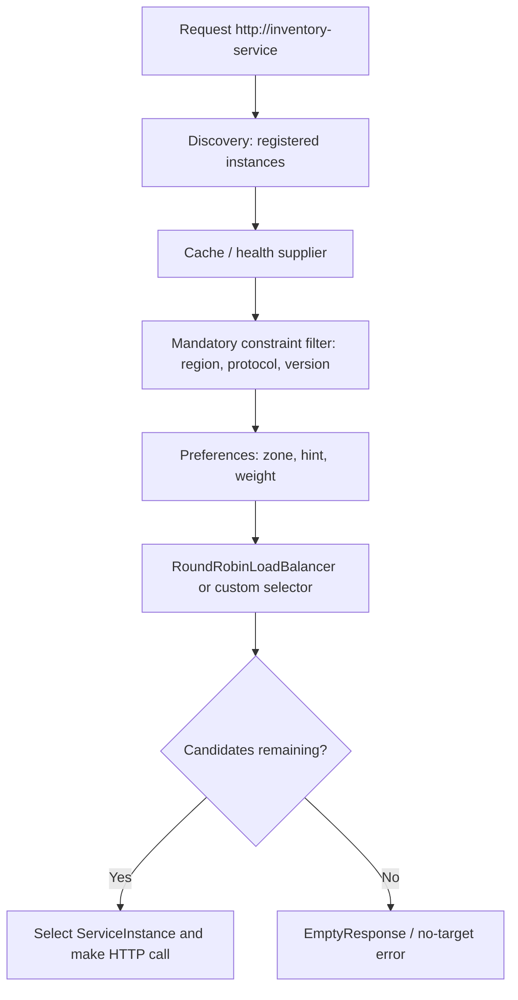
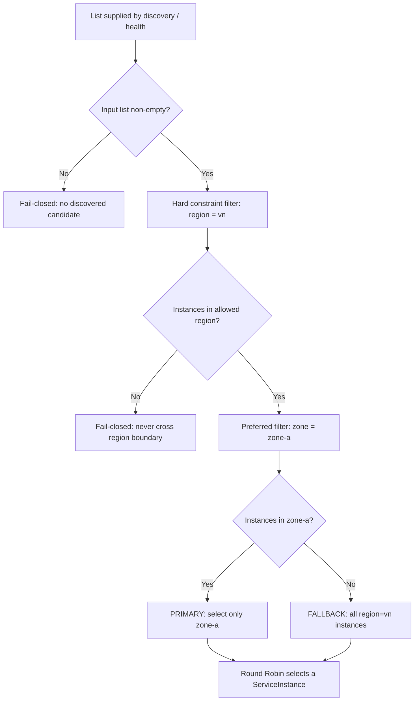

# Handling Empty Lists and Ensuring Intentional Fallback

In Spring Cloud LoadBalancer, `order-service` typically calls `inventory-service` by **service ID** such as `http://inventory-service`. A `ServiceInstanceListSupplier` chain fetches replicas from discovery and may apply caching, health checks, zone, version, weighting, or custom filtering policies before Round Robin/Random chooses a `ServiceInstance`. The problem arises when the **final list is empty**: no valid address remains to send the request to.

An empty list does not occur only when every server is shut down. It can also result from a wrong service ID, an unrefreshed registry, overly strict zone filtering, an incompatible API version, data residency constraints, or health probes marking every replica unhealthy. Blindly "falling back to all instances" in every case can cause the application to cross data boundaries, pick an instance with an incompatible contract, or send traffic to a backend already known to be unavailable.

The goal of this lesson in the **Customizing LoadBalancer** chapter is to distinguish **causes of emptiness**, pick a fallback policy based on constraint type, implement a supplier/selector that handles `EmptyResponse` intentionally, and test both the happy path with candidates and mandatory fail-closed scenarios. The examples connect to discovery, health checks, RestClient/WebClient/OpenFeign, retries/timeouts, and error observability in the Spring Cloud LoadBalancer module.

## 1. Which List Is Empty?

A single call can pass through several different lists:



This is a conceptual model: the exact order depends on supplier, discovery, caching, and retry configuration. In particular, several built-in suppliers **already have their own fallback behaviors**, so never assume "a filter returned empty" solely from the final result.

| State | Example | Is fallback acceptable? |
|---|---|---|
| **Empty discovery** | No `inventory-service` in the registry | No safe target to pick; usually fail fast and check discovery |
| **Preferred zone filter empty** | Instances exist in the same region, but not the same zone | Can expand to another zone **within the already-permitted set** |
| **Mandatory region/tenant filter empty** | No instance resides in the allowed data-processing region | **Never** expand beyond this boundary |
| **API version filter empty** | No replica supports the v2 contract | Fall back only with proven backward compatibility and explicit policy permission |
| **Health probes find no healthy replica** | Discovery still has A/B, but all health checks fail | Requires an explicit fail-open/fail-closed decision; do not equate with empty discovery |
| **Stale cache or missing metadata** | Stale list, blank zone metadata | Check refresh and metadata source; never guess server location |
| **Retry avoiding previous instance empties the set** | Only one candidate existed, and retry-aware filter excluded it | Needs an explicit retry/fallback policy, no infinite loops |

The most important principle is preserving the **provenance** of the candidate set: knowing which discovery source it came from, which mandatory filters it passed, and whether it still satisfies security and API-version contracts.

## 2. Default Behavior When No ServiceInstance Is Available

`RoundRobinLoadBalancer` uses `ServiceInstanceListSupplier` to obtain candidates. When the supplier emits an **empty list**, the selection algorithm cannot construct a `DefaultResponse` holding a valid server; the standard path returns an `EmptyResponse` with `hasServer() == false`.

```text
ServiceInstanceListSupplier -> []
RoundRobinLoadBalancer       -> EmptyResponse
HTTP client integration      -> no-target response/exception
```

Depending on integration and version:

- `@LoadBalanced WebClient.Builder` may turn a missing-instance condition into a synthetic `503` HTTP response; `retrieve()` then converts 503 into `WebClientResponseException`.
- OpenFeign with `FeignBlockingLoadBalancerClient` may receive a `Response` with status 503 synthesized by the LoadBalancer layer; `ErrorDecoder` can observe 503 even though **no provider request was made**.
- `RestTemplate`/`RestClient` with blocking integration may throw an exception during target selection or surface another error depending on version/adapter.

**Do not rely solely on HTTP 503 to conclude the backend is dead.** A 503 synthesized by LoadBalancer when no instance exists is different from a 503 returned by a provider after receiving a request. Record `serviceId`, `selectedInstance`, candidate count, and error origin to tell them apart.

### 2.1. Distinguish a Flux That Emits Nothing from a Flux That Emits an Empty List

`ServiceInstanceListSupplier.get()` returns `Flux<List<ServiceInstance>>`. These two cases:

```java
Flux.just(List.<ServiceInstance>of()) // Emits a list, but the list is empty
Flux.<List<ServiceInstance>>empty()   // No emission at all
```

are **different**. A selector that only calls `supplier.get(request).next().map(...)` will never run `map` if the publisher **emits no list at all**. If you write a custom selector, decide how to handle both cases—for example by applying `defaultIfEmpty(List.of())` before instance selection. Do not turn `Mono.empty()` at the selector layer into an "empty success" that leaves the HTTP adapter unsure how to proceed.

## 3. Fail-Open and Fail-Closed Are Not Global Switches

Two policies are often discussed when the preferred candidate set is empty:

| Policy | Meaning | Benefit | Risk |
|---|---|---|---|
| **Fail-open** | Relax filter conditions and try a broader candidate set | Increases probability of finding a target to serve | Can pick an unsuitable instance if the wrong condition is relaxed |
| **Fail-closed** | Refuse the call when no valid candidate remains | Protects safety, data, and compatibility constraints | Callers receive errors or degraded service |

Example where **fail-open can be acceptable**: 3 instances exist in the permitted region, but `zone-a` is empty; picking `zone-b` is reasonable when the extra latency is acceptable and data stays within the permitted region.

Example where **fail-closed is mandatory**: only instances in `region=vn` may process a given dataset, while discovery only contains instances in another region. You cannot fall back to all instances because that violates the policy.

**Rule:** relax **preference constraints** (soft preferences) when policy permits; never relax **mandatory constraints** (hard constraints) merely because the list is empty.

### 3.1. Decision Table by Emptiness Cause

| Empty condition | Illustrative policy |
|---|---|
| Discovery empty | Return no-instance; never try a random host or unmanaged DNS |
| Valid instances exist outside preferred zone | Select instances within the permitted region; record `fallback_reason=zone_empty` |
| Only wrong-region instances remain | Return no-instance; record `fallback_denied=region_boundary` |
| API version mismatch | Fail closed unless a verified **compatibility policy** exists |
| All probes unhealthy | Choose fail-open/closed based on probe reliability and safety requirements |
| Retry leaves only the just-failed instance | Stop or allow retry per retry budget; no infinite loops |

Do not use a single `fallbackToAllInstances=true` switch across all suppliers and service IDs. `inventory-service`'s policy may differ from `payment-service`'s; public catalog reads may accept stale cache while payments must never fabricate a fake "success."

## 4. Fallback Tiers Should Be Designed by Priority Level

An illustrative policy for `inventory-service` with mandatory `region=vn` and preferred `zone=zone-a`:



The outcomes are well-defined:

1. **Tier 1 — Primary:** instances in the permitted region **and** the preferred zone.
2. **Tier 2 — Allowed fallback:** instances in the permitted region but in another zone.
3. **No destination:** no instance satisfies mandatory constraints; return a controlled error without relaxing into another region.

Example registry data:

| Instance | Region | Zone | Status | Eligible? |
|---|---|---|---|---|
| `inventory-A` | vn | zone-a | ready | Primary |
| `inventory-B` | vn | zone-b | ready | Fallback when A is absent |
| `inventory-C` | sg | zone-a | ready | **No** — wrong region |
| `inventory-D` | vn | zone-a | not ready | Depends on health policy; do not assume ready |

Note: `region`/`zone` metadata is **only trustworthy if the registry and registration process are controlled**. Never use metadata supplied by an Internet client to determine regions for sensitive data. When real compliance rules apply, network controls, authorization, data storage, and deployment policies must also be enforced across other layers.

## 5. Writing a Policy-Driven Fallback ServiceInstanceListSupplier

For a **list-filtering and fallback** policy, the cleanest customization is usually **wrapping `ServiceInstanceListSupplier`** rather than rewriting the entire instance selection algorithm. The supplier receives the list from its delegate, filters by hard constraints, applies the preferred zone, and returns the permitted candidate list. `RoundRobinLoadBalancer` can then operate directly on that list.

### 5.1. Java Code: Never Relax the Region Boundary

Example Java class using Spring Cloud Commons/LoadBalancer and Reactor:

```java
import java.util.List;
import java.util.Map;
import java.util.Objects;

import org.springframework.cloud.client.ServiceInstance;
import org.springframework.cloud.client.loadbalancer.Request;
import org.springframework.cloud.loadbalancer.core.DelegatingServiceInstanceListSupplier;
import org.springframework.cloud.loadbalancer.core.ServiceInstanceListSupplier;

import reactor.core.publisher.Flux;

public final class RegionZoneFallbackSupplier
        extends DelegatingServiceInstanceListSupplier {

    private final String requiredRegion;
    private final String preferredZone;

    public RegionZoneFallbackSupplier(
            ServiceInstanceListSupplier delegate,
            String requiredRegion,
            String preferredZone) {
        super(Objects.requireNonNull(delegate, "delegate"));
        this.requiredRegion =
                Objects.requireNonNull(requiredRegion, "requiredRegion");
        this.preferredZone =
                Objects.requireNonNull(preferredZone, "preferredZone");
    }

    @Override
    public Flux<List<ServiceInstance>> get() {
        return delegate.get().map(this::selectCandidates);
    }

    @SuppressWarnings("rawtypes")
    @Override
    public Flux<List<ServiceInstance>> get(Request request) {
        // Preserve request context in case the delegate filters per request.
        return delegate.get(request).map(this::selectCandidates);
    }

    private List<ServiceInstance> selectCandidates(
            List<ServiceInstance> discovered) {
        if (discovered == null || discovered.isEmpty()) {
            // Do not fabricate fake instances or fall back to hardcoded host/port.
            return List.of();
        }

        // HARD constraint: never cross the permitted region.
        List<ServiceInstance> allowedRegion = discovered.stream()
                .filter(instance ->
                        requiredRegion.equals(metadata(instance, "region")))
                .toList();

        if (allowedRegion.isEmpty()) {
            // Cannot fall back across the region boundary.
            return List.of();
        }

        // SOFT preference: select the preferred zone when replicas exist.
        List<ServiceInstance> preferred = allowedRegion.stream()
                .filter(instance ->
                        preferredZone.equals(metadata(instance, "zone")))
                .toList();

        // Intentional fallback: expand to another zone,
        // while staying strictly inside allowedRegion.
        return preferred.isEmpty() ? allowedRegion : preferred;
    }

    private static String metadata(ServiceInstance instance, String key) {
        if (instance == null) {
            return null;
        }
        Map<String, String> values = instance.getMetadata();
        return values == null ? null : values.get(key);
    }
}
```

Because it extends `DelegatingServiceInstanceListSupplier`, the class inherits `getServiceId()` from the delegate. Both `get()` and `get(Request)` apply the same policy; `request` is forwarded to the delegate so downstream layers can still use request context when needed.

**Four output scenarios:**

1. `delegate` returns `[]` → supplier returns `[]`. Nothing can be "recovered" from discovery.
2. `delegate` has A/B/C, where A matches required region and preferred zone → returns A.
3. No A, but B is in the same region → returns B; fallback is allowed because only **zone** is relaxed.
4. Only C remains in the wrong region → returns `[]`; policy does not trade data boundaries for availability.

This snippet only illustrates a **fixed policy for one service ID**; `requiredRegion` and `preferredZone` must come from trusted configuration in a real system. It does not itself check readiness, API version compatibility, or metadata integrity; if those conditions are needed, place them **before zone relaxation** and never bypass them during fallback.

### 5.2. Notes on Multi-Emission Lists

`get()`/`get(Request)` returns `Flux<List<ServiceInstance>>`, which may re-emit as discovery or health updates. The `selectCandidates` method in the example is a **pure function**: it does not mutate the delegate's list, hold mutable cached state, or perform network side effects. Consequently, new emissions automatically receive the same policy.

If an upstream supplier emits **`Flux.empty()` without emitting any list**, the `map` operators above also emit nothing. `RoundRobinLoadBalancer` and the HTTP integration must handle that case under their behavior; if you write a custom selector, convert "no emission" into an explicit **no-target result** so requests never hang indefinitely.

### 5.3. Why Not Call Discovery Independently When the Preferred Zone Is Empty?

An error-prone implementation pattern:

```java
// ANTIPATTERN, pseudocode:
if (zoneCandidates.isEmpty()) {
    return discoveryClient.getInstances("inventory-service");
}
```

This fresh list can **bypass** mandatory filters applied earlier: region, version, health, tenant isolation, or blocklists. It can also differ from the snapshot currently in use for the same request. When policy allows zone fallback, use the **set that already passed hard constraints** (`allowedRegion`) instead of "reverting to all discovered instances" regardless of origin.

## 6. Registering the Supplier for the Right Service ID

For a blocking application using `RestClient` or OpenFeign, an example client-specific configuration:

```java
import org.springframework.cloud.loadbalancer.core.ServiceInstanceListSupplier;
import org.springframework.context.ConfigurableApplicationContext;
import org.springframework.context.annotation.Bean;
import org.springframework.context.annotation.Configuration;

@Configuration(proxyBeanMethods = false)
public class InventoryLoadBalancerConfiguration {

    @Bean
    ServiceInstanceListSupplier inventoryServiceInstanceListSupplier(
            ConfigurableApplicationContext context) {

        ServiceInstanceListSupplier discovered =
                ServiceInstanceListSupplier.builder()
                        .withBlockingDiscoveryClient()
                        .withCaching()
                        .build(context);

        return new RegionZoneFallbackSupplier(
                discovered,
                "vn",       // HARD: mandatory region
                "zone-a");  // SOFT: preferred zone
    }
}
```

Bind this configuration **specifically to `inventory-service`**:

```java
import org.springframework.boot.SpringApplication;
import org.springframework.boot.autoconfigure.SpringBootApplication;
import org.springframework.cloud.loadbalancer.annotation.LoadBalancerClient;

@SpringBootApplication
@LoadBalancerClient(
        name = "inventory-service",
        configuration = InventoryLoadBalancerConfiguration.class)
public class OrderApplication {

    public static void main(String[] args) {
        SpringApplication.run(OrderApplication.class, args);
    }
}
```

**Important about component scanning:** place `InventoryLoadBalancerConfiguration` **outside the default component scan scope of the main application**, while still referencing it via `@LoadBalancerClient(configuration=...)`. If this configuration is scanned into the parent `ApplicationContext`, the supplier bean can affect other service IDs or conflict with auto-configuration.

`withBlockingDiscoveryClient()` is used because the example uses a blocking discovery client. With reactive discovery, the builder choice and discovery source must match `ReactiveDiscoveryClient`. Method and package names can vary in older Spring Cloud release trains; always align with a compatible Spring Boot/Spring Cloud BOM.

### 6.1. Using the Proper @LoadBalanced HTTP Client

Example `RestClient` calling a logical URL:

```java
import org.springframework.cloud.client.loadbalancer.LoadBalanced;
import org.springframework.context.annotation.Bean;
import org.springframework.context.annotation.Configuration;
import org.springframework.web.client.RestClient;

@Configuration
class InventoryHttpConfiguration {

    @Bean
    @LoadBalanced
    RestClient.Builder loadBalancedRestClientBuilder() {
        return RestClient.builder();
    }
}
```

```java
import org.springframework.beans.factory.annotation.Qualifier;
import org.springframework.stereotype.Service;
import org.springframework.web.client.RestClient;

record ItemDto(String id, String name, String servedBy) {
}

@Service
class InventoryGateway {

    private final RestClient client;

    InventoryGateway(
            @Qualifier("loadBalancedRestClientBuilder")
            RestClient.Builder builder) {
        this.client = builder
                .baseUrl("http://inventory-service")
                .build();
    }

    ItemDto find(String itemId) {
        return client.get()
                .uri("/api/v1/items/{id}", itemId)
                .retrieve()
                .body(ItemDto.class);
    }
}
```

If you use `RestClient.create("http://inventory-service")` without LoadBalancer integration, the HTTP client may simply try to resolve `inventory-service` as a DNS hostname and **bypass the custom supplier**. Likewise, `WebClient` requires `@LoadBalanced WebClient.Builder`; OpenFeign requires `@FeignClient(name = "inventory-service")` and the corresponding LoadBalancer starter.

### 6.2. Placing Cache and Health in the Right Order

The example above calls `withCaching()` before wrapping with the custom supplier, so it caches the **discovery list** before applying the region policy. Never cache the output of a per-request filter and reuse it for another request if the filter depends on `tenant`, version, hints, or request context.

If replacing cache with `HealthCheckServiceInstanceListSupplier`, Spring Cloud documentation recommends placing health immediately after the network-fetching supplier, **before other filtering steps**. The health supplier has its own emission/caching mechanism; avoid stacking `CachingServiceInstanceListSupplier` unnecessarily without understanding how it affects list freshness.

**Merely configuring `spring.cloud.loadbalancer.health-check.*` without creating/enabling the appropriate supplier is not enough.** Nor should you assume a health-filtered list always clearly separates `discovered_empty` from `all_unhealthy` for downstream layers; the supplier itself may have already fallen back before your code sees the list.

## 7. Empty Health Check Differs from Empty Discovery

Per Spring Cloud Commons, `HealthCheckServiceInstanceListSupplier` probes the health of instances from its delegate. When **no instance is healthy yet the delegate list is still non-empty**, the default mechanism typically **returns the full retrieved list** (fail-open) instead of returning `[]`.

```text
Discovery: [A, B]      Health: [A]      -> selects A
Discovery: [A, B]      Health: []       -> supplier may fall back to [A, B]
Discovery: []          Health: []       -> still no target
```

This is helpful when probes suffer false negatives or instances can still serve partial traffic. However, if business policy **strictly forbids calling any unhealthy instance**, you must design **true fail-closed** behavior; you cannot just place a `.filter(instance -> healthy)` **after** the default health supplier hoping to detect whether it already fell back.

### 7.1. Preserve Provenance Information Before Fallback

If an upstream layer already returned `[A, B]` after all health probes failed, a wrapper seeing only `[A, B]` might assume those instances are healthy. To distinguish them:

- Keep probe results in a state source with explicit timestamps/updates accessible to the same policy.
- Or build a health supplier/custom filter that **does not auto-fallback** when fail-closed is required.
- Or let orchestration/readiness/registry remove unserviceable instances before LoadBalancer consumes them.

When introducing custom health state, watch for race conditions and data consistency; **never rely on a single global boolean** that ignores instance ID, probe timestamp, and latest outcome.

### 7.2. Avoid Confusing Health with Business Errors

A `GET /items/missing` returning a valid HTTP 404 does not mean an instance is unhealthy. Conversely, a provider continuously returning `503` may remain in the registry until its health probe updates. A circuit breaker tracks **call outcomes** within its configured scope; the health supplier evaluates **instance readiness**; LoadBalancer selects an **available target**. All three are related, yet none replaces the others.

## 8. Handling EmptyResponse Explicitly When Customizing a Selector

When you only need to adjust the candidate list, **you do not need** to rewrite `RoundRobinLoadBalancer`. However, if a custom selector must change how an empty publisher (emitting zero lists) is interpreted, ensure every selection path completes with a valid `Response<ServiceInstance>`.

Example extending Round Robin so that a publisher emitting no list also returns `EmptyResponse`:

```java
import org.springframework.beans.factory.ObjectProvider;
import org.springframework.cloud.client.ServiceInstance;
import org.springframework.cloud.client.loadbalancer.EmptyResponse;
import org.springframework.cloud.client.loadbalancer.Request;
import org.springframework.cloud.client.loadbalancer.Response;
import org.springframework.cloud.loadbalancer.core.RoundRobinLoadBalancer;
import org.springframework.cloud.loadbalancer.core.ServiceInstanceListSupplier;

import reactor.core.publisher.Mono;

public final class EmptyAwareRoundRobinLoadBalancer
        extends RoundRobinLoadBalancer {

    public EmptyAwareRoundRobinLoadBalancer(
            ObjectProvider<ServiceInstanceListSupplier> supplierProvider,
            String serviceId) {
        super(supplierProvider, serviceId);
    }

    @SuppressWarnings("rawtypes")
    @Override
    public Mono<Response<ServiceInstance>> choose(Request request) {
        // Delegate preserves Spring Cloud's Round Robin, retry-awareness,
        // and selected-instance callback logic.
        return super.choose(request)
                .switchIfEmpty(Mono.just(new EmptyResponse()));
    }
}
```

When `supplier.get(request)` **emits an empty list**, Round Robin already produces `EmptyResponse`. Adding `switchIfEmpty` handles the **no-emission case** as well, preventing a custom HTTP adapter from receiving a `Mono.empty()` that is hard to distinguish from "no request needed."

This is a **small, purposeful customization** example, not something every project needs. If existing integration already handles empty publishers properly, using the default implementation is simpler and less error-prone.

### 8.1. Registering a Custom Selector per Service ID (Optional)

Inside `InventoryLoadBalancerConfiguration` from section 6, if you truly need this selector, add the bean:

```java
import org.springframework.cloud.client.ServiceInstance;
import org.springframework.cloud.loadbalancer.core.ReactorLoadBalancer;
import org.springframework.cloud.loadbalancer.core.ServiceInstanceListSupplier;
import org.springframework.cloud.loadbalancer.support.LoadBalancerClientFactory;
import org.springframework.context.annotation.Bean;
import org.springframework.core.env.Environment;

@Bean
ReactorLoadBalancer<ServiceInstance> customLoadBalancer(
        LoadBalancerClientFactory clientFactory,
        Environment environment) {

    String serviceId = environment.getProperty(
            LoadBalancerClientFactory.PROPERTY_NAME);

    return new EmptyAwareRoundRobinLoadBalancer(
            clientFactory.getLazyProvider(
                    serviceId, ServiceInstanceListSupplier.class),
            serviceId);
}
```

This is a **method to place inside the `@LoadBalancerClient` configuration class**, not a standalone Java file with a top-level `@Bean`. `serviceId` is resolved from LoadBalancer's per-service child context; never hardcode another name that causes clients to misroute.

**Do not arbitrarily throw `RuntimeException` inside `choose()`** if the HTTP integration relies on `EmptyResponse`/`hasServer()` to synthesize a no-target outcome. Unexpected exceptions can break retry/lifecycle handling; if fail-closed is needed for security requirements, it is cleaner for the supplier to return `[]` and use controlled error mapping/monitoring in the caller.

## 9. Unit Testing the Fallback Policy

The unit test below creates `ServiceInstance` objects directly via `DefaultServiceInstance` and uses `ServiceInstanceListSuppliers.from(...)` as the delegate. This avoids **needing a real registry** to verify filtering logic:

```java
import static org.junit.jupiter.api.Assertions.assertEquals;
import static org.junit.jupiter.api.Assertions.assertTrue;

import java.util.List;
import java.util.Map;

import org.junit.jupiter.api.Test;
import org.springframework.cloud.client.DefaultServiceInstance;
import org.springframework.cloud.client.ServiceInstance;
import org.springframework.cloud.loadbalancer.support.ServiceInstanceListSuppliers;

class RegionZoneFallbackSupplierTest {

    private static ServiceInstance instance(
            String id, int port, String region, String zone) {
        return new DefaultServiceInstance(
                id, "inventory-service", "127.0.0.1", port, false,
                Map.of("region", region, "zone", zone));
    }

    private static List<String> ids(ServiceInstance... discovered) {
        RegionZoneFallbackSupplier supplier =
                new RegionZoneFallbackSupplier(
                        ServiceInstanceListSuppliers.from(
                                "inventory-service", discovered),
                        "vn",
                        "zone-a");

        List<ServiceInstance> selected = supplier.get().blockFirst();
        return selected == null ? List.of()
                : selected.stream()
                        .map(ServiceInstance::getInstanceId)
                        .toList();
    }

    @Test
    void primaryZoneIsPreferred() {
        ServiceInstance a = instance("A", 8091, "vn", "zone-a");
        ServiceInstance b = instance("B", 8092, "vn", "zone-b");
        ServiceInstance c = instance("C", 8093, "sg", "zone-a");

        assertEquals(List.of("A"), ids(a, b, c));
    }

    @Test
    void emptyPreferredZoneFallsBackWithinAllowedRegion() {
        ServiceInstance b = instance("B", 8092, "vn", "zone-b");
        ServiceInstance c = instance("C", 8093, "sg", "zone-a");

        assertEquals(List.of("B"), ids(b, c));
    }

    @Test
    void neverFallsBackOutsideRequiredRegion() {
        ServiceInstance c = instance("C", 8093, "sg", "zone-a");
        assertTrue(ids(c).isEmpty());
    }

    @Test
    void emptyDiscoveryRemainsEmpty() {
        assertTrue(ids().isEmpty());
    }
}
```

The unit test uses `blockFirst()` **strictly within JUnit** to read one emission from a known publisher; never call `block()` on a real application's WebFlux event loop. The test replicas are in-memory objects, so no HTTP connections or health probes occur.

### 9.1. Additional Edge Cases to Test

Beyond the four core tests, cover:

- **Missing region metadata:** instance is excluded by the hard constraint, never assumed to belong to a default region.
- **Has region but missing zone:** if no preferred-zone replica remains, the illustrative policy may allow it in same-region fallback; document whether this is intentional.
- **Two replicas in the preferred zone:** both remain candidates so Round Robin can distribute between them.
- **Delegate emits multiple snapshots:** policy reruns on every emission without reusing an earlier mutated list.
- **Delegate emits only `Flux.empty()`:** depending on selector, requests neither hang nor turn into fake successes.
- **An instance's metadata changes:** check cache/refresh behavior to verify when the updated policy takes effect.
- **Retry avoiding previous instance leaves zero candidates:** verify no infinite retries and no dropping of hard constraints.
- **Caller changes service ID:** custom configuration applies exclusively to `inventory-service`.

HTTP calls are not required to unit-test policy logic; to prove **LoadBalancer actually uses the custom supplier**, write a separate integration test.

## 10. Integration Testing: Distinguishing Policy-Empty from Transport Errors

An integration test can spin up two stub HTTP servers on dynamic ports, inject their `ServiceInstance` entries and metadata into the test context's discovery/stub supplier, and invoke calls via `@LoadBalanced RestClient` or `WebClient`.

**Cases to verify:**

| Post-discovery supplier input | Metadata | Selector result | HTTP expectation |
|---|---|---|---|
| A + B | A: vn/zone-a, B: vn/zone-b | A (primary) | Request goes to A |
| B | vn/zone-b | B (fallback) | Request goes to B |
| C | sg/zone-a | No instance | No request sent to C |
| `[]` | None | `EmptyResponse` | No request sent to any provider |
| B chosen but TCP port closed | vn/zone-b | B (chosen) | Connect error/timeout, **not selection empty** |
| Provider B returns HTTP 503 | vn/zone-b | B (chosen) | Provider receives request and returns 503 |
| Strict zone filter with only C | sg/zone-a | No instance | Never attempts C |

For the no-instance row, **do not hardcode a single exception class across all HTTP clients**. One integration may produce a synthetic 503, while another throws an exception. The decisive proof of policy enforcement is `selectedInstance == null` and `providerReceivedRequest == false`.

### 10.1. Measurements to Include in Tests

```text
scenario=zone_fallback:
  discoveredCount=2
  allowedRegionCount=1
  preferredZoneCount=0
  selectedInstance=B
  outboundRequestCount=1

scenario=region_denied:
  discoveredCount=1
  allowedRegionCount=0
  selectedInstance=none
  outboundRequestCount=0

scenario=connection_refused:
  discoveredCount=1
  allowedRegionCount=1
  selectedInstance=B
  transportError=connection_refused
```

This is **pseudocode for test assertions/instrumentation**, not built-in metric names. If a test merely mocks `RestClient` after the LoadBalancer step, it **does not prove** the policy actually selected instances; send real HTTP requests to a stub server or assert on the custom supplier and instance-selection callback.

## 11. Lab: Three Replicas, One Mandatory Region, and One Preferred Zone

To practice without a service registry, use Spring Cloud Commons' `SimpleDiscoveryClient`. Suppose `order-service` runs on port 8080 and three `inventory-service` processes run on ports 8091, 8092, and 8093.

### 11.1. Provider Returning the Instance That Actually Received the Request

In a provider application with `spring-boot-starter-web`:

```java
import org.springframework.beans.factory.annotation.Value;
import org.springframework.web.bind.annotation.GetMapping;
import org.springframework.web.bind.annotation.PathVariable;
import org.springframework.web.bind.annotation.RestController;

record ItemDto(String id, String name, String servedBy) {
}

@RestController
class InventoryDemoController {

    private final int port;

    InventoryDemoController(@Value("${server.port}") int port) {
        this.port = port;
    }

    @GetMapping("/api/v1/items/{id}")
    ItemDto get(@PathVariable String id) {
        return new ItemDto(
                id, "Demo item " + id, "inventory-" + port);
    }
}
```

Launch each process separately:

```bash
# Terminal A
java -jar inventory-service.jar --server.port=8091

# Terminal B
java -jar inventory-service.jar --server.port=8092

# Terminal C
java -jar inventory-service.jar --server.port=8093
```

### 11.2. Configuring Instances with Metadata

In the client's `application-lab.yml`:

```yaml
server:
  port: 8080

spring:
  application:
    name: order-service
  cloud:
    discovery:
      client:
        simple:
          instances:
            inventory-service:
              - uri: http://localhost:8091
                metadata:
                  region: vn
                  zone: zone-a
              - uri: http://localhost:8092
                metadata:
                  region: vn
                  zone: zone-b
              - uri: http://localhost:8093
                metadata:
                  region: sg
                  zone: zone-a
```

In this configuration, A/B belong to `region=vn` and C belongs to `region=sg`. The custom supplier from section 5 enforces the hard constraint `region=vn` and preferred `zone=zone-a`. If the client runs inside a container, replace `localhost` URIs with hostnames reachable over the container network; the client's `localhost` is not the provider machine.

If your Spring Cloud version or discovery binding does not support YAML metadata as shown, verify `getMetadata()` from `DiscoveryClient` and use a controlled metadata provider in integration tests. **Do not assume metadata was loaded properly just because the application starts up.**

### 11.3. Exposing a Client Endpoint for Observation

Using `InventoryGateway` from section 6, add an endpoint in `order-service`:

```java
import org.springframework.web.bind.annotation.GetMapping;
import org.springframework.web.bind.annotation.PathVariable;
import org.springframework.web.bind.annotation.RestController;

@RestController
class InventoryProxyController {

    private final InventoryGateway gateway;

    InventoryProxyController(InventoryGateway gateway) {
        this.gateway = gateway;
    }

    @GetMapping("/test/items/{id}")
    ItemDto item(@PathVariable String id) {
        return gateway.find(id);
    }
}
```

Run the client with the `lab` profile:

```bash
java -jar order-service.jar --spring.profiles.active=lab
```

Call multiple times:

```bash
curl -i http://localhost:8080/test/items/42
curl -i http://localhost:8080/test/items/42
curl -i http://localhost:8080/test/items/42
```

With proper A/B/C metadata and the policy registered, successful responses must come from `inventory-8091` (primary `zone-a` in region `vn`), **not** 8093 even though C is also in `zone-a`. With only one eligible candidate, Round Robin continues picking that candidate.

### 11.4. Testing Intentional Zone Fallback

In a **separate lab profile**, replace `inventory-service`'s discovery list with B and C while keeping metadata intact. Restart the client/test context to avoid confusion from stale cached snapshots. B is in the allowed region but another zone; C is in the preferred zone but the **wrong region**. Expect only B to be chosen.

If you remove B and leave only C, the custom supplier must return `[]`, so no request is sent to `inventory-8093`. This scenario verifies **fail-closed behavior on a hard constraint**, not that backend 8093 is down.

Finally, remove `inventory-service` completely from discovery: observe that no candidate is selected. If instead of updating discovery you **only stop process A while leaving A in the static list**, the supplier can still select A and trigger a **connection error**. That is **not** a test of "preferred zone has no candidates"; simulate list updates or enable proper health/discovery refresh.

## 12. Retries, Timeouts, Fallback, and Circuit Breakers Must Share One Budget

A custom fallback supplier only decides **the candidate set for one selection attempt**. It cannot turn a timed-out request into a success, guarantee an endpoint is still alive, or manage the full retry lifecycle.

| Situation | LoadBalancer fallback | Retry | Caller behavior |
|---|---|---|---|
| Preferred zone empty, another zone in same region remains | Can pick within same region | Not required solely because fallback occurred | Calls a valid instance |
| Discovery empty | No valid target | Retry only if discovery can recover within the deadline | Fail fast / degraded response per contract |
| Only wrong-region instances remain | **No** fallback | Never retry to bypass hard constraint | Returns clear no-instance error |
| B selected but connection refused | Selection list does not change by itself | Limited retry if operation is safe | Logs transport error; check health/registry |
| Provider returns 503 | Supplier selected a target successfully | Retry if idempotent, with backoff and deadline | Distinguish provider 503 from synthetic 503 |
| Circuit breaker OPEN | Do not force breaker to allow call just because a fallback zone exists | Do not immediately retry `CallNotPermittedException` | Fail fast or return valid data fallback |
| GET with valid cache | Might not even need instance selection | Not strictly needed | Can degrade at business layer per TTL/contract |
| Payment POST times out | Zone fallback does not prevent duplicate side effects | Never retry blindly | Use idempotency keys and verify outcome |

### 12.1. Do Not "Fall Back via Infinite Retries"

Given an end-to-end deadline `T`, every attempt consumes the same budget:

\[
\sum_i T_{\mathrm{attempt},i}
+\sum_j T_{\mathrm{backoff},j}
+T_{\mathrm{overhead}}
\leq T_{\mathrm{deadline}}
\]

When no valid instance remains, retrying every 100 ms for 30 seconds usually just hammers discovery and ties up resources. Enforce a deadline, attempt cap, backoff/jitter, and explicit stop condition. If discovery/health data is stale, fix the refresh mechanism; re-reading the same cached snapshot creates no new candidates.

### 12.2. Data Fallback Differs from ServiceInstance Fallback

For catalog-read GETs, an application can sometimes serve from a **verified** cache with a bounded TTL and a notice that data may be stale. That is **application-layer fallback**, completely distinct from forcing LoadBalancer to pick a policy-noncompliant instance.

For transactional writes, never return a fake "success" when downstream has not actually confirmed. If the first request committed before its response was lost, retrying on another instance can cause duplicate writes; enforce idempotency wherever side effects occur.

## 13. Observability: Log the Fallback Reason, Not Just selectedInstance

If logs only say `"selected inventory-B"`, it is hard to tell whether B was picked by normal Round Robin, because `zone-a` disappeared, or because A's metadata was missing. Design bounded-cardinality signals:

| Signal | Meaning |
|---|---|
| `serviceId` | Logical service name, e.g., `inventory-service` |
| `discoveredCount` | Number of instances returned from discovery/cache |
| `healthEligibleCount` | Number of instances considered healthy at the health layer, if present |
| `hardEligibleCount` | Number of instances remaining after hard constraints |
| `preferredCount` | Number of instances in the preferred zone |
| `fallbackTier` | `PRIMARY`, `SAME_REGION_OTHER_ZONE`, or `NONE` |
| `fallbackReason` | `preferred_zone_empty`, `hard_constraint_empty`, `discovery_empty` |
| `selectedInstance` | Chosen instance when a target exists |
| `responseOrigin` | Provider, gateway, synthetic LoadBalancer, or unknown |
| `retryCount`, `attemptCount` | How many actual request attempts were sent |
| `httpStatus`, `exceptionClass` | HTTP error, transport error, or client-side selection error |
| `traceId` / `spanId` | Correlates hops and provider logs |

These are **instrumentation recommendations**, not metrics emitted automatically by Spring Cloud LoadBalancer. You can emit post-selection reasons in structured logs/traces or via `LoadBalancerLifecycle`/appropriate metrics. Never create metric labels per request ID or full URL; instance/zone tags must also keep cardinality bounded by replica count.

### 13.1. When Should You Alert?

- Spike in `fallbackTier=SAME_REGION_OTHER_ZONE`: the preferred zone is degraded or metadata is wrong.
- `fallbackTier=NONE` with `discoveredCount=0`: registration failure or service ID has no running instances.
- `fallbackTier=NONE` while discovery still has instances: hard constraints may be excluding every instance.
- `healthEligibleCount=0` yet requests still hit providers: inspect the health supplier's all-unhealthy fallback behavior.
- Only one instance receives all requests: this may be **intentional under a preferred-zone policy**, do not assume Round Robin is broken.
- Increasing retry attempts during fallback: inspect timeouts, connection failures in the backup zone, and total deadline.

When security/compliance requires fail-closed behavior, **never create an alert saying "disable the region filter immediately to recover."** Remediation requires proper approval, infrastructure capacity fixes, and explicit runbooks—never weakening safety boundaries just because error rates rose.

## 14. Common Mistakes

| Mistake | Consequence | Fix |
|---|---|---|
| Falling back to all discovered instances when filtered list is empty | Violates hard constraints such as region, version, tenant | Fall back only within the set that already passed mandatory conditions |
| Using a hardcoded default host/port | Calls instances outside discovery, lacking TLS or stale | Only use registered/permitted targets, with separate verification for disaster recovery |
| Treating every empty list as "service is down" | Misdiagnoses filtering policies or caching | Separate discovered, health, hard, and preferred counts |
| Treating every 503 as a provider error | Misses synthetic 503s from LoadBalancer | Record `selectedInstance` and response origin |
| Enabling health checks and assuming lists are always healthy | Ignores all-unhealthy fallback, probe lag, and false negatives | Verify supplier policy and desired fail-open/closed behavior |
| Using preferred zone as an undocumented hard requirement | Causes unnecessary outages when nearby zones could serve | Explicitly classify soft vs. hard constraints and fallback reasons |
| Ignoring missing metadata | Instances can be assigned to the wrong region | Missing region metadata must fail closed |
| Caching a list filtered for one tenant and serving it to another | Breaches access boundaries | Separate shared discovery cache from per-request filtering |
| Writing a custom selector and ignoring `EmptyResponse` | `null`/`Mono.empty()` confuses adapters | Return an explicit no-target `Response` |
| Rewriting Round Robin while dropping callbacks/selection context | Can break sticky/retry-aware behavior | Prefer built-in choosers; customize only the supplier when possible |
| Retrying continuously when discovery is empty | Retry storm and resource exhaustion | Enforce deadline/attempt budgets and fail fast |
| Seeing GET succeed and concluding the policy is right | May still be hitting the wrong instance/region | Assert selected instance, metadata, and fail-closed tests |
| Stopping a provider while keeping it in a static list and blaming zone filtering | Confuses connection failure with selection-empty | Simulate real list changes or enable health/discovery refresh |

## 15. Fallback Design Checklist for Custom LoadBalancers

- [ ] Distinguish **empty discovery**, **health finding zero healthy replicas**, **empty hard-constraint filter**, and **empty soft-preference filter**.
- [ ] Explicitly scope custom config to `serviceId` so policies never leak to other services.
- [ ] Document **hard constraints** (region, security, version compatibility) and **soft preferences** (zone, locality, weight).
- [ ] Fall back only while preserving all hard constraints; never re-query discovery bypassing earlier filters.
- [ ] When no valid instance exists, return `EmptyResponse`/no-destination instead of picking an arbitrary host.
- [ ] Custom supplier handles both `get()` and `get(Request)`; never mutates the delegate's list.
- [ ] If writing a custom chooser, handle both non-emitting publishers and empty lists.
- [ ] Understand `HealthCheckServiceInstanceListSupplier`'s all-unhealthy fallback; build a dedicated fail-closed policy if mandatory.
- [ ] Verify cache/health placement in the supplier chain and when metadata/discovery refreshes.
- [ ] Never use fallback to bypass circuit breakers, idempotency, authorization, or overall deadlines.
- [ ] Unit tests cover primary, zone fallback, hard-deny, and discovery-empty cases.
- [ ] Integration tests verify real requests only reach permitted instances, not just HTTP status codes.
- [ ] Emit metrics/logs for `discoveredCount`, `hardEligibleCount`, `fallbackTier`, `fallbackReason`, and `selectedInstance`.
- [ ] Maintain runbooks for discovery outages, bad metadata, zone outages, and flaky health probes.

## 16. Summary

**An empty list is a signal to explain, not a default excuse to call an arbitrary replica.** In Spring Cloud LoadBalancer, `ServiceInstanceListSupplier` determines the candidate list, while `RoundRobinLoadBalancer` or another chooser picks one target from that list. When no candidates remain, `EmptyResponse` is the right result for **no valid server available**.

Intentional fallback means **relaxing only criteria permitted to relax** — such as moving from a preferred zone to another zone within the same region — while keeping mandatory boundaries for data, security, and API versions intact. By combining a custom supplier with health/discovery refresh, retry budgets, error mapping, and observability, a system can maintain availability when allowed without sacrificing safety invariants just to make an HTTP call appear to succeed.

### References

- [Spring Cloud Commons — Spring Cloud LoadBalancer](https://docs.spring.io/spring-cloud-commons/reference/spring-cloud-commons/loadbalancer.html): `ServiceInstanceListSupplier`, zone preference, health, caching, configuration, and custom LoadBalancer.
- [Spring Cloud Commons — Common Abstractions](https://docs.spring.io/spring-cloud-commons/reference/spring-cloud-commons/common-abstractions.html): `SimpleDiscoveryClient` and discovery properties.
- [Spring Cloud Commons — Configuration Properties](https://docs.spring.io/spring-cloud-commons/reference/configprops.html): LoadBalancer, retry, and health properties.
- [Spring Cloud Commons source — RoundRobinLoadBalancer](https://github.com/spring-cloud/spring-cloud-commons/blob/main/spring-cloud-loadbalancer/src/main/java/org/springframework/cloud/loadbalancer/core/RoundRobinLoadBalancer.java): `EmptyResponse` and instance selection behavior.
- [Spring Cloud Commons source — ZonePreferenceServiceInstanceListSupplier](https://github.com/spring-cloud/spring-cloud-commons/blob/main/spring-cloud-loadbalancer/src/main/java/org/springframework/cloud/loadbalancer/core/ZonePreferenceServiceInstanceListSupplier.java): fallback from preferred zone to source list when no zone matches.
