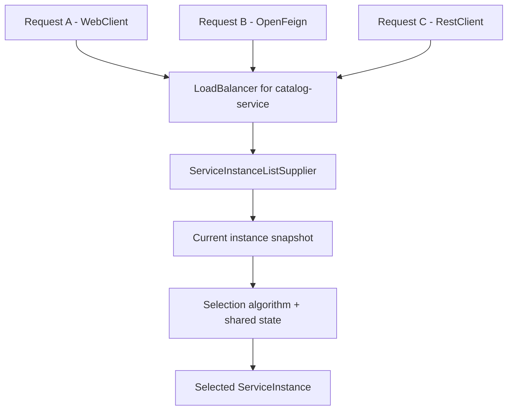
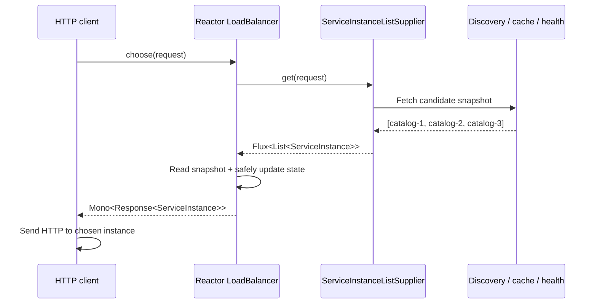

# Concurrency Safety and State Lifecycle

A custom LoadBalancer often contains only a few lines to pick a `ServiceInstance`, yet it sits on the path of **many concurrent requests**. If the algorithm stores a counter, instance list, weight table, or session info in shared variables without synchronization rules, the result can be picking the wrong instance, out-of-bounds list access, lost updates, or retaining instances already removed from discovery.

In Spring Cloud LoadBalancer, a call to `catalog-service` can originate from `RestClient`, `RestTemplate`, `WebClient`, or OpenFeign. These HTTP clients use different threading models, yet all of them can invoke the same LoadBalancer or `ServiceInstanceListSupplier` chain by **service ID**. Therefore, customizing an algorithm requires not only picking the right address; it must also be **concurrency-safe**, **never mix per-request state across calls**, and **manage state lifecycle across service ID, registry, cache, retries, and application context**.

This lesson belongs to the **Customizing LoadBalancer** chapter and focuses on state design, writing a concurrency-safe round-robin selector, understanding reactive boundaries, and verifying behavior under concurrent requests and changing instance lists.

## 1. Why Must a Custom LoadBalancer Care About Concurrency?

Suppose `order-service` calls three replicas of `catalog-service`:

| Service ID | Instance ID | Illustrative address |
|---|---|---|
| `catalog-service` | `catalog-1` | `10.0.1.11:8080` |
| `catalog-service` | `catalog-2` | `10.0.1.12:8080` |
| `catalog-service` | `catalog-3` | `10.0.1.13:8080` |

Many HTTP requests can hit the same LoadBalancer object simultaneously:



Things that can happen:

- **Race condition:** two threads both read `counter = 4` and both write `counter = 5`, losing an increment.
- **Changing list:** request A sees three instances while request B receives a newer list of two instances from discovery/health checks.
- **Wrong state scope:** a counter or `lastSelected` list is shared between `catalog-service` and `payment-service` even though the two services have different candidate sets.
- **Unclear lifecycle:** instance `catalog-2` was deregistered, yet a custom cache or sticky map still retains old entries.
- **Retries:** one business request is retried and calls `choose()` multiple times, advancing counters or mutating state.
- **Reactive cancellation:** a subscriber cancels the pipeline, leaving behind temporary state or an uncleaned-up task.

**Concurrency safety does not mean every request must pick a different instance.** Two concurrent requests picking the same instance is valid when the algorithm allows it. What matters is preventing races from corrupting data, producing invalid indices, or making decisions from half-updated state.

## 2. Classify State Before Writing an Algorithm

When designing a custom LoadBalancer, distinguish **configuration state**, **per-request state**, and **mutable shared state**.

| State category | Examples | Recommended scope | Rule |
|---|---|---|---|
| Immutable config | `serviceId`, policy name, allowed zones | `final` field on per-service bean | Initialize once; never mutate at runtime |
| Request data | Hints, sticky cookies, trace ID, retry context | Local variable / `Request` / Reactor Context | Never store in singleton fields |
| Candidate snapshot | `List<ServiceInstance>` returned by supplier | Per selection or safely published immutable snapshot | Never mutate shared lists |
| Algorithm state | Round-robin counter, selection stats | Atomic/proper synchronization, scoped per service | Update atomically |
| Per-instance state | Dynamic weights, in-flight count, health score | Map with explicit lifecycle/eviction | Remove state for departed instances; bound memory |
| Operational state | Timers, counters, timeout/retry config | Dedicated registry/config | Do not mix with ad-hoc business decisions |

An effective rule of thumb: **keep request data in local variables or immutable request objects; minimize shared state as much as possible**. If an algorithm needs no memory across selections, write it as a pure function selecting an instance from a snapshot rather than introducing unnecessary caches or maps.

## 3. Bean Lifecycle and Per-Service-ID Scope

Spring Cloud LoadBalancer uses a **named client context** mechanism via `LoadBalancerClientFactory`. Each service ID can have its own child context holding its specific selection policy and supplier chain. Custom beans are typically declared using `@LoadBalancerClient`:

```java
package com.example.orders;

import com.example.lb.catalog.CatalogLoadBalancerConfiguration;
import org.springframework.boot.SpringApplication;
import org.springframework.boot.autoconfigure.SpringBootApplication;
import org.springframework.cloud.loadbalancer.annotation.LoadBalancerClient;

@SpringBootApplication
@LoadBalancerClient(
        name = "catalog-service",
        configuration = CatalogLoadBalancerConfiguration.class)
public class OrderApplication {

    public static void main(String[] args) {
        SpringApplication.run(OrderApplication.class, args);
    }
}
```

Key points:

1. **One bean is not one request.** The LoadBalancer bean is retrieved and reused within its context, so never assume each `choose()` call runs on a fresh Java instance.
2. **State must be scoped to the service ID.** If `catalog-service` and `inventory-service` have custom policies, each service should have its own counter or state; never use `static` variables as instance-selection state shared across all services.
3. **Service-specific configuration must not be accidentally picked up by the main application context's component scan.** Place `CatalogLoadBalancerConfiguration` outside the default scan package and reference it via `@LoadBalancerClient(configuration = ...)`.
4. **Child contexts also have a lifecycle.** When the context closes, custom bean resources must be released. Never spawn eternal schedulers, executors, or subscriptions without owning and closing them.
5. **Bean count does not equal registry instance count.** One LoadBalancer for `catalog-service` may successively choose among 0, 2, or 20 instances as discovery/health changes.

When deploying multiple replicas of `order-service`, **each JVM holds its own LoadBalancer state**. An atomic counter in JVM A is not synchronized with JVM B; local round-robin does not guarantee a strictly ordered cluster-wide schedule.

## 4. Reactive Contract of the Instance Selector

A direct way to customize selection is implementing `ReactorServiceInstanceLoadBalancer`. Its `choose(Request request)` method returns `Mono<Response<ServiceInstance>>`; it interacts with `ServiceInstanceListSupplier` to obtain candidates and returns either a selected instance or an `EmptyResponse` when none exist.

High-level flow:



Core rules:

- Call `supplier.get(request)` when the algorithm or supplier needs per-request context. Arbitrarily calling `get()` can drop request-based sticky session, hint, or retry data.
- `Flux<List<ServiceInstance>>` from a supplier may emit lists in implementation-dependent ways. For a single decision, `.next()` grabs the first snapshot; this does **not** mean an eternal subscription was opened for future updates.
- Never call `.block()` or `.subscribe()` inside `choose()`. The caller of LoadBalancer owns subscription, cancellation, and error propagation.
- Never store a user's `Request` in a bean field "for the next request"; another concurrent request can overwrite it.
- `EmptyResponse` must be kept distinct from a result with an instance. The HTTP client integration translates no-server into a version- and client-appropriate response or exception; do not confuse it with a business-resource `404`.

## 5. Bad Example: Mutable Counter and Mutable List

A dangerous round-robin implementation often starts with seemingly simple lines:

```java
// WRONG: illustrates a race condition and an index tied to mutating state.
private int cursor = 0;
private List<ServiceInstance> instances = new ArrayList<>();

ServiceInstance chooseUnsafe() {
    int index = cursor++ % instances.size();
    return instances.get(index);
}
```

Problems:

1. `cursor++` is a **non-atomic** read–increment–write; concurrent threads can lose increments or observe unexpected values.
2. `instances` is an `ArrayList` that another thread might modify during selection; `size()` and `get(index)` do not form a consistent snapshot.
3. If the list is empty, modulo division fails.
4. When the counter overflows into negative numbers, `%` can yield a negative index.
5. If an `instances` field is updated from a listener, reader threads may not see a safely published snapshot.

Merely changing `int` to `volatile int` **does not make increments atomic**. `volatile` governs visibility, not atomic read–modify–write safety. Similarly, replacing `ArrayList` with `CopyOnWriteArrayList` alone does not solve all synchronization between count, selection, and state lifecycle.

For lock-based algorithms, never hold `synchronized` or locks while waiting on the network, querying a registry, calling `block()`, or serializing HTTP traffic. A long critical section forces every request to queue behind one another inside the load balancer.

## 6. Safe Example: Custom Round-Robin with `AtomicInteger` and Snapshot

The example below illustrates a concurrency-safe custom LoadBalancer at the selection layer. It uses:

- `ObjectProvider<ServiceInstanceListSupplier>` to retrieve the supplier in the service context.
- `supplier.get(request)` to forward request context.
- `Mono.defer(...)` so selection runs upon subscription.
- `AtomicInteger.getAndUpdate(...)` to allocate a unique turn for each selection reaching that step.
- `List.copyOf(...)` to obtain an immutable list for computing `size` and `get`.
- `EmptyResponse` when no candidate exists.

```java
package com.example.lb.catalog;

import java.util.List;
import java.util.concurrent.atomic.AtomicInteger;

import org.springframework.beans.factory.ObjectProvider;
import org.springframework.cloud.client.ServiceInstance;
import org.springframework.cloud.client.loadbalancer.DefaultResponse;
import org.springframework.cloud.client.loadbalancer.EmptyResponse;
import org.springframework.cloud.client.loadbalancer.Request;
import org.springframework.cloud.client.loadbalancer.Response;
import org.springframework.cloud.loadbalancer.core.ReactorServiceInstanceLoadBalancer;
import org.springframework.cloud.loadbalancer.core.ServiceInstanceListSupplier;
import reactor.core.publisher.Mono;

public final class SafeRoundRobinLoadBalancer
        implements ReactorServiceInstanceLoadBalancer {

    private final ObjectProvider<ServiceInstanceListSupplier> suppliers;
    private final String serviceId;
    private final AtomicInteger cursor = new AtomicInteger(0);

    public SafeRoundRobinLoadBalancer(
            ObjectProvider<ServiceInstanceListSupplier> suppliers,
            String serviceId) {
        this.suppliers = suppliers;
        this.serviceId = serviceId;
    }

    @Override
    public Mono<Response<ServiceInstance>> choose(Request request) {
        return Mono.defer(() -> {
            ServiceInstanceListSupplier supplier =
                    suppliers.getIfAvailable();

            if (supplier == null) {
                return Mono.<Response<ServiceInstance>>just(
                        new EmptyResponse());
            }

            return supplier.get(request)
                    .next()
                    .map(this::selectFromSnapshot)
                    .defaultIfEmpty(new EmptyResponse());
        });
    }

    private Response<ServiceInstance> selectFromSnapshot(
            List<ServiceInstance> instances) {

        if (instances == null || instances.isEmpty()) {
            return new EmptyResponse();
        }

        List<ServiceInstance> snapshot = List.copyOf(instances);
        int turn = cursor.getAndUpdate(
                current -> current == Integer.MAX_VALUE
                        ? 0
                        : current + 1);

        int index = Math.floorMod(turn, snapshot.size());
        return new DefaultResponse(snapshot.get(index));
    }
}
```

`serviceId` in this example is an immutable field holding the service name for future logging/metrics extensibility; the algorithm does not need it to compute the index. You can add a getter or logging at an appropriate boundary if observability requires it.

### 6.1. Why Is This Approach Safer?

**Atomic counter:** `getAndUpdate` updates atomically without lost turns under concurrent writes. The returned value is the value **before incrementing**; after `Integer.MAX_VALUE`, the algorithm resets to `0` to avoid handling negative counter values. `Math.floorMod(turn, snapshot.size())` always yields a valid index when `snapshot.size() > 0`.

**Local snapshot:** the algorithm checks emptiness and retrieves an element from the exact same `List.copyOf(instances)` snapshot rather than reading size from one list and indexing into another. When the supplier publishes data properly, selection code cannot mutate shared lists.

**State stores no per-request data:** `cursor` is shared solely for turn ordering; hints, cookies, and retry context flow through `Request` and the supplier, never into mutable singleton fields.

**When no candidate exists:** returns `EmptyResponse` rather than dividing by zero or picking a stale instance missing from the list.

### 6.2. Limitations of This Example

- `List.copyOf` creates an immutable snapshot **after** the supplier emits the list. If your application's custom supplier mutates the same `ArrayList` unsynchronized while copying occurs, a race still exists at the **data source**. The fix is having the supplier **publish immutable snapshots** or synchronize updates, not relying on a receiver-side copy to cure all races.
- Round-robin distributes **selections**, not request **completions**, CPU usage, processing duration, or in-flight request counts across instances.
- When the instance list shrinks or grows, taking modulo against the new size can cause an instance to be picked twice in a row or briefly skew load. That is normal behavior for a simple modulo algorithm.
- `Mono.defer` executes selection per subscription. A Publisher subscribed twice can trigger **two selections**; to bind one selection to one logical request, understand the Publisher lifecycle managed by your integration.
- `serviceId` and the example's counter are **only safe if the LoadBalancer instance is scoped to the right service**. If a bean is accidentally shared across multiple service IDs, state still mixes even with `AtomicInteger`.
- This example omits retry-aware exclusions, dynamic weights, and request-specific policies; do not treat it as a drop-in replacement for the full default LoadBalancer.

## 7. Binding the Algorithm to a Service-Specific Configuration

The bean declaration can use `LoadBalancerClientFactory` to obtain a lazy provider for `ServiceInstanceListSupplier`:

```java
package com.example.lb.catalog;

import org.springframework.cloud.client.ServiceInstance;
import org.springframework.cloud.loadbalancer.core.ReactorServiceInstanceLoadBalancer;
import org.springframework.cloud.loadbalancer.core.ServiceInstanceListSupplier;
import org.springframework.cloud.loadbalancer.support.LoadBalancerClientFactory;
import org.springframework.context.annotation.Bean;
import org.springframework.context.annotation.Configuration;
import org.springframework.core.env.Environment;

@Configuration(proxyBeanMethods = false)
public class CatalogLoadBalancerConfiguration {

    @Bean
    ReactorServiceInstanceLoadBalancer catalogLoadBalancer(
            Environment environment,
            LoadBalancerClientFactory clientFactory) {

        String serviceId = environment.getProperty(
                LoadBalancerClientFactory.PROPERTY_NAME);

        return new SafeRoundRobinLoadBalancer(
                clientFactory.getLazyProvider(
                        serviceId, ServiceInstanceListSupplier.class),
                serviceId);
    }
}
```

The bean is declared with return type `ReactorServiceInstanceLoadBalancer` in package `org.springframework.cloud.loadbalancer.core`, the interface implemented by our class above. If adjusting to another supertype, verify exact APIs/packages against your Spring Cloud BOM. **Register only one algorithm bean for this service ID** to avoid conflicting selection configurations.

**Why a lazy provider?** The supplier bean may be created through the named child context configuration while the factory instantiating the LoadBalancer references that supplier. Using a lazy provider avoids resolving all dependencies prematurely during bean creation and lets the context manage scoped lifecycles cleanly. Never store a static supplier or hold onto a supplier instance from another context.

The configuration above shows only the **algorithm bean**. The application must still provide a `ServiceInstanceListSupplier` from discovery/static instances, caching/health as needed, and compatible Spring Cloud LoadBalancer dependencies. If no supplier is registered, this example returns `EmptyResponse` so the caller handles the error rather than sending traffic to an uncontrolled fallback host.

## 8. Immutable Snapshots When the Instance List Changes

A custom `ServiceInstanceListSupplier` may refresh its list when registry entries, health checks, metadata, or configurations change. This refresh can happen **at the exact moment multiple requests are selecting instances**.

Wrong pattern:

```java
// WRONG: multiple threads read while a refresh thread modifies the same list.
private final List<ServiceInstance> current = new ArrayList<>();

void refresh(List<ServiceInstance> next) {
    current.clear();
    current.addAll(next);
}
```

Concurrent requests can read the list **after `clear` but before `addAll`**, causing transient empty candidate counts or other races. A safer option is updating an **atomic reference to an immutable snapshot**:

```java
import java.util.List;
import java.util.concurrent.atomic.AtomicReference;
import org.springframework.cloud.client.ServiceInstance;

final class CandidateSnapshot {

    private final AtomicReference<List<ServiceInstance>> current =
            new AtomicReference<>(List.of());

    void refresh(List<ServiceInstance> discovered) {
        // Create a new snapshot and publish it in one step.
        List<ServiceInstance> next = List.copyOf(discovered);
        current.set(next);
    }

    List<ServiceInstance> snapshot() {
        return current.get();
    }
}
```

When `refresh()` runs, request A may read the **old snapshot** while request B reads the **new snapshot**; both read a self-consistent list. No request ever observes a list mid-`clear/addAll`.

**Note:** if `discovered` is being mutated concurrently without synchronization while `List.copyOf` runs, fix the source to build a safe snapshot before calling `refresh`. `AtomicReference` guarantees only atomic **reference publication**, not concurrency safety of source data or mutable objects inside the list. If `ServiceInstance` elements contain mutable metadata, consider an appropriate immutable instance model.

Swapping snapshots does not mean immediately marking an old instance unhealthy. In-flight requests may have already selected an older instance prior to refresh; handling already-sent requests relies on timeouts, graceful draining, and retry policies.

## 9. Using `ConcurrentHashMap` Properly for Per-Instance State

Some algorithms track per-instance state: in-flight request count, load score, circuit state, or affinity. `ConcurrentHashMap` makes map access thread-safe, yet **does not automatically make multi-step read-modify-write logic correct**.

Dangerous example:

```java
// WRONG if multiple threads read/modify the same value and put it back.
Integer current = inFlight.get(instanceId);
inFlight.put(instanceId, current + 1);
```

One option for counters is `ConcurrentHashMap<String, AtomicInteger>`, creating counters via `computeIfAbsent` and updating atomically:

```java
private final ConcurrentHashMap<String, AtomicInteger> inFlight =
        new ConcurrentHashMap<>();

AtomicInteger counter = inFlight.computeIfAbsent(
        instanceId, ignored -> new AtomicInteger());

counter.incrementAndGet();
try {
    // Operation involving the instance (illustrative).
} finally {
    counter.decrementAndGet();
}
```

However, **do not wrap that `try/finally` around `choose()` alone and call it the in-flight HTTP request count**. Decrementing right after picking an instance only measures selection duration, not HTTP processing duration. To track true in-flight requests, tie decrementing to the lifecycle point when the HTTP request **completes, errors, or cancels**, via instrumentation/filters or the HTTP execution integration.

For reactive HTTP calls, decrementing when the Publisher terminates via `doFinally(...)` is an option, provided slots are allocated and incremented at **subscription time**, not at pipeline assembly time. When retries are active, decide whether the counter tracks logical requests or individual attempts and attach hooks at the matching boundary.

### 9.1. State Must Have a Cleanup Policy

If every new instance or request/session creates a permanent key, custom LoadBalancer state grows unboundedly over time. Enforce rules:

- When discovery drops an instance, remove its state **once no requests still reference it**; avoid deleting while decrements or in-flight tracking are active.
- During scale-in/scale-out, define retention windows for old state and ensure instance ID mapping does not collide unexpectedly.
- Bound key count, lifetime, and metric cardinality; never store every user ID or session ID forever inside a singleton.
- When the context closes, stop refresh tasks/schedulers and release custom resources.
- If using a cache such as Caffeine, configure appropriate TTL/size and invalidation policies. Do not assume cache TTL alone handles all discovery failures.

If per-instance state is not truly needed, **do not create a map**: round-robin only needs a counter and a snapshot.

## 10. Request Context, Retries, and Reactive Subscriptions

Spring Cloud LoadBalancer supports request-context-based selection. Suppliers can inspect hints, sticky-session cookies, retries, or headers/metadata forwarded by the HTTP integration.

Risks when a custom algorithm stores request data on the bean:

```java
// WRONG: a new request can overwrite data of an in-flight request.
private String preferredZone;

Mono<Response<ServiceInstance>> choose(Request request) {
    preferredZone = readZone(request);
    return supplier.get(request)
            .next()
            .map(instances -> chooseForZone(instances, preferredZone));
}
```

Because the reactive pipeline can execute after `choose` returns and another request can overwrite the field, `preferredZone` is no longer guaranteed to belong to the original request. **Better:** read zone/hint into an immutable local variable **within the same subscription**, or pass it through `Request`/Reactor Context per contract.

```java
Mono<Response<ServiceInstance>> choose(Request request) {
    return Mono.defer(() -> {
        String preferredZone = readZone(request);
        return supplier.get(request).next()
                .map(instances ->
                        chooseForZone(instances, preferredZone));
    });
}
```

This snippet is **variable-scoping pseudocode**: `readZone` and `chooseForZone` are illustrative helpers, not complete implementations. `preferredZone` is captured in the closure of that single subscription rather than a mutable singleton field.

### 10.1. What Do Retries Change?

One logical request can invoke `choose()` multiple times during retries. Your algorithm must explicitly decide:

- **Round-robin:** may advance the counter per attempt; this causes a retried request to consume multiple selection turns.
- **Avoid previous instance:** the supplier/LoadBalancer needs info about the instance that failed on the previous attempt; dropping `Request` in custom code can break this.
- **Sticky/hint:** if a version or zone constraint must hold, every retry attempt must carry the full request context; never silently fall back to an incompatible version.
- **Timeouts:** a request may still finish on the backend after the caller times out; do not infer from timeouts alone that an instance is dead.
- **Cancellation:** if a pipeline cancels before finishing selection, subscription state may already have incremented even though no request was sent. That is acceptable for a **selection-turn counter**, but unacceptable for an **in-flight HTTP counter** lacking a matching decrement.

Therefore, define **"selection turn"**, **"HTTP attempt"**, and **"logical request"** as three distinct boundaries in your docs, metrics, and tests.

## 11. Never Put Blocking Operations on the Selection Path

A custom LoadBalancer can be called at very high frequency. The following operations should never run directly inside `choose()`:

- Querying a database or HTTP health endpoint to probe each instance at selection time.
- Reading a large configuration file on every request.
- `Thread.sleep` or waiting on a long-held lock.
- Calling `Mono.block()` to retrieve lists from a reactive supplier.
- Creating a new scheduler/executor/HTTP client per selection.
- Logging full metadata/candidate lists at INFO level for every request.

Instead:

- Consume lists from `ServiceInstanceListSupplier` updated through proper discovery/cache/health pipelines.
- Keep instance selection **fast, deterministic, and low-allocation**; e.g., read an immutable snapshot and compute an index.
- If dynamic weights must be computed, gather metrics in a lifecycle-managed background job and publish an **immutable policy snapshot** to the read path.
- Constrain metric labels; never attach `requestId`, `traceId`, or unbounded instance IDs to every timer/counter.
- Keep timeouts/retries in the transport/resilience layers instead of replacing them with `synchronized` blocks or sleeps inside selection.

**A reactive API does not guarantee non-blocking execution by itself:** if `supplier.get(request)` or custom code performs blocking I/O, the entire selection path can still stall the event loop or calling thread.

## 12. Updating Dynamic Policy via Atomic Snapshots

For weighted or zone-priority algorithms, policies may need reloading from config or feature flags. Never update multiple separate fields independently where a request could observe half-old, half-new state:

```java
// WRONG: a request may read new weights alongside old zones.
this.weights = newWeights;
this.allowedZones = newZones;
```

A safer pattern is bundling all values into one immutable policy object and swapping it atomically:

```java
import java.util.Map;
import java.util.Set;
import java.util.concurrent.atomic.AtomicReference;

public final class RoutingPolicyHolder {

    public record Policy(
            Map<String, Integer> weights,
            Set<String> allowedZones) {

        public Policy {
            weights = Map.copyOf(weights);
            allowedZones = Set.copyOf(allowedZones);
        }
    }

    private final AtomicReference<Policy> current =
            new AtomicReference<>(
                    new Policy(Map.of(), Set.of()));

    public Policy snapshot() {
        return current.get();
    }

    public void update(
            Map<String, Integer> weights,
            Set<String> allowedZones) {
        validate(weights, allowedZones);
        current.set(new Policy(weights, allowedZones));
    }

    private static void validate(
            Map<String, Integer> weights,
            Set<String> zones) {
        if (weights == null || zones == null
                || weights.values().stream().anyMatch(
                        w -> w == null || w <= 0)
                || zones.stream().anyMatch(java.util.Objects::isNull)) {
            throw new IllegalArgumentException(
                    "Invalid routing policy");
        }
    }
}
```

In the selection method, read `Policy policy = holder.snapshot();` **once**, then use that same policy object for the entire calculation. When an update occurs, one request sees the old policy and the next sees the new policy; no request ever sees a torn half-old/half-new configuration.

This example focuses on **atomic publication**, without defining the weighted selection algorithm itself; converting weights to probabilities, handling total weight overflow, all-zero weights, appearing/disappearing instances, and request context still require separate design.

With `Map.copyOf` and `Set.copyOf`, collection structure is protected from mutation after snapshot creation. If values inside were mutable objects, deep immutability or a strict no-mutation convention would still be required.

## 13. Testing Race Conditions, List Churn, and Lifecycle

Sequential tests are not enough to uncover concurrency bugs; run many concurrent requests while mutating lists mid-selection. Example test plan:

| Scenario | How to trigger | What to assert |
|---|---|---|
| 1,000 parallel selections | Multiple subscribers/threads calling `choose` concurrently | No exceptions, no out-of-range index picks |
| List updates 3 → 2 → 0 instances | Supplier emits new snapshots | Only picks instances present in snapshot; 0 returns no-server |
| Mutated snapshot | Attempt to mutate list retained by supplier | Custom supplier must publish immutable snapshots |
| Two service IDs | Create two separate named client contexts | Counters/state never mix across services |
| Retries | Trigger multiple attempts for one logical request | Counters/metrics reflect the defined scope |
| Subscription cancellation | Cancel before supplier emits a list | No leaked subscriptions, tasks, or in-flight slots |
| Rollout/scale-in | Remove one instance and add a new instance | Old state is cleaned up; no stale instance retained |
| Context shutdown | Close application context | Schedulers/pools/custom caches stop cleanly |

### 13.1. Meaningful Concurrency Testing

A Reactor skeleton showing how to run many concurrent subscriptions in a test with `Reactor Test`/JUnit:

```java
Flux<Response<ServiceInstance>> choices = Flux
        .range(0, 1_000)
        .flatMap(i -> loadBalancer.choose(new DefaultRequest<>())
                .subscribeOn(Schedulers.parallel()), 64);

StepVerifier.create(choices)
        .expectNextCount(1_000)
        .verifyComplete();
```

This snippet **illustrates only the test structure**: initialize `loadBalancer` with a test supplier and import `DefaultRequest`, `Response`, `ServiceInstance`, `Schedulers`, `Flux`, and `StepVerifier` with matching dependencies. Checking `expectNextCount` only verifies 1,000 emissions and is **not enough** to prove thread safety.

Add assertions checking every `response.hasServer()`, allowed ID sets, no-instance conditions, and distribution under a **fixed** list scenario. Under a continuously changing list, do not assert "every three selections must hit each instance once," since candidate count and order change between turns.

To expose races more readily, run a task emitting 3/2/0-instance snapshots concurrently with multiple subscribers over many iterations, recording exceptions and results; even so, **tests cannot prove absence of races under every schedule**. Code must rely on sound thread-safety reasoning—atomics, immutability, and clear lifecycles—alongside stress tests.

### 13.2. Testing Resource Cleanup

If a custom LoadBalancer opens schedulers or listeners to refresh state, tests should close the child/application context and verify tasks stop running and resources are released. Avoid relying on `@PreDestroy` just to clean up an untracked/uncancellable subscription; whenever creating resources, retain proper lifecycle handles such as `Disposable` or use framework-managed resource lifecycles.

If the custom algorithm consists only of an `AtomicInteger` and a Spring-managed supplier as in the safe example, do not spawn a background task just to "clean up the counter"—lightweight state is garbage-collected with the bean when the context is destroyed.

## 14. Observing Outcomes Without Unbounded State Growth

To monitor a custom LoadBalancer in real environments, collect:

- `serviceId`, algorithm type, total selections, and no-candidate counts.
- Selection duration and candidate count before selection, using bounded-label metrics.
- HTTP 5xx, timeout, retry rates, and p95/p99 latency by caller service and operation.
- Selected instance identifier in **sampled traces/logs** rather than adding it to every metric label.
- Policy/health/registry update status and when new snapshots were published.
- State map entry count, evicted key count, and cache lifetime if applicable.

One specific alert to handle properly: **if no-instance counts spike, do not rush to bump counters or swap out round-robin**. Inspect `DiscoveryClient`, the supplier chain, health filters, zone/hints, and caches. If instances exist yet requests time out, examine transport, readiness, and actual backend capacity.

Avoid logging full `Request` objects or all headers inside a custom LB; request context can hold cookies, tokens, user IDs, or sensitive hints. Metrics should capture **algorithm behavior**, while specific failures belong in traces.

## 15. Pre-Deployment Design Checklist

- [ ] Clearly separate immutable state, per-request state, and shared state.
- [ ] Scope state properly per service ID; never use mutable static maps/counters across all services.
- [ ] Shared-state read–modify–write operations use atomics or proper synchronization.
- [ ] Candidate lists and dynamic policies are consumed as consistent snapshots; never mutate collections exposed to other requests.
- [ ] `choose(Request)` forwards request context via `supplier.get(request)` when policies need it.
- [ ] No `block()`, `subscribe()`, or blocking I/O inside the selection path.
- [ ] Return explicit no-instance when the list is empty; never retain stale instances just to "preserve" availability.
- [ ] Understand how retries, double subscriptions, and cancellations affect state and metrics.
- [ ] Per-instance or session state has size bounds, eviction, and shutdown cleanup.
- [ ] Per-service config lives in the named client context; prevent custom beans from becoming accidentally global.
- [ ] Stress-test concurrency, snapshot churn, scale-in, and application shutdown.
- [ ] Observability tracks selections/no-instance counts without introducing high-cardinality metric labels.

## 16. Key Takeaways

When customizing Spring Cloud LoadBalancer, **correct algorithm logic** alone is not enough: you must prove the algorithm is **correct under concurrency** and manage **state lifecycles**. Shared counters should be updated with `AtomicInteger` or proper synchronization; candidate lists and dynamic configurations should be published as immutable snapshots; and request hints, cookies, or traces must never be stored in mutable singleton fields.

`ReactorServiceInstanceLoadBalancer.choose(Request)` should integrate with its supplier over a reactive pipeline, return `EmptyResponse` when no instances exist, and never call `block()` or `subscribe()` itself. LoadBalancer beans must be scoped strictly by **service ID**, and per-instance state must be cleaned up when topology changes without leaking across rollouts. Finally, test **concurrency, discovery refreshes, retries, cancellations, and shutdown** together so services communicate reliably when multiple HTTP clients share LoadBalancer.
