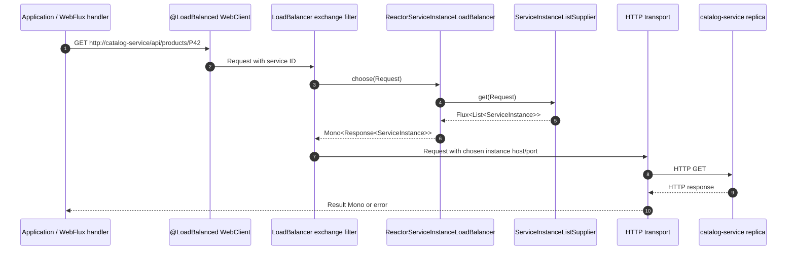
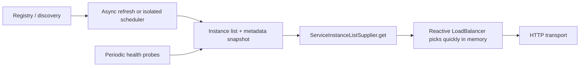

# Avoiding Blocking I/O During Reactive Target Selection

When `order-service` uses `WebClient` to call `http://catalog-service/api/products/P42`, Spring Cloud LoadBalancer must select a `ServiceInstance` before the HTTP client opens a connection to the chosen replica. Because the selection API returns `Mono<Response<ServiceInstance>>`, developers writing a custom LoadBalancer can easily assume everything inside is automatically "reactive." **That is false:** if `choose()` executes `Thread.sleep()`, calls a registry via a synchronous SDK, queries a database, or calls `.block()`, the executing thread can still be blocked.

A slow target selection operation does more than increase latency for the current request. If it runs on a **Reactor Netty event loop** or a scheduler serving many other requests, it can stall unrelated requests and trigger cascading timeouts and retries. Within the `SPRING_CLOUD_SERVICE_COMMUNICATION_LOAD_BALANCING` module, the goal is keeping `ServiceInstance` selection across service IDs, discovery, health checks, and routing policies **free of blocking I/O on the reactive path**, while maintaining timeouts, observability, and a migration path when integrating legacy data sources.

## 1. How Target Selection Works in a Reactive Chain

A `WebClient` call integrated with Spring Cloud LoadBalancer looks like this:



Four interfaces/components to distinguish:

| Component | Primary contract | Responsibility |
|---|---|---|
| `ReactorServiceInstanceLoadBalancer` | `Mono<Response<ServiceInstance>> choose(Request request)` | Picks one instance from the candidate list |
| `ServiceInstanceListSupplier` | `Flux<List<ServiceInstance>> get(Request request)` or `get()` | Supplies instance list snapshots for a service ID |
| `ReactiveDiscoveryClient` | `Flux<ServiceInstance> getInstances(String serviceId)` | Fetches discovery info via the implementation's reactive API |
| `@LoadBalanced WebClient.Builder` | Builds a `WebClient` with LoadBalancer exchange filter | Bridges logical HTTP requests to instance selection |

**A reactive return signature does not prove the implementation is non-blocking.** A `Flux` might wrap `Flux.just(discoveryClient.getInstances(...))`, where `getInstances` already ran synchronously before the publisher was even returned. Conversely, a truly reactive source emits signals only after subscription without blocking the caller thread waiting on remote I/O.

If the system only needs standard round-robin, prefer the built-in `RoundRobinLoadBalancer`. A custom LoadBalancer should only be added for genuine requirements such as zone preferences, custom policies, or metadata-driven candidate lists; never rewrite the algorithm just to get a reactive API.

## 2. Why Blocking the Event Loop Is Especially Dangerous

In Spring WebFlux/Reactor Netty applications, a small pool of event-loop threads handles I/O for **many connections and requests**. They are designed for short, fast work—not waiting on synchronous I/O.

Suppose request A selects an instance by making a synchronous HTTP registry call that takes 600 ms. If that call runs on the event loop, for those 600 ms the thread cannot efficiently process other I/O events bound to it. Requests B, C, and D can all stall even though they never made a registry call themselves.

```text
Event loop thread #1
  t=0ms:  handles request A → starts instance selection
  t=1ms:  calls synchronous DiscoveryClient.getInstances()
  t=2..600ms: thread blocked, unable to process other work
  t=601ms: returns instance list
  t=602ms: resumes I/O for waiting requests B/C/D
```

| Symptom | What can happen when the event loop is blocked |
|---|---|
| HTTP p95/p99 latency spikes across multiple endpoints | Threads cannot service socket events in time |
| Timeouts even though downstream is healthy | Client cannot process responses promptly |
| Rapid spike in retries | Timeouts trigger extra attempts |
| Connection pool pending queue grows | Requests back up at both caller and transport layers |
| CPU is not necessarily high | Threads are *waiting* on blocking I/O rather than burning CPU |
| BlockHound or logs flag blocking calls | A blocking operation ran where prohibited |

Short CPU work—like computing a round-robin index, filtering a small list, or reading in-memory metadata—is generally fine on the event loop. The danger is **waiting on results** by blocking a thread, or placing unboundedly heavy computation on the event loop.

## 3. Which Operations Risk Blocking Inside `choose()`?

| Operation | Risk of blocking? | Recommendation |
|---|---|---|
| Reading `AtomicInteger`, `AtomicReference` | Normally no; fast operation | Safe inside selection step |
| Filtering an in-memory instance list | Usually no if list is small/bounded | Keep algorithm simple; avoid heavy work |
| Calling `DiscoveryClient.getInstances()` on a blocking implementation | Yes | Use a reactive source or offload to an appropriate scheduler |
| Calling `WebClient` then `.block()` | **Yes** | Return/compose publishers; never block |
| Calling `RestClient` or blocking OpenFeign inside `map` | **Yes** | Never call on the event loop; prefer prefetch/cache |
| `Thread.sleep(...)` | **Yes** | Never use in selection logic; use reactive timers in tests |
| `Future.get()` / `CompletableFuture.join()` | **Can block** | Adapt future into a proper publisher or offload |
| `JdbcTemplate` / synchronous filesystem | **Yes** | Keep off the selection path; if unavoidable, isolate threads and bound concurrency |
| `Mono.just(blockingCall())` | **Yes, eagerly when building the Mono** | Use `Mono.fromCallable(...)` paired with a scheduler |
| `Mono.defer(() -> Mono.just(blockingCall()))` | **Yes, on subscribe** | `defer` only makes it *lazy*; it does not make it non-blocking |
| `Mono.delay(...)` / true reactive I/O | Does not block threads synchronously | Use appropriate scheduler and enforce timeout/cancellation |

A simple rule: **absence of `block()` does not mean absence of blocking**. Calling a registry SDK's synchronous `getInstances()` inside `map(...)` still blocks the thread even though the outer chain is a `Flux`.

## 4. Common Anti-Patterns

### 4.1. Blocking Directly Inside `choose()`

```java
// WRONG: if DiscoveryClient is blocking, choose() blocks the caller itself.
@Override
public Mono<Response<ServiceInstance>> choose(Request request) {
    List<ServiceInstance> instances =
            discoveryClient.getInstances("catalog-service");
    return Mono.just(select(instances));
}
```

`getInstances(...)` executes **eagerly before the `Mono` is even created**, meaning returning a publisher provides zero non-blocking benefit.

### 4.2. Forcing a Reactive Result to Be Synchronous

```java
// WRONG: block() holds the request-processing thread.
@Override
public Mono<Response<ServiceInstance>> choose(Request request) {
    List<ServiceInstance> instances =
            reactiveDiscovery.getInstances("catalog-service")
                    .collectList()
                    .block();
    return Mono.just(select(instances));
}
```

On Reactor non-blocking threads, `block()` may throw an exception immediately; even where it does not throw, it wastes a thread waiting.

### 4.3. Calling `subscribe()` Manually Inside LoadBalancer

```java
// WRONG: subscribe() detaches work from the request and fails to return the right result.
@Override
public Mono<Response<ServiceInstance>> choose(Request request) {
    supplier.get(request)
            .next()
            .subscribe(instances -> updateSharedSelection(instances));

    return Mono.just(new EmptyResponse());
}
```

Manual `subscribe()` detaches execution into an independent stream; `choose()` can return `EmptyResponse` before the list even arrives. It also breaks propagation of cancellation, errors, tracing, and request deadlines. **Return the composed publisher itself** so the framework manages subscription.

### 4.4. Fetching External Data on Every Selection

```java
// ARCHITECTURALLY WRONG: picking a replica requires waiting on a policy API/DB for every request.
return policyWebClient.get()
        .uri("/choose?service=catalog-service")
        .retrieve()
        .bodyToMono(String.class)
        .flatMap(instanceId -> findInstance(instanceId));
```

This snippet may be **non-blocking at the thread level**, yet it adds a remote dependency and network round-trip to every instance selection; if the policy service fails, every downstream call fails to pick a target. A better approach is **updating policies/weights/metadata asynchronously and selecting over an in-memory snapshot**.

## 5. Right Design: Lazy Publishers, Pure In-Memory Selection

A non-blocking custom LoadBalancer should follow these principles:

1. `choose(Request)` **immediately returns** a `Mono` without waiting on lists or connections.
2. Obtain list snapshots through a `ServiceInstanceListSupplier` with a reactive API.
3. Once a snapshot arrives, run only lightweight computation to pick an instance or return `EmptyResponse` if empty.
4. Propagate results and errors through Reactor publishers; never call `subscribe()` manually.
5. Bound the wait time for a snapshot when the source stalls, aligned with the application's deadline.
6. Do not mask registry failures as "no instance" if doing so misleads operators.
7. Never create HTTP clients or open TCP connections inside the selection algorithm.

Below is a round-robin implementation **illustrating non-blocking structure**. In systems without custom needs, using the built-in `RoundRobinLoadBalancer` is simpler and less risky.

### `NonBlockingRoundRobinLoadBalancer.java`

```java
package com.example.orders.loadbalancer;

import java.time.Duration;
import java.util.List;
import java.util.concurrent.atomic.AtomicInteger;

import org.springframework.beans.factory.ObjectProvider;
import org.springframework.cloud.client.ServiceInstance;
import org.springframework.cloud.client.loadbalancer.DefaultResponse;
import org.springframework.cloud.client.loadbalancer.EmptyResponse;
import org.springframework.cloud.client.loadbalancer.Request;
import org.springframework.cloud.client.loadbalancer.Response;
import org.springframework.cloud.loadbalancer.core.ReactorServiceInstanceLoadBalancer;
import org.springframework.cloud.loadbalancer.core.ServiceInstanceListSupplier;

import reactor.core.publisher.Mono;

public final class NonBlockingRoundRobinLoadBalancer
        implements ReactorServiceInstanceLoadBalancer {

    private final ObjectProvider<ServiceInstanceListSupplier> supplierProvider;
    private final AtomicInteger cursor = new AtomicInteger();
    private final String serviceId;

    public NonBlockingRoundRobinLoadBalancer(
            ObjectProvider<ServiceInstanceListSupplier> supplierProvider,
            String serviceId) {
        this.supplierProvider = supplierProvider;
        this.serviceId = serviceId;
    }

    @Override
    public Mono<Response<ServiceInstance>> choose(Request request) {
        return Mono.defer(() -> {
            ServiceInstanceListSupplier supplier =
                    supplierProvider.getIfAvailable();

            if (supplier == null) {
                return Mono.just(new EmptyResponse());
            }

            return supplier.get(request)
                    .next()
                    .map(this::selectFromSnapshot)
                    .switchIfEmpty(Mono.fromSupplier(EmptyResponse::new))
                    .timeout(Duration.ofMillis(300));
        });
    }

    private Response<ServiceInstance> selectFromSnapshot(
            List<ServiceInstance> instances) {

        if (instances == null || instances.isEmpty()) {
            return new EmptyResponse();
        }

        int index = Math.floorMod(
                cursor.getAndIncrement(), instances.size());
        return new DefaultResponse(instances.get(index));
    }

    public String getServiceId() {
        return serviceId;
    }
}
```

This code illustrates modern Spring Cloud LoadBalancer APIs. Verify package names, constructors, and per-client registration against your project's **Spring Cloud release train**. `Duration.ofMillis(300)` is an **experimental bound** on selection wait time (including waiting on the supplier publisher), not a production universal constant. That threshold must fit within the logical request's **remaining deadline** and match real discovery cost.

Important details:

- `Mono.defer` defers fetching the supplier and assembling the chain until subscription, avoiding side effects when the call is merely constructed.
- `supplier.get(request).next()` takes the **first snapshot** from `Flux<List<ServiceInstance>>` and finishes that subscription. Even if the supplier emits periodic updates, a single request selection will not wait indefinitely collecting all snapshots.
- `map(this::selectFromSnapshot)` operates solely on an already-delivered list, making no HTTP/DB calls.
- `Math.floorMod(...)` prevents negative indices if `AtomicInteger` wraps around; the algorithm still picks a valid element in the current snapshot.
- `switchIfEmpty` turns a source that completes without emitting a list into `EmptyResponse`; a `0`-element list also yields `EmptyResponse` from `selectFromSnapshot`.
- `timeout` guards against a supplier failing to emit a snapshot in time. It emits a **timeout error**, distinct from the supplier returning an empty list; do not swallow all errors into `EmptyResponse`.
- When no supplier bean exists, the example returns `EmptyResponse`. In production, you may prefer failing fast at startup to avoid silent degradation when discovery is misconfigured.

**Crucial condition:** this implementation is non-blocking only when **the supplier itself and all upstream components do not block threads while emitting data**. `Mono.defer` does not cure a blocking `DiscoveryClient.getInstances()` called inside the supplier.

## 6. Registering the LoadBalancer per Service ID Without Affecting Other Clients

Spring Cloud LoadBalancer manages per-service-ID configuration via `LoadBalancerClientFactory`. You can attach a custom LoadBalancer specifically to `catalog-service`:

### Configuration in the Child Context

```java
package com.example.cataloglbconfig;

import com.example.orders.loadbalancer.NonBlockingRoundRobinLoadBalancer;
import org.springframework.cloud.client.ServiceInstance;
import org.springframework.cloud.loadbalancer.core.ReactorServiceInstanceLoadBalancer;
import org.springframework.cloud.loadbalancer.core.ServiceInstanceListSupplier;
import org.springframework.cloud.loadbalancer.support.LoadBalancerClientFactory;
import org.springframework.context.annotation.Bean;
import org.springframework.context.annotation.Configuration;
import org.springframework.core.env.Environment;

@Configuration(proxyBeanMethods = false)
public class CatalogLoadBalancerConfiguration {

    @Bean
    ReactorServiceInstanceLoadBalancer catalogLoadBalancer(
            Environment environment,
            LoadBalancerClientFactory factory) {

        String serviceId = environment.getProperty(
                LoadBalancerClientFactory.PROPERTY_NAME);

        return new NonBlockingRoundRobinLoadBalancer(
                factory.getLazyProvider(
                        serviceId, ServiceInstanceListSupplier.class),
                serviceId);
    }
}
```

### Activation in the Consumer Application

```java
package com.example.orders;

import com.example.cataloglbconfig.CatalogLoadBalancerConfiguration;
import org.springframework.boot.SpringApplication;
import org.springframework.boot.autoconfigure.SpringBootApplication;
import org.springframework.cloud.loadbalancer.annotation.LoadBalancerClient;

@SpringBootApplication
@LoadBalancerClient(
        name = "catalog-service",
        configuration = CatalogLoadBalancerConfiguration.class)
public class OrderApplication {

    public static void main(String[] args) {
        SpringApplication.run(OrderApplication.class, args);
    }
}
```

**Bean-scope warning:** place `CatalogLoadBalancerConfiguration` **outside packages scanned by the main application's component scan** if you want it used solely inside `catalog-service`'s child context. If scanned into the parent context, custom beans can leak to other clients/service IDs. That is a configuration-scope mistake, not a reactive bug.

Using the LoadBalancer-integrated `WebClient`:

```java
package com.example.orders.config;

import org.springframework.cloud.client.loadbalancer.LoadBalanced;
import org.springframework.context.annotation.Bean;
import org.springframework.context.annotation.Configuration;
import org.springframework.web.reactive.function.client.WebClient;

@Configuration(proxyBeanMethods = false)
public class HttpClientConfiguration {

    @Bean
    @LoadBalanced
    WebClient.Builder loadBalancedWebClientBuilder() {
        return WebClient.builder();
    }
}
```

```java
package com.example.orders.catalog;

import org.springframework.cloud.client.loadbalancer.LoadBalanced;
import org.springframework.stereotype.Component;
import org.springframework.web.reactive.function.client.WebClient;
import reactor.core.publisher.Mono;

@Component
public class CatalogClient {

    private final WebClient client;

    public CatalogClient(@LoadBalanced WebClient.Builder builder) {
        this.client = builder.clone()
                .baseUrl("http://catalog-service")
                .build();
    }

    public Mono<ProductDto> getProduct(String id) {
        return client.get()
                .uri("/api/products/{id}", id)
                .retrieve()
                .bodyToMono(ProductDto.class);
    }
}
```

`ProductDto` is an application-defined DTO. `CatalogClient` returns a `Mono` for the reactive controller or orchestration layer to subscribe to within the request lifecycle; it never calls `.block()` to grab values eagerly. When another service ID like `inventory-service` is called, its own policy configuration remains independent of `catalog-service`.

## 7. A Truly Reactive Discovery Source Matters More Than the Algorithm

In Spring Cloud, instance data can come from:

- `ReactiveDiscoveryClient` exposing `Flux<ServiceInstance>`.
- Traditional `DiscoveryClient` exposing `List<ServiceInstance> getInstances(String)`.
- `SimpleDiscoveryClient` with a static list.
- A custom `ServiceInstanceListSupplier` reading an in-memory/cached snapshot.
- A registry or service mesh supplying lists through deployment-specific mechanisms.

**Do not conclude every `ReactiveDiscoveryClient` is non-blocking just because it returns a `Flux`.** Inspect the actual registry implementation and where it executes network I/O. Likewise, when Spring Cloud uses an adapter/supplier around a blocking `DiscoveryClient`, verify that it is offloaded from the event loop in your running version.

Example of a well-behaved supplier on the request path that reads only a pre-updated snapshot:

```java
package com.example.orders.loadbalancer;

import java.util.List;
import java.util.concurrent.atomic.AtomicReference;
import org.springframework.cloud.client.ServiceInstance;
import org.springframework.cloud.loadbalancer.core.ServiceInstanceListSupplier;
import reactor.core.publisher.Flux;

public final class SnapshotSupplier implements ServiceInstanceListSupplier {

    private final String serviceId;
    private final AtomicReference<List<ServiceInstance>> snapshot =
            new AtomicReference<>(List.of());

    public SnapshotSupplier(String serviceId) {
        this.serviceId = serviceId;
    }

    @Override
    public String getServiceId() {
        return serviceId;
    }

    @Override
    public Flux<List<ServiceInstance>> get() {
        return Flux.defer(() -> Flux.just(snapshot.get()));
    }

    public void refresh(List<ServiceInstance> instances) {
        snapshot.set(List.copyOf(instances));
    }
}
```

In this example, `get()` **never hits the network or database**; it only reads an atomic reference to an immutable list. Refreshing the list (`refresh`) must be handled by a controlled asynchronous mechanism **elsewhere**, with policies for empty caches, stale data, refresh intervals, and readiness. Do not call `refresh(discoveryClient.getInstances(...))` on the event loop just because `get()` itself is fast.

An immutable snapshot prevents readers from selecting instances while another thread mutates an `ArrayList`. During refresh, detect invalid/unavailable data and emit data-age metrics rather than silently keeping stale lists forever without alerting.

## 8. When You Must Use a Blocking DiscoveryClient

Some legacy registry clients/SDKs offer only synchronous APIs. If you cannot yet replace them with a reactive source, **isolate blocking I/O away from the event loop** instead of calling it directly in `choose()`.

Example supplier offloading a synchronous call to `boundedElastic`:

```java
package com.example.orders.loadbalancer;

import java.util.List;
import org.springframework.cloud.client.ServiceInstance;
import org.springframework.cloud.client.discovery.DiscoveryClient;
import org.springframework.cloud.loadbalancer.core.ServiceInstanceListSupplier;
import reactor.core.publisher.Flux;
import reactor.core.publisher.Mono;
import reactor.core.scheduler.Schedulers;

public final class IsolatedBlockingDiscoverySupplier
        implements ServiceInstanceListSupplier {

    private final DiscoveryClient discoveryClient;
    private final String serviceId;

    public IsolatedBlockingDiscoverySupplier(
            DiscoveryClient discoveryClient,
            String serviceId) {
        this.discoveryClient = discoveryClient;
        this.serviceId = serviceId;
    }

    @Override
    public String getServiceId() {
        return serviceId;
    }

    @Override
    public Flux<List<ServiceInstance>> get() {
        return Mono.fromCallable(
                    () -> discoveryClient.getInstances(serviceId))
                .subscribeOn(Schedulers.boundedElastic())
                .flux();
    }
}
```

Step-by-step analysis:

1. `Mono.fromCallable` makes the blocking call **lazy**: it runs only when subscribed.
2. `subscribeOn(Schedulers.boundedElastic())` moves subscription and callable execution onto the bounded scheduler meant for blocking tasks.
3. `.flux()` exposes the `Flux<List<ServiceInstance>>` return type required by the supplier contract.
4. When LoadBalancer consumes `supplier.get(request).next()`, selection waits asynchronously on the scheduler **without blocking an event-loop thread**.

**This is a transitional workaround, not true non-blocking I/O.** The SDK call still ties up a `boundedElastic` thread while waiting. If every request queries a slow registry, the scheduler/queue can still saturate—only moving the bottleneck off the event loop. Therefore, **cache/refresh on a controlled schedule** and limit refresh concurrency.

Specifically:

- Never use `Schedulers.parallel()` to run blocking I/O.
- Never attach `publishOn(Schedulers.boundedElastic())` **after** `Mono.just(blockingCall())` has already executed eagerly; blocking occurred before switching schedulers.
- Never rely on `timeout(...)` alone to cancel blocking SDK work: timeout stops waiting on the publisher, but does not guarantee the underlying I/O is interrupted or cancelled.
- Never create an unbounded `newCachedThreadPool()` for every instance selection.
- Never offload `DiscoveryClient` onto `boundedElastic` and ignore metrics for queue depth, pending tasks, and refresh duration.

When registering a custom supplier, verify only one supplier chain is active for the target service ID, avoiding accidentally registering competing `ServiceInstanceListSupplier` beans or overriding active cache/health configurations. In most systems, using Spring Cloud's built-in supplier builder matched to your discovery type is safer than writing a custom offload wrapper.

## 9. Caching, Health Checks, and Refresh: Moving I/O Off the Selection Path

A sound design does not hit the registry or `/actuator/health` of every instance **on every request**. Instead:



`ServiceInstanceListSupplier` can be assembled as a chain of suppliers/decorators—for example discovery → cache → health/zone preference → load-balancing policy—depending on version and operational needs. **Decorator order matters**: if caching sits in the wrong spot, you can accidentally cache a list filtered for one specific request/zone/hint, or retain instances whose state changed longer than expected. Verify against your version's guidance and live supplier chain behavior.

Key distinctions:

- **Discovery refresh:** updates the instance list from the registry.
- **Health check:** assesses availability via endpoints/metadata, typically via periodic probes; a `200` health endpoint does not guarantee business APIs are fast.
- **Cache:** reduces I/O or selection cost, though it can temporarily hold failed or scaled-down addresses.
- **Selection:** uses the snapshot at selection time; performs no per-instance synchronous probe I/O.

For example, `HealthCheckServiceInstanceListSupplier` can leverage background probe results and replay the candidate list. Never add `webClient.get().retrieve()...block()` inside `selectFromSnapshot` to "check health right before choosing": that adds an extra HTTP call to **every** selection, risking cascading failures and heavy downstream load.

If all instances are marked unhealthy, know the **fallback policy of the supplier** in use: some implementations return the original unfiltered list to avoid having zero candidates rather than returning an empty list. Fail-open vs. fail-closed must be an explicit, tested design choice.

## 10. A Good Refresh Loop Needs Backpressure and Resource Bounds

Updating instance lists also needs protection, even when running off the request path:

| Hazard | Consequence | Mitigation |
|---|---|---|
| Refresh triggers faster than registry responds | Overlapping refresh runs pile up | Allow only one active refresh / keep concurrency low |
| Unbounded registry retries | Scheduler and network saturation | Backoff/jitter, retry budget, circuit breaker |
| Snapshot mutated mid-read | Picks broken instance or hits race conditions | Swap whole `List.copyOf(...)` via `AtomicReference` |
| TTL too long | Calls dead or relocated replicas | Balance TTL against discovery and health latency |
| TTL too short | Excessive registry I/O | Reasonable caching; use push updates if supported |
| Empty snapshot | All requests fail fast or fall back | Clear alerts and explicit no-instance policy |
| Registry slow while snapshot still healthy | Can serve slightly older list briefly | Enforce max-staleness and monitor data age |
| Refresh runs on event loop with blocking I/O | Stalls unrelated HTTP requests | True reactive client or bounded `boundedElastic` |

If using a streaming/watch registry mechanism, handle events on a long-lived subscription in the instance-management layer—**never open a new watch per request**. For suppliers emitting multiple snapshots, LoadBalancer should take the needed snapshot and terminate its selection subscription; never call `collectList()` on an infinite `Flux`.

## 11. Time Budget: Instance Selection Must Also Be Bounded

A request might have a 1,200 ms end-to-end deadline covering authentication, instance selection, pool wait, TCP/TLS, server processing, body decoding, and retries. Spending 700 ms on instance selection may leave downstream without enough time to respond.

Illustrative budget breakdown:

| Phase | Illustrative budget |
|---|---:|
| Gateway/app before HTTP call | 100 ms |
| Discovery/selection (when refresh needed) | 150 ms |
| Pool acquire + connect/TLS | 200 ms |
| Server/response/body | 600 ms |
| Headroom to assemble and return response | 150 ms |
| **Total** | **1,200 ms** |

These numbers are only for the exercise, not defaults. **Do not use LoadBalancer's local timeout to grant a brand-new full budget on every hop.** When an upstream deadline is propagated, instance selection should fit within remaining time and leave headroom for HTTP transport.

In `NonBlockingRoundRobinLoadBalancer`, `timeout(300 ms)` protects against an unresponsive supplier. However, if the caller has only 100 ms left until its overall deadline, a 300 ms selection limit is too generous. Propagating budget/request context into LoadBalancer must follow `Request`, hints, or context mechanisms supported by your Spring Cloud version; otherwise enforce the **overall deadline** in the outer orchestration layer and keep local selection timeouts small and safe.

With WebClient:

```java
Mono<ProductDto> callWithDeadline(
        CatalogClient catalogClient,
        String id,
        java.time.Duration remaining) {

    if (remaining.isZero() || remaining.isNegative()) {
        return Mono.error(new DeadlineExceededException());
    }

    return catalogClient.getProduct(id)
            .timeout(remaining);
}
```

This is an illustrative overall timeout pattern at the reactive layer. `DeadlineExceededException` is an application-defined exception you must declare; do not assume `Mono.timeout` guarantees the server stopped processing after client cancellation. In a real implementation, recompute `remaining` close to **subscription time** (e.g., via `Mono.defer`) if the publisher might sit queued before execution.

## 12. No Instance vs. Supplier Error vs. Timeout

Three situations must be separated in code and observability:

| Situation | Signal at LoadBalancer | Interpretation |
|---|---|---|
| Supplier emits `List.of()` | `EmptyResponse` | No candidates in the current snapshot |
| Supplier emits `Flux.empty()` | `EmptyResponse` in our example | Supplier emitted no snapshot |
| Supplier returns `Mono.error(...)` or `Flux.error(...)` | Error signal | Discovery/supplier encountered an error |
| Supplier emits nothing within budget | `TimeoutException` | Selection did not complete in time |
| Instance selected but connect fails | HTTP transport error **after** selection | Host/port unreachable |
| Server returns HTTP `503` | HTTP response **after** connecting | Downstream itself reported unavailable |

Do not write:

```java
// WRONG if you want to preserve the root cause:
.onErrorResume(anyError -> Mono.just(new EmptyResponse()))
```

That collapses registry timeouts, metadata parsing errors, and programming bugs into "no instances," misleading operators into debugging the wrong layer. If the external API contract maps failures to `503 DEPENDENCY_UNAVAILABLE`, perform that mapping at the public HTTP boundary while preserving `failureStage=discovery|selection|connect|response` in logs and traces.

When selection is cancelled due to deadline expiry or caller disconnect, ensure suppliers and reactive I/O respect cancellation. **Not every legacy blocking source can be interrupted immediately** upon publisher cancellation.

## 13. Retries Can Invoke `choose()` Multiple Times

If WebClient uses `retryWhen(...)`, or Spring Cloud LoadBalancer retries across instances, a single logical request can trigger multiple selections:

```text
Logical GET http://catalog-service/api/products/P42
   ├─ Attempt 1 → choose() → catalog-a → connect timeout
   ├─ Backoff 100 ms
   └─ Attempt 2 → choose() → catalog-b → HTTP 200
```

Consequently, if each `choose()` call performs a 300 ms blocking registry query, two attempts spend 600 ms just selecting targets—before even counting connection and response waits. When multiple layers retry simultaneously, cost multiplies with actual attempt counts.

A sound design requires:

1. **Zero blocking I/O per `choose()`**, or effective isolation and caching when the source cannot be replaced.
2. One clear retry owner at the right layer; avoid stacking retries across gateway, app, LoadBalancer, and transport.
3. Attempt caps, backoff/jitter, and stopping when remaining deadline is insufficient.
4. Distinguishing same-instance retry from next-instance retry; never assume `retryWhen` automatically switches instances.
5. Never retrying side-effecting POST/PATCH calls unconditionally; use idempotency keys and deduplication per API contract.
6. Recording `logical_request_id`, `attempt_number`, and `service_id` rather than a single HTTP duration.

**Reactive selection does not make retries free.** Retries still consume connections, bandwidth, downstream CPU, and registry capacity if each attempt refreshes lists.

## 14. Context, Metadata, and Concurrency: Never Use ThreadLocal to Hold Request Data

In custom LoadBalancers, policies may require metadata like zone, tenant, or hints. Pass such data through supported context mechanisms rather than assuming callbacks stay on the same thread:

- Spring Cloud LoadBalancer `Request`/request context can carry hints or policy inputs.
- Reactor Context and tracing propagate metadata along reactive pipelines.
- `ServiceInstance.getMetadata()` holds zone/weight/instance attributes published by discovery.
- Immutable/snapshot data prevents races when concurrent requests select simultaneously.

**Never read zone or tenant from an arbitrary `ThreadLocal` inside `choose()`**, unless the application uses verified context propagation. With `subscribeOn`, `publishOn`, or event-loop scheduling, the executing thread may differ from the thread that received the HTTP request.

In multi-tenant systems, tenants or user inputs must **never arbitrarily dictate hosts or service IDs** without validation. Allow only controlled service IDs and trusted instance metadata to avoid SSRF risks or leaking credentials to untrusted endpoints.

Stateful counters like `AtomicInteger` can be thread-safe across threads, whereas an unsynchronized background-mutated `ArrayList` is **not**; immutable snapshots are simplest and safest.

## 15. Measuring Selection Duration Separately from HTTP Transport Latency

To prove selection is non-blocking, looking only at total WebClient duration is insufficient. Measure separate layers:

| Metric/span | Measurement boundary | What to watch |
|---|---|---|
| `app.lb.selection.duration` | From selection subscribe to `Response<ServiceInstance>` | Exclude HTTP transport |
| `app.lb.selection.outcome` | `selected`, `no_instance`, `error`, `timeout` | Low cardinality |
| Supplier refresh duration and cache age | Background list fetching | Do not confuse with per-request selection time |
| Event-loop blocking warnings | Threads running blocking operations | BlockHound/debug in test environments |
| Reactor `boundedElastic` pending/active | Legacy offload activity | Protect scheduler from saturation |
| HTTP pool pending/acquire | Waiting for a connection post-selection | Distinct from instance selection time |
| TCP/TLS connect/handshake | Establishing physical connection | Absent on reused pooled sockets |
| HTTP client/server latency | Request + downstream processing | Know instrumentation boundaries |
| Attempts per logical request | Retry amplification level | One logical request may select multiple times |

If adding an application-level timer around selection, measure **per subscription**, not when building the `Mono`:

```java
Mono<Response<ServiceInstance>> measuredChoose(
        Request request,
        NonBlockingRoundRobinLoadBalancer loadBalancer,
        io.micrometer.core.instrument.MeterRegistry registry) {

    return Mono.defer(() -> {
        long started = System.nanoTime();

        return loadBalancer.choose(request)
                .doFinally(signal -> registry.timer(
                        "app.lb.selection.duration",
                        "service.id", "catalog-service",
                        "terminal.signal", signal.name())
                    .record(
                        System.nanoTime() - started,
                        java.util.concurrent.TimeUnit.NANOSECONDS));
    });
}
```

This snippet is an example measurement wrapper; to measure **selection in the live client**, integrate the wrapper into the actual bean/hook rather than calling it manually only in unit tests. `doFinally` runs on `complete`, `error`, or `cancel`; to distinguish `selected` from `no_instance`, record the outcome once `Response.hasServer()` is observed or use an appropriate lifecycle hook.

In Spring Cloud LoadBalancer, `LoadBalancerLifecycle` provides callbacks for selection/execution lifecycles; depending on version, completion callbacks may fire **after the HTTP response**, so never label the entire lifecycle duration as "pure selection time." Check exact hook timing in your release train.

**Never put hostnames, IPs, traceId, userId, or productId into metric labels** if they have high cardinality; bounded enums like service ID and outcome are safer. Specific instance IDs belong in controlled traces and logs.

## 16. Minimal Unit Test with StepVerifier

A minimal unit test can provide a supplier returning an in-memory list and verify LoadBalancer selects an instance without making HTTP calls:

```java
import java.util.List;

import org.junit.jupiter.api.Test;
import org.springframework.beans.factory.support.DefaultListableBeanFactory;
import org.springframework.cloud.client.DefaultServiceInstance;
import org.springframework.cloud.client.ServiceInstance;
import org.springframework.cloud.client.loadbalancer.DefaultRequest;
import org.springframework.cloud.loadbalancer.core.ServiceInstanceListSupplier;
import reactor.core.publisher.Flux;
import reactor.test.StepVerifier;

import static org.junit.jupiter.api.Assertions.assertTrue;

class NonBlockingRoundRobinLoadBalancerTest {

    @Test
    void choosesAnInstanceFromReactiveSnapshot() {
        ServiceInstance a = new DefaultServiceInstance(
                "catalog-a", "catalog-service", "localhost", 8081, false);
        ServiceInstance b = new DefaultServiceInstance(
                "catalog-b", "catalog-service", "localhost", 8082, false);

        ServiceInstanceListSupplier supplier =
                new ServiceInstanceListSupplier() {
                    @Override
                    public String getServiceId() {
                        return "catalog-service";
                    }

                    @Override
                    public Flux<List<ServiceInstance>> get() {
                        return Flux.just(List.of(a, b));
                    }
                };

        DefaultListableBeanFactory beans = new DefaultListableBeanFactory();
        beans.registerSingleton("serviceInstanceListSupplier", supplier);

        var lb = new NonBlockingRoundRobinLoadBalancer(
                beans.getBeanProvider(ServiceInstanceListSupplier.class),
                "catalog-service");

        StepVerifier.create(lb.choose(new DefaultRequest<>()))
                .assertNext(response -> assertTrue(response.hasServer()))
                .verifyComplete();
    }
}
```

This test primarily verifies the **selection contract and publisher completion**; it does not by itself prove the entire production discovery chain is non-blocking. Add tests covering failing/empty suppliers, timeouts, cancellations, and races between refresh and selection. Test dependencies may include `reactor-test` (via `spring-boot-starter-test` or declared explicitly depending on project).

Cases to cover:

| Case | Mocked supplier or environment | Expected outcome |
|---|---|---|
| List with 2 instances | `Flux.just(List.of(a, b))` | Returns `DefaultResponse` with server |
| Empty list | `Flux.just(List.of())` | Returns `EmptyResponse`, no transport call |
| No snapshot emitted | `Flux.empty()` | Completes with `EmptyResponse` |
| Source emits error | `Flux.error(...)` | Preserves error signal; never masks as no-instance |
| Source unresponsive | `Flux.never()` | Selection times out after configured budget |
| Legacy blocking source | `Mono.fromCallable(...).subscribeOn(boundedElastic)` | Does not block event loop, though uses offload thread |
| Concurrent requests | Call `choose()` from multiple subscriptions | No races or in-place snapshot mutation |
| Cancel before snapshot arrives | Publisher cancelled | Reactive source cancelled where supported |
| Refresh changes list | Publish new immutable snapshot | Subsequent requests see updated list |
| Retry calls `choose()` multiple times | Failing then succeeding attempts | Observe selection count, budget, and outcome |

For deeper tests, use `StepVerifier.withVirtualTime` with a slow supplier via `Mono.delay` or `Flux.delayElements` to test timeouts without waiting in real time. To detect blocking on event loops, run BlockHound in an appropriate test environment while also load-testing; **do not treat zero BlockHound warnings as proof the entire system is guaranteed non-blocking**.

## 17. Two-Replica Integration Lab

**Goal:** build a `@LoadBalanced WebClient` using the custom LoadBalancer, verify requests reach selected instances, measure selection time separately, and compare against an isolated blocking discovery source.

### Setup

Run two `catalog-service` replicas with a `GET /whoami` endpoint returning the instance name:

- `catalog-a` at `localhost:8081`.
- `catalog-b` at `localhost:8082`.

In the consumer, configure static discovery:

```yaml
spring:
  cloud:
    discovery:
      client:
        simple:
          instances:
            catalog-service:
              - uri: http://localhost:8081
              - uri: http://localhost:8082
```

`localhost` works only when the consumer and both replicas share the same network namespace. In Docker/Kubernetes, use host/ports reachable from the consumer. Never try to fix DNS/container networking bugs by raising the selection timeout.

Create `@LoadBalancerClient` and the `WebClient` bean as in section 6, then call repeatedly:

```java
Mono<String> whoAmI = webClient.get()
        .uri("http://catalog-service/whoami")
        .retrieve()
        .bodyToMono(String.class);
```

### Run Four Experiment Groups

1. **Baseline:** use a supplier returning an in-memory snapshot; measure p50/p95/p99 selection duration, HTTP response duration, attempt counts, selected instances, and thread/event-loop health. Zero registry/network I/O inside `selectFromSnapshot`.
2. **Improper legacy blocking:** in an isolated test environment, add simulated delay to a blocking source invoked directly in `choose()`; observe event-loop blocking warnings and unrelated requests slowing down. Never run this fault injection against production or live endpoints.
3. **Offloaded legacy:** wrap the same source in `Mono.fromCallable(...).subscribeOn(Schedulers.boundedElastic())`; confirm the event loop no longer blocks synchronously. Compare total latency: offloading **does not make the registry faster**, it only moves where blocking occurs.
4. **Cache/snapshot:** refresh the list in the background and select directly from the snapshot. Measure selection p95 improvements and lower registry load; stop one instance to observe stale-list impact alongside refresh/health policies.

To test timeouts, use `Flux.never()` or a slow reactive supplier in tests (never `Thread.sleep` on the event loop). When the supplier times out, confirm **no HTTP request was sent** to the server. When an instance was chosen but the server is not listening, confirm it surfaces as a **post-selection connect error**, not a selection error.

### Results Table

| Scenario | Selection latency | Event loop | Registry I/O | Key takeaway |
|---|---|---|---|---|
| In-memory snapshot | Low | Not blocked by selection | None per request | Target selected quickly |
| Direct blocking | High | At risk of blocking | Every request | Latency spills to other requests |
| Blocking on boundedElastic | Still pays registry latency | Protected from direct blocking | Still every request | Scheduler/queue can saturate |
| Background-refreshed snapshot | Low on cache hit | Selection never blocks | Controlled by refresh policy | Must manage data freshness |
| Supplier has no instances | Completes with empty response | Never opens HTTP transport | Depends on supplier source | Clear no-instance error |
| Supplier timeout | Up to selection budget | Best-effort cancellation | Background work may linger | Do not mask as no-instance |

The table entries represent **qualitative expectations**, not fixed measurements. Record event-loop latency charts, pending scheduler task counts, snapshot age, instance IDs, and total request counts alongside your tests.

## 18. Diagnosing Production When "Reactive WebClient Is Still Slow"

| Symptom | Cause to check | How to verify |
|---|---|---|
| `block()`/`Thread.sleep()` in LoadBalancer stack traces | Blocking inside `choose`/supplier | Inspect implementation and thread names |
| Selection p99 tracks registry p99 | Discovery I/O on the request path | Cache hit/miss, registry latency, supplier refresh |
| Low CPU yet requests pile up | Threads waiting on blocking I/O | Thread dumps, event-loop metrics, `boundedElastic` pending |
| Fast selection yet slow HTTP | Pool/connect/TLS/server | Break down HTTP transport metrics |
| No `ServiceInstance` available | Empty discovery/supplier list | Service ID, health, zone, cache |
| Continuous supplier timeouts | Slow registry, saturated scheduler, or hung source | Publisher signals, refresh metrics, timeouts, and queues |
| Healthy event loop yet `boundedElastic` exhausted | Excessive legacy offloading | Reduce calls via cache/refetch, concurrency limits |
| Retries multiply target selections | Retries stacked across layers | Attempts per logical request, retry owner |
| Instance picked in wrong zone/metadata | Incorrect supplier or filter policy | Instance metadata and snapshot fed into `select` |
| Static discovery fails to reach server | Host/port unreachable from consumer | Network namespace, container DNS, server readiness |
| "LB time" metric equals total HTTP time | Measuring entire lifecycle instead of pure selection | Check actual start/end hooks |

Diagnostic workflow:

1. Confirm the service ID and the `ServiceInstance` list emitted by the supplier.
2. Measure the exact boundary of `choose()`, separated from HTTP transport.
3. Inspect executing threads and blocking behavior inside the **supplier implementation**.
4. Check the request path for remote registry calls, health probes, or DB queries.
5. Correlate findings with event-loop latency, `boundedElastic` queues, and HTTP pool pending counts.
6. Check whether retries re-invoke `choose()` or whether timeouts/deadlines cancel subscriptions.
7. Only after pinpointing the slow phase, apply the fix: reactive discovery, offloading, caching, retry reduction, pool tuning, or downstream fixes.

## 19. Anti-Patterns to Avoid

| Anti-pattern | Consequence | Alternative |
|---|---|---|
| `choose()` returns Mono but calls synchronous `DiscoveryClient` before returning | Blocks current thread | Lazy publisher + reactive source/offload |
| `.block()` on `ReactiveDiscoveryClient` | Deadlock/error on event loop; higher latency | `flatMap`/`map`, never block |
| `Mono.just(blockingCall())` | Blocking runs eagerly | `fromCallable` + `boundedElastic` if unavoidable |
| `Mono.defer` still doing blocking I/O | Only postpones when blocking happens | Switch source or offload properly |
| Manual `subscribe()` inside `choose()` | Loses lifecycle/cancellation; racy results | Return the publisher directly |
| Synchronous health probing before every selection | Multiplies HTTP requests; invites cascades | Health supplier / periodic probes |
| Calling external policy API/DB per request | Selection depends on a new remote service | Prefetch policy into an in-memory snapshot |
| Eternal cache with no TTL/readiness | Retains dead instances; misroutes traffic | Bounded refresh, stale-age metrics |
| Using `Schedulers.parallel()` for blocking I/O | Starves CPU scheduler | Bounded `boundedElastic` or switch API |
| `Flux.collectList()` on an infinite snapshot stream | Selection never completes | `.next()` for the first snapshot |
| Collapsing all supplier errors into `EmptyResponse` | Hides registry timeouts as no-instance | Preserve error signals; map at API boundary |
| Unbounded selection duration | Requests can hang before HTTP connect | Selection timeout + overall deadline |
| Putting instance ID/trace ID in metric labels | High cardinality explosion | Bounded tags; details in traces/logs |
| Allowing users to supply arbitrary service ID/URL | SSRF risk and credential leaks | Validate service IDs and trust boundaries |

## 20. Pre-Production Checklist for Custom LoadBalancers

1. Have you confirmed custom code is necessary, or would `RoundRobinLoadBalancer`/built-in suppliers suffice?
2. Does `ReactorServiceInstanceLoadBalancer.choose(Request)` return a publisher **without waiting on I/O itself**?
3. Inside `choose`, `ServiceInstanceListSupplier`, decorators, and `map/flatMap` callbacks, are `block/get/join/sleep` completely avoided?
4. Does the real discovery source use `ReactiveDiscoveryClient` or blocking `DiscoveryClient`, and do you know which thread runs the I/O?
5. If offloading blocking calls is unavoidable, does the scheduler have bounded concurrency/queues and metrics tracking slow registries?
6. Can background snapshots/caching/health refreshes remove registry and health probes from every selection?
7. Are snapshots immutable, updated thread-safely, and governed by sound TTL/max-staleness/readiness policies?
8. Does selection handle empty lists, non-emitting publishers, supplier errors, and timeouts **distinctly**?
9. Does the selection timeout fit within the overall request deadline without resetting budgets on retries?
10. Have you avoided manual `subscribe()`, unpropagated `ThreadLocal` usage, and blocking calls on event loops?
11. Is `@LoadBalancerClient` scoped to the exact service ID and kept outside root component scanning?
12. Does `@LoadBalanced WebClient.Builder` use the right bean and HTTP connector in the live consumer?
13. Have you tested multiple subscriptions, concurrent requests, list refreshes, and caller-triggered cancellations?
14. Are selection duration, outcome, cache age, scheduler pending counts, and HTTP transport measured separately?
15. Have you tested registry outages, no-instance states, stopping one replica, retry amplification, and event-loop blocking in a bounded test environment?

**Conclusion:** For a custom LoadBalancer to perform well in a reactive pipeline, keep **`ServiceInstance` selection short and free of blocking I/O**, draw candidates from a `ServiceInstanceListSupplier` that never blocks the event loop, and return a `Mono` so the framework manages subscription and cancellation. For legacy synchronous sources, `boundedElastic` is only a temporary isolation step; the sustainable strategy is **asynchronous prefetching/caching/refreshing**, paired with timeouts/deadlines, phase-level observability, and bounded retries. Separating *target selection* from *HTTP execution* enables WebClient applications to communicate reliably across replicas even under heavy load or discovery trouble.
